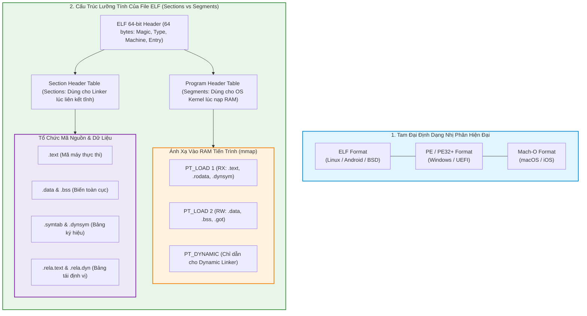
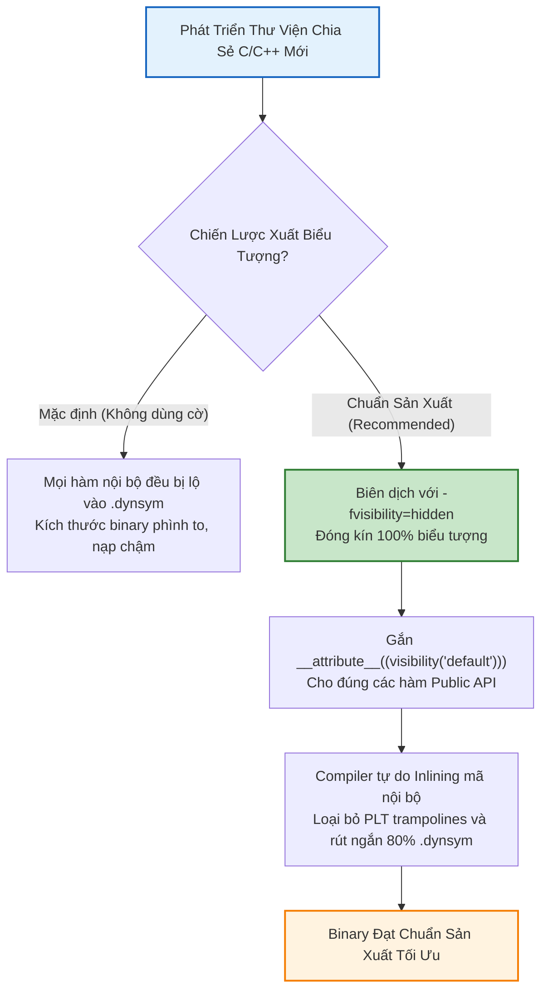

# 14.1. Định Dạng File Nhị Phân và Bảng Ký Hiệu (Binary Formats & Object Files)

> [!IMPORTANT]
> **Nếu bạn chỉ được nhớ một điều duy nhất:** File nhị phân thực thi không phải là một khối mã máy nguyên khối mà là một vùng dữ liệu có cấu trúc phân tầng nghiêm ngặt (ELF trên Linux, PE trên Windows, Mach-O trên macOS); sự khác biệt cốt tử nằm ở ranh giới giữa **Sections** (Góc nhìn tĩnh của Trình biên dịch/Linker để tổ chức mã nguồn và bảng ký hiệu `.symtab`) và **Segments** (Góc nhìn động của Nhân hệ điều hành để ánh xạ trang bộ nhớ có quyền truy cập cụ thể qua bảng `Program Headers`), kết hợp với thuộc tính **Symbol Visibility (`hidden` vs `default`)** để tối ưu hóa kích thước bảng ký hiệu động `.dynsym`.

---

## 1. Kiến trúc Tổng quan & Mô hình Tư duy (Mental Model)

### Ẩn dụ Đời sống: Hộp Đồ Chơi Lắp Ráp và Hướng Dẫn Sử Dụng Đóng Gói
Hãy hình dung định dạng file nhị phân giống như một bộ mô hình kiến trúc đóng gói sẵn:
- **Tiêu đề nhận dạng (Magic Bytes & Header)**: Ngay ngoài vỏ hộp có in mã vạch quốc tế:
  - Nếu thấy 4 bytes đầu là `\x7fELF`, đó là tiêu chuẩn Linux.
  - Nếu thấy `MZ` (`0x4D5A` - tên viết tắt của kỹ sư Mark Zbikowski), đó là tiêu chuẩn Windows PE.
  - Nếu thấy `\xfe\xed\xfa\xce` (*Feed Face*), đó là tiêu chuẩn Mach-O của Apple.
  - Tiêu đề này chỉ dẫn: Hộp dành cho kiến trúc tay thuận nào (Little-Endian), người lớn hay trẻ em (64-bit hay 32-bit), và chỉ dẫn mở nắp ở đâu (Entry Point).
- **Phân vùng tĩnh (Sections) vs Đoạn nạp động (Segments)**:
  - *Góc nhìn Linker (Sections)*: Trong xưởng đóng gói, người ta chia thành từng ngăn nhỏ: Ngăn chứa bản vẽ (`.text`), ngăn chứa gạch màu (`.data`), ngăn chứa nhãn tên (`.symtab`).
  - *Góc nhìn Nhân OS (Segments)*: Khi đem ra công trường, xe cẩu không quan tâm có bao nhiêu ngăn nhỏ; nó chỉ quan tâm đến các khối tải trọng lớn (**Segments**): *"Khối này gồm bản vẽ và văn bản, cấp quyền Chỉ Đọc & Thực Thi (RX)"*, *"Khối này là vật liệu, cấp quyền Đọc & Ghi (RW)"*. Nhiều Sections tương đồng sẽ được gom vào chung một Segment duy nhất (`PT_LOAD`) để ánh xạ vừa vặn vào các trang bộ nhớ 4KB (Memory Pages).
- **Symbol Visibility (Tầm nhìn Biểu tượng)**:
  - Giống như việc một công ty xuất bản danh bạ:
  - Biểu tượng `default`: Số điện thoại đường dây nóng của tổng đài, in ra danh bạ công khai cho cả thế giới gọi vào (`.dynsym`).
  - Biểu tượng `hidden`: Số điện thoại nội bộ giữa các phòng ban, chỉ lưu hành trong xưởng lúc biên dịch (`.symtab`), khi xuất xưởng ra thị trường (Strip Binary) sẽ bị xóa sạch để bảo mật và tiết kiệm giấy.



---

## 2. Chi tiết từng Keyword (Under-the-Hood Deep Dive)

### 2.1. Executable Formats: ELF, PE & Mach-O
- **ELF (Executable and Linkable Format - Linux, Solaris, BSD, Android)**:
  - Thiết kế chuẩn mở, cực kỳ linh hoạt và nhất quán giữa 32-bit và 64-bit.
  - Hỗ trợ đầy đủ các kiểu file: `.o` (Relocatable), Executable (Thực thi), `.so` (Shared Object), và Core Dump (Bản ghi sự cố sập bộ nhớ).
- **PE / PE32+ (Portable Executable - Windows OS)**:
  - Bắt nguồn từ định dạng COFF của UNIX kết hợp với DOS Header cổ điển.
  - 2 bytes đầu tiên luôn là `MZ` (`0x5A4D`) kèm theo một chương trình DOS Stub in ra câu: *"This program cannot be run in DOS mode"*.
  - Tiếp theo là con trỏ `e_lfanew` trỏ tới `PE Signature` (`PE\0\0`), theo sau là `COFF File Header` và `Optional Header` (chứa các thông số nạp RAM quan trọng như Image Base, Section Alignment).
- **Mach-O (Mach Object - Apple macOS, iOS, watchOS)**:
  - Cấu trúc gồm 3 phần: Mach Header, Load Commands, và Data Segments (`__TEXT`, `__DATA`, `__LINKEDIT`).
  - Hỗ trợ công nghệ **Universal Binary (Fat Binary)**: Đóng gói mã máy của cả kiến trúc x86-64 và ARM64 (Apple Silicon) vào chung một file nhị phân duy nhất.

### 2.2. Sự Khác Biệt Giữa Segments (Góc Nhìn Thực Thi) và Sections (Góc Nhìn Liên Kết)
- **Sections (Góc nhìn Trình liên kết)**:
  - Được mô tả bởi **Section Header Table**.
  - Chia nhỏ mã nguồn và dữ liệu theo mục đích logic: `.text`, `.rodata`, `.data`, `.bss`, `.init_array`, `.comment`, `.debug_info`.
  - Giúp Linker thực hiện sắp xếp, kiểm tra kiểu dữ liệu, ghép phân vùng và giải quyết ký hiệu.
  - *Quan trọng*: File thực thi nhị phân đã Stripped có thể **xóa hoàn toàn Section Header Table** mà hệ điều hành vẫn khởi chạy bình thường!
- **Segments (Góc nhìn Nhân Hệ Điều Hành)**:
  - Được mô tả bởi **Program Header Table**.
  - Nhân hệ điều hành không quan tâm đến từng hàm hay biến nhỏ; nó chỉ quan tâm đến việc phân bổ quyền truy cập trang nhớ ảo (**Page Protection Flags**):
    - `PT_LOAD (PF_R | PF_X)`: Ánh xạ vào bộ nhớ với quyền Read-Only và Executable (Chứa `.text`, `.rodata`).
    - `PT_LOAD (PF_R | PF_W)`: Ánh xạ vào bộ nhớ với quyền Read-Write, cấm thực thi (Chứa `.data`, `.bss`).
    - `PT_DYNAMIC`: Chứa mảng các cặp thẻ/giá trị (`Elf64_Dyn`) hướng dẫn Dynamic Linker tìm bảng GOT, PLT, bảng băm ký hiệu.
    - `PT_INTERP`: Chứa chuỗi đường dẫn đến trình nạp động của hệ thống (ví dụ: `"/lib64/ld-linux-x86-64.so.2"`).

### 2.3. Symbol Tables: `.symtab` (Tĩnh) vs `.dynsym` (Động)
- **Bảng Ký Hiệu Tĩnh (`.symtab` - Symbol Table)**:
  - Chứa toàn bộ các ký hiệu trong chương trình: biến static, hàm nội bộ, hằng số cục bộ, tên file mã nguồn.
  - Phân vùng này chỉ phục vụ mục đích Debug và Linker tĩnh. Nó **không bao giờ được nạp vào RAM** khi chương trình chạy và có thể bị loại bỏ hoàn toàn bằng lệnh `strip --strip-all binary`.
- **Bảng Ký Hiệu Động (`.dynsym` - Dynamic Symbol Table)**:
  - Chỉ chứa các ký hiệu cần thiết cho quá trình liên kết động lúc runtime: các hàm được `export` ra ngoài thư viện chia sẻ hoặc các hàm `import` từ thư viện khác (`printf`, `malloc`).
  - Bảng này bắt buộc **phải được nạp vào RAM** (nằm trong một `PT_LOAD` Segment), không thể bị strip.

### 2.4. Symbol Visibility: `default`, `hidden`, `protected`, `internal`
- Trong phát triển thư viện chia sẻ (`.so`), việc mặc định phơi bày toàn bộ hàm ra bảng ký hiệu động gây ra hai tổn thất: phình to bảng `.dynsym` làm chậm thời gian khởi động, và ngăn cản compiler tối ưu inlining.
- **Các mức Visibility của GCC/Clang**:
  - `STV_DEFAULT`: Biểu tượng hiển thị công khai ra bên ngoài, có thể bị ghi đè bởi thư viện khác (**Symbol Interposition**). Mọi lời gọi đều phải đi qua PLT/GOT.
  - `STV_HIDDEN` (`__attribute__((visibility("hidden")))`): Biểu tượng không được đưa vào bảng ký hiệu động `.dynsym`. Nó hoàn toàn vô hình đối với các module khác. Compiler tự tin biến mọi lời gọi nội bộ thành Direct Call, loại bỏ chi phí PLT!
  - `STV_PROTECTED`: Hiển thị ra bên ngoài nhưng các lời gọi nội bộ bên trong cùng module không thể bị ghi đè bởi bên ngoài.
  - **Best Practice trong Kỹ nghệ Phần mềm**: Luôn biên dịch toàn bộ dự án với cờ `-fvisibility=hidden`, và chỉ gắn nhãn `__attribute__((visibility("default")))` cho những hàm API chính thức được công bố ra ngoài.

### 2.5. Relocation Tables: `.rel` vs `.rela` (Explicit Addend)
- **Bản chất kỹ thuật**: Bảng tái định vị hướng dẫn Linker cách vá lại các địa chỉ ô nhớ khi các phân vùng được ghép nối hoặc di dời.
- **Cấu trúc `Elf64_Rela`**:
  - `r_offset`: Địa chỉ ô nhớ cần được vá.
  - `r_info`: Chứa loại tái định vị (Relocation Type) và chỉ số của ký hiệu liên quan trong bảng ký hiệu.
  - `r_addend`: Số bù cộng thêm tường minh (**Explicit Addend**).
- **Khác biệt giữa `.rel` và `.rela`**:
  - Trong cấu trúc cũ `.rel` (32-bit x86), số bù Addend được ghi đè trực tiếp vào chính vị trí ô nhớ cần vá trong mã máy (Implicit Addend).
  - Trong kiến trúc 64-bit hiện đại (x86-64), chuẩn chuyển sang dùng `.rela` với trường `r_addend` 64-bit tường minh, giúp việc tái định vị diễn ra an toàn, chính xác và không làm ô uế dữ liệu mã máy ban đầu.

---

## 3. Thực thi Mã nguồn & Mô phỏng Chuyên sâu (Dual-Engine Implementation)

### 3.1. C++20 Implementation: Khảo Sát Tác Động Của Symbol Visibility Lên Bảng Ký Hiệu
Đoạn mã C++20 dưới đây minh họa cách sử dụng thuộc tính Visibility để kiểm soát chặt chẽ việc xuất biểu tượng ra ngoài thư viện chia sẻ, kèm theo kỹ thuật can thiệp bảng nhị phân:

```cpp
#include <iostream>
#include <string>

// Định nghĩa Macro điều khiển Visibility chuẩn công nghiệp
#if defined(_WIN32)
    #define EXPORT_API __declspec(dllexport)
    #define HIDDEN_API
#else
    #define EXPORT_API __attribute__((visibility("default")))
    #define HIDDEN_API __attribute__((visibility("hidden")))
#endif

// -----------------------------------------------------------------
// 1. BIỂU TƯỢNG ĐƯỢC XUẤT BẢN CÔNG KHAI (DEFAULT VISIBILITY)
// -----------------------------------------------------------------
// Hàm này sẽ xuất hiện trong cả .symtab lẫn .dynsym
// Các ứng dụng bên ngoài có thể dlsym() hoặc gọi qua liên kết động
EXPORT_API void public_service_interface() {
    std::cout << "[Public API]: Giao tiếp công khai qua bảng .dynsym!\n";
}

// -----------------------------------------------------------------
// 2. BIỂU TƯỢNG NỘI BỘ BỊ ẨN (HIDDEN VISIBILITY)
// -----------------------------------------------------------------
// Hàm này BỊ CẤM xuất hiện trong .dynsym
// Compiler tối ưu hóa thành Direct Call, không qua PLT trampolines
HIDDEN_API void internal_fast_helper() {
    std::cout << "[Internal Helper]: Hàm nội bộ ẩn, tối ưu hóa Direct Call siêu tốc.\n";
}

int main() {
    std::cout << "=========================================================\n";
    std::cout << "   C++20 SYMBOL VISIBILITY & EXPORT CONTROLLER DEMO      \n";
    std::cout << "=========================================================\n\n";

    std::cout << "[Thực thi gọi hàm từ cùng một module]:\n";
    public_service_interface();
    internal_fast_helper();

    std::cout << "\n[Hướng dẫn kiểm tra nhị phân thực tế]:\n";
    std::cout << "  1. Biên dịch file ra thư viện chia sẻ:\n";
    std::cout << "     g++ -O2 -fPIC -fvisibility=hidden -shared source.cpp -o libdemo.so\n";
    std::cout << "  2. Khảo sát bảng ký hiệu động bằng công cụ Linux:\n";
    std::cout << "     nm -D --defined-only libdemo.so\n";
    std::cout << "  -> KẾT QUẢ: Chỉ duy nhất 'public_service_interface' xuất hiện!\n";
    std::cout << "     'internal_fast_helper' hoàn toàn vô hình trong .dynsym.\n";

    return 0;
}
```

### 3.2. Python 3.11+ Implementation: Trình Giải Mã Program Headers & Segments Của File ELF
Chương trình Python 3.11+ dưới đây phân tích cấu trúc **Program Header Table (Phân vùng Segments)** của tệp ELF 64-bit, giải mã quyền truy cập trang nhớ (Read/Write/Execute) và mô phỏng cách nhân hệ điều hành ánh xạ file vào RAM:

```python
import struct
from typing import List, Dict, Any

class ELFProgramHeaderParser:
    """
    Trình phân tích cấu trúc Program Headers (Segments) của ELF 64-bit
    theo chuẩn Linux ABI để khảo sát góc nhìn thực thi của Kernel.
    """
    SEGMENT_TYPES = {
        0: "PT_NULL (Không hoạt động)",
        1: "PT_LOAD (Ánh xạ vào RAM - mmap)",
        2: "PT_DYNAMIC (Siêu dữ liệu Liên kết động)",
        3: "PT_INTERP (Đường dẫn Dynamic Linker)",
        4: "PT_NOTE (Thông tin bổ trợ OS)",
        6: "PT_PHDR (Bản thân Program Header Table)",
        7: "PT_TLS (Bộ nhớ cục bộ luồng - Thread Local Storage)",
        0x6474e550: "PT_GNU_EH_FRAME (Bảng DWARF Exception Unwinding)",
        0x6474e551: "PT_GNU_STACK (Cờ bảo mật ngăn xếp cấm thực thi NX)",
        0x6474e552: "PT_GNU_RELRO (Vùng nhớ Chỉ Đọc sau khi Relocation - RELRO)"
    }

    @staticmethod
    def parse_flags(flags: int) -> str:
        r = "R" if (flags & 0x4) else "-"
        w = "W" if (flags & 0x2) else "-"
        x = "X" if (flags & 0x1) else "-"
        return f"{r}{w}{x}"

    @classmethod
    def parse_segment(cls, raw_entry: bytes) -> Dict[str, Any]:
        # Cấu trúc Elf64_Phdr (56 bytes):
        # uint32_t p_type;
        # uint32_t p_flags;
        # uint64_t p_offset;
        # uint64_t p_vaddr;
        # uint64_t p_paddr;
        # uint64_t p_filesz;
        # uint64_t p_memsz;
        # uint64_t p_align;
        p_type, p_flags, p_offset, p_vaddr, p_paddr, p_filesz, p_memsz, p_align = struct.unpack(
            "<IIQQQQQQ", raw_entry
        )

        return {
            "type_str": cls.SEGMENT_TYPES.get(p_type, f"UNKNOWN (0x{p_type:x})"),
            "flags": cls.parse_flags(p_flags),
            "offset": hex(p_offset),
            "vaddr": hex(p_vaddr),
            "filesz": f"{p_filesz} bytes",
            "memsz": f"{p_memsz} bytes",
            "align": hex(p_align)
        }

if __name__ == '__main__':
    print("=== MÔ PHỎNG ELF PROGRAM HEADER TABLE & SEGMENT PARSER (PYTHON 3.11+) ===")

    # Giả lập 4 Program Headers tiêu biểu trong một binary thực thi Linux 64-bit hiện đại:
    # 1. PT_INTERP (Chỉ định loader ld-linux.so)
    # 2. PT_LOAD 1: Mã máy (R-X)
    # 3. PT_LOAD 2: Dữ liệu (RW-)
    # 4. PT_GNU_STACK: Đánh dấu Stack cấm thực thi (RW-)
    sample_segments_raw = [
        # Type=3 (INTERP), Flags=4 (R--), Offset=0x238, Vaddr=0x238, Paddr=0x238, Filesz=28B, Memsz=28B, Align=1
        struct.pack("<IIQQQQQQ", 3, 4, 0x238, 0x238, 0x238, 28, 28, 1),
        # Type=1 (LOAD Text), Flags=5 (R-X), Offset=0x0, Vaddr=0x400000, Paddr=0x400000, Filesz=0x2400, Memsz=0x2400, Align=0x1000
        struct.pack("<IIQQQQQQ", 1, 5, 0x0, 0x400000, 0x400000, 0x2400, 0x2400, 0x1000),
        # Type=1 (LOAD Data), Flags=6 (RW-), Offset=0x2400, Vaddr=0x403400, Paddr=0x403400, Filesz=0x800, Memsz=0x1200, Align=0x1000
        struct.pack("<IIQQQQQQ", 1, 6, 0x2400, 0x403400, 0x403400, 0x800, 0x1200, 0x1000),
        # Type=0x6474e551 (GNU_STACK), Flags=6 (RW-), Offset=0, Vaddr=0, Paddr=0, Filesz=0, Memsz=0, Align=0x10
        struct.pack("<IIQQQQQQ", 0x6474e551, 6, 0, 0, 0, 0, 0, 0x10)
    ]

    print("\n[Bảng Phân Vùng Đoạn Nạp Động Của Kernel (Program Headers)]:")
    print(f"  {'Loại Segment':25s} | {'Quyền':5s} | {'Địa Chỉ Ảo':10s} | {'File Size':10s} | {'Mem Size':10s} | {'Căn Chỉnh Trang'}")
    print("  " + "-" * 85)

    for raw in sample_segments_raw:
        info = ELFProgramHeaderParser.parse_segment(raw)
        print(f"  {info['type_str']:25s} | {info['flags']:5s} | {info['vaddr']:10s} | {info['filesz']:10s} | {info['memsz']:10s} | {info['align']}")

    print("\n[Nhận xét Kỹ thuật từ Kernel]:")
    print("  1. Segment LOAD (R-X): Chứa mã lệnh .text được bảo vệ nghiêm ngặt chống ghi đè mã độc.")
    print("  2. Segment LOAD (RW-): Mem Size (0x1200) > File Size (0x800) -> Khoảng chênh lệch chính là .bss!")
    print("  3. PT_GNU_STACK (RW-): Cờ X bị tắt hoàn toàn -> Kích hoạt cơ chế chống thực thi mã độc trên Stack (NX Bit).")
```

### 3.3. Terminal Output Mẫu Thực tế
```text
=========================================================
   C++20 SYMBOL VISIBILITY & EXPORT CONTROLLER DEMO      
=========================================================

[Thực thi gọi hàm từ cùng một module]:
[Public API]: Giao tiếp công khai qua bảng .dynsym!
[Internal Helper]: Hàm nội bộ ẩn, tối ưu hóa Direct Call siêu tốc.

[Hướng dẫn kiểm tra nhị phân thực tế]:
  1. Biên dịch file ra thư viện chia sẻ:
     g++ -O2 -fPIC -fvisibility=hidden -shared source.cpp -o libdemo.so
  2. Khảo sát bảng ký hiệu động bằng công cụ Linux:
     nm -D --defined-only libdemo.so
  -> KẾT QUẢ: Chỉ duy nhất 'public_service_interface' xuất hiện!
     'internal_fast_helper' hoàn toàn vô hình trong .dynsym.

=== MÔ PHỎNG ELF PROGRAM HEADER TABLE & SEGMENT PARSER (PYTHON 3.11+) ===

[Bảng Phân Vùng Đoạn Nạp Động Của Kernel (Program Headers)]:
  Loại Segment              | Quyền | Địa Chỉ Ảo | File Size  | Mem Size   | Căn Chỉnh Trang
  -------------------------------------------------------------------------------------
  PT_INTERP (Đường dẫn Dynam | R--   | 0x238      | 28 bytes   | 28 bytes   | 0x1
  PT_LOAD (Ánh xạ vào RAM -  | R-X   | 0x400000   | 9216 bytes | 9216 bytes | 0x1000
  PT_LOAD (Ánh xạ vào RAM -  | RW-   | 0x403400   | 2048 bytes | 4608 bytes | 0x1000
  PT_GNU_STACK (Cờ bảo mật n | RW-   | 0x0        | 0 bytes    | 0 bytes    | 0x10

[Nhận xét Kỹ thuật từ Kernel]:
  1. Segment LOAD (R-X): Chứa mã lệnh .text được bảo vệ nghiêm ngặt chống ghi đè mã độc.
  2. Segment LOAD (RW-): Mem Size (0x1200) > File Size (0x800) -> Khoảng chênh lệch chính là .bss!
  3. PT_GNU_STACK (RW-): Cờ X bị tắt hoàn toàn -> Kích hoạt cơ chế chống thực thi mã độc trên Stack (NX Bit).
```

---

## 4. Systems Engineering & Production Pitfalls

### 4.1. Sự Cố Ô Nhiễm Ký Hiệu Động Làm Chậm Thời Gian Khởi Động Container (Startup Latency Spike)
- **Sự cố sản xuất**: Trong các dự án C/C++ khổng lồ gồm hàng triệu dòng mã, lập trình viên không đặt cờ `-fvisibility=hidden`. Trình biên dịch đưa toàn bộ hàng chục ngàn tên hàm và lớp nội bộ vào bảng `.dynsym`.
- Khi ứng dụng khởi động trong môi trường Cloud Container (Kubernetes), Dynamic Linker phải mất tới **5-10 giây chỉ để băm và phân giải bảng ký hiệu động khổng lồ này**, làm hỏng các bài kiểm tra `livenessProbe` và khiến Pod bị restart liên tục.
- **Kỹ thuật chẩn đoán bằng `readelf`**:
  ```bash
  readelf -s --dyn-syms ./production_binary | wc -l
  # Nếu số lượng ký hiệu động vượt quá vài ngàn, ứng dụng đang bị rò rỉ ký hiệu nội bộ nghiêm trọng!
  ```

### 4.2. Hiểm Họa Lỗi Bảo Mật Ngăn Xếp Thực Thi (Executable Stack Warning)
- **Sự cố sản xuất**: Khi liên kết các file assembly viết tay cổ điển hoặc các file thư viện nhị phân cũ không có phân vùng `PT_GNU_STACK`, trình liên kết buộc phải bật quyền thực thi cho ngăn xếp (`RWE`). Điều này vô hiệu hóa hoàn toàn công nghệ bảo vệ **NX Bit (No-Execute)** của phần cứng CPU, mở toang cánh cửa cho các cuộc tấn công chiếm quyền điều khiển qua tràn bộ đệm ngăn xếp (**Stack Buffer Overflow Shellcode**).
- **Khắc phục**: Luôn kiểm tra bằng `readelf -l binary | grep GNU_STACK` và đảm bảo cờ quyền hạn luôn là `RW` (tuyệt đối không bao giờ được chứa cờ `E` hoặc `X`).

---

## 5. Bảng So sánh & Decision Matrix

| Khía Cạnh | Linux ELF (`.so`, ELF Executable) | Windows PE (`.dll`, `.exe`) | macOS Mach-O (`.dylib`, Mach-O) |
| :--- | :--- | :--- | :--- |
| **Magic Bytes Nhận Dạng** | `\x7fELF` (`0x7f 0x45 0x4c 0x46`) | `MZ` (`0x4d 0x5a`) | `\xcf\xfa\xed\xfe` (64-bit Little-Endian) |
| **Mô Hình Xuất Biểu Tượng** | Mặc định xuất toàn bộ (`default`), cần cờ ẩn | Mặc định ẩn toàn bộ, cần `__declspec(dllexport)` | Tương tự ELF, dùng Visibility attributes |
| **Cấu Trúc Tải Bộ Nhớ** | Phân tầng Sections $\to$ Segments | Phân vùng Headers $\to$ Sections | Commands $\to$ Segments $\to$ Sections |
| **Hỗ Trợ Đa Kiến Trúc** | Không (Mỗi file một kiến trúc riêng) | Không hỗ trợ chính thức | Fat / Universal Binary tích hợp sẵn |
| **Độ Phổ Biến Hạ Tầng** | Máy chủ Backend, Cloud, Docker Containers | Máy trạm Desktop Doanh nghiệp, Game Windows | Thiết bị hệ sinh thái Apple (Mac/iPhone) |



---

## 6. Kỹ Thuật Chẩn Đoán Nhị Phân Nâng Cao Trong Môi Trường Thực Chiến

### 6.1. Giải Mã Cấu Trúc Nhị Phân Bằng Bộ Công Cụ GNU Binutils & LLVM
Trong quy trình vận hành và gỡ lỗi hệ thống Linux chuyên sâu, các kỹ sư hệ thống sử dụng các lệnh tiêu chuẩn sau để bóc tách từng byte của file nhị phân:
- **Kiểm tra tiêu đề và phân vùng ELF Header**:
  ```bash
  readelf -h ./production_binary
  ```
  Lệnh này hiển thị Entry point address, kiểu file ELF (EXEC hay DYN cho PIE), và vị trí của Program Header Table.
- **Liệt kê danh sách các Segments được nạp vào bộ nhớ ảo**:
  ```bash
  readelf -l ./production_binary
  ```
  Cho biết chính xác địa chỉ ảo `VirtAddr` mà từng Segment chiếm dụng và mối quan hệ ánh xạ giữa Sections vào Segments (`Section to Segment mapping`).
- **Phân tích chi tiết bảng ký hiệu tĩnh và động**:
  ```bash
  # Đọc bảng ký hiệu động .dynsym
  readelf --dyn-syms ./production_binary
  # Đọc bảng ký hiệu tĩnh .symtab (nếu chưa bị strip)
  readelf -s ./production_binary
  ```
- **Bóc tách bảng tái định vị (Relocation Entries)**:
  ```bash
  readelf -r ./production_binary
  ```
  Hiển thị danh sách các con trỏ PLT/GOT cần được Dynamic Linker xử lý lúc khởi động.

### 6.2. Kiểm Tra An Toàn Nhị Phân Bằng Checksec
Bộ công cụ `checksec` giúp kiểm tra nhanh 5 lớp phòng thủ nhị phân hiện đại:
```bash
checksec --file=./production_binary
# Kết quả lý tưởng cho một hệ thống an toàn:
# RELRO:        Full RELRO (Chống ghi đè bảng GOT)
# Stack:        Canary found (Chống tràn bộ đệm ngăn xếp)
# NX:           NX enabled (Chống thực thi mã trên Stack)
# PIE:          PIE enabled (Kích hoạt ASLR toàn phần)
# Fortify:      Yes (Bảo vệ các hàm chuỗi printf/strcpy)
```
