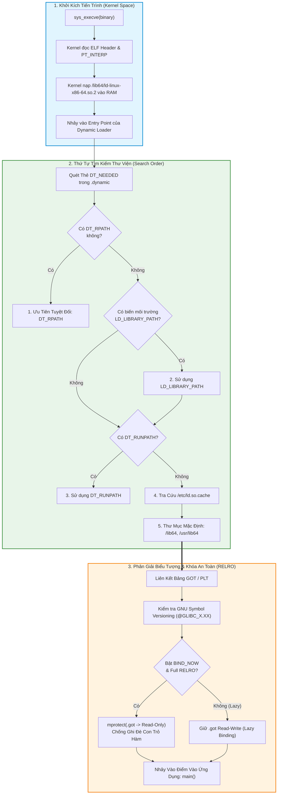
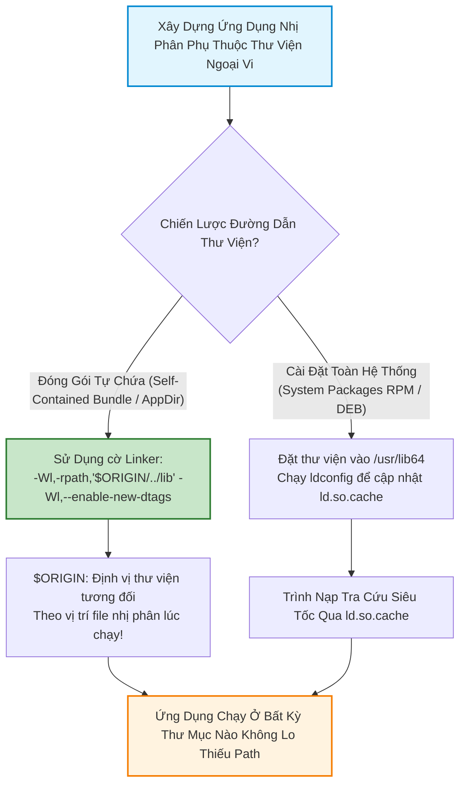

# 14.2. Cơ Chế Nạp Động và Tương Thích Nhị Phân (Dynamic Linking & Loader Mechanics)

> [!IMPORTANT]
> **Nếu bạn chỉ được nhớ một điều duy nhất:** Trình nạp động (**Dynamic Loader** như `ld-linux.so`) là thực thể đầu tiên nắm quyền điều khiển khi một tiến trình khởi chạy, thực hiện nhiệm vụ nạp các thư viện phụ thuộc theo thứ tự ưu tiên tìm kiếm (**RPATH > LD_LIBRARY_PATH > RUNPATH > Cache**); trong khi tính tương thích nhị phân lâu dài của hệ thống được bảo vệ bởi bộ đôi **SONAME Versioning** (quản lý ranh giới phá vỡ ABI) và **GNU Symbol Versioning** (cho phép nhiều phiên bản của cùng một hàm cùng tồn tại song song trong một file `.so`).

---

## 1. Kiến trúc Tổng quan & Mô hình Tư duy (Mental Model)

### Ẩn dụ Đời sống: Đội Tiền Trạm Sân Khấu và Hợp Đồng Biểu Diễn Quốc Tế
Hãy hình dung quá trình nạp động và tương thích nhị phân như việc tổ chức một buổi đại nhạc hội lưu diễn:
- **Trình nạp động (Dynamic Loader - `ld-linux.so`)**: Trước khi ca sĩ chính (`main()`) bước ra sân khấu, đội tiền trạm (Dynamic Loader) phải đến trước: kiểm tra danh sách thiết bị yêu cầu (các thẻ `DT_NEEDED`), chạy xe đi mượn loa đài, dàn đèn từ các kho thiết bị bên ngoài (các file thư viện `.so`), cắm dây nối và kiểm tra điện áp (phân giải bảng GOT/PLT). Chỉ khi tất cả thiết bị đã sẵn sàng và kết nối an toàn, ca sĩ chính mới được phép cầm micro.
- **Thứ tự tìm kiếm kho thiết bị (Search Paths Priority)**:
  - Đầu tiên, đội tiền trạm xem trong hợp đồng có chỉ định kho riêng của bầu sô hay không (**RPATH**).
  - Nếu không ghi đè, họ kiểm tra người quản lý có đổi ý qua tin nhắn khẩn cấp không (**biến môi trường `LD_LIBRARY_PATH`**).
  - Kế đến, họ tra cứu địa chỉ dự phòng thứ hai (**RUNPATH**).
  - Nếu vẫn chưa thấy, họ mở cuốn sổ danh bạ tra cứu nhanh của thành phố (**`/etc/ld.so.cache`**).
  - Cuối cùng, họ mới lặn lội xuống các kho công cộng mặc định ở ngoại ô (**`/lib` và `/usr/lib`**).
- **SONAME & Symbol Versioning**:
  - Khi dàn nhạc nâng cấp bộ chỉnh âm từ phiên bản 1 sang phiên bản 2 làm thay đổi toàn bộ cổng cắm (Phá vỡ ABI - ABI Breaking Change), nhà sản xuất đổi tên tem nhãn từ `libsound.so.1` thành `libsound.so.2` (**SONAME**). Ca sĩ cũ cầm dây cắm bản 1 sẽ không bao giờ bị cắm nhầm vào ổ cắm bản 2 gây cháy nổ (Segfault).
  - Thậm chí, cùng một bài hát `memcpy()`, thư viện GNU libc vẫn giữ một cổng cắm an toàn cho các ca sĩ hát đĩa cổ từ 20 năm trước (`memcpy@GLIBC_2.2.5`) bên cạnh cổng cắm siêu tốc AVX-512 cho ca sĩ hiện đại (`memcpy@@GLIBC_2.14`).



---

## 2. Chi tiết từng Keyword (Under-the-Hood Deep Dive)

### 2.1. Runtime Loader & Dynamic Linker (`ld-linux.so`, `dyld`)
- **Bản chất kỹ thuật**: Trình nạp động là một thư viện chia sẻ đặc biệt tự thân (Self-relocatable binary). Nó là mã nhị phân đầu tiên chạy trong không gian người dùng của tiến trình.
- **Nhiệm vụ cốt lõi**:
  1. Tự tái định vị chính mình (**Bootstrap Relocation**): Ban đầu, `ld-linux.so` chưa có bảng GOT, nó phải tự vá các con trỏ địa chỉ nội bộ của chính mình.
  2. Nạp đệ quy toàn bộ cây phụ thuộc thư viện (`DT_NEEDED`) vào không gian địa chỉ ảo bằng syscall `mmap()`.
  3. Thực hiện phân giải biểu tượng và vá bảng GOT cho toàn bộ các module.
  4. Thực thi các hàm khởi tạo trong phân vùng `.init` hoặc `.init_array` của các thư viện phụ thuộc theo thứ tự tô-pô (Topological Sort).
  5. Chuyển con trỏ lệnh `RIP` đến hàm `_start` của ứng dụng chính.

### 2.2. Thứ Tự Tìm Kiếm Thư Viện Chia Sẻ: RPATH vs RUNPATH
Trình nạp động của Linux tìm kiếm các file `.so` theo thứ tự ưu tiên bất di bất dịch sau:
1. **`DT_RPATH` (Run-time search path)**: Chuỗi đường dẫn được nhúng cứng vào file ELF lúc biên dịch (`-Wl,-rpath,/custom/lib`). Nếu `DT_RPATH` tồn tại, nó có mức ưu tiên cao hơn mọi cấu hình khác và bỏ qua `LD_LIBRARY_PATH` (trừ khi có `DT_RUNPATH`).
2. **Biến môi trường `LD_LIBRARY_PATH`**: Danh sách thư mục phân tách bằng dấu hai chấm do người dùng thiết lập. (Bị trình nạp động **vô hiệu hóa hoàn toàn** khi ứng dụng chạy với cờ cấp quyền `setuid`/`setgid` để ngăn chặn leo thang đặc quyền).
3. **`DT_RUNPATH`**: Chuỗi đường dẫn nhúng cứng thế hệ mới của ELF. Khác với RPATH, `DT_RUNPATH` có độ ưu tiên **thấp hơn** biến môi trường `LD_LIBRARY_PATH`, cho phép người dùng ghi đè thư viện khi cần thử nghiệm.
4. **Bộ đệm hệ thống `/etc/ld.so.cache`**: File nhị phân băm được tạo bởi lệnh `ldconfig`, chứa danh sách ánh xạ tên thư viện tới đường dẫn tuyệt đối của toàn bộ hệ điều hành.
5. **Thư mục mặc định của Kernel**: `/lib64`, `/usr/lib64` (hoặc `/lib`, `/usr/lib` trên 32-bit).

### 2.3. ABI Compatibility, Binary Compatibility & SONAME Versioning
- **Tương thích nhị phân (Binary Compatibility)**: Một phiên bản thư viện mới được coi là tương thích nhị phân nếu mã thực thi cũ biên dịch từ 5 năm trước vẫn có thể nạp và chạy trơn tru mà không cần biên dịch lại mã nguồn (Không thay đổi kích thước struct, không đổi kiểu tham số, không xóa hàm).
- **Cơ chế SONAME (Shared Object Name)**:
  - Một thư viện chia sẻ có 3 tên gọi:
    1. *Real Name*: Tên file thực tế trên đĩa chứa đầy đủ số phiên bản phụ (`libmath.so.1.2.3`).
    2. *SONAME*: Tên logic của phiên bản giao diện ABI chính (`libmath.so.1`).
    3. *Linker Name*: Tên tượng trưng dùng lúc biên dịch (`libmath.so` trỏ symlink tới SONAME).
  - Khi ứng dụng được liên kết với cờ `-lmath`, Linker đọc trường `DT_SONAME` bên trong `libmath.so.1.2.3` và **ghi đúng chuỗi `"libmath.so.1"` vào thẻ `DT_NEEDED` của ứng dụng**.
  - Nhờ đó, quản trị viên có thể tự do nâng cấp bản vá lỗi lên `libmath.so.1.2.4` và cập nhật symlink `libmath.so.1` mà ứng dụng không hề hay biết và không bị lỗi nạp.

### 2.4. GNU Symbol Versioning (`@GLIBC_X.XX`)
- **Vấn đề lịch sử**: Làm thế nào để `glibc` thay đổi hành vi hoặc chữ ký của một hàm (ví dụ: hàm `posix_spawn()` hoặc `memcpy()`) mà không làm hỏng hàng triệu ứng dụng cũ đã biên dịch?
- **Giải pháp GNU Versioning**:
  - Phân vùng `.gnu.version` và `.gnu.version_r` lưu trữ nhãn phiên bản cho từng biểu tượng hàm.
  - Khi một lập trình viên gọi `memcpy()`, trình biên dịch gắn nhãn: `memcpy@@GLIBC_2.14` (Phiên bản mặc định mới nhất).
  - Một binary cũ biên dịch trên CentOS 6 mang nhãn `memcpy@GLIBC_2.2.5`.
  - Cả hai phiên bản hàm cùng nằm song song trong thư viện `libc.so.6`. Trình nạp động sẽ căn cứ vào nhãn version để nối đúng con trỏ hàm tương thích cho từng chương trình.
- **Lỗi kinh điển `"version GLIBC_2.34 not found"`**: Xuất hiện khi bạn biên dịch ứng dụng trên một hệ điều hành mới (Ubuntu 22.04 có GLIBC 2.34) rồi đem chạy trên hệ điều hành cũ (CentOS 7 chỉ có GLIBC 2.17). Binary đòi hỏi phiên bản ký hiệu mà thư viện trên máy chủ cũ không hỗ trợ.

### 2.5. Bảo Mật Liên Kết Động: RELRO & BIND_NOW
- **Hiểm họa GOT Overwrite Attack**: Bảng `.got.plt` có quyền Ghi (Writeable) để hỗ trợ cơ chế Lazy Binding. Kẻ tấn công lợi dụng lỗi tràn bộ nhớ để ghi đè địa chỉ hàm `printf@got` bằng địa chỉ của lệnh `system("/bin/sh")`.
- **Cơ chế phòng thủ RELRO (Relocation Read-Only)**:
  - *Partial RELRO* (Mặc định trên nhiều hệ thống): Sắp xếp lại bộ nhớ sao cho bảng `.got` nằm trước phân vùng dữ liệu biến toàn cục `.data`, chống tràn bộ đệm tuyến tính từ `.data` vào `.got`, nhưng `.got.plt` vẫn có quyền ghi.
  - *Full RELRO* (`-Wl,-z,relro,-z,now`):
    1. Kích hoạt cờ `BIND_NOW`: Buộc Dynamic Loader phải phân giải toàn bộ các ký hiệu hàm ngay trong tích tắc khởi động.
    2. Sau khi vá xong toàn bộ con trỏ hàm, Loader gọi syscall `mprotect()` để **tước bỏ hoàn toàn quyền Ghi của toàn bộ bảng GOT (chuyển thành Read-Only)**. Triệt tiêu 100% các cuộc tấn công chiếm quyền qua bảng GOT!

---

## 3. Thực thi Mã nguồn & Mô phỏng Chuyên sâu (Dual-Engine Implementation)

### 3.1. C++20 Implementation: Khảo Sát Tương Thích ABI & Mô Phỏng Quá Trình Nạp SONAME
Đoạn mã C++20 dưới đây minh họa việc quản lý tương thích ABI của một thư viện qua việc kiểm tra Versioning Token và phân giải động:

```cpp
#include <iostream>
#include <string>
#include <vector>
#include <memory>
#include <stdexcept>

// Cấu trúc mô phỏng Hợp đồng ABI Phiên bản 1 (v1.0)
struct ServiceContextV1 {
    uint32_t abi_version = 1;
    int32_t client_id;
    char client_name[32];
};

// Cấu trúc mô phỏng Hợp đồng ABI Phiên bản 2 (v2.0: Phá vỡ ABI do thêm trường và đổi vị trí)
struct ServiceContextV2 {
    uint32_t abi_version = 2;
    int32_t client_id;
    uint64_t session_token; // Trường mới bổ sung!
    char client_name[64];
};

class MicroserviceHost {
public:
    void execute_v1(const void* raw_context) {
        const auto* ctx = reinterpret_cast<const ServiceContextV1*>(raw_context);
        if (ctx->abi_version != 1) {
            throw std::runtime_error("LỖI KHÔNG TƯƠNG THÍCH ABI: Mong đợi Context v1 (ABI=1)!");
        }
        std::cout << "  -> [Host v1]: Xử lý Client ID = " << ctx->client_id 
                  << " | Name = " << ctx->client_name << "\n";
    }

    void execute_v2(const void* raw_context) {
        const auto* ctx = reinterpret_cast<const ServiceContextV2*>(raw_context);
        if (ctx->abi_version != 2) {
            throw std::runtime_error("LỖI KHÔNG TƯƠNG THÍCH ABI: Mong đợi Context v2 (ABI=2)!");
        }
        std::cout << "  -> [Host v2]: Xử lý Client ID = " << ctx->client_id 
                  << " | Token = 0x" << std::hex << ctx->session_token << std::dec
                  << " | Name = " << ctx->client_name << "\n";
    }
};

int main() {
    std::cout << "=========================================================\n";
    std::cout << "   C++20 ABI COMPATIBILITY & SONAME VERSIONING SIMULATOR \n";
    std::cout << "=========================================================\n\n";

    MicroserviceHost host;

    std::cout << "[1. Giao Tiếp Với Client Đúng Chuẩn ABI v1]:\n";
    ServiceContextV1 client_v1{1, 101, "LegacyClient_v1"};
    host.execute_v1(&client_v1);

    std::cout << "\n[2. Giao Tiếp Với Client Chuẩn ABI v2]:\n";
    ServiceContextV2 client_v2{2, 202, 0xFEEDFACEDEADF00D, "ModernClient_v2"};
    host.execute_v2(&client_v2);

    std::cout << "\n[3. Mô Phỏng Sự Cố Lệch ABI (ABI Mismatch Crash Test)]:\n";
    try {
        std::cout << "  Đang truyền cấu trúc v2 vào cổng tiếp nhận v1...\n";
        // Giả lập tình huống client dùng thư viện header mới nhưng server link phải thư viện cũ
        host.execute_v1(&client_v2);
    } catch (const std::exception& ex) {
        std::cerr << "  ! [PHÁT HIỆN SỰ CỐ]: " << ex.what() << "\n";
        std::cerr << "  -> Nhờ có trường kiểm tra ABI Version, hệ thống tránh được lỗi đọc sai ô nhớ (Memory Corruption)!\n";
    }

    return 0;
}
```

### 3.2. Python 3.11+ Implementation: Mô Phỏng Thuật Toán Tìm Kiếm Thư Viện Của Dynamic Loader
Chương trình Python 3.11+ dưới đây tái hiện chính xác thuật toán tìm kiếm thư viện chia sẻ theo thứ tự ưu tiên của Linux Dynamic Loader (`ld-linux.so`), bao gồm xử lý RPATH, `LD_LIBRARY_PATH`, RUNPATH và Cache:

```python
import os
from typing import List, Optional, Dict

class DynamicLoaderSearchSimulator:
    """
    Mô phỏng thuật toán tìm kiếm thư viện chia sẻ của Linux Dynamic Linker
    theo đúng quy chuẩn thứ tự ưu tiên ELF Specification.
    """
    def __init__(self, 
                 rpath: Optional[str] = None, 
                 runpath: Optional[str] = None, 
                 ld_library_path: Optional[str] = None):
        self.rpath = rpath.split(":") if rpath else []
        self.runpath = runpath.split(":") if runpath else []
        self.ld_library_path = ld_library_path.split(":") if ld_library_path else []
        
        # Giả lập bảng băm /etc/ld.so.cache
        self.system_cache: Dict[str, str] = {
            "libcrypto.so.3": "/usr/lib64/libcrypto.so.3",
            "libssl.so.3": "/usr/lib64/libssl.so.3",
            "libcurl.so.4": "/usr/lib64/libcurl.so.4"
        }
        
        # Thư mục hệ thống mặc định
        self.default_system_dirs = ["/lib64", "/usr/lib64", "/usr/local/lib64"]

    def resolve_library(self, lib_soname: str, simulated_filesystem: Dict[str, List[str]]) -> str:
        print(f"\n[DynamicLoader]: Bắt đầu tìm kiếm phụ thuộc: '{lib_soname}'")

        # Bước 1: Kiểm tra DT_RPATH (Nếu không bị RUNPATH vô hiệu)
        if self.rpath and not self.runpath:
            print(f"  1. Kiểm tra DT_RPATH: {self.rpath}")
            for directory in self.rpath:
                if lib_soname in simulated_filesystem.get(directory, []):
                    return f"[FOUND via DT_RPATH] -> {directory}/{lib_soname}"

        # Bước 2: Kiểm tra biến môi trường LD_LIBRARY_PATH
        if self.ld_library_path:
            print(f"  2. Kiểm tra LD_LIBRARY_PATH: {self.ld_library_path}")
            for directory in self.ld_library_path:
                if lib_soname in simulated_filesystem.get(directory, []):
                    return f"[FOUND via LD_LIBRARY_PATH] -> {directory}/{lib_soname}"

        # Bước 3: Kiểm tra DT_RUNPATH
        if self.runpath:
            print(f"  3. Kiểm tra DT_RUNPATH: {self.runpath}")
            for directory in self.runpath:
                if lib_soname in simulated_filesystem.get(directory, []):
                    return f"[FOUND via DT_RUNPATH] -> {directory}/{lib_soname}"

        # Bước 4: Kiểm tra /etc/ld.so.cache
        print(f"  4. Tra cứu hệ thống /etc/ld.so.cache...")
        if lib_soname in self.system_cache:
            cache_hit = self.system_cache[lib_soname]
            return f"[FOUND via /etc/ld.so.cache] -> {cache_hit}"

        # Bước 5: Kiểm tra Thư mục hệ thống mặc định
        print(f"  5. Quét thư mục mặc định hệ thống: {self.default_system_dirs}")
        for directory in self.default_system_dirs:
            if lib_soname in simulated_filesystem.get(directory, []):
                return f"[FOUND via Default System Dirs] -> {directory}/{lib_soname}"

        raise FileNotFoundError(f"LỖI KHỞI ĐỘNG TIẾN TRÌNH: Không tìm thấy thư viện chia sẻ '{lib_soname}' (cannot open shared object file: No such file or directory)!")

if __name__ == '__main__':
    print("=== MÔ PHỎNG THUẬT TOÁN TÌM KIẾM CỦA LINUX DYNAMIC LOADER ===")

    # Giả lập cây thư mục chứa các phiên bản thư viện
    mock_filesystem = {
        "/app/custom_libs": ["libcustom_engine.so.1"],
        "/opt/vendor/lib": ["libvendor_auth.so.2"],
        "/usr/lib64": ["libcrypto.so.3", "libssl.so.3", "libc.so.6"],
        "/tmp/debug_override": ["libcrypto.so.3"] # Bản dựng có chèn mã debug
    }

    # Kịch bản 1: Có cấu hình LD_LIBRARY_PATH để ghi đè thư viện
    print("\n--- KỊCH BẢN 1: GHI ĐÈ BẰNG LD_LIBRARY_PATH ---")
    loader_with_env = DynamicLoaderSearchSimulator(
        runpath="/opt/vendor/lib",
        ld_library_path="/tmp/debug_override"
    )
    result = loader_with_env.resolve_library("libcrypto.so.3", mock_filesystem)
    print(f"  => Kết quả: {result}")

    # Kịch bản 2: Không có biến môi trường, dựa vào RUNPATH
    print("\n--- KỊCH BẢN 2: TÌM QUA DT_RUNPATH CỦA FILE BINARY ---")
    loader_standard = DynamicLoaderSearchSimulator(
        runpath="/opt/vendor/lib",
        ld_library_path=None
    )
    result = loader_standard.resolve_library("libvendor_auth.so.2", mock_filesystem)
    print(f"  => Kết quả: {result}")

    # Kịch bản 3: Thư viện không tồn tại -> Báo lỗi Linker
    print("\n--- KỊCH BẢN 3: THƯ VIỆN BỊ THIẾU TRÊN HỆ THỐNG ---")
    try:
        loader_standard.resolve_library("libmissing_database.so.4", mock_filesystem)
    except FileNotFoundError as err:
        print(f"  => {err}")
```

### 3.3. Terminal Output Mẫu Thực tế
```text
=========================================================
   C++20 ABI COMPATIBILITY & SONAME VERSIONING SIMULATOR 
=========================================================

[1. Giao Tiếp Với Client Đúng Chuẩn ABI v1]:
  -> [Host v1]: Xử lý Client ID = 101 | Name = LegacyClient_v1

[2. Giao Tiếp Với Client Chuẩn ABI v2]:
  -> [Host v2]: Xử lý Client ID = 202 | Token = 0xfeedfacedeadf00d | Name = ModernClient_v2

[3. Mô Phỏng Sự Cố Lệch ABI (ABI Mismatch Crash Test)]:
  Đang truyền cấu trúc v2 vào cổng tiếp nhận v1...
  ! [PHÁT HIỆN SỰ CỐ]: LỖI KHÔNG TƯƠNG THÍCH ABI: Mong đợi Context v1 (ABI=1)!
  -> Nhờ có trường kiểm tra ABI Version, hệ thống tránh được lỗi đọc sai ô nhớ (Memory Corruption)!

=== MÔ PHỎNG THUẬT TOÁN TÌM KIẾM CỦA LINUX DYNAMIC LOADER ===

--- KỊCH BẢN 1: GHI ĐÈ BẰNG LD_LIBRARY_PATH ---

[DynamicLoader]: Bắt đầu tìm kiếm phụ thuộc: 'libcrypto.so.3'
  2. Kiểm tra LD_LIBRARY_PATH: ['/tmp/debug_override']
  => Kết quả: [FOUND via LD_LIBRARY_PATH] -> /tmp/debug_override/libcrypto.so.3

--- KỊCH BẢN 2: TÌM QUA DT_RUNPATH CỦA FILE BINARY ---

[DynamicLoader]: Bắt đầu tìm kiếm phụ thuộc: 'libvendor_auth.so.2'
  3. Kiểm tra DT_RUNPATH: ['/opt/vendor/lib']
  => Kết quả: [FOUND via DT_RUNPATH] -> /opt/vendor/lib/libvendor_auth.so.2

--- KỊCH BẢN 3: THƯ VIỆN BỊ THIẾU TRÊN HỆ THỐNG ---

[DynamicLoader]: Bắt đầu tìm kiếm phụ thuộc: 'libmissing_database.so.4'
  3. Kiểm tra DT_RUNPATH: ['/opt/vendor/lib']
  4. Tra cứu hệ thống /etc/ld.so.cache...
  5. Quét thư mục mặc định hệ thống: ['/lib64', '/usr/lib64', '/usr/local/lib64']
  => LỖI KHỞI ĐỘNG TIẾN TRÌNH: Không tìm thấy thư viện chia sẻ 'libmissing_database.so.4' (cannot open shared object file: No such file or directory)!
```

---

## 4. Systems Engineering & Production Pitfalls

### 4.1. Lỗ Hổng Bảo Mật Nguy Hiểm Qua `LD_PRELOAD` Hijacking
- **Hiểm họa an ninh mạng**: Biến môi trường `LD_PRELOAD` cho phép người dùng chỉ định một thư viện `.so` được ưu tiên nạp vào bộ nhớ trước **mọi thư viện khác**. Nếu một tiến trình chạy với quyền root không được bảo vệ, kẻ tấn công có thể viết một thư viện giả mạo chứa hàm `geteuid()` luôn trả về 0 để chiếm toàn quyền điều khiển máy chủ.
- **Cơ chế phòng thủ của Linux Loader**: Đối với bất kỳ tệp thực thi nào có gắn cờ `setuid` hoặc `setgid` (như `/usr/bin/sudo`), trình nạp động tự động kích hoạt chế độ **Secure Execution Mode**: bỏ qua hoàn toàn `LD_PRELOAD` và `LD_LIBRARY_PATH`.

### 4.2. Cạm Bẫy Quên Chạy `ldconfig` Sau Khi Triển Khai Thư Viện Mới
- **Sự cố sản xuất**: Kỹ sư cài đặt một thư viện nội bộ vào `/usr/local/lib64/libbilling.so.2`, nhưng khi khởi động ứng dụng backend, hệ thống lập tức ném lỗi:
  ```text
  error while loading shared libraries: libbilling.so.2: cannot open shared object file: No such file or directory
  ```
- **Nguyên nhân**: File nhị phân tra cứu qua bộ đệm `/etc/ld.so.cache`. Nếu kỹ sư không chạy lệnh `ldconfig` với quyền root, bộ đệm hệ thống chưa được cập nhật và không hề biết sự tồn tại của file `.so` mới.
- **Kỹ thuật chẩn đoán bằng `ldd`**:
  ```bash
  ldd ./production_service | grep "not found"
  ```

---

## 5. Bảng So sánh & Decision Matrix

| Tiêu chí | DT_RPATH | DT_RUNPATH | Biến môi trường LD_LIBRARY_PATH |
| :--- | :--- | :--- | :--- |
| **Vị Trí Lưu Trữ** | Nhúng cứng trong ELF Header | Nhúng cứng trong ELF Header | Lưu trong Process Environment |
| **Thứ Tự Ưu Tiên** | Cao nhất (Đè LD_LIBRARY_PATH) | Thấp hơn LD_LIBRARY_PATH | Nằm giữa RPATH và RUNPATH |
| **Khả Năng Ghi Đè** | Rất khó ghi đè (Cần sửa binary) | Dễ dàng ghi đè lúc chạy | Rất dễ ghi đè |
| **Môi Trường setuid** | Vẫn được sử dụng bình thường | Vẫn được sử dụng bình thường | Bị vô hiệu hóa hoàn toàn vì an ninh |
| **Khuyến Nghị Hiện Đại** | Tránh sử dụng (Đã lỗi thời) | **Khuyến nghị sử dụng chính thức** | Chỉ dùng để kiểm thử cục bộ |


