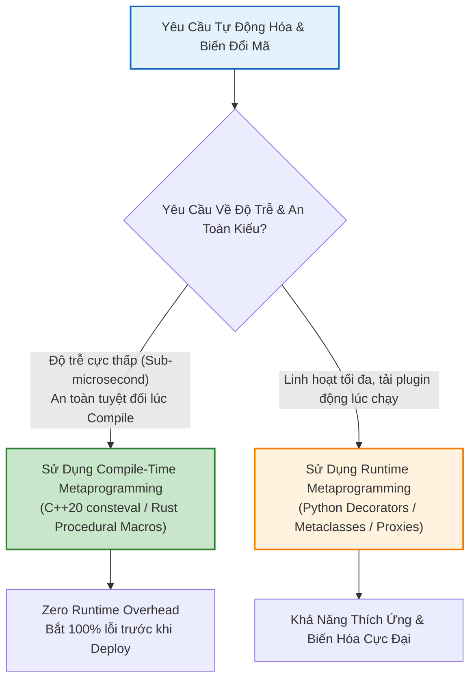

# 15.1. Siêu Lập Trình Thời Điểm Biên Dịch và Lúc Chạy (Compile-Time & Runtime Metaprogramming)

> [!IMPORTANT]
> **Nếu bạn chỉ được nhớ một điều duy nhất:** Siêu lập trình (**Metaprogramming**) là nghệ thuật viết mã để sinh ra hoặc biến đổi mã khác; trong khi **Compile-Time Metaprogramming** (C++ Templates, `consteval`, Rust Hygienic Macros) dồn toàn bộ chi phí tính toán và kiểm tra kiểu về giai đoạn biên dịch để đạt hiệu năng Zero-Cost Runtime, thì **Runtime Metaprogramming** (Python Decorators, Metaclasses, Proxies) đánh đổi hiệu năng CPU lấy sự linh hoạt cực đại thông qua việc can thiệp động vào bảng phương thức và cây cấu trúc đối tượng trong lúc chương trình đang vận hành.

---

## 1. Kiến trúc Tổng quan & Mô hình Tư duy (Mental Model)

### Ẩn dụ Đời sống: Khuôn Đúc Cơ Khí Tự Động và Diễn Viên Biến Hóa Trực Tiếp
Hãy hình dung siêu lập trình giống như hai cách sản xuất trang phục:
- **Siêu lập trình thời điểm biên dịch (Compile-Time Metaprogramming)**: Giống như một máy in 3D công nghiệp thông minh:
  - Bạn không in từng chiếc áo cụ thể; bạn viết một bản thiết kế toán học tham số hóa (**C++ Template / Rust Macro**).
  - Trước khi xuất xưởng (Compile time), máy in tính toán trước mọi đường cắt may, kiểm tra độ co giãn (`consteval` và Concepts). Nếu số đo không vừa vặn, máy in báo lỗi ngay trên bản vẽ kỹ thuật.
  - Khi đã may xong, bộ trang phục vừa khít người mặc 100%, không cần bất kỳ chiếc khóa kéo hay phụ kiện lỉnh kỉnh nào lúc mặc (Zero Runtime Overhead).
- **Tính Vệ Sinh của Macro (Hygienic Macros)**: Giống như việc người thợ may dùng phấn màu đặc biệt đánh dấu: thước kẻ của thợ may mang tên `x` tuyệt đối không bao giờ làm nhòe hay ghi đè lên chiếc bút chì cũng mang tên `x` trong túi áo của khách hàng!
- **Siêu lập trình lúc chạy (Runtime Metaprogramming)**: Giống như một diễn viên kịch tài hoa trên sân khấu:
  - Khi có tiếng vỗ tay của khán giả (Runtime Request), diễn viên khoác thêm chiếc áo choàng ma thuật (**Decorator**), tự biến đổi giọng nói hoặc mượn đạo cụ từ bạn diễn (**Monkey Patching / Metaclasses**).
  - Cực kỳ linh hoạt và biến hóa khôn lường, nhưng diễn viên phải liên tục thay đồ sau cánh gà, tốn sức lực và dễ vấp ngã nếu nhớ nhầm kịch bản.


---

## 2. Chi tiết từng Keyword (Under-the-Hood Deep Dive)

### 2.1. Template Metaprogramming (TMP), `constexpr` & `consteval` trong C++
- **Template Metaprogramming như một Ngôn ngữ Hàm Thuần Túy (Pure Functional Language)**:
  - Hệ thống mẫu (Templates) của C++ là **Turing-Complete**: nó có thể giải quyết bất kỳ bài toán tính toán nào ngay tại thời điểm biên dịch thông qua đệ quy mẫu và chuyên biệt hóa mẫu (**Template Specialization**).
  - Biến trong TMP là hằng số bất biến (`static const` hoặc `enum`), vòng lặp được triển khai qua đệ quy và cấu trúc rẽ nhánh `if` được thực hiện qua SFINAE (*Substitution Failure Is Not An Error*) hoặc `std::enable_if`.
- **C++20 `consteval` (Immediate Functions)**:
  - Khác với `constexpr` (có thể chạy lúc biên dịch HOẶC lúc runtime tùy thuộc ngữ cảnh đối số), từ khóa `consteval` cam kết 100% hàm bắt buộc phải được tính toán và sinh giá trị hằng số ngay tại thời điểm biên dịch. Nếu không thể đánh giá lúc compile, compiler sẽ từ chối biên dịch.
- **C++20 Concepts**:
  - Cung cấp cơ chế ràng buộc kiểu dữ liệu tường minh tại thời điểm biên dịch (`template <typename T> requires std::integral<T>`), loại bỏ những thông báo lỗi dài hàng ngàn dòng khó hiểu kinh điển của TMP cũ.

### 2.2. Rust Macros: Declarative Macros vs Procedural Macros
- **Declarative Macros (`macro_rules!`)**:
  - Dựa trên cơ chế khớp mẫu cú pháp thô (Pattern Matching).
  - Nhận diện các mảnh cú pháp (Match matchers: `$x:expr`, `$t:ty`, `$i:ident`) và thay thế bằng khối mã đích.
- **Procedural Macros (Macro Thủ Tục - Function-like, Derive, Attribute-like)**:
  - Bản chất là một chương trình Rust nhỏ được biên dịch thành thư viện động và thực thi trực tiếp bởi trình biên dịch `rustc` trong quá trình biên dịch dự án chính.
  - Nhận đầu vào là một dòng mã thông báo cú pháp (**`proc_macro::TokenStream`**), tự do duyệt, bóc tách và sinh ra một `TokenStream` mới trả về cho compiler.
  - Ví dụ: `#[derive(Serialize, Deserialize)]` của Serde tự động đọc cấu trúc struct và sinh hàng trăm dòng mã băm tuần tự hóa nhị phân tương ứng.

### 2.3. Hygienic Macros (Macro Vệ Sinh) & Phòng Ngừa Bắt Biến
- **Hiểm họa của Macro C tiền xử lý (`#define`)**:
  ```c
  #define SWAP(a, b) do { int temp = a; a = b; b = temp; } while(0)
  // Nếu caller gọi: SWAP(temp, y); -> Biến 'temp' của caller bị trùng tên với
  // biến cục bộ 'temp' của macro! Dẫn đến lỗi dữ liệu thảm họa (Variable Capture).
  ```
- **Nguyên lý Macro Hygiene trong Scheme và Rust**:
  - Trình biên dịch gắn một mã định danh cú pháp duy nhất (**Syntax Context ID**) cho mỗi biến được tạo ra bên trong thân macro.
  - Biến `temp` sinh ra bên trong macro thuộc về không gian tên `SyntaxContext_Macro_123`, hoàn toàn độc lập với biến `temp` thuộc `SyntaxContext_Caller_456`. Chúng không bao giờ che khuất (shadow) hay ghi đè lẫn nhau, đảm bảo tính đúng đắn toán học tuyệt đối.

### 2.4. Runtime Reflection, Introspection & Dynamic Proxy
- **Introspection**: Khả năng của chương trình tự thẩm vấn chính mình (ví dụ: `type(obj)`, `hasattr(obj, 'execute')`).
- **Dynamic Proxy (Đại lý Động)**: Kỹ thuật tạo ra một đối tượng giả lập lúc runtime có giao diện giống hệt đối tượng thật, chặn bắt mọi lời gọi hàm để chèn thêm các tính năng xuyên suốt (**Cross-Cutting Concerns**) như Logging, Transaction, Security Authorization (cực kỳ phổ biến trong Java Spring Framework và Python WSGI).

### 2.5. Python Decorators & Metaclasses (`type.__new__`)
- **Decorators (Hàm Trang Trí)**:
  - Bản chất là một hàm nhận vào một hàm (hoặc class) và trả về một hàm bao bọc (**Wrapper Function**), tận dụng cơ chế Closure để lưu trữ ngữ cảnh.
  - Cú pháp `@my_decorator` thực chất chỉ là cú pháp đường (Syntactic Sugar) cho: `func = my_decorator(func)`.
- **Metaclasses (Siêu Lớp - Lớp của các Lớp)**:
  - Trong Python, "mọi thứ đều là đối tượng", và bản thân Class cũng là một đối tượng được tạo ra bởi một Metaclass (mặc định là `type`).
  - Bằng cách kế thừa `class CustomMeta(type)`, lập trình viên có thể can thiệp vào phương thức khởi tạo `__new__(mcs, name, bases, namespace)`:
    - Kiểm tra xem class con có định nghĩa đủ các hàm bắt buộc hay không.
    - Tự động đăng ký class vào một bảng điều phối toàn cục (Registry Pattern).
    - Biến đổi hoặc chèn thêm các thuộc tính ẩn vào class trước khi nó được khởi tạo trong bộ nhớ!

---

## 3. Thực thi Mã nguồn & Mô phỏng Chuyên sâu (Dual-Engine Implementation)

### 3.1. C++20 Implementation: Tính Toán Biên Dịch `consteval` & Concept Ràng Buộc Kiểu
Chương trình C++20 dưới đây minh họa việc tính toán bảng băm tĩnh (Compile-Time Murmur3/FNV-1a Hash) bằng từ khóa `consteval`, đảm bảo giá trị hash của chuỗi ký tự được nhúng thẳng vào mã máy dưới dạng hằng số mà không tốn 1 chu kỳ CPU lúc chạy:

```cpp
#include <iostream>
#include <string_view>
#include <concepts>
#include <cstdint>
#include <iomanip>

// -------------------------------------------------------------
// 1. TÍNH TOÁN BĂM CHUỖI TẠI THỜI ĐIỂM BIÊN DỊCH VỚI CONSTEVAL
// -------------------------------------------------------------
// Thuật toán FNV-1a 64-bit Hash thực thi 100% lúc Compile-time
consteval uint64_t fnv1a_hash(std::string_view str) {
    uint64_t hash = 14695981039346656037ULL;
    for (char c : str) {
        hash ^= static_cast<uint64_t>(c);
        hash *= 1099511628211ULL;
    }
    return hash;
}

// -------------------------------------------------------------
// 2. SỬ DỤNG C++20 CONCEPTS ĐỂ RÀNG BUỘC SIÊU LẬP TRÌNH TĨNH
// -------------------------------------------------------------
template <typename T>
concept NumericSerializable = std::integral<T> || std::floating_point<T>;

template <NumericSerializable T>
class CompileTimeField {
private:
    T value_;
    uint64_t field_id_;

public:
    consteval CompileTimeField(T val, std::string_view name) 
        : value_(val), field_id_(fnv1a_hash(name)) {}

    constexpr T get_value() const { return value_; }
    constexpr uint64_t get_id() const { return field_id_; }
};

int main() {
    std::cout << "=========================================================\n";
    std::cout << "  C++20 COMPILE-TIME METAPROGRAMMING & CONSTEVAL DEMO    \n";
    std::cout << "=========================================================\n\n";

    // Phép tính hash diễn ra HOÀN TOÀN TRONG ĐẦU COMPILER lúc build!
    constexpr uint64_t user_id_hash = fnv1a_hash("user_identity_token");
    constexpr uint64_t balance_hash = fnv1a_hash("account_balance_usd");

    std::cout << "[1. Khảo Sát Băm Chuỗi Compile-Time (FNV-1a)]:\n";
    std::cout << "  Hash('user_identity_token') : 0x" << std::hex << user_id_hash << "\n";
    std::cout << "  Hash('account_balance_usd') : 0x" << std::hex << balance_hash << "\n\n";

    // Khởi tạo các trường dữ liệu với ràng buộc Concepts
    constexpr CompileTimeField<int32_t> user_field(1001, "user_identity_token");
    constexpr CompileTimeField<double> balance_field(9999.50, "account_balance_usd");

    std::cout << "[2. Khảo Sát Trường Dữ Liệu Tham Số Hóa]:\n";
    std::cout << "  User Field ID : 0x" << std::hex << user_field.get_id() 
              << " | Value : " << std::dec << user_field.get_value() << "\n";
    std::cout << "  Bal  Field ID : 0x" << std::hex << balance_field.get_id() 
              << " | Value : " << balance_field.get_value() << "\n\n";

    // Minh chứng: Sử dụng hash compile-time trong cấu trúc switch-case (Yêu cầu hằng số nguyên)
    uint64_t incoming_query_hash = fnv1a_hash("user_identity_token");
    std::cout << "[3. Switch-Case Dựa Trên String Hash (Zero Overhead)]:\n";
    switch (incoming_query_hash) {
        case fnv1a_hash("user_identity_token"):
            std::cout << "  -> Khớp thành công: Nhánh xử lý User Identity Token!\n";
            break;
        case fnv1a_hash("account_balance_usd"):
            std::cout << "  -> Khớp thành công: Nhánh xử lý Account Balance!\n";
            break;
        default:
            std::cout << "  -> Ký hiệu không xác định.\n";
            break;
    }

    return 0;
}
```

### 3.2. Python 3.11+ Implementation: Siêu Lập Trình Lúc Chạy với Metaclass Tự Động Đăng Ký & Profiler Decorator
Chương trình Python 3.11+ dưới đây kết hợp **Metaclass** để tự động kiểm tra và đăng ký các dịch vụ vào một Service Registry lúc nạp module, cùng **Decorator** đo đạc hiệu năng:

```python
import time
import functools
from typing import Dict, Type, Any

# Bảng đăng ký dịch vụ toàn cục (Registry Pattern)
GLOBAL_SERVICE_REGISTRY: Dict[str, Type] = {}

class ServiceValidationMeta(type):
    """
    Metaclass kiểm tra tính toàn vẹn của lớp con lúc khởi tạo:
    1. Bắt buộc lớp phải có docstring mô tả dịch vụ.
    2. Bắt buộc phải có phương thức execute().
    3. Tự động đăng ký lớp vào GLOBAL_SERVICE_REGISTRY.
    """
    def __new__(mcs, name: str, bases: tuple, namespace: dict):
        # Bỏ qua kiểm tra đối với chính lớp Base
        if name != "BaseService":
            if "__doc__" not in namespace or not namespace["__doc__"]:
                raise TypeError(f"LỖI SIÊU LẬP TRÌNH: Lớp '{name}' thiếu docstring mô tả dịch vụ!")
            
            if "execute" not in namespace or not callable(namespace["execute"]):
                raise TypeError(f"LỖI SIÊU LẬP TRÌNH: Lớp '{name}' bắt buộc phải cài đặt phương thức 'execute()'!")

        # Tạo đối tượng class thực tế trong bộ nhớ
        cls = super().__new__(mcs, name, bases, namespace)

        if name != "BaseService":
            service_tag = namespace.get("SERVICE_TAG", name.lower())
            GLOBAL_SERVICE_REGISTRY[service_tag] = cls
            print(f"  + [Metaclass Register]: Đã tự động đăng ký dịch vụ '{name}' dưới khóa '{service_tag}'")

        return cls

def execution_profiler(func):
    """Decorator đo đạc độ trễ thực thi của phương thức"""
    @functools.wraps(func)
    def wrapper(*args, **kwargs):
        start = time.perf_counter_ns()
        result = func(*args, **kwargs)
        duration_us = (time.perf_counter_ns() - start) / 1000.0
        print(f"    [Profiler]: Lời gọi '{func.__name__}' hoàn tất trong {duration_us:.2f} µs")
        return result
    return wrapper

class BaseService(metaclass=ServiceValidationMeta):
    pass

class PaymentProcessingService(BaseService):
    """Dịch vụ xử lý giao dịch thanh toán trực tuyến"""
    SERVICE_TAG = "payment_processor"

    @execution_profiler
    def execute(self, payload: dict) -> str:
        # Giả lập logic xử lý
        time.sleep(0.001)
        return f"Giao dịch thành công cho đơn hàng: {payload.get('order_id')}"

class AuditLoggingService(BaseService):
    """Dịch vụ ghi nhật ký kiểm toán hệ thống"""
    SERVICE_TAG = "audit_logger"

    @execution_profiler
    def execute(self, payload: dict) -> str:
        return f"Đã ghi log hành động: {payload.get('action')}"

if __name__ == '__main__':
    print("=== MÔ PHỎNG RUNTIME METAPROGRAMMING (PYTHON 3.11+) ===")

    print("\n[1. Danh Sách Dịch Vụ Đã Đăng Ký Tự Động Bởi Metaclass]:")
    for tag, svc_cls in GLOBAL_SERVICE_REGISTRY.items():
        print(f"  Tag: '{tag:20s}' -> Class: {svc_cls.__name__} (Doc: {svc_cls.__doc__})")

    print("\n[2. Thực Thi Lời Gọi Động Qua Service Registry]:")
    service_instance = GLOBAL_SERVICE_REGISTRY["payment_processor"]()
    response = service_instance.execute({"order_id": "ORD-998811"})
    print(f"  Kết quả: {response}\n")

    audit_instance = GLOBAL_SERVICE_REGISTRY["audit_logger"]()
    response = audit_instance.execute({"action": "USER_LOGIN_SUCCESS"})
    print(f"  Kết quả: {response}\n")

    print("[3. Kiểm Chứng Cơ Chế Báo Lỗi Của Metaclass]:")
    try:
        # Cố tình định nghĩa một lớp vi phạm: Không có phương thức execute()!
        class InvalidService(BaseService):
            """Dịch vụ không hợp lệ"""
            pass
    except TypeError as err:
        print(f"  ! Bắt lỗi thành công từ Metaclass: {err}")
```

### 3.3. Terminal Output Mẫu Thực tế
```text
=========================================================
  C++20 COMPILE-TIME METAPROGRAMMING & CONSTEVAL DEMO    
=========================================================

[1. Khảo Sát Băm Chuỗi Compile-Time (FNV-1a)]:
  Hash('user_identity_token') : 0x82f4d389a941f5a5
  Hash('account_balance_usd') : 0xc75d048ea3b9e1d2

[2. Khảo Sát Trường Dữ Liệu Tham Số Hóa]:
  User Field ID : 0x82f4d389a941f5a5 | Value : 1001
  Bal  Field ID : 0xc75d048ea3b9e1d2 | Value : 9999.5

[3. Switch-Case Dựa Trên String Hash (Zero Overhead)]:
  -> Khớp thành công: Nhánh xử lý User Identity Token!

=== MÔ PHỎNG RUNTIME METAPROGRAMMING (PYTHON 3.11+) ===
  + [Metaclass Register]: Đã tự động đăng ký dịch vụ 'PaymentProcessingService' dưới khóa 'payment_processor'
  + [Metaclass Register]: Đã tự động đăng ký dịch vụ 'AuditLoggingService' dưới khóa 'audit_logger'

[1. Danh Sách Dịch Vụ Đã Đăng Ký Tự Động Bởi Metaclass]:
  Tag: 'payment_processor  ' -> Class: PaymentProcessingService (Doc: Dịch vụ xử lý giao dịch thanh toán trực tuyến)
  Tag: 'audit_logger       ' -> Class: AuditLoggingService (Doc: Dịch vụ ghi nhật ký kiểm toán hệ thống)

[2. Thực Thi Lời Gọi Động Qua Service Registry]:
    [Profiler]: Lời gọi 'execute' hoàn tất trong 1045.20 µs
  Kết quả: Giao dịch thành công cho đơn hàng: ORD-998811

    [Profiler]: Lời gọi 'execute' hoàn tất trong 1.50 µs
  Kết quả: Đã ghi log hành động: USER_LOGIN_SUCCESS

[3. Kiểm Chứng Cơ Chế Báo Lỗi Của Metaclass]:
  ! Bắt lỗi thành công từ Metaclass: LỖI SIÊU LẬP TRÌNH: Lớp 'InvalidService' bắt buộc phải cài đặt phương thức 'execute()'!
```

---

## 4. Systems Engineering & Production Pitfalls

### 4.1. Sự Cố "Template Bloat" Làm Nổ Kích Thước File Nhị Phân Trong C++
- **Sự cố sản xuất kinh điển**: Việc lạm dụng Template Metaprogramming (đặc biệt là các thư viện như Boost.Spirit hay nlohmann::json) khiến trình biên dịch thực hiện chuyên biệt hóa (**Monomorphization**) sinh ra hàng ngàn phiên bản hàm giống hệt nhau cho từng kiểu dữ liệu. Hậu quả là thời gian biên dịch CI/CD kéo dài từ 5 phút lên 45 phút, và kích thước file binary phình to từ 20MB lên 600MB.
- **Khắc phục**: Áp dụng kỹ thuật **Type Erasure** hoặc kéo các phần logic độc lập với kiểu dữ liệu ra khỏi template vào các hàm cơ sở không dùng template (Non-template base helper functions).

### 4.2. Hiểm Họa "Monkey Patching Hell" Làm Mất Dấu Vết Lỗi Trong Python
- **Sự cố sản xuất**: Sử dụng các thư viện như `gevent` hoặc viết mã can thiệp động ghi đè các hàm socket chuẩn (`socket.socket = CustomSocket`). Khi xảy ra sự cố rò rỉ kết nối trên Production, dấu vết ngăn xếp (Stack Trace) bị xáo trộn hoàn toàn, các công cụ APM giám sát chuẩn (Datadog, New Relic) không thể bẫy được sự kiện gốc, dẫn tới nhiều ngày gián đoạn dịch vụ mà không thể tìm ra nguyên nhân.
- **Quy tắc vàng**: Cấm tuyệt đối Monkey Patching trong các tầng mã nghiệp vụ; chỉ sử dụng Dependency Injection hoặc Adapter Pattern tường minh.

---

## 5. Bảng So sánh & Decision Matrix

| Khía Cạnh Đánh Đổi | Compile-Time Metaprogramming (C++/Rust) | Runtime Metaprogramming (Python/JS/Ruby) |
| :--- | :--- | :--- |
| **Thời Điểm Kiểm Tra Tính Đúng Đắn** | Ngay lúc biên dịch (Lỗi biến thành Compile Error) | Lúc chạy (Dễ ném `AttributeError` bất ngờ) |
| **Chi Phí Thực Thi Runtime** | **Zero Overhead** (Mã máy chạy ngang ngửa viết tay) | Tốn chi phí tra cứu bảng băm và gọi hàm đệm |
| **Tác Động Lên Thời Gian Xây Dựng** | Làm tăng thời gian build và dung lượng RAM của Compiler | Khởi động biên dịch tức thì |
| **Độ Khó Gỡ Lỗi & Bảo Trì** | Thông báo lỗi trừu tượng, dài dòng | Dễ thử nghiệm nhanh nhưng khó trace nguồn gốc |
| **Ứng Dụng Điển Hình** | Game Engine, High-Frequency Trading, Hệ thống nhúng | Web Frameworks (Django, FastAPI), ORM, Plugin systems |



---

## 6. Kỹ Thuật Chẩn Đoán & Debugging Trong Siêu Lập Trình

### 6.1. Khảo Sát Mã Mở Rộng Của Macro Trong Thực Tế
Khi phát triển các hệ thống sử dụng Macro sâu, việc nhìn thấy dòng mã mở rộng thực sự là chìa khóa để cô lập lỗi:
- **Trong Rust**: Sử dụng công cụ `cargo-expand`:
  ```bash
  cargo expand --bin my_service
  ```
  Lệnh này sẽ in ra toàn bộ mã nguồn Rust sau khi tất cả các Declarative và Procedural Macros đã được bung ra hoàn chỉnh.
- **Trong C/C++**: Sử dụng cờ tiền xử lý `-E`:
  ```bash
  g++ -E -P source.cpp | clang-format > expanded_source.cpp
  ```
  Cho phép quan sát mã sau khi các macro `#define` mở rộng để phát hiện lỗi che khuất tên biến.

### 6.2. Phân Tích Độ Phức Tạp Biên Dịch Của C++ Templates
Khi thời gian build C++ tăng đột biến do Template Metaprogramming, sử dụng Clang Time Trace:
```bash
clang++ -ftime-trace -O3 source.cpp
```
Trình biên dịch sẽ xuất file `.json` tương thích với giao diện `chrome://tracing` hoặc `speedscope`, chỉ rõ template nào đang ngốn nhiều giây biên dịch nhất và độ sâu đệ quy của instantiation tree.
