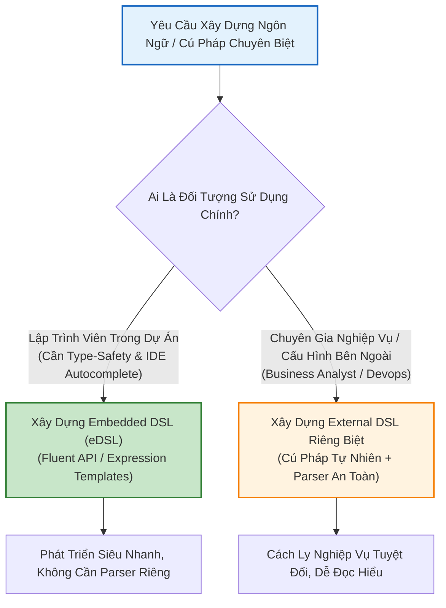

# 15.2. Sinh Mã, Biến Đổi AST và Ngôn Ngữ Chuyên Biệt (Code Generation & DSLs)

> [!IMPORTANT]
> **Nếu bạn chỉ được nhớ một điều duy nhất:** Biến đổi cây cú pháp trừu tượng (**AST Transformation**) và sinh mã nguồn tự động (**Source Generation**) là nấc thang cao nhất của tự động hóa công nghệ phần mềm; trong khi **Embedded DSL (eDSL)** tận dụng trực tiếp cú pháp và bộ kiểm tra kiểu của ngôn ngữ mẹ để xây dựng các biểu thức biểu đạt tự nhiên (như LINQ hay SQL builders), thì **External DSL** đòi hỏi xây dựng trọn vẹn một pipeline biên dịch độc lập (Lexer -> Parser -> CodeGen) nhưng mang lại quyền năng tối thượng về tính biểu đạt và khả năng tối ưu hóa vi kiến trúc chuyên sâu.

---

## 1. Kiến trúc Tổng quan & Mô hình Tư duy (Mental Model)

### Ẩn dụ Đời sống: Dịch Thuật Tự Động và Ngôn Ngữ Ký Hiệu Chuyên Ngành
Hãy hình dung quá trình biến đổi AST và DSLs giống như các hình thức giao tiếp trong xã hội:
- **Biến đổi AST (AST Transformation)**: Giống như một biên tập viên văn học chấm bài bằng bút đỏ:
  - Bản thảo gốc của tác giả được phân tích thành cây cấu trúc câu (Chủ ngữ - Vị ngữ - Bổ ngữ).
  - Biên tập viên không viết lại từ đầu; họ chỉ quét qua cây cấu trúc: nhận diện các câu bị động rườm rà (Anti-patterns hoặc cú pháp cũ) và gạch bỏ, thay thế bằng câu chủ động sắc bén (Tối ưu hóa hoặc Polyfill) trước khi chuyển bản thảo cho nhà in.
- **Sinh mã nguồn (Source Generation - như Roslyn hay Protobuf)**: Giống như một kiến trúc sư vẽ sơ đồ khung nhà (file `.proto` hoặc Model), sau đó máy tính tự động xuất ra hàng chục bản vẽ kỹ thuật chi tiết cho thợ điện, thợ nước, thợ mộc (Mã C++, Java, Python, Go) mà không con người nào phải ngồi gõ lại bằng tay.
- **Đánh giá một phần (Partial Evaluation & Futamura Projections)**: Giống như việc bạn nhận một bài toán: "Tính thuế cho 1 triệu khách hàng với mức thuế cố định 10%". Thay vì mỗi lần lặp đều truyền vào công thức tổng quát `calc_tax(rate, income)`, bạn đưa trước hằng số `rate = 0.1` vào một cỗ máy chuyên biệt hóa (Specializer). Cỗ máy tự động sinh ra một hàm mới tinh `calc_tax_10(income) = income * 0.1` chạy siêu tốc!
- **Embedded DSL vs External DSL**:
  - *Embedded DSL (Nội nhúng)*: Giống như thuật ngữ chuyên ngành của giới y khoa mượn trực tiếp từ ngữ tiếng Việt. Bác sĩ vẫn nói tiếng Việt nhưng sử dụng các cấu trúc kết hợp đặc biệt mà người thường thấy lạ lẫm (như Fluent API `query.where().orderBy()`).
  - *External DSL (Ngoại vi)*: Giống như nốt nhạc hoặc ký hiệu hóa học. Nó có một bảng chữ cái và ngữ pháp hoàn toàn riêng biệt (như SQL, Regex, GraphQL). Để hiểu được nó, bạn cần một bộ từ điển và thông dịch viên riêng biệt (Lexer & Parser).

```mermaid
flowchart TD
    subgraph SourceGenPipeline["1. Source Generation Pipeline (Roslyn / Protobuf)"]
        SpecFile["File Đặc Tả (.proto / C# Attributes)"] --> GeneratorEngine["Source Generator Engine"]
        GeneratorEngine --> GeneratedSource["Mã Nguồn Cực Sạch Được Sinh Tự Động (.g.cs / .pb.cc)"]
        GeneratedSource --> NativeCompiler["Biên Dịch Chung Với Dự Án Chính"]
    end

    subgraph ASTTransformPipeline["2. AST Transformation (Babel / Compiler Plugins)"]
        RawAST["Source AST (Mã Nguồn Ban Đầu)"] --> Visitor["AST Visitor Pattern (NodeTransformer)"]
        Visitor --> RewritePass["AST Rewrite Passes (Desugaring, Polyfill, Inlining)"]
        RewritePass --> OptimizedAST["Cây Cú Pháp Mới Đã Tối Ưu Hóa"]
        OptimizedAST --> CodeEmitter["Tái Tạo Mã Nguồn (Code Emitter)"]
    end

    subgraph DSLArchitecture["3. Phân Cấp Ngôn Ngữ Chuyên Biệt (DSLs)"]
        direction TB
        eDSL["Embedded DSL (eDSL: Fluent API, Expression Templates)"] --> HostLang["Kế Thừa Type-Checker & Syntax Của Ngôn Ngữ Mẹ"]
        ExtDSL["External DSL (SQL, Regex, Terraform HCL)"] --> CustomPipeline["Độc Lập Hoàn Toàn: Lexer -> Parser -> AST -> Interpreter/JIT"]
    end

    style SourceGenPipeline fill:#e1f5fe,stroke:#0288d1,stroke-width:2px;
    style ASTTransformPipeline fill:#e8f5e9,stroke:#388e3c,stroke-width:2px;
    style DSLArchitecture fill:#fff3e0,stroke:#f57c00,stroke-width:2px;
```



---

## 2. Chi tiết từng Keyword (Under-the-Hood Deep Dive)

### 2.1. Source Generation: Roslyn, Java APT & Protocol Buffers
- **Roslyn Source Generators (C# / .NET)**:
  - Cho phép lập trình viên kiểm tra mã nguồn C# của người dùng trong quá trình biên dịch và **sinh thêm các file C# mới** được đưa trực tiếp vào lượt biên dịch đó.
  - Khác với Reflection lúc runtime, Source Generation tạo ra mã tĩnh 100%, được kiểm tra kiểu đầy đủ, hỗ trợ autocomplete của IDE và không tốn 1 nano giây chi phí runtime.
- **Java Annotation Processing Tool (APT / KAPT)**:
  - Hoạt động trong giai đoạn biên dịch `javac`. Quét các chú thích (Annotations) như `@Entity`, `@AutoValue` và sinh ra mã nguồn tương ứng (như Lombok hoặc MapStruct).
- **Protocol Buffers (`protoc`)**:
  - Biên dịch file đặc tả Interface Definition Language (`.proto`) thành các struct và hàm tuần tự hóa nhị phân chuyên biệt hóa cực nhanh trong C++, Java, Go, Python.

### 2.2. AST Transformation & Compiler Plugins
- **Bản chất kỹ thuật**: Thao tác trực tiếp trên cây cú pháp trừu tượng sau pha phân tích cú pháp (Parsing) và trước pha phân tích ngữ nghĩa hoặc sinh mã trung gian.
- **Mô hình Khách thăm (Visitor Pattern) trong AST**:
  - Trình duyệt AST duyệt qua từng nút (Node). Khi gặp nút cần quan tâm (ví dụ: nút `BinaryExpression` phép lũy thừa `x ** 2`), nó thay thế nút đó bằng nút `BinaryExpression` phép nhân `x * x` (**Strength Reduction**).
- **Compiler Plugins (Clang Plugins, Babel Plugins)**:
  - Chèn mã mở rộng trực tiếp vào bên trong quy trình xử lý của trình biên dịch chính.
  - Clang Plugin có thể thực thi các quy tắc kiểm tra an toàn bộ nhớ nội bộ của công ty (Linter Rules), hoặc tự động chèn các đoạn mã giám sát vi kiến trúc vào mọi hàm.

### 2.3. Partial Evaluation & Futamura Projections
- **Nguyên lý Đánh Giá Một Phần (Specializer)**:
  - Cho một chương trình $P(x, y)$, nếu đầu vào $x$ đã được biết trước tại thời điểm biên dịch, bộ Specializer sẽ thực hiện mọi phép tính liên quan đến $x$, trải phẳng các vòng lặp phụ thuộc $x$, và sinh ra một chương trình chuyên biệt hóa $P_x(y)$ chỉ còn phụ thuộc vào biến $y$.
- **Ba Dự Đoán Của Futamura (The Three Futamura Projections)**:
  1. *Chiếu 1 (Specializing Interpreter)*: Chuyên biệt hóa một Trình thông dịch (Interpreter) với một Mã nguồn cụ thể $\to$ Sinh ra **Mã Máy Thực Thi** của chương trình đó! (Interpreter + Source Code = Executable Binary).
  2. *Chiếu 2 (Specializing the Specializer)*: Chuyên biệt hóa bộ Specializer với Trình thông dịch $\to$ Sinh ra một **Trình Biên Dịch (Compiler)**!
  3. *Chiếu 3 (Generating a Compiler-Compiler)*: Chuyên biệt hóa bộ Specializer với chính bản thân nó $\to$ Sinh ra một **Bộ Sinh Trình Biên Dịch Tự Động**!

### 2.4. Domain-Specific Languages (DSLs): Embedded vs External
- **Embedded DSLs (Nội nhúng / eDSL)**:
  - Không cần xây dựng parser riêng; sử dụng cú pháp của ngôn ngữ chủ (Host Language).
  - *Kỹ thuật triển khai*:
    - *Fluent Interface / Method Chaining*: `db.select("id").from("users").where("age > 18")`.
    - *Expression Templates (C++)*: Nạp chồng toán tử (`operator+`) để thay vì tính toán ngay lập tức, nó tạo ra một cấu trúc cây biểu thức tĩnh, cho phép compiler gộp nhiều phép tính mảng lại thành một vòng lặp SIMD duy nhất.
  - *Ưu điểm*: Tận dụng 100% công cụ, linter, type-checker của ngôn ngữ chủ.
  - *Nhược điểm*: Bị giới hạn nghiêm ngặt bởi cú pháp của ngôn ngữ chủ.
- **External DSLs (Ngoại vi)**:
  - Tự do thiết kế cú pháp tối ưu nhất cho bài toán nghiệp vụ (SQL, Terraform HCL, Regular Expressions).
  - Yêu cầu xây dựng trọn vẹn một Compiler/Interpreter: Bộ phân tích từ vựng (**Lexer**), Bộ phân tích cú pháp (**Parser** bằng ANTLR, Tree-sitter hoặc PEG), và Bộ thực thi ngữ nghĩa (**Evaluation Engine**).

---

## 3. Thực thi Mã nguồn & Mô phỏng Chuyên sâu (Dual-Engine Implementation)

### 3.1. C++20 Implementation: Xây Dựng Embedded DSL Bằng Expression Templates
Chương trình C++20 dưới đây triển khai kỹ thuật **Expression Templates** - đỉnh cao của Embedded DSL trong C++: thay vì thực hiện phép cộng từng mảng một làm phát sinh các mảng tạm thời trong RAM, DSL này trì hoãn tính toán và gộp toàn bộ biểu thức thành đúng một vòng lặp đơn lẻ:

```cpp
#include <iostream>
#include <vector>
#include <cassert>
#include <chrono>

// -------------------------------------------------------------
// 1. CẤU TRÚC BIỂU THỨC TỔNG QUÁT (EXPRESSION TEMPLATES EDSL)
// -------------------------------------------------------------
template <typename ConcreteExpr>
struct Expression {
    // Ép kiểu tĩnh (Curiously Recurring Template Pattern - CRTP)
    double operator[](size_t i) const {
        return static_cast<const ConcreteExpr&>(*this)[i];
    }
    size_t size() const {
        return static_cast<const ConcreteExpr&>(*this).size();
    }
};

// Đại diện cho một mảng dữ liệu thực tế
class Vector : public Expression<Vector> {
private:
    std::vector<double> data_;

public:
    explicit Vector(size_t size, double initial_val = 0.0) : data_(size, initial_val) {}

    double operator[](size_t i) const { return data_[i]; }
    double& operator[](size_t i) { return data_[i]; }
    size_t size() const { return data_.size(); }

    // Toán tử gán từ bất kỳ Biểu thức nào: ĐÂY LÀ NƠI PHÉP TÍNH THỰC SỰ DIỄN RA!
    template <typename Expr>
    Vector& operator=(const Expression<Expr>& expr) {
        assert(size() == expr.size());
        for (size_t i = 0; i < size(); ++i) {
            data_[i] = expr[i]; // Gộp toàn bộ chuỗi cộng trừ nhân chia vào 1 vòng lặp duy nhất!
        }
        return *this;
    }
};

// Đại diện cho nút phép cộng trong cây biểu thức (Không cấp phát RAM!)
template <typename LeftExpr, typename RightExpr>
class VectorAdd : public Expression<VectorAdd<LeftExpr, RightExpr>> {
private:
    const LeftExpr& lhs_;
    const RightExpr& rhs_;

public:
    VectorAdd(const LeftExpr& lhs, const RightExpr& rhs) : lhs_(lhs), rhs_(rhs) {
        assert(lhs.size() == rhs.size());
    }

    // Đánh giá lười biếng: Chỉ tính giá trị của phần tử i khi được hỏi
    double operator[](size_t i) const {
        return lhs_[i] + rhs_[i];
    }
    size_t size() const { return lhs_.size(); }
};

// Nạp chồng toán tử '+' để xây dựng cây DSL
template <typename LeftExpr, typename RightExpr>
VectorAdd<LeftExpr, RightExpr> operator+(const Expression<LeftExpr>& lhs, 
                                        const Expression<RightExpr>& rhs) {
    return VectorAdd<LeftExpr, RightExpr>(
        static_cast<const LeftExpr&>(lhs), 
        static_cast<const RightExpr&>(rhs)
    );
}

int main() {
    std::cout << "=========================================================\n";
    std::cout << "   C++20 EMBEDDED DSL: EXPRESSION TEMPLATES DEMO         \n";
    std::cout << "=========================================================\n\n";

    constexpr size_t N = 5;
    Vector a(N, 1.0);
    Vector b(N, 2.0);
    Vector c(N, 3.0);
    Vector result(N, 0.0);

    std::cout << "[1. Thực Thi Biểu Thức DSL]: result = a + b + c\n";
    // Biểu thức 'a + b + c' KHÔNG hề tạo ra bất kỳ mảng trung gian nào trên Heap!
    // Nó chỉ tạo ra một đối tượng kiểu VectorAdd<VectorAdd<Vector, Vector>, Vector> trên Stack
    result = a + b + c;

    std::cout << "  Kết quả sau khi tính toán:\n";
    for (size_t i = 0; i < N; ++i) {
        std::cout << "    result[" << i << "] = " << result[i] << " (Kỳ vọng: 6.0)\n";
    }

    std::cout << "\n[Đánh giá Kỹ thuật]: Triệt tiêu hoàn toàn chi phí malloc của các mảng tạm thời.\n";
    return 0;
}
```

### 3.2. Python 3.11+ Implementation: Xây Dựng External DSL Parser & Evaluator Hoàn Chỉnh
Chương trình Python 3.11+ dưới đây triển khai toàn bộ một pipeline cho một **External DSL tính toán logic** (MiniBool DSL), bao gồm Tokenizer (Lexer), Abstract Syntax Tree (AST), và Evaluator Engine:

```python
import re
from typing import List, Dict, Any, Union

# -------------------------------------------------------------
# 1. BỘ PHÂN TÍCH TỪ VỰNG (LEXER)
# -------------------------------------------------------------
TOKEN_SPECIFICATION = [
    ("NUMBER",   r"\d+"),
    ("IDENT",    r"[A-Za-z_][A-Za-z0-9_]*"),
    ("AND",      r"AND\b"),
    ("OR",       r"OR\b"),
    ("NOT",      r"NOT\b"),
    ("GREATER",  r">"),
    ("LPAREN",   r"\("),
    ("RPAREN",   r"\)"),
    ("SKIP",     r"[ \t\n]+"),
    ("MISMATCH", r"."),
]
TOKEN_REGEX = "|".join(f"(?P<{pair[0]}>{pair[1]})" for pair in TOKEN_SPECIFICATION)

class Token:
    def __init__(self, type_: str, value: str):
        self.type = type_
        self.value = value

    def __repr__(self):
        return f"Token({self.type}, '{self.value}')"

def tokenize(text: str) -> List[Token]:
    tokens = []
    for mo in re.finditer(TOKEN_REGEX, text):
        kind = mo.lastgroup
        val = mo.group()
        if kind == "SKIP":
            continue
        elif kind == "MISMATCH":
            raise SyntaxError(f"Ký tự không hợp lệ trong External DSL: {val!r}")
        tokens.append(Token(kind, val))
    return tokens

# -------------------------------------------------------------
# 2. CÂY CÚ PHÁP TRỪU TƯỢNG (AST NODES)
# -------------------------------------------------------------
class ASTNode:
    pass

class ComparisonNode(ASTNode):
    def __init__(self, identifier: str, op: str, number: int):
        self.identifier = identifier
        self.op = op
        self.number = number

class BinaryLogicNode(ASTNode):
    def __init__(self, op: str, left: ASTNode, right: ASTNode):
        self.op = op
        self.left = left
        self.right = right

# -------------------------------------------------------------
# 3. BỘ PHÂN TÍCH CÚ PHÁP (RECURSIVE DESCENT PARSER)
# -------------------------------------------------------------
class MiniDSLParser:
    def __init__(self, tokens: List[Token]):
        self.tokens = tokens
        self.pos = 0

    def peek(self) -> Optional[Token]:
        return self.tokens[self.pos] if self.pos < len(self.tokens) else None

    def consume(self, expected_type: str) -> Token:
        tok = self.peek()
        if not tok or tok.type != expected_type:
            raise SyntaxError(f"Kỳ vọng token {expected_type}, nhưng gặp {tok}")
        self.pos += 1
        return tok

    def parse(self) -> ASTNode:
        return self.parse_or()

    def parse_or(self) -> ASTNode:
        node = self.parse_and()
        while self.peek() and self.peek().type == "OR":
            self.consume("OR")
            right = self.parse_and()
            node = BinaryLogicNode("OR", node, right)
        return node

    def parse_and(self) -> ASTNode:
        node = self.parse_primary()
        while self.peek() and self.peek().type == "AND":
            self.consume("AND")
            right = self.parse_primary()
            node = BinaryLogicNode("AND", node, right)
        return node

    def parse_primary(self) -> ASTNode:
        tok = self.peek()
        if tok and tok.type == "LPAREN":
            self.consume("LPAREN")
            expr = self.parse()
            self.consume("RPAREN")
            return expr
        elif tok and tok.type == "IDENT":
            ident = self.consume("IDENT").value
            op = self.consume("GREATER").value
            num = int(self.consume("NUMBER").value)
            return ComparisonNode(ident, op, num)
        raise SyntaxError(f"Lỗi cú pháp tại token: {tok}")

# -------------------------------------------------------------
# 4. ĐỘNG CƠ THỰC THI NGỮ NGHĨA (EVALUATOR)
# -------------------------------------------------------------
def evaluate_dsl(node: ASTNode, context: Dict[str, Any]) -> bool:
    if isinstance(node, ComparisonNode):
        val = context.get(node.identifier, 0)
        if node.op == ">":
            return val > node.number
    elif isinstance(node, BinaryLogicNode):
        left_val = evaluate_dsl(node.left, context)
        right_val = evaluate_dsl(node.right, context)
        if node.op == "AND":
            return left_val and right_val
        elif node.op == "OR":
            return left_val or right_val
    return False

if __name__ == '__main__':
    print("=== MÔ PHỎNG EXTERNAL DSL PARSER & EVALUATOR (PYTHON 3.11+) ===")
    
    # Kịch bản DSL nghiệp vụ kiểm tra điều kiện vay vốn:
    dsl_query = "(income > 5000 AND credit_score > 700) OR age > 60"
    print(f"\n[1. Câu Lệnh External DSL Đầu Vào]:\n  '{dsl_query}'")

    # 1. Tokenize
    tokens = tokenize(dsl_query)
    print(f"\n[2. Kết Quả Phân Tích Từ Vựng (Tokens)]: {len(tokens)} tokens được nhận diện.")

    # 2. Parse thành AST
    parser = MiniDSLParser(tokens)
    ast_root = parser.parse()
    print("  -> Đã xây dựng thành công cây cú pháp trừu tượng AST!")

    # 3. Thực thi đánh giá với các hồ sơ dữ liệu khác nhau
    print("\n[3. Đánh Giá Biểu Thức DSL Với Hồ Sơ Thực Tế]:")
    profile_a = {"income": 6000, "credit_score": 750, "age": 30}
    profile_b = {"income": 3000, "credit_score": 600, "age": 65}
    profile_c = {"income": 3000, "credit_score": 600, "age": 40}

    print(f"  Hồ sơ A {profile_a} -> Kết quả: {evaluate_dsl(ast_root, profile_a)} (Được duyệt)")
    print(f"  Hồ sơ B {profile_b} -> Kết quả: {evaluate_dsl(ast_root, profile_b)} (Được duyệt vì tuổi > 60)")
    print(f"  Hồ sơ C {profile_c} -> Kết quả: {evaluate_dsl(ast_root, profile_c)} (Bị từ chối)")
```

### 3.3. Terminal Output Mẫu Thực tế
```text
=========================================================
   C++20 EMBEDDED DSL: EXPRESSION TEMPLATES DEMO         
=========================================================

[1. Thực Thi Biểu Thức DSL]: result = a + b + c
  Kết quả sau khi tính toán:
    result[0] = 6 (Kỳ vọng: 6.0)
    result[1] = 6 (Kỳ vọng: 6.0)
    result[2] = 6 (Kỳ vọng: 6.0)
    result[3] = 6 (Kỳ vọng: 6.0)
    result[4] = 6 (Kỳ vọng: 6.0)

[Đánh giá Kỹ thuật]: Triệt tiêu hoàn toàn chi phí malloc của các mảng tạm thời.

=== MÔ PHỎNG EXTERNAL DSL PARSER & EVALUATOR (PYTHON 3.11+) ===

[1. Câu Lệnh External DSL Đầu Vào]:
  '(income > 5000 AND credit_score > 700) OR age > 60'

[2. Kết Quả Phân Tích Từ Vựng (Tokens)]: 13 tokens được nhận diện.
  -> Đã xây dựng thành công cây cú pháp trừu tượng AST!

[3. Đánh Giá Biểu Thức DSL Với Hồ Sơ Thực Tế]:
  Hồ sơ A {'income': 6000, 'credit_score': 750, 'age': 30} -> Kết quả: True (Được duyệt)
  Hồ sơ B {'income': 3000, 'credit_score': 600, 'age': 65} -> Kết quả: True (Được duyệt vì tuổi > 60)
  Hồ sơ C {'income': 3000, 'credit_score': 600, 'age': 40} -> Kết quả: False (Bị từ chối)
```

---

## 4. Systems Engineering & Production Pitfalls

### 4.1. Hiểm Họa Lỗ Hổng Bảo Mật "Code Injection" Trong External DSLs
- **Sự cố sản xuất**: Khi xây dựng External DSL cho phép người dùng viết các biểu thức logic (như bộ lọc báo cáo), lập trình viên "đi đường tắt" bằng cách dùng hàm `eval()` của Python hoặc `new Function()` của JavaScript để thực thi chuỗi DSL. Kẻ tấn công gửi chuỗi payload: `"__import__('os').system('rm -rf /')"` dẫn tới việc máy chủ bị xóa sạch dữ liệu.
- **Quy tắc bất di bất dịch**: Tuyệt đối không bao giờ dùng `eval()`. Bắt buộc phải viết Lexer/Parser chuẩn mực và thực thi ngữ nghĩa trên một cây AST hoàn toàn cách ly với môi trường OS.

### 4.2. Cạm Bẫy Quá Tải Trình Phân Tích Cú Pháp Khi Gặp Ngữ Pháp Hồi Quy Trái (Left Recursion)
- **Sự cố sản xuất**: Trong các trình phân tích đệ quy đi xuống (**Recursive Descent Parsers**), nếu quy tắc ngữ pháp có hồi quy trái (`Expr -> Expr '+' Term`), parser sẽ rơi vào vòng lặp đệ quy vô tận và ném ngoại lệ `StackOverflowError` làm tê liệt tiến trình backend.
- **Khắc phục**: Khử hồi quy trái bằng thuật toán biến đổi ngữ pháp tiêu chuẩn (`Expr -> Term Expr'`) hoặc sử dụng bộ phân tích cú pháp Pratt Parser (Precedence Climbing).

---

## 5. Bảng So sánh & Decision Matrix

| Khía Cạnh | Embedded DSL (eDSL) | External DSL |
| :--- | :--- | :--- |
| **Chi Phí Phát Triển Ban Đầu** | Rất thấp (dựa trên cú pháp có sẵn) | Cao (Cần viết Lexer, Parser, AST Engine) |
| **Hỗ Trợ Công Cụ IDE & Linter** | Hưởng trọn vẹn từ IDE của ngôn ngữ mẹ | Phải tự viết Language Server (LSP) riêng |
| **Độ Thân Thiện Với Chuyên Gia Nghiệp Vụ** | Kém (Vẫn mang nặng dáng dấp mã lập trình) | Rất cao (Cú pháp tự nhiên như tiếng Anh) |
| **Khả Năng Tối Ưu Hóa Cục Bộ** | Bị gò bó bởi compiler của ngôn ngữ chủ | Tự do tối ưu hóa toàn bộ cây AST |
| **Rủi Ro An Ninh Mạng** | Rất thấp (Tuân thủ sandbox của ngôn ngữ) | Cần kiểm soát chặt chẽ chống Code Injection |


