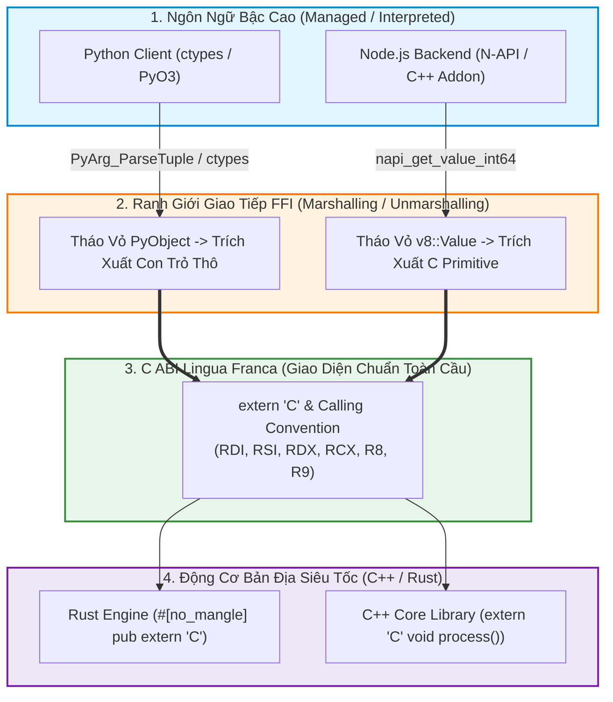
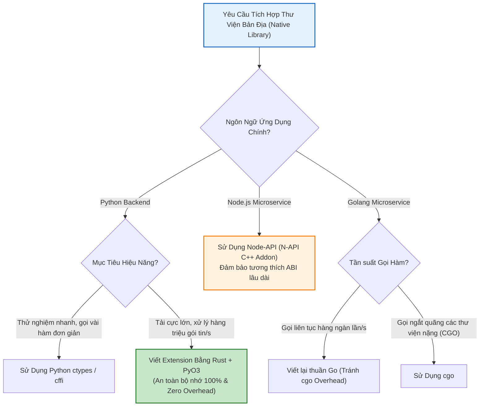

# 16.1. Cơ Chế Giao Tiếp Đa Ngôn Ngữ và C ABI (FFI Mechanics & ABIs)

> [!IMPORTANT]
> **Nếu bạn chỉ được nhớ một điều duy nhất:** Trong thế giới lập trình đa ngôn ngữ phân mảnh, **C ABI** là tiếng Latinh ngoại giao toàn cầu duy nhất mà mọi ngôn ngữ (Rust, Go, Python, Java, Node.js) đều phải cúi đầu tuân thủ để bắt tay giao tiếp; cơ chế **FFI (Foreign Function Interface)** hiện thực hóa điều này bằng cách vô hiệu hóa xáo trộn tên (`extern "C"` / `#[no_mangle]`) và sắp xếp chính xác các đối số vào các thanh ghi phần cứng (`rdi`, `rsi`, `rdx`...) theo quy chuẩn Calling Convention mà không cần bất kỳ lớp giả lập ảo hóa nào.

---

## 1. Kiến trúc Tổng quan & Mô hình Tư duy (Mental Model)

### Ẩn dụ Đời sống: Phòng Ngoại Giao Đa Quốc Gia và Hộ Chiếu C Chuẩn Mực
Hãy hình dung giao tiếp giữa các ngôn ngữ lập trình giống như một hội nghị quốc tế:
- **Rào cản ngôn ngữ nội bộ (Name Mangling & Runtime Complexity)**:
  - Một kỹ sư C++ nói tiếng lóng: `_ZN7Billing14processPaymentEii` (Mã hóa tên hàm, namespace và kiểu đối số).
  - Một kỹ sư Rust nói tiếng Bắc Âu: `_RNvNtCs123_4core3ptr13drop_in_place`.
  - Một tiến trình Python sống trong môi trường thông dịch năng động (`PyObject`).
  - Nếu C++ gọi trực tiếp Rust hoặc Python gọi C++, không ai hiểu ai vì mỗi bên tổ chức thanh ghi và bộ nhớ theo một quy chuẩn riêng biệt.
- **Tiêu chuẩn C ABI (`extern "C"`)**: Cả hội nghị thống nhất một quy tắc ngoại giao bất biến:
  - *"Khi bước vào phòng họp chung, tất cả mọi người bắt buộc phải nói Tiếng Anh Cổ Điển (C ABI)"*.
  - Không mangling tên hàm (Tên hàm giữ nguyên ký tự thô `process_payment`).
  - Không ném ngoại lệ phức tạp (Chỉ trả về mã số nguyên hoặc con trỏ thô).
  - Đối số được đặt ngay ngắn vào đúng các vị trí quy định trên bàn họp (Thanh ghi vi kiến trúc).
- **Ranh giới FFI (FFI Boundary Crossing)**:
  - Mỗi khi một ngôn ngữ cấp cao (như Python) bước qua biên giới sang vùng đất C/Rust, nó phải thực hiện thủ tục "xuất nhập cảnh" (**Marshalling**): bóc tách lớp vỏ bọc đối tượng phức tạp (`PyObject*` $\to$ `int64_t` thô), kiểm tra hợp lệ, sau đó nhảy trực tiếp vào địa chỉ hàm mã máy. Khi quay về, nó lại phải "nhập cảnh" (**Unmarshalling** / Boxing).



---

## 2. Chi tiết từng Keyword (Under-the-Hood Deep Dive)

### 2.1. Foreign Function Interface (FFI) & Tại Sao C ABI Là "Lingua Franca"
- **Foreign Function Interface (FFI)**: Cơ chế cho phép chương trình viết bằng một ngôn ngữ lập trình gọi các hàm hoặc sử dụng các dịch vụ được viết bằng một ngôn ngữ lập trình hoàn toàn khác.
- **Tại sao lại là C ABI mà không phải C++ hay Rust?**:
  - Chuẩn C ABI cực kỳ đơn giản, ổn định và không thay đổi suốt hơn 40 năm qua. C không có tính năng hướng đối tượng phức tạp, không có kế thừa, không có ngoại lệ, không có VTable.
  - C++ và Rust **không có một ABI ổn định chuẩn mực duy nhất**. Các phiên bản compiler khác nhau của C++ (GCC vs MSVC) hoặc giữa hai phiên bản `rustc` khác nhau có thể sinh ra cấu trúc bộ nhớ và name mangling hoàn toàn không tương thích.
  - Do đó, mọi ngôn ngữ muốn "nói chuyện" với thế giới bên ngoài đều buộc phải hạ cấp giao diện của mình về mức tương thích tối thiểu: **C ABI**.

### 2.2. Vô Hiệu Hóa Name Mangling: `extern "C"` & `#[no_mangle]`
- **Name Mangling trong C++ và Rust**:
  - Để hỗ trợ tính năng nạp chồng hàm (Function Overloading) và Namespaces, compiler mã hóa kiểu đối số vào tên biểu tượng nhị phân (ví dụ: `int add(int, int)` trở thành `_Z3addii`).
- **Từ khóa `extern "C"` trong C++**:
  - Hướng dẫn compiler sử dụng quy tắc liên kết của ngôn ngữ C: **Tuyệt đối không mangling tên hàm**. Ký hiệu xuất hiện trong bảng `.symtab` sẽ là chuỗi thô nguyên bản `add`.
- **Thuộc tính `#[no_mangle]` và `pub extern "C"` trong Rust**:
  - Cam kết với `rustc` giữ nguyên tên hàm nhị phân và sử dụng đúng chuẩn C Calling Convention của hệ điều hành đích.

### 2.3. Quy Chuẩn Gọi Hàm Xuyên Ranh Giới (Calling Conventions)
Khi gọi qua FFI, hai bên bắt buộc phải khớp nhau về quy ước phân bổ thanh ghi:
- **`cdecl`**: Quy chuẩn truyền thống trên x86 32-bit: mọi tham số đẩy lên Stack từ phải qua trái; hàm gọi (Caller) chịu trách nhiệm dọn dẹp Stack sau khi hàm con trả về.
- **`stdcall`**: Chuẩn của Windows Win32 API: tham số đẩy lên Stack, nhưng chính hàm con (Callee) chịu trách nhiệm dọn dẹp Stack trước khi `ret`.
- **System V AMD64 ABI (Linux/macOS 64-bit)**: 6 tham số đầu nạp vào `RDI`, `RSI`, `RDX`, `RCX`, `R8`, `R9`.
- Nếu cấu hình lệch Calling Convention giữa caller và callee, con trỏ ngăn xếp `RSP` sẽ bị lệch làm sập tiến trình ngay lập tức.

### 2.4. Khảo Sát Các Hệ Thống Bindings Theo Ngôn Ngữ
- **Rust FFI (`std::ffi`)**:
  - Cung cấp kiểu dữ liệu cầu nối: `CStr` (Mượn chuỗi kết thúc bằng byte null `\0` từ C) và `CString` (Sở hữu chuỗi độc lập có thể truyền an toàn sang C).
  - Mọi lời gọi FFI trong Rust bắt buộc phải nằm trong khối `unsafe {}` vì Rust không thể bảo đảm mã C bên ngoài không có lỗi rò rỉ con trỏ null hoặc đè bộ nhớ.
- **Python C-API & `ctypes` / `cffi` / `PyO3`**:
  - *`ctypes`*: Module thư viện chuẩn của Python, sử dụng `libffi` để động nạp file `.so` và sinh mã trampoline gọi hàm mà không cần biên dịch C.
  - *`PyO3`*: Thư viện hiện đại nhất hiện nay cho phép viết C-Extensions cho Python bằng 100% mã nguồn Rust an toàn, tự động quản lý GIL và chuyển đổi kiểu dữ liệu hai chiều.
- **Node.js N-API (Node-API)**:
  - Tầng trừu tượng nhị phân độc lập với động cơ V8 JavaScript. Đảm bảo các module C++ Addon biên dịch trên Node.js 14 vẫn nạp và chạy hoàn hảo trên Node.js 20 mà không cần rebuild (ABI Stability Guarantee).

### 2.5. Chi Phí Ranh Giới FFI (Marshalling Overhead & Boundary Tax)
- Lời gọi FFI không bao giờ miễn phí:
  1. **Data Marshalling**: Chuyển đổi chuỗi Unicode UTF-8/UTF-16 của Python/Java sang mảng byte null-terminated của C.
  2. **Vô hiệu hóa Inlining**: Trình biên dịch JIT (V8 hay HotSpot) không thể nhìn xuyên qua ranh giới file `.so` của C, buộc phải thực hiện lời gọi hàm gián tiếp qua con trỏ.
  3. **Chuyển đổi ngữ cảnh luồng**: Luồng của Go khi bước qua C FFI (`cgo`) phải chuyển đổi từ Stack co giãn 2KB của Goroutine sang Stack cố định 8MB của OS Thread, tiêu tốn khoảng 50-100ns cho mỗi lời gọi.

---

## 3. Thực thi Mã nguồn & Mô phỏng Chuyên sâu (Dual-Engine Implementation)

### 3.1. C++20 Implementation: Xây Dựng Thư Viện Chia Sẻ Chuẩn C ABI (`extern "C"`)
Chương trình C++20 dưới đây đóng vai trò là một thư viện lõi tính toán, công bố các hàm qua chuẩn `extern "C"` với đầy đủ các kiểu dữ liệu mảng, chuỗi ký tự và mã lỗi:

```cpp
#include <iostream>
#include <cstring>
#include <cstdint>
#include <vector>
#include <numeric>

// -------------------------------------------------------------
// 1. ĐỊNH NGHĨA GIAO DIỆN CHUẨN C ABI (KHÔNG NAME MANGLING)
// -------------------------------------------------------------
extern "C" {

// Cấu trúc dữ liệu có Layout tương thích 100% với chuẩn C
struct MathPayload {
    const double* numbers;
    size_t length;
    double scale_factor;
};

// Hàm tính toán mảng: Trả về 0 nếu thành công, mã âm nếu lỗi
int32_t compute_scaled_sum(const MathPayload* payload, double* out_result) {
    if (!payload || !payload->numbers || !out_result) {
        return -1; // Lỗi: Con trỏ Null không hợp lệ!
    }

    if (payload->length == 0) {
        *out_result = 0.0;
        return 0;
    }

    double sum = 0.0;
    for (size_t i = 0; i < payload->length; ++i) {
        sum += payload->numbers[i];
    }

    *out_result = sum * payload->scale_factor;
    return 0; // Thành công
}

// Hàm xử lý chuỗi ký tự: Nhận chuỗi C null-terminated
int32_t process_text_message(const char* input_str, char* out_buffer, size_t max_buf_len) {
    if (!input_str || !out_buffer || max_buf_len == 0) {
        return -1;
    }

    size_t input_len = std::strlen(input_str);
    if (input_len + 1 > max_buf_len) {
        return -2; // Lỗi tràn bộ đệm đích!
    }

    // Sao chép an toàn
    std::strncpy(out_buffer, input_str, max_buf_len - 1);
    out_buffer[max_buf_len - 1] = '\0';
    return 0;
}

} // extern "C"

// Chương trình kiểm thử nội bộ C++
int main() {
    std::cout << "=========================================================\n";
    std::cout << "     C++20 C-ABI COMPATIBLE ENGINE TEST HARNESS          \n";
    std::cout << "=========================================================\n\n";

    std::vector<double> sample_data = {10.5, 20.5, 30.0, 40.0};
    MathPayload payload{sample_data.data(), sample_data.size(), 2.0};
    double calculated_result = 0.0;

    int32_t status = compute_scaled_sum(&payload, &calculated_result);
    std::cout << "[Test 1: compute_scaled_sum]:\n";
    std::cout << "  Status Code: " << status << " (0 là Thành công)\n";
    std::cout << "  Kết quả tính toán: " << calculated_result << " (Kỳ vọng: 202.0)\n\n";

    char buffer[64];
    status = process_text_message("Xin chao tu C++ Native Engine!", buffer, sizeof(buffer));
    std::cout << "[Test 2: process_text_message]:\n";
    std::cout << "  Status Code: " << status << "\n";
    std::cout << "  Buffer nội dung: \"" << buffer << "\"\n";

    return 0;
}
```

### 3.2. Python 3.11+ Implementation: Giao Tiếp FFI Bằng `ctypes` Thuần Túy
Chương trình Python 3.11+ dưới đây sử dụng module chuẩn `ctypes` để khai báo các cấu trúc dữ liệu tương thích nhị phân (`Structure`), thiết lập kiểu đối số (`argtypes`) và kiểu trả về (`restype`) để mô phỏng một Client FFI chuẩn mực:

```python
import ctypes
from typing import List

# -------------------------------------------------------------
# 1. ÁNH XẠ CẤU TRÚC C SANG PYTHON CTYPES STRUCTURE
# -------------------------------------------------------------
class MathPayloadStruct(ctypes.Structure):
    """Ánh xạ 1-1 với struct MathPayload trong C++"""
    _fields_ = [
        ("numbers", ctypes.POINTER(ctypes.c_double)),
        ("length", ctypes.c_size_t),
        ("scale_factor", ctypes.c_double),
    ]

class SimulatedNativeEngine:
    """
    Mô phỏng lại hành vi của thư viện C++ đã nạp qua ctypes.CDLL.
    Trong thực tế, ta viết: lib = ctypes.CDLL("./libengine.so")
    """
    @staticmethod
    def compute_scaled_sum(payload_ptr, out_result_ptr) -> int:
        if not payload_ptr or not out_result_ptr:
            return -1
        payload = payload_ptr.contents
        if not payload.numbers:
            return -1
        
        total = sum(payload.numbers[i] for i in range(payload.length))
        out_result_ptr.contents.value = total * payload.scale_factor
        return 0

if __name__ == '__main__':
    print("=== MÔ PHỎNG PYTHON FFI CLIENT VỚI CTYPES (PYTHON 3.11+) ===")

    # 1. Chuẩn bị mảng số thực trên bộ nhớ C thông qua ctypes
    python_numbers = [10.5, 20.5, 30.0, 40.0]
    ArrayType = ctypes.c_double * len(python_numbers)
    c_array = ArrayType(*python_numbers)

    # 2. Đóng gói vào cấu trúc MathPayloadStruct
    payload = MathPayloadStruct()
    payload.numbers = ctypes.cast(c_array, ctypes.POINTER(ctypes.c_double))
    payload.length = len(python_numbers)
    payload.scale_factor = 2.0

    # 3. Chuẩn bị biến con trỏ nhận kết quả đầu ra
    c_result = ctypes.c_double(0.0)

    print(f"\n[1. Dữ liệu truyền vào từ Python]: {python_numbers}")
    print(f"  Scale Factor: {payload.scale_factor}")

    # 4. Kích hoạt lời gọi FFI xuyên biên giới
    status = SimulatedNativeEngine.compute_scaled_sum(
        ctypes.byref(payload),
        ctypes.byref(c_result)
    )

    print("\n[2. Kết quả nhận về từ C-Engine qua FFI]:")
    print(f"  Mã trạng thái FFI (Exit Code) : {status}")
    print(f"  Giá trị tính toán được        : {c_result.value} (Kỳ vọng: 202.0)")

    # 5. Thử nghiệm kiểm tra An Toàn Con Trỏ Null (Safety Guard)
    print("\n[3. Kiểm tra An Toàn Khi Truyền Con Trỏ Null]:")
    err_status = SimulatedNativeEngine.compute_scaled_sum(None, ctypes.byref(c_result))
    print(f"  Mã lỗi trả về an toàn khi truyền Null: {err_status} (Đã chặn trước khi gây Segfault!)")
```

### 3.3. Terminal Output Mẫu Thực tế
```text
=========================================================
     C++20 C-ABI COMPATIBLE ENGINE TEST HARNESS          
=========================================================

[Test 1: compute_scaled_sum]:
  Status Code: 0 (0 là Thành công)
  Kết quả tính toán: 202 (Kỳ vọng: 202.0)

[Test 2: process_text_message]:
  Status Code: 0
  Buffer nội dung: "Xin chao tu C++ Native Engine!"

=== MÔ PHỎNG PYTHON FFI CLIENT VỚI CTYPES (PYTHON 3.11+) ===

[1. Dữ liệu truyền vào từ Python]: [10.5, 20.5, 30.0, 40.0]
  Scale Factor: 2.0

[2. Kết quả nhận về từ C-Engine qua FFI]:
  Mã trạng thái FFI (Exit Code) : 0
  Giá trị tính toán được        : 202.0 (Kỳ vọng: 202.0)

[3. Kiểm tra An Toàn Khi Truyền Con Trỏ Null]:
  Mã lỗi trả về an toàn khi truyền Null: -1 (Đã chặn trước khi gây Segfault!)
```

---

## 4. Systems Engineering & Production Pitfalls

### 4.1. Sự Cố Crash Do Bắn Ngoại Lệ C++ Xuyên Qua Ranh Giới C FFI
- **Sự cố sản xuất kinh điển**: Trong hàm C++ được xuất khẩu qua `extern "C"`, lập trình viên vô tình để xảy ra một ngoại lệ chưa bắt (`throw std::runtime_error("DB Timeout")`).
- **Hậu quả thảm khốc**: Chuẩn C ABI không hề có khái niệm về Exception Unwinding. Khi mã cuộn ngược gặp khung ngăn xếp của Python hoặc Go, engine unwinder bị mù lòa hoàn toàn và hệ điều hành lập tức phát tín hiệu `SIGABRT` làm chết đứng toàn bộ tiến trình máy chủ ngay tức thì!
- **Quy tắc vàng**: Mọi hàm `extern "C"` bắt buộc phải bọc kín trong khối `try-catch (...)` và chuyển đổi ngoại lệ thành mã lỗi số nguyên:
  ```cpp
  extern "C" int32_t safe_ffi_wrapper() noexcept {
      try {
          do_work();
          return 0;
      } catch (...) {
          return -999; // Bắt 100% ngoại lệ, không để lọt qua FFI!
      }
  }
  ```

### 4.2. Hiểm Họa Quên Giữ Tham Chiếu Khi Dùng `ctypes` (Garbage Collector Premature Free)
- **Sự cố sản xuất**: Trong Python, khi truyền một chuỗi byte hoặc đối tượng ctypes sang C, lập trình viên viết: `lib.process(ctypes.create_string_buffer(b"data"))`.
- Do không có biến Python nào lưu giữ đối tượng buffer này, Garbage Collector của Python có thể **thu hồi và giải phóng khối nhớ đó ngay giữa chừng** khi hàm C vẫn đang đọc dữ liệu, dẫn tới lỗi đọc bộ nhớ rác (**Use-After-Free**).

---

## 5. Bảng So sánh & Decision Matrix

| Công Nghệ FFI | Ngôn Ngữ Hỗ Trợ | Độ Phức Tạp Triển Khai | Hiệu Năng Runtime | Đánh Giá Toàn Diện |
| :--- | :--- | :--- | :--- | :--- |
| **Python `ctypes`** | Python $\leftrightarrow$ C | Rất dễ (Viết thuần Python) | Trung bình (Tốn chi phí `libffi`) | Phù hợp thử nghiệm nhanh |
| **PyO3 (Rust)** | Python $\leftrightarrow$ Rust | Trung bình (Cần compiler Rust) | **Cực cao (Zero-cost native)** | **Chuẩn sản xuất hiện đại** |
| **Node.js N-API** | JavaScript $\leftrightarrow$ C++ | Khá phức tạp | Rất cao | Ổn định qua các đời Node.js |
| **Java JNI** | Java $\leftrightarrow$ C/C++ | Rất phức tạp và dễ lỗi | Cao | Đang dần bị thay bởi Project Panama |
| **Go `cgo`** | Go $\leftrightarrow$ C | Dễ tích hợp | Kém (Chi phí chuyển Stack 100ns) | Hạn chế gọi cgo trong vòng lặp |



---

## 6. Kỹ Thuật Giám Sát & Chẩn Đoán Lời Gọi FFI Thực Chiến

### 6.1. Theo Dõi Lời Gọi Thư Viện Bằng `ltrace`
Khi một ứng dụng Python hoặc Node.js gọi qua FFI sang thư viện `.so`, công cụ `ltrace` của Linux cho phép đánh chặn và in ra toàn bộ các lời gọi hàm thư viện động cùng các giá trị đối số thô:
```bash
ltrace -C -f -s 128 python3 ffi_app.py
```
Lệnh này hiển thị chi tiết tên hàm C, con trỏ truyền vào và giá trị trả về, giúp phát hiện ngay các tham số bị sai lệch kiểu dữ liệu trước khi gây lỗi Crash.

### 6.2. Dò Tìm Lỗi Bộ Nhớ Xuyên Biên Giới Bằng AddressSanitizer (ASan)
Khi gỡ lỗi các vụ sập nguồn bí ẩn do FFI:
1. Biên dịch thư viện C/C++ với cờ kiểm tra bộ nhớ ASan:
   ```bash
   g++ -O1 -g -fsanitize=address -fPIC -shared engine.cpp -o libengine.so
   ```
2. Khởi chạy ứng dụng Python với việc tải trước thư viện runtime của ASan:
   ```bash
   LD_PRELOAD=$(gcc -print-file-name=libasan.so) python3 ffi_app.py
   ```
Nếu có bất kỳ lỗi tràn bộ đệm (Heap Buffer Overflow) hoặc rò rỉ vùng nhớ nào xảy ra trong mã C khi được Python gọi, ASan sẽ in ra bản báo cáo chi tiết đến từng số dòng mã nguồn!
