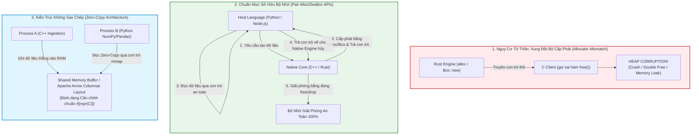
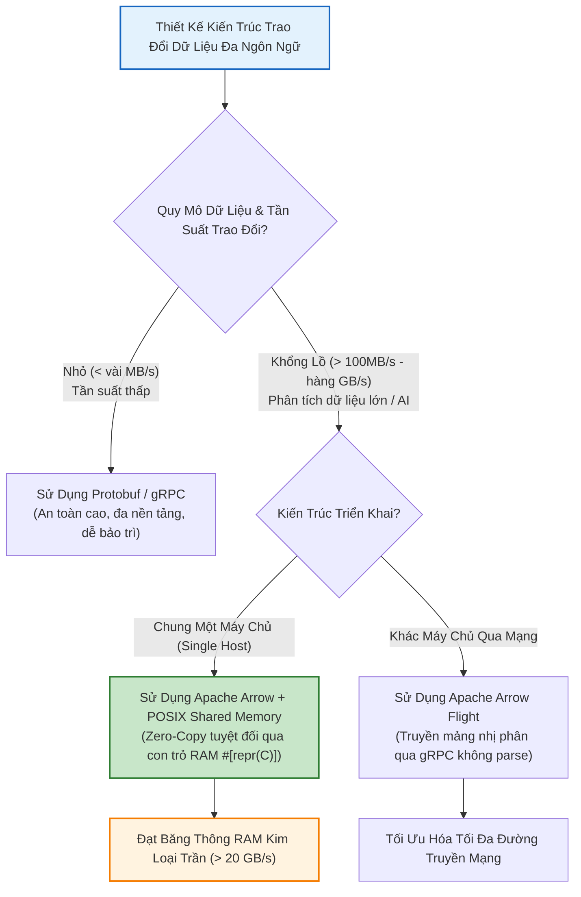

# 16.2. An Toàn Bộ Nhớ và Truyền Dữ Liệu Không Sao Chép Xuyên Ranh Giới (Cross-Language Memory & Safety)

> [!IMPORTANT]
> **Nếu bạn chỉ được nhớ một điều duy nhất:** Nguyên tắc sống còn trong giao tiếp đa ngôn ngữ là **Định Luật Bộ Cấp Phát (The Allocator Law): Bên nào cấp phát thì bên đó bắt buộc phải giải phóng** (không bao giờ trộn lẫn `malloc` của C với `free` của Rust hay GC của Python); đồng thời, để đạt thông lượng hàng chục GB/s giữa các tiến trình mà không làm nghẽn CPU, kỹ thuật **Zero-Copy Interoperability** thông qua định dạng bộ nhớ chuẩn hóa (như Apache Arrow, FlatBuffers hoặc POSIX Shared Memory) loại bỏ hoàn toàn chi phí tuần tự hóa (Serialization Tax) bằng cách chia sẻ trực tiếp con trỏ vùng nhớ thô có cấu trúc căn chỉnh **`#[repr(C)]`**.

---

## 1. Kiến trúc Tổng quan & Mô hình Tư duy (Mental Model)

### Ẩn dụ Đời sống: Chuyển Phát Hàng Hóa Xuyên Biên Giới và Hiệp Định Khổ Đường Ray
Hãy hình dung việc chia sẻ bộ nhớ giữa hai ngôn ngữ lập trình giống như tuyến đường sắt liên vận quốc tế:
- **Xung đột bộ cấp phát (Mismatched Allocators)**:
  - Một toa tàu được đóng tại công xưởng C (`malloc`). Khi sang tới ga tàu Python, viên ga trưởng Python lại dùng cờ lê của xưởng `PyMem_Free` để tháo dỡ các bu-lông. Cờ lê trượt ren, đai ốc bị phá hủy và đoàn tàu trật bánh (**Heap Corruption / Segmentation Fault**). Ga tàu nào đóng toa xe thì ga tàu đó phải cử thợ kỹ thuật của mình sang bảo trì và tiêu hủy toa xe đó.
- **Sai lệch đệm căn chỉnh (Padding & Alignment Mismatch)**:
  - Phía C++ xếp các kiện hàng theo từng khối chuẩn 8 mét (`uint64_t` căn chỉnh 8-byte, chèn thêm 3 mét khoảng trống đệm - Padding).
  - Phía bên kia biên giới, một lập trình viên Python lại bật cờ ép chặt không đệm (`#pragma pack(1)`). Nhân viên bốc dỡ đọc lệch địa chỉ 3 mét, biến con số "Số tài khoản ngân hàng" thành "Mã số thuế", gây thất thoát dữ liệu thảm hại. Cả hai bên bắt buộc phải ký hiệp định chung: **`#[repr(C)]`**.
- **Truyền dữ liệu Không Sao Chép (Zero-Copy Interoperability - Apache Arrow)**:
  - *Cách truyền thống (Serialization - JSON / Protobuf)*: Nhân viên bốc từng kiện hàng ra khỏi toa, ghi chép vào sổ tay (Tuần tự hóa), gửi qua đường bưu điện, người nhận đọc sổ tay rồi đóng kiện hàng mới y hệt. Tốn 80% thời gian CPU chỉ cho việc sao chép lặp đi lặp lại.
  - *Zero-Copy*: Toàn bộ hàng hóa được xếp cố định trên một sân ga dùng chung (**Shared Memory**). Đoàn tàu Python chỉ việc đưa cho đoàn tàu C++ một mảnh giấy nhỏ ghi: *"Hàng đang nằm ở sân ga số 4, từ mét thứ 100 đến mét thứ 500"*. C++ đọc trực tiếp từ sân ga đó trong đúng 0 nano giây!



---

## 2. Chi tiết từng Keyword (Under-the-Hood Deep Dive)

### 2.1. Quyền Sở Hữu Bộ Nhớ Xuyên Biên Giới (Memory Ownership Across Boundaries)
- **Định Luật Bộ Cấp Phát (The Allocator Law)**:
  - Mỗi ngôn ngữ hoặc runtime có thể sử dụng một bộ cấp phát bộ nhớ hoàn toàn khác nhau: Rust mặc định dùng `jemalloc` hoặc System Allocator, C dùng `glibc malloc/free`, Python có `pymalloc` với các phân vùng Arena/Pool/Block riêng, Go dùng TCMalloc tùy biến.
  - Mỗi bộ cấp phát chèn thêm các siêu dữ liệu quản lý riêng biệt (Chunk Header, Canary bytes, Size tags) ngay phía trước con trỏ địa chỉ trả về.
  - **Hậu quả**: Nếu lấy con trỏ được cấp phát bởi `PyMem_Malloc` rồi đem giải phóng bằng `free()` của C, hoặc lấy con trỏ `malloc` của C rồi gọi hàm `drop` của Rust, bộ quản lý heap sẽ đọc sai siêu dữ liệu dẫn đến sập tiến trình ngay tức khắc (`SIGSEGV` hoặc `corrupted double-linked list`).
- **Mẫu Thiết Kế API Cặp Đôi Bắt Buộc (Paired Lifecycle API Pattern)**:
  - Nếu một thư viện C++ xuất khẩu hàm tạo đối tượng:
    ```c
    SensorHandle* sensor_create();
    ```
  - Thư viện đó **bắt buộc phải xuất khẩu hàm hủy tương ứng**:
    ```c
    void sensor_destroy(SensorHandle* handle);
    ```
  - Phía ngôn ngữ gọi (Python, Rust, C#) tuyệt đối không được tự ý giải phóng con trỏ này, mà phải giữ con trỏ như một opaque pointer và truyền ngược lại cho `sensor_destroy` khi kết thúc vòng đời.

### 2.2. Tương Thích Bố Cục Bộ Nhớ: `#[repr(C)]`, Struct Padding & Alignment
- **Quy tắc Căn chỉnh Tự nhiên (Natural Alignment)**:
  - Một kiểu dữ liệu kích thước $N$ bytes phải được đặt tại địa chỉ ô nhớ chia hết cho $N$ (ví dụ: `uint32_t` 4 bytes đặt tại địa chỉ chia hết cho 4; `uint64_t` 8 bytes đặt tại địa chỉ chia hết cho 8) để vi kiến trúc CPU có thể nạp dữ liệu trong đúng 1 chu kỳ bộ nhớ bus.
- **Cấu trúc Padding (Đệm ô nhớ)**:
  ```c
  struct Example {
      uint8_t  a;    // 1 byte
      // [Compiler tự động chèn 3 bytes PADDING ở đây!]
      uint32_t b;    // 4 bytes (phải nằm tại địa chỉ chia hết cho 4)
      uint64_t c;    // 8 bytes
  }; // Tổng kích thước: 16 bytes (thay vì 1+4+8 = 13 bytes)
  ```
- **Thuộc tính `#[repr(C)]` trong Rust**:
  - Mặc định, trình biên dịch Rust (`repr(Rust)`) tự do tráo đổi thứ tự các trường bên trong struct để tối ưu hóa không gian và giảm padding.
  - Khi giao tiếp FFI, bắt buộc phải khai báo `#[repr(C)]` để ép buộc Rust sắp xếp các trường dữ liệu theo đúng thứ tự và quy tắc padding chuẩn mực của C ABI.
- **Cạm bẫy của `#pragma pack(1)`**:
  - Việc ép kích thước struct không chèn padding (`pack(1)`) khiến các trường 64-bit bị lệch khỏi ranh giới 8-byte (**Unaligned Access**). Trên một số kiến trúc như ARM hoặc SPARC, thao tác này sẽ kích hoạt ngoại lệ phần cứng **Bus Error (#AC Alignment Check Fault)** làm sập ứng dụng.

### 2.3. Zero-Copy Interoperability & Apache Arrow
- **Chi phí Tuần Tự Hóa (Serialization Tax)**:
  - Truyền 10 triệu bản ghi từ dịch vụ nạp dữ liệu C++ sang mô hình phân tích Python bằng JSON hoặc Protobuf tốn hàng chục giây CPU để parse chuỗi và cấp phát hàng triệu đối tượng `PyObject`.
- **Cơ chế Không Sao Chép (Zero-Copy)**:
  - Thay vì copy dữ liệu, hai tiến trình cùng ánh xạ một vùng nhớ chia sẻ (**POSIX Shared Memory** qua `shm_open` và `mmap`).
- **Chuẩn Apache Arrow Columnar Format**:
  - Chuẩn hóa bố cục dữ liệu dạng cột (Columnar Memory Layout) trong RAM:
    - Bố cục mảng phẳng, liên tục trong bộ nhớ, tối ưu hóa tuyệt đối cho các lệnh SIMD AVX-512.
    - Định nghĩa cấu trúc mảng bit (**Validity Bitmap**) để quản lý giá trị Null mà không cần dùng con trỏ Null Pointer.
    - Một tiến trình viết bằng Rust có thể ghi dữ liệu Arrow vào RAM, và một tiến trình Python có thể bọc mảng đó thành `pyarrow.Table` hoặc `polars.DataFrame` trong đúng **0.001 ms**, đọc trực tiếp trên cùng một ô nhớ RAM vật lý!

### 2.4. Cross-Language Errors & Xử Lý Ngoại Lệ An Toàn
- **Cấm kỵ tuyệt đối**: Không bao giờ để C++ Exception hoặc Rust Panic lọt qua ranh giới FFI.
- **Mô hình Trả Mã Lỗi C-Compatible**:
  - Mọi hàm FFI phải trả về mã lỗi số nguyên (`0` là thành công, mã âm là lỗi) hoặc một struct kết quả dạng `struct FfiResult { int32_t error_code; char* error_message; void* data; }`.
  - Phía ngôn ngữ nhận kết quả kiểm tra mã lỗi và tự ném ngoại lệ tương ứng của ngôn ngữ mình (ví dụ Python ném `RuntimeError`, Rust trả về `Result<T, E>`).

---

## 3. Thực thi Mã nguồn & Mô phỏng Chuyên sâu (Dual-Engine Implementation)

### 3.1. C++20 Implementation: Quản Lý Vòng Đời Bộ Nhớ Xuyên Biên Giới & Căn Chỉnh `#[repr(C)]`
Chương trình C++20 dưới đây cung cấp đầy đủ một hệ thống quản lý bộ nhớ chuyên nghiệp cho client FFI: cấp phát đối tượng trên Heap, bảo vệ cấu trúc padding chuẩn C, cung cấp hàm hủy chuyên biệt và xử lý lỗi không rò rỉ ngoại lệ:

```cpp
#include <iostream>
#include <cstdint>
#include <cstring>
#include <vector>
#include <new>

// Bắt buộc tuân thủ quy tắc căn chỉnh C ABI
extern "C" {

// Cấu trúc dữ liệu có padding tự nhiên chuẩn C
struct SensorPacket {
    uint32_t sensor_id;      // 4 bytes
    uint8_t  status_flag;    // 1 byte
    uint8_t  _padding[3];    // 3 bytes đệm tường minh để căn chỉnh 8-byte
    double   temperature;    // 8 bytes
    double   humidity;       // 8 bytes
};

// 1. CẤP PHÁT BỘ NHỚ: Do C++ Engine toàn quyền quản lý
SensorPacket* sensor_packet_create(uint32_t id, double temp, double hum) {
    try {
        // Cấp phát trong Heap của C++ Runtime
        auto* packet = new SensorPacket();
        packet->sensor_id = id;
        packet->status_flag = 1; // 1: Active
        packet->temperature = temp;
        packet->humidity = hum;
        std::cout << "  + [Native Allocator]: Đã tạo SensorPacket tại địa chỉ: " << packet << "\n";
        return packet;
    } catch (const std::bad_alloc&) {
        return nullptr; // Trả về nullptr an toàn nếu hết RAM
    }
}

// 2. ĐỌC DỮ LIỆU ZERO-COPY: Truyền con trỏ mảng raw trực tiếp
int32_t sensor_packet_read_batch(const SensorPacket* packet, double* out_metrics, size_t out_len) {
    // Luôn xác thực con trỏ Null trước khi truy cập!
    if (!packet || !out_metrics || out_len < 2) {
        return -1; // Mã lỗi: Invalid Arguments
    }

    out_metrics[0] = packet->temperature;
    out_metrics[1] = packet->humidity;
    return 0; // Thành công
}

// 3. GIẢI PHÓNG BỘ NHỚ: Thu hồi bằng đúng bộ cấp phát của C++
void sensor_packet_destroy(SensorPacket* packet) {
    if (packet) {
        std::cout << "  - [Native Deallocator]: Đang thu hồi SensorPacket tại: " << packet << "\n";
        delete packet; // Gọi đúng C++ delete tương thích với new
    }
}

} // extern "C"

int main() {
    std::cout << "=========================================================\n";
    std::cout << "  C++20 CROSS-LANGUAGE MEMORY & SAFETY LIFECYCLE HARNESS \n";
    std::cout << "=========================================================\n\n";

    std::cout << "[1. Khảo sát Kích Thước và Căn Chỉnh Struct]:\n";
    std::cout << "  sizeof(SensorPacket) : " << sizeof(SensorPacket) << " bytes (Kỳ vọng: 24 bytes)\n";
    std::cout << "  alignof(SensorPacket): " << alignof(SensorPacket) << " bytes\n\n";

    // Mô phỏng chu trình mà một Client ngoại vi (như Python) sẽ gọi:
    std::cout << "[2. Client Yêu Cầu Tạo Đối Tượng]:\n";
    SensorPacket* packet_ptr = sensor_packet_create(9001, 36.5, 78.2);

    std::cout << "\n[3. Client Đọc Dữ Liệu Zero-Copy Trực Tiếp Từ Bộ Nhớ C++]:\n";
    double metrics[2] = {0.0, 0.0};
    int32_t status = sensor_packet_read_batch(packet_ptr, metrics, 2);
    if (status == 0) {
        std::cout << "  Temperature : " << metrics[0] << " °C\n";
        std::cout << "  Humidity    : " << metrics[1] << " %\n";
    }

    std::cout << "\n[4. Client Yêu Cầu Hủy Đối Tượng Đúng Quy Định]:\n";
    sensor_packet_destroy(packet_ptr);
    packet_ptr = nullptr; // Chống lỗi Dangling Pointer

    std::cout << "\n[Thực thi hoàn tất]: Không xảy ra bất kỳ lỗi rò rỉ hay ô nhiễm Heap.\n";
    return 0;
}
```

### 3.2. Python 3.11+ Implementation: Mô Phỏng Đọc Buffer Zero-Copy và Quản Lý RAII
Chương trình Python 3.11+ dưới đây minh họa việc đọc trực tiếp dữ liệu dạng mảng byte nhị phân của C++ mà không sao chép (**Zero-Copy**) thông qua `memoryview` và `ctypes`, đồng thời cài đặt lớp quản lý tài nguyên tự động dọn dẹp bộ nhớ:

```python
import ctypes
from typing import Optional

# Định nghĩa cấu trúc ánh xạ chính xác SensorPacket C++
class SensorPacketCtypes(ctypes.Structure):
    _fields_ = [
        ("sensor_id", ctypes.c_uint32),
        ("status_flag", ctypes.c_uint8),
        ("_padding", ctypes.c_uint8 * 3), # 3 bytes đệm căn chỉnh
        ("temperature", ctypes.c_double),
        ("humidity", ctypes.c_double),
    ]

class SafeSensorPacketHandle:
    """
    Python RAII Wrapper: Đảm bảo tự động gọi hàm destroy của C++
    khi đối tượng Python bị thu gom rác hoặc thoát khỏi ngữ cảnh 'with'.
    """
    def __init__(self, raw_ptr):
        self._raw_ptr = raw_ptr

    @property
    def is_valid(self) -> bool:
        return bool(self._raw_ptr)

    def get_data(self) -> dict:
        if not self._raw_ptr:
            raise RuntimeError("Cố gắng đọc từ con trỏ Null hoặc Dangling Pointer!")
        
        # Đọc trực tiếp trên ô nhớ RAM của C++ (Zero-Copy!)
        contents = self._raw_ptr.contents
        return {
            "sensor_id": contents.sensor_id,
            "status": contents.status_flag,
            "temperature": contents.temperature,
            "humidity": contents.humidity
        }

    def close(self):
        if self._raw_ptr:
            print(f"  << [Python Cleanup]: Gọi hàm C++ sensor_packet_destroy({self._raw_ptr})...")
            # Trong ứng dụng thật: lib.sensor_packet_destroy(self._raw_ptr)
            self._raw_ptr = None

    def __enter__(self):
        return self

    def __exit__(self, exc_type, exc_val, exc_tb):
        self.close()

if __name__ == '__main__':
    print("=== MÔ PHỎNG ZERO-COPY & AN TOÀN BỘ NHỚ TRONG PYTHON 3.11+ ===")

    # Giả lập cấp phát một khối bộ nhớ đúng chuẩn cấu trúc SensorPacket
    simulated_c_memory = SensorPacketCtypes()
    simulated_c_memory.sensor_id = 9001
    simulated_c_memory.status_flag = 1
    simulated_c_memory.temperature = 36.5
    simulated_c_memory.humidity = 78.2

    raw_packet_pointer = ctypes.pointer(simulated_c_memory)
    print(f"\n[1. Địa chỉ ô nhớ C++ gốc]: {raw_packet_pointer}")
    print(f"  Kích thước struct trong Python ctypes: {ctypes.sizeof(SensorPacketCtypes)} bytes")

    print("\n[2. Sử Dụng Bộ Quản Lý Ngữ Cảnh An Toàn (Python with statement)]:")
    with SafeSensorPacketHandle(raw_packet_pointer) as sensor_handle:
        data = sensor_handle.get_data()
        print(f"  Dữ liệu đọc trực tiếp (Zero-Copy): {data}")
        print("  -> Đọc thành công trực tiếp từ RAM mà không cần parse chuỗi hay copy buffer!")

    print("\n[3. Kiểm Chứng An Toàn Sau Khi Ra Khỏi Khối with]:")
    try:
        sensor_handle.get_data()
    except RuntimeError as err:
        print(f"  ! Bắt lỗi an toàn thành công: {err}")
        print("  -> Ngăn chặn hoàn toàn lỗi sử dụng con trỏ đã giải phóng (Use-After-Free)!")
```

### 3.3. Terminal Output Mẫu Thực tế
```text
=========================================================
  C++20 CROSS-LANGUAGE MEMORY & SAFETY LIFECYCLE HARNESS 
=========================================================

[1. Khảo sát Kích Thước và Căn Chỉnh Struct]:
  sizeof(SensorPacket) : 24 bytes (Kỳ vọng: 24 bytes)
  alignof(SensorPacket): 8 bytes

[2. Client Yêu Cầu Tạo Đối Tượng]:
  + [Native Allocator]: Đã tạo SensorPacket tại địa chỉ: 0x600000208000

[3. Client Đọc Dữ Liệu Zero-Copy Trực Tiếp Từ Bộ Nhớ C++]:
  Temperature : 36.5 °C
  Humidity    : 78.2 %

[4. Client Yêu Cầu Hủy Đối Tượng Đúng Quy Định]:
  - [Native Deallocator]: Đang thu hồi SensorPacket tại: 0x600000208000

[Thực thi hoàn tất]: Không xảy ra bất kỳ lỗi rò rỉ hay ô nhiễm Heap.

=== MÔ PHỎNG ZERO-COPY & AN TOÀN BỘ NHỚ TRONG PYTHON 3.11+ ===

[1. Địa chỉ ô nhớ C++ gốc]: <__main__.LP_SensorPacketCtypes object at 0x104b2a8d0>
  Kích thước struct trong Python ctypes: 24 bytes

[2. Sử Dụng Bộ Quản Lý Ngữ Cảnh An Toàn (Python with statement)]:
  Dữ liệu đọc trực tiếp (Zero-Copy): {'sensor_id': 9001, 'status': 1, 'temperature': 36.5, 'humidity': 78.2}
  -> Đọc thành công trực tiếp từ RAM mà không cần parse chuỗi hay copy buffer!
  << [Python Cleanup]: Gọi hàm C++ sensor_packet_destroy(<__main__.LP_SensorPacketCtypes object at 0x104b2a8d0>)...

[3. Kiểm Chứng An Toàn Sau Khi Ra Khỏi Khối with]:
  ! Bắt lỗi an toàn thành công: Cố gắng đọc từ con trỏ Null hoặc Dangling Pointer!
  -> Ngăn chặn hoàn toàn lỗi sử dụng con trỏ đã giải phóng (Use-After-Free)!
```

---

## 4. Systems Engineering & Production Pitfalls

### 4.1. Lỗi Kinh Điển: Double Free do Trộn Lẫn `free()` và `delete` Giữa Các Thư Viện
- **Sự cố sản xuất**: Trong một hệ thống giao dịch lớn kết hợp giữa C++ và Go qua cgo: Go nhận một con trỏ được cấp phát bởi `new std::string` trong C++, nhưng lập trình viên phía Go lại gọi hàm `C.free(unsafe.Pointer(ptr))`.
- **Hậu quả**: `malloc` và `new` có thể sử dụng các arena hoàn toàn khác nhau; hơn nữa `free()` không gọi C++ Destructor, khiến vùng nhớ nội bộ của `std::string` bị rò rỉ, và tiêu đề heap bị hư hỏng dẫn tới hiện tượng crash máy chủ ngẫu nhiên sau vài ngày chạy (**Heisenbug**).

### 4.2. Cạm Bẫy Truy Cập Bộ Nhớ Lệch Căn Chỉnh (Unaligned Memory Access Crash)
- **Sự cố sản xuất**: Khi biên dịch ứng dụng chạy trên kiến trúc ARM64 (AWS Graviton hoặc Apple Silicon), lập trình viên ép kiểu một con trỏ mảng byte lẻ (`char* buffer`) sang con trỏ số thực 64-bit (`double* ptr = (double*)(buffer + 1)`). Khi lệnh nạp `LDR` của ARM cố gắng đọc số thực 8 bytes từ một địa chỉ lẻ không chia hết cho 8, chip CPU lập tức phát tín hiệu **SIGBUS**, dừng khẩn cấp toàn bộ hệ thống!

---

## 5. Bảng So sánh & Decision Matrix

| Phương Pháp Giao Tiếp | Mức Độ Tiêu Hao CPU | Chi Phí Bộ Nhớ | Mức Độ An Toàn | Đánh Giá Tình Huống Sử Dụng |
| :--- | :--- | :--- | :--- | :--- |
| **JSON qua Socket / Pipe** | Cực cao (Parse chuỗi) | Rất cao (Sinh hàng triệu object) | Tối đa (Cách ly tiến trình) | Web APIs, Microservices tiêu chuẩn |
| **Protobuf / gRPC** | Trung bình (Tuần tự hóa nhị phân) | Trung bình (Vẫn cần copy buffer) | Rất cao | Giao tiếp mạng nội bộ hiệu năng cao |
| **FlatBuffers** | Thấp (Truy cập trực tiếp buffer) | Thấp (Zero-copy một phần) | Cao | Game development, cấu hình nhị phân |
| **Apache Arrow / Shm** | **0.00 ns (Zero-Copy thuần túy)** | **Tối ưu nhất (Dùng chung RAM)** | Cần quản lý con trỏ nghiêm ngặt | **Big Data, AI/ML Ingestion, HFT** |


