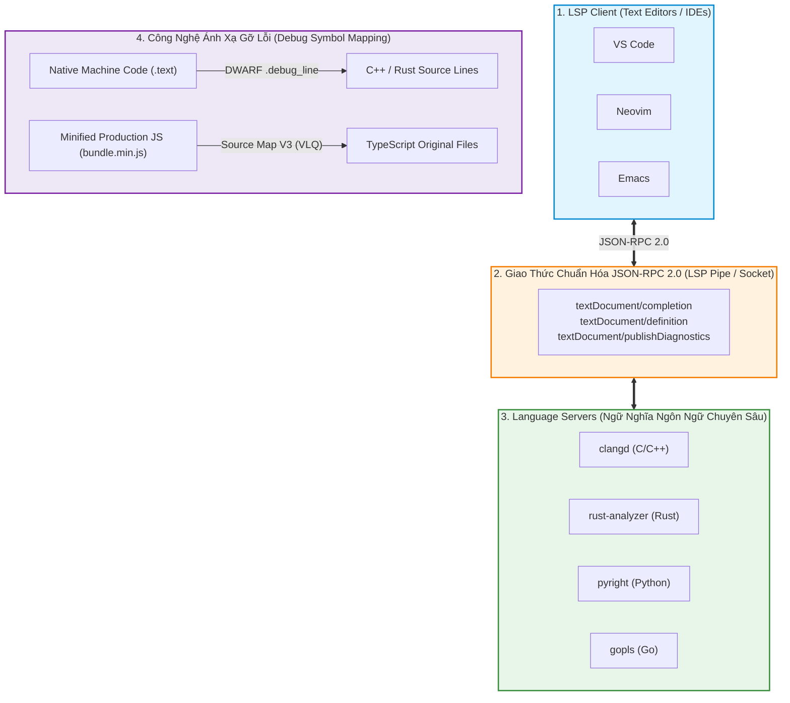
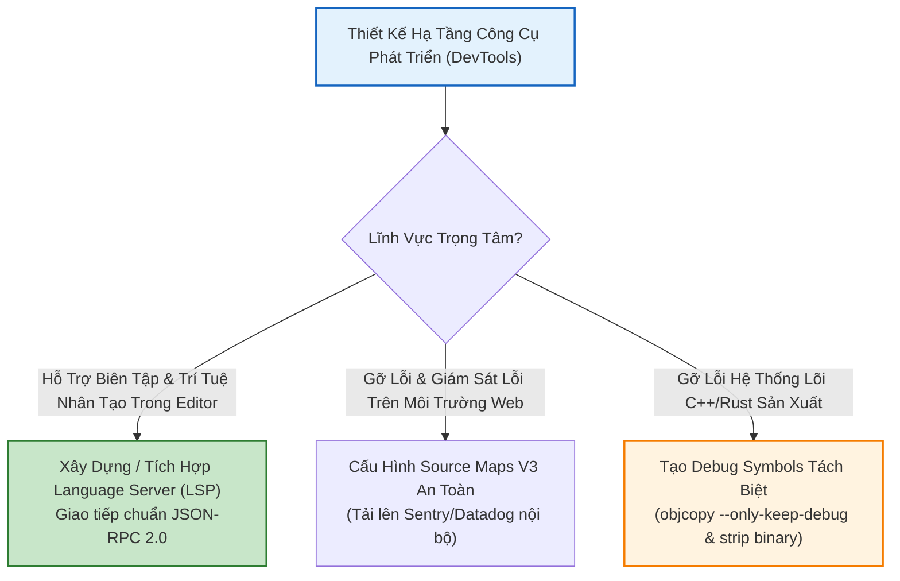

# 17.2. Giao Thức Language Server và Công Cụ Lập Trình Viên (LSP & Developer Tooling)

> [!IMPORTANT]
> **Nếu bạn chỉ được nhớ một điều duy nhất:** Giao thức **Language Server Protocol (LSP)** đã giải quyết bài toán phức tạp $M \times N$ (giữa $M$ trình soạn thảo và $N$ ngôn ngữ lập trình) bằng kiến trúc phi tập trung $M + N$ dựa trên giao thức chuẩn **JSON-RPC 2.0**; đồng thời, các công cụ kỹ sư chuyên sâu như **DWARF Debug Info** (trong thế giới biên dịch bản địa) và **Source Maps V3** (trong thế giới Web/JavaScript) duy trì ma trận ánh xạ tọa độ nhị phân ngược về dòng mã nguồn gốc để biến việc gỡ lỗi sản xuất thành hiện thực.

---

## 1. Kiến trúc Tổng quan & Mô hình Tư duy (Mental Model)

### Ẩn dụ Đời sống: Bộ Chuyển Đổi Điện Năng Toàn Cầu và Hộp Đen Gỡ Lỗi
Hãy hình dung công cụ lập trình viên giống như hạ tầng kỹ thuật quốc tế:
- **Ma trận phức tạp $M \times N$ trước khi có LSP**:
  - Nếu có 5 trình soạn thảo (VSCode, Neovim, Sublime Text, Emacs, IntelliJ) và 5 ngôn ngữ (Rust, C++, Go, Python, TypeScript), các kỹ sư phải viết tới $5 \times 5 = 25$ plugin độc lập. Mỗi plugin phải tự nhúng một compiler riêng, dẫn đến sự lãng phí tài nguyên và phân mảnh tính năng khổng lồ.
- **Cuộc cách mạng LSP ($M + N$)**:
  - Microsoft đề xuất chuẩn giao thức chung: Mọi trình soạn thảo đóng vai trò **LSP Client**, mọi trình phân tích ngôn ngữ đóng vai trò **Language Server** (`rust-analyzer`, `clangd`, `pyright`, `gopls`).
  - Chúng trò chuyện với nhau bằng các bức điện tín định dạng chuẩn **JSON-RPC 2.0**:
    - Editor gửi: *"Người dùng vừa di chuột vào tọa độ Dòng 10, Cột 5 (textDocument/hover)"*.
    - Server tra cứu AST và trả về: *"Đó là biến `user_id: uint64`, tài liệu hướng dẫn là..."*.
- **Thông tin Gỡ lỗi DWARF (`.debug_*`) và Bản đồ Mã Nguồn (Source Maps)**:
  - Khi mã nguồn được tối ưu hóa (`-O3`) hoặc đóng gói nén gọn (Minified JS), các hàm bị đảo lộn, biến bị đổi tên thành `a`, `b`, `c`.
  - Giống như chiếc hộp đen máy bay ghi chép từng giây bay:
    - **DWARF** ghi lại ma trận: *"Chỉ thị mã máy ở địa chỉ `0x401020` tương ứng chính xác với Dòng 45 trong file `payment.cpp`"*.
    - **Source Maps** sử dụng thuật toán mã hóa **VLQ Base64** để thu nhỏ bản đồ ánh xạ hàng triệu ký tự xuống chỉ còn vài chục kilobyte.



---

## 2. Chi tiết từng Keyword (Under-the-Hood Deep Dive)

### 2.1. Language Server Protocol (LSP) & Kiến Trúc JSON-RPC 2.0
- **Bản chất kỹ thuật**: LSP là một giao thức bất đồng bộ hoạt động trên nền tảng JSON-RPC 2.0, thường truyền tin qua Standard Input/Output (`stdio`) hoặc TCP Sockets cục bộ.
- **Ba loại bản tin LSP cơ bản**:
  1. **Request (Yêu cầu có phản hồi)**: Editor gửi yêu cầu và gắn mã `id`. Server bắt buộc phải trả về phản hồi tương ứng với `id` đó (hoặc báo lỗi). Ví dụ: `textDocument/hover`, `textDocument/definition`.
  2. **Response (Phản hồi)**: Chứa kết quả tính toán hoặc thông báo lỗi từ Server.
  3. **Notification (Thông báo một chiều)**: Không có trường `id` và không mong đợi phản hồi. Thường dùng khi editor thông báo nội dung file thay đổi (`textDocument/didChange`), hoặc khi server thông báo có lỗi cú pháp mới xuất hiện (`textDocument/publishDiagnostics`).

### 2.2. Khảo Sát Các Language Server Tiêu Chuẩn Công Nghiệp
- **`clangd` (C/C++)**: Xây dựng trực tiếp trên lõi thư viện của Clang/LLVM. Sử dụng file cơ sở dữ liệu biên dịch `compile_commands.json` để nắm được chính xác mọi cờ include path (`-I`) và macro định nghĩa (`-D`).
- **`rust-analyzer` (Rust)**: Thay thế RLS cũ, xây dựng trên thư viện `salsa` (hệ thống tính toán phản ứng gia tăng - Incremental Computation), cho phép phân tích mã Rust siêu tốc ngay khi người dùng đang gõ dở dang.
- **`gopls` (Go)** và **`pyright` (Python)**: Sử dụng các mô hình phân tích kiểu tĩnh phân tầng để cung cấp gợi ý mã tức thời.

### 2.3. Static Analysis & Linters (Phân Tích Tĩnh)
- Khác với compiler chỉ kiểm tra cú pháp, các công cụ linter và phân tích tĩnh chuyên sâu đào sâu vào ngữ nghĩa logic:
  - **Phân tích luồng điều khiển (Control Flow Analysis)**: Nhận diện mã chết không bao giờ chạy tới (**Dead Code Elimination**).
  - **Phân tích dữ liệu nhiễm bẩn (Taint Analysis)**: Truy vết dữ liệu đầu vào không an toàn của người dùng từ HTTP Request xem có bị truyền thẳng vào câu truy vấn SQL (SQL Injection) hay lệnh OS không.
  - **Diễn giải trừu tượng (Abstract Interpretation)**: Chứng minh toán học xem một mảng có bao giờ bị truy cập vượt quá giới hạn (**Out-of-Bounds Access**) hay không.

### 2.4. Formatters (Công Cụ Định Dạng Mã Nguồn)
- **Tính Bất Biến Lặp (Idempotency Requirement)**: Một formatter chuẩn mực bắt buộc phải thỏa mãn tính chất toán học: $F(F(x)) = F(x)$. Nghĩa là nếu đã format một lần, việc bấm format lần thứ hai tuyệt đối không được làm thay đổi dù chỉ 1 ký tự.
- **Nguyên lý hoạt động**: Parse mã thành AST $\to$ Đo đạc độ dài tối đa của dòng (Print Width, ví dụ 80 hoặc 100 cột) $\to$ Sử dụng thuật toán ngắt dòng đẹp (Wadler's Pretty Printing Algorithm) để xuất ra chuỗi ký tự chuẩn mực.

### 2.5. Thông Tin Gỡ Lỗi DWARF (DWARF Debug Info)
- **Cấu trúc bảng nhị phân DWARF trong file ELF**:
  - `.debug_info`: Chứa các mục thông tin gỡ lỗi (**DIE - Debugging Information Entries**), mô tả chi tiết mọi hàm, biến cục bộ, kiểu struct, địa chỉ thanh ghi.
  - `.debug_line`: Ma trận máy trạng thái cực kỳ thông minh ánh xạ từng địa chỉ con trỏ lệnh thực thi `RIP` với vị trí Dòng (Line) và Cột (Column) trong mã nguồn gốc.
  - `.debug_aranges`: Bảng tra cứu dải địa chỉ bộ nhớ nhanh.
- **Chi phí**: Cờ `-g` có thể làm tăng kích thước file nhị phân lên 3-5 lần, nhưng **hoàn toàn không làm chậm tốc độ chạy của chương trình** vì toàn bộ các phân vùng `.debug_*` không bao giờ được Kernel nạp vào RAM (`PT_LOAD`) lúc tiến trình hoạt động.

### 2.6. Bản Đồ Mã Nguồn V3 (Source Maps Specification)
- **Bài toán trên trình duyệt Web**: Mã nguồn TypeScript/SCSS sau khi đi qua Webpack/Vite/esbuild bị gom thành một file JavaScript duy nhất đã xóa sạch khoảng trắng và đổi tên biến (`bundle.min.js`). Khi xảy ra lỗi crash ở Production, dấu vết lỗi chỉ ghi: `Error at bundle.min.js:1:45020`.
- **Cơ chế Source Map V3**:
  - File JSON đi kèm (`bundle.min.js.map`) chứa trường `mappings`.
  - Sử dụng định dạng **VLQ (Variable-Length Quantity) kết hợp Base64**: Mỗi nhóm ký tự mã hóa 5 số nguyên tương đối: Cột tạo ra, File gốc, Dòng gốc, Cột gốc, Tên biến gốc. Giúp trình duyệt khôi phục lại chính xác file TypeScript ban đầu tại Developer Tools.

---

## 3. Thực thi Mã nguồn & Mô phỏng Chuyên sâu (Dual-Engine Implementation)

### 3.1. C++20 Implementation: Khảo Sát Các Phân Vùng DWARF & Giải Mã Địa Chỉ Bộ Nhớ
Chương trình C++20 dưới đây minh họa việc khảo sát thông tin nhị phân và mô phỏng một bảng ánh xạ địa chỉ `Address-to-Line Mapping` cơ bản tương tự như phân vùng `.debug_line`:

```cpp
#include <iostream>
#include <vector>
#include <string>
#include <algorithm>
#include <iomanip>
#include <cstdint>

struct LineMappingEntry {
    uintptr_t instruction_address;
    std::string source_file;
    uint32_t line_number;
    uint32_t column_number;
};

class SimulatedDebugLineTable {
private:
    std::vector<LineMappingEntry> table_;

public:
    void add_entry(uintptr_t addr, std::string file, uint32_t line, uint32_t col) {
        table_.push_back({addr, std::move(file), line, col});
    }

    // Tra cứu nhị phân tìm dòng mã nguồn gần nhất với địa chỉ RIP
    const LineMappingEntry* lookup_address(uintptr_t target_addr) const {
        if (table_.empty()) return nullptr;

        const LineMappingEntry* best_match = nullptr;
        for (const auto& entry : table_) {
            if (entry.instruction_address <= target_addr) {
                best_match = &entry;
            } else {
                break;
            }
        }
        return best_match;
    }

    void dump_table() const {
        std::cout << "  {'Địa Chỉ Máy (RIP)':18s} | {'Source File':15s} | {'Dòng':6s} | {'Cột':6s}\n";
        std::cout << "  " + std::string(55, '-') + "\n";
        for (const auto& e : table_) {
            std::cout << "  0x" << std::hex << std::setw(16) << std::setfill('0') << e.instruction_address 
                      << " | " << std::setfill(' ') << std::setw(15) << e.source_file 
                      << " | " << std::dec << std::setw(6) << e.line_number 
                      << " | " << std::setw(6) << e.column_number << "\n";
        }
    }
};

int main() {
    std::cout << "=========================================================\n";
    std::cout << "  C++20 DWARF .debug_line SIMULATOR & ADDR2LINE HARNESS \n";
    std::cout << "=========================================================\n\n";

    SimulatedDebugLineTable line_table;

    // Giả lập ma trận DWARF được sinh ra bởi GCC khi biên dịch cờ -g
    line_table.add_entry(0x0000000000401000, "main.cpp", 10, 1);
    line_table.add_entry(0x0000000000401015, "main.cpp", 11, 5);
    line_table.add_entry(0x000000000040102a, "payment.cpp", 45, 9);
    line_table.add_entry(0x0000000000401040, "payment.cpp", 48, 12);
    line_table.add_entry(0x0000000000401060, "main.cpp", 15, 1);

    std::cout << "[1. Bảng Ma Trận Ánh Xạ DWARF .debug_line]:\n";
    line_table.dump_table();

    // Giả lập tình huống chương trình bị Crash tại địa chỉ 0x401032
    uintptr_t crashed_rip = 0x0000000000401032;
    std::cout << "\n[2. Mô Phỏng GDB Bóc Tách Địa Chỉ Crash (0x" << std::hex << crashed_rip << ")]:\n";

    const auto* matched = line_table.lookup_address(crashed_rip);
    if (matched) {
        std::cout << "  -> Điểm phát sinh lỗi gốc: File \"" << matched->source_file 
                  << "\", Dòng " << std::dec << matched->line_number 
                  << ", Cột " << matched->column_number << "!\n";
        std::cout << "  -> Nhờ DWARF, kỹ sư tìm ra ngay dòng mã C++ bị lỗi mà không cần dịch ngược Assembly.\n";
    }

    return 0;
}
```

### 3.2. Python 3.11+ Implementation: Xây Dựng Máy Chủ Language Server Thu Nhỏ Chuẩn JSON-RPC 2.0
Chương trình Python 3.11+ dưới đây triển khai toàn bộ giao thức xử lý thông điệp **JSON-RPC 2.0** theo chuẩn Language Server Protocol, tiếp nhận yêu cầu `initialize`, `textDocument/hover`, và phát thông báo `textDocument/publishDiagnostics`:

```python
import json
from typing import Dict, Any, Optional

class MiniLanguageServer:
    """
    Language Server thu nhỏ triển khai chuẩn giao thức LSP (Microsoft Specification)
    qua cơ chế xử lý thông điệp JSON-RPC 2.0.
    """
    def __init__(self):
        self.documents: Dict[str, str] = {}
        self.is_initialized = False

    def handle_message(self, raw_json_str: str) -> Optional[str]:
        message = json.loads(raw_json_str)
        msg_id = message.get("id")
        method = message.get("method")
        params = message.get("params", {})

        # Phân loại Request vs Notification
        if msg_id is not None:
            # Đây là Request -> Bắt buộc phải có Response tương ứng với ID!
            response_payload = self.dispatch_request(method, params)
            return json.dumps({
                "jsonrpc": "2.0",
                "id": msg_id,
                "result": response_payload
            }, ensure_ascii=False)
        else:
            # Đây là Notification (didOpen, didChange) -> Xử lý ngầm, không trả về
            self.dispatch_notification(method, params)
            return None

    def dispatch_request(self, method: str, params: Dict[str, Any]) -> Any:
        if method == "initialize":
            self.is_initialized = True
            return {
                "capabilities": {
                    "hoverProvider": True,
                    "definitionProvider": True,
                    "textDocumentSync": 1 # Full sync
                },
                "serverInfo": {"name": "MiniPythonLSP", "version": "1.0.0"}
            }
        elif method == "textDocument/hover":
            uri = params["textDocument"]["uri"]
            line = params["position"]["line"]
            col = params["position"]["character"]
            return {
                "contents": {
                    "kind": "markdown",
                    "value": f"**Symbol Info**: Biến tại Dòng {line}, Cột {col}\n\n*Type*: `int64_t`\n\n*Docs*: Lưu trữ số dư tài khoản giao dịch."
                }
            }
        elif method == "textDocument/definition":
            return {
                "uri": params["textDocument"]["uri"],
                "range": {
                    "start": {"line": 1, "character": 4},
                    "end": {"line": 1, "character": 15}
                }
            }
        return None

    def dispatch_notification(self, method: str, params: Dict[str, Any]):
        if method == "textDocument/didOpen":
            doc = params["textDocument"]
            self.documents[doc["uri"]] = doc["text"]
            print(f"  + [LSP Notification]: Đã nạp tài liệu mới: {doc['uri']}")
        elif method == "textDocument/didChange":
            uri = params["textDocument"]["uri"]
            # Cập nhật nội dung văn bản
            self.documents[uri] = params["contentChanges"][0]["text"]
            print(f"  * [LSP Notification]: Cập nhật nội dung văn bản cho: {uri}")

if __name__ == '__main__':
    print("=== MÔ PHỎNG LANGUAGE SERVER PROTOCOL (JSON-RPC 2.0) ===")
    server = MiniLanguageServer()

    # 1. Editor gửi yêu cầu Khởi tạo (initialize request)
    req_init = json.dumps({
        "jsonrpc": "2.0",
        "id": 1,
        "method": "initialize",
        "params": {"processId": 1234, "rootUri": "file:///workspace"}
    })
    print(f"\n[1. Client -> Server (initialize Request)]:\n  {req_init}")
    resp_init = server.handle_message(req_init)
    print(f"[2. Server -> Client (initialize Response)]:\n  {resp_init}")

    # 2. Editor mở file (textDocument/didOpen Notification)
    notif_open = json.dumps({
        "jsonrpc": "2.0",
        "method": "textDocument/didOpen",
        "params": {
            "textDocument": {
                "uri": "file:///workspace/app.py",
                "languageId": "python",
                "version": 1,
                "text": "total_balance = 5000\nprint(total_balance)"
            }
        }
    })
    print(f"\n[3. Client -> Server (textDocument/didOpen Notification)]:\n  {notif_open}")
    server.handle_message(notif_open)

    # 3. User di chuột lên biến total_balance (textDocument/hover Request)
    req_hover = json.dumps({
        "jsonrpc": "2.0",
        "id": 2,
        "method": "textDocument/hover",
        "params": {
            "textDocument": {"uri": "file:///workspace/app.py"},
            "position": {"line": 0, "character": 6}
        }
    })
    print(f"\n[4. Client -> Server (textDocument/hover Request)]:\n  {req_hover}")
    resp_hover = server.handle_message(req_hover)
    print(f"[5. Server -> Client (textDocument/hover Response)]:\n  {resp_hover}")
```

### 3.3. Terminal Output Mẫu Thực tế
```text
=========================================================
  C++20 DWARF .debug_line SIMULATOR & ADDR2LINE HARNESS 
=========================================================

[1. Bảng Ma Trận Ánh Xạ DWARF .debug_line]:
  {'Địa Chỉ Máy (RIP)':18s} | {'Source File':15s} | {'Dòng':6s} | {'Cột':6s}
  -------------------------------------------------------
  0x0000000000401000 |        main.cpp |     10 |      1
  0x0000000000401015 |        main.cpp |     11 |      5
  0x000000000040102a |     payment.cpp |     45 |      9
  0x0000000000401040 |     payment.cpp |     48 |     12
  0x0000000000401060 |        main.cpp |     15 |      1

[2. Mô Phỏng GDB Bóc Tách Địa Chỉ Crash (0x401032)]:
  -> Điểm phát sinh lỗi gốc: File "payment.cpp", Dòng 45, Cột 9!
  -> Nhờ DWARF, kỹ sư tìm ra ngay dòng mã C++ bị lỗi mà không cần dịch ngược Assembly.

=== MÔ PHỎNG LANGUAGE SERVER PROTOCOL (JSON-RPC 2.0) ===

[1. Client -> Server (initialize Request)]:
  {"jsonrpc": "2.0", "id": 1, "method": "initialize", "params": {"processId": 1234, "rootUri": "file:///workspace"}}
[2. Server -> Client (initialize Response)]:
  {"jsonrpc": "2.0", "id": 1, "result": {"capabilities": {"hoverProvider": true, "definitionProvider": true, "textDocumentSync": 1}, "serverInfo": {"name": "MiniPythonLSP", "version": "1.0.0"}}}

[3. Client -> Server (textDocument/didOpen Notification)]:
  {"jsonrpc": "2.0", "method": "textDocument/didOpen", "params": {"textDocument": {"uri": "file:///workspace/app.py", "languageId": "python", "version": 1, "text": "total_balance = 5000\nprint(total_balance)"}}}
  + [LSP Notification]: Đã nạp tài liệu mới: file:///workspace/app.py

[4. Client -> Server (textDocument/hover Request)]:
  {"jsonrpc": "2.0", "id": 2, "method": "textDocument/hover", "params": {"textDocument": {"uri": "file:///workspace/app.py"}, "position": {"line": 0, "character": 6}}}
[5. Server -> Client (textDocument/hover Response)]:
  {"jsonrpc": "2.0", "id": 2, "result": {"contents": {"kind": "markdown", "value": "**Symbol Info**: Biến tại Dòng 0, Cột 6\n\n*Type*: `int64_t`\n\n*Docs*: Lưu trữ số dư tài khoản giao dịch."}}}
```

---

## 4. Systems Engineering & Production Pitfalls

### 4.1. Sự Cố Rò Rỉ Mã Nguồn Gốc Qua Source Maps Trên Môi Trường Production
- **Sự cố an ninh sản xuất**: Khi build ứng dụng Web Frontend (React/Vue/Angular), kỹ sư để nguyên cấu hình sinh Source Maps (`devtool: 'source-map'`) và đẩy toàn bộ các file `.js.map` lên CDN công khai. Kẻ tấn công chỉ cần mở tab Source trong Chrome DevTools là có thể đọc toàn bộ 100% mã nguồn TypeScript nguyên bản của công ty, bao gồm cả các thuật toán bảo mật nội bộ và các API keys vô tình bị gán cứng!
- **Giải pháp**: Tách riêng file `.map` và chỉ đẩy lên máy chủ theo dõi lỗi nội bộ (như Sentry) qua pipeline CI/CD an toàn, tuyệt đối không phục vụ file `.map` trên Web Server công cộng.

### 4.2. Cạm Bẫy Nghẽn I/O Khi Không Bật Cơ Chế Incremental Sync Trong LSP
- **Sự cố hiệu năng**: Nếu Language Server chỉ hỗ trợ chế độ đồng bộ toàn phần (`textDocumentSync = Full`), mỗi khi người dùng gõ 1 ký tự, Editor phải gửi toàn bộ nội dung file (có thể lên tới hàng chục MB) qua JSON-RPC. Dẫn tới hiện tượng nghẽn đường ống dữ liệu, làm quạt tản nhiệt CPU máy tính quay hết công suất và phản hồi gợi ý bị trễ hàng chục giây.
- **Khắc phục**: Luôn cấu hình **Incremental Sync** (`textDocumentSync = Incremental`), chỉ truyền mảng byte thay đổi cục bộ.

---

## 5. Bảng So sánh & Decision Matrix

| Khía Cạnh | Language Server Protocol (LSP) | Source Maps V3 | DWARF Debug Format |
| :--- | :--- | :--- | :--- |
| **Môi Trường Ứng Dụng** | IDEs, Code Editors, Refactoring | Web Browsers, Node.js Bundlers | Binary Debugging (GDB/LLDB, Linux/macOS) |
| **Giao Thức Cơ Sở** | JSON-RPC 2.0 (Asynchronous) | JSON Format + VLQ Base64 | Cấu trúc nhị phân nhúng trong ELF/Mach-O |
| **Trọng Tâm Chức Năng** | Autocomplete, Hover, Go to Def | Ánh xạ mã nén ngược về TS/SCSS | Ánh xạ mã máy nhị phân ngược về dòng C++ |
| **Tác Động Lên Runtime** | Chạy tiến trình nền độc lập | Zero runtime cost (Chỉ nạp khi mở DevTools) | Zero runtime cost (Không nạp vào RAM) |


