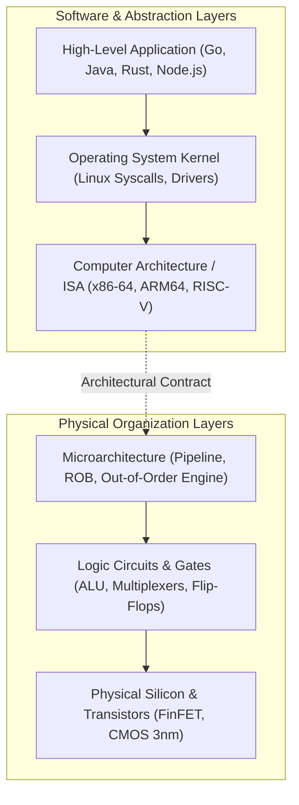
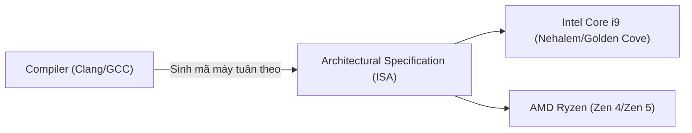
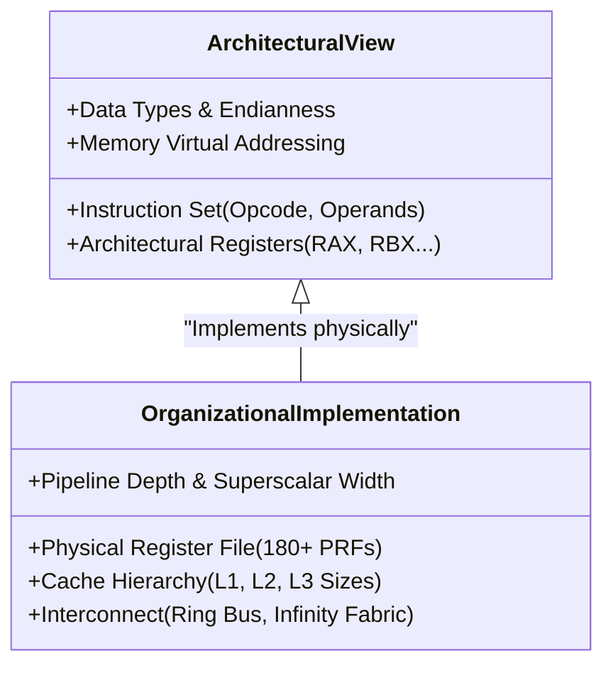
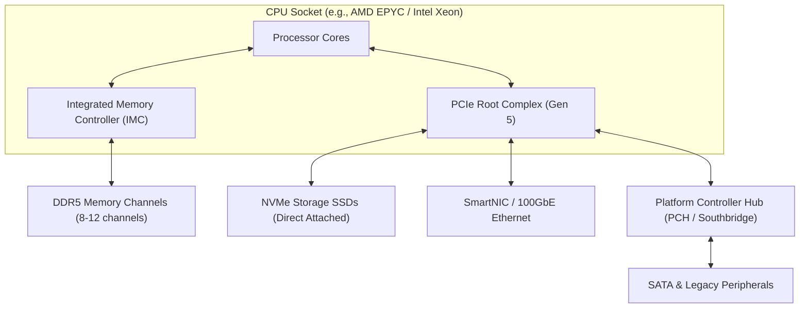
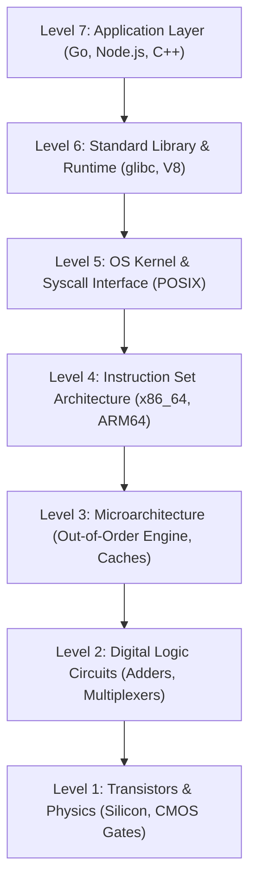

# 1.1. Architecture vs Organization & System Hierarchy (Kiến trúc, Tổ chức & Phân cấp Hệ thống)

## Tổng quan về Architecture vs Organization
Trong khoa học máy tính, ranh giới giữa **Computer Architecture (Kiến trúc Máy tính)** và **Computer Organization (Tổ chức Máy tính)** xác định hợp đồng giao tiếp giữa lập trình viên và phần cứng vật lý. 
- **Architecture**: Là góc nhìn trừu tượng mà lập trình viên hệ thống nhìn thấy (programmer's view) — bao gồm tập lệnh (ISA), các thanh ghi khả kiến, định dạng dữ liệu, cơ chế ngắt và mô hình bộ nhớ.
- **Organization**: Là cách thức hiện thực hóa vật lý (hardware implementation) các đặc tả kiến trúc đó — bao gồm đường dẫn dữ liệu (datapaths), tín hiệu điều khiển, công nghệ bán dẫn, tổ chức bộ nhớ đệm (cache hierarchy), và tần số xung nhịp.



---

## 2. Chi tiết từng Keyword (Under-the-Hood Deep Dive)

### 1. Computer Architecture

#### 1. Khái niệm bản chất (What & Why)
- **Computer Architecture** là bản thiết kế logic và đặc tả giao diện chức năng giữa phần cứng và phần mềm. Nó trả lời cho câu hỏi: *"Phần cứng có thể thực hiện những chỉ thị nào và cung cấp những thanh ghi gì cho lập trình viên?"*
- Xuất hiện từ nhu cầu chuẩn hóa để phần mềm có thể chạy trên nhiều thế hệ máy tính khác nhau mà không cần viết lại toàn bộ mã nguồn (ví dụ: phần mềm biên dịch cho kiến trúc x86 từ 1978 vẫn có thể chạy trên CPU Intel Core i9 thế hệ mới nhất).

#### 2. Cơ chế hoạt động sâu (Under the hood / Hardcore Internals)
- Architecture quy định:
  - **Tập thanh ghi khả kiến (Architectural Registers)**: Ví dụ trên x86-64 là 16 thanh ghi đa năng (`RAX`, `RBX`, `RCX`, `RDX`, `RSI`, `RDI`, `RBP`, `RSP`, `R8`-`R15`).
  - **Mô hình bộ nhớ (Memory Model)**: Cách phần cứng xử lý việc ghi/đọc song song giữa các lõi (TSO - Total Store Order trên x86 vs Weak Ordering trên ARM).
  - **Không gian địa chỉ (Addressing Modes)**: 32-bit (4GB) hay 48-bit/57-bit virtual addressing trên x86-64.
  - **Calling Conventions & ABI (Application Binary Interface)**: Quy ước truyền tham số qua thanh ghi hay qua ngăn xếp.

#### 3. Sơ đồ minh họa (Mermaid Diagram)


#### 4. Code ví dụ thực chiến (C++)
Minh họa kiểm tra kiến trúc và khả năng tương thích tại thời điểm biên dịch bằng C++20:
```cpp
#include <iostream>
#include <string_view>

// Kiểm tra kiến trúc mục tiêu thông qua preprocessor macros do compiler định nghĩa
constexpr std::string_view get_target_architecture() {
#if defined(__x86_64__) || defined(_M_X64)
    return "x86-64 (AMD64)";
#elif defined(__aarch64__) || defined(_M_ARM64)
    return "ARM64 (AArch64)";
#elif defined(__riscv) && (__riscv_xlen == 64)
    return "RISC-V 64-bit";
#else
    return "Unknown Architecture";
#endif
}

int main() {
    std::cout << "[Architecture]: Target ISA = " << get_target_architecture() << '\n';
    std::cout << "[Pointer Width]: " << sizeof(void*) * 8 << " bits\n";
    return 0;
}
```

#### 5. Ưu / Nhược điểm, Pitfalls & Anti-patterns
- **Ưu điểm**: Đảm bảo tính tương thích ngược (Backward Compatibility) tuyệt đối cho hệ sinh thái phần mềm.
- **Cạm bẫy (Pitfalls)**: Tương thích ngược khiến kiến trúc phải gánh "khoản nợ kỹ thuật" (technical debt) khổng lồ. x86-64 hiện nay vẫn phải hỗ trợ giải mã các opcode cổ từ thập niên 1980, làm bộ giải mã instruction decoder trở nên cực kỳ cồng kềnh và tiêu tốn năng lượng.

#### 6. Ứng dụng thực tế trong Backend / Systems
- **Cross-Compilation**: Khi deploy microservice lên môi trường Kubernetes chạy chip ARM Graviton (AWS) từ máy dev chạy chip Intel x86, backend engineer phải cấu hình Docker Buildx đa kiến trúc để biên dịch mã máy tương thích chính xác với ISA mục tiêu.

---

### 2. Computer Organization

#### 1. Khái niệm bản chất (What & Why)
- **Computer Organization** mô tả cấu trúc vật lý và các đường kết nối phần cứng bên trong để hiện thực hóa các đặc tả của Computer Architecture.
- Trả lời cho câu hỏi: *"Làm thế nào để phần cứng thực thi chỉ thị này nhanh nhất với mức tiêu thụ năng lượng thấp nhất?"*

#### 2. Cơ chế hoạt động sâu (Under the hood / Hardcore Internals)
- Hai bộ vi xử lý có thể dùng chung một Architecture (x86-64) nhưng có Organization hoàn toàn khác nhau:
  - **Intel Raptor Lake**: Thiết kế vi kiến trúc Hybrid với P-cores (Performance) và E-cores (Efficiency). Bộ nhớ đệm L3 lên tới 36MB dạng Ring Bus.
  - **AMD Zen 4**: Thiết kế Chiplet (MCM - Multi-Chip Module), tách riêng I/O Die (IOD) và Core Complex Dies (CCD), kết nối qua Infinity Fabric.
- Tổ chức phần cứng bao gồm:
  - Độ dài của Pipeline (14 stages trên Zen 4 vs 19 stages trên Raptor Lake).
  - Kích thước hàng đợi Reorder Buffer (ROB) để xử lý Out-of-Order.
  - Thuật toán Branch Predictor (TAGE predictor, perceptron-based prediction).

#### 3. Sơ đồ so sánh Architecture vs Organization


#### 4. Code ví dụ thực chiến (C++)
Đo lường sự khác biệt về Organization giữa các CPU thông qua độ trễ chu kỳ xung nhịp bằng lệnh hợp ngữ x86 `RDTSCP`:
```cpp
#include <iostream>
#include <x86intrin.h>
#include <cstdint>

// Đo số chu kỳ CPU để thực hiện một phép toán (phản ánh Organization của ALU)
inline uint64_t measure_latency() {
    unsigned int aux;
    uint64_t start = __rdtscp(&aux); // Serialization instruction: đọc timestamp counter
    
    // Thao tác đo: phép nhân 64-bit
    volatile uint64_t a = 123456789;
    volatile uint64_t b = 987654321;
    volatile uint64_t c = a * b;
    (void)c;

    uint64_t end = __rdtscp(&aux);
    return end - start;
}

int main() {
    uint64_t cycles = measure_latency();
    std::cout << "[Microarchitecture Latency]: Operation took ~" << cycles << " CPU cycles.\n";
    return 0;
}
```

#### 5. Ưu / Nhược điểm, Pitfalls & Anti-patterns
- **Pitfalls**: Lập trình viên viết mã tối ưu hóa quá mức cho một dòng chip cụ thể (ví dụ dựa dẫm vào kích thước L3 Cache 32MB) có thể khiến hiệu năng sụt giảm nghiêm trọng khi chạy trên dòng chip khác có Organization khác (như chip AMD chia 2 CCD với L3 phân mảnh).

#### 6. Ứng dụng thực tế trong Backend / Systems
- **Tối ưu hóa Database Engine**: Các engine lưu trữ như RocksDB hay ClickHouse phải benchmark Organization của phần cứng (kích thước L1/L2 data cache, chiều rộng vector SIMD) để tự động điều chỉnh batch size và buffer size phù hợp.

---

### 3. System Architecture

#### 1. Khái niệm bản chất (What & Why)
- **System Architecture** là kiến trúc tổng thể tích hợp toàn bộ các phân hệ phần cứng: CPU, bộ điều khiển bộ nhớ (Memory Controller), bộ điều khiển I/O (Root Complex, PCIe Bridges), hệ thống lưu trữ và mạng.
- Đảm bảo các thành phần phần cứng phối hợp nhịp nhàng, tối ưu hóa băng thông tổng thể (Total System Bandwidth) và giảm độ trễ cổ chai.

#### 2. Cơ chế hoạt động sâu (Under the hood / Hardcore Internals)
- Trong các máy chủ hiện đại, System Architecture dịch chuyển từ cấu hình **Northbridge / Southbridge** rời rạc cổ điển sang kiến trúc **SoC (System on Chip)**:
  - **Integrated Memory Controller (IMC)** nằm ngay trên die CPU để giảm độ trễ RAM.
  - **PCIe Root Complex** tích hợp trực tiếp trên CPU lane kết nối thẳng tới NVMe SSD và card mạng 100GbE (NIC).
  - **PCH (Platform Controller Hub)** đảm nhiệm các giao tiếp tốc độ chậm hơn (SATA, USB, TPM, SPI flash).

#### 3. Sơ đồ kiến trúc System Architecture hiện đại (Server Platform)


#### 4. Code ví dụ thực chiến (C++)
Đọc thông số topo hệ thống từ Linux sysfs để nhận diện System Architecture:
```cpp
#include <iostream>
#include <fstream>
#include <string>

void inspect_numa_system() {
    std::ifstream file("/sys/devices/system/node/online");
    std::string numa_nodes;
    if (file >> numa_nodes) {
        std::cout << "[System Topology]: Online NUMA Nodes: " << numa_nodes << '\n';
    } else {
        std::cout << "[System Topology]: Single socket or non-NUMA architecture.\n";
    }
}

int main() {
    inspect_numa_system();
    return 0;
}
```

#### 5. Ưu / Nhược điểm, Pitfalls & Anti-patterns
- **Pitfalls**: Bỏ qua topology hệ thống khi thiết kế backend server có thể dẫn đến việc thread chạy trên Socket 0 nhưng lại cấp phát và truy cập RAM gắn vào Socket 1 (NUMA Remote Access penalty, độ trễ tăng 2.5x).

#### 6. Ứng dụng thực tế trong Backend / Systems
- **High-Performance Networking (DPDK / io_uring)**: Gắn card mạng PCIe trực tiếp vào CPU socket quản lý packet processing để truyền dữ liệu thẳng vào L3 Cache qua công nghệ Intel DDIO (Data Direct I/O).

---

### 4. Hardware Abstraction & Computer System Hierarchy

#### 1. Khái niệm bản chất (What & Why)
- **Hardware Abstraction** là việc đóng gói các chi tiết phức tạp của phần cứng đằng sau các giao diện (interfaces) chuẩn mực.
- **Computer System Hierarchy** là sự phân tầng cấu trúc máy tính từ mức vật lý nguyên tử lên đến phần mềm ứng dụng: Transistor $\to$ Logic Gates $\to$ Functional Units $\to$ Microarchitecture $\to$ ISA $\to$ Operating System Kernel $\to$ System Libraries $\to$ User Applications.

#### 2. Cơ chế hoạt động sâu (Under the hood / Hardcore Internals)
- Mỗi tầng che giấu chi tiết của tầng bên dưới:
  - **HAL (Hardware Abstraction Layer)** trong nhân Linux tách biệt mã điều khiển CPU (thư mục `arch/x86`, `arch/arm64`) khỏi logic nhân chung (scheduler, virtual filesystem).
  - Tầng **Device Driver**: Cung cấp giao diện trừu tượng như file descriptor (`read()`, `write()`, `ioctl()`) cho ứng dụng, bất kể phần cứng bên dưới là SSD SATA, ổ NVMe hay card mạng.

#### 3. Sơ đồ phân tầng hệ thống (System Hierarchy)


#### 4. Code ví dụ thực chiến (C++ & POSIX)
Minh họa tầng trừu tượng I/O của hệ điều hành che giấu hoàn toàn bản chất phần cứng đĩa bên dưới:
```cpp
#include <fcntl.h>
#include <unistd.h>
#include <iostream>
#include <cstring>

// Ứng dụng chỉ tương tác qua POSIX Abstraction Interface (Syscalls)
// Không cần quan tâm đĩa bên dưới là NVMe SSD, HDD hay RAM disk
int main() {
    const char* filename = "system_test.bin";
    int fd = open(filename, O_CREAT | O_WRONLY | O_TRUNC, 0644);
    if (fd < 0) {
        perror("open failed");
        return 1;
    }

    const char* buffer = "Direct Hardware Abstraction Test";
    ssize_t bytes_written = write(fd, buffer, strlen(buffer));
    
    std::cout << "[OS Abstraction]: Wrote " << bytes_written 
              << " bytes to file descriptor " << fd << '\n';

    close(fd);
    unlink(filename);
    return 0;
}
```

#### 5. Ưu / Nhược điểm, Pitfalls & Anti-patterns
- **Ưu điểm**: Tính khả chuyển (Portability) cao, phát triển phần mềm nhanh chóng mà không cần chuyên môn sâu về phần cứng cho từng ứng dụng.
- **Nhược điểm (Abstractions Leak)**: Mọi sự trừu tượng đều có kẽ hở (*Law of Leaky Abstractions*). Một vòng lặp duyệt mảng 2D theo cột thay vì theo hàng có thể chậm hơn 20 lần do cache miss, mặc dù cú pháp hoàn toàn hợp lệ ở tầng ứng dụng.

#### 6. Ứng dụng thực tế trong Backend / Systems
- **Kernel Bypass Frameworks (SPDK / DPDK)**: Khi yêu cầu throughput lên tới hàng chục triệu IOPS, lập trình viên backend cố tình phá vỡ lớp trừu tượng của OS (Kernel Bypass) để driver chạy ở User Space trực tiếp điều khiển thanh ghi phần cứng PCIe, loại bỏ chi phí context switch và syscall.