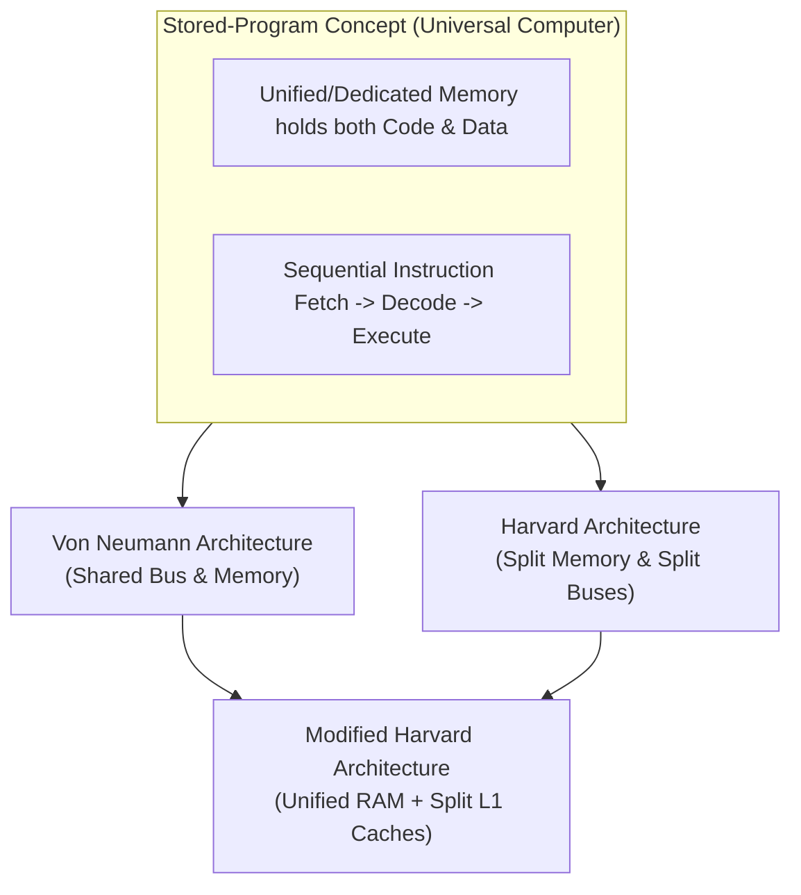
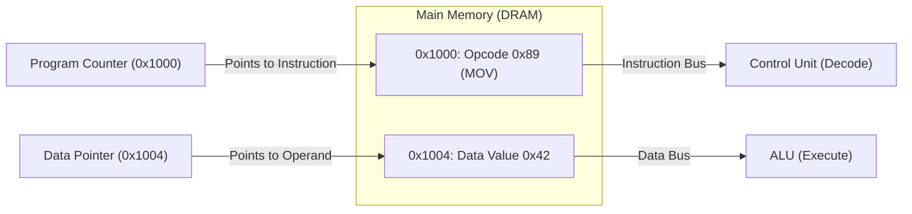
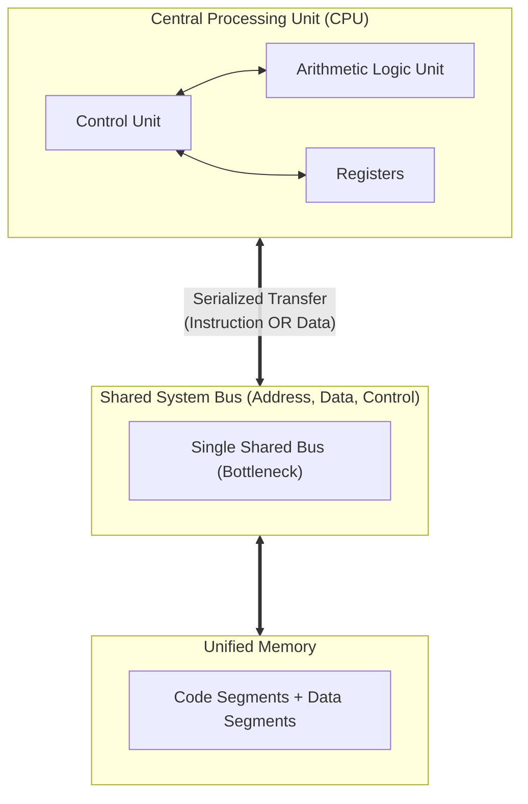
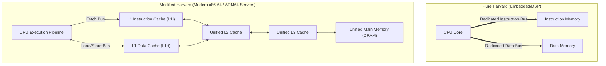

# 1.2. Classical Computer Architectures (Các Kiến trúc Máy tính Cổ điển)

## Tổng quan về Classical Architectures
Các kiến trúc máy tính cổ điển xác định nền móng cho cách thức tổ chức bộ nhớ, lệnh điều khiển và dữ liệu.
- **Stored-Program Concept (Khái niệm Chương trình Lưu trữ)**: Đưa ra cuộc cách mạng biến máy tính từ cỗ máy nối dây cứng (hard-wired) thành máy tính vạn năng (universal computer) bằng cách lưu trữ cả chỉ thị lệnh (instructions) và dữ liệu (data) dưới dạng nhị phân trong bộ nhớ truy cập ngẫu nhiên.
- **Von Neumann vs Harvard**: Cuộc tranh luận cốt lõi về việc chia sẻ chung hay tách biệt hoàn toàn không gian bộ nhớ và bus truyền dẫn giữa lệnh và dữ liệu.
- **Modified Harvard**: Kiến trúc thực tế kết hợp ưu thế của cả hai mô hình, được ứng dụng trong hầu hết các vi xử lý máy chủ và máy tính cá nhân hiện đại.



---

## 2. Chi tiết từng Keyword (Under-the-Hood Deep Dive)

### 1. Stored-Program Concept (Khái niệm Chương trình Lưu trữ)

#### 1. Khái niệm bản chất (What & Why)
- **Stored-Program Concept** (được đề xuất bởi Alan Turing, John von Neumann, J. Presper Eckert và John Mauchly trong thập niên 1940) khẳng định rằng: **Chương trình điều khiển máy tính không phải là phần cứng cố định, mà là dữ liệu được mã hóa nhị phân lưu trữ ngay trong bộ nhớ chính**.
- **Lý do tồn tại**: Trước khi có khái niệm này, máy tính (như ENIAC) muốn đổi thuật toán tính toán thì kỹ sư phải mất hàng ngày để tháo và cắm lại hàng nghìn dây nối (patch cables) và công tắc vật lý. Khái niệm này cho phép "lập trình lại" chỉ bằng cách nạp dữ liệu mới vào RAM.

#### 2. Cơ chế hoạt động sâu (Under the hood / Hardcore Internals)
- **Tính đồng nhất của Byte (Equivalence of Code and Data)**:
  - Ở mức phần cứng vật lý, transistor và tụ điện trong ô nhớ RAM không phân biệt byte nào là mã thực thi (`opcode`), byte nào là chuỗi ký tự hay số nguyên.
  - Sự khác biệt duy nhất nằm ở con trỏ thanh ghi: Nếu thanh ghi `PC` (Program Counter) trỏ tới địa chỉ đó, CPU sẽ coi các byte là mã lệnh và giải mã. Nếu thanh ghi con trỏ dữ liệu (ví dụ `RSI`/`RDI`) trỏ tới, CPU sẽ coi đó là dữ liệu.
- **Self-Modifying Code (Mã tự biến đổi)**: Vì mã là dữ liệu, CPU có thể chạy lệnh ghi (`STORE`) để sửa chính các byte lệnh tiếp theo trong bộ nhớ (kỹ thuật thường gặp trong JIT Compiler và Virus/Malware cổ điển).

#### 3. Sơ đồ minh họa (Mermaid Diagram)


#### 4. Code ví dụ thực chiến (C++ & POSIX mprotect)
Minh họa Stored-Program Concept qua cơ chế JIT (Just-In-Time) compilation — tự tạo mã máy trong mảng byte và thực thi:
```cpp
#include <iostream>
#include <sys/mman.h>
#include <cstring>
#include <cstdint>

// Hàm con trỏ có dạng: int (*)(int)
using FuncPtr = int (*)(int);

int main() {
    // 1. Cấp phát một trang nhớ có quyền ĐỌC và GHI (như dữ liệu)
    size_t size = 4096;
    void* mem = mmap(nullptr, size, PROT_READ | PROT_WRITE, 
                     MAP_ANONYMOUS | MAP_PRIVATE, -1, 0);

    if (mem == MAP_FAILED) {
        perror("mmap failed");
        return 1;
    }

    // 2. Dữ liệu nhị phân: Mã máy x86-64 cho hàm: int add_five(int x) { return x + 5; }
    // 8d 47 05 : lea eax, [rdi + 5]
    // c3       : ret
    uint8_t machine_code[] = {
        0x8d, 0x47, 0x05, // lea eax, [rdi + 5]
        0xc3              // ret
    };

    // Ghi dữ liệu vào ô nhớ
    std::memcpy(mem, machine_code, sizeof(machine_code));

    // 3. Thay đổi quyền trang nhớ từ WRITE sang EXECUTE (Bảo vệ phần cứng W^X)
    if (mprotect(mem, size, PROT_READ | PROT_EXEC) == -1) {
        perror("mprotect failed");
        munmap(mem, size);
        return 1;
    }

    // 4. Ép kiểu vùng nhớ dữ liệu thành con trỏ hàm để CPU nhảy vào thực thi
    FuncPtr dynamic_func = reinterpret_cast<FuncPtr>(mem);
    int input = 10;
    int result = dynamic_func(input);

    std::cout << "[Stored-Program Demo]: dynamic_func(" << input << ") = " << result << '\n';

    munmap(mem, size);
    return 0;
}
```

#### 5. Ưu / Nhược điểm, Pitfalls & Anti-patterns
- **Ưu điểm**: Tính linh hoạt tuyệt đối; là nền tảng của toàn bộ ngành công nghiệp phần mềm hiện đại và các bộ JIT compiler (V8, JVM, .NET).
- **Cạm bẫy bảo mật (W^X / DEP)**: Kẻ tấn công có thể ghi mã độc vào buffer dữ liệu (Stack/Heap Overflow) rồi chuyển con trỏ `PC` vào để chiếm quyền điều khiển. Do đó, các OS hiện đại áp dụng chính sách **W^X (Write XOR Execute)** — một vùng nhớ chỉ có thể ghi hoặc thực thi, không bao giờ được phép cả hai cùng lúc.

#### 6. Ứng dụng thực tế trong Backend / Systems
- **V8 Engine (Node.js) & JVM HotSpot**: Trực tiếp phân tích byte dữ liệu Javascript/Java bytecode khi runtime, biên dịch chúng thành mã máy x86-64/ARM64 ngay trong RAM và gọi thực thi trực tiếp để đạt tốc độ tương đương C++.

---

### 2. Von Neumann Architecture & Von Neumann Bottleneck

#### 1. Khái niệm bản chất (What & Why)
- **Von Neumann Architecture** là mô hình kiến trúc máy tính trong đó **chỉ có duy nhất một không gian bộ nhớ (Unified Memory)** và **một hệ thống bus dữ liệu/địa chỉ dùng chung** cho cả mã lệnh và dữ liệu.
- Được công bố năm 1945 bởi John von Neumann trong tài liệu *"First Draft of a Report on the EDVAC"*.

#### 2. Cơ chế hoạt động sâu (Under the hood / Hardcore Internals)
- **Cấu trúc 5 khối cơ bản**:
  1. Memory (Bộ nhớ chính chứa cả Code và Data).
  2. Control Unit (Khối điều khiển - giải mã lệnh).
  3. Arithmetic Logic Unit (ALU - tính toán).
  4. Input Mechanism.
  5. Output Mechanism.
- **The Von Neumann Bottleneck (Cổ chai Von Neumann)**:
  - Do chỉ có **một bus duy nhất nối giữa CPU và Memory**, tại một chu kỳ xung nhịp, CPU chỉ có thể làm một trong hai việc: **hoặc là nạp lệnh (Fetch Instruction), hoặc là đọc/ghi dữ liệu (Load/Store Data)**. CPU không thể thực hiện cả hai việc cùng lúc.
  - Tốc độ tính toán của CPU tăng theo cấp số nhân (định luật Moore), trong khi tốc độ truy xuất DRAM tăng rất chậm. CPU phải liên tục nhàn rỗi (CPU Stall) chờ dữ liệu từ Memory Bus.

#### 3. Sơ đồ kiến trúc Von Neumann


#### 4. Code ví dụ thực chiến (C++ Benchmark minh họa Bottleneck)
Minh họa hiện tượng CPU bị nghẽn băng thông bộ nhớ khi dữ liệu không vừa trong Cache:
```cpp
#include <iostream>
#include <vector>
#include <chrono>
#include <numeric>

// Minh họa việc nghẽn băng thông bộ nhớ chính (Memory Wall / Von Neumann Bottleneck)
int main() {
    constexpr size_t SMALL_SIZE = 1024 * 16;       // 16 KB (Vừa vặn trong L1 Cache)
    constexpr size_t LARGE_SIZE = 1024 * 1024 * 64; // 64 MB (Vượt quá L3 Cache, phải ra DRAM)

    std::vector<int> small_buf(SMALL_SIZE, 1);
    std::vector<int> large_buf(LARGE_SIZE, 1);

    // 1. Đo lường khi dữ liệu nằm trọn trong Cache
    auto start = std::chrono::high_resolution_clock::now();
    long long sum1 = 0;
    for (int rep = 0; rep < 4000; ++rep) {
        for (size_t i = 0; i < SMALL_SIZE; ++i) sum1 += small_buf[i];
    }
    auto end = std::chrono::high_resolution_clock::now();
    auto time_cache = std::chrono::duration_cast<std::chrono::microseconds>(end - start).count();

    // 2. Đo lường khi dữ liệu liên tục phải kéo qua Bus từ DRAM
    start = std::chrono::high_resolution_clock::now();
    long long sum2 = 0;
    for (size_t i = 0; i < LARGE_SIZE; ++i) sum2 += large_buf[i];
    end = std::chrono::high_resolution_clock::now();
    auto time_dram = std::chrono::duration_cast<std::chrono::microseconds>(end - start).count();

    std::cout << "[L1 Cache Hit Processing Time]: " << time_cache << " us (High Throughput)\n";
    std::cout << "[DRAM Memory Bus Bottleneck]:   " << time_dram  << " us (Memory Wall Penalty)\n";
    return 0;
}
```

#### 5. Ưu / Nhược điểm, Pitfalls & Anti-patterns
- **Ưu điểm**: Thiết kế phần cứng đơn giản, giá thành sản xuất rẻ, việc quản lý và phân bổ ô nhớ linh hoạt giữa mã và dữ liệu.
- **Nhược điểm**: Băng thông bị nghẽn nghiêm trọng (Von Neumann Bottleneck), trở thành rào cản lớn nhất đối với hiệu năng hệ thống hiện đại.

#### 6. Ứng dụng thực tế trong Backend / Systems
- Thúc đẩy sự ra đời của **Phân cấp bộ nhớ đệm (Cache Hierarchy L1/L2/L3)** và kỹ thuật **Data Locality** trong High-Frequency Trading (HFT) để tránh tối đa việc chạm vào Shared Memory Bus.

---

### 3. Harvard Architecture vs Modified Harvard Architecture

#### 1. Khái niệm bản chất (What & Why)
- **Harvard Architecture**: Tách biệt hoàn toàn bộ nhớ lưu trữ và bus truyền dẫn thành hai thế giới riêng:
  - **Instruction Memory & Instruction Bus**: Chỉ dùng để đọc mã lệnh.
  - **Data Memory & Data Bus**: Chỉ dùng để đọc/ghi dữ liệu.
- **Modified Harvard Architecture**: Là mô hình lai kết hợp thực tế: **Bộ nhớ RAM vật lý bên ngoài dùng chung (Unified Memory)** để tiết kiệm chi phí và linh hoạt, nhưng **bên trong chip CPU tách thành hai đường Cache độc lập: L1 Instruction Cache (L1i) và L1 Data Cache (L1d)** với hai bộ bus riêng biệt.

#### 2. Cơ chế hoạt động sâu (Under the hood / Hardcore Internals)
- **Tại sao Harvard thuần túy ít dùng trong máy chủ thông thường?**
  - Trong Harvard thuần túy, nếu Instruction ROM còn thừa 10MB nhưng Data RAM bị đầy 1KB, chương trình vẫn sập vì OOM (Out Of Memory) do hai bộ nhớ không thể hoán đổi dung lượng cho nhau. Thường chỉ ứng dụng trong DSP (Digital Signal Processors) hoặc vi điều khiển nhỏ (AVR ATmega328P trên Arduino).
- **Cơ chế Modified Harvard trong vi xử lý hiện đại (x86-64 / ARM)**:
  - CPU có thể **Fetch lệnh từ L1i** và **Load dữ liệu từ L1d** trong **cùng một chu kỳ xung nhịp (Clock Cycle)** mà không hề bị xung đột bus.
  - Khi cần cập nhật mã (như JIT Compiler), CPU ghi dữ liệu vào L1d. Sau đó phần mềm phải phát lệnh **Cache Invalidation** hoặc **Instruction Barrier** (`ISB` trên ARM, `clflush` trên x86) để đồng bộ dữ liệu từ D-Cache sang I-Cache.

#### 3. Sơ đồ so sánh Harvard vs Modified Harvard


#### 4. Code ví dụ thực chiến (C++ Cache Invalidation cho Modified Harvard)
Minh họa thao tác xóa Cache line bằng nội tại x86 (`_mm_clflush`) khi sửa đổi mã trong kiến trúc Modified Harvard:
```cpp
#include <iostream>
#include <immintrin.h> // Header cho SSE/AVX intrinsics
#include <cstdint>

// Trong kiến trúc Modified Harvard, nếu bạn ghi đè mã máy vào RAM (qua Data Path),
// bạn phải flush cache line khỏi L1d để đảm bảo I-Cache đọc lại phiên bản mới nhất từ L2/RAM.
void invalidate_cache_line(const void* addr) {
#if defined(__x86_64__) || defined(_M_X64)
    // _mm_clflush: Xóa một dòng cache line (64 bytes) chứa địa chỉ addr khỏi mọi tầng Cache
    _mm_clflush(addr);
    std::cout << "[Cache Coherence]: Cache line flushed for addr: " << addr << '\n';
#else
    std::cout << "[Cache Invalidation]: Non-x86 platform, using generic barrier.\n";
#endif
}

int main() {
    uint8_t buffer[128];
    invalidate_cache_line(&buffer[0]);
    return 0;
}
```

#### 5. Ưu / Nhược điểm, Pitfalls & Anti-patterns
- **Modified Harvard Advantage**: Khắc phục triệt để Von Neumann Bottleneck ở cấp độ Execution Pipeline trong khi vẫn duy trì sự kinh tế và linh hoạt của một thanh RAM thống nhất.
- **Pitfall**: Quên phát lệnh flush cache khi sinh mã động (Dynamic code generation) trên kiến trúc ARM sẽ gây lỗi crash ngẫu nhiên (`Illegal Instruction`) vì I-Cache vẫn giữ bản sao cũ trong khi D-Cache đã ghi mã mới.

#### 6. Ứng dụng thực tế trong Backend / Systems
- **Tối ưu hóa L1i / L1d Contention**: Các ứng dụng xử lý dữ liệu lớn (như Redis hoặc Envoy Proxy) phân tách rõ rệt luồng logic nhỏ gọn để nằm trọn trong 32KB L1i Cache, tránh gây ra tình trạng I-Cache Thrashing làm pipeline CPU bị dừng.