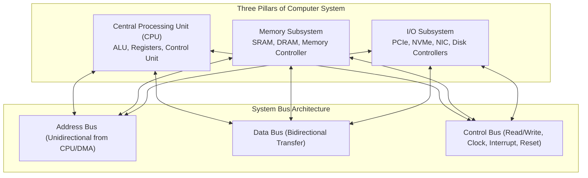
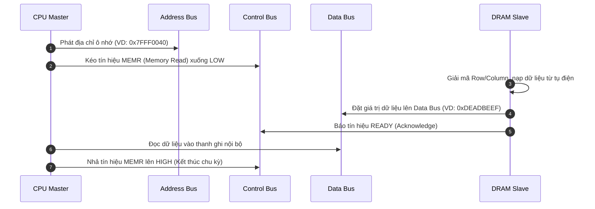
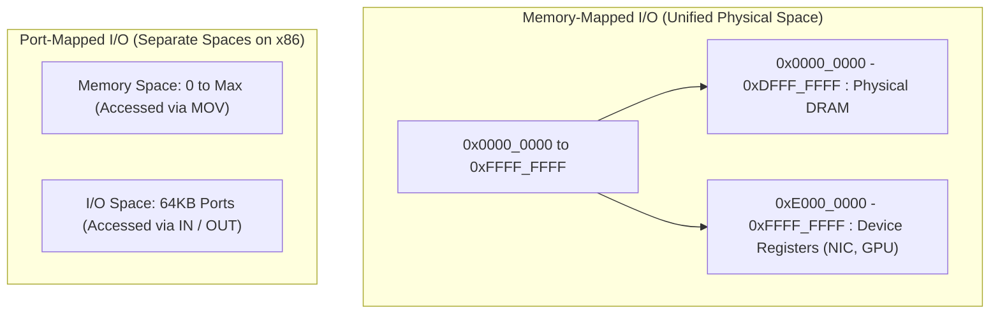
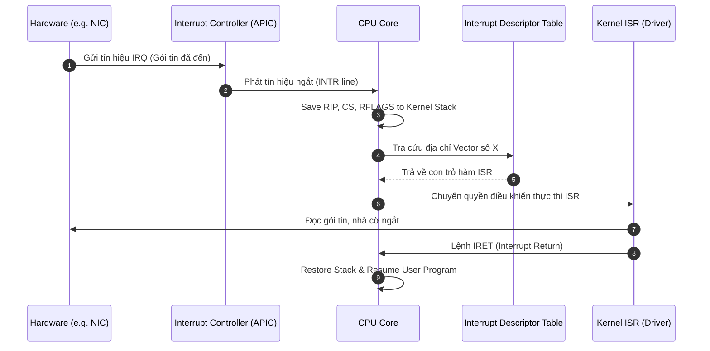

# 1.3. System Components & Bus Architecture (Các Thành phần Hệ thống & Kiến trúc Bus)

## Tổng quan về System Components & Buses
Một hệ thống máy tính hoàn chỉnh là một mạng lưới tích hợp phức tạp giữa ba trụ cột chính: **CPU (Bộ xử lý trung tâm)**, **Memory (Phân hệ bộ nhớ)** và **I/O (Phân hệ nhập/xuất thiết bị ngoại vi)**.
- **Bus Architecture**: Là hệ thống xa lộ truyền dẫn tín hiệu vật lý liên kết các thành phần này lại với nhau, bao gồm Bus Địa chỉ (Address Bus), Bus Dữ liệu (Data Bus) và Bus Điều khiển (Control Bus).
- **Hardware-Software Interface (Giao diện Phần cứng - Phần mềm)**: Cầu nối biến các chỉ thị trừu tượng trong phần mềm thành các chuỗi xung điện kích hoạt phần cứng thực tế thông qua các thanh ghi điều khiển (Control/Status Registers), ngắt (Interrupts) và bản đồ bộ nhớ (Memory Mapped I/O).



---

## 2. Chi tiết từng Keyword (Under-the-Hood Deep Dive)

### 1. Bus Architecture (Address Bus, Data Bus, Control Bus)

#### 1. Khái niệm bản chất (What & Why)
- **Bus** là tập hợp các đường dây dẫn điện song song (hoặc các kênh vi sai nối tiếp tốc độ cao) truyền tải thông tin số giữa nhiều linh kiện phần cứng theo một giao thức chuẩn hóa.
- **Lý do tồn tại**: Thay vì phải nối $N \times (N-1)$ đường dây riêng biệt giữa từng linh kiện (gây bất khả thi về mặt vật lý trên bo mạch chủ), kiến trúc Bus cho phép các linh kiện chia sẻ một đường truyền chung có điều phối.

#### 2. Cơ chế hoạt động sâu (Under the hood / Hardcore Internals)
Hệ thống Bus truyền thống được chia thành 3 loại bus chức năng:
1. **Address Bus (Bus Địa chỉ)**:
   - Truyền tải địa chỉ ô nhớ vật lý mà CPU muốn đọc hoặc ghi.
   - **Độ rộng Address Bus ($W_A$)** quyết định trực tiếp **Dung lượng bộ nhớ vật lý tối đa** mà CPU có thể đánh địa chỉ:
     $$\text{Max Physical Memory} = 2^{W_A} \text{ bytes}$$
     *Ví dụ*: Bus địa chỉ 32-bit quản lý tối đa $2^{32} = 4\text{ GB}$ RAM. Bus địa chỉ 48-bit (trên x86-64 hiện đại) quản lý tối đa $2^{48} = 256\text{ TB}$ RAM.
2. **Data Bus (Bus Dữ liệu)**:
   - Truyền tải dữ liệu thực tế hai chiều giữa CPU, Memory và I/O.
   - **Độ rộng Data Bus ($W_D$)** quyết định số bit truyền được trong một chu kỳ bus. Ví dụ: Bus dữ liệu 64-bit truyền được 8 bytes/chu kỳ.
3. **Control Bus (Bus Điều khiển)**:
   - Truyền tải các tín hiệu điều khiển trạng thái và thời gian (Timing & Control signals):
     - `MEMR` (Memory Read), `MEMW` (Memory Write).
     - `IOR` (I/O Read), `IOW` (I/O Write).
     - `CLK` (Bus Clock), `RESET`, `INTR` (Interrupt Request), `ACK` (Acknowledge).

#### 3. Sơ đồ chu kỳ Bus (Bus Cycle Timing)


#### 4. Code ví dụ thực chiến (C++ Bit Manipulation mô phỏng Address Bus Decoding)
Minh họa cách phần cứng giải mã địa chỉ từ Address Bus thành Index, Tag và Byte Offset:
```cpp
#include <iostream>
#include <cstdint>
#include <bitset>

// Mô phỏng bộ giải mã địa chỉ vật lý (Address Bus Decoder)
struct DecodedAddress {
    uint64_t tag;
    uint32_t set_index;
    uint32_t byte_offset;
};

// Giả sử Cache Line 64-byte (6 bit offset), 1024 Sets (10 bit index), còn lại là Tag
DecodedAddress decode_bus_address(uint64_t address) {
    DecodedAddress decoded;
    decoded.byte_offset = address & 0x3F;                // 6 bits thấp [5:0]
    decoded.set_index   = (address >> 6) & 0x3FF;       // 10 bits tiếp theo [15:6]
    decoded.tag         = address >> 16;                // Các bits còn lại [63:16]
    return decoded;
}

int main() {
    uint64_t physical_addr = 0x00007FFF89ABCDEF;
    DecodedAddress res = decode_bus_address(physical_addr);

    std::cout << "[Address Bus]: 0x" << std::hex << physical_addr << '\n';
    std::cout << "  Tag:    0x" << res.tag << '\n';
    std::cout << "  Index:  " << std::dec << res.set_index << '\n';
    std::cout << "  Offset: " << res.byte_offset << " bytes\n";
    return 0;
}
```

#### 5. Ưu / Nhược điểm, Pitfalls & Anti-patterns
- **Chuyển dịch từ Parallel Bus sang High-Speed Serial Point-to-Point**:
  - *Parallel Bus cổ điển* (PCI, IDE, SCSI): Nhiều đường dây chạy song song gây ra hiện tượng **Clock Skew** (tín hiệu ở các dây đến không cùng lúc do sai số vật lý) và **Crosstalk** (nhiễu xuyên kênh) khi tần số vượt quá vài trăm MHz.
  - *Serial Point-to-Point hiện đại* (PCIe, SATA, NVMe, USB): Dùng các cặp vi sai (differential pairs) truyền nối tiếp tần số cực cao (hàng chục GHz), loại bỏ hoàn toàn Clock Skew.

#### 6. Ứng dụng thực tế trong Backend / Systems
- **Băng thông kết nối PCIe Gen 4/Gen 5**: Khi xây dựng cụm phân tán Kafka hoặc Cassandra chạy trên NVMe SSD, backend engineer phải tính toán tổng băng thông của các lane PCIe (mỗi lane PCIe 5.0 đạt ~4 GB/s) để tránh làm nghẽn bus I/O khi đĩa đẩy hàng triệu IOPS về RAM.

---

### 2. CPU Architecture, Memory Architecture & I/O Architecture

#### 1. Khái niệm bản chất (What & Why)
- **CPU Architecture**: Cấu trúc khối xử lý dữ liệu trung tâm gồm Datapath (đường dẫn dữ liệu) và Control Unit (khối điều khiển các tín hiệu xung nhịp).
- **Memory Architecture**: Phân cấp và cách bố trí các ô nhớ (SRAM $\to$ DRAM $\to$ NVM) đảm bảo cân bằng giữa chi phí, dung lượng và độ trễ truy xuất.
- **I/O Architecture**: Cơ chế trao đổi dữ liệu giữa CPU/RAM với thế giới bên ngoài (mạng, bàn phím, màn hình, ổ cứng).

#### 2. Cơ chế hoạt động sâu (Under the hood / Hardcore Internals)
Sự tương tác giữa 3 phân hệ này thông qua hai phương thức kiến trúc then chốt:
1. **Memory-Mapped I/O (MMIO)**:
   - Các thanh ghi điều khiển của thiết bị I/O được ánh xạ thẳng vào cùng không gian địa chỉ vật lý với RAM.
   - CPU đọc/ghi vào thiết bị ngoại vi bằng chính các lệnh nạp nhớ chuẩn (`MOV`, `LOAD`, `STORE`) như thao tác với RAM thông thường.
2. **Port-Mapped I/O (PMIO / Isolated I/O)**:
   - Sử dụng một không gian địa chỉ riêng biệt và các tập lệnh chuyên dụng của CPU (như `IN` và `OUT` trên x86) với tín hiệu chân điều khiển riêng trên CPU.

#### 3. Sơ đồ minh họa MMIO vs PMIO


#### 4. Code ví dụ thực chiến (C++ MMIO Simulation)
Mô phỏng cơ chế MMIO điều khiển phần cứng qua con trỏ `volatile`:
```cpp
#include <iostream>
#include <cstdint>

// Mô phỏng cấu trúc thanh ghi phần cứng của một card mạng (NIC MMIO Registers)
struct NicHardwareRegisters {
    volatile uint32_t control;     // Offset 0x00: Bit 0 = Enable, Bit 1 = Reset
    volatile uint32_t status;      // Offset 0x04: Bit 0 = Link Up, Bit 1 = RX Ready
    volatile uint64_t rx_buffer;   // Offset 0x08: Địa chỉ bộ đệm nhận gói tin (DMA address)
    volatile uint32_t tx_len;      // Offset 0x10: Độ dài gói tin phát đi
};

int main() {
    // Trong môi trường kernel thật, con trỏ này nhận từ ioremap() trỏ tới PCIe MMIO BAR
    alignas(64) uint8_t mock_hardware_space[sizeof(NicHardwareRegisters)] = {0};
    auto* nic_regs = reinterpret_cast<NicHardwareRegisters*>(mock_hardware_space);

    // Kích hoạt thiết bị phần cứng thông qua ghi ô nhớ (MMIO)
    std::cout << "[Driver Simulation]: Enabling NIC via MMIO write...\n";
    nic_regs->control = 0x01; // Ghi bit Enable

    // Đọc trạng thái từ thanh ghi phần cứng
    nic_regs->status = 0x03; // Giả lập phần cứng trả về Link Up & RX Ready
    if (nic_regs->status & 0x01) {
        std::cout << "[Driver Simulation]: NIC Link is UP! Status = " 
                  << nic_regs->status << '\n';
    }

    return 0;
}
```

#### 5. Ưu / Nhược điểm, Pitfalls & Anti-patterns
- **Cạm bẫy từ khóa `volatile` và Cacheability**:
  - Vùng nhớ MMIO **tuyệt đối không được bật CPU Cache**. Nếu bật cache, thao tác `read` của CPU sẽ chỉ đọc từ L1 Cache mà không đọc trạng thái mới nhất từ phần cứng ngoại vi. Trong Linux Kernel, các vùng này phải được map với thuộc tính `pgprot_noncached()`.
  - Phải dùng con trỏ `volatile` trong C/C++ để ngăn Compiler tối ưu hóa loại bỏ các thao tác đọc/ghi lặp lại.

#### 6. Ứng dụng thực tế trong Backend / Systems
- **High-Performance Storage (NVMe Controller)**: Giao thức NVMe hoàn toàn dựa trên MMIO và DMA Ring Buffer (Submission & Completion Queues). Ứng dụng backend gửi I/O request bằng cách ghi thẳng lệnh vào hàng đợi trong RAM và cập nhật thanh ghi chuông cửa (Doorbell Register) của NVMe controller qua MMIO.

---

### 3. Hardware-Software Interface

#### 1. Khái niệm bản chất (What & Why)
- **Hardware-Software Interface** là tập hợp các cơ chế, quy chuẩn và giao thức cho phép phần mềm (ứng dụng, OS) chỉ huy phần cứng và nhận phản hồi từ phần cứng.
- Bao gồm 3 cơ chế tương tác cốt lõi:
  1. **Polled Status Register**: Phần mềm liên tục lặp để kiểm tra cờ trạng thái phần cứng.
  2. **Interrupts (Ngắt)**: Phần cứng chủ động gửi tín hiệu điện ngắt dòng thực thi của CPU khi có sự kiện (nhận gói tin, hoàn thành đọc đĩa).
  3. **Direct Memory Access (DMA)**: Thiết bị phần cứng tự động sao chép hàng loạt dữ liệu trực tiếp vào RAM mà không cần CPU nhúng tay vào từng byte.

#### 2. Cơ chế hoạt động sâu (Under the hood / Hardcore Internals)
- Khi ngắt phần cứng xuất hiện:
  1. Thiết bị ngoại vi phát tín hiệu lên chân **IRQ** của chip điều khiển ngắt (APIC).
  2. CPU tạm dừng dòng lệnh hiện tại, đẩy con trỏ lệnh `RIP/PC` và các cờ `RFLAGS` vào Kernel Stack.
  3. CPU tra cứu bảng **IDT (Interrupt Descriptor Table)** trong RAM để tìm địa chỉ hàm xử lý ngắt (**ISR - Interrupt Service Routine**).
  4. Sau khi ISR chạy xong, CPU thực thi lệnh `IRET` (Interrupt Return) để khôi phục ngữ cảnh và tiếp tục công việc đang dang dở.

#### 3. Sơ đồ xử lý Ngắt phần cứng (Hardware Interrupt Flow)


#### 4. Code ví dụ thực chiến (C++ Minh họa Interrupt vs Polling Pattern)
```cpp
#include <iostream>
#include <atomic>
#include <thread>
#include <chrono>

// Minh họa nguyên lý giữa Polling (chờ bận) và Interrupt-driven notification
struct HardwareDevice {
    std::atomic<bool> data_ready{false};
    int data_payload{0};
};

// 1. Polling: CPU tốn 100% tài nguyên để liên tục hỏi trạng thái
void poll_hardware(HardwareDevice& dev) {
    std::cout << "[Poller]: Waiting for hardware data via Polling...\n";
    while (!dev.data_ready.load(std::memory_order_acquire)) {
        // CPU liên tục quay vòng (Busy Waiting) - Tiêu thụ điện năng lớn
#if defined(__x86_64__)
        __builtin_ia32_pause(); // Tối ưu CPU pipeline không bị nghẽn
#endif
    }
    std::cout << "[Poller]: Data received: " << dev.data_payload << '\n';
}

int main() {
    HardwareDevice nic;
    std::thread worker(poll_hardware, std::ref(nic));

    // Giả lập thiết bị phần cứng mất 50ms để nhận dữ liệu từ dây cáp mạng
    std::this_thread::sleep_for(std::chrono::milliseconds(50));
    nic.data_payload = 1024;
    nic.data_ready.store(true, std::memory_order_release); // "Hardware" bật cờ

    worker.join();
    return 0;
}
```

#### 5. Ưu / Nhược điểm, Pitfalls & Anti-patterns
- **Interrupt Storm (Bão ngắt)**: Khi lưu lượng mạng cực lớn (hàng chục triệu packet/s), việc CPU liên tục nhận ngắt sẽ làm sập hệ thống do chi phí Context Switch của ISR chiếm hết thời gian tính toán.
- **Giải pháp thực tế**: Chuyển sang mô hình kết hợp **NAPI (New API)** trong Linux — nhận ngắt lần đầu tiên, sau đó tắt ngắt và chuyển sang chế độ Polling theo batch để đọc sạch dữ liệu trong buffer rồi mới bật lại ngắt.

#### 6. Ứng dụng thực tế trong Backend / Systems
- **Linux NAPI & DPDK**: Các hệ thống tường lửa, Reverse Proxy (Cloudflare, Nginx) hoặc Trading Engine áp dụng triệt để cơ chế chuyển đổi giữa Interrupt và Polling để duy trì độ trễ ở mức sub-microsecond.