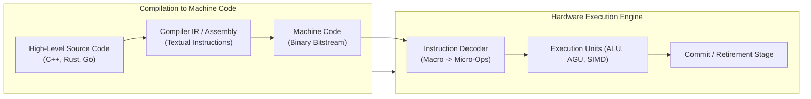
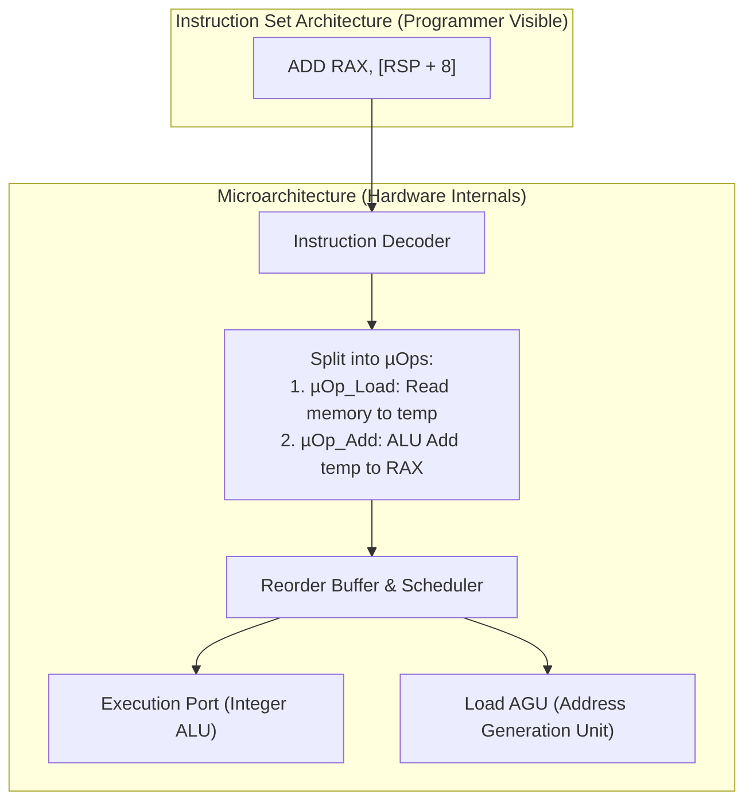
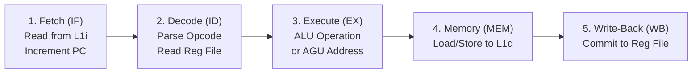
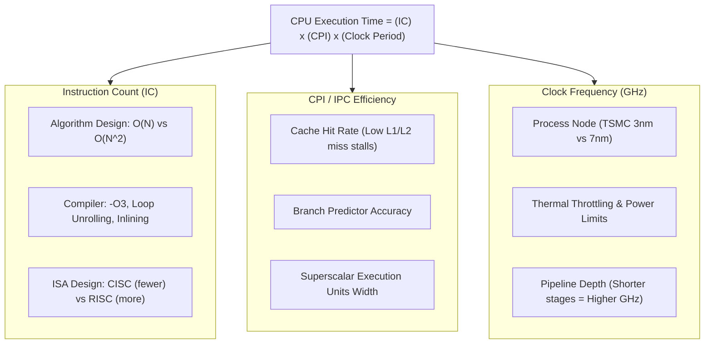

# 1.4. Execution & Performance Foundations (Thực thi Chỉ thị & Nền tảng Hiệu năng)

## Tổng quan về Execution & Performance Foundations
Để tối ưu hóa phần mềm ở cấp độ backend và hệ thống, kỹ sư phải hiểu rõ quá trình một dòng mã cấp cao (như Go, Rust, C++) được hạ cấp (lowered) thành mã máy, được nạp vào vi kiến trúc CPU và thực thi theo chu kỳ xung nhịp như thế nào.
- **ISA vs Microarchitecture**: ISA là bản hợp đồng lập trình (Programmer-Visible Contract), còn Microarchitecture là công nghệ hiện thực hóa bên dưới nắp silicon (Hardware Implementation).
- **Instruction Execution**: Vòng đời chuyển hóa từ bit nhị phân thành các thao tác dịch chuyển điện áp trong các cổng logic.
- **Performance Fundamentals**: Công thức Iron Law of Processor Performance và các chỉ số đo lường hiệu năng cốt lõi: CPI, IPC, Clock Frequency.



---

## 2. Chi tiết từng Keyword (Under-the-Hood Deep Dive)

### 1. Instruction Set Architecture (ISA) vs Microarchitecture

#### 1. Khái niệm bản chất (What & Why)
- **Instruction Set Architecture (ISA)**: Là giao diện trừu tượng mô tả những gì CPU hỗ trợ: tập lệnh hợp ngữ, kiểu dữ liệu, các thanh ghi, quy tắc quản lý bộ nhớ ảo và xử lý ngắt. Ví dụ: x86-64, ARMv9, RISC-V.
- **Microarchitecture (Vi kiến trúc)**: Là thiết kế vi mạch vật lý bên trong để triển khai một ISA cụ thể. Ví dụ: Kiến trúc `Zen 4` của AMD và `Golden Cove` của Intel là hai Microarchitecture hoàn toàn khác nhau nhưng cùng thực thi chung một ISA là `x86-64`.

#### 2. Cơ chế hoạt động sâu (Under the hood / Hardcore Internals)
- Cùng một lệnh ISA như `ADD RAX, RBX` (trên x86-64):
  - Ở mức **ISA**: Nó cộng giá trị hai thanh ghi 64-bit và cập nhật các cờ `ZF`, `SF`, `OF`, `CF` trong `RFLAGS`.
  - Ở mức **Microarchitecture hiện đại**:
    1. Bộ giải mã (Decoder) bẻ lệnh `ADD` thành một hoặc nhiều vi lệnh (**Micro-operations - µOps**).
    2. Bộ đổi tên thanh ghi (**Register Renaming**) ánh xạ thanh ghi kiến trúc `RAX`, `RBX` sang các thanh ghi vật lý (**Physical Registers**) bên trong chip (ví dụ: `P42`, `P18`) để xóa bỏ phụ thuộc dữ liệu giả (WAR/WAW hazards).
    3. Bộ lập lịch (**Scheduler**) đẩy µOp vào trạm chờ (**Reservation Station**).
    4. Khi toán hạng sẵn sàng, vi lệnh được bắn vào một trong các cổng thực thi ALU (**Execution Port**) có sẵn.
    5. Kết quả ghi vào Reorder Buffer (ROB) và được cam kết (**Retire/Commit**) theo đúng thứ tự ban đầu.

#### 3. Sơ đồ minh họa ISA vs Microarchitecture


#### 4. Code ví dụ thực chiến (C++ x86 Assembly Inlining)
Xem xét cách compiler hạ cấp một biểu thức C++ thành mã máy ISA:
```cpp
#include <iostream>
#include <cstdint>

// Hàm thực hiện phép cộng và kiểm tra cờ Overflow ở mức ISA
bool safe_add_overflow(int64_t a, int64_t b, int64_t* result) {
#if defined(__x86_64__)
    bool overflow;
    // Sử dụng Inline Assembly để can thiệp trực tiếp vào thanh ghi ISA và cờ FLAGS
    asm volatile (
        "addq %[b_val], %[a_val]\n\t"  // Lệnh ISA x86-64: cộng 64-bit
        "seto %[ovf_flag]\n\t"         // Đọc cờ Overflow (OF) từ thanh ghi RFLAGS
        : [a_val] "+r" (a), [ovf_flag] "=r" (overflow)
        : [b_val] "r" (b)
        : "cc" // Báo compiler biết rằng conditional codes (FLAGS) bị thay đổi
    );
    *result = a;
    return overflow;
#else
    // Fallback chuẩn C++20 nếu không chạy trên x86-64
    return __builtin_add_overflow(a, b, result);
#endif
}

int main() {
    int64_t res = 0;
    int64_t max_val = INT64_MAX;
    bool has_overflow = safe_add_overflow(max_val, 1, &res);

    std::cout << "[ISA Inspection]: Result = " << res 
              << ", Overflow Flag = " << std::boolalpha << has_overflow << '\n';
    return 0;
}
```

#### 5. Ưu / Nhược điểm, Pitfalls & Anti-patterns
- **Tính độc lập**: ISA ổn định cho phép phần mềm không cần biên dịch lại suốt nhiều thập kỷ.
- **Pitfall**: Kỹ sư phần mềm cho rằng hai CPU có cùng xung nhịp 3.5 GHz chạy cùng một file nhị phân sẽ có tốc độ như nhau. Thực tế, Microarchitecture mới hơn có thể có IPC gấp đôi thế hệ cũ, giúp chạy nhanh gấp 2 lần dù cùng tần số xung nhịp.

#### 6. Ứng dụng thực tế trong Backend / Systems
- **Profile-Guided Optimization (PGO)**: Kỹ thuật biên dịch mã máy đặc thù theo Microarchitecture cụ thể của server triển khai (ví dụ: cờ `-march=znver4` cho AMD EPYC Genoa hoặc `-march=sapphirerapids` cho Intel Xeon) giúp cải thiện thông lượng dịch vụ lên tới 15–20%.

---

### 2. Machine-Level Programming & Instruction Execution

#### 1. Khái niệm bản chất (What & Why)
- **Machine-Level Programming**: Lập trình ở mức mã máy (dãy byte nhị phân) hoặc hợp ngữ (Assembly) — nơi mọi sự trừu tượng về biến, kiểu dữ liệu, vòng lặp biến mất, chỉ còn lại các thanh ghi, ô nhớ và các lệnh nhảy điều kiện (`JMP`, `JNE`).
- **Instruction Execution**: Vòng đời 5 bước kinh điển của một chỉ thị CPU:
  $$\text{Fetch} \longrightarrow \text{Decode} \longrightarrow \text{Execute} \longrightarrow \text{Memory Access} \longrightarrow \text{Write-Back}$$

#### 2. Cơ chế hoạt động sâu (Under the hood / Hardcore Internals)
- **Các bước chi tiết trong chu kỳ lệnh**:
  1. **Instruction Fetch (IF)**: CPU đưa địa chỉ trong `PC/RIP` ra bus địa chỉ, kéo dòng mã lệnh từ L1 Instruction Cache vào thanh ghi lệnh `IR` (Instruction Register). `PC` tự động tăng lên để trỏ tới lệnh kế tiếp.
  2. **Instruction Decode (ID)**: Bộ giải mã phân tích các trường bit của lệnh: Opcode (mã tác vụ), địa chỉ thanh ghi nguồn/đích, giá trị hằng số (Immediate value).
  3. **Execute (EX)**: ALU hoặc FPU thực hiện tính toán (cộng, trừ, shift bit) hoặc AGU tính toán địa chỉ bộ nhớ hiệu dụng.
  4. **Memory Access (MEM)**: Nếu lệnh là `LOAD` hoặc `STORE`, dữ liệu được đọc từ hoặc ghi vào Cache/RAM. Nếu không có thao tác bộ nhớ, stage này bỏ qua.
  5. **Write-Back (WB)**: Kết quả tính toán từ ALU hoặc dữ liệu vừa load từ MEM được ghi vào thanh ghi đích trong Register File.

#### 3. Sơ đồ chu kỳ thực thi lệnh (Classic 5-Stage Pipeline)


#### 4. Code ví dụ thực chiến (C++ Xem xét Disassembly)
Xem xét ánh xạ từ hàm C++ sang các chỉ thị Assembly x86-64:
```cpp
#include <iostream>

// Hàm đếm số phần tử chẵn trong mảng
// Compiler sẽ sinh ra: MOV, TEST, JZ / CMOV, ADD, INC, CMP, JNE
int count_evens(const int* arr, size_t len) {
    int count = 0;
    for (size_t i = 0; i < len; ++i) {
        if ((arr[i] & 1) == 0) {
            count++;
        }
    }
    return count;
}

int main() {
    int data[] = {1, 2, 3, 4, 5, 6, 7, 8, 10};
    int total = count_evens(data, sizeof(data)/sizeof(data[0]));
    std::cout << "[Execution]: Total even numbers: " << total << '\n';
    return 0;
}
```

#### 5. Ưu / Nhược điểm, Pitfalls & Anti-patterns
- **Branch Penalty**: Trong vòng lặp trên, câu lệnh `if ((arr[i] & 1) == 0)` sinh ra lệnh nhảy điều kiện ở tầng Machine Code. Nếu CPU đoán sai nhánh (Branch Misprediction), toàn bộ các lệnh đang nằm trong 5 tầng pipeline sẽ bị hủy bỏ (Flushed), làm lãng phí 15–20 chu kỳ xung nhịp CPU.

#### 6. Ứng dụng thực tế trong Backend / Systems
- **Branchless Programming**: Các thuật toán xử lý dữ liệu tài chính hoặc engine phân tích log thay thế câu lệnh `if` bằng các toán tử bit hoặc lệnh `CMOV` (Conditional Move) ở tầng Machine Code để loại bỏ hoàn toàn nguy cơ Branch Misprediction.

---

### 3. Performance Fundamentals (Iron Law of Processor Performance)

#### 1. Khái niệm bản chất (What & Why)
- Để đánh giá một hệ thống máy tính chạy nhanh hay chậm, khoa học máy tính sử dụng phương trình cơ bản gọi là **"The Iron Law of Processor Performance"** (Luật Thép của Hiệu năng Bộ vi xử lý):
  $$\text{Execution Time} = \frac{\text{Instructions}}{\text{Program}} \times \frac{\text{Clock Cycles}}{\text{Instruction}} \times \frac{\text{Time}}{\text{Clock Cycle}}$$

#### 2. Cơ chế hoạt động sâu (Under the hood / Hardcore Internals)
Ba đại lượng tạo nên thời gian thực thi:
1. **Instruction Count (IC - Số lượng lệnh)**: 
   - Số lượng chỉ thị mã máy thực sự cần chạy. Phụ thuộc vào **Thuật toán**, **Ngôn ngữ lập trình** và **Trình biên dịch** (Compiler optimizations).
2. **Cycles Per Instruction (CPI)** hoặc **Instructions Per Cycle (IPC)**:
   - Đại diện cho hiệu quả của **Microarchitecture**: Pipeline, Caches, Out-of-Order execution, Branch Prediction.
   - Quan hệ nghịch đảo: $\text{IPC} = \frac{1}{\text{CPI}}$.
   - Trong các CPU Superscalar hiện đại, $\text{IPC} > 1$ (ví dụ: IPC đạt 3.0 đến 4.0 tức là CPU thực thi trung bình 3-4 lệnh trong MỘT chu kỳ xung nhịp).
3. **Clock Cycle Time ($T_c$)** hay **Clock Frequency ($f = \frac{1}{T_c}$)**:
   - Tần số xung nhịp của CPU (ví dụ: $4.0\text{ GHz} \implies T_c = 0.25\text{ ns}$). Phụ thuộc vào **Công nghệ bán dẫn**, độ dài đường dẫn tới hạn (Critical Path) và giải pháp làm mát.

$$\text{CPU Time} = \frac{\text{Instruction Count} \times \text{CPI}}{\text{Clock Frequency}}$$

#### 3. Sơ đồ các yếu tố ảnh hưởng tới Iron Law


#### 4. Code ví dụ thực chiến (C++ Đo lường IPC bằng Hardware Counters)
Đọc bộ đếm phần cứng hiệu năng (Performance Counters) trên Linux thông qua system call `perf_event_open`:
```cpp
#include <iostream>
#include <unistd.h>
#include <sys/syscall.h>
#include <linux/perf_event.h>
#include <cstring>
#include <vector>

// Wrapper gọi syscall mở counter đo số chu kỳ hoặc số lệnh thực thi
int open_perf_counter(uint64_t config) {
    struct perf_event_attr pe;
    std::memset(&pe, 0, sizeof(pe));
    pe.type = PERF_TYPE_HARDWARE;
    pe.size = sizeof(pe);
    pe.config = config;
    pe.disabled = 1;
    pe.exclude_kernel = 1; // Chỉ đo trong User Space
    pe.exclude_hv = 1;

    return syscall(__NR_perf_event_open, &pe, 0, -1, -1, 0);
}

int main() {
    int fd_cycles = open_perf_counter(PERF_COUNT_HW_CPU_CYCLES);
    int fd_instr  = open_perf_counter(PERF_COUNT_HW_INSTRUCTIONS);

    if (fd_cycles < 0 || fd_instr < 0) {
        std::cerr << "Hardware counters require root or perf_event_paranoid <= 1.\n";
        return 0;
    }

    // Reset và bắt đầu đếm
    ioctl(fd_cycles, PERF_EVENT_IOC_RESET, 0);
    ioctl(fd_instr,  PERF_EVENT_IOC_RESET, 0);
    ioctl(fd_cycles, PERF_EVENT_IOC_ENABLE, 0);
    ioctl(fd_instr,  PERF_EVENT_IOC_ENABLE, 0);

    // Đoạn mã cần đo đạc: tính toán nặng
    volatile uint64_t acc = 0;
    for (uint64_t i = 0; i < 50'000'000; ++i) {
        acc += (i ^ (i >> 3));
    }

    // Dừng đếm
    ioctl(fd_cycles, PERF_EVENT_IOC_DISABLE, 0);
    ioctl(fd_instr,  PERF_EVENT_IOC_DISABLE, 0);

    uint64_t cycles = 0, instructions = 0;
    read(fd_cycles, &cycles, sizeof(cycles));
    read(fd_instr, &instructions, sizeof(instructions));

    close(fd_cycles);
    close(fd_instr);

    double ipc = static_cast<double>(instructions) / static_cast<double>(cycles);
    std::cout << "[Hardware Performance Counters]:\n";
    std::cout << "  Instructions Executed: " << instructions << '\n';
    std::cout << "  CPU Cycles Consumed:   " << cycles << '\n';
    std::cout << "  Calculated IPC:        " << ipc << " instructions/cycle\n";

    return 0;
}
```

#### 5. Ưu / Nhược điểm, Pitfalls & Anti-patterns
- **Cạm bẫy "Megahertz Myth"**: Cho rằng CPU có xung nhịp GHz cao hơn là nhanh hơn. Một CPU Pentium 4 có xung nhịp 3.8 GHz chạy chậm hơn nhiều so với chip Core 2 Duo 2.4 GHz vì kiến trúc Pentium 4 có pipeline quá sâu (31 stages) dẫn đến CPI rất cao khi gặp rẽ nhánh sai.
- **Tối ưu hóa cục bộ phản tác dụng**: Giảm số lượng lệnh (Instruction Count) bằng cách viết mã phức tạp có thể vô tình làm tăng số chu kỳ CPU do gây cache miss hoặc branch misprediction, khiến tổng thời gian thực thi dài hơn.

#### 6. Ứng dụng thực tế trong Backend / Systems
- **Giám sát Sức khỏe Microservice qua IPC**: Trong các hệ thống quy mô lớn (Google, Meta, Netflix), IPC là chỉ số đo độ trễ phần cứng chuẩn mực nhất. Nếu CPU Utilization ở mức 100% nhưng IPC < 0.5, điều đó chỉ ra dịch vụ đang bị nghẽn Memory/Cache stalls chứ không phải do thiếu CPU compute. Ngược lại, nếu IPC > 2.0, CPU đang làm việc ở công suất tính toán tối ưu.