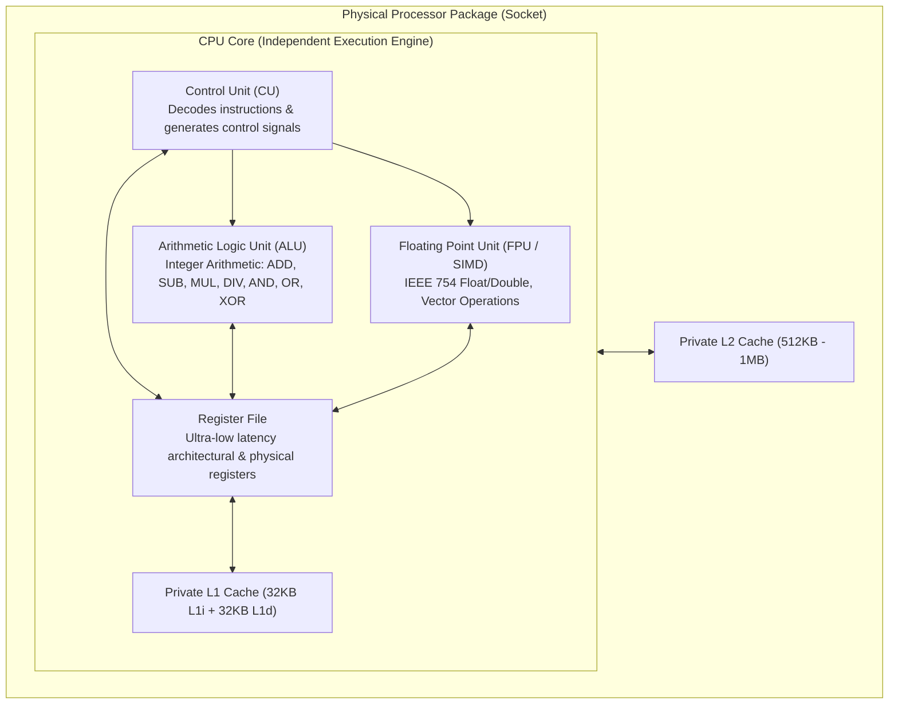
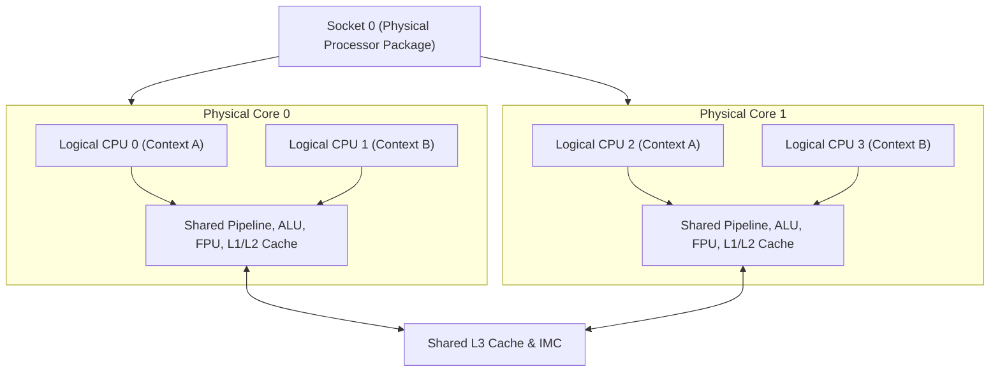
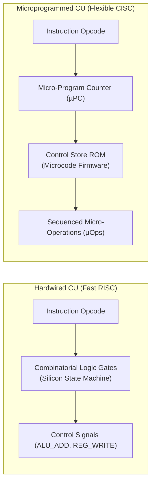
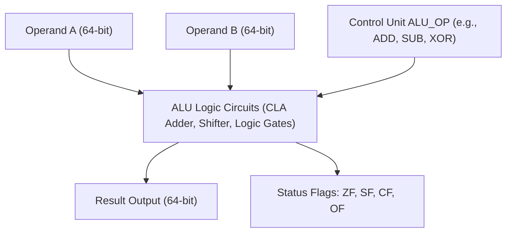

# 2.1. CPU Core Components (Các Thành phần Cốt lõi của CPU)

## Tổng quan về CPU Core Components
Bộ vi xử lý trung tâm (**CPU - Central Processing Unit**) hiện đại đã tiến hóa từ một con chip đơn nhân chứa các mạch logic rời rạc thành các vi xử lý đa nhân (**Multi-core Processors**) phức tạp tích hợp hàng tỷ bóng bán dẫn trên một diện tích silicon chỉ bằng đầu ngón tay.
- **CPU vs Core vs Processor**: Phân biệt rạch ròi giữa vi xử lý vật lý (Processor package/socket), đơn vị tính toán độc lập (CPU Core) và luồng phần cứng (Logical CPU / Hardware Thread).
- **Các khối tính toán cốt lõi**: **Control Unit (CU)** điều phối chu kỳ xung nhịp và luồng dữ liệu; **ALU (Arithmetic Logic Unit)** xử lý các phép toán số nguyên và logic nhị phân; **FPU (Floating Point Unit)** xử lý các phép toán số thực theo chuẩn IEEE 754 với tốc độ cao.



---

## 2. Chi tiết từng Keyword (Under-the-Hood Deep Dive)

### 1. CPU, CPU Core & Processor

#### 1. Khái niệm bản chất (What & Why)
- **Processor (Bộ xử lý vật lý)**: Là toàn bộ con chip đóng gói (Package/Socket) được gắn trực tiếp lên bo mạch chủ qua chân cắm (LGA/BGA). Một máy chủ server có thể có 1, 2 hoặc 4 Sockets.
- **CPU Core (Lõi CPU)**: Là một đơn vị vi xử lý hoàn chỉnh, độc lập nằm bên trong Processor. Mỗi Core sở hữu riêng một bộ ALU, FPU, Register File, bộ giải mã lệnh và các tầng Cache riêng (thường là L1i, L1d và L2).
- **Logical Processor (CPU Logic / Hardware Thread)**: Nhờ công nghệ SMT (Simultaneous Multithreading / Hyper-Threading), mỗi Core vật lý nhân bản Register File và Execution Context để tạo thành 2 CPU logic dưới góc nhìn của Hệ điều hành.

#### 2. Cơ chế hoạt động sâu (Under the hood / Hardcore Internals)
- **Từ Single-Core đến Multi-Core**:
  - Vào năm 2005, định luật Dennard Scaling sụp đổ (tần số xung nhịp không thể tăng vượt ngưỡng 4 GHz - 5 GHz do nhiệt lượng tỏa ra quá lớn — *Power Wall*). Ngành công nghiệp phần cứng buộc phải chuyển sang bổ sung nhiều Core trên cùng một die chip để tăng thông lượng tính toán song song.
- **Độc lập và Chia sẻ trong Multi-Core**:
  - Các Core hoạt động hoàn toàn song song: Core 0 có thể đang chạy mã Kernel, Core 1 chạy mã Go runtime, Core 2 chạy luồng Java.
  - Tuy nhiên, các Core phải **chia sẻ chung bộ nhớ đệm L3 (LLC - Last Level Cache)**, **Memory Controller** và **Băng thông bus PCIe**. Sự tranh chấp tài nguyên chia sẻ này có thể gây ra hiện tượng *Noisy Neighbor* ở tầng phần cứng.

#### 3. Sơ đồ phân cấp Processor -> Core -> Logical CPU


#### 4. Code ví dụ thực chiến (C++ Đọc thông tin Core/Processor trên Linux)
Sử dụng C++ để phân biệt giữa số lượng Hardware Threads và Physical Cores:
```cpp
#include <iostream>
#include <thread>
#include <fstream>
#include <string>
#include <set>

// Lấy số lượng Physical Cores thật sự bằng cách đọc sysfs trên Linux
size_t get_physical_core_count() {
    std::set<std::pair<int, int>> unique_cores; // socket_id, core_id
    int cpu_index = 0;
    while (true) {
        std::string core_path = "/sys/devices/system/cpu/cpu" + std::to_string(cpu_index) + "/topology/core_id";
        std::string sock_path = "/sys/devices/system/cpu/cpu" + std::to_string(cpu_index) + "/topology/physical_package_id";
        
        std::ifstream fc(core_path);
        std::ifstream fs(sock_path);
        if (!fc.is_open() || !fs.is_open()) break;

        int core_id, socket_id;
        fc >> core_id;
        fs >> socket_id;
        unique_cores.insert({socket_id, core_id});
        cpu_index++;
    }
    return unique_cores.empty() ? std::thread::hardware_concurrency() / 2 : unique_cores.size();
}

int main() {
    unsigned int logical_threads = std::thread::hardware_concurrency();
    size_t physical_cores = get_physical_core_count();

    std::cout << "[Processor Topology]:\n";
    std::cout << "  Logical Processors (Threads): " << logical_threads << '\n';
    std::cout << "  Physical CPU Cores:           " << physical_cores << '\n';
    std::cout << "  SMT / Hyper-Threading Ratio:  " << (static_cast<double>(logical_threads) / physical_cores) << "x\n";
    return 0;
}
```

#### 5. Ưu / Nhược điểm, Pitfalls & Anti-patterns
- **Cạm bẫy Hyper-Threading trong High-Performance Backend**:
  - Hai luồng logic chạy trên cùng một core vật lý sẽ **chia sẻ chung ALU, FPU và L1/L2 Cache**. Nếu một luồng chạy tác vụ mã hóa nặng tiêu thụ toàn bộ FPU, luồng còn lại sẽ bị dừng (Stall) gần như 100%.
  - *Giải pháp*: Trong các hệ thống giao dịch tài chính hoặc Real-time Media Engine, kỹ sư thường tắt hoàn toàn Hyper-Threading trong BIOS hoặc cô lập các thread vật lý riêng biệt bằng `numactl` / `taskset`.

#### 6. Ứng dụng thực tế trong Backend / Systems
- **CPU Affinity & Thread Pinning**: Trong các web server hiệu năng cao (như Seastar framework hoặc Envoy), mỗi worker process được "ghim" cứng (pinned) vào một CPU Core vật lý duy nhất để tối ưu hóa triệt để L1/L2 cache hit rate và loại bỏ chi phí context switch của OS Scheduler.

---

### 2. Control Unit (CU)

#### 1. Khái niệm bản chất (What & Why)
- **Control Unit (CU - Khối điều khiển)** là "bộ não điều hành" bên trong CPU. Nó không trực tiếp tính toán dữ liệu mà có nhiệm vụ đọc chỉ thị lệnh, giải mã ý nghĩa và phát ra các tín hiệu điện điều khiển (Control Signals) đồng bộ tới các thành phần khác (ALU, thanh ghi, bus).
- **Nguồn gốc**: Cần một cỗ máy trạng thái hữu hạn (FSM) trung tâm để dịch chuyển các bit dữ liệu chính xác theo từng nhịp xung clock.

#### 2. Cơ chế hoạt động sâu (Under the hood / Hardcore Internals)
Control Unit được thiết kế theo một trong hai trường phái:
1. **Hardwired Control Unit (Mạch nối cứng)**:
   - Toàn bộ logic điều khiển được xây dựng hoàn toàn bằng các cổng logic cố định (AND, OR, NOT, Flip-Flops).
   - *Ưu điểm*: Cực kỳ nhanh, chỉ mất 1 chu kỳ clock.
   - *Nhược điểm*: Rất khó chỉnh sửa nếu có lỗi; thiết kế vô cùng phức tạp đối với tập lệnh lớn (thường dùng trong CPU RISC).
2. **Microprogrammed Control Unit (Khối điều khiển vi chương trình / Microcode)**:
   - CU chứa một bộ nhớ ROM nhỏ bên trong gọi là **Control Store**. Mỗi lệnh phức tạp của người dùng (Macro-instruction) được dịch thành một chuỗi các lệnh vi mã (**Microinstructions / µOps**).
   - *Ưu điểm*: Linh hoạt, có thể sửa lỗi CPU (CPU errata/vulnerabilities) bằng cách nạp Microcode Update từ BIOS/Kernel.
   - *Nhược điểm*: Chậm hơn Hardwired Control Unit (thường dùng cho kiến trúc CISC như x86).

#### 3. Sơ đồ hoạt động của Hardwired vs Microprogrammed CU


#### 4. Code ví dụ thực chiến (C++ Mô phỏng State Machine của Control Unit)
```cpp
#include <iostream>
#include <cstdint>

// Mô phỏng Finite State Machine (FSM) của một Hardwired Control Unit cơ bản
enum class CPUState { FETCH, DECODE, EXECUTE_ALU, MEMORY_ACCESS, WRITE_BACK };
enum class Opcode : uint8_t { NOP = 0x00, ADD = 0x01, LOAD = 0x02, STORE = 0x03 };

struct ControlSignals {
    bool reg_read_enable{false};
    bool reg_write_enable{false};
    bool alu_enable{false};
    bool mem_read_enable{false};
    bool mem_write_enable{false};
};

ControlSignals generate_signals(CPUState state, Opcode op) {
    ControlSignals sig;
    if (state == CPUState::DECODE) {
        sig.reg_read_enable = true;
    } else if (state == CPUState::EXECUTE_ALU && op == Opcode::ADD) {
        sig.alu_enable = true;
    } else if (state == CPUState::MEMORY_ACCESS && op == Opcode::LOAD) {
        sig.mem_read_enable = true;
    } else if (state == CPUState::WRITE_BACK) {
        sig.reg_write_enable = true;
    }
    return sig;
}

int main() {
    ControlSignals sig = generate_signals(CPUState::EXECUTE_ALU, Opcode::ADD);
    std::cout << "[Control Unit FSM]: State = EXECUTE_ALU, Opcode = ADD\n";
    std::cout << "  ALU Enable Signal: " << std::boolalpha << sig.alu_enable << '\n';
    std::cout << "  Memory Read Signal: " << sig.mem_read_enable << '\n';
    return 0;
}
```

#### 5. Ưu / Nhược điểm, Pitfalls & Anti-patterns
- **Microcode Update Security**: Vì Microcode có thể cập nhật qua phần mềm, nó trở thành mục tiêu của các cuộc tấn công cấp thấp (Microcode reverse-engineering). Tuy nhiên, các nhà sản xuất CPU bảo vệ nghiêm ngặt bằng chữ ký số mã hóa RSA/ECDSA được phần cứng xác thực trước khi flash.

#### 6. Ứng dụng thực tế trong Backend / Systems
- **Vá lỗi bảo mật CPU không cần thay phần cứng**: Khi các lỗ hổng chấn động như Spectre, Meltdown hay Downfall xuất hiện trên chip Intel/AMD, các kỹ sư hệ thống không cần vứt bỏ CPU máy chủ mà chỉ cần cài gói `microcode.ctl` / `intel-microcode` trên Linux để Control Unit thay đổi quy tắc giải mã vi lệnh.

---

### 3. Arithmetic Logic Unit (ALU) & Floating Point Unit (FPU)

#### 1. Khái niệm bản chất (What & Why)
- **Arithmetic Logic Unit (ALU)**: Khối tính toán số nguyên và thao tác bit logic. ALU là trái tim của mọi phép tính cơ bản trong máy tính (cộng, trừ, nhân, chia, bitwise AND/OR/XOR/NOT, shift, rotate).
- **Floating Point Unit (FPU)**: Khối tính toán chuyên trách cho các số thực dấu phẩy động (**IEEE 754 Single/Double Precision**). Xử lý các phép toán phức tạp như căn bậc hai, hàm lượng giác, lũy thừa mà ALU số nguyên không thể xử lý hiệu quả.

#### 2. Cơ chế hoạt động sâu (Under the hood / Hardcore Internals)
- **ALU Internals**:
  - Xây dựng từ mạch cộng nhanh **Carry Lookahead Adder (CLA)** để tính toán phép cộng trong thời gian $\mathcal{O}(\log N)$ thay vì $\mathcal{O}(N)$ của Ripple Carry Adder.
  - Sau mỗi phép toán, ALU xuất ra các cờ trạng thái điều kiện (**Status/Condition Codes**):
    - `ZF` (Zero Flag): Kết quả bằng 0.
    - `SF` (Sign Flag): Kết quả là số âm (bit có trọng số cao nhất MSB = 1).
    - `CF` (Carry Flag): Phép toán số nguyên không dấu bị tràn.
    - `OF` (Overflow Flag): Phép toán số nguyên có dấu (Two's Complement) bị tràn.
- **FPU & SIMD Vectors**:
  - Trước năm 1989 (thời Intel 80386), FPU là một chip đồng xử lý (Coprocessor 80387) gắn ngoài riêng biệt. Từ Intel 80486 trở đi, FPU được tích hợp thẳng vào die CPU.
  - Hiện nay, FPU được sáp nhập vào khối **SIMD / Vector Execution Engine** (AVX2, AVX-512 trên x86, Neon trên ARM) với các thanh ghi độ rộng 128-bit, 256-bit hoặc 512-bit để tính toán song song hàng loạt số thực trong 1 chu kỳ.

#### 3. Sơ đồ mạch nội bộ của ALU và Cờ Trạng thái


#### 4. Code ví dụ thực chiến (C++ Khám phá ALU Flags & FPU IEEE 754)
Minh họa sự khác biệt giữa ALU Integer Overflow và FPU Special Values:
```cpp
#include <iostream>
#include <limits>
#include <cmath>
#include <cstdint>

int main() {
    // 1. ALU: Xử lý số nguyên tràn theo bù 2 (Two's Complement)
    int32_t max_int = std::numeric_limits<int32_t>::max();
    int32_t overflowed_int = max_int + 1; // Trong C++ là Undefined Behavior, nhưng ở mức ALU là Wrap-around
    std::cout << "[ALU Integer]: Max = " << max_int 
              << ", Max + 1 (wrap-around) = " << overflowed_int << '\n';

    // 2. FPU: Xử lý số thực theo chuẩn phần cứng IEEE 754
    double zero = 0.0;
    double div_by_zero = 1.0 / zero;      // FPU sinh ra +Infinity (không crash CPU)
    double invalid_op  = zero / zero;     // FPU sinh ra NaN (Not a Number)

    std::cout << "[FPU IEEE 754]: 1.0 / 0.0 = " << div_by_zero << '\n';
    std::cout << "[FPU IEEE 754]: 0.0 / 0.0 = " << invalid_op << '\n';
    std::cout << "  Is Infinity: " << std::boolalpha << std::isinf(div_by_zero) << '\n';
    std::cout << "  Is NaN:      " << std::isnan(invalid_op) << '\n';

    return 0;
}
```

#### 5. Ưu / Nhược điểm, Pitfalls & Anti-patterns
- **Cạm bẫy độ trễ của FPU vs ALU**: Các phép toán số nguyên trên ALU (`ADD`, `SUB`, `BITWISE`) chỉ mất **1 chu kỳ clock**, trong khi phép toán trên FPU (đặc biệt là phép chia `FDIV` hoặc căn bậc hai `FSQRT`) có thể mất tới **15–40 chu kỳ clock**.
- **Anti-pattern**: Sử dụng số thực `float/double` cho các trường tiền tệ tài chính trong cơ sở dữ liệu backend. Sai số làm tròn của chuẩn IEEE 754 sẽ làm mất cân bằng sổ sách kế toán. Luôn dùng số nguyên định dạng Decimal/Fixed-point để xử lý trên ALU.

#### 6. Ứng dụng thực tế trong Backend / Systems
- **Vectorized Search Engines & AI Databases**: Các cơ sở dữ liệu vector hiện đại (như Milvus, Qdrant hay pgvector của PostgreSQL) tối ưu hóa hàm tính khoảng cách Cosine hoặc Euclidean bằng cách sử dụng trực tiếp các chỉ thị FPU SIMD (`_mm256_fmadd_ps` - Fused Multiply-Add) để tính toán 8 phép toán số thực dấu phẩy động trong một chu kỳ xung nhịp duy nhất.