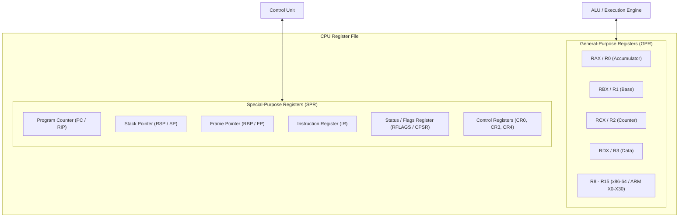
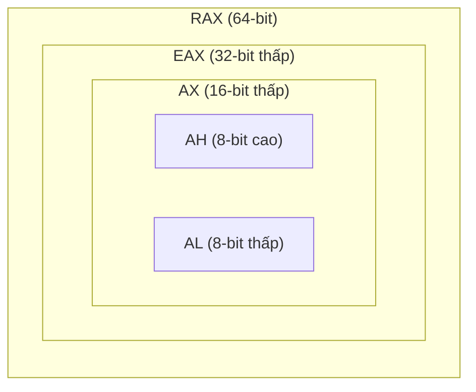
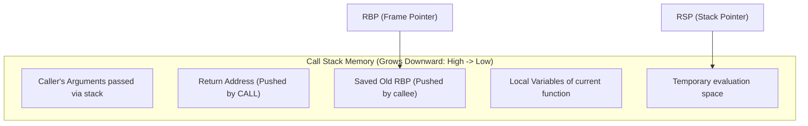
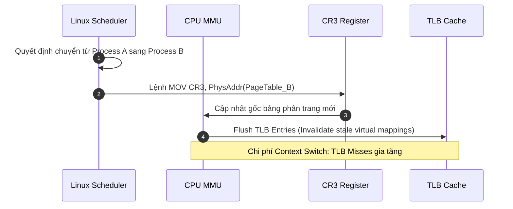

# 2.2. CPU Register Architecture (Kiến trúc Thanh ghi CPU)

## Tổng quan về CPU Register Architecture
Thanh ghi (**Registers**) là tầng lưu trữ nhanh nhất, đắt đỏ nhất và có độ trễ nhỏ nhất (dưới 1 chu kỳ xung nhịp, cỡ $\approx 0.25 - 0.5\text{ ns}$) trong toàn bộ hệ thống phân cấp bộ nhớ máy tính.
- **Vị trí và bản chất vật lý**: Được chế tạo từ các mạch chốt Static RAM (SRAM Flip-Flops) nằm trực tiếp bên trong đường dẫn dữ liệu (datapath) của lõi CPU, kết nối thẳng với các cổng đầu vào của ALU và FPU.
- **Register File**: Tập hợp toàn bộ các mảng thanh ghi vật lý bên trong CPU được quản lý bởi hệ thống mạch giải mã đa cổng (multi-ported read/write array).
- **Phân loại thanh ghi**:
  - **General-Purpose Registers (GPR)**: Dùng để lưu trữ dữ liệu tạm thời, con trỏ và kết quả tính toán của chương trình.
  - **Special-Purpose Registers (SPR)**: Điều khiển luồng thực thi, quản lý ngăn xếp, lưu trạng thái tính toán và cấu hình chế độ hoạt động của phần cứng.



---

## 2. Chi tiết từng Keyword (Under-the-Hood Deep Dive)

### 1. Register File & General-Purpose Registers (GPR)

#### 1. Khái niệm bản chất (What & Why)
- **Register File**: Mảng vật lý chứa các thanh ghi đa năng bên trong lõi chip. Khác với RAM phải truy cập qua bus địa chỉ, Register File là bộ nhớ SRAM đa cổng (Multi-ported SRAM, thường có 4–8 cổng đọc và 2–4 cổng ghi) cho phép nhiều đơn vị thực thi (ALU1, ALU2, AGU) đọc/ghi đồng thời trong một chu kỳ clock.
- **General-Purpose Registers (GPR)**: Là tập hợp các thanh ghi mà lập trình viên và trình biên dịch có thể tự do sử dụng cho bất kỳ mục đích nào (chứa biến tạm, địa chỉ con trỏ, giá trị trả về của hàm).

#### 2. Cơ chế hoạt động sâu (Under the hood / Hardcore Internals)
- **Sự khác biệt giữa Kiến trúc (Architectural) và Vật lý (Physical)**:
  - *Architectural GPRs*: Số lượng thanh ghi được ISA quy định cho lập trình viên thấy:
    - x86 (IA-32): Chỉ có 8 thanh ghi 32-bit (`EAX`, `EBX`, `ECX`, `EDX`, `ESI`, `EDI`, `EBP`, `ESP`). Do quá ít thanh ghi, x86-32 liên tục bị hiện tượng **Register Spill** (phải đẩy biến ra Stack RAM).
    - x86-64: Mở rộng thành 16 thanh ghi 64-bit (`RAX`, `RBX`, `RCX`, `RDX`, `RSI`, `RDI`, `RBP`, `RSP`, `R8` đến `R15`).
    - AArch64 (ARM 64-bit): Có tới 31 thanh ghi 64-bit đa năng (`X0` đến `X30`).
  - *Physical Register File (PRF)*: Bên dưới vi kiến trúc hiện đại, chip Intel/AMD sở hữu từ 180 đến 256 thanh ghi vật lý thật sự. Công nghệ **Register Renaming** liên tục ánh xạ 16 thanh ghi logic sang hàng trăm thanh ghi vật lý để chạy song song Out-of-Order.
- **Calling Convention (Quy ước gọi hàm - System V AMD64 ABI)**:
  - Các tham số hàm được truyền qua GPRs thay vì Stack để đạt tốc độ cao nhất:
    `RDI` (tham số 1) $\to$ `RSI` (tham số 2) $\to$ `RDX` (tham số 3) $\to$ `RCX` (tham số 4) $\to$ `R8` (tham số 5) $\to$ `R9` (tham số 6).
  - Giá trị trả về nằm ở `RAX` (hoặc `RDX:RAX` nếu kiểu dữ liệu 128-bit).

#### 3. Sơ đồ ánh xạ kích thước thanh ghi x86-64 GPR


#### 4. Code ví dụ thực chiến (C++ & GPR Assembly Optimization)
Minh họa cách ép compiler sử dụng trực tiếp thanh ghi GPR cụ thể bằng từ khóa register trên GCC:
```cpp
#include <iostream>
#include <cstdint>

// Minh họa việc tối ưu hóa vòng lặp bằng cách giữ biến trực tiếp trong GPR
uint64_t sum_gpr_loop(uint64_t n) {
    // Ép thanh ghi RAX làm biến tích lũy accumulator, RCX làm biến đếm counter
    register uint64_t sum asm("rax") = 0;
    register uint64_t i asm("rcx") = 1;

    for (; i <= n; ++i) {
        sum += i;
    }
    return sum;
}

int main() {
    uint64_t n = 1'000'000;
    uint64_t res = sum_gpr_loop(n);
    std::cout << "[GPR Direct Execution]: Sum 1.." << n << " = " << res << '\n';
    return 0;
}
```

#### 5. Ưu / Nhược điểm, Pitfalls & Anti-patterns
- **Register Pressure & Register Spilling**: Khi hàm chứa quá nhiều biến cục bộ hoặc biểu thức quá phức tạp vượt quá số lượng GPRs khả dụng, compiler buộc phải sinh ra các lệnh `MOV [RSP + offset], reg` để lưu tạm dữ liệu ra RAM và `MOV reg, [RSP + offset]` để nạp lại. Hiện tượng này làm sụt giảm nghiêm trọng IPC của CPU.

#### 6. Ứng dụng thực tế trong Backend / Systems
- **Tối ưu hóa Hot Loop trong Serialization/Deserialization**: Khi parse JSON (như thư viện `simdjson`) hoặc xử lý Protobuf, các kỹ sư tối ưu hóa mã C++/Rust sao cho toàn bộ state máy trạng thái (FSM state, con trỏ mảng, byte hiện tại) nằm gọn trong các thanh ghi GPR mà không bị spill ra Stack.

---

### 2. Special-Purpose Registers: PC, SP, FP, IR

#### 1. Khái niệm bản chất (What & Why)
- **Special-Purpose Registers (SPR)**: Là các thanh ghi có nhiệm vụ chuyên biệt phục vụ việc điều khiển hoạt động nội bộ của CPU và hệ điều hành. Lập trình viên thông thường không thể tùy tiện dùng chúng để lưu biến tự do.

#### 2. Cơ chế hoạt động sâu (Under the hood / Hardcore Internals)
1. **Program Counter (PC) / Instruction Pointer (IP / RIP)**:
   - Lưu trữ địa chỉ ô nhớ của chỉ thị lệnh tiếp theo sẽ được CPU nạp (Fetch).
   - Tự động tăng lên sau mỗi lệnh: $\text{PC} \leftarrow \text{PC} + \text{Instruction\_Length}$.
   - Khi gặp lệnh nhảy (`JMP`, `CALL`, `RET`, `JZ`), `PC` bị ghi đè bằng địa chỉ mục tiêu (Target Address). Lập trình viên không thể ghi trực tiếp vào `RIP` qua lệnh `MOV` thông thường trên x86-64.
2. **Stack Pointer (SP / RSP)**:
   - Luôn trỏ tới đỉnh hiện tại của Call Stack trong bộ nhớ RAM.
   - Khi gọi lệnh `PUSH value`, CPU giảm `RSP` đi 8 bytes (vì Stack trên x86 phát triển ngược từ vùng địa chỉ cao xuống thấp) rồi ghi dữ liệu vào địa chỉ `[RSP]`. Khi gọi `POP`, dữ liệu được đọc ra và `RSP` tăng thêm 8 bytes.
3. **Frame Pointer (FP / RBP)**:
   - Trỏ tới vị trí cơ sở (Base) của Stack Frame của hàm hiện tại.
   - Cho phép hàm truy cập các tham số (`[RBP + offset]`) và các biến cục bộ (`[RBP - offset]`) với độ dịch cố định trong suốt quá trình hàm thực thi, ngay cả khi `RSP` liên tục biến đổi.
4. **Instruction Register (IR)**:
   - Thanh ghi nội bộ bên trong Control Unit. Giữ chuỗi byte mã máy vừa được fetch từ L1i Cache về để bộ giải mã (Decoder) tiến hành phân tích Opcode. Thanh ghi này hoàn toàn vô hình đối với lập trình viên (không thể truy cập bằng bất kỳ lệnh assembly nào).

#### 3. Sơ đồ bố cục Stack Frame với RSP và RBP


#### 4. Code ví dụ thực chiến (C++ Trích xuất RBP & Stack Walk)
Minh họa đọc địa chỉ Stack Pointer và Frame Pointer tại runtime:
```cpp
#include <iostream>
#include <cstdint>

void print_stack_context() {
    uint64_t rsp_val = 0;
    uint64_t rbp_val = 0;

#if defined(__x86_64__)
    asm volatile("movq %%rsp, %0" : "=r"(rsp_val));
    asm volatile("movq %%rbp, %0" : "=r"(rbp_val));
#endif

    std::cout << "[Stack Context]:\n";
    std::cout << "  Stack Pointer (RSP): 0x" << std::hex << rsp_val << '\n';
    std::cout << "  Frame Pointer (RBP): 0x" << std::hex << rbp_val << '\n';
    std::cout << "  Current Frame Size:  " << std::dec << (rbp_val - rsp_val) << " bytes\n";
}

int main() {
    print_stack_context();
    return 0;
}
```

#### 5. Ưu / Nhược điểm, Pitfalls & Anti-patterns
- **Frame Pointer Omission (`-fomit-frame-pointer`)**:
  - *Ưu điểm*: Trình biên dịch giải phóng thanh ghi `RBP` để dùng như một GPR bình thường, giúp CPU có thêm 1 thanh ghi đa năng và tiết kiệm 2 lệnh (`push rbp`, `mov rbp, rsp`) khi vào hàm.
  - *Cạm bẫy (Pitfall)*: Làm cho các công cụ giám sát hiệu năng (như Linux `perf` hoặc eBPF profiler) không thể "Stack Walk" để vẽ Flame Graph, hoặc gây khó khăn nghiêm trọng khi phân tích crash dump (Core Dump).

#### 6. Ứng dụng thực tế trong Backend / Systems
- **eBPF Continuous Profiling (Parca / Pyroscope)**: Trong môi trường production, các backend service được khuyến nghị biên dịch với cờ `-fno-omit-frame-pointer` để eBPF kernel probes có thể đọc nhanh chuỗi `RBP` trong vài microsecond mà không cần giải mã bảng unwinding DWARF cồng kềnh.

---

### 3. Status/Flags Register & Control Registers

#### 1. Khái niệm bản chất (What & Why)
- **Status/Flags Register (`RFLAGS` trên x86, `CPSR` trên ARM)**: Chứa các bit cờ phản ánh kết quả của phép tính toán vừa thực hiện bởi ALU và điều khiển các hành vi rẽ nhánh logic hoặc cho phép ngắt.
- **Control Registers (CR0, CR2, CR3, CR4, CR8 trên x86)**: Các thanh ghi đặc quyền của CPU quản lý trực tiếp các chế độ vận hành phần cứng: bật/tắt bộ nhớ ảo (Paging), kích hoạt chế độ bảo vệ (Protected Mode / Long Mode), và lưu địa chỉ bảng phân trang.

#### 2. Cơ chế hoạt động sâu (Under the hood / Hardcore Internals)
- **Cấu trúc RFLAGS**:
  - *Condition Flags*:
    - `CF` (bit 0 - Carry): Báo tràn số nguyên không dấu.
    - `ZF` (bit 6 - Zero): Báo kết quả bằng 0 (dùng cho lệnh `JE`/`JNE`).
    - `SF` (bit 7 - Sign): Báo kết quả âm.
    - `OF` (bit 11 - Overflow): Báo tràn số nguyên bù hai có dấu.
  - *System Flags*:
    - `IF` (bit 9 - Interrupt Enable Flag): Nếu bằng 1, CPU chấp nhận ngắt phần cứng ngoài (Maskable Interrupts). Lệnh `CLI` xóa bit này về 0 (tắt ngắt), lệnh `STI` bật lại bit này.
    - `TF` (bit 8 - Trap Flag): Bật chế độ chạy từng bước (Single-step debugging) cho các bộ debugger như GDB.
- **Các thanh ghi Control Registers then chốt**:
  - `CR0`: Chứa bit `PE` (Protection Enable - chuyển từ Real Mode sang Protected Mode) và bit `PG` (Paging Enable - bật bộ nhớ ảo MMU).
  - `CR2`: Page Fault Linear Address (PFLA) — Khi CPU gặp lỗi truy cập trang bộ nhớ (Page Fault), địa chỉ gây lỗi lập tức được phần cứng tự động ghi vào `CR2` để Kernel xử lý.
  - `CR3`: Page-Directory Base Register (PDBR) — Lưu **địa chỉ vật lý của bảng phân trang cấp cao nhất (PML4 / PML5)** của tiến trình hiện tại. Khi hệ điều hành thực hiện Context Switch sang tiến trình khác, thao tác cốt lõi là ghi địa chỉ mới vào `CR3` (đồng thời làm vô hiệu hóa bộ đệm TLB).

#### 3. Sơ đồ kiến trúc Control Registers và Context Switch


#### 4. Code ví dụ thực chiến (C++ Đọc và thao tác Bit Flags)
Minh họa kiểm tra cờ Zero và Carry thông qua lệnh so sánh:
```cpp
#include <iostream>
#include <cstdint>

// Kiểm tra trạng thái cờ RFLAGS sau một phép so sánh
uint64_t read_rflags_after_cmp(int a, int b) {
    uint64_t rflags = 0;
#if defined(__x86_64__)
    asm volatile (
        "cmpl %[val_b], %[val_a]\n\t" // So sánh a và b
        "pushfq\n\t"                  // Đẩy thanh ghi RFLAGS vào đỉnh Stack
        "popq %[flags_out]\n\t"       // Kéo ra biến C++
        : [flags_out] "=r" (rflags)
        : [val_a] "r" (a), [val_b] "r" (b)
        : "cc"
    );
#endif
    return rflags;
}

int main() {
    uint64_t flags = read_rflags_after_cmp(10, 10);
    bool zf = (flags >> 6) & 1; // Bit 6 là Zero Flag
    std::cout << "[RFLAGS Analysis]: Comparing 10 with 10:\n";
    std::cout << "  Raw Flags Value: 0x" << std::hex << flags << '\n';
    std::cout << "  Zero Flag (ZF):  " << std::boolalpha << zf << " (Values are Equal)\n";
    return 0;
}
```

#### 5. Ưu / Nhược điểm, Pitfalls & Anti-patterns
- **Chi phí đắt đỏ của việc cập nhật CR3**: Thao tác ghi vào `CR3` là một thao tác cực kỳ tốn kém ở mức phần cứng, vì nó kích hoạt cơ chế xóa sạch (Flush) bộ đệm chuyển đổi địa chỉ (TLB). Các CPU hiện đại giải quyết vấn đề này bằng tính năng **PCID (Process-Context Identifiers)** cho phép gán nhãn cho các dòng TLB thay vì xóa toàn bộ khi nạp `CR3`.

#### 6. Ứng dụng thực tế trong Backend / Systems
- **Thread vs Process trong High-Concurrency Servers**: Các worker dạng multi-threading (như Java Netty, Tokio Rust, Go Goroutines) rẻ hơn rất nhiều so với multi-process (như PHP-FPM hay Postgres processes) vì các thread trong cùng một process dùng chung không gian bộ nhớ ảo, hoàn toàn **không cần nạp lại thanh ghi CR3**, tránh được thảm họa TLB Thrashing.