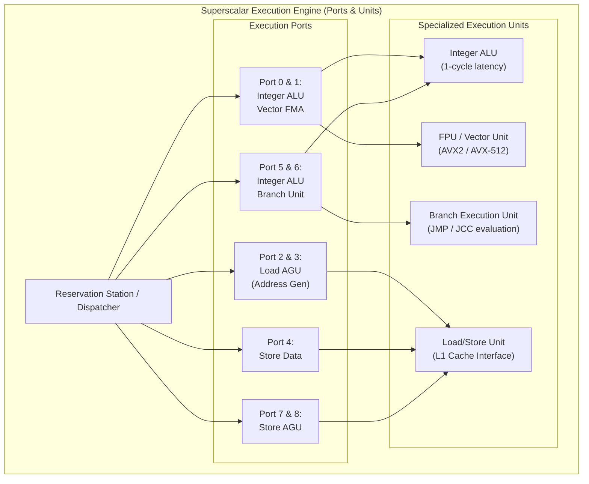
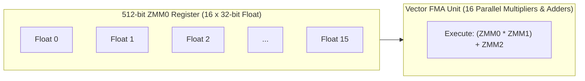
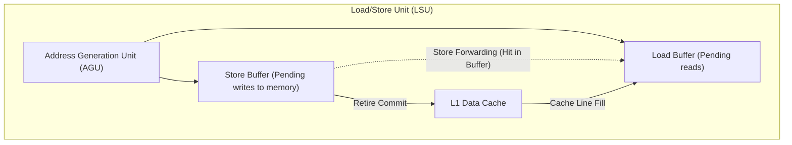

# 2.3. CPU Execution Engine & Pipeline Units (Động cơ Thực thi & Các Khối Đường ống CPU)

## Tổng quan về Execution Engine & Pipeline Units
Bên trong một lõi CPU hiện đại, trung tâm sức mạnh xử lý nằm ở **Execution Engine (Động cơ thực thi)**. Thay vì chỉ có một khối ALU duy nhất xử lý tuần tự, CPU hiện đại áp dụng kiến trúc **Superscalar**, tích hợp đồng thời nhiều khối thực thi chuyên biệt (**Execution Units - EUs**) hoạt động song song.
- **CPU Pipeline**: Kỹ thuật phân chia quá trình xử lý lệnh thành một dây chuyền lắp ráp liên tục, giúp tăng thông lượng xử lý lệnh trên mỗi đơn vị thời gian.
- **Phân bổ Execution Units**:
  - **Integer Execution Units (IEU / ALU)**: Xử lý số nguyên, dịch bit và các phép toán logic cơ bản.
  - **Floating-Point Execution Units (FPU / Vector SIMD)**: Xử lý số thực dấu phẩy động và tính toán song song trên vector dữ liệu lớn.
  - **Load/Store Units (LSU / AGU)**: Chuyên trách tính toán địa chỉ bộ nhớ và giao tiếp với L1 Cache.
  - **Branch Units (BRU)**: Đánh giá các điều kiện rẽ nhánh và điều phối lại dòng chảy của con trỏ lệnh.



---

## 2. Chi tiết từng Keyword (Under-the-Hood Deep Dive)

### 1. CPU Pipeline & Execution Units Overview

#### 1. Khái niệm bản chất (What & Why)
- **CPU Pipeline**: Là nguyên lý chia nhỏ quá trình thực thi chỉ thị lệnh thành nhiều bước (stages) nối tiếp nhau, ngăn cách bởi các thanh ghi đệm đường ống (Pipeline Registers). Khi một lệnh chuyển sang bước 2, lệnh tiếp theo lập tức bước vào bước 1.
- **Execution Units (EUs)**: Là các mạch phần cứng độc lập thực sự đảm nhiệm việc biến đổi dữ liệu. Trong vi kiến trúc hiện đại (như Intel Raptor Lake hoặc AMD Zen 4), có từ 6 đến 12 EUs được gắn vào các cổng thực thi (**Execution Ports**) riêng biệt.

#### 2. Cơ chế hoạt động sâu (Under the hood / Hardcore Internals)
- **Độ sâu Pipeline và Cân bằng Tần số**:
  - Thời gian của một chu kỳ xung nhịp bị giới hạn bởi **stage có đường dẫn tới hạn (Critical Path) dài nhất**:
    $$T_{\text{clock}} = \max(T_{\text{stage\_i}}) + T_{\text{latch}}$$
  - Chia nhỏ pipeline thành nhiều stages (Pipeline sâu, ví dụ 14–19 stages) cho phép đẩy tần số xung nhịp lên rất cao (4 GHz - 6 GHz). Tuy nhiên, nếu pipeline quá sâu, chi phí phạt khi đoán sai nhánh (Branch Misprediction Penalty) sẽ trở nên cực kỳ đắt đỏ.
- **Port Contention (Tranh chấp cổng thực thi)**:
  - Nếu trình biên dịch sinh ra hai vi lệnh đồng thời đòi hỏi cùng một Execution Port (ví dụ cả hai đều cần Port 0 để nhân số thực), một vi lệnh sẽ bị dừng lại (**Port Stall**).
  - Trình biên dịch thông minh luôn cố gắng xen kẽ các chỉ thị thuộc các nhóm Execution Units khác nhau (ALU xen kẽ với Load hoặc Vector) để tận dụng tối đa chiều rộng của Superscalar Engine.

#### 3. Sơ đồ minh họa nguyên lý Pipeline Dây chuyền

```mermaid
gantt
    title Pipeline Execution (4 Instructions in 5 Stages)
    dateFormat X
    axisFormat %s

    section Instruction 1
    Fetch (IF)     :0, 1
    Decode (ID)    :1, 2
    Execute (EX)   :2, 3
    Memory (MEM)   :3, 4
    WriteBack (WB) :4, 5

    section Instruction 2
    Fetch (IF)     :1, 2
    Decode (ID)    :2, 3
    Execute (EX)   :3, 4
    Memory (MEM)   :4, 5
    WriteBack (WB) :5, 6

    section Instruction 3
    Fetch (IF)     :2, 3
    Decode (ID)    :3, 4
    Execute (EX)   :4, 5
    Memory (MEM)   :5, 6
    WriteBack (WB) :6, 7

    section Instruction 4
    Fetch (IF)     :3, 4
    Decode (ID)    :4, 5
    Execute (EX)   :5, 6
    Memory (MEM)   :6, 7
    WriteBack (WB) :7, 8
```


#### 4. Code ví dụ thực chiến (C++ Tận dụng Đa cổng Thực thi qua Instruction-Level Parallelism)
Minh họa kỹ thuật Loop Unrolling để phát song song nhiều lệnh vào các cổng ALU độc lập:
```cpp
#include <iostream>
#include <vector>
#include <chrono>

// Phiên bản 1: Phụ thuộc dữ liệu tuần tự - Nghẽn vào 1 cổng ALU duy nhất
double sum_serial(const double* data, size_t n) {
    double acc = 0.0;
    for (size_t i = 0; i < n; ++i) {
        acc += data[i]; // acc phải chờ kết quả vòng lặp trước (Latency bottleneck)
    }
    return acc;
}

// Phiên bản 2: Tận dụng nhiều Execution Units song song (Multiple Accumulators)
double sum_parallel_ports(const double* data, size_t n) {
    double acc0 = 0.0, acc1 = 0.0, acc2 = 0.0, acc3 = 0.0;
    size_t i = 0;
    for (; i + 3 < n; i += 4) {
        acc0 += data[i];     // Bắn vào Execution Port A
        acc1 += data[i + 1]; // Bắn vào Execution Port B
        acc2 += data[i + 2]; // Bắn vào Execution Port C
        acc3 += data[i + 3]; // Bắn vào Execution Port D
    }
    for (; i < n; ++i) acc0 += data[i];
    return acc0 + acc1 + acc2 + acc3;
}

int main() {
    constexpr size_t N = 10'000'000;
    std::vector<double> arr(N, 1.0);

    auto t0 = std::chrono::high_resolution_clock::now();
    double res1 = sum_serial(arr.data(), N);
    auto t1 = std::chrono::high_resolution_clock::now();
    double res2 = sum_parallel_ports(arr.data(), N);
    auto t2 = std::chrono::high_resolution_clock::now();

    auto time1 = std::chrono::duration_cast<std::chrono::microseconds>(t1 - t0).count();
    auto time2 = std::chrono::duration_cast<std::chrono::microseconds>(t2 - t1).count();

    std::cout << "[Serial Loop Time]:   " << time1 << " us (Result: " << res1 << ")\n";
    std::cout << "[Parallel Ports Time]: " << time2 << " us (Result: " << res2 << ")\n";
    std::cout << "  Speedup: " << static_cast<double>(time1) / time2 << "x via Instruction-Level Parallelism\n";
    return 0;
}
```

#### 5. Ưu / Nhược điểm, Pitfalls & Anti-patterns
- **Độ trễ (Latency) vs Thông lượng (Throughput)**:
  - *Latency*: Thời gian để một lệnh hoàn thành từ đầu đến cuối (ví dụ: phép nhân số thực mất 4 chu kỳ).
  - *Throughput*: Tốc độ tiếp nhận lệnh mới của đơn vị thực thi (ví dụ: FPU được pipeline hoàn toàn, có thể tiếp nhận 1 lệnh nhân mới ở MỖI chu kỳ xung nhịp).
  - *Anti-pattern*: Viết chuỗi tính toán mà mỗi dòng sau phụ thuộc trực tiếp vào kết quả của dòng trước (`a = a + 1; a = a * 2; a = a - 3;`) sẽ triệt tiêu hoàn toàn khả năng chạy song song của các Execution Ports.

#### 6. Ứng dụng thực tế trong Backend / Systems
- **Tối ưu hóa Hash Function (CityHash / MurmurHash / xxHash)**: Các thuật toán băm hiệu năng cao nhất thế giới dành cho distributed cache và cơ sở dữ liệu luôn sử dụng 4 đến 8 biến tích lũy độc lập để ép vi kiến trúc CPU tận dụng triệt để tất cả các Execution Ports trong cùng một vòng lặp.

---

### 2. Integer & Floating-Point Execution Units

#### 1. Khái niệm bản chất (What & Why)
- **Integer Execution Unit (IEU)**: Xử lý các phép toán số nguyên cơ bản (ADD, SUB), logic nhị phân (AND, OR, XOR), và các phép dịch bit (SHL, SHR). Một lõi CPU hiện đại thường có 4 đến 6 IEUs.
- **Floating-Point Execution Unit (FPU)**: Xử lý các phép tính số thực IEEE 754 và các chỉ thị SIMD Vector mở rộng (AVX, NEON). Thường có 2 đến 3 đơn vị FMA (Fused Multiply-Add) có khả năng tính toán $(A \times B) + C$ trong một chỉ thị duy nhất.

#### 2. Cơ chế hoạt động sâu (Under the hood / Hardcore Internals)
- **Fast ALU vs Complex ALU**:
  - Không phải mọi IEU đều bình đẳng. Các CPU hiện đại thường chia thành:
    - *Simple ALUs* (xử lý ADD, SUB, AND, OR): Cực nhanh, hoàn thành trong **1 chu kỳ clock**, thậm chí có thể chạy ở tốc độ gấp đôi xung nhịp cơ bản (Double-pumped ALUs).
    - *Complex ALUs* (xử lý MUL, DIV, Bit Scan): Phép nhân số nguyên mất 3–4 chu kỳ, phép chia số nguyên (`IDIV`) có thể mất tới 15–30 chu kỳ và không thể pipeline hoàn toàn.
- **FPU SIMD Vectors & Subnormal Numbers**:
  - Khi tính toán số thực, nếu kết quả rơi vào vùng số siêu nhỏ tiệm cận 0 (**Denormal / Subnormal Numbers**), phần cứng FPU không thể xử lý bằng mạch thông thường mà phải kích hoạt chế độ **Microcode Assist Trap** để tính bằng phần mềm. Điều này khiến tốc độ tính toán bị chậm đi tới **100 lần**.

#### 3. Sơ đồ FPU SIMD Register Datapath (AVX-512)


#### 4. Code ví dụ thực chiến (C++ Tránh Subnormal Numbers Penalty trên FPU)
Bật cờ phần cứng FTZ (Flush-To-Zero) và DAZ (Denormals-Are-Zero) trong thanh ghi điều khiển `MXCSR` của FPU:
```cpp
#include <iostream>
#include <immintrin.h>
#include <chrono>

void enable_fast_denormals() {
#if defined(__x86_64__) || defined(_M_X64)
    // _MM_FLUSH_ZERO_ON: Tự động coi kết quả siêu nhỏ bằng 0.0 để tránh chậm FPU
    // _MM_DENORMALS_ZERO_ON: Tự động coi toán hạng siêu nhỏ bằng 0.0
    _MM_SET_FLUSH_ZERO_MODE(_MM_FLUSH_ZERO_ON);
    _MM_SET_DENORMALS_ZERO_MODE(_MM_DENORMALS_ZERO_ON);
    std::cout << "[FPU Optimization]: FTZ and DAZ modes enabled in MXCSR.\n";
#endif
}

int main() {
    enable_fast_denormals();
    return 0;
}
```

#### 5. Ưu / Nhược điểm, Pitfalls & Anti-patterns
- **Cạm bẫy AVX Frequency Downclocking**: Trên một số thế hệ chip máy chủ cũ hơn (Intel Skylake-SP), khi một luồng kích hoạt các lệnh AVX-512 nặng trên FPU, CPU sẽ tiêu thụ quá nhiều điện năng và tự động hạ xung nhịp (Frequency Downclock) của toàn bộ các lõi đi 10–20%, vô tình làm chậm các luồng xử lý số nguyên thông thường.

#### 6. Ứng dụng thực tế trong Backend / Systems
- **Machine Learning Inference trên CPU**: Các framework như ONNX Runtime hay PyTorch tận dụng triệt để các khối FPU SIMD Vector và cơ chế FTZ/DAZ để thực hiện ma trận nhân (GEMM) với thông lượng hàng chục TeraFLOPS ngay trên CPU máy chủ mà không cần card GPU rời.

---

### 3. Load/Store Unit (LSU) & Branch Unit (BRU)

#### 1. Khái niệm bản chất (What & Why)
- **Load/Store Unit (LSU)**: Khối chuyên trách quản lý mọi thao tác đọc dữ liệu từ bộ nhớ vào thanh ghi (`LOAD`) và ghi dữ liệu từ thanh ghi ra bộ nhớ (`STORE`). Bao gồm các mạch sinh địa chỉ (**AGU - Address Generation Unit**), hàng đợi **Load Buffer** và **Store Buffer**.
- **Branch Unit (BRU / Branch Execution Unit)**: Khối kiểm tra điều kiện rẽ nhánh (dựa trên các cờ trong Flags Register), tính toán địa chỉ đích thực tế của lệnh nhảy, và thông báo cho Branch Predictor biết dự đoán trước đó là Đúng hay Sai.

#### 2. Cơ chế hoạt động sâu (Under the hood / Hardcore Internals)
- **AGU & Load-to-Use Latency**:
  - Địa chỉ ô nhớ x86 thường có dạng phức tạp: `[Base + Index * Scale + Displacement]` (ví dụ: `[RAX + RCX*4 + 0x20]`). AGU là một mạch cộng chuyên biệt tính toán địa chỉ này chỉ trong 1 chu kỳ clock trước khi gửi tới L1d Cache.
  - Sau khi gửi địa chỉ, mất thêm 4–5 chu kỳ clock để L1d Cache trả dữ liệu về thanh ghi (**Load-to-Use Latency**).
- **Store-to-Load Forwarding**:
  - Nếu CPU vừa ghi dữ liệu vào một địa chỉ ô nhớ (dữ liệu đang nằm trong Store Buffer chưa kịp xả ra Cache), và ngay sau đó có một lệnh đọc dữ liệu từ chính địa chỉ đó:
  - Khối LSU sẽ kích hoạt cơ chế **Store Forwarding** — truyền thẳng giá trị từ Store Buffer sang cho lệnh Load mà không cần phải chờ ghi vào Cache rồi đọc ngược lại. Nếu việc forwarding bị thất bại (ví dụ đọc 8 byte từ một lệnh ghi 4 byte trước đó - *Misaligned/Partial Forwarding*), CPU sẽ bị phạt dừng pipeline tới 10–15 chu kỳ.
- **Branch Unit Misprediction Resolution**:
  - Khi Branch Unit phát hiện CPU đã chạy suy đoán (Speculative Execution) vào sai nhánh:
  - BRU lập tức phát tín hiệu **Pipeline Flush**, xóa toàn bộ các lệnh sai đang nằm trong pipeline, khôi phục lại trạng thái thanh ghi từ Reorder Buffer và chuyển con trỏ `PC` sang nhánh đúng.

#### 3. Sơ đồ khối LSU với Store Forwarding


#### 4. Code ví dụ thực chiến (C++ Tránh Branch Misprediction bằng CMOV)
Minh họa cách viết mã cho phép trình biên dịch sinh ra lệnh Conditional Move (`CMOV`) thay vì Branch:
```cpp
#include <iostream>
#include <vector>
#include <random>
#include <algorithm>

// Thuật toán tìm giá trị lớn nhất
// Cách 1: Sử dụng if (Branching - Dễ bị Mispredict nếu dữ liệu ngẫu nhiên)
int max_branch(int a, int b) {
    if (a > b) return a;
    return b;
}

// Cách 2: Sử dụng toán tử 3 ngôi (Compiler hiện đại hạ cấp thành lệnh CMOV của Branch Unit)
int max_branchless(int a, int b) {
    return (a > b) ? a : b;
}

int main() {
    int x = 42, y = 99;
    std::cout << "[Branch Unit Inspection]:\n";
    std::cout << "  max_branch:     " << max_branch(x, y) << '\n';
    std::cout << "  max_branchless: " << max_branchless(x, y) << " (Compiled to CMOVcc)\n";
    return 0;
}
```

#### 5. Ưu / Nhược điểm, Pitfalls & Anti-patterns
- **Store Buffer Overflow (Store Stalls)**: Khi ứng dụng thực hiện ghi dữ liệu liên tục với tốc độ cao hơn tốc độ xả (drain) của Store Buffer ra L1 Cache, Store Buffer sẽ bị đầy. Toàn bộ Execution Engine sẽ bị đông cứng (Stalled) cho đến khi buffer có chỗ trống.

#### 6. Ứng dụng thực tế trong Backend / Systems
- **Tối ưu hóa B-Tree Node Search trong Database (Postgres / SQLite)**: Khi tìm kiếm khóa (Key) trong một Node của cây B-Tree, việc thay thế vòng lặp nhị phân truyền thống (với vô số lần rẽ nhánh khó đoán) bằng thuật toán tìm kiếm Branchless (dùng SIMD hoặc CMOV) giúp giảm 30% thời gian truy vấn index nhờ loại bỏ hoàn toàn các lỗi rẽ nhánh tại Branch Execution Unit.