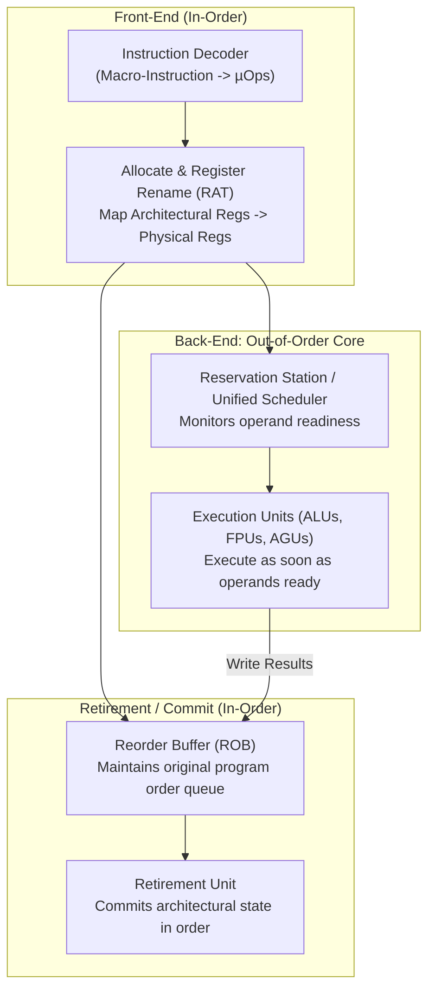
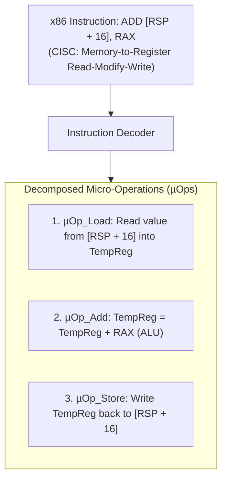
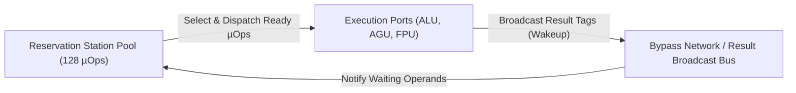
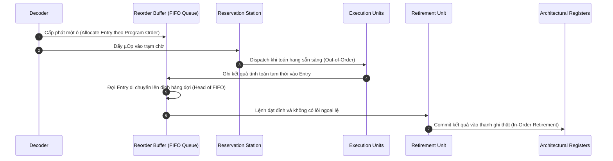

# 2.4. Out-of-Order Engine & Microcode Units (Động cơ Thực thi Không theo Thứ tự & Các Khối Vi mã)

## Tổng quan về Out-of-Order Engine & Microcode Units
Trong các CPU hiện đại (x86-64, ARM Cortex-X, Apple Silicon), việc thực thi các chỉ thị không còn diễn ra tuần tự từ trên xuống dưới theo thứ tự xuất hiện trong chương trình (**In-Order**). Thay vào đó, CPU sử dụng kiến trúc **Out-of-Order Execution (OoO)** dựa trên thuật toán Tomasulo kết hợp với bộ đệm **Reorder Buffer (ROB)**.
- **Mục tiêu cốt lõi**: Khắc phục tình trạng "kẹt xe" khi một chỉ thị bị treo vì phải chờ dữ liệu từ RAM chậm chạp. CPU sẽ tự động tìm kiếm các chỉ thị độc lập phía sau để thực thi trước, giúp giữ cho các Execution Units luôn bận rộn 100%.
- **Quy tắc bất di bất dịch**: Thực thi có thể xáo trộn (Execute Out-of-Order), nhưng kết quả bắt buộc phải được cam kết và hoàn tất theo đúng thứ tự ban đầu của chương trình (**In-Order Retirement / Commit**) để đảm bảo tính đúng đắn và tính toàn vẹn của ngoại lệ (Precise Exceptions).



---

## 2. Chi tiết từng Keyword (Under-the-Hood Deep Dive)

### 1. Instruction Decoder & Micro-Operations (µOps)

#### 1. Khái niệm bản chất (What & Why)
- **Instruction Decoder (Bộ giải mã lệnh)**: Là khối phần cứng nằm ở Front-End của CPU, có nhiệm vụ biên dịch các chỉ thị phức tạp của kiến trúc CISC (như x86) thành một hoặc nhiều vi lệnh đơn giản có độ dài cố định gọi là **Micro-Operations (µOps)**.
- **Micro-Operations (µOps)**: Các phép tính vi mô cấp thấp (như `load`, `store`, `alu_add`) mà lõi phần cứng bên trong thực sự hiểu và có thể lập lịch thực thi song song.

#### 2. Cơ chế hoạt động sâu (Under the hood / Hardcore Internals)
- **Cơ cấu bộ giải mã đa luồng (Decoder Width)**:
  - Trên các CPU Intel/AMD hiện đại, Front-End có từ 4 đến 6 decoders song song:
    - *Simple Decoders*: Giải mã các lệnh x86 thông thường ánh xạ thành 1 µOp (chiếm ~80% số lệnh).
    - *Complex Decoder*: Giải mã các lệnh x86 sinh ra từ 2 đến 4 µOps.
    - *Microcode ROM (MSROM)*: Dành cho các lệnh cực kỳ phức tạp (như `STRING COPY`, `SYSENTER`, `CPUID`, `XSAVE`), giải mã thành một chuỗi hàng chục đến hàng trăm µOps từ bộ nhớ ROM.
- **Macro-Fusion & Micro-Fusion**:
  - *Macro-Fusion*: Bộ giải mã gộp hai lệnh hợp ngữ riêng biệt (ví dụ lệnh so sánh `CMP` và lệnh nhảy `JE`) thành MỘT vi lệnh duy nhất `cmp-and-branch µOp`, giúp tiết kiệm băng thông pipeline.
  - *Micro-Fusion*: Gộp một thao tác nạp nhớ (Load) và một thao tác tính toán (ALU) thành một vi lệnh nén duy nhất khi di chuyển trong Front-End, và chỉ tách ra khi vào Scheduler.
- **Decoded Stream Buffer (DSB / µOp Cache)**:
  - CPU tích hợp một bộ đệm lưu trữ sẵn các µOps đã được giải mã (khoảng 1500–4000 µOps). Khi chương trình chạy các vòng lặp nhỏ, Front-End bỏ qua hoàn toàn bộ giải mã x86 cồng kềnh và nạp trực tiếp µOps từ DSB, tiết kiệm điện năng và đạt thông lượng tối đa (6–8 µOps/chu kỳ).

#### 3. Sơ đồ quá trình hạ cấp lệnh x86 thành µOps


#### 4. Code ví dụ thực chiến (C++ Phân tích Chuỗi Lệnh và µOp Fusion)
Quan sát cách viết code để trình biên dịch tận dụng tính năng Macro-Fusion của CPU:
```cpp
#include <iostream>
#include <cstdint>

// Hàm kiểm tra giá trị: Trình biên dịch sẽ tối ưu lệnh TEST/CMP đi liền với JCC
// để phần cứng CPU thực hiện Macro-Fusion thành 1 vi lệnh duy nhất trong Decoder
bool is_valid_pointer(const void* ptr) {
#if defined(__x86_64__)
    bool result;
    asm volatile (
        "testq %[p], %[p]\n\t"  // TEST R, R
        "setnz %[res]\n\t"      // SETNZ (tận dụng macro-fusion kết hợp cờ)
        : [res] "=r" (result)
        : [p] "r" (ptr)
        : "cc"
    );
    return result;
#else
    return ptr != nullptr;
#endif
}

int main() {
    int x = 10;
    std::cout << "[Decoder Macro-Fusion]: Pointer valid? " 
              << std::boolalpha << is_valid_pointer(&x) << '\n';
    return 0;
}
```

#### 5. Ưu / Nhược điểm, Pitfalls & Anti-patterns
- **Decoder Bottleneck**: Nếu mã nguồn chứa quá nhiều lệnh x86 có độ dài kỳ dị hoặc nhiều tiền tố (instruction prefixes), bộ giải mã sẽ bị chậm lại, không thể cung cấp đủ 4–6 µOps/chu kỳ cho Back-End, khiến toàn bộ lõi CPU bị "đói" (Front-End Bound).

#### 6. Ứng dụng thực tế trong Backend / Systems
- **Tối ưu hóa Vòng lặp nhỏ (Small Loop Fitting in µOp Cache)**: Các hàm nén dữ liệu (như Zstandard hoặc LZ4) luôn cố gắng giữ thân vòng lặp nén dưới 64 bytes mã máy để toàn bộ vòng lặp nằm trọn vẹn trong DSB (µOp Cache), giúp CPU chạy mà không tốn bất kỳ chu kỳ nào cho bộ giải mã lệnh x86.

---

### 2. Scheduler & Reservation Station (RS)

#### 1. Khái niệm bản chất (What & Why)
- **Reservation Station (RS)**: Các trạm chờ lưu trữ các vi lệnh (µOps) đã được giải mã nhưng chưa thể thực thi vì đang thiếu dữ liệu toán hạng đầu vào (ví dụ: đang chờ kết quả nạp từ RAM).
- **Scheduler (Bộ lập lịch phần cứng)**: Mạch logic liên tục giám sát trạng thái của tất cả các vi lệnh đang chờ trong Reservation Station. Ngay khi dữ liệu toán hạng của một vi lệnh sẵn sàng, Scheduler lập tức bắn (Dispatch) vi lệnh đó vào một Execution Unit còn rảnh rỗi.

#### 2. Cơ chế hoạt động sâu (Under the hood / Hardcore Internals)
- **Wakeup and Select Logic**:
  - *Wakeup*: Mỗi khi một Execution Unit hoàn thành phép tính, nó phát sóng (broadcast) thẻ định danh (Tag/Physical Register ID) của kết quả lên mạng lưới bus nội bộ. Tất cả các µOp trong RS có toán hạng phụ thuộc vào Tag này sẽ được "đánh thức" (Ready to execute).
  - *Select*: Nếu có nhiều µOp cùng sẵn sàng cho một Execution Port, bộ lập lịch sẽ chọn µOp có độ ưu tiên cao hơn (thường là lệnh thuộc nhánh suy đoán quan trọng hoặc lệnh cũ hơn).
- **Unified Scheduler vs Distributed RS**:
  - *Distributed*: Mỗi nhóm cổng (ví dụ nhóm Integer ALU và nhóm Vector FPU) có hàng đợi RS riêng (kiến trúc cũ).
  - *Unified Scheduler*: Một bể chung chứa toàn bộ các vi lệnh (kích thước từ 96 đến 160 µOps trên CPU hiện đại), cho phép chia sẻ linh hoạt tài nguyên giữa mọi loại cổng thực thi.

#### 3. Sơ đồ cơ chế Wakeup & Dispatch trong Scheduler


#### 4. Code ví dụ thực chiến (C++ Phá vỡ Dependency Chain cho Scheduler)
Minh họa kỹ thuật loại bỏ phụ thuộc dữ liệu tuần tự giúp Scheduler có thể bắn đồng thời 4 phép toán vào các cổng ALU:
```cpp
#include <iostream>
#include <cstdint>

// Chuỗi phụ thuộc dài: Scheduler buộc phải xếp hàng tuần tự
uint64_t dependent_chain(uint64_t a, uint64_t b, uint64_t c, uint64_t d) {
    uint64_t res = a;
    res += b; // Chờ a + b
    res += c; // Chờ kết quả trước + c
    res += d; // Chờ kết quả trước + d
    return res;
}

// Cây phụ thuộc dạng nhị phân: Scheduler có thể dispatch song song (a+b) và (c+d)
uint64_t independent_tree(uint64_t a, uint64_t b, uint64_t c, uint64_t d) {
    uint64_t t1 = a + b; // Nhóm 1: ALU Port 0
    uint64_t t2 = c + d; // Nhóm 2: ALU Port 1 (Chạy song song cùng lúc!)
    return t1 + t2;      // Nhóm 3: Gom kết quả
}

int main() {
    std::cout << "[Scheduler Dependency]: Tree sum = " 
              << independent_tree(10, 20, 30, 40) << '\n';
    return 0;
}
```

#### 5. Ưu / Nhược điểm, Pitfalls & Anti-patterns
- **RS Full Stall**: Khi một lệnh Load bị Cache Miss (phải ra tận DRAM mất 200 chu kỳ), các lệnh phụ thuộc vào nó sẽ bị kẹt lại trong Reservation Station. Nếu có quá nhiều lệnh bị kẹt, Reservation Station sẽ bị đầy (RS Exhaustion). CPU không thể nạp thêm bất kỳ lệnh mới nào từ Front-End, dẫn đến đình trệ toàn hệ thống.

#### 6. Ứng dụng thực tế trong Backend / Systems
- **Tối ưu hóa Transaction Processing**: Các kỹ sư database thiết kế các cấu trúc dữ liệu không khóa (Lock-free queues) sao cho các biến trạng thái không bị phụ thuộc vòng tròn, cho phép Out-of-Order Scheduler của CPU thực thi song song các thao tác kiểm tra trạng thái độc lập.

---

### 3. Reorder Buffer (ROB) & Retirement Unit

#### 1. Khái niệm bản chất (What & Why)
- **Reorder Buffer (ROB)**: Là một cấu trúc hàng đợi vòng (Circular FIFO Queue) lưu trữ toàn bộ các vi lệnh đang được xử lý trong CPU theo đúng thứ tự logic ban đầu của chương trình.
- **Retirement Unit (Commit Unit)**: Khối đảm nhận việc "chốt sổ" (Commit / Retire) kết quả của các vi lệnh từ ROB vào thanh ghi kiến trúc (Architectural State) và bộ nhớ chính. Chỉ khi một lệnh đã hoàn thành và đạt tới đỉnh của ROB (Head of Queue), nó mới được phép Retire.

#### 2. Cơ chế hoạt động sâu (Under the hood / Hardcore Internals)
- **Tại sao cần ROB để đảm bảo Precise Exceptions (Ngoại lệ chính xác)?**
  - Giả sử Lệnh 1 là phép chia cho 0 (`DIV EAX, 0`), và Lệnh 2 là phép cộng bình thường (`ADD EBX, 1`).
  - Trong động cơ Out-of-Order, Lệnh 2 chạy nhanh hơn nên hoàn thành trước Lệnh 1. Nếu cho phép Lệnh 2 ghi đè ngay vào thanh ghi thật (`EBX`), thì khi Lệnh 1 gây ra lỗi phần cứng ngoại lệ (`SIGFPE` - Division by Zero), hệ điều hành sẽ thấy thanh ghi `EBX` đã bị biến đổi sai lệch!
  - **Nhờ có ROB**: Kết quả của Lệnh 2 chỉ nằm tạm trong ô nhớ của ROB (chưa ghi vào thanh ghi kiến trúc thật). Khi Lệnh 1 lên đỉnh hàng đợi và phát hiện ngoại lệ chia cho 0, CPU lập tức hủy bỏ (Discard) toàn bộ các lệnh đứng sau trong ROB. Trạng thái CPU được giữ nguyên vẹn chính xác tại thời điểm trước khi xảy ra lỗi.
- **Dung lượng ROB và Cửa sổ Out-of-Order (OoO Window)**:
  - Dung lượng ROB quyết định CPU có thể "nhìn trước" (Lookahead) bao xa vào tương lai của dòng lệnh:
    - Intel Skylake: ROB có 224 entries.
    - Intel Golden Cove: ROB có 512 entries.
    - Apple M1/M2/M3: ROB khổng lồ lên tới hơn 600 entries.

#### 3. Sơ đồ vòng đời của một chỉ thị trong ROB


#### 4. Code ví dụ thực chiến (C++ Thử nghiệm Exception Precision)
Minh họa tính toàn vẹn của trạng thái thanh ghi khi xảy ra lỗi ngoại lệ CPU:
```cpp
#include <iostream>
#include <csignal>
#include <csetjmp>

sigjmp_buf jump_buffer;

void sigfpe_handler(int sig) {
    std::cout << "[CPU Hardware Exception]: SIGFPE caught (Division by Zero).\n";
    siglongjmp(jump_buffer, 1);
}

int main() {
    signal(SIGFPE, sigfpe_handler);

    volatile int a = 100;
    volatile int zero = 0;
    volatile int b = 50;

    if (sigsetjmp(jump_buffer, 1) == 0) {
        // Lệnh 1: Gây ngoại lệ phần cứng
        // Lệnh 2: Không bao giờ được phép commit vào kiến trúc nhờ Reorder Buffer
        int c = a / zero;
        b = 999; // Lệnh này bị hủy bỏ hoàn toàn trong ROB
        (void)c;
    } else {
        std::cout << "[Precise Exception Verified]: b value remained: " << b << '\n';
    }

    return 0;
}
```

#### 5. Ưu / Nhược điểm, Pitfalls & Anti-patterns
- **ROB Stall do Last Level Cache (LLC) Miss**: Khi một lệnh Load bị trượt L3 Cache và phải kéo dữ liệu từ DRAM, lệnh này sẽ đứng chặn ở đỉnh của ROB trong suốt 200–300 chu kỳ clock. Dù các lệnh phía sau đã thực thi xong toàn bộ, chúng vẫn không thể Retire. Cuối cùng, ROB bị đầy (ROB Full) và toàn bộ CPU buộc phải dừng lại.

#### 6. Ứng dụng thực tế trong Backend / Systems
- **Tối ưu hóa Software Memory Prefetching**: Các thư viện dữ liệu lớn (như Apache Arrow hoặc ClickHouse) sử dụng chỉ thị phần mềm `_mm_prefetch` để nạp dữ liệu từ xa trước hàng trăm chu kỳ, giúp cho các lệnh Load không bao giờ bị nghẽn ở đỉnh hàng đợi ROB.