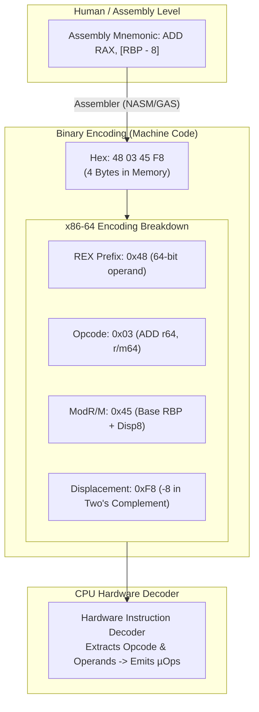
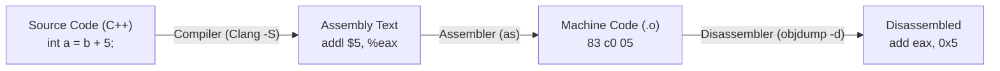
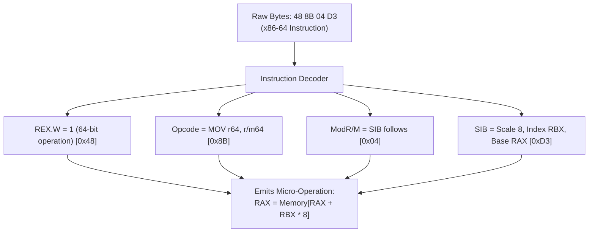
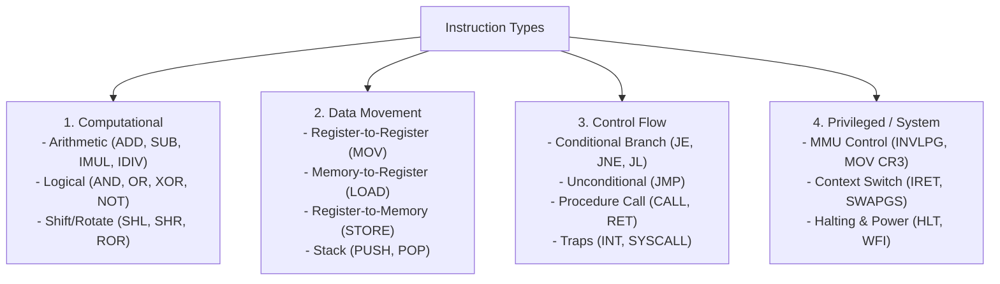

# 3.1. Instruction Basics & Formats (Cơ bản về Chỉ thị Lệnh & Định dạng Mã máy)

## Tổng quan về Instruction Basics & Formats
Mọi dòng code cấp cao trong các ngôn ngữ hiện đại (Go, Rust, C++, Java) sau quá trình biên dịch cuối cùng đều quy về một chuỗi các **Machine Instructions (Chỉ thị mã máy)** — các chuỗi byte nhị phân được mã hóa theo các quy chuẩn khắt khe của kiến trúc tập lệnh (**ISA**).
- **Opcode & Operands**: Mỗi chỉ thị là sự kết hợp giữa mã tác vụ (Opcode - CPU cần làm gì) và các toán hạng (Operands - CPU thao tác trên dữ liệu nào).
- **Instruction Encoding & Formats**: Cách bố trí các trường bit nhị phân (Bitfields) trong không gian từ 16-bit, 32-bit (Fixed-length trên RISC) đến 1-15 bytes (Variable-length trên CISC).
- **Assembly Language vs Machine Code**: Hợp ngữ là dạng biểu diễn văn bản cho con người đọc (Human-readable mnemonics), còn mã máy là luồng dữ liệu nhị phân nguyên thủy mà bộ giải mã phần cứng nạp vào đường ống thực thi.



---

## 2. Chi tiết từng Keyword (Under-the-Hood Deep Dive)

### 1. Machine Instructions, Assembly Language & Machine Code

#### 1. Khái niệm bản chất (What & Why)
- **Machine Code (Mã máy)**: Là ngôn ngữ bản địa duy nhất mà mạch điện tử CPU thực sự hiểu được. Đó là một dòng bit nhị phân `0` và `1` (thường được biểu diễn dưới dạng Hexadecimal để con người dễ nhìn).
- **Assembly Language (Hợp ngữ)**: Là lớp trừu tượng đầu tiên trên mã máy, thay thế các chuỗi byte khô khan bằng các ký hiệu gợi nhớ (**Mnemonics**) như `MOV`, `ADD`, `SUB`, `JMP`.
- **Assembler & Disassembler**:
  - *Assembler* (như NASM, GAS): Biên dịch file văn bản `.asm` thành file nhị phân `.o` hoặc executable.
  - *Disassembler* (như `objdump`, Ghidra, IDA Pro): Đọc các byte mã máy và dịch ngược lại thành các dòng hợp ngữ tương ứng.

#### 2. Cơ chế hoạt động sâu (Under the hood / Hardcore Internals)
- **Tính khả chuyển (Portability)**:
  - Mã máy **hoàn toàn không có tính khả chuyển**. Một file binary biên dịch cho x86-64 không thể chạy trên chip ARM64 (Apple M-series hoặc AWS Graviton) vì tập lệnh, opcode và định dạng mã hóa hoàn toàn khác nhau.
- **Calling the Hardware via Binary Injection**:
  - Khi hệ điều hành tải một file thực thi định dạng ELF (trên Linux) hoặc Mach-O (trên macOS), kernel đọc phần `text segment` (chứa các byte mã máy) từ đĩa và nạp thẳng vào RAM vật lý, sau đó gán địa chỉ này cho thanh ghi `RIP/PC` để CPU bắt đầu thực thi.

#### 3. Sơ đồ chu trình từ C++ đến Assembly và Machine Code


#### 4. Code ví dụ thực chiến (C++ Đọc và Disassemble Bytecode Runtime)
Đọc chuỗi byte mã máy của một hàm C++ ngay trong bộ nhớ:
```cpp
#include <iostream>
#include <iomanip>
#include <cstdint>

// Một hàm số học đơn giản
int calculate_square(int x) {
    return x * x;
}

int main() {
    // Lấy con trỏ địa chỉ của hàm calculate_square trong RAM
    const auto* func_bytes = reinterpret_cast<const uint8_t*>(calculate_square);

    std::cout << "[Machine Code Bytes for calculate_square]:\n  ";
    // In ra 16 bytes đầu tiên của mã máy hàm này
    for (int i = 0; i < 16; ++i) {
        std::cout << std::hex << std::setw(2) << std::setfill('0') 
                  << static_cast<int>(func_bytes[i]) << " ";
    }
    std::cout << std::dec << "\n";
    return 0;
}
```

#### 5. Ưu / Nhược điểm, Pitfalls & Anti-patterns
- **Cạm bẫy Variable-Length Disassembly (x86)**: Trên x86, do các chỉ thị có độ dài biến thiên từ 1 đến 15 bytes, nếu bạn nhảy sai chỉ 1 byte vào giữa thân của một chỉ thị mã máy (Misaligned Instruction Jump), CPU sẽ giải mã hoàn toàn sai lệch và sinh ra một chuỗi các lệnh hoàn toàn khác, dẫn đến crash (`SIGILL` - Illegal Instruction) hoặc các lỗ hổng Return-Oriented Programming (ROP).

#### 6. Ứng dụng thực tế trong Backend / Systems
- **Dynamic Binary Instrumentation & Profiling (eBPF / DynamoRIO)**: Các công cụ giám sát hiệu năng chèn trực tiếp các byte mã máy (ví dụ lệnh ngắt `INT3` - `0xCC` hoặc lệnh nhảy `JMP`) vào binary của ứng dụng đang chạy trong RAM để đo đạc thời gian thực thi của từng hàm backend mà không cần biên dịch lại mã nguồn.

---

### 2. Opcode, Operands & Instruction Decoding

#### 1. Khái niệm bản chất (What & Why)
- **Opcode (Operation Code - Mã thao tác)**: Trường bit xác định bản chất của hành động mà phần cứng cần thực hiện (ví dụ: cộng, trừ, nạp dữ liệu, rẽ nhánh).
- **Operands (Toán hạng)**: Các đối tượng mà Opcode tác động lên. Toán hạng có thể là:
  - Thanh ghi (Register operand).
  - Ô nhớ trong RAM (Memory operand).
  - Hằng số trực tiếp (Immediate operand).
  - Cổng I/O (Port operand).
- **Instruction Decoding (Giải mã chỉ thị)**: Quá trình mạch logic trong CPU bóc tách luồng byte nhị phân thành các trường: Prefix, Opcode, Addressing Mode, Register IDs và Offset/Displacement.

#### 2. Cơ chế hoạt động sâu (Under the hood / Hardcore Internals)
- **Định dạng lệnh x86-64 phức tạp (Variable-Length up to 15 Bytes)**:
  Bao gồm tối đa 5 phần cấu thành:
  1. **Legacy Prefixes & REX Prefix** (1–4 bytes): Thay đổi kích thước toán hạng (16-bit override `0x66`), kích hoạt chế độ 64-bit (REX prefix `0x48`).
  2. **Opcode** (1–3 bytes): Xác định tác vụ cơ bản.
  3. **ModR/M Byte** (1 byte): Xác định cách thức định vị toán hạng (Addressing Mode) và các thanh ghi sử dụng.
  4. **SIB Byte (Scale-Index-Base)** (0–1 byte): Dùng cho việc đánh địa chỉ mảng phức tạp `[Base + Index * Scale]`.
  5. **Displacement & Immediate** (0–8 bytes): Các hằng số dịch chuyển địa chỉ hoặc giá trị tức thời.

#### 3. Sơ đồ cấu trúc một lệnh mã máy x86-64
```text
+-------------------+---------+--------+--------+--------------+-----------+
| Instruction Prefix| Opcode  | ModR/M |  SIB   | Displacement | Immediate |
|    (1 - 4 bytes)  | (1-3 B) | (0-1 B)| (0-1 B)|   (0-4 B)    |  (0-4 B)  |
+-------------------+---------+--------+--------+--------------+-----------+
```



#### 4. Code ví dụ thực chiến (C++ Trình giải mã Bitfields cơ bản)
Mô phỏng bộ bóc tách các trường bit (Bitfields Decoder) của một kiến trúc lệnh 32-bit:
```cpp
#include <iostream>
#include <cstdint>

// Giả lập định dạng lệnh 32-bit kiểu R-Type:
// [31:26] Opcode (6 bits) | [25:21] Rs (5 bits) | [20:16] Rt (5 bits) 
// [15:11] Rd (5 bits)     | [10:6] Shamt (5 bits) | [5:0] Funct (6 bits)
struct DecodedInstruction {
    uint8_t opcode;
    uint8_t rs;
    uint8_t rt;
    uint8_t rd;
    uint8_t shamt;
    uint8_t funct;
};

DecodedInstruction decode_instruction(uint32_t raw_inst) {
    DecodedInstruction inst;
    inst.opcode = (raw_inst >> 26) & 0x3F;
    inst.rs     = (raw_inst >> 21) & 0x1F;
    inst.rt     = (raw_inst >> 16) & 0x1F;
    inst.rd     = (raw_inst >> 11) & 0x1F;
    inst.shamt  = (raw_inst >> 6)  & 0x1F;
    inst.funct  = raw_inst & 0x3F;
    return inst;
}

int main() {
    // 0x012B4820: Mã máy lệnh ADD $t1, $t1, $t3
    uint32_t raw_binary = 0x012B4820;
    DecodedInstruction dec = decode_instruction(raw_binary);

    std::cout << "[Instruction Decoder Simulation]:\n";
    std::cout << "  Raw Hex: 0x" << std::hex << raw_binary << std::dec << '\n';
    std::cout << "  Opcode:  " << (int)dec.opcode << '\n';
    std::cout << "  Reg Rs:  " << (int)dec.rs << '\n';
    std::cout << "  Reg Rt:  " << (int)dec.rt << '\n';
    std::cout << "  Reg Rd:  " << (int)dec.rd << '\n';
    std::cout << "  Funct:   " << (int)dec.funct << '\n';
    return 0;
}
```

#### 5. Ưu / Nhược điểm, Pitfalls & Anti-patterns
- **Định dạng độ dài biến thiên (Variable Length) vs Cố định (Fixed Length)**:
  - *CISC (x86)*: Tiết kiệm dung lượng RAM vì lệnh ngắn chỉ tốn 1 byte. Nhưng giải mã cực kỳ khó vì không thể biết trước lệnh tiếp theo bắt đầu ở vị trí byte nào, làm bộ giải mã phần cứng tốn nhiều transistor và điện năng.
  - *RISC (ARM/RISC-V)*: Mọi lệnh đều đúng 32-bit (4 bytes). Giải mã cực kỳ đơn giản và nhanh, nhưng file nhị phân có dung lượng lớn hơn 20–30%.

#### 6. Ứng dụng thực tế trong Backend / Systems
- **JIT Compilers (LuaJIT / V8 / Java HotSpot)**: Khi ứng dụng backend chạy, các bộ JIT compiler trực tiếp phát sinh các chuỗi byte Opcode và Operands vào RAM theo thời gian thực để thực thi các khối mã lặp nhiều lần (Hot Path) mà không cần thông qua trình thông dịch (Interpreter).

---

### 3. Instruction Encoding & Instruction Types

#### 1. Khái niệm bản chất (What & Why)
- **Instruction Encoding**: Quy tắc phân bổ các bit nhị phân để biểu diễn kiểu dữ liệu, chế độ truy cập và các thao tác trong một từ mã (Instruction Word).
- **Instruction Types (Phân loại chỉ thị)**: Các nhóm lệnh cơ bản tạo nên năng lực hoàn chỉnh của một cỗ máy tính toán Turing:
  1. **Arithmetic & Logical Instructions**: Tính toán số học và logic.
  2. **Data Movement Instructions**: Luân chuyển dữ liệu giữa các thanh ghi và giữa thanh ghi với RAM.
  3. **Control Flow Instructions**: Thay đổi luồng thực thi (Rẽ nhánh điều kiện, Nhảy không điều kiện, Gọi hàm).
  4. **System & Privileged Instructions**: Quản trị tài nguyên phần cứng (chỉ chạy ở Ring 0 Kernel Mode).

#### 2. Cơ chế hoạt động sâu (Under the hood / Hardcore Internals)
- **Zero-Address, 1-Address, 2-Address và 3-Address Architectures**:
  - *Zero-Address (Stack-based - như JVM / WebAssembly)*: `ADD` (Tự động pop 2 phần tử đỉnh Stack, cộng lại và push kết quả lên Stack).
  - *1-Address (Accumulator-based)*: `ADD X` (Thanh ghi tích lũy $AC \leftarrow AC + \text{Memory}[X]$).
  - *2-Address (x86 CISC)*: `ADD RAX, RBX` (Thanh ghi đích kiêm luôn toán hạng nguồn 1: $RAX \leftarrow RAX + RBX$). Làm mất giá trị ban đầu của toán hạng đích!
  - *3-Address (RISC / ARM64)*: `ADD X0, X1, X2` ($X0 \leftarrow X1 + X2$). Giữ nguyên vẹn cả hai toán hạng nguồn, giúp trình biên dịch quản lý thanh ghi hiệu quả hơn rất nhiều.

#### 3. Sơ đồ phân loại các họ chỉ thị lệnh


#### 4. Code ví dụ thực chiến (C++ Thao tác Đổi Dữ liệu không mất Biến nguồn)
Minh họa cách compiler biến đổi phép toán 2-Address của x86 thành 3-Address thông qua lệnh `LEA` (Load Effective Address):
```cpp
#include <iostream>

// Trên x86, phép toán a + b thường ghi đè lên a:
// mov eax, [a]
// add eax, [b]   --> Phải dùng thêm lệnh mov nếu muốn giữ a

// Compiler x86 thông minh sử dụng LEA để đạt được tính chất 3-Address của RISC:
int add_three_address(int a, int b) {
    int result;
#if defined(__x86_64__)
    // LEA tính toán con trỏ nhưng được dùng để cộng số nguyên mà KHÔNG ghi đè biến nguồn
    asm ("leal (%[op_a], %[op_b]), %[res]"
         : [res] "=r" (result)
         : [op_a] "r" (a), [op_b] "r" (b));
#else
    result = a + b;
#endif
    return result;
}

int main() {
    int x = 15, y = 25;
    int sum = add_three_address(x, y);
    std::cout << "[3-Address Emulation via LEA]: " << x << " + " << y << " = " << sum << '\n';
    return 0;
}
```

#### 5. Ưu / Nhược điểm, Pitfalls & Anti-patterns
- **Side Effects của Chỉ thị**: Các lệnh toán học trên x86 luôn tự động cập nhật thanh ghi cờ `RFLAGS`. Trong khi đó trên kiến trúc ARM64, các lệnh toán học (`ADD`) mặc định **không thay đổi cờ trạng thái**; chỉ khi lập trình viên thêm hậu tố `S` (như `ADDS`), cờ mới được cập nhật. Điều này giúp ARM loại bỏ các phụ thuộc dữ liệu giả (Flags Hazards) trong CPU Pipeline.

#### 6. Ứng dụng thực tế trong Backend / Systems
- **Tối ưu hóa Binary Size & Network Transmission**: Các kiến trúc điện toán đám mây thế hệ mới (như AWS Lambda hoặc Cloudflare Workers) đặc biệt quan tâm đến kích thước mã máy. Việc tối ưu hóa định dạng mã hóa lệnh giúp giảm độ trễ khởi động lạnh (Cold-start Latency) của các hàm serverless.