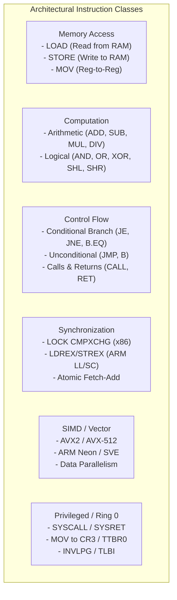
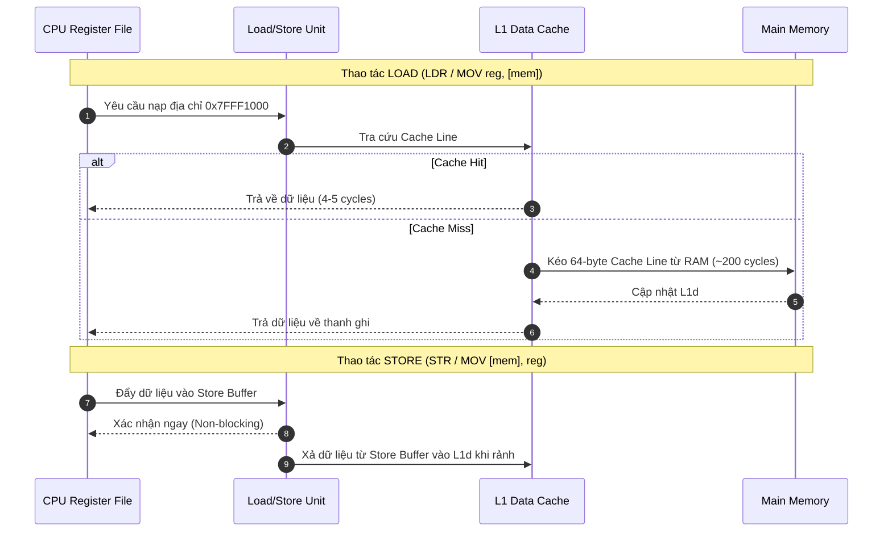
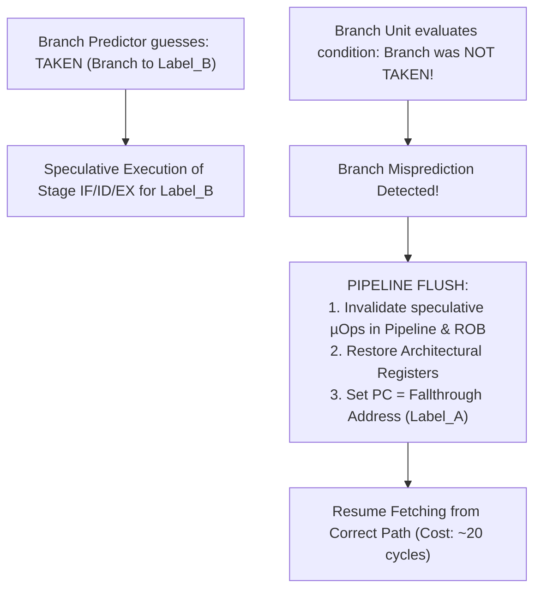
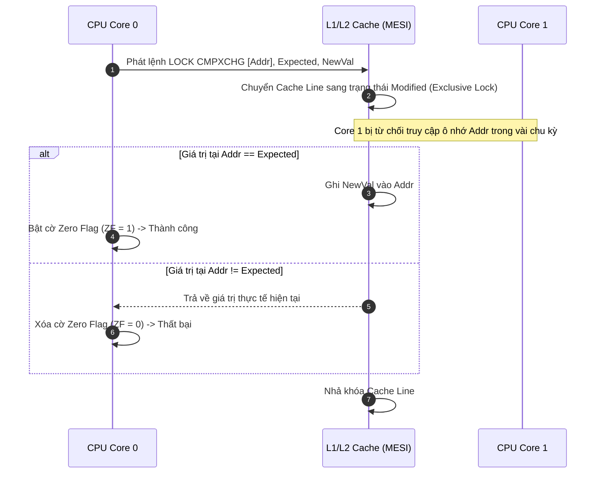

# 3.2. Instruction Classes & Semantics (Các Phân lớp Chỉ thị & Ngữ nghĩa Thực thi)

## Tổng quan về Instruction Classes & Semantics
Một tập lệnh ISA hiện đại không chỉ dừng lại ở các phép tính số học đơn giản mà được phân chia thành các lớp chỉ thị chuyên biệt nhằm phục vụ toàn diện cho hệ thống máy tính đa nhiệm, đa luồng và hiệu năng cao.
- **Data Movement & Memory Operations**: Các lệnh nạp (`LOAD`), lưu (`STORE`) và sao chép (`MOV`), thiết lập dòng chảy dữ liệu giữa thanh ghi và các tầng Cache/RAM.
- **Computational Core**: Các lệnh số học (`Arithmetic`) và logic (`Logical`) xử lý dữ liệu nhị phân trên ALU.
- **Flow Control & Branching**: Các lệnh rẽ nhánh có điều kiện và không điều kiện, nhảy và gọi hàm điều khiển con trỏ lệnh `PC`.
- **Specialized High-Performance Classes**: Các lệnh đồng bộ hóa nguyên tử (**Atomic Instructions**) cho đa luồng, các lệnh xử lý vector (**SIMD/Vector Instructions**) cho dữ liệu lớn, và các lệnh đặc quyền (**Privileged Instructions**) bảo vệ không gian nhân hệ điều hành (Kernel space).



---

## 2. Chi tiết từng Keyword (Under-the-Hood Deep Dive)

### 1. Data Transfer, Load & Store Instructions

#### 1. Khái niệm bản chất (What & Why)
- **Data Transfer Instructions**: Các chỉ thị sao chép bit giữa các thanh ghi nội bộ của CPU (ví dụ: `MOV RAX, RBX`).
- **Load Instructions**: Nạp dữ liệu từ một địa chỉ trong bộ nhớ RAM vào thanh ghi CPU (ví dụ: `MOV RAX, [RBP - 8]` trên x86, hoặc `LDR X0, [X1]` trên ARM).
- **Store Instructions**: Ghi dữ liệu từ một thanh ghi CPU ra ô nhớ RAM (ví dụ: `MOV [RBP - 8], RAX` trên x86, hoặc `STR X0, [X1]` trên ARM).

#### 2. Cơ chế hoạt động sâu (Under the hood / Hardcore Internals)
- **Kiến trúc Load-Store (RISC) vs Register-Memory (CISC)**:
  - *RISC (ARM, RISC-V)*: Tuân thủ nghiêm ngặt mô hình **Load-Store Architecture**. Các phép toán số học ALU (như `ADD`) **chỉ được phép thực hiện giữa các thanh ghi**. Muốn cộng một biến trong RAM, CPU buộc phải:
    1. `LDR R1, [Addr1]` (Load vào thanh ghi).
    2. `LDR R2, [Addr2]`.
    3. `ADD R3, R1, R2` (Tính toán).
    4. `STR R3, [Addr3]` (Store lại ra RAM).
  - *CISC (x86)*: Cho phép một toán hạng là địa chỉ RAM: `ADD RAX, [RSP + 16]`. Phần cứng bên dưới sẽ tự động tách thành 3 vi lệnh (µOp Load $\to$ µOp Add $\to$ Store/Commit).
- **Độ trễ truy xuất ô nhớ**: Thao tác Register-to-Register tốn 0–1 chu kỳ. Thao tác Load chạm vào L1 Cache tốn 4–5 chu kỳ; nếu trượt (Cache Miss) phải ra tận DRAM, lệnh Load có thể tốn tới **150–250 chu kỳ CPU**.

#### 3. Sơ đồ chu trình Load và Store


#### 4. Code ví dụ thực chiến (C++ Load/Store Optimization)
Minh họa sự vượt trội về tốc độ khi dữ liệu nằm trọn trong thanh ghi thay vì liên tục Load/Store từ bộ nhớ:
```cpp
#include <iostream>
#include <chrono>

// Phiên bản 1: Con trỏ volatile ép CPU phải Load và Store ra RAM ở MỖI vòng lặp
void count_memory_heavy(volatile int* val, int iterations) {
    for (int i = 0; i < iterations; ++i) {
        *val = *val + 1; // Load từ RAM -> ALU Add -> Store lại RAM
    }
}

// Phiên bản 2: Dữ liệu nằm trong Register, chỉ Store 1 lần duy nhất khi kết thúc
void count_register_optimized(volatile int* val, int iterations) {
    int local_reg = *val; // 1 lần Load
    for (int i = 0; i < iterations; ++i) {
        local_reg += 1;   // Thực thi 100% trong CPU Register
    }
    *val = local_reg;     // 1 lần Store
}

int main() {
    int counter = 0;
    int iters = 50'000'000;

    auto t0 = std::chrono::high_resolution_clock::now();
    count_memory_heavy(&counter, iters);
    auto t1 = std::chrono::high_resolution_clock::now();
    count_register_optimized(&counter, iters);
    auto t2 = std::chrono::high_resolution_clock::now();

    auto time_mem = std::chrono::duration_cast<std::chrono::milliseconds>(t1 - t0).count();
    auto time_reg = std::chrono::duration_cast<std::chrono::milliseconds>(t2 - t1).count();

    std::cout << "[Load/Store Memory Penalty]: " << time_mem << " ms\n";
    std::cout << "[Register Local Optimization]: " << time_reg << " ms\n";
    std::cout << "  Speedup: " << static_cast<double>(time_mem) / time_reg << "x faster!\n";
    return 0;
}
```

#### 5. Ưu / Nhược điểm, Pitfalls & Anti-patterns
- **Aliasing Problem**: Khi hai con trỏ trỏ tới cùng một vùng nhớ (Memory Aliasing), trình biên dịch không thể giữ biến trong thanh ghi mà buộc phải sinh ra các lệnh Load/Store liên tục. Dùng từ khóa `__restrict__` trong C/C++ để báo cho compiler biết các con trỏ không bao giờ trùng nhau, cho phép tối ưu hóa triệt để Register Allocation.

#### 6. Ứng dụng thực tế trong Backend / Systems
- **Tối ưu hóa In-Memory Databases (Redis / Dragonfly)**: Cấu trúc bộ nhớ của các Key-Value store được thiết kế căn chỉnh sao cho các trường thường xuyên truy cập nằm trọn trong 64 bytes đầu tiên của đối tượng, giúp nạp toàn bộ metadata chỉ bằng MỘT thao tác Load Cache Line duy nhất.

---

### 2. Control Flow & Branch Instructions

#### 1. Khái niệm bản chất (What & Why)
- **Control Flow Instructions**: Các lệnh làm thay đổi dòng chảy tuần tự của chương trình bằng cách cập nhật giá trị mới cho thanh ghi con trỏ lệnh `PC/RIP`.
- **Branch Instructions (Lệnh rẽ nhánh)**:
  - *Unconditional Branch*: Lệnh nhảy tuyệt đối không cần điều kiện (`JMP` trên x86, `B` trên ARM).
  - *Conditional Branch*: Lệnh nhảy dựa trên kết quả của cờ điều kiện (`JE` - Jump if Equal, `JNE` - Jump if Not Equal, `JG` - Jump if Greater).
  - *Subroutine Call & Return*: `CALL` (đẩy địa chỉ trở về vào Stack và nhảy) và `RET` (kéo địa chỉ từ Stack vào `PC`).

#### 2. Cơ chế hoạt động sâu (Under the hood / Hardcore Internals)
- **Branch Penalty và Pipeline Flushing**:
  - Khi gặp lệnh rẽ nhánh có điều kiện, CPU chưa thể biết nhánh nào sẽ được chọn cho đến khi lệnh tính toán phía trước chạy xong tại stage EX.
  - CPU hiện đại sử dụng **Branch Predictor** để đoán trước và thực thi suy đoán (Speculative Execution). Nếu đoán sai (**Branch Misprediction**):
    - Phần cứng phải kích hoạt tín hiệu xoay chiều: **Hủy toàn bộ (Squash/Flush)** tất cả các lệnh đang nạp trong pipeline.
    - Thiệt hại: Lãng phí từ 15 đến 25 chu kỳ xung nhịp CPU cho mỗi lần đoán sai.

#### 3. Sơ đồ Pipeline Flush khi Branch Misprediction


#### 4. Code ví dụ thực chiến (C++ Branch Prediction Benchmark)
Minh họa tác động kinh điển của mảng đã sắp xếp vs mảng chưa sắp xếp đối với Branch Predictor:
```cpp
#include <iostream>
#include <vector>
#include <algorithm>
#include <random>
#include <chrono>

int main() {
    constexpr size_t SIZE = 32768;
    std::vector<int> data(SIZE);
    std::mt19937 rng(42);
    for (size_t i = 0; i < SIZE; ++i) data[i] = rng() % 256;

    // Trường hợp 1: Dữ liệu chưa sắp xếp -> Rẽ nhánh ngẫu nhiên 50/50 -> Misprediction cực cao
    auto run_test = [&](const std::vector<int>& arr) {
        auto start = std::chrono::high_resolution_clock::now();
        long long sum = 0;
        for (int rep = 0; rep < 10000; ++rep) {
            for (size_t i = 0; i < SIZE; ++i) {
                if (arr[i] >= 128) { // Lệnh Branch có điều kiện
                    sum += arr[i];
                }
            }
        }
        auto end = std::chrono::high_resolution_clock::now();
        return std::chrono::duration_cast<std::chrono::milliseconds>(end - start).count();
    };

    auto time_unsorted = run_test(data);
    std::sort(data.begin(), data.end()); // Sắp xếp dữ liệu
    auto time_sorted = run_test(data);   // Nhánh rẽ liên tục FALSE rồi liên tục TRUE -> Đoán đúng 99.9%

    std::cout << "[Branch Predictor Benchmark]:\n";
    std::cout << "  Unsorted Data (High Misprediction): " << time_unsorted << " ms\n";
    std::cout << "  Sorted Data (Near 100% Accuracy):   " << time_sorted   << " ms\n";
    std::cout << "  Speedup: " << static_cast<double>(time_unsorted) / time_sorted << "x faster purely from Hardware Branch Prediction!\n";
    return 0;
}
```

#### 5. Ưu / Nhược điểm, Pitfalls & Anti-patterns
- **Predictor Pattern Saturation**: Viết các chuỗi rẽ nhánh lồng nhau phức tạp (Nested IFs) hoặc switch-case quá lớn trong Hot Path sẽ làm tràn bộ nhớ đệm lịch sử rẽ nhánh (Branch History Table - BHT), khiến độ chính xác dự đoán giảm mạnh.

#### 6. Ứng dụng thực tế trong Backend / Systems
- **Linux Kernel `likely()` / `unlikely()` Macros**: Hệ điều hành Linux cung cấp macro `__builtin_expect()` để gợi ý cho trình biên dịch sắp xếp mã máy sao cho đường rẽ nhánh thường xảy ra nhất nằm thẳng hàng (Fallthrough), giảm thiểu tối đa lệnh nhảy nhảy xa và tối ưu hóa I-Cache.

---

### 3. Atomic Instructions, SIMD/Vector & Privileged Instructions

#### 1. Khái niệm bản chất (What & Why)
- **Atomic Instructions (Chỉ thị nguyên tử)**: Các lệnh thực hiện chu trình Đọc-Biến đổi-Ghi (Read-Modify-Write) trên một ô nhớ một cách toàn vẹn không thể bị chia cắt, ngăn chặn triệt để Race Condition trong hệ thống đa nhân.
- **SIMD / Vector Instructions**: Xử lý một chỉ thị trên nhiều phần tử dữ liệu cùng lúc (**Single Instruction, Multiple Data**).
- **Privileged Instructions (Chỉ thị đặc quyền)**: Các lệnh quản trị phần cứng chỉ được phép chạy khi CPU ở mức đặc quyền cao nhất (**Ring 0 / Supervisor Mode**). Nếu ứng dụng thông thường (Ring 3) cố tình thực thi, CPU sẽ lập tức kích hoạt ngắt bảo vệ `General Protection Fault (#GP)`.

#### 2. Cơ chế hoạt động sâu (Under the hood / Hardcore Internals)
- **Atomic Bus Locking vs Cache Locking**:
  - *Bus Lock cổ điển*: CPU kích hoạt tín hiệu `LOCK#` trên Bus, chặn đứng mọi CPU khác truy cập vào toàn bộ RAM vật lý. Cực kỳ tốn kém!
  - *Cache Lock hiện đại (x86 `LOCK CMPXCHG`)*: Dựa trên giao thức Cache Coherence (MESI). CPU chỉ khóa độc quyền một dòng Cache Line (64 bytes) chứa biến đó ở trạng thái `Modified` (M). Các core khác vẫn truy cập vào các vùng nhớ khác hoàn toàn bình thường.
- **Load-Linked / Store-Conditional (LL/SC trên ARM/RISC-V)**:
  - ARM không dùng tiền tố khóa như x86 mà dùng cặp lệnh `LDREX` (Load-Exclusive) và `STREX` (Store-Exclusive). Nếu trong khoảng thời gian giữa LDREX và STREX có một core khác ghi vào ô nhớ đó, lệnh STREX sẽ thất bại và trả về cờ lỗi để phần mềm thử lại.
- **Privileged Protection Ring Transition**:
  - Ứng dụng muốn thực hiện I/O hoặc cấp phát trang nhớ phải chuyển từ Ring 3 sang Ring 0 bằng lệnh `SYSCALL` (trên x86) hoặc `SVC` (trên ARM). Phần cứng sẽ tự động lưu `RIP`, nâng mức đặc quyền và nhảy tới địa chỉ Entry Point an toàn trong kernel.

#### 3. Sơ đồ cơ chế Atomic Compare-And-Swap (CAS)


#### 4. Code ví dụ thực chiến (C++ Triển khai Spinlock bằng Hardware Atomic CAS)
```cpp
#include <iostream>
#include <atomic>
#include <thread>
#include <vector>

// Triển khai Spinlock hiệu năng cao ở mức phần cứng
class HardwareSpinlock {
private:
    std::atomic<bool> lock_state{false};

public:
    void lock() {
        // Thực hiện Compare-And-Swap (CAS) nguyên tử
        // Tương đương với lệnh assembly: LOCK CMPXCHG trên x86
        while (lock_state.exchange(true, std::memory_order_acquire)) {
            // Chỉ thị tạm dừng pipeline CPU để tiết kiệm điện và giảm xung đột bus
#if defined(__x86_64__)
            __builtin_ia32_pause();
#elif defined(__aarch64__)
            asm volatile("yield");
#endif
        }
    }

    void unlock() {
        lock_state.store(false, std::memory_order_release);
    }
};

int main() {
    HardwareSpinlock spinlock;
    int shared_counter = 0;
    std::vector<std::thread> threads;

    for (int t = 0; t < 4; ++t) {
        threads.emplace_back([&]() {
            for (int i = 0; i < 100'000; ++i) {
                spinlock.lock();
                shared_counter++; // Critical Section được bảo vệ an toàn
                spinlock.unlock();
            }
        });
    }

    for (auto& th : threads) th.join();
    std::cout << "[Hardware Atomic Spinlock]: Final Counter = " << shared_counter << '\n';
    return 0;
}
```

#### 5. Ưu / Nhược điểm, Pitfalls & Anti-patterns
- **Cache Line Bouncing trong Atomic Contention**: Nếu hàng trăm thread liên tục thực hiện lệnh nguyên tử (`fetch_add`) trên cùng MỘT biến số nguyên, Cache Line chứa biến đó sẽ liên tục bị chuyển nhượng qua lại giữa các Core thông qua bus liên kết (Interconnect). Hiện tượng này làm sụp đổ thông lượng của toàn bộ CPU.

#### 6. Ứng dụng thực tế trong Backend / Systems
- **Lock-Free Concurrency trong LMAX Disruptor & Kafka**: Các kiến trúc xử lý hàng triệu message/giây hoàn toàn loại bỏ OS Mutex (vốn cần gọi Privileged Syscall đắt đỏ), thay thế bằng các thuật toán Lock-Free Ring Buffer dựa trên các chỉ thị Atomic CAS và SIMD Vector nén dữ liệu.