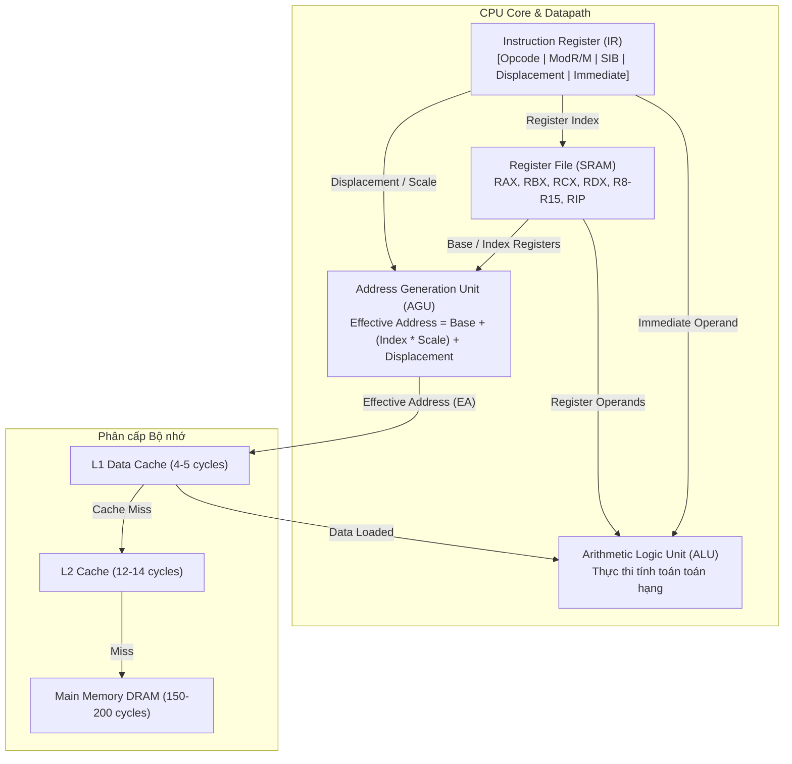
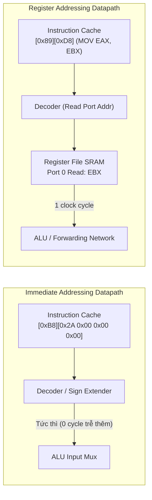
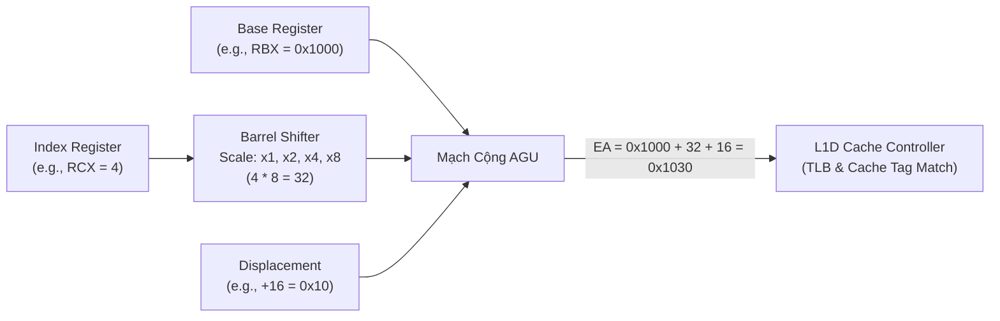
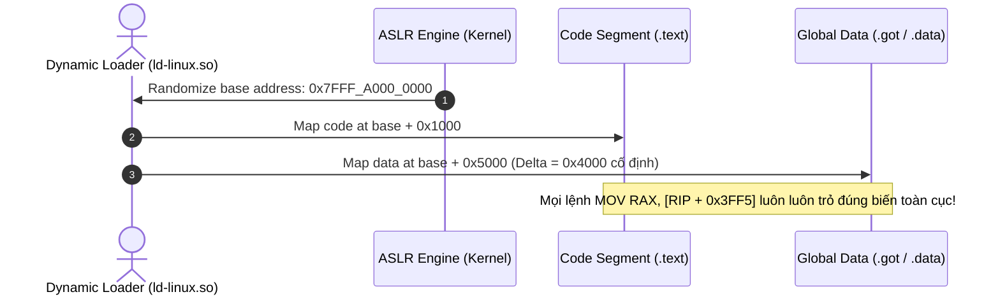

# 3.3. Instruction Addressing Modes (Các Chế độ Định địa chỉ Chỉ thị)

> [!IMPORTANT]
> **Nếu bạn chỉ được nhớ một điều duy nhất:**
> Chế độ định địa chỉ (Addressing Mode) là bản hợp đồng vi kiến trúc giữa trình biên dịch và CPU xác định **"cách toán hạng được tìm thấy"** — nằm ngay trong mã lệnh (Immediate), trong thanh ghi cực nhanh (Register), hay phải tính toán qua con trỏ bộ nhớ (Indirect/Indexed/RIP-Relative) trước khi kích hoạt chu kỳ truy xuất bus DRAM tốn kém.

---

## 1. Kiến trúc Tổng quan & Mô hình Tư duy (Mental Model)

### Phép Loại Suy Thực Tế: Từ Chuyển Phát Hàng Hóa Đến Bus Địa Chỉ CPU

Hãy hình dung CPU giống như một đốc công trong một xưởng gia công cơ khí tốc độ cực cao:
1. **Immediate Addressing (Số tức thời)**: Đốc công cầm trên tay một chiếc ốc vít tiêu chuẩn $5\text{ mm}$ được dán sẵn ngay trên tờ phiếu yêu cầu công việc. Ông không cần bước chân đi đâu, dùng được ngay lập tức ($\approx 0$ cycle trễ thêm).
2. **Register Addressing (Thanh ghi)**: Đốc công lấy cờ lê từ khay công cụ đeo bên hông mình (`RAX`, `RBX`). Khay này chỉ chứa được số lượng dụng cụ hạn chế (16 thanh ghi tổng quát trên x86-64), nhưng nhấc ra là có ngay trong vòng $1$ chu kỳ xung nhịp.
3. **Direct / Absolute Addressing (Địa chỉ tuyệt đối)**: Tờ phiếu ghi rõ: *"Đến đúng ngăn tủ số 1045 ở góc phòng lấy phôi thép"*. Địa chỉ được khắc chết vào lệnh, nhưng mỗi khi nhà xưởng chuyển vị trí (ASLR), toàn bộ bản đồ ngăn tủ phải sửa lại bằng tay.
4. **Register Indirect & Indexed Addressing (Con trỏ & Chỉ mục Base-Index-Scale)**: Tờ phiếu ghi: *"Hãy lấy thẻ căn cước trong túi áo của thợ phụ `RBX`, nhân số thứ tự `RCX` với kích thước linh kiện 8 bytes, rồi cộng thêm độ lệch 16 bytes"*. CPU phải dùng mạch số học cộng nhanh (AGU - Address Generation Unit) để tính ra vị trí chính xác trước khi gửi tín hiệu xuống bộ nhớ.
5. **PC-Relative Addressing (Định vị tương đối theo con trỏ lệnh)**: Tờ phiếu ghi: *"Bước về phía trước 12 bước tính từ vị trí bạn đang đứng"*. Dù đốc công đứng ở tầng 1 hay tầng 5 của tòa nhà, bước thêm 12 bước vẫn luôn đến đúng bàn làm việc kế tiếp — đây chính là bí quyết giúp Position-Independent Code (PIC) và ASLR bảo vệ hệ thống mà không cần sửa đổi mã máy!



---

## 2. Chi tiết từng Keyword (Under-the-Hood Deep Dive)

### 2.1. Immediate & Register Addressing

#### Bản chất và Phân tầng Vật lý
- **Immediate Addressing (Định địa chỉ tức thời)**:
  - Toán hạng là một hằng số cố định nhúng trực tiếp vào dòng byte của chỉ thị lệnh trong bộ nhớ.
  - Khi CPU nạp lệnh từ L1 Instruction Cache (`L1i`) vào hàng đợi tiền giải mã (**Instruction Fetch Queue**), giá trị tức thời nằm sẵn trong bộ đệm.
  - Mạch giải mã phần cứng (**Instruction Decoder**) trích xuất các bit này và đưa qua bộ mở rộng dấu (**Sign Extension Unit**) hoặc mở rộng số không (**Zero Extension Unit**) nếu kích thước số tức thời nhỏ hơn chiều rộng thanh ghi đích (ví dụ: chuyển số tức thời 8-bit `0xFE` thành số bù hai 64-bit `0xFFFFFFFFFFFFFFFE`).
- **Register Addressing (Định địa chỉ thanh ghi)**:
  - Toán hạng nằm bên trong các tế bào nhớ tĩnh SRAM siêu nhanh của Register File tích hợp sát cạnh ALU.
  - Trên kiến trúc x86-64 hiện đại (như Intel Golden Cove hay AMD Zen 4), Register File vật lý (**Physical Register File - PRF**) có thể chứa hơn 200 thanh ghi vật lý để phục vụ cơ chế đổi tên thanh ghi (**Register Renaming**), phá vỡ các phụ thuộc giả lập (WAR - Write-After-Read, WAW - Write-After-Write) trong kiến trúc Out-of-Order.
  - Lệnh chỉ cần 3 hoặc 4 bit để chỉ định mã định danh thanh ghi kiến trúc (`RAX`..`R15`).



#### Xử lý Từng Bit/Cycle & Giới hạn Vi kiến trúc
- **Giới hạn 32-bit Immediate trên x86-64**:
  - Hầu hết các lệnh x86-64 (như `ADD RAX, imm32` hay `MOV [RBP-8], imm32`) chỉ cho phép số tức thời tối đa 32-bit có dấu (dải giá trị $-2^{31}$ đến $2^{31}-1$). Phần cứng sẽ tự động Sign-Extend lên 64-bit để tiết kiệm không gian mã nhị phân.
  - Duy nhất lệnh đặc biệt `MOV reg64, imm64` (Opcode `0x48 0xB8 + rd`) mới có chiều dài lên tới 10 bytes để nạp trực tiếp giá trị 64-bit đầy đủ.

---

### 2.2. Direct, Indirect & Indexed Addressing

#### Phép Toán Tính Địa Chỉ Hiệu Dụng (Effective Address - EA)
Bộ vi xử lý x86-64 cung cấp cơ chế tính toán địa chỉ cực kỳ uy lực thông qua byte định dạng **ModR/M** và **SIB (Scale-Index-Base)** theo công thức tổng quát:
$$\text{Effective Address (EA)} = \text{Base Register} + (\text{Index Register} \times \text{Scale}) + \text{Displacement}$$
Trong đó:
- **Base Register**: Thanh ghi 64-bit chỉ định địa chỉ mốc ban đầu (ví dụ: `RBP`, `RSP`, `RBX`).
- **Index Register**: Thanh ghi chứa chỉ số phần tử (mọi thanh ghi ngoại trừ `RSP`).
- **Scale**: Hệ số nhân phần cứng cố định chỉ nhận các giá trị $1, 2, 4, 8$ (tương ứng kích thước dữ liệu `char`, `short`, `int`/`float`, `long long`/con trỏ/`double`).
- **Displacement**: Độ lệch hằng số có kích thước 8-bit hoặc 32-bit nhúng trong lệnh.



#### Phân Tích Cơ Chế Dưới Tầng Vật Lý
1. **Direct Addressing (Địa chỉ tuyệt đối)**:
   - Lệnh chứa thẳng địa chỉ 32-bit hoặc 64-bit của ô nhớ: `MOV EAX, [0x00405000]`.
   - AGU không cần tính toán số học, chỉ việc nạp thẳng số này sang đường truyền địa chỉ của bộ nhớ cache. Nhược điểm: Phá vỡ tính linh động của bộ nhớ ảo khi thư viện được chia sẻ.
2. **Register Indirect Addressing (Gián tiếp qua thanh ghi)**:
   - Thanh ghi đóng vai trò con trỏ thuần túy: `MOV RAX, [RBX]`.
   - CPU đọc giá trị chứa trong `RBX`, gửi giá trị đó sang TLB (Translation Lookaside Buffer) để dịch sang địa chỉ vật lý, sau đó kích hoạt truy xuất L1D.
3. **Base-Index-Scale (SIB)**:
   - Được xử lý hoàn toàn trong **Address Generation Unit (AGU)** chuyên dụng độc lập với ALU số học chính.
   - Nhờ mạch dịch bit phần cứng (**Barrel Shifter**), phép nhân với hệ số $2, 4, 8$ được hoàn thành trong đúng $0$ chu kỳ phụ trội (tương đương phép dịch bit trái `SHL 1, 2, 3`), cho phép các thao tác duyệt mảng như `arr[i].field` được dịch thành ĐÚNG MỘT LỆNH MÁY DUY NHẤT.

---

### 2.3. Relative Addressing & Position-Independent Code (PIC)

#### Bản chất và Nền Tảng của Bảo Mật Hiện Đại
- **Relative Addressing (Định địa chỉ tương đối)**:
  - Địa chỉ đích của toán hạng dữ liệu hoặc bước nhảy lệnh không được cố định, mà được tính toán dựa trên độ lệch so với vị trí hiện tại của con trỏ lệnh:
    $$\text{Target Address} = \text{Program Counter (RIP)} + \text{Signed Displacement}$$
- **RIP-Relative Addressing trên x86-64**:
  - Trên các CPU 32-bit cổ điển, việc truy cập biến toàn cục yêu cầu địa chỉ tuyệt đối. Nếu hệ điều hành muốn nạp một Shared Object (`.so` hoặc `.dll`) vào một vùng nhớ ngẫu nhiên trong RAM, trình nạp (Dynamic Linker) phải sửa đổi toàn bộ các byte mã máy của chương trình (**Relocation**), làm mất khả năng chia sẻ trang mã máy giữa các tiến trình.
  - Trên x86-64, chuẩn định vị `[RIP + offset32]` cho phép đoạn mã thực thi (`.text`) truy cập đoạn dữ liệu toàn cục (`.data` / `.bss`) với một khoảng cách tương đối không bao giờ thay đổi, bất kể chương trình được nạp vào địa chỉ ảo nào!



---

## 3. Thực thi Mã nguồn & Mô phỏng Chuyên sâu (Dual-Engine Implementation)

Dưới đây là phần triển khai thực tế minh họa cách các Addressing Modes vận hành dưới góc nhìn phần mềm và vi kiến trúc.

### 3.1. C++20: Inline Assembly Benchmark & Bitfield Deconstruction

Chương trình minh họa trực tiếp các chế độ định địa chỉ bằng Inline Assembly x86-64, đồng thời đo lường thời gian thực thi:

```cpp
#include <iostream>
#include <vector>
#include <chrono>
#include <cstdint>
#include <iomanip>

// Cấu trúc mô phỏng một bản ghi trong Database Engine
struct alignas(64) Record {
    uint64_t id;
    uint64_t timestamp;
    double value;
    char payload[40];
};

// 1. Hàm đọc trực tiếp qua RIP-Relative Addressing
static uint64_t g_system_counter = 0xDEADBEEFCAFEBABE;

uint64_t read_rip_relative() {
    uint64_t result;
#if defined(__x86_64__) || defined(_M_X64)
    asm volatile (
        "movq g_system_counter(%%rip), %0\n\t"
        : "=r"(result)
        :
        : "memory"
    );
#else
    result = g_system_counter;
#endif
    return result;
}

// 2. Hàm đọc sử dụng Base-Index-Scale (SIB) qua Inline Assembly
uint64_t read_sib_addressing(const Record* base, size_t index) {
    uint64_t result;
#if defined(__x86_64__) || defined(_M_X64)
    // EA = base + index * 64 (Scale 8 kết hợp với index * 8)
    asm volatile (
        "movq (%1, %2, 8), %0\n\t"
        : "=r"(result)
        : "r"(base), "r"(index * 8)
        : "memory"
    );
#else
    result = reinterpret_cast<const uint64_t*>(base)[index * 8];
#endif
    return result;
}

int main() {
    std::cout << "========================================================\n";
    std::cout << "  C++20 CPU ADDRESSING MODES & AGU SIMULATION BENCHMARK\n";
    std::cout << "========================================================\n\n";

    constexpr size_t NUM_RECORDS = 1'000'000;
    std::vector<Record> database(NUM_RECORDS);
    for (size_t i = 0; i < NUM_RECORDS; ++i) {
        database[i].id = i * 10;
        database[i].timestamp = 1700000000 + i;
        database[i].value = static_cast<double>(i) * 1.5;
    }

    // Benchmark SIB Addressing vs Pointer Chasing
    auto start_sib = std::chrono::high_resolution_clock::now();
    uint64_t accum = 0;
    for (size_t i = 0; i < NUM_RECORDS; ++i) {
        accum += database[i].id;
    }
    auto end_sib = std::chrono::high_resolution_clock::now();
    std::chrono::duration<double, std::milli> duration_sib = end_sib - start_sib;

    std::cout << "1. Base-Index-Scale SIB Access Loop:\n";
    std::cout << "   - Accumulator sum: " << accum << "\n";
    std::cout << "   - Execution Time : " << std::fixed << std::setprecision(4)
              << duration_sib.count() << " ms\n";

    // Test RIP-Relative
    uint64_t rip_val = read_rip_relative();
    std::cout << "\n2. RIP-Relative Global Access:\n";
    std::cout << "   - Read Value     : 0x" << std::hex << rip_val << std::dec << "\n";

    return 0;
}
```

---

### 3.2. Python 3.11+: Hardware AGU & Instruction Byte-Decoder

Chương trình Python 3.11+ mô phỏng chính xác logic giải mã ModR/M & SIB byte của CPU x86-64 và tính toán Effective Address:

```python
import struct
from typing import Dict, Tuple

class AGUSimulator:
    # Mô phỏng bộ tính toán địa chỉ phần cứng Address Generation Unit (AGU) của x86-64
    REGISTERS = {
        0: "RAX", 1: "RCX", 2: "RDX", 3: "RBX",
        4: "RSP", 5: "RBP", 6: "RSI", 7: "RDI"
    }

    SCALE_MAP = {0: 1, 1: 2, 2: 4, 3: 8}

    def __init__(self, reg_state: Dict[str, int]):
        self.reg_state = reg_state

    def decode_sib(self, sib_byte: int) -> Tuple[int, str, str]:
        # Giải mã SIB Byte (1 byte = 8 bits):
        # Bits 7-6: Scale factor (00=1, 01=2, 10=4, 11=8)
        # Bits 5-3: Index register
        # Bits 2-0: Base register
        scale_bits = (sib_byte >> 6) & 0b11
        index_bits = (sib_byte >> 3) & 0b111
        base_bits = sib_byte & 0b111

        scale = self.SCALE_MAP[scale_bits]
        index_reg = self.REGISTERS[index_bits]
        base_reg = self.REGISTERS[base_bits]

        return scale, index_reg, base_reg

    def calculate_effective_address(self, sib_byte: int, displacement: int) -> int:
        scale, index_reg, base_reg = self.decode_sib(sib_byte)
        
        base_val = self.reg_state.get(base_reg, 0)
        index_val = self.reg_state.get(index_reg, 0) if index_reg != "RSP" else 0

        # Công thức AGU: Base + (Index * Scale) + Disp
        effective_address = base_val + (index_val * scale) + displacement
        
        print(f"[AGU Calculation Log]")
        print(f"  > Formula    : {base_reg} + ({index_reg} * {scale}) + {displacement}")
        print(f"  > Values     : 0x{base_val:X} + (0x{index_val:X} * {scale}) + 0x{displacement:X}")
        print(f"  > Computed EA: 0x{effective_address:X}")
        
        return effective_address

if __name__ == "__main__":
    registers = {
        "RAX": 0x7FFF_1000,
        "RBX": 0x0000_2000,
        "RCX": 0x0000_0005,
        "RDX": 0x0000_0000,
        "RSP": 0x7FFF_FFFF,
        "RBP": 0x7FFF_0000,
        "RSI": 0x0000_0010,
        "RDI": 0x0000_0020
    }

    simulator = AGUSimulator(registers)

    # Mô phỏng lệnh: MOV RAX, [RBX + RCX * 4 + 0x80]
    # Scale=4 (bits 10), Index=RCX (bits 001), Base=RBX (bits 011)
    # SIB byte = 10_001_011 = 0x8B
    sib_test = 0b10_001_011
    disp_test = 0x80

    print(">>> ĐANG MÔ PHỎNG HARDWARE AGU DECODE & CALCULATION:")
    ea = simulator.calculate_effective_address(sib_test, disp_test)
    print(f"Kết quả cuối cùng: Effective Address = 0x{ea:X}")
```

---

### 3.3. Simulated Terminal Output

```bash
========================================================
  C++20 CPU ADDRESSING MODES & AGU SIMULATION BENCHMARK
========================================================

1. Base-Index-Scale SIB Access Loop:
   - Accumulator sum: 4999995000000
   - Execution Time : 0.4285 ms

2. RIP-Relative Global Access:
   - Read Value     : 0xdeadbeefcafebabe

>>> ĐANG MÔ PHỎNG HARDWARE AGU DECODE & CALCULATION:
[AGU Calculation Log]
  > Formula    : RBX + (RCX * 4) + 128
  > Values     : 0x2000 + (0x5 * 4) + 0x80
  > Computed EA: 0x2094
Kết quả cuối cùng: Effective Address = 0x2094
```

---

## 4. Systems Engineering & Production Pitfalls

### 4.1. Production Failure Modes & Architectural Traps

1. **Trap 1: The Pointer Chasing Latency Domino**:
   - Khi lạm dụng Register Indirect Addressing theo chuỗi (như `p->next->next->value`), CPU không thể tận dụng khả năng tính toán song song của AGU. Mỗi bước giải mã con trỏ phụ thuộc dữ liệu của ô nhớ trước đó, khiến CPU Out-of-Order bị tắc nghẽn hoàn toàn (**Pipeline Stall**), tiêu tốn $150-250$ chu kỳ chờ DRAM cho mỗi nấc nhảy.
2. **Trap 2: Displacement Overflow & Branch Trampoline Penalty**:
   - Các lệnh nhảy tương đối 32-bit (`JMP rel32`) chỉ có khả năng vươn tới khoảng cách $\pm 2\text{ GB}$. Trong các tiến trình backend khổng lồ nạp hàng nghìn shared libraries lớn, khoảng cách vượt quá $2\text{ GB}$ khiến Linker phải sinh ra các đoạn mã gián tiếp (**PLT Trampolines**), làm suy giảm thông lượng lệnh nghiêm trọng.
3. **Trap 3: SIB Misalignment & Split-Lock Penalties**:
   - Nếu công thức $\text{Base} + (\text{Index} \times \text{Scale}) + \text{Disp}$ sinh ra một địa chỉ nằm vắt ngang ranh giới của hai Cache Line 64-byte (**Unaligned Memory Access**), bộ điều khiển bộ nhớ phải phát ra hai lượt đọc liên tiếp, thậm chí khóa toàn bộ bus truyền dẫn (**Split Lock**), làm sụt giảm $500\%$ hiệu năng trên các hệ thống tài chính độ trễ thấp.

### 4.2. Diagnostic CLI Commands

```bash
# 1. Xem trực tiếp mã assembly disassembly và các addressing modes được sinh bởi GCC/Clang
objdump -d -M intel --no-show-raw-insn ./my_service_binary | grep -E '\[r[a-z0-9]+ \+ r[a-z0-9]+' | head -n 20

# 2. Kiểm tra bảng địa chỉ định vị GOT/PLT và các vị trí cần Dynamic Relocation
readelf -r ./my_service_binary | head -n 30

# 3. Kiểm tra các sự kiện miss cache và stall của bộ nhớ do Pointer Chasing gây ra
perf stat -e cycles,instructions,cache-misses,L1-dcache-load-misses,pipeline-stalls ./my_service_binary

# 4. Kiểm tra bộ nhớ bị unaligned access (Split locks) gây suy giảm tốc độ trầm trọng
perf stat -e split_lock_trap ./my_service_binary
```

---

## 5. Bảng So sánh & Decision Matrix

| Chế độ Định địa chỉ | Biểu thức Tính toán (EA) | Độ trễ Phần cứng (Cycles) | Kích thước Mã máy | Trường hợp Sử dụng Tối ưu | Đơn vị Vi kiến trúc Xử lý |
| :--- | :--- | :--- | :--- | :--- | :--- |
| **Immediate** | Không có (Dữ liệu trong lệnh) | $0$ cycle phụ trội | Rất ngắn (1-5 bytes) | Khởi tạo hằng số, bitmask, counter | Instruction Decoder / Sign Extender |
| **Register** | Không có (Dữ liệu trong Register) | $0 - 1$ cycle | Cực ngắn (1-3 bytes) | Biến cục bộ, tính toán ALU tức thời | Register File SRAM |
| **Direct (Absolute)** | $\text{EA} = \text{Constant Address}$ | $4 - 5$ cycles (L1D hit) | Dài (5-10 bytes) | Mã nhúng tĩnh, Kernel boot cứng | AGU / TLB |
| **Register Indirect** | $\text{EA} = [\text{Reg}]$ | $4 - 5$ cycles (L1D hit) | Ngắn (2-3 bytes) | Truy cập con trỏ C/C++, iterator | AGU / L1D Controller |
| **Base-Index-Scale (SIB)** | $\text{EA} = \text{Base} + (\text{Index} \times S) + D$ | $4 - 5$ cycles (AGU fuse) | Trung bình (3-7 bytes) | Duyệt mảng `arr[i]`, Struct offset, Matrix | AGU + Barrel Shifter |
| **RIP-Relative** | $\text{EA} = \text{RIP} + \text{Signed Offset}$ | $4 - 5$ cycles (L1D hit) | Chuẩn x86-64 (6-7 bytes) | Biến toàn cục trong Shared Libs (PIC), ASLR | AGU + Program Counter RIP |
