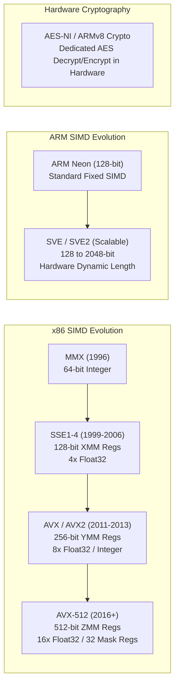
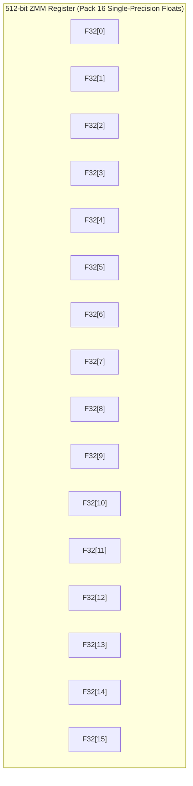
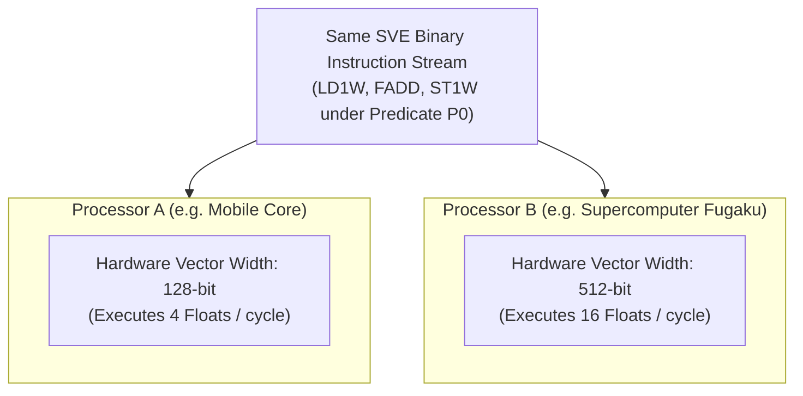
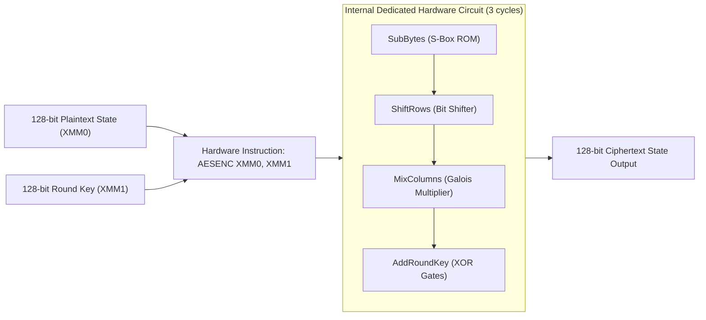

# 3.5. Instruction Extensions & SIMD Vectorization (Các Tập lệnh Mở rộng & Vector hóa SIMD)

## Tổng quan về Instruction Extensions & SIMD
Theo thời gian, tập lệnh ISA cơ sở không đủ để đáp ứng nhu cầu bùng nổ của các tác vụ tính toán hiệu năng cao (HPC), mã hóa bảo mật, xử lý âm thanh/hình ảnh và trí tuệ nhân tạo (AI/ML). Các nhà sản xuất CPU đã liên tục bổ sung các **Instruction Extensions (Tập lệnh Mở rộng)** vào kiến trúc gốc.
- **SIMD (Single Instruction, Multiple Data)**: Kỹ thuật cho phép một chỉ thị đơn lẻ thực hiện đồng thời một phép toán trên nhiều phần tử dữ liệu được đóng gói trong một thanh ghi vector siêu rộng (Vector Registers).
- **Hệ sinh thái SIMD x86**: Tiến hóa từ **MMX** (64-bit) $\to$ **SSE** (128-bit) $\to$ **AVX / AVX2** (256-bit) $\to$ **AVX-512** (512-bit).
- **Hệ sinh thái SIMD ARM**: **NEON** (128-bit cố định) và **SVE (Scalable Vector Extension)** với khả năng xử lý vector độc lập với độ dài phần cứng (Vector-Length Agnostic).
- **Phần cứng Tăng tốc Chuyên dụng**: **AES-NI** (Mã hóa phần cứng thuật toán AES) mang lại tốc độ bảo mật mạng tiệm cận tốc độ dây (Line rate).



---

## 2. Chi tiết từng Keyword (Under-the-Hood Deep Dive)

### 1. SIMD Extensions Evolution: SSE, AVX, AVX2, AVX-512

#### 1. Khái niệm bản chất (What & Why)
- **SIMD Extensions**: Các tập lệnh mở rộng trang bị cho CPU khả năng tính toán song song dữ liệu ở cấp độ phần cứng (Data-Level Parallelism).
- Thay vì cộng hai mảng số thực bằng vòng lặp 1000 bước tuần tự:
  $$\text{for}(i=0; i<1000; ++i)\ c[i] = a[i] + b[i];$$
  SIMD cho phép cộng cùng lúc 8 số thực 32-bit (với AVX2) hoặc 16 số thực (với AVX-512) chỉ trong **1 chu kỳ xung nhịp CPU duy nhất**.

#### 2. Cơ chế hoạt động sâu (Under the hood / Hardcore Internals)
- **Các thế hệ thanh ghi Vector trên x86**:
  - **SSE (Streaming SIMD Extensions - 128 bits)**:
    - Bổ sung 16 thanh ghi `XMM0` đến `XMM15`.
    - Chứa được: $4 \times 32$-bit floats, $2 \times 64$-bit doubles, hoặc $16 \times 8$-bit integers.
  - **AVX / AVX2 (Advanced Vector Extensions - 256 bits)**:
    - Mở rộng thanh ghi lên `YMM0` đến `YMM15` (256-bit). Thanh ghi `XMM` trở thành nửa dưới 128-bit của `YMM`.
    - Hỗ trợ phép toán **FMA (Fused Multiply-Add)**: Thực hiện $A \times B + C$ chỉ với 1 lần làm tròn, tăng gấp đôi thông lượng tính toán FLOPS.
  - **AVX-512 (512 bits)**:
    - Nhân đôi số lượng thanh ghi lên 32 thanh ghi: `ZMM0` đến `ZMM31` độ rộng 512-bit.
    - Chứa được $16 \times 32$-bit floats hoặc $8 \times 64$-bit doubles trong MỘT thanh ghi.
    - Bổ sung 8 thanh ghi mặt nạ vị ngữ (**Opmask Registers `k0`-`k7`**) cho phép xử lý câu lệnh điều kiện (Vector Predication / Masked Vectorization) mà không cần rẽ nhánh.

#### 3. Sơ đồ cấu trúc đóng gói dữ liệu trong thanh ghi AVX-512 ZMM


#### 4. Code ví dụ thực chiến (C++ AVX2 Intrinsics Vectorized Addition)
Minh họa trực tiếp việc sử dụng AVX2 C++ Intrinsics để cộng mảng số thực:
```cpp
#include <iostream>
#include <immintrin.h> // Header chứa toàn bộ SIMD intrinsics
#include <vector>
#include <cstdint>

// Hàm cộng 8 phần tử float song song bằng 1 chỉ thị AVX2 duy nhất
void add_floats_avx2(const float* a, const float* b, float* c) {
#if defined(__AVX2__)
    // 1. Nạp 256 bits (8 số float) từ mảng a và b vào thanh ghi YMM
    __m256 va = _mm256_loadu_ps(a);
    __m256 vb = _mm256_loadu_ps(b);

    // 2. Thực hiện 8 phép cộng đồng thời trong 1 chu kỳ ALU Vector
    __m256 vres = _mm256_add_ps(va, vb);

    // 3. Ghi kết quả 256 bits từ thanh ghi YMM ra bộ nhớ c
    _mm256_storeu_ps(c, vres);
#else
    for (int i = 0; i < 8; ++i) c[i] = a[i] + b[i];
#endif
}

int main() {
    alignas(32) float a[8] = {1.0f, 2.0f, 3.0f, 4.0f, 5.0f, 6.0f, 7.0f, 8.0f};
    alignas(32) float b[8] = {0.1f, 0.2f, 0.3f, 0.4f, 0.5f, 0.6f, 0.7f, 0.8f};
    alignas(32) float c[8] = {0};

    add_floats_avx2(a, b, c);

    std::cout << "[AVX2 SIMD Result]: ";
    for (int i = 0; i < 8; ++i) std::cout << c[i] << " ";
    std::cout << "\n";
    return 0;
}
```

#### 5. Ưu / Nhược điểm, Pitfalls & Anti-patterns
- **Yêu cầu căn chỉnh bộ nhớ (Memory Alignment)**: Lệnh `_mm256_load_ps` (Aligned Load) đòi hỏi địa chỉ RAM phải chia hết cho 32 bytes. Nếu con trỏ không được căn chỉnh (Unaligned), CPU sẽ ném ngoại lệ crash phần cứng `General Protection Fault (#GP)`. Luôn sử dụng lệnh an toàn `_mm256_loadu_ps` nếu không chắc chắn về căn chỉnh.

#### 6. Ứng dụng thực tế trong Backend / Systems
- **Parsing JSON siêu tốc (simdjson)**: Thư viện `simdjson` nổi tiếng parse được nhiều Gigabyte JSON/giây bằng cách nạp toàn bộ chuỗi 64 ký tự vào thanh ghi AVX-512, dùng mặt nạ bit để tìm vị trí các dấu `"` `{` `}` `:` trong 1 chu kỳ mà không cần duyệt từng ký tự.

---

### 2. ARM SIMD Extensions: NEON & Scalable Vector Extension (SVE)

#### 1. Khái niệm bản chất (What & Why)
- **ARM NEON**: Tập lệnh mở rộng SIMD 128-bit tiêu chuẩn trên nền tảng AArch64 (tương tự như SSE trên x86), trang bị 32 thanh ghi vector `V0` đến `V31`.
- **ARM SVE (Scalable Vector Extension)**: Cuộc cách mạng trong thiết kế SIMD. Khác với x86 cố định kích thước phần cứng (128, 256, 512-bit), SVE cho phép nhà sản xuất chip tự chọn độ rộng thanh ghi vector từ **128-bit đến 2048-bit**, trong khi **mã máy thực thi không cần biên dịch lại**.

#### 2. Cơ chế hoạt động sâu (Under the hood / Hardcore Internals)
- **Vector-Length Agnostic (VLA) Programming trong SVE**:
  - Trong SIMD truyền thống, lập trình viên phải viết vòng lặp xử lý phần dư (Tail / Epilogue Loop) nếu kích thước mảng không chia hết cho 8 hoặc 16.
  - Với SVE, CPU sở hữu lệnh tự động tính toán độ rộng vector phần cứng tại runtime:
    `WHILELT p0.s, x1, x2`
  - Vòng lặp tự động điều chỉnh thanh ghi vị ngữ (Predicate Register `p0`) để tắt các lane thừa khi đến cuối mảng, loại bỏ hoàn toàn phần mã Tail Loop cồng kềnh.

#### 3. Sơ đồ minh họa nguyên lý Vector-Length Agnostic của ARM SVE


#### 4. Code ví dụ thực chiến (C++ ARM NEON Intrinsics)
```cpp
#include <iostream>
#if defined(__ARM_NEON) || defined(__aarch64__)
#include <arm_neon.h>
#endif

void vector_add_neon(const float* a, const float* b, float* c) {
#if defined(__ARM_NEON) || defined(__aarch64__)
    // Nạp 4 số float (128-bit) vào thanh ghi Neon
    float32x4_t va = vld1q_f32(a);
    float32x4_t vb = vld1q_f32(b);
    // Cộng 4 số cùng lúc
    float32x4_t vc = vaddq_f32(va, vb);
    vst1q_f32(c, vc);
#else
    for (int i = 0; i < 4; ++i) c[i] = a[i] + b[i];
#endif
}

int main() {
    float a[4] = {10, 20, 30, 40};
    float b[4] = {1, 2, 3, 4};
    float c[4] = {0};
    vector_add_neon(a, b, c);
    std::cout << "[ARM NEON]: First element = " << c[0] << '\n';
    return 0;
}
```

#### 5. Ưu / Nhược điểm, Pitfalls & Anti-patterns
- **Ưu điểm vượt trội của SVE**: Đảm bảo mã nhị phân viết ra có thể "sống sót" và tự động chạy nhanh hơn khi phần cứng tương lai nâng cấp thanh ghi vector từ 256-bit lên 1024-bit mà không cần bảo trì hay build lại.

#### 6. Ứng dụng thực tế trong Backend / Systems
- **Siêu máy tính Fugaku (Nhật Bản)**: Tận dụng vi xử lý ARM A64FX trang bị tập lệnh SVE 512-bit để thực hiện các mô phỏng thời tiết và sinh học với hiệu năng dẫn đầu thế giới mà vẫn duy trì mức tiêu thụ điện năng tối ưu.

---

### 3. Hardware Cryptographic Extensions: AES-NI

#### 1. Khái niệm bản chất (What & Why)
- **AES-NI (Advanced Encryption Standard New Instructions)**: Tập lệnh mở rộng phần cứng được Intel và AMD giới thiệu từ năm 2010, tích hợp trực tiếp các vòng biến đổi mật mã (SubBytes, ShiftRows, MixColumns, AddRoundKey) của thuật toán mã hóa đối xứng AES vào các cổng logic silicon của CPU.
- **Lý do tồn tại**: Thuật toán AES triển khai bằng phần mềm dựa trên các bảng tra cứu (Lookup Tables) trong RAM, vừa chậm vừa dễ bị tấn công kênh kề (**Cache-Timing Side-Channel Attacks**). AES-NI giải quyết triệt để cả hai vấn đề này.

#### 2. Cơ chế hoạt động sâu (Under the hood / Hardcore Internals)
- **Các chỉ thị chính trong AES-NI**:
  - `AESENC` / `AESENCLAST`: Thực hiện một vòng mã hóa AES hoàn chỉnh trong đúng **3–4 chu kỳ xung nhịp**.
  - `AESDEC` / `AESDECLAST`: Thực hiện một vòng giải mã AES.
  - `AESKEYGENASSIST`: Sinh các khóa con (Round Keys) từ Master Key.
- **Tính toán Constant-Time (Thời gian bất biến)**:
  - Do các phép toán diễn ra trực tiếp bên trong vi mạch phần cứng mà không hề truy cập bảng tra cứu ô nhớ, thời gian thực thi của lệnh `AESENC` là hoàn toàn cố định (Fixed-latency), vô hiệu hóa mọi nỗ lực đo lường độ trễ cache để đoán khóa bí mật của hacker.

#### 3. Sơ đồ mạch giải mã phần cứng AES-NI


#### 4. Code ví dụ thực chiến (C++ Kiểm tra Hỗ trợ AES-NI qua CPUID)
Sử dụng chỉ thị `CPUID` để phát hiện CPU có hỗ trợ tập lệnh tăng tốc phần cứng AES-NI hay không:
```cpp
#include <iostream>
#include <cstdint>

#if defined(__x86_64__) || defined(_M_X64)
#include <cpuid.h>
#endif

bool is_aesni_supported() {
#if defined(__x86_64__) || defined(_M_X64)
    unsigned int eax, ebx, ecx, edx;
    // Gọi CPUID với function 1 để lấy thông tin feature flags
    if (__get_cpuid(1, &eax, &ebx, &ecx, &edx)) {
        // Bit 25 của thanh ghi ECX xác định sự hiện diện của AES-NI
        return (ecx & (1 << 25)) != 0;
    }
#endif
    return false;
}

int main() {
    bool has_aes = is_aesni_supported();
    std::cout << "[Hardware Security Inspection]:\n";
    std::cout << "  AES-NI Hardware Acceleration: " 
              << (has_aes ? "SUPPORTED (Ultra Fast & Secure)" : "NOT SUPPORTED") << '\n';
    return 0;
}
```

#### 5. Ưu / Nhược điểm, Pitfalls & Anti-patterns
- **Hiệu năng nhảy vọt**: Triển khai AES bằng phần mềm thuần túy (OpenSSL không có assembly) đạt khoảng 15–20 chu kỳ/byte. Khi bật phần cứng AES-NI kết hợp chế độ AES-GCM (với lệnh nhân Galois `PCLMULQDQ`), tốc độ đạt dưới **0.5 chu kỳ/byte** (nhanh hơn 30–40 lần).

#### 6. Ứng dụng thực tế trong Backend / Systems
- **HTTPS & TLS 1.3 Termination trong Nginx / Envoy / API Gateways**: Các máy chủ API Gateway xử lý hàng trăm nghìn kết nối TLS đồng thời có thể thực hiện mã hóa và giải mã dữ liệu ở tốc độ hàng chục Gigabit/giây mà CPU vẫn chỉ hoạt động ở mức vài phần trăm tải nhờ tập lệnh phần cứng AES-NI.