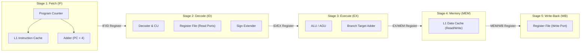
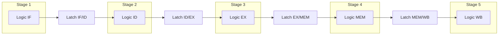

# 4.1. Instruction Cycle & Classic Pipeline (Chu kỳ Lệnh & Đường ống Kinh điển)

## Tổng quan về Instruction Cycle & Pipeline
Trọng tâm vận hành của bất kỳ bộ vi xử lý nào là **Chu kỳ Lệnh (Instruction Cycle)** — chuỗi các bước lặp đi lặp lại vô tận từ khi máy tính khởi động cho đến khi tắt nguồn nhằm biến đổi mã máy thành các tác vụ phần cứng cụ thể.
- **Classic 5-Stage RISC Pipeline**: Được chuẩn hóa bởi Hennessy & Patterson, mô hình này chia nhỏ chu kỳ lệnh thành 5 công đoạn liên tục: **Fetch (IF)** $\to$ **Decode (ID)** $\to$ **Execute (EX)** $\to$ **Memory (MEM)** $\to$ **Write-Back (WB)**.
- **Nguyên lý Dây chuyền Lắp ráp**: Tương tự dây chuyền sản xuất xe hơi của Henry Ford, Pipeline cho phép xử lý đồng thời 5 lệnh khác nhau ở 5 công đoạn khác nhau tại cùng một chu kỳ xung nhịp, đẩy thông lượng lý thuyết lên mức **1 lệnh hoàn thành trên mỗi chu kỳ xung nhịp ($\text{CPI} \approx 1$)**.

```mermaid
gantt
    title Classic 5-Stage Pipeline Throughput Over Time
    dateFormat X
    axisFormat Cycle %s

    section Inst 1 (ADD)
    IF  :0, 1
    ID  :1, 2
    EX  :2, 3
    MEM :3, 4
    WB  :4, 5

    section Inst 2 (SUB)
    IF  :1, 2
    ID  :2, 3
    EX  :3, 4
    MEM :4, 5
    WB  :5, 6

    section Inst 3 (LOAD)
    IF  :2, 3
    ID  :3, 4
    EX  :4, 5
    MEM :5, 6
    WB  :6, 7

    section Inst 4 (OR)
    IF  :3, 4
    ID  :4, 5
    EX  :5, 6
    MEM :6, 7
    WB  :7, 8
```



---

## 2. Chi tiết từng Keyword (Under-the-Hood Deep Dive)

### 1. The Instruction Cycle: Fetch, Decode, Execute, Memory, Write-Back

#### 1. Khái niệm bản chất (What & Why)
- **Instruction Cycle**: Vòng đời hoàn chỉnh của một chỉ thị lệnh từ lúc được nạp từ bộ nhớ RAM/Cache cho đến khi kết quả được ghi vĩnh viễn vào thanh ghi hoặc ô nhớ.
- **5 công đoạn cốt lõi**:
  1. **Fetch (IF)**: Đọc lệnh từ bộ nhớ thông qua con trỏ lệnh `PC`.
  2. **Decode (ID)**: Phân tích mã Opcode và đọc các thanh ghi nguồn.
  3. **Execute (EX)**: Thực hiện tính toán trên ALU hoặc tính địa chỉ bộ nhớ trên AGU.
  4. **Memory Access (MEM)**: Đọc hoặc ghi dữ liệu vào L1 Data Cache.
  5. **Write-Back (WB)**: Ghi kết quả tính toán vào Register File.

#### 2. Cơ chế hoạt động sâu (Under the hood / Hardcore Internals)
- **Chi tiết phần cứng từng giai đoạn**:
  - **Stage 1 - IF**:
    - Địa chỉ trong thanh ghi `PC` được gửi tới L1 Instruction Cache.
    - Lệnh (32-bit hoặc chuỗi byte) được nạp vào thanh ghi đệm `IF/ID Pipeline Register`.
    - Mạch cộng phần cứng tự động tăng giá trị `PC`: $PC \leftarrow PC + 4$ (trên kiến trúc 32-bit).
  - **Stage 2 - ID**:
    - Bộ giải mã bóc tách các trường bit: Opcode được đưa vào Control Unit để sinh các tín hiệu điều khiển (`RegWrite`, `ALUOp`, `MemRead`, `MemWrite`).
    - Các số định danh thanh ghi nguồn (`rs`, `rt`) được đưa vào mảng đọc của Register File. Cuối chu kỳ ID, dữ liệu của hai thanh ghi này đã sẵn sàng ở đầu ra.
    - Thực hiện mở rộng dấu (Sign-Extend) cho trường hằng số dịch chuyển (Immediate).
  - **Stage 3 - EX**:
    - Bộ dồn kênh (Multiplexer) chọn toán hạng đầu vào cho ALU: có thể là giá trị thanh ghi từ ID hoặc giá trị mở rộng dấu Immediate.
    - ALU thực hiện phép toán (cộng, trừ, logic...) và xuất ra kết quả `ALU_Out` cùng các cờ điều kiện.
    - Nếu là lệnh rẽ nhánh (`BEQ`), mạch cộng phụ tính toán địa chỉ đích: $PC_{\text{branch}} = PC + (\text{Offset} \times 4)$.
  - **Stage 4 - MEM**:
    - Nếu tín hiệu `MemRead` bật (lệnh LOAD), địa chỉ `ALU_Out` được dùng để truy vấn L1d Cache, dữ liệu đọc được đưa vào thanh ghi đệm `MEM/WB`.
    - Nếu tín hiệu `MemWrite` bật (lệnh STORE), dữ liệu từ thanh ghi thứ hai được ghi vào L1d Cache tại địa chỉ `ALU_Out`.
  - **Stage 5 - WB**:
    - Bộ dồn kênh chọn giữa kết quả của ALU (`ALU_Out`) hoặc dữ liệu vừa load từ MEM.
    - Dữ liệu được ghi vào thanh ghi đích (`rd`) trong Register File nếu cờ `RegWrite` bật.

#### 3. Sơ đồ khối phần cứng của 5-Stage Datapath


#### 4. Code ví dụ thực chiến (C++ Mô phỏng Vòng lặp Pipeline 5-Stage)
```cpp
#include <iostream>
#include <vector>
#include <string>

// Mô phỏng cấu trúc dữ liệu lưu trạng thái giữa các Pipeline Registers
struct PipelineRegister {
    std::string instruction = "NOP";
    int pc = 0;
    int alu_result = 0;
    int mem_data = 0;
    int dest_reg = -1;
    bool valid = false;
};

class ClassicPipelineSimulator {
public:
    PipelineRegister if_id, id_ex, ex_mem, mem_wb;

    void step_clock_cycle(const std::string& next_inst, int next_pc) {
        // Stage 5: Write-Back
        if (mem_wb.valid) {
            std::cout << "  [WB]  Committed: " << mem_wb.instruction << " to Reg R" << mem_wb.dest_reg << '\n';
        }
        // Stage 4: Memory
        mem_wb = ex_mem;
        // Stage 3: Execute
        ex_mem = id_ex;
        // Stage 2: Decode
        id_ex = if_id;
        // Stage 1: Fetch
        if_id.instruction = next_inst;
        if_id.pc = next_pc;
        if_id.valid = (next_inst != "NOP");
    }
};

int main() {
    ClassicPipelineSimulator sim;
    std::vector<std::string> program = {"ADD R1, R2, R3", "SUB R4, R1, R5", "LOAD R6, [R7]", "NOP", "NOP"};

    std::cout << "[Pipeline Simulation Cycle by Cycle]:\n";
    for (size_t cycle = 0; cycle < program.size() + 4; ++cycle) {
        std::string inst = (cycle < program.size()) ? program[cycle] : "NOP";
        std::cout << "Cycle " << cycle + 1 << ": Fetching [" << inst << "]\n";
        sim.step_clock_cycle(inst, cycle * 4);
    }
    return 0;
}
```

#### 5. Ưu / Nhược điểm, Pitfalls & Anti-patterns
- **Giới hạn của Pipeline đơn**:
  - *Pipeline Unbalance*: Thời gian của một chu kỳ clock bị trói buộc bởi stage chạy chậm nhất (thường là MEM stage truy cập cache). Nếu một stage mất 1.5 ns còn 4 stage khác chỉ mất 0.5 ns, toàn bộ hệ thống vẫn phải chạy với chu kỳ clock 1.5 ns.

#### 6. Ứng dụng thực tế trong Backend / Systems
- **Tối ưu hóa Pipeline Depth trong Thiết kế CPU Server**: Các kỹ sư thiết kế chip phải tính toán cân bằng hoàn hảo giữa độ sâu pipeline (ví dụ 14 stages trên AMD EPYC) để vừa đạt tần số xung nhịp cao (trên 3.5 GHz) vừa không để chi phí phạt khi dừng pipeline (Stall/Flush) phá hỏng hiệu năng cơ sở dữ liệu.

---

### 2. Instruction Pipeline & Pipeline Stages

#### 1. Khái niệm bản chất (What & Why)
- **Instruction Pipeline**: Kiến trúc phần cứng xâu chuỗi các khối chức năng độc lập của CPU, phân cách bởi các thanh ghi chốt (Pipeline Latches), hoạt động đồng bộ dưới một xung nhịp chung.
- **Pipeline Stages**: Số lượng phân đoạn mà một chỉ thị phải trải qua. Độ sâu của pipeline dao động từ 5 stages (RISC kinh điển), 14 stages (hiện đại thông dụng) cho tới 31 stages (Intel NetBurst Pentium 4).

#### 2. Cơ chế hoạt động sâu (Under the hood / Hardcore Internals)
- **Công thức Tăng tốc Pipeline (Pipeline Speedup)**:
  - Nếu một lệnh chạy không có pipeline mất $k$ chu kỳ, thì $n$ lệnh tuần tự mất:
    $$T_{\text{non-pipelined}} = n \times k \times \tau$$
  - Khi có $k$-stage pipeline, sau khi làm đầy đường ống mất $k-1$ chu kỳ, mỗi chu kỳ tiếp theo sẽ có đúng 1 lệnh hoàn thành:
    $$T_{\text{pipelined}} = (k + n - 1) \times \tau$$
  - Khi số lượng lệnh $n \to \infty$, hệ số tăng tốc lý thuyết đạt mức tối đa:
    $$\text{Speedup} = \frac{n \times k \times \tau}{(k + n - 1) \times \tau} \xrightarrow{n \to \infty} k$$
  - Một đường ống 5 stages về mặt lý thuyết giúp CPU chạy **nhanh gấp 5 lần** so với thiết kế không có pipeline!

#### 3. Sơ đồ Pipeline Registers và Luồng Dữ liệu Đồng bộ


#### 4. Code ví dụ thực chiến (C++ Phân tích Tác động của Pipeline Stalls)
```cpp
#include <iostream>
#include <chrono>
#include <vector>

// Minh họa tác động khi mã nguồn tạo ra chuỗi lệnh không bị phụ thuộc pipeline
void test_pipeline_efficiency() {
    constexpr size_t N = 100'000'000;
    uint64_t a = 1, b = 2, c = 3, d = 4;

    auto t0 = std::chrono::high_resolution_clock::now();
    // Vòng lặp tính toán hoàn toàn độc lập, lấp đầy mọi stage của pipeline
    for (size_t i = 0; i < N; ++i) {
        a += 1;
        b += 2;
        c += 3;
        d += 4;
    }
    auto t1 = std::chrono::high_resolution_clock::now();

    auto dur = std::chrono::duration_cast<std::chrono::milliseconds>(t1 - t0).count();
    std::cout << "[Pipeline Throughput]: Executed " << N * 4 << " independent ALU ops in " << dur << " ms\n";
    std::cout << "  Dummy sum to prevent dead-code elimination: " << (a + b + c + d) << '\n';
}

int main() {
    test_pipeline_efficiency();
    return 0;
}
```

#### 5. Ưu / Nhược điểm, Pitfalls & Anti-patterns
- **Định luật Lợi ích Giảm dần (Diminishing Returns of Superpipelining)**:
  - Tăng độ sâu pipeline từ 5 lên 20 giúp tăng xung nhịp GHz. Nhưng tăng từ 20 lên 50 stages sẽ phản tác dụng vì:
    1. Điện năng tiêu thụ tại các Pipeline Latches tăng vọt.
    2. Chi phí độ trễ chốt (Latch Setup & Hold Time) chiếm tỷ lệ phần trăm quá lớn trong chu kỳ xung nhịp.
    3. Hậu quả của Pipeline Hazards (đặc biệt là Branch Misprediction) trở nên quá nặng nề.

#### 6. Ứng dụng thực tế trong Backend / Systems
- **Tối ưu hóa Trình thông dịch Bytecode (Interpreter Optimization)**: Trong các máy ảo như Python CPython hay Lua, vòng lặp giải mã bytecode chính (`switch(opcode)`) liên tục gây ra tình trạng xáo trộn pipeline. Kỹ thuật **Direct Threaded Code** (dùng mảng con trỏ nhãn `&&label` của GCC) được áp dụng để giữ cho pipeline CPU luôn được nạp đầy mượt mà.