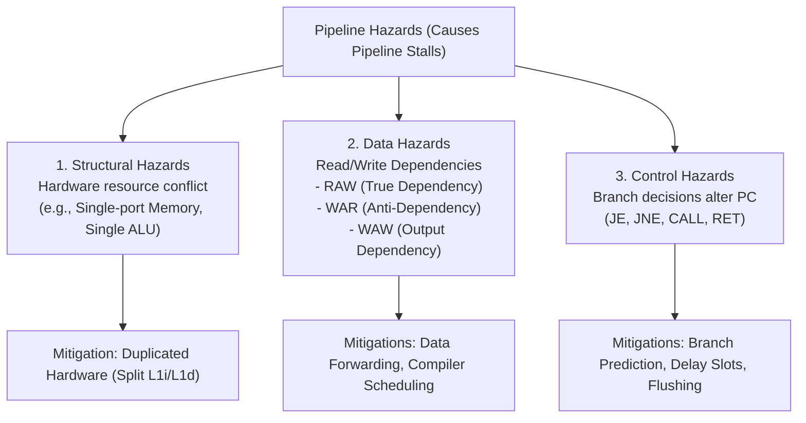
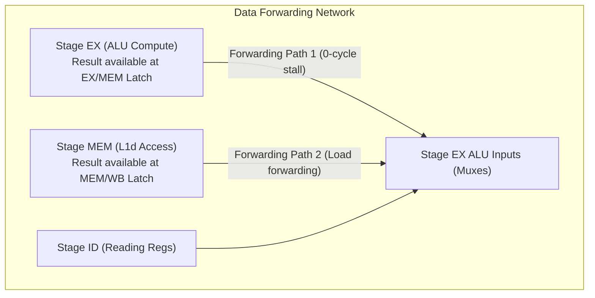
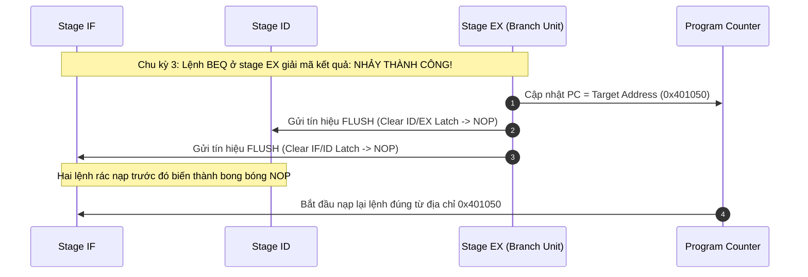

# 4.2. Pipeline Hazards & Mitigations (Hiểm họa Đường ống & Các Giải pháp Khắc phục)

## Tổng quan về Pipeline Hazards & Mitigations
Trong điều kiện lý tưởng, một bộ vi xử lý có pipeline sẽ hoàn thành một lệnh trên mỗi chu kỳ xung nhịp ($\text{CPI} = 1$). Tuy nhiên trong thực tế, dòng chảy mượt mà này liên tục bị gián đoạn bởi các xung đột phần cứng gọi là **Pipeline Hazards (Hiểm họa đường ống)**.
- **Phân loại Hazards**:
  - **Structural Hazards (Hiểm họa Cấu trúc)**: Xảy ra khi hai lệnh đồng thời đòi hỏi sử dụng cùng một tài nguyên phần cứng vật lý duy nhất.
  - **Data Hazards (Hiểm họa Dữ liệu)**: Xảy ra khi một lệnh phụ thuộc vào kết quả của một lệnh đi trước nhưng kết quả đó chưa kịp hoàn tất ghi lại vào thanh ghi.
  - **Control Hazards (Hiểm họa Điều khiển)**: Xảy ra khi lệnh rẽ nhánh làm thay đổi con trỏ lệnh `PC`, khiến CPU không biết chắc lệnh nào sẽ được thực thi tiếp theo.
- **Các kỹ thuật cứu vãn phần cứng**: **Data Forwarding (Bypass Network)**, **Pipeline Stalling (Chèn bong bóng NOP)**, và **Pipeline Flushing (Xóa sạch đường ống)**.



---

## 2. Chi tiết từng Keyword (Under-the-Hood Deep Dive)

### 1. Structural Hazards & Pipeline Stalling

#### 1. Khái niệm bản chất (What & Why)
- **Structural Hazard (Xung đột Cấu trúc)**: Tình huống hai hoặc nhiều chỉ thị lệnh đang ở các stage khác nhau trong pipeline cùng muốn truy cập vào **cùng một mạch phần cứng tại cùng một chu kỳ xung nhịp**.
- **Pipeline Stalling (Dừng đường ống / Pipeline Bubble)**: Biện pháp phòng thủ bắt buộc của phần cứng khi xảy ra hazard — làm đóng băng các stage phía trước và chèn một vi lệnh rỗng (**Bubble / NOP**) vào các stage tiếp theo để chờ tài nguyên được giải phóng.

#### 2. Cơ chế hoạt động sâu (Under the hood / Hardcore Internals)
- **Ví dụ kinh điển về Structural Hazard**:
  - Giả sử máy tính dùng kiến trúc Von Neumann với **một bộ nhớ RAM duy nhất cho cả mã và dữ liệu**:
    - Lệnh 1 (LOAD) đang ở **Stage 4 (MEM)** để đọc dữ liệu từ bộ nhớ.
    - Lệnh 4 đang ở **Stage 1 (IF)** để nạp mã lệnh mới từ bộ nhớ.
    - Cả hai cùng cần Memory Bus! Vì một bus không thể phục vụ hai yêu cầu cùng lúc, mạch phát hiện Hazard (**Hazard Detection Unit**) buộc phải dừng Stage IF lại 1 chu kỳ.
- **Giải pháp phần cứng triệt tiêu Structural Hazard**:
  - Áp dụng kiến trúc **Modified Harvard**: Tách L1 Cache thành hai khối riêng biệt: **L1 Instruction Cache** (phục vụ stage IF) và **L1 Data Cache** (phục vụ stage MEM).
  - Tích hợp **Multi-ported Register File**: Cho phép 2 cổng đọc (Read Ports) và 1 cổng ghi (Write Port) hoạt động đồng thời trong cùng một chu kỳ xung nhịp.

#### 3. Sơ đồ cơ chế chèn Bong bóng Pipeline (Bubble Injection)

```mermaid
gantt
    title Pipeline Stall due to Structural Hazard (Bubble Inserted)
    dateFormat X
    axisFormat Cycle %s

    section Inst 1 (LOAD)
    IF  :0, 1
    ID  :1, 2
    EX  :2, 3
    MEM :3, 4
    WB  :4, 5

    section Inst 2
    IF  :1, 2
    ID  :2, 3
    EX  :3, 4
    MEM :4, 5
    WB  :5, 6

    section Inst 3
    IF  :2, 3
    ID  :3, 4
    EX  :4, 5
    MEM :5, 6
    WB  :6, 7

    section Inst 4 (Stalled)
    STALL (Bubble NOP) :3, 4
    IF  :4, 5
    ID  :5, 6
    EX  :6, 7
    MEM :7, 8
    WB  :8, 9
```


#### 4. Code ví dụ thực chiến (C++ Mô phỏng Hazard Detection Unit chèn Bong bóng)
```cpp
#include <iostream>
#include <string>

struct HazardUnit {
    // Phát hiện nếu lệnh đang ở ID cần đọc thanh ghi mà lệnh ở EX đang ghi
    bool detect_hazard(int id_read_reg, int ex_dest_reg, bool ex_is_load) {
        if (ex_is_load && (id_read_reg == ex_dest_reg) && ex_dest_reg != 0) {
            return true; // Phải chèn Bong bóng (Bubble)
        }
        return false;
    }
};

int main() {
    HazardUnit hdu;
    int ex_dest = 2;       // Lệnh ở EX là: LOAD R2, [mem]
    bool ex_load = true;
    int id_read = 2;       // Lệnh ở ID là: ADD R5, R2, R3 (Cần đọc R2!)

    bool stall_needed = hdu.detect_hazard(id_read, ex_dest, ex_load);
    std::cout << "[Hazard Detection Unit]: Load-to-Use conflict detected? " 
              << std::boolalpha << stall_needed << '\n';
    if (stall_needed) {
        std::cout << "  Action: Freeze PC & IF/ID latch; Inject NOP bubble into ID/EX latch.\n";
    }
    return 0;
}
```

#### 5. Ưu / Nhược điểm, Pitfalls & Anti-patterns
- **Chi phí của Pipeline Stall**: Mỗi chu kỳ Stall là một chu kỳ mà phần cứng hoàn toàn không sinh ra công có ích, làm tăng chỉ số CPI lên trên 1.0. Thiết kế phần cứng tốt là thiết kế loại bỏ 100% Structural Hazards thông qua việc nhân bản tài nguyên vật lý.

#### 6. Ứng dụng thực tế trong Backend / Systems
- **Tối ưu hóa Băng thông Bus trong GPU Computing (CUDA)**: Trên kiến trúc GPU, hàng nghìn thread cùng chạy song song. Nếu tất cả các thread trong cùng một Warp cùng truy cập vào cùng một Bank của Shared Memory (**Bank Conflict**), một Structural Hazard phần cứng xảy ra, buộc GPU phải tuần tự hóa (serialize) các truy cập, làm tốc độ xử lý giảm đi hàng chục lần.

---

### 2. Data Hazards & Data Forwarding (Bypassing)

#### 1. Khái niệm bản chất (What & Why)
- **Data Hazard (Hiểm họa Dữ liệu)**: Xảy ra khi thứ tự đọc/ghi dữ liệu của các lệnh trong pipeline bị sai lệch do các chỉ thị chạy gối đầu lên nhau.
- **Ba loại Data Hazards kinh điển**:
  1. **RAW (Read-After-Write - True Data Dependency)**: Lệnh B cố gắng đọc giá trị trước khi Lệnh A kịp ghi. Đây là phụ thuộc dữ liệu thật duy nhất không thể xóa bỏ bằng cách đổi tên thanh ghi.
  2. **WAR (Write-After-Read - Anti-Dependency)**: Lệnh B cố gắng ghi đè trước khi Lệnh A kịp đọc.
  3. **WAW (Write-After-Write - Output Dependency)**: Lệnh B cố gắng ghi đè trước khi Lệnh A kịp ghi.
- **Data Forwarding (Bypassing)**: Kỹ thuật phần cứng truyền trực tiếp kết quả tính toán từ đầu ra của ALU (ở stage EX hoặc MEM) ngược về đầu vào của ALU cho lệnh tiếp theo mà không cần chờ dữ liệu được ghi qua stage WB vào Register File.

#### 2. Cơ chế hoạt động sâu (Under the hood / Hardcore Internals)
- **Nguyên lý Mạch Forwarding Unit**:
  - Xem xét hai lệnh kế tiếp:
    ```text
    Lệnh 1: ADD R1, R2, R3    (R1 = R2 + R3)
    Lệnh 2: SUB R4, R1, R5    (R4 = R1 - R5)
    ```
  - Nếu không có Forwarding: Lệnh 1 phải đến cuối chu kỳ 5 (WB) mới ghi $R1$ vào Register File. Lệnh 2 cần $R1$ ở chu kỳ 3 (EX) $\implies$ Pipeline phải Stall **2 chu kỳ**!
  - **Với Forwarding Bus**: Kết quả của Lệnh 1 đã nằm sẵn ở đầu ra của ALU tại cuối chu kỳ 3 (EX/MEM Register). Mạch Forwarding Unit phát hiện số thanh ghi trùng nhau (`EX/MEM.RegisterRd == ID/EX.RegisterRs`) và kích hoạt bộ Multiplexer truyền thẳng giá trị này vào đầu vào ALU của Lệnh 2 ở ngay chu kỳ 4. **Số chu kỳ Stall giảm về 0!**
- **Trường hợp ngoại lệ: Load-to-Use Data Hazard**:
  - Nếu Lệnh 1 là lệnh `LOAD R1, [R2]`: Dữ liệu chỉ sẵn sàng tại cuối stage MEM (chu kỳ 4).
  - Lệnh 2 cần dữ liệu ở đầu stage EX (chu kỳ 4). Vì thời gian không thể quay ngược, Forwarding không thể cứu hoàn toàn trường hợp này. CPU **bắt buộc phải Stall đúng 1 chu kỳ** (Load-to-Use Delay).

#### 3. Sơ đồ mạch Data Forwarding Bus


#### 4. Code ví dụ thực chiến (C++ Sắp xếp lại Mã lệnh để Triệt tiêu Load-to-Use Stall)
Minh họa kỹ thuật Instruction Scheduling của Compiler:
```cpp
#include <iostream>

// Phiên bản 1: Bị Load-to-Use Hazard (CPU bị khựng 1 chu kỳ giữa Load và Add)
int unoptimized_load_use(const int* a, const int* b) {
    int v1 = *a;        // LOAD R1
    int res1 = v1 + 10; // ADD dùng ngay R1 -> STALL 1 cycle!
    int v2 = *b;        // LOAD R2
    int res2 = v2 + 20; // ADD dùng ngay R2 -> STALL 1 cycle!
    return res1 + res2;
}

// Phiên bản 2: Compiler Schedule - Nạp trước toàn bộ dữ liệu để lấp đầy khoảng chờ
int optimized_scheduled(const int* a, const int* b) {
    int v1 = *a;        // LOAD R1
    int v2 = *b;        // LOAD R2 (Chạy vào chu kỳ chờ của v1 -> 0 Stall!)
    int res1 = v1 + 10; // R1 đã sẵn sàng từ trước
    int res2 = v2 + 20; // R2 đã sẵn sàng từ trước
    return res1 + res2;
}

int main() {
    int x = 5, y = 15;
    std::cout << "[Instruction Scheduling]: Res = " << optimized_scheduled(&x, &y) << '\n';
    return 0;
}
```

#### 5. Ưu / Nhược điểm, Pitfalls & Anti-patterns
- **Phức tạp về mặt dây dẫn silicon**: Mạch Forwarding đòi hỏi thêm nhiều đường dây nối tắt (Bypass wires) và các bộ Multiplexer lớn phía trước ALU, làm tăng diện tích chip và tiêu thụ điện năng.

#### 6. Ứng dụng thực tế trong Backend / Systems
- **Tối ưu hóa Vòng lặp Vector SIMD trong ClickHouse / DuckDB**: Các engine phân tích dữ liệu thiết kế các hàm tổng hợp theo cách tách rời các thao tác nạp bộ nhớ và tính toán toán học, đảm bảo không một lệnh nào phải chịu phạt Load-to-Use latency.

---

### 3. Control Hazards & Pipeline Flushing

#### 1. Khái niệm bản chất (What & Why)
- **Control Hazard (Hiểm họa Điều khiển / Branch Hazard)**: Xảy ra khi xuất hiện lệnh rẽ nhánh điều khiển luồng chương trình. Phần cứng không thể biết lệnh kế tiếp cần fetch tại địa chỉ nào cho đến khi điều kiện rẽ nhánh được đánh giá xong tại stage EX hoặc MEM.
- **Pipeline Flushing (Xả đường ống)**: Thao tác phần cứng cưỡng chế biến đổi toàn bộ các lệnh đang được nạp dở dang trong các stage IF và ID thành các lệnh rỗng vô hại (**NOPs**) khi phát hiện nhánh rẽ đã bị đoán sai.

#### 2. Cơ chế hoạt động sâu (Under the hood / Hardcore Internals)
- **Chi phí của một lần Pipeline Flush**:
  - Giả sử điều kiện rẽ nhánh được giải quyết tại stage EX (chu kỳ 3).
  - Khi đó, CPU đã lỡ nạp 2 lệnh tiếp theo vào stage IF và ID.
  - Nếu nhánh được chọn (**Branch Taken**), 2 lệnh này hoàn toàn sai logic. CPU kích hoạt tín hiệu `Flush` làm sạch thanh ghi chốt `IF/ID` và `ID/EX`, biến chúng thành mã nhị phân `0x00000000` (NOP), đồng thời nạp địa chỉ mục tiêu mới vào `PC`. Toàn bộ 2 chu kỳ này bị lãng phí hoàn toàn.
- **Kỹ thuật Cổ điển: Branch Delay Slot (MIPS)**:
  - Để không lãng phí chu kỳ khi flush, kiến trúc MIPS cổ quy định: **Lệnh ngay sau lệnh nhảy (Delay Slot) LUÔN LUÔN được thực thi**, bất kể nhánh có nhảy hay không! Trình biên dịch có nhiệm vụ tìm một lệnh hữu ích nhét vào vị trí này. (Các kiến trúc hiện đại đã loại bỏ tính năng này vì gây cản trở cho Out-of-Order execution).

#### 3. Sơ đồ xử lý Pipeline Flush khi rẽ nhánh


#### 4. Code ví dụ thực chiến (C++ Đo lường Độ phạt Flush của CPU)
```cpp
#include <iostream>
#include <x86intrin.h>
#include <cstdint>

// Đo số chu kỳ CPU bị mất khi gặp phải rẽ nhánh không thể dự đoán
int main() {
    volatile int condition = 1;
    unsigned int aux;

    uint64_t t0 = __rdtscp(&aux);
    // Nhánh rẽ khó đoán ép CPU phải flush pipeline nếu đoán sai
    if (condition == 2) {
        asm volatile("nop");
    } else {
        asm volatile("nop");
    }
    uint64_t t1 = __rdtscp(&aux);

    std::cout << "[Pipeline Flush Timing]: Cycles consumed = " << (t1 - t0) << '\n';
    return 0;
}
```

#### 5. Ưu / Nhược điểm, Pitfalls & Anti-patterns
- **Anti-pattern**: Viết mã với mật độ rẽ nhánh quá dày đặc (Branch Density cao, cứ 3 lệnh lại có 1 lệnh rẽ nhánh). Nguy cơ flush pipeline liên tục sẽ kéo tụt hiệu năng CPU xuống mức tồi tệ nhất.

#### 6. Ứng dụng thực tế trong Backend / Systems
- **Tối ưu hóa Network Packet Processing (XDP / DPDK)**: Mã xử lý gói tin mạng được viết hoàn toàn theo phong cách Branchless (dùng bảng ánh xạ hoặc bitmask) để đảm bảo không một gói tin nào kích hoạt lệnh rẽ nhánh gây flush pipeline của CPU máy chủ.