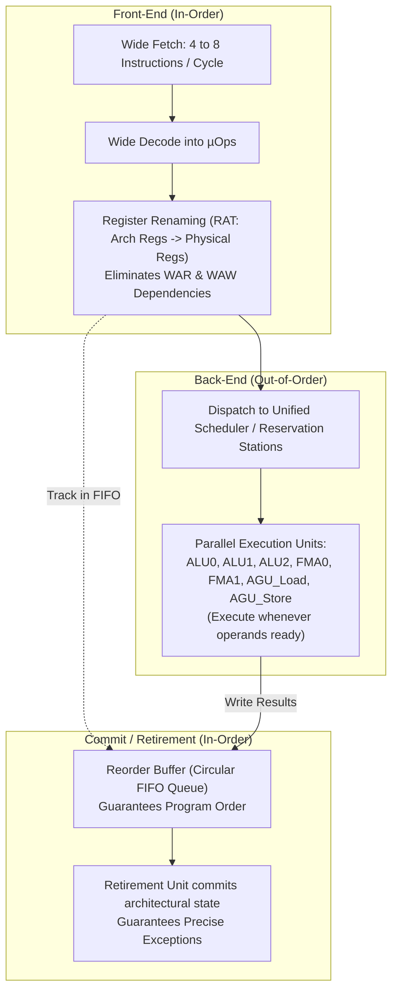
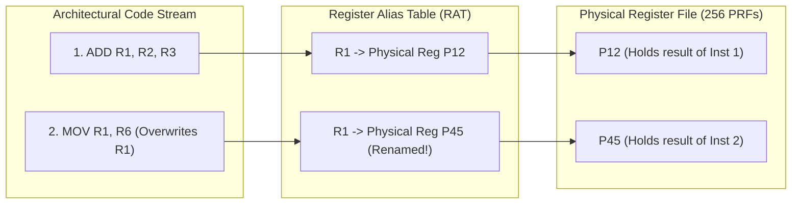
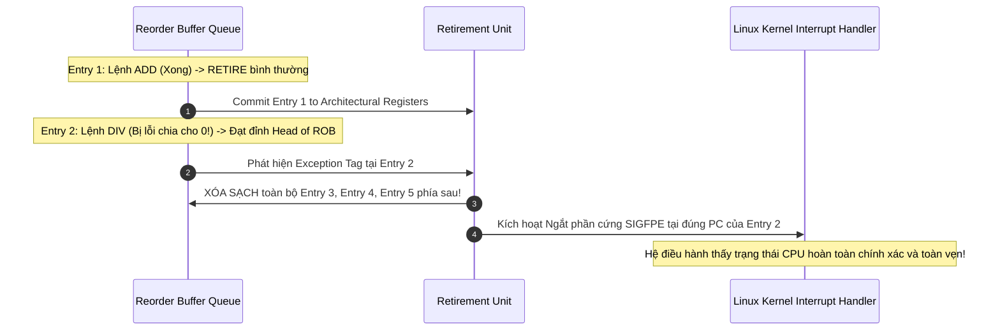

# 4.4. Superscalar & Out-of-Order Execution (Kiến trúc Siêu vô hướng & Thực thi Không tuần tự)

## Tổng quan về Superscalar & Out-of-Order Execution
Đỉnh cao của kỹ nghệ vi kiến trúc CPU hiện đại là sự kết hợp giữa **Superscalar Architecture (Kiến trúc Siêu vô hướng)** và **Out-of-Order Execution (OoO - Thực thi Không tuần tự)**.
- **Superscalar**: Khả năng nạp (fetch), giải mã (decode) và phát lệnh (issue) nhiều hơn 1 chỉ thị lệnh trong MỘT chu kỳ xung nhịp duy nhất, phá vỡ giới hạn lý thuyết $\text{CPI} = 1$ để đạt tới $\text{IPC} > 1$ (thường từ 4 đến 8 lệnh/chu kỳ).
- **Instruction-Level Parallelism (ILP)**: Mức độ song song tiềm ẩn giữa các chỉ thị độc lập trong luồng mã của chương trình mà phần cứng có thể khai thác.
- **Thuật toán Tomasulo & Register Renaming**: Giải pháp phần cứng xóa bỏ hoàn toàn các phụ thuộc dữ liệu giả (False Hazards: WAR và WAW) bằng cách ánh xạ thanh ghi kiến trúc sang mảng thanh ghi vật lý khổng lồ, cho phép CPU thực thi các lệnh độc lập nằm rải rác phía sau trước khi các lệnh chậm chạp phía trước hoàn tất.



---

## 2. Chi tiết từng Keyword (Under-the-Hood Deep Dive)

### 1. Superscalar Architecture & Instruction-Level Parallelism (ILP)

#### 1. Khái niệm bản chất (What & Why)
- **Superscalar Architecture**: Kiến trúc CPU sở hữu nhiều đường ống (Pipelines) song song. Một CPU 4-way Superscalar có thể fetch đồng thời 4 lệnh, decode đồng thời 4 lệnh và phát (dispatch) đồng thời 4 lệnh vào các Execution Units độc lập trong mỗi chu kỳ clock.
- **Instruction-Level Parallelism (ILP)**: Tiềm năng thực thi đồng thời của các lệnh trong mã nguồn mà không làm thay đổi kết quả logic cuối cùng.

#### 2. Cơ chế hoạt động sâu (Under the hood / Hardcore Internals)
- **ILP Wall (Bức tường ILP)**:
  - Về mặt lý thuyết, một chương trình có thể có ILP rất cao nếu được viết tốt. Tuy nhiên trong thực tế, ILP bị giới hạn bởi:
    1. **True Data Dependencies (RAW)**: Lệnh sau phải đợi kết quả của lệnh trước.
    2. **Control Dependencies**: Sự xuất hiện liên tục của các lệnh rẽ nhánh.
    3. **Memory Latency**: Thời gian chờ dữ liệu từ RAM.
  - Các CPU hiện đại (như Apple M3 hay Intel Raptor Lake) có chiều rộng giải mã (Decode Width) lên tới 6 đến 8 lệnh/chu kỳ. Để giữ cho cỗ máy 8-way này không bị đói, CPU phải duy trì một cửa sổ thực thi Out-of-Order khổng lồ với hàng trăm lệnh được nạp trước.

#### 3. Sơ đồ so sánh Scalar Pipeline vs Superscalar Pipeline

```mermaid
gantt
    title Scalar (1 instruction/cycle) vs 2-Way Superscalar (2 instructions/cycle)
    dateFormat X
    axisFormat Cycle %s

    section Scalar Pipeline
    Inst 1 :0, 5
    Inst 2 :1, 6

    section Superscalar 2-Way
    Inst A1 :0, 5
    Inst A2 :0, 5
    Inst B1 :1, 6
    Inst B2 :1, 6
```


#### 4. Code ví dụ thực chiến (C++ Đo lường Khả năng Khai thác ILP)
Minh họa sự khác biệt hiệu năng giữa chuỗi lệnh phụ thuộc (Low ILP) và chuỗi lệnh độc lập (High ILP):
```cpp
#include <iostream>
#include <chrono>

// Trường hợp 1: Low ILP - Mỗi phép tính phụ thuộc hoàn toàn vào kết quả trước đó
void low_ilp_benchmark(size_t iters) {
    uint64_t x = 1;
    for (size_t i = 0; i < iters; ++i) {
        x = (x * 3) + 1; // Chuỗi phụ thuộc nối tiếp
    }
    std::cout << "[Low ILP Dummy]: " << x << '\n';
}

// Trường hợp 2: High ILP - 4 biến độc lập cho phép Superscalar Core thực thi song song trên 4 ALUs
void high_ilp_benchmark(size_t iters) {
    uint64_t a = 1, b = 2, c = 3, d = 4;
    for (size_t i = 0; i < iters; ++i) {
        a = (a * 3) + 1; // Port 0
        b = (b * 3) + 1; // Port 1 (Chạy song song cùng lúc!)
        c = (c * 3) + 1; // Port 5 (Chạy song song cùng lúc!)
        d = (d * 3) + 1; // Port 6 (Chạy song song cùng lúc!)
    }
    std::cout << "[High ILP Dummy]: " << (a + b + c + d) << '\n';
}

int main() {
    constexpr size_t N = 100'000'000;

    auto t0 = std::chrono::high_resolution_clock::now();
    low_ilp_benchmark(N);
    auto t1 = std::chrono::high_resolution_clock::now();
    high_ilp_benchmark(N);
    auto t2 = std::chrono::high_resolution_clock::now();

    auto time_low = std::chrono::duration_cast<std::chrono::milliseconds>(t1 - t0).count();
    auto time_high = std::chrono::duration_cast<std::chrono::milliseconds>(t2 - t1).count();

    std::cout << "[Low ILP Time]:  " << time_low << " ms\n";
    std::cout << "[High ILP Time]: " << time_high << " ms\n";
    std::cout << "  Throughput Speedup: " << static_cast<double>(time_low) / time_high << "x via Superscalar Execution!\n";
    return 0;
}
```

#### 5. Ưu / Nhược điểm, Pitfalls & Anti-patterns
- **Giới hạn vật lý của Superscalar Width**: Mở rộng từ 4-way lên 8-way đòi hỏi số lượng mạch so sánh xung đột (Bypass logic & Hazard checking) tăng theo cấp số nhân $\mathcal{O}(N^2)$. Do đó, các CPU máy chủ hiếm khi vượt quá chiều rộng 8-way vì chi phí diện tích silicon và nhiệt lượng tỏa ra quá lớn.

#### 6. Ứng dụng thực tế trong Backend / Systems
- **Tối ưu hóa Code Cryptography & Hashing**: Trong các thuật toán mã hóa (như ChaCha20 hoặc SHA-256), lập trình viên sắp xếp các khối dữ liệu độc lập cạnh nhau để bộ vi xử lý Superscalar có thể bắn đồng thời 4 đến 6 lệnh tính toán vào các cổng ALU trong mỗi chu kỳ clock.

---

### 2. Register Renaming & The Tomasulo Algorithm

#### 1. Khái niệm bản chất (What & Why)
- **Register Renaming (Đổi tên Thanh ghi)**: Kỹ thuật phần cứng ánh xạ động các thanh ghi kiến trúc khả kiến (Architectural Registers: `RAX`, `RBX`...) sang một tập thanh ghi vật lý bên trong chip (**Physical Registers**) lớn hơn rất nhiều (từ 16 thanh ghi lên tới hơn 200 thanh ghi).
- **Mục tiêu**: Xóa bỏ hoàn toàn các phụ thuộc dữ liệu giả tạo:
  - **WAR Hazard (Write-After-Read / Anti-dependency)**.
  - **WAW Hazard (Write-After-Write / Output dependency)**.

#### 2. Cơ chế hoạt động sâu (Under the hood / Hardcore Internals)
- **Bản chất của Phụ thuộc Dữ liệu Giả**:
  Xem xét đoạn mã hợp ngữ:
  ```text
  Lệnh 1: ADD R1, R2, R3    (R1 = R2 + R3)
  Lệnh 2: SUB R4, R1, R5    (R4 = R1 - R5  --> Phụ thuộc thật RAW vào R1)
  Lệnh 3: MOV R1, R6        (R1 = R6       --> Phụ thuộc giả WAW với Lệnh 1, WAR với Lệnh 2)
  Lệnh 4: MUL R7, R1, R8    (R7 = R1 * R8  --> Phụ thuộc thật RAW vào Lệnh 3)
  ```
  - Tại sao Lệnh 3 và 4 phải chờ Lệnh 1 và 2? Chỉ vì chúng **dùng chung cái tên thanh ghi `R1`** do trình biên dịch bị thiếu thanh ghi! Giữa Lệnh 3, 4 và Lệnh 1, 2 hoàn toàn không có mối liên hệ dữ liệu nào.
- **Giải pháp Register Alias Table (RAT)**:
  - Phần cứng tự động đổi tên:
    - Lệnh 1 ghi vào thanh ghi vật lý `P20` ($P20 = R2 + R3$).
    - Lệnh 2 đọc từ `P20`.
    - Lệnh 3 được gán cho một thanh ghi vật lý mới tinh `P99` ($P99 = R6$).
    - Lệnh 4 đọc từ `P99`.
  - Giờ đây, Lệnh 3 và 4 hoàn toàn độc lập với Lệnh 1 và 2! Lõi Out-of-Order có thể thực thi Lệnh 3 và 4 **TRƯỚC** cả khi Lệnh 1 và 2 hoàn thành.

#### 3. Sơ đồ hoạt động của Register Alias Table (RAT)


#### 4. Code ví dụ thực chiến (C++ Tái hiện Lợi ích của Register Renaming)
Minh họa việc tái sử dụng tên biến trong C++ được compiler và CPU xử lý độc lập:
```cpp
#include <iostream>

// Hàm thực hiện hai tác vụ tính toán độc lập nhưng dùng chung tên biến 'temp'
int independent_computations(int a, int b, int c, int d) {
    // Tác vụ 1:
    int temp = a + b; // Ánh xạ vào Physical Reg P1
    int res1 = temp * 2;

    // Tác vụ 2: Tái sử dụng cùng một biến 'temp'
    // Ở mức CPU, Register Renaming sẽ gán biến này cho Physical Reg P2 hoàn toàn mới
    temp = c * d;     // Ánh xạ vào Physical Reg P2 (Chạy song song với Tác vụ 1!)
    int res2 = temp + 5;

    return res1 + res2;
}

int main() {
    std::cout << "[Register Renaming Demo]: Result = " 
              << independent_computations(2, 3, 4, 5) << '\n';
    return 0;
}
```

#### 5. Ưu / Nhược điểm, Pitfalls & Anti-patterns
- **Cạn kiệt Physical Register Pool (PRF Exhaustion)**: Nếu có quá nhiều lệnh đang nằm chờ trong pipeline mà chưa retire, số lượng thanh ghi vật lý rảnh rỗi sẽ cạn kiệt. Bộ đổi tên thanh ghi (Rename Stage) sẽ buộc phải dừng (Stall) toàn bộ Front-End của CPU.

#### 6. Ứng dụng thực tế trong Backend / Systems
- **Tối ưu hóa Allocator trong C++ & Rust (mimalloc / jemalloc)**: Các bộ cấp phát bộ nhớ hiện đại thiết kế các hàm malloc/free nội bộ sao cho các biến tạm thời không tạo ra các chuỗi phụ thuộc vòng quanh, cho phép động cơ Register Renaming của phần cứng giải phóng tài nguyên thanh ghi với thông lượng cao nhất.

---

### 3. In-Order Retirement & Precise Exceptions

#### 1. Khái niệm bản chất (What & Why)
- **In-Order Retirement (Cam kết Theo đúng Thứ tự)**: Dù các lệnh được thực thi lung tung, xáo trộn trong Back-End (Out-of-Order Execution), nhưng khi ghi kết quả cuối cùng vào trạng thái kiến trúc chính thức và bộ nhớ RAM, chúng **bắt buộc phải xếp hàng và về đích theo đúng thứ tự tuần tự ban đầu** của chương trình.
- **Precise Exceptions (Ngoại lệ Chính xác)**: Nguyên tắc an toàn quy định: Khi một ngoại lệ (như chia cho 0, Page Fault) xảy ra tại Lệnh $N$, toàn bộ các lệnh đứng trước $N$ phải được hoàn tất 100%, và **tuyệt đối không một lệnh nào đứng sau $N$ được phép để lại bất kỳ thay đổi nào trong trạng thái kiến trúc**.

#### 2. Cơ chế hoạt động sâu (Under the hood / Hardcore Internals)
- **Cơ chế Reorder Buffer (ROB) bảo vệ Precise Exceptions**:
  - Khi một lệnh gặp lỗi phần cứng (ví dụ: `DIV` chia cho 0) tại Execution Unit:
    1. Lệnh đó **không được kích hoạt Exception ngay lập tức**.
    2. Execution Unit chỉ đánh dấu cờ lỗi (**Exception Tag**) vào ô tương ứng của lệnh đó trong Reorder Buffer.
    3. CPU tiếp tục để các lệnh đứng trước lệnh đó hoàn tất và Retire bình thường.
    4. Chỉ khi ô bị lỗi đó di chuyển lên tới đỉnh hàng đợi (Head of ROB), Retirement Unit mới chính thức dừng CPU, kích hoạt ngắt phần cứng, lưu con trỏ `PC` của Lệnh $N$ và chuyển quyền điều khiển sang cho Kernel Exception Handler.
    5. Toàn bộ các lệnh nằm sau $N$ trong ROB lập tức bị xóa sạch (Purged). Không một hiệu ứng phụ (Side effect) nào bị rò rỉ ra ngoài!

#### 3. Sơ đồ xử lý Precise Exception tại Reorder Buffer


#### 4. Code ví dụ thực chiến (C++ Minh họa Precise Exception Handling)
```cpp
#include <iostream>
#include <csignal>
#include <csetjmp>

sigjmp_buf env;

void handle_sigsegv(int sig) {
    std::cout << "[Precise Exception Engine]: SIGSEGV (Invalid Memory Access) caught cleanly.\n";
    siglongjmp(env, 1);
}

int main() {
    signal(SIGSEGV, handle_sigsegv);

    volatile int valid_var = 100;
    int* null_ptr = nullptr;

    if (sigsetjmp(env, 1) == 0) {
        // Lệnh gây lỗi: Dereference con trỏ NULL
        // Nhờ In-Order Retirement, biến valid_var trước đó đã an toàn,
        // và các lệnh suy đoán sau lệnh này hoàn toàn bị vô hiệu hóa.
        *null_ptr = 42; 
    } else {
        std::cout << "[System Recovery]: Program resumed. Architectural integrity preserved!\n";
    }

    return 0;
}
```

#### 5. Ưu / Nhược điểm, Pitfalls & Anti-patterns
- **Head-of-Line Blocking trong ROB**: Nếu một lệnh ở đầu ROB bị chậm (ví dụ bị Cache Miss mất 200 chu kỳ), nó sẽ chặn đứng toàn bộ hàng đợi. Dù 200 lệnh phía sau đã thực thi xong toàn bộ, chúng vẫn phải nằm chờ trong ROB mà không thể Retire.

#### 6. Ứng dụng thực tế trong Backend / Systems
- **Cơ chế Virtual Memory Page Faulting trong OS**: Nhờ có Precise Exceptions được bảo đảm bởi phần cứng ROB, nhân Linux có thể tự tin tạm dừng một tiến trình khi gặp Page Fault (đọc trang nhớ chưa nạp từ đĩa vào RAM), nạp dữ liệu từ SSD vào RAM, rồi khôi phục lại đúng tiến trình đó chạy tiếp từ lệnh gây lỗi mà không bị sai lệch bất kỳ bit dữ liệu nào.