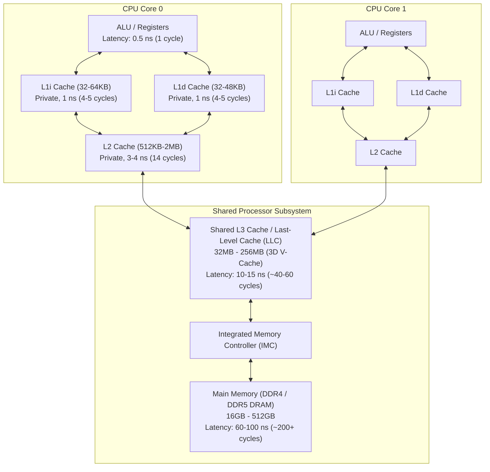
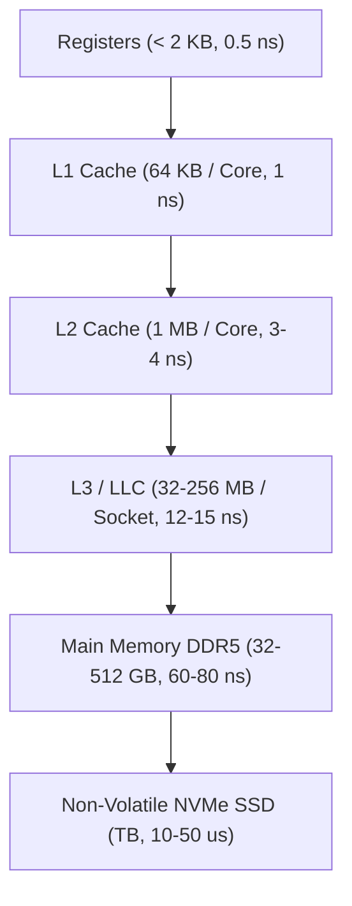
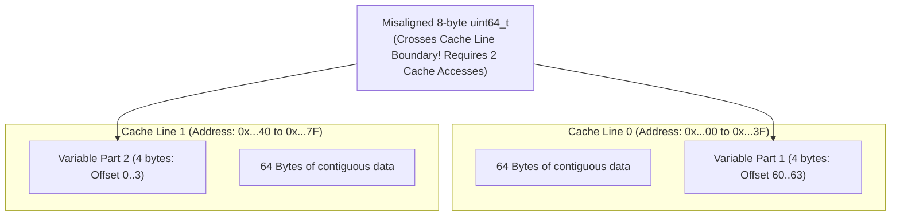
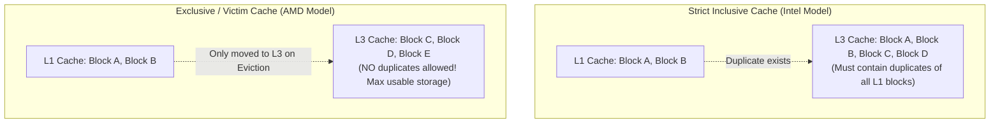

# 5.1. Cache Hierarchy & Organization (Phân cấp & Tổ chức Bộ nhớ đệm CPU)

## Tổng quan về Cache Hierarchy & Organization
Trong suốt 4 thập kỷ qua, tốc độ tính toán của bộ vi xử lý CPU đã tăng hàng nghìn lần, trong khi tốc độ truy xuất của bộ nhớ động DRAM chỉ tăng vài lần. Khoảng cách khổng lồ này tạo nên cuộc khủng hoảng hiệu năng gọi là **Memory Wall (Bức tường Bộ nhớ)**.
- **Giải pháp tối thượng**: **Phân cấp Bộ nhớ đệm (Cache Hierarchy)** — một chuỗi các tầng bộ nhớ đệm SRAM siêu tốc, dung lượng tăng dần và tốc độ giảm dần, được đặt xen vào giữa CPU Core và Main Memory (DRAM).
- **Phân tầng L1, L2, L3 (LLC)**:
  - **L1 Cache (Private)**: Nằm sát ALU, chia thành L1 Instruction (L1i) và L1 Data (L1d), độ trễ cực nhỏ ($\approx 1\text{ ns}$ / 4–5 chu kỳ).
  - **L2 Cache (Private)**: Đóng vai trò vùng đệm riêng biệt cho từng core ($\approx 3 - 4\text{ ns}$ / 14 chu kỳ).
  - **L3 Cache / Last-Level Cache - LLC (Shared)**: Dung lượng lớn (hàng chục đến hàng trăm MB), chia sẻ chung giữa toàn bộ các Core trong CPU Socket ($\approx 10 - 15\text{ ns}$ / 40–60 chu kỳ).
- **Đơn vị truyền tải cơ bản**: Mọi sự dịch chuyển dữ liệu giữa RAM và CPU Cache không diễn ra theo từng byte đơn lẻ mà luôn theo một khối cố định gọi là **Cache Line / Cache Block (thường là 64 bytes)**.



---

## 2. Chi tiết từng Keyword (Under-the-Hood Deep Dive)

### 1. Memory Hierarchy & CPU Cache Overview

#### 1. Khái niệm bản chất (What & Why)
- **Memory Hierarchy (Phân cấp Bộ nhớ)**: Mô hình kiến trúc tổ chức các loại linh kiện lưu trữ theo hình kim tự tháp: Tầng trên cùng có tốc độ nhanh nhất, dung lượng nhỏ nhất và giá thành trên mỗi bit đắt đỏ nhất. Càng xuống dưới, dung lượng càng lớn, giá thành càng rẻ nhưng độ trễ truy xuất càng cao.
- **CPU Cache**: Bộ nhớ đệm vật lý chế tạo từ công nghệ **SRAM (Static RAM)** với 6 transistor cho mỗi ô nhớ (6T cell), không cần tụ điện và không cần mạch làm tươi (refresh) như DRAM, cho phép truy xuất dữ liệu gần như ngay lập tức theo tần số xung nhịp của CPU.

#### 2. Cơ chế hoạt động sâu (Under the hood / Hardcore Internals)
- **Thống kê Độ trễ Truy xuất (Latency Numbers Every Engineer Should Know)**:
  Để hình dung sự chênh lệch khủng khiếp giữa các tầng, nếu quy đổi 1 chu kỳ CPU (0.3 ns) thành 1 giây của con người:
  - **CPU Register**: 0.3 ns $\implies$ **1 giây** (cầm cuốn sách ngay trên tay).
  - **L1 Cache**: 1.0 ns $\implies$ **3 giây** (lấy sách từ kệ bàn làm việc).
  - **L2 Cache**: 4.0 ns $\implies$ **12 giây** (bước ra tủ sách ở phòng khách).
  - **L3 Cache (LLC)**: 15.0 ns $\implies$ **45 giây** (đi sang phòng bên cạnh).
  - **Main Memory (DRAM)**: 70.0 ns $\implies$ **4 phút** (đi bộ xuống quán cà phê dưới phố).
  - **NVMe SSD Storage**: 20,000 ns ($20\ \mu\text{s}$) $\implies$ **19 giờ** (bay sang một lục địa khác).
  - **Cơ khí HDD**: 10,000,000 ns ($10\text{ ms}$) $\implies$ **12 tháng** (ngủ đông 1 năm).

#### 3. Sơ đồ Kim tự tháp Phân cấp Bộ nhớ (Memory Pyramid)


#### 4. Code ví dụ thực chiến (C++ Đọc Kích thước Cache Lines và Tầng Cache từ Linux sysfs)
```cpp
#include <iostream>
#include <fstream>
#include <string>
#include <vector>

struct CacheInfo {
    std::string level;
    std::string type;
    std::string size;
    std::string line_size;
};

std::vector<CacheInfo> read_cpu_caches() {
    std::vector<CacheInfo> caches;
    int index = 0;
    while (true) {
        std::string base = "/sys/devices/system/cpu/cpu0/cache/index" + std::to_string(index) + "/";
        std::ifstream fl(base + "level"), ft(base + "type"), fs(base + "size"), fcl(base + "coherency_line_size");
        if (!fl.is_open()) break;

        CacheInfo info;
        fl >> info.level;
        ft >> info.type;
        fs >> info.size;
        fcl >> info.line_size;
        caches.push_back(info);
        index++;
    }
    return caches;
}

int main() {
    auto list = read_cpu_caches();
    std::cout << "[Hardware Cache Hierarchy Detected]:\n";
    for (const auto& c : list) {
        std::cout << "  Level " << c.level << " (" << c.type << "): Size = " 
                  << c.size << ", Line Size = " << c.line_size << " bytes\n";
    }
    return 0;
}
```

#### 5. Ưu / Nhược điểm, Pitfalls & Anti-patterns
- **Ngộ nhận về Kích thước Bộ nhớ**: Lập trình viên thường cho rằng có nhiều RAM (ví dụ server 128GB RAM) là ứng dụng sẽ chạy nhanh. Nhưng nếu ứng dụng liên tục truy cập dữ liệu ngẫu nhiên (Random Access Pattern), CPU sẽ liên tục bị trượt L1/L2/L3 Cache, khiến toàn bộ lõi CPU phải nhàn rỗi chờ DRAM, làm hiệu năng sụt giảm nghiêm trọng.

#### 6. Ứng dụng thực tế trong Backend / Systems
- **Thiết kế Cấu trúc Dữ liệu Cache-Conscious**: Các thư viện hiệu năng cao (như Folly của Facebook hay Abseil của Google) thay thế cấu trúc cây `std::map` (dựa trên Node và con trỏ) bằng mảng phẳng dạng băm `flat_hash_map` để đảm bảo dữ liệu nằm gọn trong L1/L2 Cache, mang lại tốc độ truy vấn nhanh gấp 3 đến 5 lần.

---

### 2. Cache Line & Cache Block (The 64-Byte Standard)

#### 1. Khái niệm bản chất (What & Why)
- **Cache Line (hay Cache Block)**: Là đơn vị dữ liệu nhỏ nhất mà phần cứng CPU có thể chuyển giao giữa các tầng Cache và bộ nhớ chính RAM.
- **Kích thước tiêu chuẩn**: Trên hầu như mọi bộ vi xử lý hiện đại (x86-64, ARM64, RISC-V), kích thước một Cache Line cố định là **64 bytes** (512 bits).
- **Lý do tồn tại**: Dựa trên **Nguyên lý Cục bộ Không gian (Spatial Locality)** — nếu chương trình đọc một biến tại địa chỉ $X$, khả năng rất cao là nó sẽ tiếp tục đọc các biến tại địa chỉ $X+1, X+2$ ngay sau đó. Do đó, nạp luôn một khối 64 bytes lân cận sẽ tiết kiệm chu kỳ bus cho các lệnh tương lai.

#### 2. Cơ chế hoạt động sâu (Under the hood / Hardcore Internals)
- **Căn chỉnh dòng nhớ (Cache Line Alignment)**:
  - Mọi Cache Line đều bắt đầu tại một địa chỉ bộ nhớ vật lý chia hết cho 64:
    $$\text{Cache Line Base Address} = \text{Address} \ \& \ \sim(64 - 1) = \text{Address} \ \& \ (\sim 0x3F)$$
  - 6 bit thấp nhất của địa chỉ ô nhớ (`Address[5:0]`) đóng vai trò là **Byte Offset** (từ 0 đến 63) bên trong dòng Cache Line đó.
- **Hiện tượng Cache Line Split / Misaligned Access**:
  - Nếu một biến dữ liệu 8-byte (ví dụ `uint64_t`) nằm vắt ngang qua ranh giới giữa hai Cache Lines (ví dụ bắt đầu từ byte thứ 60 và kết thúc ở byte thứ 67):
  - CPU buộc phải **thực hiện 2 lần truy xuất Cache độc lập**, khóa bus nội bộ và ghép các byte lại. Thao tác này có thể làm giảm tốc độ đọc/ghi biến đó đi từ 2 đến 3 lần.

#### 3. Sơ đồ căn chỉnh Cache Line 64-byte và Misaligned Access


#### 4. Code ví dụ thực chiến (C++ Sử dụng `alignas(64)` để Căn chỉnh Dòng Cache)
Minh họa cách ép cấu trúc dữ liệu căn chỉnh chính xác trên ranh giới 64-byte bằng C++20:
```cpp
#include <iostream>
#include <cstdint>
#include <new>

// Định nghĩa struct được căn chỉnh chính xác trên ranh giới Cache Line 64-byte
struct alignas(64) CacheAlignedCounter {
    uint64_t value{0};
    // Compiler sẽ tự động chèn thêm 56 bytes padding vào đuôi struct
};

int main() {
    CacheAlignedCounter c1, c2;

    std::cout << "[Cache Line Alignment Inspection]:\n";
    std::cout << "  sizeof(CacheAlignedCounter): " << sizeof(CacheAlignedCounter) << " bytes\n";
    std::cout << "  c1 Address: " << &c1 << " (Divisible by 64? " 
              << (reinterpret_cast<uintptr_t>(&c1) % 64 == 0 ? "YES" : "NO") << ")\n";
    std::cout << "  c2 Address: " << &c2 << " (Divisible by 64? " 
              << (reinterpret_cast<uintptr_t>(&c2) % 64 == 0 ? "YES" : "NO") << ")\n";
    std::cout << "  Distance between c1 and c2: " 
              << (reinterpret_cast<uintptr_t>(&c2) - reinterpret_cast<uintptr_t>(&c1)) << " bytes\n";
    return 0;
}
```

#### 5. Ưu / Nhược điểm, Pitfalls & Anti-patterns
- **Cạm bẫy Bộ nhớ Độn (Padding Overhead)**: Việc căn chỉnh `alignas(64)` cho các struct nhỏ (ví dụ chỉ có 1 biến 8-byte) sẽ làm lãng phí 56 bytes cho mỗi đối tượng. Nếu tạo một mảng hàng triệu đối tượng như vậy, dung lượng RAM và Cache tiêu thụ sẽ tăng vọt gấp 8 lần một cách vô ích.

#### 6. Ứng dụng thực tế trong Backend / Systems
- **Triệt tiêu False Sharing trong Multi-threaded Queues**: Các cấu trúc dữ liệu không khóa (như `Disruptor` ring buffer hoặc con trỏ `head`/`tail` của `moodycamel::ConcurrentQueue`) luôn ép con trỏ `head` và con trỏ `tail` nằm trên **hai Cache Lines 64-byte hoàn toàn tách biệt** để ngăn hiện tượng Core 0 và Core 1 liên tục tranh chấp và làm vô hiệu hóa cache của nhau.

---

### 3. L1, L2 & Last-Level Cache (LLC / L3) Architecture

#### 1. Khái niệm bản chất (What & Why)
- **L1 Cache (Level 1)**: Nằm ngay trong lõi CPU, chia thành:
  - **L1i (Instruction Cache)**: Chỉ nạp mã lệnh, tối ưu hóa cho thông lượng fetch liên tục.
  - **L1d (Data Cache)**: Nạp và lưu dữ liệu toán hạng, tối ưu hóa cho đọc/ghi đa cổng.
- **L2 Cache (Level 2)**: Vùng đệm cấp 2 riêng biệt của từng lõi, gom chung cả mã và dữ liệu (Unified), giải tỏa áp lực khi L1 bị miss.
- **L3 Cache / Last-Level Cache (LLC)**: Bộ đệm cấp cao nhất trước khi ra bộ nhớ ngoài. Được chia sẻ chung giữa toàn bộ các lõi trong cùng một vi xử lý, đóng vai trò như một trung tâm điều phối và đồng bộ dữ liệu giữa các lõi.

#### 2. Cơ chế hoạt động sâu (Under the hood / Hardcore Internals)
- **Inclusive vs Exclusive vs Non-Inclusive Cache**:
  - **Inclusive Cache (Bao hàm - thường dùng trên Intel cũ)**: Mọi dữ liệu nằm trong L1 hoặc L2 **bắt buộc phải có một bản sao nằm trong L3**. Khi một dòng trong L3 bị thay thế, phần cứng tự động phát tín hiệu Invalidate để xóa luôn dòng đó khỏi L1 và L2 (*Back Invalidation*). Giúp kiểm tra Cache Coherence cực nhanh nhưng lãng phí dung lượng L3.
  - **Exclusive Cache (Loại trừ - AMD Zen 2/Zen 3)**: Một dòng dữ liệu chỉ được phép nằm ở **DUY NHẤT một tầng Cache**. Khi dòng đó bị đá khỏi L1/L2, nó mới được đưa vào L3 (*Victim Cache*). Tối đa hóa tổng dung lượng cache thực tế của chip.
  - **Non-Inclusive / Non-Exclusive (NINE - Intel hiện đại)**: Dữ liệu trong L1/L2 có thể có hoặc không có trong L3, linh hoạt theo cơ chế động.
- **Công nghệ 3D V-Cache (AMD 3D Stacking)**:
  - Xếp chồng một tấm silicon SRAM dung lượng 64MB lên thẳng trên die CPU qua các mối nối đồng **TSV (Through-Silicon Vias)**, nâng tổng dung lượng L3 Cache lên tới **96MB - 256MB**, giúp các máy chủ Database chứa trọn vẹn toàn bộ working set trong L3 mà không bao giờ phải chạm vào DRAM.

#### 3. Sơ đồ so sánh Inclusive Cache vs Exclusive Cache


#### 4. Code ví dụ thực chiến (C++ Đo Độ trễ Bước nhảy qua các Tầng Cache)
Chương trình benchmark kinh điển (Pointer Chasing Benchmark) đo đạc bước nhảy độ trễ từ L1 sang L2, L3 và RAM:
```cpp
#include <iostream>
#include <vector>
#include <numeric>
#include <random>
#include <chrono>

// Đo thời gian truy xuất ngẫu nhiên mảng liên kết con trỏ với kích thước tăng dần
double measure_latency(size_t size_bytes) {
    size_t count = size_bytes / sizeof(size_t);
    std::vector<size_t> indices(count);
    std::iota(indices.begin(), indices.end(), 0);

    // Xáo trộn ngẫu nhiên để triệt tiêu Hardware Prefetcher
    std::mt19937 rng(42);
    for (size_t i = count - 1; i > 0; --i) {
        std::uniform_int_distribution<size_t> dist(0, i);
        std::swap(indices[i], indices[dist(rng)]);
    }

    std::vector<size_t> buffer(count);
    for (size_t i = 0; i < count; ++i) {
        buffer[i] = indices[i];
    }

    // Pointer chasing loop
    size_t curr = 0;
    auto t0 = std::chrono::high_resolution_clock::now();
    for (size_t step = 0; step < 10'000'000; ++step) {
        curr = buffer[curr];
    }
    auto t1 = std::chrono::high_resolution_clock::now();

    // Ngăn compiler tối ưu hóa
    if (curr == 0xDEADBEEF) std::cout << "never";

    auto ns = std::chrono::duration_cast<std::chrono::nanoseconds>(t1 - t0).count();
    return static_cast<double>(ns) / 10'000'000.0;
}

int main() {
    std::cout << "[Cache Latency Measurements]:\n";
    std::cout << "  16 KB (Fits L1d):   " << measure_latency(16 * 1024) << " ns\n";
    std::cout << "  512 KB (Fits L2):   " << measure_latency(512 * 1024) << " ns\n";
    std::cout << "  8 MB (Fits L3):     " << measure_latency(8 * 1024 * 1024) << " ns\n";
    std::cout << "  64 MB (Spills RAM): " << measure_latency(64 * 1024 * 1024) << " ns\n";
    return 0;
}
```

#### 5. Ưu / Nhược điểm, Pitfalls & Anti-patterns
- **Non-Uniform L3 Latency trong Chiplet Architecture**: Trên các chip AMD EPYC hoặc Ryzen đa chiplet (MCM), các Core nằm trên cùng một Core Complex Die (CCD) truy cập L3 rất nhanh (10 ns). Nhưng nếu Core ở CCD 0 muốn truy cập dữ liệu đang nằm trong L3 của CCD 1, nó phải đi qua bus liên kết **Infinity Fabric**, độ trễ tăng vọt lên tới 40–50 ns.

#### 6. Ứng dụng thực tế trong Backend / Systems
- **Tối ưu hóa In-Memory Caches (Memcached / Redis Cluster)**: Bằng cách chia nhỏ các sharding process và ghim (pin) mỗi shard vào một tập Core nằm chung một L3 Cache Domain (dùng `taskset -c`), các kỹ sư backend loại bỏ hoàn toàn chi phí cross-CCD traffic, nâng cao 25% thông lượng xử lý request.