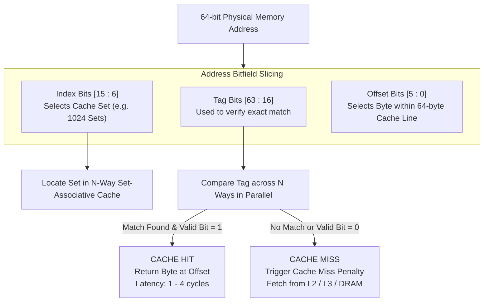
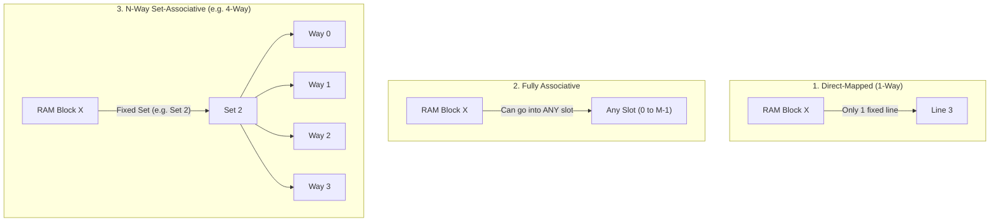
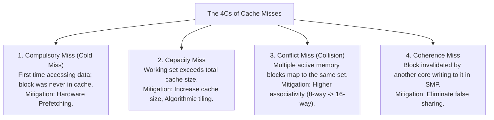

# 5.2. Cache Mapping & Performance Metrics (Ánh xạ Bộ nhớ đệm & Các Chỉ số Hiệu năng)

## Tổng quan về Cache Mapping & Metrics
Một thanh RAM vật lý có dung lượng từ hàng chục đến hàng trăm Gigabytes, trong khi bộ nhớ đệm CPU Cache chỉ có vài Kilobytes đến Megabytes. Làm thế nào phần cứng có thể ánh xạ hàng tỷ ô nhớ RAM vào một số lượng rất nhỏ các dòng Cache một cách nhanh chóng và chính xác?
- **Giải phẫu Địa chỉ Bộ nhớ**: Mọi địa chỉ 64-bit mà CPU phát ra được chia làm 3 trường bit chuyên biệt: **Tag**, **Index** và **Offset**.
- **Ba mô hình ánh xạ kinh điển (Cache Associativity)**:
  - **Direct-Mapped Cache (Ánh xạ Trực tiếp)**: Mỗi khối RAM chỉ có đúng MỘT vị trí duy nhất trong Cache. Cực nhanh nhưng dễ xung đột.
  - **Fully Associative Cache (Liên kết Hoàn toàn)**: Một khối RAM có thể nằm ở BẤT KỲ vị trí nào trong Cache. Linh hoạt nhất nhưng mạch tra cứu song song quá tốn kém.
  - **Set-Associative Cache (Liên kết Tập hợp - N-way)**: Sự kết hợp hoàn hảo giữa hai mô hình, được sử dụng trong 100% CPU hiện đại.
- **Các chỉ số hiệu năng cốt lõi**: **Hit Rate**, **Miss Rate**, **Cache Latency**, **Cache Bandwidth** và **Average Memory Access Time (AMAT)**.



---

## 2. Chi tiết từng Keyword (Under-the-Hood Deep Dive)

### 1. Cache Indexing, Tag & Offset (Address Dissection)

#### 1. Khái niệm bản chất (What & Why)
- Để CPU tìm kiếm dữ liệu trong Cache chỉ trong vòng 1 nanosecond mà không cần duyệt tuyến tính qua toàn bộ các dòng nhớ, địa chỉ bộ nhớ được chia thành 3 phần toán học:
  1. **Offset (Độ dịch byte)**: Số bit cần thiết để định vị một byte cụ thể bên trong khối Cache Line 64-byte:
     $$\text{Offset Bits} = \log_2(\text{Line Size in Bytes}) = \log_2(64) = 6\text{ bits}$$
  2. **Index (Chỉ số tập hợp)**: Số bit dùng để chọn Tập hợp (**Set**) mà khối nhớ bắt buộc phải cư trú trong Cache:
     $$\text{Index Bits} = \log_2(\text{Number of Sets})$$
  3. **Tag (Thẻ nhận dạng)**: Toàn bộ các bit địa chỉ còn lại ở phần cao. Tag được lưu cùng với dữ liệu trong Cache để xác minh xem dòng dữ liệu đó có đúng là địa chỉ RAM mà CPU đang tìm kiếm hay không:
     $$\text{Tag Bits} = \text{Total Address Width} - (\text{Index Bits} + \text{Offset Bits})$$

#### 2. Cơ chế hoạt động sâu (Under the hood / Hardcore Internals)
- **Ví dụ tính toán kỹ thuật cụ thể**:
  - Giả sử hệ thống có:
    - Địa chỉ vật lý: 48-bit.
    - L1 Data Cache: dung lượng 32 KB.
    - Cache Line: 64 bytes.
    - Tổ chức: 8-way Set-Associative.
  - *Bước 1: Tính số dòng (Lines/Blocks)*:
    $$\text{Total Lines} = \frac{32 \times 1024\text{ bytes}}{64\text{ bytes}} = 512\text{ lines}$$
  - *Bước 2: Tính số tập hợp (Sets)*:
    $$\text{Number of Sets} = \frac{512\text{ lines}}{8\text{ ways}} = 64\text{ sets}$$
  - *Bước 3: Phân chia các trường bit*:
    - **Offset**: $\log_2(64) = 6\text{ bits}$ (Bits [5:0]).
    - **Index**: $\log_2(64) = 6\text{ bits}$ (Bits [11:6]).
    - **Tag**: $48 - (6 + 6) = 36\text{ bits}$ (Bits [47:12]).
  - Khi có địa chỉ `0x00007FFF89AB4038`:
    - Offset = `0x38` (Byte thứ 56 trong line).
    - Index = `(0x4038 >> 6) & 0x3F = 0`. Dữ liệu bắt buộc phải nằm ở **Set 0**!
    - Tag = `0x00007FFF89AB`. Phần cứng so sánh Tag này với 8 thẻ nhớ trong Set 0.

#### 3. Sơ đồ giải phẫu trường bit địa chỉ
```text
+--------------------------------------+----------------+---------------+
|               Tag Bits               |   Index Bits   |  Offset Bits  |
|               (36 bits)              |    (6 bits)    |   (6 bits)    |
+--------------------------------------+----------------+---------------+
47                                   12 11             6 5              0
```

#### 4. Code ví dụ thực chiến (C++ Trình giải mã Bitfields Địa chỉ Cache)
```cpp
#include <iostream>
#include <cstdint>
#include <iomanip>

struct CacheAddressDecoder {
    uint32_t line_size_bytes;
    uint32_t total_size_bytes;
    uint32_t associativity;

    uint32_t num_offset_bits;
    uint32_t num_index_bits;
    uint32_t num_tag_bits;
    uint32_t num_sets;

    CacheAddressDecoder(uint32_t size, uint32_t line_size, uint32_t assoc)
        : total_size_bytes(size), line_size_bytes(line_size), associativity(assoc) {
        
        num_offset_bits = 6; // 64 bytes -> 6 bits
        uint32_t total_lines = size / line_size;
        num_sets = total_lines / assoc;
        
        uint32_t temp = num_sets;
        num_index_bits = 0;
        while (temp > 1) { num_index_bits++; temp >>= 1; }

        num_tag_bits = 64 - (num_index_bits + num_offset_bits);
    }

    void decode(uint64_t addr) const {
        uint64_t offset = addr & ((1ULL << num_offset_bits) - 1);
        uint64_t index  = (addr >> num_offset_bits) & ((1ULL << num_index_bits) - 1);
        uint64_t tag    = addr >> (num_offset_bits + num_index_bits);

        std::cout << "[Address 0x" << std::hex << addr << std::dec << "]:\n";
        std::cout << "  Tag:    0x" << std::hex << tag << std::dec << " (" << num_tag_bits << " bits)\n";
        std::cout << "  Index:  " << index << " (" << num_index_bits << " bits)\n";
        std::cout << "  Offset: " << offset << " (" << num_offset_bits << " bits)\n";
    }
};

int main() {
    // L1 Data Cache 32KB, 64-byte line, 8-way
    CacheAddressDecoder l1(32 * 1024, 64, 8);
    l1.decode(0x00007FFF89AB4038ULL);
    return 0;
}
```

#### 5. Ưu / Nhược điểm, Pitfalls & Anti-patterns
- **Cạm bẫy Lũy thừa của 2 (Power-of-Two Stride Conflict)**: Nếu chương trình duyệt một mảng với bước nhảy đúng bằng bội số của kích thước Cache Set (ví dụ: nhảy đúng 4096 bytes), tất cả các phần tử sẽ có cùng trường **Index**, khiến chúng bị dồn cục vào cùng một Set duy nhất, làm tê liệt toàn bộ các Set khác và gây ra hàng loạt Conflict Misses.

#### 6. Ứng dụng thực tế trong Backend / Systems
- **Matrix Transpose Optimization**: Khi nhân hoặc chuyển vị ma trận lớn trong các thuật toán khoa học máy tính, kỹ sư thường chèn thêm các khoảng trống (Padding dummy elements) vào cuối mỗi hàng của ma trận để phá vỡ chu kỳ bội số lũy thừa của 2, ngăn ngừa triệt để hiện tượng Cache Set Collision.

---

### 2. Cache Associativity: Direct-Mapped, Fully Associative & Set-Associative

#### 1. Khái niệm bản chất (What & Why)
- **Cache Associativity (Độ liên kết của Bộ nhớ đệm)**: Xác định một khối dữ liệu từ RAM có bao nhiêu vị trí (slots/ways) tiềm năng có thể cư trú bên trong Cache.
- **Ba mô hình tổ chức**:
  1. **Direct-Mapped Cache (1-way)**: Mỗi khối RAM chỉ có thể đặt vào đúng 1 dòng Cache cố định:
     $$\text{Set Index} = (\text{Block Address}) \pmod{\text{Total Cache Lines}}$$
  2. **Fully Associative Cache**: Dữ liệu có thể nằm ở bất kỳ đâu. Không có trường Index; toàn bộ địa chỉ (trừ Offset) đều là Tag.
  3. **N-Way Set-Associative Cache**: Cache được chia thành nhiều Tập hợp (Sets), mỗi Set chứa $N$ dòng (Ways). Khối RAM ánh xạ vào một Set cố định, nhưng có thể nằm ở bất kỳ Way nào trong $N$ ways của Set đó.

#### 2. Cơ chế hoạt động sâu (Under the hood / Hardcore Internals)
- **So sánh Phần cứng và Đánh đổi**:
  - *Direct-Mapped*: Chỉ cần **1 bộ so sánh Tag (1 Comparator)** duy nhất. Mạch cực kỳ đơn giản và nhanh. Nhưng tỉ lệ Conflict Miss rất cao; nếu 2 biến liên tục dùng chung 1 dòng cache, chúng sẽ đá nhau văng ra liên tục (*Cache Thrashing*).
  - *Fully Associative*: Cần tới $M$ bộ so sánh Tag hoạt động đồng thời song song (Content-Addressable Memory - CAM, với $M$ là hàng nghìn dòng cache). Quá nóng và quá đắt đỏ, chỉ dùng cho các bộ đệm cực nhỏ như **TLB (Translation Lookaside Buffer)** với 32–64 entries.
  - *Set-Associative (thường là 8-way trên L1, 16-way trên L3)*: Cần $N$ bộ so sánh Tag song song ($N=8$ hoặc $N=16$). Cân bằng hoàn hảo giữa chi phí silicon và tỷ lệ giảm Cache Miss.

#### 3. Sơ đồ so sánh 3 mô hình Cache Associativity


#### 4. Code ví dụ thực chiến (C++ Tái hiện Conflict Miss trong Direct-Mapped Cache)
Minh họa hiện tượng hai địa chỉ có cùng Index làm giảm hiệu năng:
```cpp
#include <iostream>
#include <vector>
#include <chrono>

int main() {
    // Kích thước bước nhảy 32KB (Đúng bằng kích thước L1 Data Cache)
    constexpr size_t STRIDE = 32 * 1024;
    constexpr size_t REPS = 50'000'000;

    std::vector<char> buffer(STRIDE * 2, 0);
    char* ptrA = &buffer[0];          // Cùng Index với ptrB
    char* ptrB = &buffer[STRIDE];     // Cùng Index với ptrA

    // 1. Truy cập xen kẽ 2 địa chỉ cùng Index (Tranh chấp Set)
    auto t0 = std::chrono::high_resolution_clock::now();
    volatile char dummy = 0;
    for (size_t i = 0; i < REPS; ++i) {
        dummy = *ptrA;
        dummy = *ptrB;
    }
    auto t1 = std::chrono::high_resolution_clock::now();

    auto dur = std::chrono::duration_cast<std::chrono::milliseconds>(t1 - t0).count();
    std::cout << "[Cache Associativity Test]: Stride access time: " << dur << " ms\n";
    return 0;
}
```

#### 5. Ưu / Nhược điểm, Pitfalls & Anti-patterns
- **Associativity Law of Diminishing Returns**: Tăng độ liên kết từ 1-way lên 2-way hoặc 4-way giúp giảm Cache Miss đáng kể. Nhưng tăng từ 8-way lên 16-way hay 32-way chỉ giúp giảm thêm một tỷ lệ Miss cực nhỏ trong khi làm tăng đáng kể độ trễ chu kỳ truy xuất của bộ so sánh Tag.

#### 6. Ứng dụng thực tế trong Backend / Systems
- **Tối ưu hóa Hash Tables (Swiss Tables / Google Abseil)**: Thiết kế của Flat Hash Table nhóm các metadata byte thành các nhóm 16-byte phù hợp chính xác với số lượng ways của L2 Cache, đảm bảo việc tìm kiếm Bucket không bao giờ gây ra hiện tượng Set Thrashing.

---

### 3. Cache Metrics: Hit/Miss Rate, Latency, Bandwidth & AMAT

#### 1. Khái niệm bản chất (What & Why)
- **Cache Hit**: Dữ liệu mà CPU yêu cầu đang có sẵn trong Cache.
- **Cache Miss**: Dữ liệu không có trong Cache, CPU buộc phải gửi tín hiệu xuống tầng dưới (L2/L3/DRAM) để lấy về.
- **Cache Hit Rate ($H$) & Miss Rate ($M$)**:
  $$H = \frac{\text{Hits}}{\text{Total Memory Accesses}}, \quad M = 1 - H = \frac{\text{Misses}}{\text{Total Accesses}}$$
- **Cache Miss Penalty**: Khoảng thời gian (số chu kỳ CPU) bị lãng phí để kéo một Cache Line từ tầng dưới về lấp vào Cache hiện tại.
- **Average Memory Access Time (AMAT)**: Thước đo vàng đánh giá hiệu quả của toàn bộ hệ thống phân cấp bộ nhớ:
  $$\text{AMAT} = \text{Hit Time} + (\text{Miss Rate} \times \text{Miss Penalty})$$

#### 2. Cơ chế hoạt động sâu (Under the hood / Hardcore Internals)
- **Công thức AMAT Phân cấp Đa tầng (Multi-Level AMAT)**:
  Đối với CPU có 3 tầng Cache (L1, L2, L3) và Main Memory:
  $$\text{AMAT} = T_{L1} + M_{L1} \times (T_{L2} + M_{L2} \times (T_{L3} + M_{L3} \times T_{\text{DRAM}}))$$
  - Giả sử:
    - $T_{L1} = 1\text{ ns}$, Miss Rate $M_{L1} = 5\%$ ($0.05$).
    - $T_{L2} = 4\text{ ns}$, Miss Rate cục bộ $M_{L2} = 20\%$ ($0.20$).
    - $T_{L3} = 15\text{ ns}$, Miss Rate cục bộ $M_{L3} = 50\%$ ($0.50$).
    - $T_{\text{DRAM}} = 70\text{ ns}$.
  - Tính toán:
    $$\text{Penalty}_{L3} = 15 + (0.50 \times 70) = 50\text{ ns}$$
    $$\text{Penalty}_{L2} = 4 + (0.20 \times 50) = 14\text{ ns}$$
    $$\text{AMAT} = 1 + (0.05 \times 14) = 1.7\text{ ns}$$
  - **Sức mạnh của Cache**: Dù truy xuất DRAM mất tận 70 ns, nhưng nhờ có phân cấp Cache, thời gian truy xuất bộ nhớ trung bình của chương trình chỉ là **1.7 ns**!

#### 3. Sơ đồ các loại Cache Miss (Phân loại 3C/4C Model)


#### 4. Code ví dụ thực chiến (C++ Tính toán và Đo lường AMAT Thực nghiệm)
```cpp
#include <iostream>
#include <chrono>
#include <vector>

int main() {
    constexpr size_t NUM_ACCESSES = 50'000'000;
    constexpr size_t L1_SIZE = 32 * 1024 / sizeof(int);      // Vừa L1
    constexpr size_t DRAM_SIZE = 64 * 1024 * 1024 / sizeof(int); // Vượt L3 ra DRAM

    std::vector<int> l1_buf(L1_SIZE, 1);
    std::vector<int> dram_buf(DRAM_SIZE, 1);

    // Đo Hit Time L1
    auto t0 = std::chrono::high_resolution_clock::now();
    long long s1 = 0;
    for (size_t i = 0; i < NUM_ACCESSES; ++i) s1 += l1_buf[i % L1_SIZE];
    auto t1 = std::chrono::high_resolution_clock::now();

    // Đo Miss Penalty DRAM
    auto t2 = std::chrono::high_resolution_clock::now();
    long long s2 = 0;
    for (size_t i = 0; i < NUM_ACCESSES / 10; ++i) s2 += dram_buf[(i * 1024) % DRAM_SIZE];
    auto t3 = std::chrono::high_resolution_clock::now();

    double l1_ns = static_cast<double>(std::chrono::duration_cast<std::chrono::nanoseconds>(t1 - t0).count()) / NUM_ACCESSES;
    double dram_ns = static_cast<double>(std::chrono::duration_cast<std::chrono::nanoseconds>(t3 - t2).count()) / (NUM_ACCESSES / 10);

    std::cout << "[Empirical AMAT Analysis]:\n";
    std::cout << "  L1 Hit Latency:       " << l1_ns << " ns/access\n";
    std::cout << "  DRAM Miss Penalty:    " << dram_ns << " ns/access\n";
    std::cout << "  Theoretical AMAT (with 98% L1 hit rate): " 
              << (l1_ns + 0.02 * dram_ns) << " ns\n";

    if (s1 == s2) std::cout << "same";
    return 0;
}
```

#### 5. Ưu / Nhược điểm, Pitfalls & Anti-patterns
- **Bẫy Tỷ lệ Trượt (Miss Rate Trap)**: Một chương trình có Miss Rate 1% chưa chắc đã chạy nhanh hơn chương trình có Miss Rate 5% nếu chương trình thứ nhất thực hiện số lượng lệnh Load nhiều gấp 10 lần. Chỉ số chuẩn xác nhất để đánh giá là **MPKI (Misses Per Kilo-Instructions - Số lần trượt Cache trên 1000 chỉ thị lệnh)**.

#### 6. Ứng dụng thực tế trong Backend / Systems
- **Giám sát Hiệu năng Database bằng Linux perf**: Kỹ sư hiệu năng định kỳ chạy lệnh `perf stat -e L1-dcache-load-misses,LLC-load-misses` trên các tiến trình MongoDB hoặc MySQL. Nếu chỉ số LLC Miss Rate vượt quá 10%, đó là dấu hiệu cho thấy Working Set của cơ sở dữ liệu đã vượt quá kích thước L3 Cache, cần phải nâng cấp phần cứng hoặc tối ưu lại câu truy vấn SQL.