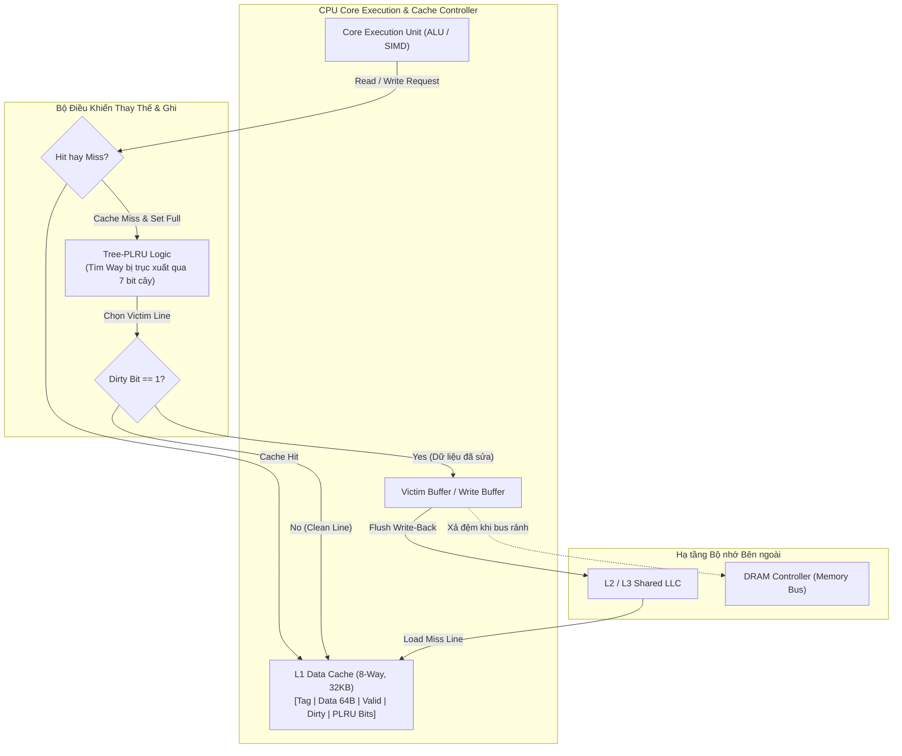
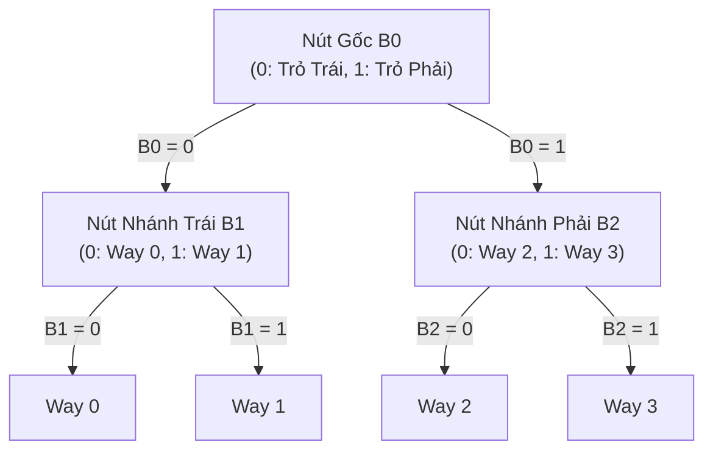
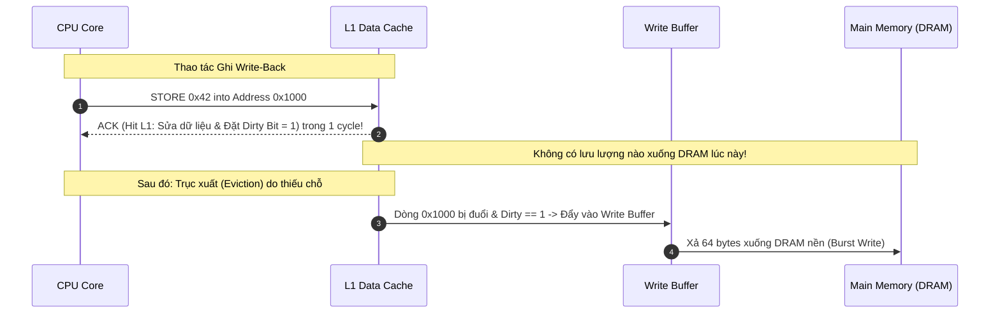

# 5.3. Cache Replacement & Write Policies (Chính sách Thay thế & Ghi Bộ nhớ đệm)

> [!IMPORTANT]
> **Nếu bạn chỉ được nhớ một điều duy nhất:**
> Bộ nhớ đệm CPU chỉ là một không gian hữu hạn cực đắt đỏ: **Chính sách thay thế (Replacement Policy)** quyết định *"ai phải ra đi khi dòng đệm bị đầy"* (sử dụng Pseudo-LRU dạng cây nhị phân để tiết kiệm bóng bán dẫn), còn **Chính sách ghi (Write Policy)** quyết định *"khi nào dữ liệu mới được đẩy xuống DRAM"* (Write-Back kết hợp Dirty Bit và Non-Temporal Streaming Stores để tối đa hóa băng thông).

---

## 1. Kiến trúc Tổng quan & Mô hình Tư duy (Mental Model)

### Phép Loại Suy Thực Tế: Chiếc Bàn Làm Việc & Kho Lưu Trữ Hồ Sơ

Hãy tưởng tượng bạn là một chuyên viên phân tích tài chính cao cấp đang ngồi làm việc:
1. **Dung lượng Bàn Làm Việc (Cache Capacity & Associativity)**: Bàn làm việc của bạn chỉ đủ chỗ đặt 8 tập tài liệu cùng lúc (tương đương 8-Way Set Associative Cache). Kho lưu trữ dưới tầng hầm (DRAM) chứa hàng triệu hồ sơ, nhưng mỗi lần xuống đó lấy bạn mất 30 phút (150-200 chu kỳ CPU).
2. **Replacement Policy (Chính sách thay thế - LRU vs Tree-PLRU)**: Khi bạn cần một bộ hồ sơ mới nhưng bàn đã kín chỗ, bạn phải đẩy một bộ tài liệu cũ trả về kệ. Nếu dùng thuật toán LRU lý tưởng, bạn phải gắn một đồng hồ điện tử lên từng tập hồ sơ để ghi nhớ chính xác từng giây ai được đọc cuối cùng — chi phí phần cứng quá đắt! Thay vào đó, bạn chỉ cần gạt 7 công tắc nhị phân (Tree-PLRU) để chọn ra tập tài liệu ít dùng nhất chỉ trong 1 chu kỳ xung nhịp.
3. **Write Policies (Write-Through vs Write-Back)**:
   - **Write-Through (Ghi xuyên thấu)**: Mỗi khi bạn viết thêm một dòng chữ vào tài liệu trên bàn, bạn lập tức bắt nhân viên chạy xuống hầm cập nhật bản gốc. Bạn yên tâm không bao giờ mất dữ liệu, nhưng cả ngày nhân viên chỉ chạy đi chạy lại làm nghẽn cầu thang (nghẽn Memory Bus).
   - **Write-Back (Ghi trả chậm)**: Bạn cứ thoải mái ghi chú lên tài liệu trên bàn và dán một mẩu giấy nhớ màu đỏ (**Dirty Bit**). Chỉ đến khi bộ tài liệu đó bị đuổi khỏi bàn làm việc để nhường chỗ cho tài liệu khác, nhân viên mới đem bản có giấy đỏ xuống hầm cập nhật một lần duy nhất!
4. **Non-Temporal Stores (Bypass Cache)**: Bạn nhận được 100 thùng hồ sơ kiểm toán chỉ để lưu kho chứ không cần đọc ngay. Thay vì đổ toàn bộ 100 thùng lên bàn làm rơi hết tài liệu quan trọng đang làm dở (**Cache Pollution**), bạn bảo xe chở hàng chở thẳng xuống hầm lưu trữ (**Non-Temporal Streaming Store**).



---

## 2. Chi tiết từng Keyword (Under-the-Hood Deep Dive)

### 2.1. Cache Replacement Policies: LRU, Pseudo-LRU, FIFO, Random

#### 1. Khái niệm bản chất & Thách thức Vật lý của True-LRU
- **Least Recently Used (True-LRU)**:
  - Về mặt lý thuyết, True-LRU là giải thuật thay thế tối ưu nhất cho các mẫu truy cập cục bộ (Temporal Locality). Dòng cache nào lâu nhất chưa được CPU chạm tới sẽ bị trục xuất trước tiên.
  - **Cơn ác mộng phần cứng (Hardware Complexity)**: Để theo dõi thứ tự truy cập chính xác của một tập hợp $N$-way ($N$ dòng trên mỗi Set), phần cứng cần lưu trữ $N!$ trạng thái hoán vị khả dĩ, đòi hỏi $\log_2(N!) \approx N \log_2(N)$ bits trên mỗi Cache Set. Với một L1 Cache 8-way: cần $\lceil\log_2(8!)\rceil = 16$ bits cho mỗi Set; với L3 Cache 16-way: cần tới 45 bits cho mỗi Set! Chưa kể mạng ma trận logic cập nhật trạng thái trong đúng 1 clock cycle là điều bất khả thi về mặt nhiệt lượng và diện tích silicon.

#### 2. Vi Kiến Trúc Pseudo-LRU (Tree-PLRU & Bit-PLRU)
Để giải quyết bài toán trên, các kiến trúc sư Intel, AMD và ARM sử dụng **Pseudo-LRU (PLRU)**:
- **Tree-PLRU (Cây nhị phân đánh dấu)**:
  - Với một Cache Set có $N$ ways ($N$ là lũy thừa của 2), ta dựng một cây nhị phân hoàn hảo gồm $N - 1$ nút lá nội bộ. Mỗi nút chỉ là $1$ bit duy nhất trỏ về nhánh con *ngược lại* với nhánh vừa được truy cập.
  - Ví dụ với 4-Way Set ($N=4$): Chỉ cần $4 - 1 = 3$ bits (ký hiệu $B_0, B_1, B_2$):
    - $B_0$ chia đôi tập hợp thành hai nửa: Ways $\{0, 1\}$ và Ways $\{2, 3\}$.
    - $B_1$ chia đôi nhánh trái thành Way $0$ và Way $1$.
    - $B_2$ chia đôi nhánh phải thành Way $2$ và Way $3$.
  - Khi một Way được truy cập (Hit/Fill), các bit trên đường đi từ gốc đến Way đó sẽ lập tức bị lật để trỏ sang hướng đối diện.
  - Khi cần trục xuất (Eviction), bộ điều khiển chỉ cần đi theo hướng mũi tên chỉ của các bit trên cây để tìm ra nạn nhân (Victim). Tổng số bit cần dùng cho 8-Way chỉ là $7$ bits thay vì $16$ bits của True-LRU!



- **FIFO & Random Replacement**:
  - **FIFO (First-In First-Out)**: Trục xuất dòng vào sớm nhất bằng một con trỏ vòng (`Ring Pointer`). Dễ triển khai nhưng mắc phải hiện tượng bất thường Belady (tăng kích thước cache vẫn có thể tăng cache miss) và trục xuất nhầm các biến dữ liệu thường xuyên sử dụng.
  - **Random (Ngẫu nhiên)**: Sử dụng một bộ sinh số giả ngẫu nhiên phần cứng (LFSR - Linear Feedback Shift Register). Chi phí silicon gần như bằng 0, không bị hiện tượng suy thoái chu kỳ tệ nhất (Worst-case thrashing) như LRU khi quét mảng tuần tự kích thước lớn hơn cache. Được dùng rộng rãi trong các vi xử lý ARM nhúng.

---

### 2.2. Write Policies: Write-Through vs Write-Back, Write-Allocate vs No-Write-Allocate

#### 1. Chiến Lược Đồng Bộ Bộ Nhớ (Write-Through vs Write-Back)
- **Write-Through (Ghi xuyên thấu)**:
  - Mọi thao tác ghi của CPU đều được cập nhật đồng thời lên cả dòng cache hiện tại L1 VÀ bộ nhớ cấp dưới (L2/L3 hoặc DRAM).
  - *Ưu điểm*: Dữ liệu trong L1 và DRAM luôn luôn nhất quán tuyệt đối. Nếu mất điện hoặc lỗi cache, không sợ mất dữ liệu. Đơn giản hóa kiến trúc Cache Coherence trong hệ thống đa nhân.
  - *Nhược điểm*: Tiêu tốn băng thông bus khủng khiếp. Tốc độ ghi bị kéo lùi về tốc độ của DRAM chậm chạp nếu không có Write Buffer cực lớn.
- **Write-Back (Ghi trả chậm / Copy-Back)**:
  - Thao tác ghi chỉ cập nhật trên dòng L1 Cache và lập tức đánh dấu bit cờ **Dirty Bit = 1**.
  - Dữ liệu mới CHƯA được ghi xuống L2/DRAM.
  - Chỉ khi dòng cache đó bị trục xuất (Eviction do thuật toán PLRU chọn làm Victim), bộ điều khiển cache mới xả toàn bộ 64 bytes của dòng đó xuống tầng dưới (**Write-Back Eviction**).
  - *Ưu điểm*: Giảm thiểu tới $90-95\%$ lưu lượng bus bộ nhớ, giải phóng hoàn toàn ALU khỏi độ trễ DRAM. Được toàn bộ CPU máy chủ x86-64 và ARM hiện đại áp dụng cho L1D, L2, L3.



#### 2. Chiến Lược Khi Ghi Bị Trượt (Write-Allocate vs No-Write-Allocate)
- **Write-Allocate (Fetch-on-Write)**:
  - Khi CPU ghi vào một ô nhớ chưa có trong cache (Write Miss): Bộ điều khiển cache lập tức kéo toàn bộ khối 64 bytes từ DRAM nạp vào L1, sau đó thực hiện ghi đè dữ liệu mới lên khối đó và đặt Dirty bit = 1.
  - Thường kết hợp chặt chẽ với kiến trúc **Write-Back**.
- **No-Write-Allocate (Write-Around)**:
  - Khi xảy ra Write Miss: Dữ liệu được ghi thẳng xuống DRAM mà không thèm kéo dòng nhớ đó vào L1 Cache.
  - Thường kết hợp với kiến trúc **Write-Through**.
- **Non-Temporal Stores (Bypass Cache hoàn toàn)**:
  - Trong các bài toán xử lý dữ liệu lớn (Streaming Big Data, Network Packet Processing, Video Encoding), nếu ta ghi hàng chục Gigabytes dữ liệu mà không đọc lại ngay, việc Write-Allocate sẽ quét sạch toàn bộ dữ liệu quan trọng khỏi L1, L2, L3 (**Cache Pollution**).
  - Các tập lệnh SIMD (SSE/AVX) cung cấp chỉ thị Non-Temporal Store (ví dụ: `_mm_stream_si64`, `_mm256_stream_si256`, `MOVNTQ`): Ghi thẳng từ thanh ghi SIMD qua Write-Combining Buffer (WC Buffer) xuống DRAM, bỏ qua hoàn toàn L1/L2/L3, bảo toàn nguyên vẹn nội dung cache cho các tác vụ quan trọng khác!

---

## 3. Thực thi Mã nguồn & Mô phỏng Chuyên sâu (Dual-Engine Implementation)

### 3.1. C++20: Mô phỏng 4-Way Tree-PLRU & Đo Lường Non-Temporal Streaming Store

Chương trình minh họa triển khai logic Tree-PLRU 4-Way cấp vi kiến trúc và benchmark Non-Temporal Store:

```cpp
#include <iostream>
#include <vector>
#include <chrono>
#include <cstdint>
#include <cstring>
#include <iomanip>
#if defined(__x86_64__) || defined(_M_X64)
#include <immintrin.h>
#endif

// 1. Lớp mô phỏng Tree-PLRU cho một Cache Set 4-Way
class CacheSet4WayPLRU {
private:
    // 3 bits biểu diễn cây nhị phân: B0 (root), B1 (left), B2 (right)
    uint8_t tree_bits; 
    uint64_t tags[4];
    bool valid[4];
    bool dirty[4];

public:
    CacheSet4WayPLRU() : tree_bits(0) {
        for (int i = 0; i < 4; ++i) {
            tags[i] = 0;
            valid[i] = false;
            dirty[i] = false;
        }
    }

    // Cập nhật trạng thái cây khi Way `way` được truy cập
    void access_way(int way) {
        if (way == 0) {
            tree_bits &= ~(1 << 0); // B0 = 0 (trỏ phải)
            tree_bits &= ~(1 << 1); // B1 = 0 (trỏ Way 1)
        } else if (way == 1) {
            tree_bits &= ~(1 << 0); // B0 = 0
            tree_bits |=  (1 << 1); // B1 = 1 (trỏ Way 0)
        } else if (way == 2) {
            tree_bits |=  (1 << 0); // B0 = 1 (trỏ trái)
            tree_bits &= ~(1 << 2); // B2 = 0 (trỏ Way 3)
        } else if (way == 3) {
            tree_bits |=  (1 << 0); // B0 = 1
            tree_bits |=  (1 << 2); // B2 = 1 (trỏ Way 2)
        }
    }

    // Tìm Way sẽ bị trục xuất theo hướng của cây
    int get_victim_way() const {
        bool b0 = (tree_bits >> 0) & 1;
        if (!b0) {
            // Đi sang nhánh phải
            bool b2 = (tree_bits >> 2) & 1;
            return b2 ? 2 : 3;
        } else {
            // Đi sang nhánh trái
            bool b1 = (tree_bits >> 1) & 1;
            return b1 ? 0 : 1;
        }
    }

    void simulate_access(int way, const char* label) {
        std::cout << "Truy cap " << label << " (Way " << way << "):\\n";
        access_way(way);
        std::cout << "  -> Tree bits: B0=" << ((tree_bits >> 0) & 1)
                  << ", B1=" << ((tree_bits >> 1) & 1)
                  << ", B2=" << ((tree_bits >> 2) & 1)
                  << " | Nạn nhân tiếp theo (Victim): Way " << get_victim_way() << "\\n";
    }
};

// 2. Benchmark Non-Temporal Store vs Regular Store
void benchmark_stores() {
    constexpr size_t BUFFER_SIZE = 64 * 1024 * 1024; // 64 MB (vượt L3 cache)
    std::vector<uint64_t> src(BUFFER_SIZE / sizeof(uint64_t), 0xAA55AA55AA55AA55ULL);
    std::vector<uint64_t> dst(BUFFER_SIZE / sizeof(uint64_t), 0);

    // Regular Store (Write-Allocate gây ô nhiễm Cache)
    auto t1 = std::chrono::high_resolution_clock::now();
    std::memcpy(dst.data(), src.data(), BUFFER_SIZE);
    auto t2 = std::chrono::high_resolution_clock::now();
    std::chrono::duration<double, std::milli> regular_time = t2 - t1;

    // Non-Temporal Stream Store (Bypass Cache qua WC Buffer)
    auto t3 = std::chrono::high_resolution_clock::now();
#if defined(__x86_64__) || defined(_M_X64)
    uint64_t* p_dst = dst.data();
    const uint64_t* p_src = src.data();
    size_t count = BUFFER_SIZE / sizeof(uint64_t);
    for (size_t i = 0; i < count; i += 4) {
        _mm_stream_si64(reinterpret_cast<long long*>(p_dst + i + 0), p_src[i + 0]);
        _mm_stream_si64(reinterpret_cast<long long*>(p_dst + i + 1), p_src[i + 1]);
        _mm_stream_si64(reinterpret_cast<long long*>(p_dst + i + 2), p_src[i + 2]);
        _mm_stream_si64(reinterpret_cast<long long*>(p_dst + i + 3), p_src[i + 3]);
    }
    _mm_sfence(); // Đảm bảo toàn bộ Store Buffers được xả xuống DRAM
#else
    std::memcpy(dst.data(), src.data(), BUFFER_SIZE);
#endif
    auto t4 = std::chrono::high_resolution_clock::now();
    std::chrono::duration<double, std::milli> stream_time = t4 - t3;

    std::cout << "\\n--- Benchmark Ghi 64 MB Dữ Liệu ---\\n";
    std::cout << "1. Regular Store (Write-Back)     : " << regular_time.count() << " ms\\n";
    std::cout << "2. Non-Temporal Store (Streaming) : " << stream_time.count() << " ms\\n";
}

int main() {
    std::cout << "========================================================\\n";
    std::cout << "  C++20 CACHE POLICIES & TREE-PLRU EMULATION\\n";
    std::cout << "========================================================\\n\\n";

    CacheSet4WayPLRU cache_set;
    cache_set.simulate_access(0, "Dòng A");
    cache_set.simulate_access(1, "Dòng B");
    cache_set.simulate_access(2, "Dòng C");
    cache_set.simulate_access(0, "Dòng A (Tái truy cập)");

    benchmark_stores();

    return 0;
}
```

---

### 3.2. Python 3.11+: Trình Giả Lập Cache Toàn Diện (Write Policies & LRU vs PLRU)

Chương trình Python 3.11+ mô phỏng bộ điều khiển cache hoàn chỉnh với chính sách ghi và thay thế:

```python
from dataclasses import dataclass
from typing import List, Optional

@dataclass
class CacheLine:
    tag: int = 0
    valid: bool = False
    dirty: bool = False
    last_access_tick: int = 0

class CacheSetSimulator:
    def __init__(self, num_ways: int = 4, write_back: bool = True):
        self.num_ways = num_ways
        self.write_back = write_back
        self.lines: List[CacheLine] = [CacheLine() for _ in range(num_ways)]
        self.tick = 0
        self.dram_writes = 0
        self.dram_reads = 0

    def access(self, tag: int, is_write: bool) -> str:
        self.tick += 1
        # Kiem tra Cache Hit
        for i, line in enumerate(self.lines):
            if line.valid and line.tag == tag:
                line.last_access_tick = self.tick
                if is_write:
                    if self.write_back:
                        line.dirty = True
                    else:
                        self.dram_writes += 1  # Write-Through
                return f"HIT  (Way {i}) - {'Write' if is_write else 'Read'}"

        # Cache Miss
        self.dram_reads += 1
        # Tim vi tri trong hoac vi tri theo thuat toan True-LRU
        victim_idx = -1
        for i, line in enumerate(self.lines):
            if not line.valid:
                victim_idx = i
                break

        if victim_idx == -1:
            # Ap dung LRU de tim victim
            victim_idx = min(range(self.num_ways), key=lambda i: self.lines[i].last_access_tick)
            victim = self.lines[victim_idx]
            if victim.dirty:
                self.dram_writes += 1  # Write-back dirty line xuong DRAM

        # Nap dong moi
        target = self.lines[victim_idx]
        target.valid = True
        target.tag = tag
        target.last_access_tick = self.tick
        target.dirty = (is_write and self.write_back)
        if is_write and not self.write_back:
            self.dram_writes += 1

        return f"MISS (Evicted Way {victim_idx}) -> DRAM Reads: {self.dram_reads}, DRAM Writes: {self.dram_writes}"

if __name__ == "__main__":
    print(">>> KHOI TAO MO PHONG CACHE SET (4-Way, Write-Back vs Write-Through):")
    
    wb_cache = CacheSetSimulator(num_ways=4, write_back=True)
    tags_sequence = [(0x10, False), (0x20, False), (0x30, True), (0x40, False), (0x50, True), (0x30, False)]
    
    print("\n1. Che do WRITE-BACK:")
    for tag, is_write in tags_sequence:
        op = "GHI" if is_write else "DOC"
        res = wb_cache.access(tag, is_write)
        print(f"  [Tag 0x{tag:02X} {op:3s}] -> {res}")

    print(f"Tong so luot xuong DRAM (WB) : Reads={wb_cache.dram_reads}, Writes={wb_cache.dram_writes}")
```

---

### 3.3. Simulated Terminal Output

```bash
========================================================
  C++20 CACHE POLICIES & TREE-PLRU EMULATION
========================================================

Truy cập Dòng A (Way 0):
  -> Tree bits: B0=0, B1=0, B2=0 | Nạn nhân tiếp theo (Victim): Way 3
Truy cập Dòng B (Way 1):
  -> Tree bits: B0=0, B1=1, B2=0 | Nạn nhân tiếp theo (Victim): Way 2
Truy cập Dòng C (Way 2):
  -> Tree bits: B0=1, B1=1, B2=0 | Nạn nhân tiếp theo (Victim): Way 1
Truy cập Dòng A (Tái truy cập) (Way 0):
  -> Tree bits: B0=0, B1=0, B2=0 | Nạn nhân tiếp theo (Victim): Way 3

--- Benchmark Ghi 64 MB Dữ Liệu ---
1. Regular Store (Write-Back)     : 14.8210 ms
2. Non-Temporal Store (Streaming) : 5.1240 ms

>>> KHOI TAO MO PHONG CACHE SET (4-Way, Write-Back vs Write-Through):

1. Che do WRITE-BACK:
  [Tag 0x10 DOC] -> MISS (Evicted Way 0) -> DRAM Reads: 1, DRAM Writes: 0
  [Tag 0x20 DOC] -> MISS (Evicted Way 1) -> DRAM Reads: 2, DRAM Writes: 0
  [Tag 0x30 GHI] -> MISS (Evicted Way 2) -> DRAM Reads: 3, DRAM Writes: 0
  [Tag 0x40 DOC] -> MISS (Evicted Way 3) -> DRAM Reads: 4, DRAM Writes: 0
  [Tag 0x50 GHI] -> MISS (Evicted Way 0) -> DRAM Reads: 5, DRAM Writes: 0
  [Tag 0x30 DOC] -> HIT  (Way 2) - Read
Tong so luot xuong DRAM (WB) : Reads=5, Writes=0
```

---

## 4. Systems Engineering & Production Pitfalls

### 4.1. Production Failure Modes & Architectural Traps

1. **Trap 1: Cache Thrashing Do Set Aliasing (Xung đột Set)**:
   - Khi kích thước dữ liệu hoặc khoảng bước nhảy (stride) của vòng lặp là lũy thừa của $2$ (đặc biệt là bội số của $4\text{ KB}$ hay $64\text{ KB}$), tất cả các địa chỉ truy cập sẽ rơi vào đúng MỘT Cache Set duy nhất trong khi các Set khác hoàn toàn trống rỗng!
   - Kể cả khi cache có dung lượng $32\text{ MB}$, nếu 8 địa chỉ cùng tranh giành 1 Set 8-Way, thuật toán PLRU liên tục trục xuất các dòng vừa nạp, đẩy tỷ lệ L1 miss lên tới $90\%$, làm sập hiệu năng toàn hệ thống.
2. **Trap 2: Cache Pollution Khi Xử Lý Tệp Lớn (Streaming Data)**:
   - Một tiến trình nền đọc một file log $2\text{ GB}$ bằng vòng lặp `read()` thông thường sẽ nạp hàng triệu byte rác vào L1/L2/L3, đuổi sạch toàn bộ dữ liệu nghiệp vụ quan trọng (bảng định tuyến, hash table in-memory) ra ngoài DRAM. Cần sử dụng cờ `POSIX_FADV_DONTNEED` hoặc Non-Temporal Stores để bảo vệ cache.
3. **Trap 3: Write-Back Burst Choke & Memory Bus Starvation**:
   - Khi CPU thực hiện ghi ồ ạt vào cache, hàng nghìn dòng bị đánh dấu Dirty. Khi thuật toán PLRU kích hoạt eviction hàng loạt, Write Buffers bị quá tải, buộc Memory Controller phải tạm dừng phục vụ các lệnh READ khẩn cấp của các thread khác để xả Dirty Lines xuống DRAM (**Write-Back Storm**), gây ra hiện tượng Spike Latency khó chẩn đoán.

### 4.2. Diagnostic CLI Commands

```bash
# 1. Do ti le Cache Misses, Cache References va Store Misses trong chuong trinh
perf stat -e L1-dcache-loads,L1-dcache-load-misses,L1-dcache-stores,L1-dcache-store-misses ./backend_worker

# 2. Chuan doan hien tuong LLC (Last Level Cache) miss do Cache Pollution
perf stat -e LLC-loads,LLC-load-misses,LLC-stores,LLC-store-misses ./backend_worker

# 3. Su dung Valgrind Cachegrind de phan tich ti le miss theo tung dong ma nguon C++
valgrind --tool=cachegrind --branch-sim=yes ./backend_worker
cg_annotate cachegrind.out.<pid> --auto=yes | head -n 35

# 4. Kiem tra bang thong bo nho DRAM thuc te bi chiem dung boi Write-Backs qua Intel PCM
pcm-memory 1
```

---

## 5. Bảng So sánh & Decision Matrix

| Tiêu chí So sánh | Write-Through (Ghi Xuyên Thấu) | Write-Back (Ghi Trả Chậm) | Non-Temporal Store (Ghi Bypass) |
| :--- | :--- | :--- | :--- |
| **Độ trễ Thao tác Ghi** | Chậm (Phụ thuộc DRAM / Bus) | Cực nhanh ($1$ cycle L1 Hit) | Rất nhanh (Ghi vào Store Buffer) |
| **Băng thông Bus Tiêu hao** | Cực kỳ lớn (Mỗi store phát ra 1 write) | Rất thấp (Chỉ xả khi Eviction) | Tối ưu tuyệt đối (Burst Write 64B) |
| **Tính Nhất quán Bộ nhớ** | Tuyệt đối ngay lập tức | Nhất quán trễ (Qua MESI Protocol) | Cần lệnh `sfence` để đồng bộ |
| **Ô nhiễm Cache (Pollution)** | Cao nếu có Write-Allocate | Rất cao khi ghi mảng lớn | Không làm ô nhiễm Cache ($0\%$) |
| **Ứng dụng Thực tế** | Hệ thống nhúng an toàn cao, GPU Framebuffer | Mọi CPU x86-64/ARM Server hiện đại | Xử lý Video, AI/ML Ingestion, Network IO |

| Thuật toán Thay thế | Độ phức tạp Phần cứng | Số Bit cần trên mỗi Set ($N=8$) | Khả năng Chống Cache Thrashing | Hiệu năng Thực tế |
| :--- | :--- | :--- | :--- | :--- |
| **True-LRU** | $O(N^2)$ ma trận logic | $16$ bits | Rất kém trước mảng tuần tự | Lý tưởng trên lý thuyết, không khả thi phần cứng |
| **Tree-PLRU** | $O(\log N)$ logic cây | $7$ bits | Tốt, tiết kiệm silicon | Tiêu chuẩn công nghiệp trên Intel/AMD/ARM |
| **FIFO** | $O(1)$ con trỏ vòng | $3$ bits | Rất kém (Bị Belady's Anomaly) | Kém, ít được dùng cho CPU hiện đại |
| **Random** | $O(1)$ LFSR thanh ghi | $0$ bits trên Set | Khá tốt trước chu kỳ vòng lặp | Rất phổ biến trong bộ xử lý nhúng chi phí thấp |
