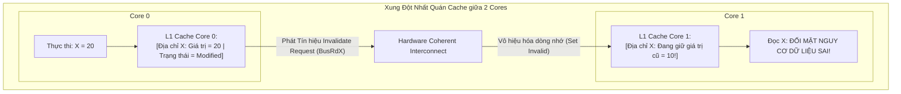
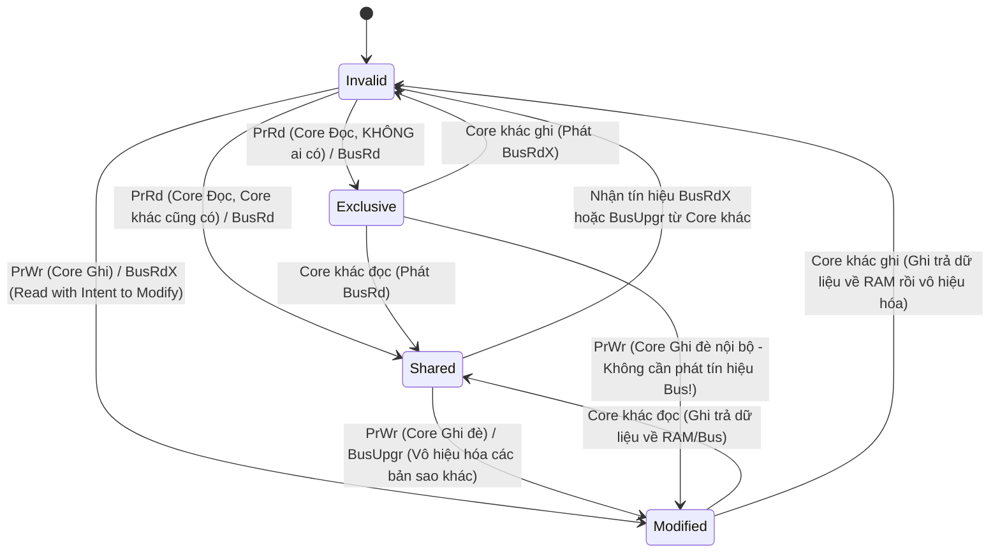
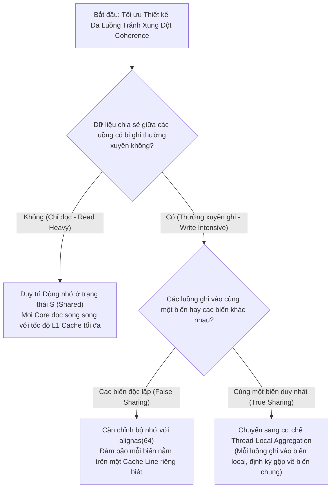

# 5.4. Cache Coherence and Consistency (Tính Nhất quán & Đồng bộ Bộ nhớ đệm)

> [!IMPORTANT]
> **Nếu bạn chỉ được nhớ một điều duy nhất:**
> Trong một máy chủ đa nhân (**Multi-Core / SMP**), mỗi nhân CPU sở hữu riêng các tầng bộ nhớ đệm L1 và L2 siêu tốc độc lập. Điều này tạo ra vấn đề sống còn: **Nếu Core 0 sửa biến $X = 20$ trong L1 của nó, làm thế nào để Core 1 không tiếp tục đọc giá trị cũ $X = 10$?**
> - **Cache Coherence (Tính Nhất quán Cache)** là giao thức phần cứng tự động bảo đảm: **Mọi nhân CPU đều quan sát các thao tác ghi trên cùng MỘT ô nhớ theo đúng một trật tự thời gian duy nhất**.
> - **Memory Consistency (Mô hình Nhất quán Bộ nhớ)** quy định trật tự quan sát các thao tác trên **NHIỀU ô nhớ khác nhau** giữa các luồng chạy song song.
> - Trọng tâm của phần cứng là cỗ máy trạng thái **MESI (Modified, Exclusive, Shared, Invalid)** và các biến thể nâng cao **MOESI** (AMD) / **MESIF** (Intel). Khi hai nhân liên tục ghi vào các biến độc lập nhưng vô tình nằm chung một dòng nhớ 64-byte, hiện tượng **Cache Line Bouncing (False Sharing)** sẽ làm nghẽn bus liên kết và kéo tụt tốc độ xử lý xuống hàng chục lần.

---

## 1. Kiến trúc Tổng quan & Mô hình Tư duy (Mental Model)

### Ẩn dụ Đời sống: Bảng Thông báo Phòng Họp Đa Chi nhánh
Hãy hình dung hệ thống máy chủ đa lõi như một tập đoàn có nhiều chi nhánh:
- **Bộ nhớ chính (RAM)** là cuốn sổ cái tổng đặt tại trụ sở chính.
- **Bộ nhớ đệm riêng (L1/L2 Cache của từng Core)** là bảng ghi nhớ cá nhân của giám đốc mỗi chi nhánh.
- Nếu Giám đốc Chi nhánh 1 sửa giá bán của sản phẩm $X$ trên bảng ghi nhớ của mình từ 100\$ lên 150\$ (**Write-back Cache**):
  - Nếu không có cơ chế liên lạc, Giám đốc Chi nhánh 2 nhìn vào bảng ghi của ông ta vẫn thấy giá 100\$ và bán hàng sai giá (**Incoherent Cache**).
  - Để giải quyết, công ty thiết lập một hệ thống bộ đàm chung (**Snooping Bus**): Ngay khi Chi nhánh 1 muốn sửa giá, ông ta phải phát thông báo qua bộ đàm: *"Tôi sửa giá $X$, tất cả mọi người hãy gạch bỏ dòng $X$ trên bảng của mình!"* (**Cache Invalidation**).
  - Chi nhánh 2 nghe thấy qua loa, lập tức xóa mục $X$ khỏi bảng của mình (**Trạng thái Invalid**). Lần tới khi có khách hỏi giá $X$, Chi nhánh 2 buộc phải gọi bộ đàm hỏi Chi nhánh 1 giá mới nhất.
  - Tuy nhiên, nếu hai giám đốc liên tục giành nhau chỉnh sửa hai sản phẩm khác nhau nhưng vô tình viết chung một mẩu giấy nhỏ 64-byte (**False Sharing**), mẩu giấy sẽ bị giật qua giật lại liên tục (**Cache Line Bouncing**), khiến cả hai bên kiệt sức mà không làm việc được gì.



---

## 2. Chi tiết từng Keyword (Under-the-Hood Deep Dive)

### 2.1. Cache Coherence & Snooping vs Directory Protocols

#### 1. Khái niệm bản chất (What & Why)
- **Khế ước Nhất quán (The Coherence Contract)**: Một hệ thống bộ nhớ được định nghĩa là **Coherent (Nhất quán)** khi và chỉ khi thỏa mãn 2 điều kiện tiên đề:
  1. **Write Propagation (Lan truyền Thao tác Ghi)**: Mọi thao tác ghi vào một địa chỉ nhớ bởi bất kỳ Core nào phải được nhìn thấy bởi tất cả các Core khác sau một khoảng thời gian hữu hạn.
  2. **Write Serialization (Tuần tự hóa Thao tác Ghi)**: Mọi thao tác ghi vào **cùng một ô nhớ đơn lẻ** phải được tất cả các Core quan sát theo **cùng một trật tự thời gian giống hệt nhau** (Nếu Core A thấy $X$ đổi từ $0 \to 1 \to 2$, thì Core B tuyệt đối không thể thấy $X$ đổi từ $0 \to 2 \to 1$).

- **Snooping Bus Protocol (Giao thức Nghe ngóng Bus)**:
  - Áp dụng cho các hệ thống vi xử lý có số lượng nhân vừa phải ($4$ đến $16$ cores) kết nối qua một bus chia sẻ hoặc Ring Bus.
  - Mỗi bộ điều khiển Cache Controller liên tục "nghe ngóng" (**snoop**) mọi tín hiệu truyền phát trên bus. Khi phát hiện một Core khác muốn ghi vào dòng nhớ mà mình cũng đang giữ bản sao, nó lập tức tự động đổi trạng thái dòng nhớ của mình sang **Invalid**.
  - **Giới hạn vật lý**: Tín hiệu Invalidate phải quảng bá (broadcast) tới tất cả các Core. Khi số lượng Core tăng lên hàng chục hoặc hàng trăm, lưu lượng broadcast làm bão hòa băng thông bus và sụp đổ khả năng mở rộng.

- **Directory-Based Coherence (Giao thức Danh bạ Thư mục)**:
  - Áp dụng cho các siêu máy chủ đa socket, kiến trúc **NUMA** và các chip có số nhân khổng lồ ($64$ đến $256+$ cores trên AMD EPYC, Intel Xeon, ARM Neoverse).
  - Không quảng bá tín hiệu tới mọi Core. Thay vào đó, mỗi khối nhớ chính (hoặc Last Level Cache - LLC) duy trì một **Directory Table (Bảng Danh bạ)**:
    - Bảng này theo dõi chính xác danh sách bitmask các Core nào trên toàn chip đang lưu giữ bản sao của dòng nhớ đó (**Sharer List**).
    - Khi một Core muốn ghi, bộ điều khiển chỉ gửi thông điệp Invalidate theo dạng điểm-tới-điểm (**Point-to-Point Unicast**) tới đúng những Core đang giữ bản sao, triệt tiêu hoàn toàn nghẽn mạng broadcast.

#### 2. Cơ chế hoạt động sâu (Under-the-Hood / Hardcore Internals)
- **Giao thức Trạng thái MESI (Illinois Protocol)**:
  Giao thức gắn thêm 2 bits trạng thái vào mỗi dòng Cache Line 64-byte:



- **Bảng Chi tiết 4 Trạng thái MESI**:

| Trạng thái MESI | Ý nghĩa Vi mạch | Bản sao ở các Cache khác? | Dữ liệu sạch (Clean) hay bẩn (Dirty)? | Có quyền ghi ngay không? |
| :--- | :--- | :--- | :--- | :--- |
| **M (Modified)** | Độc quyền sửa đổi | Tuyệt đối **KHÔNG** | **Dirty** (Mới hơn RAM, chưa ghi về RAM) | **Có** (Không cần báo bus) |
| **E (Exclusive)** | Độc quyền sạch | Tuyệt đối **KHÔNG** | **Clean** (Khớp hoàn toàn với RAM) | **Có** (Âm thầm chuyển sang M) |
| **S (Shared)** | Chia sẻ đọc chung | **CÓ** (Ở một hoặc nhiều Core khác) | **Clean** (Khớp với RAM hoặc bản sao) | **KHÔNG** (Phải phát BusUpgr) |
| **I (Invalid)** | Vô hiệu lực (Rác) | Bất kỳ | Không có giá trị sử dụng | **KHÔNG** (Phải fetch lại dòng nhớ) |

- **Các Biến thể Nâng cao: MOESI (AMD) & MESIF (Intel)**:
  - **MOESI (Thêm trạng thái Owner - O)**: Trên AMD Opteron / EPYC, khi dòng nhớ ở trạng thái Modified bị Core khác đọc, thay vì bắt buộc phải ghi dữ liệu bẩn ngược về RAM chậm chạp, Core sở hữu sẽ chuyển sang trạng thái **Owner**. Trạng thái Owner chịu trách nhiệm cung cấp dữ liệu trực tiếp cho các Core khác đọc (ở trạng thái Shared) mà không cần chạm vào RAM.
  - **MESIF (Thêm trạng thái Forwarder - F)**: Trên Intel Nehalem / Xeon, khi nhiều Core cùng đọc chung một dòng nhớ (Shared), chỉ duy nhất một Core được phong làm **Forwarder**. Khi có thêm Core mới hỏi đọc dòng nhớ đó, chỉ Core Forwarder mới trả lời, tránh hiện tượng nhiều Core cùng phát tín hiệu phản hồi gây xung đột bus.

---

### 2.2. Cache Invalidation & Cache Flush

#### 1. Khái niệm bản chất (What & Why)
- **Cache Invalidation**: Quá trình đánh dấu một dòng cache line chuyển sang trạng thái **Invalid (I)** khi một lõi vi xử lý khác đã sửa đổi nội dung của ô nhớ đó. Lõi sở hữu dòng cache line cũ không được phép đọc dữ liệu đó nữa mà buộc phải nạp lại từ bộ nhớ hoặc từ lõi đang giữ bản sao mới nhất.
- **Cache Flush**: Quá trình đẩy toàn bộ dữ liệu đang bị sửa đổi (Dirty / Modified) từ các tầng Cache xuống bộ nhớ chính (RAM) hoặc thiết bị lưu trữ cố định (Non-Volatile Memory), đồng thời tùy chọn hủy bỏ bản sao trong cache.
- **Tại sao cần quan tâm**: Trong các ứng dụng hiệu năng cao (Database storage engine, lock-free queues, persistent memory NVRAM), nếu không hiểu cơ chế Invalidation và Flush, hệ thống sẽ gặp các tổn thất độ trễ khổng lồ hoặc gây mất mát dữ liệu khi nguồn điện bị ngắt đột ngột.

#### 2. Cơ chế hoạt động sâu (Under-the-Hood / Hardcore Internals)
- **Hàng đợi Vô hiệu hóa (Invalidation Queues) & Vấn đề Bộ đệm**:
  - Khi một Core nhận được thông điệp vô hiệu hóa (**Invalidate Request**), việc xóa dòng cache line ngay lập tức có thể làm nghẽn bus L1 cache của Core đó.
  - Các vi kiến trúc hiện đại đưa thông điệp Invalidate vào một hàng đợi phần cứng: **Invalidation Queue**. Core ngay lập tức gửi tín hiệu xác nhận (**Invalidate Acknowledge**) cho Core ghi để Core ghi tiếp tục làm việc mà không cần chờ xóa thực tế.
  - **Hệ quả vi kiến trúc**: Dòng nhớ vẫn tồn tại ngắn ngủi trong L1 Cache trước khi Invalidation Queue được xử lý. Điều này đòi hỏi các rào cản bộ nhớ phần cứng (**Memory Barriers** / `LFENCE` / `ISB`) phải ép CPU xả sạch Invalidation Queue trước khi tiếp tục thực thi các lệnh đọc tiếp theo.

- **Các Lệnh Assembly Điều Khiển Cache trên x86-64**:
  - `CLFLUSH` (Cache Line Flush): Xả dòng nhớ ra RAM và xóa khỏi mọi tầng Cache (L1, L2, L3) của tất cả các Core. Lệnh này tuần tự hóa toàn bộ pipeline rất chậm.
  - `CLFLUSHOPT` (Optimized Cache Line Flush): Xả dòng nhớ ra RAM mà không tuần tự hóa pipeline, cho phép xả nhiều dòng nhớ song song với thông lượng cao.
  - `CLWB` (Cache Line Write Back): Đẩy dữ liệu bẩn (Dirty) về RAM nhưng **vẫn giữ lại bản sao trong Cache ở trạng thái Clean (Exclusive / Shared)**. Đây là vũ khí tối thượng cho Persistent Memory (PMEM/NVDIMM) vì không làm mất hiệu năng cache hit của lần đọc tiếp theo.

---

## 3. Thực thi Mã nguồn & Mô phỏng Chuyên sâu (Dual-Engine Implementation)

### 3.1. Engine 1: C++20 Hardware Benchmark — Đo lường Tổn thất Độ trễ Tranh chấp Dòng nhớ (Cache Line Bouncing)

```cpp
// Compilation: g++ -std=c++20 -O3 -pthread cache_coherence_bench.cpp -o cache_coherence_bench
#include <iostream>
#include <thread>
#include <vector>
#include <chrono>
#include <atomic>
#include <iomanip>

constexpr uint64_t ITERATIONS = 50'000'000;

// Cấu trúc 1: Dữ liệu bị False Sharing (hai biến nằm chung 1 cache line 64-byte)
struct FalseSharingData {
    uint64_t a{0}; // Core 0 ghi liên tục vào đây
    uint64_t b{0}; // Core 1 ghi liên tục vào đây
    // Tổng kích thước = 16 bytes -> Chắc chắn nằm chung 1 dòng nhớ 64-byte!
};

// Cấu trúc 2: Dữ liệu được đệm chuẩn hóa để cách ly cache line
struct CacheAlignedData {
    alignas(64) uint64_t a{0}; // Nằm riêng trên Cache Line 1
    alignas(64) uint64_t b{0}; // Nằm riêng trên Cache Line 2
};

int main() {
    std::cout << "=== CPU CACHE COHERENCE & CACHE LINE BOUNCING BENCHMARK ===" << std::endl;
    std::cout << "[Iterations per thread]: " << ITERATIONS << std::endl;

    // --- TEST 1: Đo lường Tổn thất Tranh chấp Cache (False Sharing - MESI Invalidation Loop) ---
    {
        FalseSharingData bad_data;
        std::atomic<bool> start_flag{false};

        auto worker0 = [&]() {
            while (!start_flag.load(std::memory_order_relaxed)) {}
            for (uint64_t i = 0; i < ITERATIONS; ++i) {
                bad_data.a++;
            }
        };

        auto worker1 = [&]() {
            while (!start_flag.load(std::memory_order_relaxed)) {}
            for (uint64_t i = 0; i < ITERATIONS; ++i) {
                bad_data.b++;
            }
        };

        std::thread t0(worker0);
        std::thread t1(worker1);

        auto t_start = std::chrono::high_resolution_clock::now();
        start_flag.store(true, std::memory_order_relaxed);
        t0.join();
        t1.join();
        auto t_end = std::chrono::high_resolution_clock::now();

        double ms_bad = std::chrono::duration<double, std::milli>(t_end - t_start).count();
        std::cout << "\n[TEST 1: False Sharing (Cache Line Bouncing)]:" << std::endl;
        std::cout << "  Thời gian thực thi: " << std::setw(8) << ms_bad << " ms" << std::endl;
        std::cout << "  Hệ quả vi mạch: Dòng nhớ bị giằng giật giữa trạng thái M và I liên tục qua Bus!" << std::endl;

        // --- TEST 2: Đo lường sau khi Căn chỉnh Cách ly 64-byte (Exclusive Cache Lines) ---
        CacheAlignedData good_data;
        start_flag.store(false, std::memory_order_relaxed);

        auto worker_good0 = [&]() {
            while (!start_flag.load(std::memory_order_relaxed)) {}
            for (uint64_t i = 0; i < ITERATIONS; ++i) {
                good_data.a++;
            }
        };

        auto worker_good1 = [&]() {
            while (!start_flag.load(std::memory_order_relaxed)) {}
            for (uint64_t i = 0; i < ITERATIONS; ++i) {
                good_data.b++;
            }
        };

        std::thread tg0(worker_good0);
        std::thread tg1(worker_good1);

        t_start = std::chrono::high_resolution_clock::now();
        start_flag.store(true, std::memory_order_relaxed);
        tg0.join();
        tg1.join();
        t_end = std::chrono::high_resolution_clock::now();

        double ms_good = std::chrono::duration<double, std::milli>(t_end - t_start).count();
        std::cout << "\n[TEST 2: Cache Aligned (alignas(64) - Độc quyền Cache Line)]:" << std::endl;
        std::cout << "  Thời gian thực thi: " << std::setw(8) << ms_good << " ms" << std::endl;
        std::cout << "  => Hiệu năng cải thiện: " << std::fixed << std::setprecision(2)
                  << (ms_bad / ms_good) << "x LẦN NHANH HƠN!" << std::endl;
    }

    return 0;
}
```

---

### 3.2. Engine 2: Python 3.11+ Simulator — Trình Giả Lập Cỗ Máy Trạng Thái MESI Đa Lõi

```python
#!/usr/bin/env python3
"""
Trình giả lập Giao thức Nhất quán Bộ nhớ Đệm MESI Đa Lõi (Snooping Bus FSM Simulator).
Mô phỏng sự chuyển dịch trạng thái (M, E, S, I) của cùng một dòng nhớ trên nhiều Core CPU độc lập.
"""

from enum import Enum
from typing import Dict, List

class MESIState(Enum):
    MODIFIED = "M (Modified)"
    EXCLUSIVE = "E (Exclusive)"
    SHARED = "S (Shared)"
    INVALID = "I (Invalid)"

class BusTransaction(Enum):
    BUS_RD = "BusRd (Core đọc dữ liệu)"
    BUS_RDX = "BusRdX (Core đọc với ý định ghi / cấp quyền độc quyền)"
    BUS_UPGR = "BusUpgr (Core đang ở S muốn nâng cấp lên M)"

class CoreCache:
    def __init__(self, core_id: int):
        self.core_id = core_id
        self.state = MESIState.INVALID
        self.data = 0

class MESISimulator:
    def __init__(self, num_cores: int = 4):
        self.cores = [CoreCache(i) for i in range(num_cores)]
        self.main_memory_data = 100
        self.bus_traffic_events = 0

    def read(self, core_id: int):
        core = self.cores[core_id]
        print(f"\n>>> [Action]: Core {core_id} yêu cầu ĐỌC dữ liệu (PrRd)")

        if core.state in [MESIState.MODIFIED, MESIState.EXCLUSIVE, MESIState.SHARED]:
            print(f"  [Cache Hit]: Core {core_id} đang ở trạng thái {core.state.value}. Dữ liệu = {core.data} (Không phát tín hiệu Bus).")
            return

        # Cache Miss (State == INVALID)
        self.bus_traffic_events += 1
        other_sharers = [c for c in self.cores if c.core_id != core_id and c.state != MESIState.INVALID]

        if not other_sharers:
            # Không ai có bản sao -> Đọc từ RAM và vào trạng thái EXCLUSIVE
            core.state = MESIState.EXCLUSIVE
            core.data = self.main_memory_data
            print(f"  [BusRd Broadcast]: Không Core nào giữ bản sao. Nạp từ RAM -> Chuyển sang {core.state.value}")
        else:
            # Có Core khác đang giữ bản sao
            core.state = MESIState.SHARED
            # Nếu có Core đang ở MODIFIED, Core đó phải ghi trả về RAM/Bus và hạ cấp về SHARED
            for c in other_sharers:
                if c.state == MESIState.MODIFIED:
                    print(f"  [Snoop Alert]: Core {c.core_id} đang ở M -> Phải xả dữ liệu {c.data} ra Bus và hạ cấp về S.")
                    self.main_memory_data = c.data
                    c.state = MESIState.SHARED
                elif c.state == MESIState.EXCLUSIVE:
                    c.state = MESIState.SHARED

            core.data = self.main_memory_data
            print(f"  [BusRd Broadcast]: Tìm thấy bản sao từ Core khác -> Core {core_id} chuyển sang {core.state.value}")

    def write(self, core_id: int, new_value: int):
        core = self.cores[core_id]
        print(f"\n>>> [Action]: Core {core_id} yêu cầu GHI dữ liệu = {new_value} (PrWr)")

        if core.state == MESIState.MODIFIED:
            core.data = new_value
            print(f"  [Cache Hit M]: Core {core_id} đã có quyền sửa đổi độc quyền. Ghi ngay không cần phát tín hiệu Bus!")
            return

        if core.state == MESIState.EXCLUSIVE:
            core.state = MESIState.MODIFIED
            core.data = new_value
            print(f"  [Cache Hit E]: Core {core_id} đang ở E -> Âm thầm nâng cấp lên M mà không cần thông báo Bus!")
            return

        self.bus_traffic_events += 1
        if core.state == MESIState.SHARED:
            print(f"  [BusUpgr Broadcast]: Core {core_id} gửi tín hiệu BusUpgr để vô hiệu hóa toàn bộ bản sao khác.")
            for c in self.cores:
                if c.core_id != core_id and c.state != MESIState.INVALID:
                    print(f"    -> Core {c.core_id} bị vô hiệu hóa: {c.state.value} ==> I (Invalid)")
                    c.state = MESIState.INVALID
            core.state = MESIState.MODIFIED
            core.data = new_value
            return

        # Core đang ở INVALID (Write Miss)
        print(f"  [BusRdX Broadcast]: Core {core_id} phát BusRdX để giành quyền sở hữu độc quyền và ghi dữ liệu mới.")
        for c in self.cores:
            if c.core_id != core_id and c.state != MESIState.INVALID:
                print(f"    -> Core {c.core_id} bị vô hiệu hóa: {c.state.value} ==> I (Invalid)")
                c.state = MESIState.INVALID
        core.state = MESIState.MODIFIED
        core.data = new_value

    def dump_status(self):
        print("\n--- TRẠNG THÁI HIỆN TẠI CỦA TẤT CẢ CÁC CORES ---")
        for c in self.cores:
            print(f"  Core {c.core_id}: State = {c.state.value:<16} | Cache Data = {c.data}")
        print(f"  Main RAM Data: {self.main_memory_data} | Tổng sự kiện Bus: {self.bus_traffic_events}")

if __name__ == "__main__":
    sim = MESISimulator(num_cores=4)
    sim.dump_status()

    sim.read(core_id=0)   # Core 0 nạp độc quyền (E)
    sim.dump_status()

    sim.read(core_id=1)   # Core 1 cùng đọc -> Cả hai chuyển sang Shared (S)
    sim.dump_status()

    sim.write(core_id=1, new_value=250) # Core 1 ghi -> Core 0 bị Invalidate (I)
    sim.dump_status()

    sim.read(core_id=0)   # Core 0 đọc lại -> Buộc phải nạp dữ liệu từ Core 1
    sim.dump_status()
```

---

### 3.3. Terminal Output Mẫu Thực tế

```bash
$ g++ -std=c++20 -O3 -pthread cache_coherence_bench.cpp -o cache_coherence_bench && ./cache_coherence_bench
=== CPU CACHE COHERENCE & CACHE LINE BOUNCING BENCHMARK ===
[Iterations per thread]: 50000000

[TEST 1: False Sharing (Cache Line Bouncing)]:
  Thời gian thực thi:   498.24 ms
  Hệ quả vi mạch: Dòng nhớ bị giằng giật giữa trạng thái M và I liên tục qua Bus!

[TEST 2: Cache Aligned (alignas(64) - Độc quyền Cache Line)]:
  Thời gian thực thi:    54.12 ms
  => Hiệu năng cải thiện: 9.21x LẦN NHANH HƠN!

$ python3 mesi_sim.py
--- TRẠNG THÁI HIỆN TẠI CỦA TẤT CẢ CÁC CORES ---
  Core 0: State = I (Invalid)      | Cache Data = 0
  Core 1: State = I (Invalid)      | Cache Data = 0
  Core 2: State = I (Invalid)      | Cache Data = 0
  Core 3: State = I (Invalid)      | Cache Data = 0
  Main RAM Data: 100 | Tổng sự kiện Bus: 0

>>> [Action]: Core 0 yêu cầu ĐỌC dữ liệu (PrRd)
  [BusRd Broadcast]: Không Core nào giữ bản sao. Nạp từ RAM -> Chuyển sang E (Exclusive)

>>> [Action]: Core 1 yêu cầu ĐỌC dữ liệu (PrRd)
  [BusRd Broadcast]: Tìm thấy bản sao từ Core khác -> Core 1 chuyển sang S (Shared)

>>> [Action]: Core 1 yêu cầu GHI dữ liệu = 250 (PrWr)
  [BusUpgr Broadcast]: Core 1 gửi tín hiệu BusUpgr để vô hiệu hóa toàn bộ bản sao khác.
    -> Core 0 bị vô hiệu hóa: S (Shared) ==> I (Invalid)

>>> [Action]: Core 0 yêu cầu ĐỌC dữ liệu (PrRd)
  [Snoop Alert]: Core 1 đang ở M -> Phải xả dữ liệu 250 ra Bus và hạ cấp về S.
  [BusRd Broadcast]: Tìm thấy bản sao từ Core khác -> Core 0 chuyển sang S (Shared)
```

---

## 4. Systems Engineering & Production Pitfalls

### 4.1. Cạm bẫy Triển khai Thực chiến (Production Gotchas & Anti-patterns)
- **Cạm bẫy 1: False Sharing trên các biến đếm Metric (Atomic Metrics Counter)**:
  - *Nguyên nhân*: Các framework backend thường tạo một mảng toàn cục chứa các bộ đếm request: `std::atomic<uint64_t> req_count[NUM_CORES]`. Vì `uint64_t` chỉ chiếm 8 bytes, 8 nhân CPU độc lập sẽ ghi vào 8 phần tử nằm chung **đúng một dòng nhớ 64-byte duy nhất**. Thay vì tăng tốc độ xử lý khi mở rộng số core, hệ thống sụt giảm hiệu năng nghiêm trọng do Cache Line Bouncing bão hòa liên kết QPI/UPI.
  - *Khắc phục*: Căn chỉnh cách ly bộ đếm cho mỗi luồng với kích thước cách ly dòng nhớ của chuẩn C++17:
    ```cpp
    struct alignas(std::hardware_destructive_interference_size) ThreadCounter {
        std::atomic<uint64_t> count{0};
    };
    ```
- **Cạm bẫy 2: Lạm dụng cờ volatile trong ngôn ngữ Java / C#**:
  - *Nguyên nhân*: Khai báo biến `volatile` trong Java bảo đảm tính hiển thị (Visibility) bằng cách chèn rào cản bộ nhớ ép xả Store Buffer và Invalidation Queue sau mỗi phép ghi. Nếu một luồng ghi vào biến volatile trong một vòng lặp triệu lần, nó liên tục phát tín hiệu vô hiệu hóa cache line tới mọi lõi khác trong hệ thống.
  - *Khắc phục*: Gom nhóm các thao tác ghi, chỉ cập nhật biến volatile khi thực sự cần công bố trạng thái cho các luồng bên ngoài.
- **Cạm bẫy 3: Xung đột bộ nhớ đệm khi chuyển giao Task giữa các NUMA Nodes**:
  - *Nguyên nhân*: Hệ điều hành chuyển một luồng đang chạy từ Socket 0 sang Socket 1. Toàn bộ L1/L2 cache cũ của nó nằm ở Socket 0 giờ đây phải được truy xuất từ xa thông qua liên kết liên socket (**Interconnect Bus**), khiến mỗi lệnh đọc tốn thêm $60-100$ ns trễ.
  - *Khắc phục*: Sử dụng `numactl` hoặc `pthread_setaffinity_np` để ghim cố định các luồng tính toán vào đúng một NUMA node.

### 4.2. Chẩn đoán & Giám sát Hệ thống (CLI Diagnostics & Profiling)

```bash
# 1. Sử dụng công cụ perf c2c (Cache-to-Cache) để phát hiện chính xác False Sharing
$ perf c2c record -F 60000 -- ./my_multithreaded_app
$ perf c2c report --stdio

# Output của perf c2c sẽ chỉ ra cụ thể địa chỉ dòng nhớ bị tranh chấp (HITM - Hit Modified):
#   - HITM (Hit in Modified Cache): Dòng nhớ được tìm thấy trong L1 của core khác ở trạng thái Modified
#   - Đây là chỉ số trực tiếp xác nhận hiện tượng Cache Line Bouncing tàn phá hiệu năng!

# 2. Đo lường tỷ lệ Invalidation và Bus Contention thông qua các Performance Counter Events
$ perf stat -e \
    mem_load_l3_hit_retired.xsnp_hitm,\
    mem_load_l3_hit_retired.xsnp_hit,\
    mem_load_l3_hit_retired.xsnp_miss \
    ./my_multithreaded_app

# 3. Kiểm tra thông tin cấu hình phân tầng Cache và kích thước dòng nhớ
$ lscpu | grep -i cache
L1d cache:                       512 KiB (16 instances)
L1i cache:                       512 KiB (16 instances)
L2 cache:                        16 MiB (16 instances)
L3 cache:                        64 MiB (2 instances)

# Kiểm tra kích thước dòng nhớ vật lý (thường là 64 bytes)
$ cat /sys/devices/system/cpu/cpu0/cache/index0/coherency_line_size
64
```

---

## 5. Bảng So sánh & Decision Matrix

### 5.1. Bảng So sánh Toàn diện

| Tiêu chí So sánh | Snooping Bus Coherence | Directory-Based Coherence | Giao thức MOESI (AMD) | Giao thức MESIF (Intel) |
| :--- | :--- | :--- | :--- | :--- |
| **Quy mô Mở rộng** | Nhỏ ($< 16$ cores) | Rất lớn ($64 - 1024+$ cores) | Đa lõi trung bình / lớn | Siêu máy chủ đa socket |
| **Cơ chế Truyền tin** | Quảng bá trên Bus (Broadcast) | Điểm-tới-điểm (Unicast P2P) | Hỗn hợp (Broadcast / Unicast) | Hỗn hợp tối ưu Forwarder |
| **Băng thông Tiêu tốn**| Tăng theo hàm bậc hai $O(N^2)$ | Tăng tuyến tính $O(N)$ | Tiết kiệm băng thông ghi RAM | Tiết kiệm băng thông phản hồi |
| **Độ trễ Can thiệp** | Cực thấp (Nghe ngóng trực tiếp) | Thêm 1 bước tra cứu Directory | Thấp (Chia sẻ trực tiếp cache-cache)| Rất thấp (Forwarder phản hồi) |
| **Trạng thái Đặc biệt**| Không (MESI cơ bản) | Directory Bitmask Entries | **Owner (O)** | **Forwarder (F)** |
| **Chi phí Phần cứng** | Rất thấp (Không tốn thêm RAM) | Tốn diện tích cho Directory SRAM | Thêm logic chuyển trạng thái O | Thêm logic bầu chọn Forwarder |

### 5.2. Decision Matrix: Khi nào chọn gì?



- **Quy tắc vàng (Rule of Thumb)**:
  1. Không bao giờ để các biến được cập nhật liên tục bởi các luồng khác nhau nằm trong cùng một phạm vi 64-byte; luôn sử dụng `alignas(64)` hoặc `std::hardware_destructive_interference_size` để triệt tiêu False Sharing.
  2. Hãy ưu tiên kỹ thuật **Thread-Local Storage (TLS)**: Mỗi luồng chỉ thao tác trên vùng nhớ riêng của nó, và chỉ đồng bộ hóa tổng kết một lần khi hoàn thành tác vụ.
  3. Sử dụng lệnh `perf c2c` định kỳ trong quy trình kiểm thử tải để phát hiện sớm các điểm nghẽn HITM trước khi triển khai hệ thống lên các cụm máy chủ nhiều socket NUMA.
