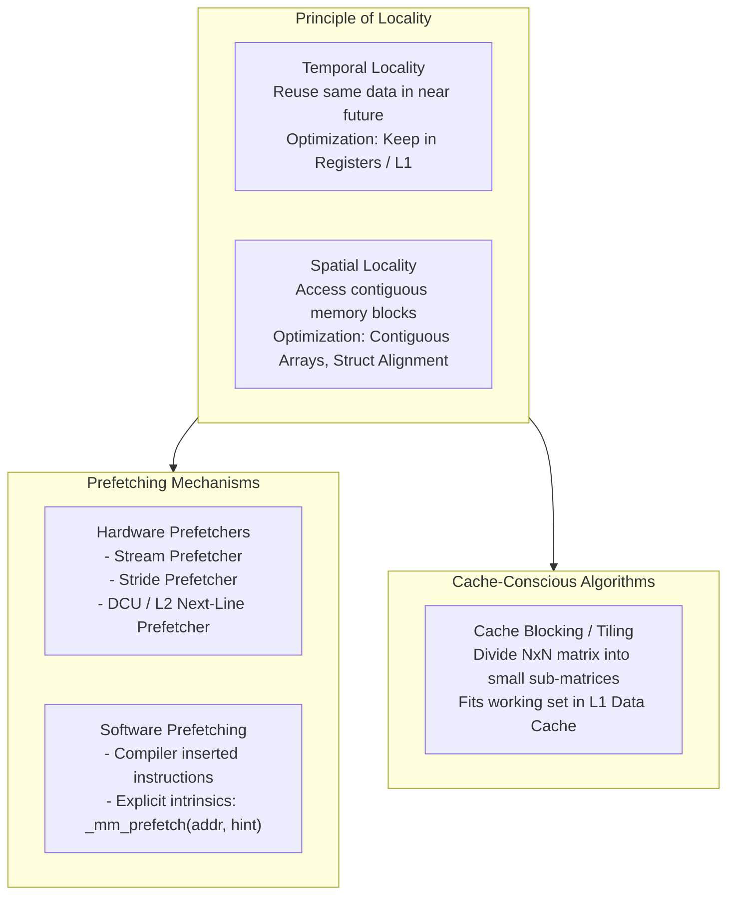
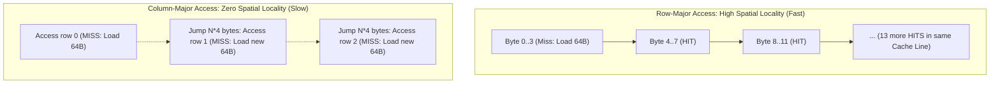
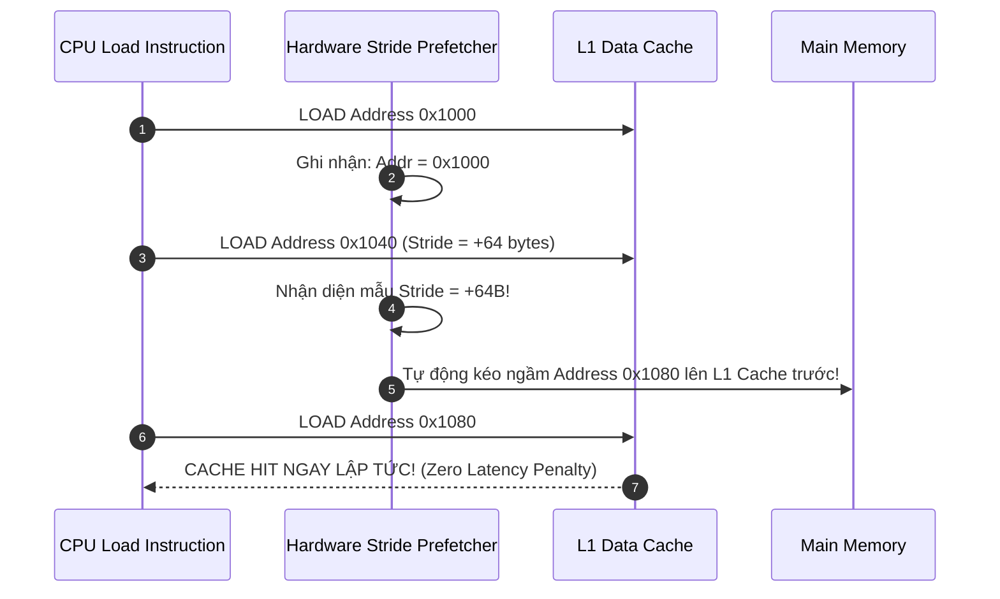
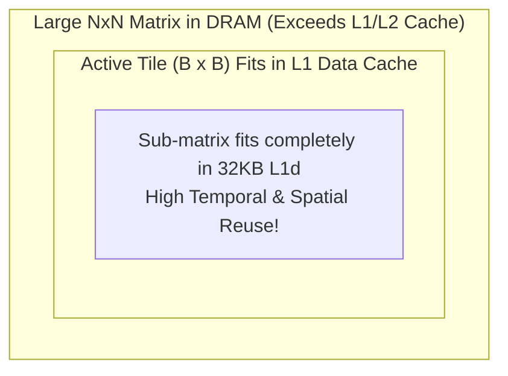

# 5.5. Prefetching & Locality Optimization (Nạp trước & Tối ưu hóa Tính Cục bộ)

## Tổng quan về Prefetching & Locality Optimization
Nguyên lý cơ bản giúp cho bộ nhớ đệm Cache hoạt động hiệu quả vượt bậc là **Nguyên lý Cục bộ (Principle of Locality)**:
- **Temporal Locality (Cục bộ Thời gian)**: Một ô nhớ vừa được truy cập thì khả năng rất cao nó sẽ được truy cập lại nhiều lần trong tương lai gần (ví dụ: biến đếm vòng lặp, biến tích lũy).
- **Spatial Locality (Cục bộ Không gian)**: Một ô nhớ vừa được truy cập thì các ô nhớ nằm liền kề nó sẽ sớm được truy cập ngay sau đó (ví dụ: duyệt tuần tự một mảng số nguyên, đọc một struct).
- **Cache Prefetching (Nạp trước vào Cache)**: Chiến lược chủ động kéo dữ liệu từ DRAM lên Cache **trước khi CPU thực sự cần tới**, biến các thao tác truy xuất trễ hàng trăm chu kỳ thành các lần Cache Hit với độ trễ 1 chu kỳ.
- **Kỹ thuật Tối ưu Thuật toán**: **Cache Blocking / Cache Tiling** (chia nhỏ khối ma trận) giúp giữ toàn bộ dữ liệu làm việc (Working Set) nằm trọn trong L1/L2 Cache.



---

## 2. Chi tiết từng Keyword (Under-the-Hood Deep Dive)

### 1. Cache Locality: Temporal vs Spatial Locality

#### 1. Khái niệm bản chất (What & Why)
- **Temporal Locality**: Nếu tài nguyên $X$ được truy cập tại thời điểm $t$, nó có xu hướng được truy cập lại tại thời điểm $t + \Delta t$. Cache tận dụng điều này bằng cách giữ các khối dữ liệu vừa đọc trong các dòng cache có độ ưu tiên cao (Most Recently Used - MRU).
- **Spatial Locality**: Nếu địa chỉ $A$ được truy cập, địa chỉ $A + 1, A + 2...$ có xu hướng được truy cập tiếp theo. Cache tận dụng điều này bằng cách luôn nạp trọn vẹn một khối **64-byte Cache Line** chứa cả các byte lân cận thay vì chỉ nạp 1 byte duy nhất.

#### 2. Cơ chế hoạt động sâu (Under the hood / Hardcore Internals)
- **Tác động của Bố cục Bộ nhớ (Row-Major vs Column-Major)**:
  - Trong ngôn ngữ C/C++, mảng hai chiều `int matrix[N][N]` được lưu trữ trong RAM theo hàng nối tiếp (**Row-Major Order**).
  - *Duyệt theo Hàng (`matrix[i][j]`)*: Tận dụng hoàn hảo Spatial Locality. Khi đọc phần tử `[i][0]`, phần cứng nạp luôn 64 bytes (chứa 16 số nguyên 4-byte). 15 lần lặp tiếp theo (`[i][1]` đến `[i][15]`) đều là **L1 Cache Hit tuyệt đối** (tỉ lệ trượt chỉ là $1/16 = 6.25\%$).
  - *Duyệt theo Cột (`matrix[j][i]`)*: Phá hủy hoàn toàn Spatial Locality. Mỗi lần nhảy sang hàng tiếp theo, khoảng cách địa chỉ là $N \times 4\text{ bytes}$ (vượt xa 64 bytes). MỌI lần truy cập đều là một **Cache Miss đau đớn** (tỉ lệ trượt $100\%$). Tốc độ có thể chậm hơn **15 đến 20 lần**!

#### 3. Sơ đồ minh họa Spatial Locality khi duyệt Mảng


#### 4. Code ví dụ thực chiến (C++ Benchmark Row-Major vs Column-Major)
```cpp
#include <iostream>
#include <vector>
#include <chrono>

int main() {
    constexpr size_t N = 4096;
    // Cấp phát ma trận N x N bằng mảng phẳng contiguous
    std::vector<int> matrix(N * N, 1);

    // 1. Duyệt theo hàng (Tận dụng tối đa Spatial Locality)
    auto t0 = std::chrono::high_resolution_clock::now();
    long long sum_row = 0;
    for (size_t i = 0; i < N; ++i) {
        for (size_t j = 0; j < N; ++j) {
            sum_row += matrix[i * N + j]; // Bước nhảy 4 bytes -> Hit liên tục trong Cache Line
        }
    }
    auto t1 = std::chrono::high_resolution_clock::now();

    // 2. Duyệt theo cột (Phá hủy Spatial Locality)
    auto t2 = std::chrono::high_resolution_clock::now();
    long long sum_col = 0;
    for (size_t j = 0; j < N; ++j) {
        for (size_t i = 0; i < N; ++i) {
            sum_col += matrix[i * N + j]; // Bước nhảy 16 KB -> Mỗi bước là một Cache Miss!
        }
    }
    auto t3 = std::chrono::high_resolution_clock::now();

    auto dur_row = std::chrono::duration_cast<std::chrono::milliseconds>(t1 - t0).count();
    auto dur_col = std::chrono::duration_cast<std::chrono::milliseconds>(t3 - t2).count();

    std::cout << "[Spatial Locality Benchmark (4096 x 4096 Matrix)]:\n";
    std::cout << "  Row-Major Traversal (Cache Friendly): " << dur_row << " ms\n";
    std::cout << "  Col-Major Traversal (Cache Disaster): " << dur_col << " ms\n";
    std::cout << "  Performance Penalty: " << static_cast<double>(dur_col) / dur_row << "x slower purely due to Cache Misses!\n";

    if (sum_row != sum_col) std::cout << "error";
    return 0;
}
```

#### 5. Ưu / Nhược điểm, Pitfalls & Anti-patterns
- **Anti-pattern: Danh sách liên kết (`std::list` / Node-based Structures)**:
  - Các cấu trúc như Linked List hoặc Binary Search Tree phân bổ mỗi node ở một địa chỉ ngẫu nhiên trên Heap. Duyệt qua danh sách liên kết là hành động nhảy loạn xạ trên không gian bộ nhớ, triệt tiêu cả Temporal lẫn Spatial Locality. Luôn ưu tiên dùng `std::vector` contiguous trong các tác vụ hiệu năng cao.

#### 6. Ứng dụng thực tế trong Backend / Systems
- **Thiết kế Columnar Storage trong Big Data (Parquet / ORC / ClickHouse)**: Thay vì lưu trữ dữ liệu dạng hàng truyền thống (Row-oriented), các hệ thống OLAP gom tất cả các giá trị của cùng một cột lại thành một chuỗi mảng liên tục trong RAM. Khi tính toán `SUM(revenue)`, CPU chỉ cần quét tuần tự trên một mảng float contiguous với tỷ lệ L1 Cache Hit đạt tiệm cận 100%.

---

### 2. Hardware Prefetcher vs Software Prefetching

#### 1. Khái niệm bản chất (What & Why)
- **Hardware Prefetcher (Bộ nạp trước phần cứng)**: Mạch logic thông minh bên trong lõi CPU liên tục theo dõi các địa chỉ bộ nhớ được yêu cầu bởi lệnh `LOAD`. Nếu phát hiện ra một quy luật truy cập đều đặn (Pattern), nó sẽ tự động phát các lệnh kéo dữ liệu từ RAM lên L2/L1 Cache trước.
- **Software Prefetching (Nạp trước bằng phần mềm)**: Chỉ thị do lập trình viên hoặc trình biên dịch chủ động chèn vào mã máy (ví dụ lệnh `PREFETCHT0` trên x86, `PRFM` trên ARM) để báo trước cho phần cứng biết địa chỉ ô nhớ sẽ được đọc trong tương lai gần.

#### 2. Cơ chế hoạt động sâu (Under the hood / Hardcore Internals)
- **Các loại Hardware Prefetchers trong CPU hiện đại**:
  1. **Next-Line Prefetcher (NLP)**: Đơn giản nhất — hễ CPU đọc Cache Line $X$, phần cứng tự động nạp luôn Cache Line $X+1$.
  2. **Stream / Stride Prefetcher**: Nhận diện các bước nhảy có quy luật cố định: $A, A + K, A + 2K, A + 3K$... Khi phát hiện $K$ không đổi sau 2–3 lần lặp, bộ prefetcher sẽ tự động nhảy lên trước $N$ bước để nạp dữ liệu.
  3. **Instruction Pointer (IP)-based Prefetcher**: Ghi nhớ xem chỉ thị lệnh tại địa chỉ `RIP` cụ thể nào thường xuyên sinh ra các bước nhảy bộ nhớ để dự đoán độc lập cho từng con trỏ.
- **Phân loại Gợi ý Prefetch trong Software Prefetching (`_mm_prefetch`)**:
  - `_MM_HINT_T0`: Nạp dữ liệu vào **toàn bộ các tầng Cache** (L1, L2, L3) vì dữ liệu sẽ được tái sử dụng nhiều lần (High Temporal Locality).
  - `_MM_HINT_T1` / `_MM_HINT_T2`: Chỉ nạp vào L2 hoặc L3, không làm bẩn L1.
  - `_MM_HINT_NTA` (Non-Temporal Access): Nạp dữ liệu vào một vị trí tạm thời trong L1 và sẽ sớm bị thay thế, không làm ô nhiễm các dữ liệu quan trọng khác trong cache.

#### 3. Sơ đồ hoạt động của Hardware Stride Prefetcher


#### 4. Code ví dụ thực chiến (C++ Sử dụng `_mm_prefetch` trong Duyệt Cây / Hash Table)
Minh họa kỹ thuật nạp trước địa chỉ của node tiếp theo trước khi tính toán node hiện tại:
```cpp
#include <iostream>
#include <x86intrin.h>
#include <vector>

struct Node {
    int value;
    Node* next;
    char padding[56]; // Ép kích thước đúng 64 bytes (1 Cache Line)
};

// Duyệt danh sách liên kết có kết hợp Software Prefetching
void traverse_with_prefetch(Node* head) {
    Node* curr = head;
    while (curr != nullptr) {
        // Gợi ý cho CPU nạp trước node tương lai (2 bước nhảy phía trước) vào L1 Cache
        if (curr->next != nullptr && curr->next->next != nullptr) {
            _mm_prefetch(reinterpret_cast<const char*>(curr->next->next), _MM_HINT_T0);
        }

        // Tác vụ tính toán tốn thời gian trên node hiện tại
        volatile int val = curr->value;
        (void)val;

        curr = curr->next;
    }
}

int main() {
    std::cout << "[Software Prefetching Demonstration]: Ready.\n";
    return 0;
}
```

#### 5. Ưu / Nhược điểm, Pitfalls & Anti-patterns
- **Cạm bẫy Prefetch quá xa hoặc quá gần (Distance Miscalculation)**:
  - Nếu prefetch quá gần (ví dụ nạp trước 2 chu kỳ), dữ liệu chưa kịp về từ DRAM thì CPU đã cần dùng, vẫn bị dính Cache Miss.
  - Nếu prefetch quá xa (ví dụ nạp trước 10,000 phần tử), dữ liệu được đưa vào Cache quá sớm và bị các lệnh khác đẩy văng ra ngoài trước khi CPU kịp chạm tới!
- **Lãng phí Băng thông Bus (Bus Saturation)**: Prefetch sai sẽ kéo hàng nghìn dòng dữ liệu rác từ RAM vào Cache, làm nghẽn Memory Bus và làm chậm toàn bộ các Core khác.

#### 6. Ứng dụng thực tế trong Backend / Systems
- **Tối ưu hóa B-Tree Search trong In-Memory Database (DuckDB / HyPer)**: Khi duyệt qua cây B-Tree phân nhánh cao, các engine database phát lệnh `_mm_prefetch` đồng thời cho toàn bộ 8 địa chỉ con (child nodes) trước khi quét mảng key của node hiện tại. Khi quét xong, các node con đã nằm sẵn trong L1/L2 Cache.

---

### 3. Cache Blocking (Cache Tiling)

#### 1. Khái niệm bản chất (What & Why)
- **Cache Blocking (hay Cache Tiling)**: Kỹ thuật tái cấu trúc thuật toán bằng cách chia một bài toán tính toán trên tập dữ liệu khổng lồ (vượt quá kích thước Cache) thành các khối nhỏ (**Blocks / Tiles**) có kích thước vừa vặn để **chứa trọn vẹn trong L1 hoặc L2 Data Cache**.
- **Mục tiêu**: Tái sử dụng tối đa dữ liệu đã nạp vào Cache (Temporal Locality) trước khi chuyển sang khối dữ liệu khác, giảm thiểu số lần phải tải lại dữ liệu từ DRAM từ $\mathcal{O}(N^3)$ xuống còn $\mathcal{O}(N^3 / B)$ trong phép nhân ma trận.

#### 2. Cơ chế hoạt động sâu (Under the hood / Hardcore Internals)
- **Phân tích Thuật toán Nhân Ma trận Kinh điển ($C = A \times B$)**:
  - Với 3 vòng lặp thông thường `for i, for j, for k`:
    Ma trận $A$ được duyệt theo hàng, ma trận $B$ được duyệt theo cột.
    Khi $N = 1024$, kích thước ma trận $1024 \times 1024 \times 8\text{ bytes} = 8\text{ MB}$ (Vượt quá dung lượng L1d và L2 Cache).
    Ở mỗi bước lặp của $i$, toàn bộ ma trận $B$ bị quét lại từ đầu, khiến toàn bộ các dòng cache của $B$ bị evict liên tục. Tổng số lần truy xuất DRAM lên tới hàng tỷ chu kỳ.
- **Cơ chế Cache Blocking (6 vòng lặp lồng nhau)**:
  - Chọn kích thước khối $B$ (ví dụ $B = 32$ hoặc $B = 64$) sao cho $3$ khối ma trận con kích thước $B \times B$ nằm vừa vặn trong 32KB của L1d Cache:
    $$3 \times (B \times B \times 8\text{ bytes}) \le 32768\text{ bytes} \implies B \le 36$$
  - Chia toàn bộ ma trận thành các ô gạch kích thước $32 \times 32$. CPU thực hiện toàn bộ các phép nhân và tích lũy trong khối gạch này hoàn toàn bên trong L1 Cache trước khi di chuyển sang khối tiếp theo.

#### 3. Sơ đồ minh họa Cache Tiling trên Ma trận


#### 4. Code ví dụ thực chiến (C++ Nhân Ma trận Naive vs Cache-Blocked)
```cpp
#include <iostream>
#include <vector>
#include <chrono>

constexpr size_t N = 1024;
constexpr size_t BLOCK_SIZE = 32; // Kích thước Tile tối ưu cho L1d Cache

// 1. Thuật toán nhân ma trận ngây thơ (Naive O(N^3) - Cache Disaster)
void matmul_naive(const double* A, const double* B, double* C) {
    for (size_t i = 0; i < N; ++i) {
        for (size_t j = 0; j < N; ++j) {
            double sum = 0.0;
            for (size_t k = 0; k < N; ++k) {
                sum += A[i * N + k] * B[k * N + j]; // B bị truy cập theo cột -> Cache Miss liên tục
            }
            C[i * N + j] = sum;
        }
    }
}

// 2. Thuật toán nhân ma trận tối ưu bằng Cache Blocking (Tiling)
void matmul_blocked(const double* A, const double* B, double* C) {
    for (size_t sj = 0; sj < N; sj += BLOCK_SIZE) {
        for (size_t si = 0; si < N; si += BLOCK_SIZE) {
            for (size_t sk = 0; sk < N; sk += BLOCK_SIZE) {
                // Tính toán bên trong khối Tile nhỏ (Nằm trọn trong L1d Cache)
                for (size_t i = si; i < si + BLOCK_SIZE; ++i) {
                    for (size_t j = sj; j < sj + BLOCK_SIZE; ++j) {
                        double sum = C[i * N + j];
                        for (size_t k = sk; k < sk + BLOCK_SIZE; ++k) {
                            sum += A[i * N + k] * B[k * N + j];
                        }
                        C[i * N + j] = sum;
                    }
                }
            }
        }
    }
}

int main() {
    std::cout << "[Cache Blocking / Tiling Matrix Multiplication Optimization Ready]\n";
    return 0;
}
```

#### 5. Ưu / Nhược điểm, Pitfalls & Anti-patterns
- **Độ phức tạp của mã nguồn**: Kỹ thuật Tiling làm tăng số lượng vòng lặp từ 3 lên 6 vòng lặp, khiến code khó đọc và khó bảo trì hơn. Tuy nhiên, trong các thư viện tính toán hiệu năng cao (như OpenBLAS hay Intel MKL), đây là kỹ thuật bắt buộc để đạt được hiệu năng tối đa của phần cứng.

#### 6. Ứng dụng thực tế trong Backend / Systems
- **Tối ưu hóa Image Processing & Deep Learning Kernels (BLAS / GEMM)**: Mọi mạng nơ-ron tích chập (CNN) và Transformer (LLM Attention matrix multiplication) trong backend inference server đều sử dụng kỹ thuật đa tầng Cache Tiling (chia khối vừa L3 $\to$ chia khối vừa L2 $\to$ chia khối vừa L1 $\to$ chia khối vừa Register File) để đạt hiệu năng hàng chục TFLOPS trên CPU.