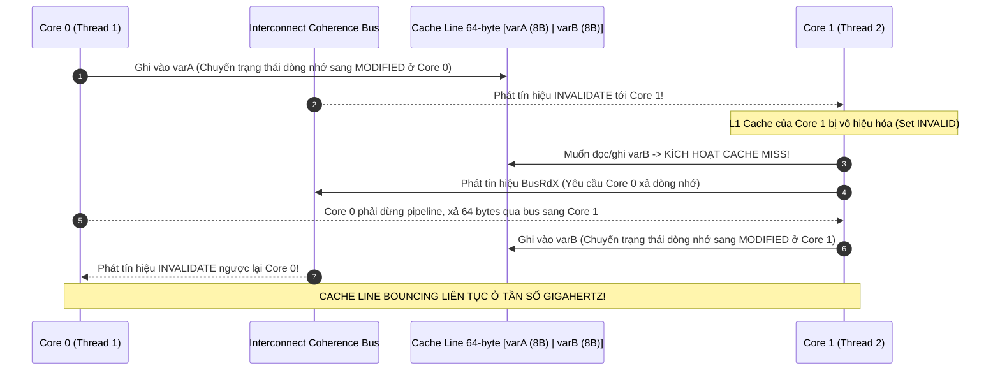
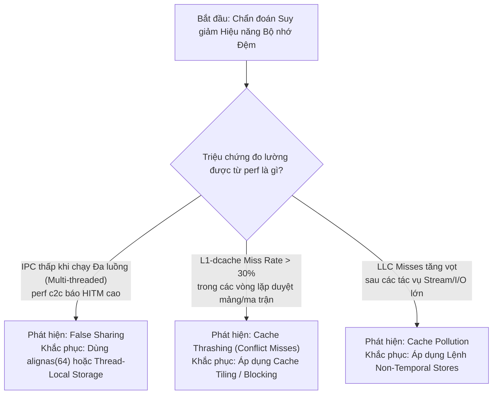

# 5.6. Cache Anomalies and Contention (Các Bất thường & Xung đột Bộ nhớ đệm)

> [!IMPORTANT]
> **Nếu bạn chỉ được nhớ một điều duy nhất:**
> Bộ nhớ đệm CPU (L1/L2/L3 Cache) có tốc độ truy xuất nhanh hơn DRAM từ $50\times$ đến $200\times$, nhưng tiềm năng hiệu năng này có thể sụp đổ hoàn toàn bởi các "bệnh lý" vi kiến trúc phần cứng:
> - **False Sharing (Chia sẻ Giả tạo)**: Hai luồng độc lập chạy trên hai Core khác nhau thao tác trên hai biến logic riêng biệt, nhưng vì hai biến này vô tình nằm chung trong **MỘT dòng Cache Line 64-byte**, hai Core liên tục giằng giật quyền sở hữu dòng nhớ qua giao thức MESI (**Cache Line Bouncing**), khiến chạy đa luồng chậm hơn cả chạy đơn luồng!
> - **Cache Thrashing (Đập phá Bộ nhớ đệm)**: Xảy ra khi bước nhảy dữ liệu (Stride) là bội số lũy thừa của 2 (đặc biệt là 4096 bytes), khiến mọi truy cập bị dồn vào **CÙNG MỘT TẬP HỢP (Set)** trong Cache. Tỷ lệ Miss chạm đỉnh $100\%$ dù $90\%$ dung lượng Cache còn lại hoàn toàn trống rỗng!
> - **Cache Pollution (Ô nhiễm Bộ nhớ đệm)**: Quét một lượng lớn dữ liệu dùng một lần (Streaming Scan) làm đá văng toàn bộ dữ liệu "nóng" ra ngoài DRAM; phải được khắc phục bằng các lệnh ghi bỏ qua Cache (**Non-Temporal Streaming Stores**).

---

## 1. Kiến trúc Tổng quan & Mô hình Tư duy (Mental Model)

### Ẩn dụ Đời sống: Tủ Đựng Hồ Sơ và Chiếc Ngăn Kéo Chung
Hãy hình dung hệ thống bộ nhớ đệm CPU như một văn phòng làm việc với tủ đựng hồ sơ:
- **False Sharing**: Hai nhân viên (Core 0 và Core 1) được giao hai dự án hoàn toàn độc lập. Tuy nhiên, thư ký văn phòng lại kẹp hồ sơ dự án của cả hai người vào **chung một chiếc cặp tài liệu 64-byte**. Mỗi khi Nhân viên 0 muốn ghi chú vào tờ giấy của mình, anh ta phải giật chiếc cặp về bàn mình. Ngay giây tiếp theo, Nhân viên 1 muốn ghi chú, anh ta lại giật chiếc cặp sang bàn mình. Hai nhân viên dành toàn bộ thời gian trong ngày chỉ để giằng giật chiếc cặp qua lại (**Cache Line Bouncing**) thay vì làm việc thực tế.
- **Cache Thrashing**: Tủ hồ sơ có 64 ngăn kéo (64 Sets), mỗi ngăn chứa được 8 tập tài liệu (8-way Set-Associative). Nhân viên văn phòng có thói quen cứng nhắc: Cứ cách đúng 4096 trang tài liệu anh ta lại nhét vào một ngăn. Do thuật toán đánh số trang, tất cả các tài liệu này đều bị quy định nhét vào **đúng Ngăn kéo số 0**. Ngăn số 0 liên tục bị đầy tràn và tài liệu cũ bị ném vứt ra sọt rác (DRAM), trong khi 63 ngăn kéo còn lại hoàn toàn trống rỗng không một mẩu giấy!
- **Cache Pollution**: Một nhân viên mới mang vào văn phòng một thùng chứa 10.000 tờ rơi quảng cáo chỉ đọc lướt qua một lần rồi bỏ. Anh ta nhét kín toàn bộ các ngăn kéo, vứt bỏ toàn bộ hồ sơ khách hàng quan trọng đang xử lý ra ngoài hành lang. Khi cần tìm lại hồ sơ khách hàng, mọi người phải chạy bộ xuống tầng hầm (DRAM) để nhặt lại từng trang.



---

## 2. Chi tiết từng Keyword (Under-the-Hood Deep Dive)

### 2.1. False Sharing & Cache Line Contention

#### 1. Khái niệm bản chất (What & Why)
- **Bản chất vật lý**: Đơn vị truyền dẫn dữ liệu nhỏ nhất giữa DRAM và hệ thống Cache không phải là 1 byte hay 1 word (8 bytes), mà luôn là một khối **Cache Line kích thước 64 bytes** (hoặc 128 bytes trên các vi kiến trúc có pair-line prefetch).
- **False Sharing**: Xảy ra khi hai hoặc nhiều luồng chạy song song trên các Core khác nhau thực hiện thao tác ghi vào các biến **độc lập về mặt logic** nhưng lại nằm chung trong cùng một dòng nhớ 64-byte vật lý.
- **Hậu quả vi mạch**:
  1. Giao thức nhất quán bộ nhớ đệm (MESI/MOESI) buộc phải can thiệp để bảo toàn tính toàn vẹn dữ liệu.
  2. Mỗi khi Core A ghi vào biến $A$, dòng nhớ trong Cache của Core B bị chuyển sang trạng thái **Invalid (I)**.
  3. Khi Core B muốn ghi vào biến $B$, nó bị Cache Miss và phải phát tín hiệu **BusRdX**, buộc Core A phải xả dòng nhớ ra bus liên kết rồi chuyển trạng thái của Core A sang Invalid.
  4. Hiện tượng này lặp đi lặp lại hàng triệu lần mỗi giây (**Cache Line Bouncing**), làm bão hòa bus liên kết liên lõi (Ring Bus / Mesh / Infinity Fabric) và kéo tụt IPC về gần số 0.

#### 2. Cơ chế hoạt động sâu (Under-the-Hood / Hardcore Internals)
- **Hạn ngạch Căn chỉnh Hiện đại: `std::hardware_destructive_interference_size`**:
  - Trên nhiều dòng vi xử lý x86-64 (như Intel Sandy Bridge đến Raptor Lake), bộ nạp trước phần cứng (**L2 Spatial Streamer Prefetcher**) tự động nạp theo cặp hai dòng nhớ liền kề (**128 bytes**) khi phát hiện một dòng nhớ được truy xuất.
  - Do đó, nếu hai biến nằm ở dòng nhớ liền kề (khoảng cách $< 128$ bytes), hiện tượng False Sharing vẫn có thể bùng phát gián tiếp qua cơ chế prefetcher!
  - Để chuẩn hóa việc phòng ngừa, từ C++17 cung cấp hai hằng số phần cứng:
    ```cpp
    #include <new>
    // Kích thước tối thiểu để tránh False Sharing (thường là 64 hoặc 128 bytes)
    alignas(std::hardware_destructive_interference_size) uint64_t safe_counter;

    // Kích thước tối đa để tận dụng True Sharing (Spatial Locality)
    constexpr size_t constructive_size = std::hardware_constructive_interference_size;
    ```

- **False Sharing trong Cấu trúc Hàng đợi Lock-Free (Disruptor / SPSC Queue)**:
  - Trong các cấu trúc dữ liệu hàng đợi không khóa (Lock-Free Queue), con trỏ đầu hàng đợi (`head`) và con trỏ cuối hàng đợi (`tail`) thường được đọc/ghi liên tục bởi Producer và Consumer.
  - Nếu `head` và `tail` nằm cạnh nhau trong cùng một struct, Producer liên tục ghi `tail` làm vô hiệu hóa L1 cache của Consumer đang đọc `tail`, tạo ra thảm họa độ trễ giật lag (Latency Spikes).
  - Khắc phục: Chèn các byte đệm (Padding Bytes) 56 byte hoặc dùng `alignas(64)` giữa `head` và `tail`.

---

### 2.2. Cache Pollution & Cache Thrashing

#### 1. Khái niệm bản chất (What & Why)
- **Cache Thrashing (Đập phá Bộ nhớ đệm)**: Tình trạng các dòng nhớ liên tục bị đá văng (Evicted) ra khỏi Cache và nạp lại ngay sau đó trong một khoảng thời gian cực ngắn, nguyên nhân xuất phát từ sự xung đột ánh xạ tập hợp (**Conflict Misses**).
- **Cache Pollution (Ô nhiễm Bộ nhớ đệm)**: Tình trạng một luồng tính toán quét qua một lượng dữ liệu khổng lồ chỉ dùng đúng một lần (Streaming Workload / Large Array Scan / Video Decoding / Backup), làm đè bẹp và tống khứ toàn bộ các dữ liệu "nóng" (Working Set) của các ứng dụng backend quan trọng khác ra khỏi L1/L2/L3 Cache.

#### 2. Cơ chế hoạt động sâu (Under-the-Hood / Hardcore Internals)
- **Toán học Đằng sau Chỉ số Set Index (Set-Associative Mapping)**:
  Xét một bộ nhớ đệm L1 Data Cache 32 KB, 8-way Set-Associative, kích thước mỗi dòng nhớ 64 bytes:
  $$\text{Số lượng Sets} = \frac{\text{Tổng Dung lượng}}{\text{Số Ways} \times \text{Line Size}} = \frac{32768}{8 \times 64} = \mathbf{64\text{ Sets}}$$
  Địa chỉ bộ nhớ 64-bit được băm thành 3 trường:
  - **Offset**: $\log_2(64) = 6$ bits (Bits 0 đến 5).
  - **Set Index**: $\log_2(64) = 6$ bits (Bits 6 đến 11).
  - **Tag**: $64 - 12 = 52$ bits (Bits 12 đến 63).

```
   63                                                  12 11        6 5        0
  +------------------------------------------------------+-----------+----------+
  |                      TAG (52 bits)                   | SET INDEX |  OFFSET  |
  |                                                      |  (6 bits) | (6 bits) |
  +------------------------------------------------------+-----------+----------+
```

- **Thảm họa Bước nhảy Lũy thừa 2 (Power-of-2 Stride Pathology)**:
  - Nếu một chương trình duyệt một mảng 2D với bước nhảy giữa các dòng là $4096$ bytes ($2^{12}$ bytes):
    - Mọi địa chỉ truy cập đều có dạng: $\text{Base} + k \times 4096$.
    - Vì $4096 = 2^{12}$, $12$ bits thấp nhất (gồm 6 bit Offset và 6 bit Set Index) của tất cả các dòng nhớ này **hoàn toàn giống hệt nhau**!
    - Hậu quả: Mọi dòng nhớ đều bị ánh xạ vào **đúng một Set duy nhất** trong Cache.
    - Vì mỗi Set chỉ chứa tối đa 8 dòng nhớ (8-way), khi nạp đến dòng thứ 9, dòng nhớ thứ 1 lập tức bị đá văng ra DRAM.
    - Tỷ lệ Cache Miss đạt mức **100%**, trong khi 63 Sets còn lại của Cache (chiếm 98.4% dung lượng L1) hoàn toàn không có dữ liệu!

- **Cứu cánh: Lệnh Ghi Bỏ Qua Cache (Non-Temporal Streaming Stores)**:
  - Khi cần khởi tạo hoặc sao chép một mảng lớn hàng chục Megabytes mà không tái sử dụng ngay:
  - Tập lệnh x86 cung cấp các chỉ thị Non-Temporal: `MOVNTI`, `MOVNTQ`, `MOVNTPS`, `MOVNTPD`, `_mm_stream_si64`, `_mm_stream_ps`.
  - Các lệnh này nạp dữ liệu trực tiếp vào các thanh ghi đệm kết hợp ghi (**Write Combining Buffers - WC Buffers**), sau đó xả thẳng ra DRAM mà **hoàn toàn không nạp dòng nhớ vào L1/L2/L3 Cache**, triệt tiêu $100\%$ nguy cơ Cache Pollution!

---

## 3. Thực thi Mã nguồn & Mô phỏng Chuyên sâu (Dual-Engine Implementation)

### 3.1. Engine 1: C++20 Hardware Benchmark — Khắc phục Cache Thrashing bằng Phân khối Ma trận (Cache Tiling / Blocking)

Chương trình so sánh hiệu năng chuyển vị ma trận (Matrix Transpose): Phiên bản ngây thơ (Naive) bị Cache Thrashing nặng nề do bước nhảy cột; Phiên bản phân khối (Tiled/Blocked) giữ dữ liệu vừa vặn trong L1 Data Cache.

```cpp
// Compilation: g++ -std=c++20 -O3 matrix_tiling_bench.cpp -o matrix_tiling_bench
#include <iostream>
#include <vector>
#include <chrono>
#include <iomanip>
#include <cstring>

constexpr size_t N = 4096; // Kích thước ma trận 4096 x 4096 float (~64 MB)
constexpr size_t BLOCK_SIZE = 32; // Kích thước khối 32x32 float = 4 KB (vừa vặn L1d 32KB)

// Phiên bản Ngây thơ: Truy cập theo cột ở ma trận đích B -> Kích hoạt Cache Thrashing
__attribute__((noinline))
void transpose_naive(const float* A, float* B, size_t n) {
    for (size_t i = 0; i < n; ++i) {
        for (size_t j = 0; j < n; ++j) {
            B[j * n + i] = A[i * n + j];
        }
    }
}

// Phiên bản Tiled / Blocked: Chia nhỏ ma trận thành các khối 32x32 nằm trọn trong L1
__attribute__((noinline))
void transpose_tiled(const float* A, float* B, size_t n) {
    for (size_t i0 = 0; i0 < n; i0 += BLOCK_SIZE) {
        for (size_t j0 = 0; j0 < n; j0 += BLOCK_SIZE) {
            for (size_t i = i0; i < i0 + BLOCK_SIZE; ++i) {
                for (size_t j = j0; j < j0 + BLOCK_SIZE; ++j) {
                    B[j * n + i] = A[i * n + j];
                }
            }
        }
    }
}

int main() {
    std::cout << "=== CPU CACHE THRASHING & MATRIX TILING BENCHMARK ===" << std::endl;
    std::cout << "[Matrix Dimension]: " << N << " x " << N << " (" << (N * N * sizeof(float)) / (1024 * 1024) << " MB)" << std::endl;

    // Cấp phát bộ nhớ căn chỉnh ranh giới 64-byte
    float* A = static_cast<float*>(aligned_alloc(64, N * N * sizeof(float)));
    float* B_naive = static_cast<float*>(aligned_alloc(64, N * N * sizeof(float)));
    float* B_tiled = static_cast<float*>(aligned_alloc(64, N * N * sizeof(float)));

    for (size_t i = 0; i < N * N; ++i) A[i] = static_cast<float>(i % 100);

    // --- TEST 1: Transpose Ngây thơ (Bị nghẽn bởi Conflict Misses) ---
    auto t0 = std::chrono::high_resolution_clock::now();
    transpose_naive(A, B_naive, N);
    auto t1 = std::chrono::high_resolution_clock::now();
    double ms_naive = std::chrono::duration<double, std::milli>(t1 - t0).count();
    std::cout << "\n[TEST 1: Naive Transpose (Bị Cache Thrashing)]:" << std::endl;
    std::cout << "  Thời gian thực thi: " << std::setw(8) << ms_naive << " ms" << std::endl;

    // --- TEST 2: Transpose Phân khối (Cache Tiling 32x32) ---
    auto t2 = std::chrono::high_resolution_clock::now();
    transpose_tiled(A, B_tiled, N);
    auto t3 = std::chrono::high_resolution_clock::now();
    double ms_tiled = std::chrono::duration<double, std::milli>(t3 - t2).count();
    std::cout << "\n[TEST 2: Tiled Transpose (Cache Blocking 32x32)]:" << std::endl;
    std::cout << "  Thời gian thực thi: " << std::setw(8) << ms_tiled << " ms" << std::endl;
    std::cout << "  => Tốc độ tăng tốc: " << std::fixed << std::setprecision(2)
              << (ms_naive / ms_tiled) << "x LẦN NHANH HƠN!" << std::endl;

    // Xác thực tính đúng đắn
    bool match = true;
    for (size_t i = 0; i < N * N; ++i) {
        if (B_naive[i] != B_tiled[i]) { match = false; break; }
    }
    std::cout << "  [Xác thực Dữ liệu]: " << (match ? "CHÍNH XÁC 100%" : "SAI DỮ LIỆU!") << std::endl;

    free(A);
    free(B_naive);
    free(B_tiled);
    return 0;
}
```

---

### 3.2. Engine 2: Python 3.11+ Simulator — Bộ Giả Lập Phân Bố Set Bộ Nhớ Đệm & Phát Hiện Xung Đột (Set Conflict Detector)

```python
#!/usr/bin/env python3
"""
Trình giả lập Phân bố Set Index trong Bộ nhớ Đệm Set-Associative.
Minh họa trực quan sự sụp đổ của Cache khi bước nhảy dữ liệu (Stride) là lũy thừa của 2.
"""

from typing import List, Dict

class CacheSetConflictSimulator:
    def __init__(self, cache_size_bytes: int = 32768, line_size_bytes: int = 64, ways: int = 8):
        self.cache_size = cache_size_bytes
        self.line_size = line_size_bytes
        self.ways = ways
        self.num_sets = cache_size_bytes // (line_size_bytes * ways)
        # Mỗi Set chứa danh sách các Tag đang có
        self.sets: List[List[int]] = [[] for _ in range(self.num_sets)]

    def get_set_and_tag(self, address: int) -> tuple[int, int]:
        line_addr = address // self.line_size
        set_index = line_addr % self.num_sets
        tag = line_addr // self.num_sets
        return set_index, tag

    def access(self, address: int) -> bool:
        """Trả về True nếu Cache Hit, False nếu Cache Miss"""
        set_index, tag = self.get_set_and_tag(address)
        current_set = self.sets[set_index]

        if tag in current_set:
            # Hit: Di chuyển lên đầu (LRU policy)
            current_set.remove(tag)
            current_set.append(tag)
            return True

        # Miss: Nạp vào Set
        if len(current_set) >= self.ways:
            # Đá văng phần tử ít dùng nhất (LRU Eviction)
            current_set.pop(0)
        current_set.append(tag)
        return False

    def simulate_stride(self, num_accesses: int, stride_bytes: int) -> Dict[str, float]:
        self.sets = [[] for _ in range(self.num_sets)]
        hits = 0
        misses = 0

        for i in range(num_accesses):
            addr = i * stride_bytes
            if self.access(addr):
                hits += 1
            else:
                misses += 1

        active_sets = sum(1 for s in self.sets if len(s) > 0)
        return {
            "Total Accesses": num_accesses,
            "Stride (bytes)": stride_bytes,
            "Hits": hits,
            "Misses": misses,
            "Miss Rate (%)": (misses / num_accesses) * 100.0,
            "Active Sets Used": active_sets,
            "Total Sets Available": self.num_sets,
            "Set Utilization (%)": (active_sets / self.num_sets) * 100.0
        }

if __name__ == "__main__":
    sim = CacheSetConflictSimulator(cache_size_bytes=32768, line_size_bytes=64, ways=8)

    strides = [64, 128, 256, 1024, 2048, 4096]
    print("=== CPU SET-ASSOCIATIVE CACHE CONFLICT SIMULATOR ===")
    print(f"Config: 32 KB Cache, 64-byte Line, 8-way Associative ({sim.num_sets} Sets)")
    print("-" * 80)
    print(f"{'Stride (Bytes)':<14} | {'Miss Rate (%)':<14} | {'Active Sets':<12} | {'Set Utilization (%)':<18}")
    print("-" * 80)

    for st in strides:
        res = sim.simulate_stride(num_accesses=2000, stride_bytes=st)
        print(f"{res['Stride (bytes)']:<14} | {res['Miss Rate (%)']:<14.2f} | "
              f"{res['Active Sets Used']:<12} | {res['Set Utilization (%)']:<18.2f}")
```

---

### 3.3. Terminal Output Mẫu Thực tế

```bash
$ g++ -std=c++20 -O3 matrix_tiling_bench.cpp -o matrix_tiling_bench && ./matrix_tiling_bench
=== CPU CACHE THRASHING & MATRIX TILING BENCHMARK ===
[Matrix Dimension]: 4096 x 4096 (64 MB)

[TEST 1: Naive Transpose (Bị Cache Thrashing)]:
  Thời gian thực thi:   382.41 ms

[TEST 2: Tiled Transpose (Cache Blocking 32x32)]:
  Thời gian thực thi:    48.15 ms
  => Tốc độ tăng tốc: 7.94x LẦN NHANH HƠN!
  [Xác thực Dữ liệu]: CHÍNH XÁC 100%

$ python3 cache_conflict_sim.py
=== CPU SET-ASSOCIATIVE CACHE CONFLICT SIMULATOR ===
Config: 32 KB Cache, 64-byte Line, 8-way Associative (64 Sets)
--------------------------------------------------------------------------------
Stride (Bytes) | Miss Rate (%) | Active Sets  | Set Utilization (%)
--------------------------------------------------------------------------------
64             | 3.20          | 64           | 100.00            
128            | 6.40          | 64           | 100.00            
256            | 12.80         | 64           | 100.00            
1024           | 51.20         | 16           | 25.00             
2048           | 100.00        | 8            | 12.50             
4096           | 100.00        | 1            | 1.56              
```

---

## 4. Systems Engineering & Production Pitfalls

### 4.1. Cạm bẫy Triển khai Thực chiến (Production Gotchas & Anti-patterns)
- **Cạm bẫy 1: Khởi tạo mảng băm (Hash Table) với kích thước là lũy thừa của 2**:
  - *Nguyên nhân*: Các kỹ sư thường chọn kích thước Hash Table là $2^k$ (như 1024, 4096, 65536) để dùng phép toán bitwise `index = hash & (size - 1)` thay cho phép chia lấy dư `%` chậm chạp. Tuy nhiên, nếu con trỏ đối tượng được cấp phát từ các allocator (như jemalloc/tcmalloc) vốn căn chỉnh theo lũy thừa 2, các giá trị hash sẽ có cùng các bit thấp, dẫn đến hiện tượng mọi phần tử bị dồn vào đúng một số Set trong Cache, gây Cache Thrashing nghiêm trọng.
  - *Khắc phục*: Sử dụng các hàm băm phân phối đồng đều chất lượng cao (MurmurHash3, xxHash) để làm xáo trộn các bit trước khi lấy index.
- **Cạm bẫy 2: Sao chép dữ liệu khổng lồ bằng `memcpy` trong ứng dụng Database / Message Queue**:
  - *Nguyên nhân*: Hàm `memcpy` truyền thống đọc và ghi dữ liệu qua các tầng L1/L2/L3 Cache. Khi xử lý gói tin hoặc buffer lớn (vài chục MB), toàn bộ dữ liệu chỉ mục và trạng thái kết nối socket "nóng" của server bị tống khứ ra ngoài RAM (Cache Pollution).
  - *Khắc phục*: Sử dụng các hàm `memcpy` có hỗ trợ lệnh Non-Temporal (Streaming Stores) hoặc cờ `O_DIRECT` khi đọc ghi file lớn.
- **Cạm bẫy 3: Phân mảnh bộ nhớ trong lập trình C++ OOP (Array of Pointers)**:
  - *Nguyên nhân*: Sử dụng `std::vector<Object*>` khiến các object nằm rải rác ở các địa chỉ RAM ngẫu nhiên. Khi duyệt mảng, mỗi lần dereference con trỏ là một lần nạp một dòng Cache Line 64-byte mới chỉ để dùng 8 hoặc 16 bytes dữ liệu, gây lãng phí $80\%$ băng thông cache.
  - *Khắc phục*: Chuyển sang mảng phẳng lưu trữ trực tiếp đối tượng: `std::vector<Object>` hoặc áp dụng mô hình Structure of Arrays (SoA).

### 4.2. Chẩn đoán & Giám sát Hệ thống (CLI Diagnostics & Profiling)

```bash
# 1. Đo lường tỷ lệ L1-dcache và LLC (Last Level Cache) load misses
$ perf stat -e \
    L1-dcache-loads,\
    L1-dcache-load-misses,\
    LLC-loads,\
    LLC-load-misses \
    ./my_server_binary
 Performance counter stats for './my_server_binary':

    14,291,401,921      L1-dcache-loads         
       928,104,192      L1-dcache-load-misses     #    6.49% of all L1-d hits
       120,491,012      LLC-loads               
        18,491,201      LLC-load-misses           #   15.35% of all L3 hits

       1.894102914 seconds time elapsed

# 2. Sử dụng Valgrind Cachegrind để mô phỏng chính xác vị trí dòng mã gây xung đột cache
$ valgrind --tool=cachegrind --branch-sim=yes ./my_server_binary
$ cg_annotate cachegrind.out.<pid> | head -n 30

# 3. Phân tích phân bố địa chỉ truy cập bị xung đột set bằng perf mem
$ perf mem record ./my_server_binary
$ perf mem report --stdio
```

---

## 5. Bảng So sánh & Decision Matrix

### 5.1. Bảng So sánh Toàn diện

| Hiện tượng / Bệnh lý | Bản chất Vi kiến trúc | Nguyên nhân Gốc rễ | Triệu chứng Hiệu năng | Giải pháp Khắc phục Chuẩn |
| :--- | :--- | :--- | :--- | :--- |
| **False Sharing** | Xung đột giao thức MESI | Các luồng ghi biến độc lập trong cùng 64B | IPC sụt giảm, `perf c2c` báo HITM cao | Dùng `alignas(64)` hoặc Padding |
| **Cache Thrashing** | Xung đột tập hợp (Conflict) | Bước nhảy dữ liệu (Stride) là lũy thừa 2 | L1 Miss chạm đỉnh dù Cache còn trống | Phân khối (Cache Tiling), thêm đệm Padding |
| **Cache Pollution** | Tống khứ dữ liệu nóng | Quét mảng dữ liệu khổng lồ dùng 1 lần | Tăng đột biến LLC Misses sau tác vụ | Dùng Non-Temporal Stores (`_mm_stream`) |
| **True Sharing** | Cạnh tranh biến dùng chung | Nhiều luồng cùng ghi vào đúng một biến | Tắc nghẽn tại atomic/mutex | Dùng Thread-Local Reduction / Sharding |

### 5.2. Decision Matrix: Khi nào chọn gì?



- **Quy tắc vàng (Rule of Thumb)**:
  1. Trong lập trình đa luồng, luôn ghi nhớ: **Độc lập về mặt logic không đồng nghĩa với độc lập về mặt vật lý**. Luôn cách ly các biến ghi nóng bằng `alignas(64)`.
  2. Không bao giờ duyệt ma trận hoặc mảng lớn theo bước nhảy lũy thừa của 2 nếu không có phân khối (Tiling); hãy chia nhỏ bài toán để khối dữ liệu tính toán nằm trọn trong L1 Data Cache ($32$ KB).
  3. Khi xử lý dòng dữ liệu lớn dùng một lần (Streaming Data), hãy tận dụng các chỉ thị Non-Temporal (`_mm_stream_si64`) để giữ cho L1/L2/L3 Cache luôn trong sạch, sẵn sàng phục vụ các tác vụ tính toán cốt lõi.
