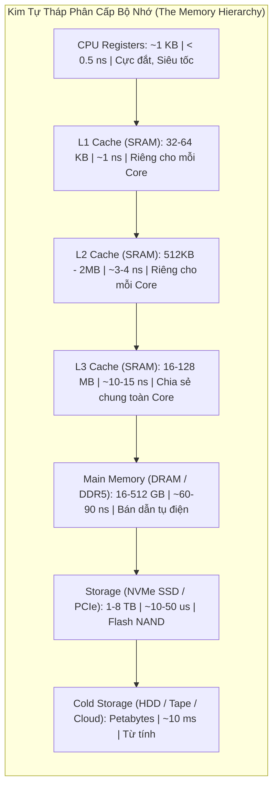
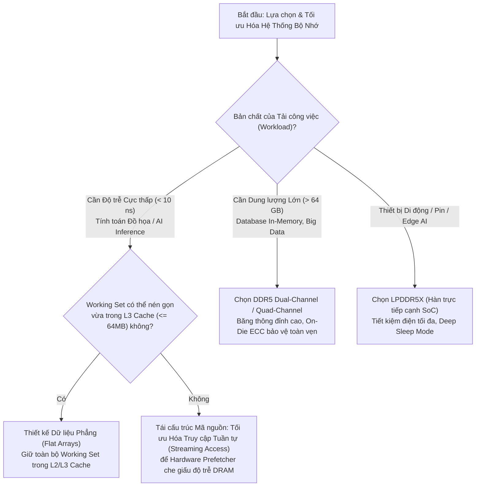

# 6.1. Memory Hierarchy and Technologies (Phân cấp Bộ nhớ & Công nghệ Bán dẫn)

> [!IMPORTANT]
> **Nếu bạn chỉ được nhớ một điều duy nhất:**
> Không có công nghệ bán dẫn nào trên thế giới vừa đạt dung lượng hàng trăm Gigabytes, vừa có độ trễ dưới 1 nano-giây, vừa có giá thành rẻ. Kiến trúc máy tính hiện đại là một chuỗi thỏa hiệp hình kim tự tháp:
> - **SRAM (Static RAM)**: Dùng làm L1/L2/L3 Cache, cấu tạo từ mạch lật 6 bóng bán dẫn ($6\text{T}$), tốc độ tia chớp ($0.5 - 15$ ns), không cần làm tươi dữ liệu nhưng tốn diện tích silicon khổng lồ và cực kỳ đắt đỏ.
> - **DRAM (Dynamic RAM)**: Dùng làm bộ nhớ chính (RAM), cấu tạo tối giản từ $1$ transistor và $1$ tụ điện ($1\text{T}1\text{C}$), mật độ lưu trữ cực cao và rẻ tiền, nhưng tụ điện bị rò rỉ điện tích liên tục, buộc bộ điều khiển phải tạm dừng truy cập để sạc lại (**DRAM Refresh Penalty**) và chịu độ trễ truy xuất lớn ($50 - 100$ ns - **The Memory Wall**).
> - **Tiến hóa DDR (DDR1 $\to$ DDR5)**: Tăng băng thông không phải bằng cách làm tụ điện DRAM nạp xả nhanh hơn (tần số lõi cell DRAM gần như giậm chân tại chỗ ở $200-400$ MHz trong 20 năm qua!), mà bằng cách tăng độ rộng nạp trước (**Prefetch Buffer**) từ $2n$ lên $16n$ và chia tách kênh truyền dữ liệu song song.

---

## 1. Kiến trúc Tổng quan & Mô hình Tư duy (Mental Model)

### Ẩn dụ Đời sống: Bàn Làm Việc, Giá Sách và Nhà Kho Cảng Biển
Hãy hình dung hệ thống phân cấp bộ nhớ giống như không gian làm việc của một học giả nghiên cứu:
- **Thanh ghi CPU (Registers)** giống như cây bút và mẩu giấy ghi nhớ đang cầm trên tay: Bạn có thể viết và đọc ngay lập tức trong nháy mắt ($< 0.5$ ns, 0 chu kỳ).
- **L1/L2/L3 Cache (SRAM)** giống như chiếc bàn làm việc và giá sách ngay cạnh ghế ngồi: Chứa những cuốn sách đang mở sẵn. Bạn chỉ cần với tay là lấy được tài liệu trong vòng vài giây ($1 - 10$ ns).
- **Bộ nhớ RAM (DRAM)** giống như thư viện trung tâm thành phố cách nhà 10 km: Bạn phải dắt xe máy ra đi đến thư viện, gửi xe, tra cứu mục lục, tìm sách rồi chở về nhà. Thời gian mất 30 phút ($60 - 100$ ns, tương đương khoảng $200 - 300$ chu kỳ xung nhịp CPU).
- **Ổ cứng SSD NVMe / HDD** giống như đặt hàng một cuốn sách quý từ kho cảng biển bên kia đại dương: Bạn phải làm thủ tục hải quan, chờ tàu container vận chuyển nhiều ngày ($10 - 100$ micro-giây đối với NVMe, hoặc $10$ mili-giây đối với HDD).
- Nếu CPU liên tục phải "đi xe máy đến thư viện" để nạp từng byte dữ liệu, động cơ 5 GHz siêu tốc của bạn sẽ dành $99\%$ thời gian trong ngày chỉ để ngồi chơi xơi nước (**Memory Stall**).



---

## 2. Chi tiết từng Keyword (Under-the-Hood Deep Dive)

### 2.1. SRAM vs DRAM: The Fundamental Tradeoff

#### 1. Khái niệm bản chất (What & Why)
- **SRAM (Static Random-Access Memory)**: "Static" (Tĩnh) có nghĩa là dữ liệu được lưu trữ nguyên vẹn chừng nào mạch điện còn được cấp nguồn. Không cần bất kỳ thao tác làm mới dữ liệu nào.
- **DRAM (Dynamic Random-Access Memory)**: "Dynamic" (Động) có nghĩa là dữ liệu lưu trữ bị suy hao theo thời gian. Tụ điện lưu trữ bit nhị phân liên tục bị rò rỉ điện tích qua lớp điện môi bán dẫn. Sau vài chục miligiây, điện tích sẽ tiêu tán hoàn toàn, biến giá trị $1$ thành $0$. Do đó, phần cứng buộc phải liên tục đọc và sạc lại điện tích cho từng tụ điện định kỳ (**Refresh Cycle**).

#### 2. Cơ chế hoạt động sâu (Under-the-Hood / Hardcore Internals)
- **Giải phẫu Mạch Bán dẫn Cấp độ Transistor**:
  - **Ô nhớ SRAM ($6\text{T}$ Cell)**: Cấu tạo từ **6 bóng bán dẫn MOSFET**. Bốn transistor ghép chéo tạo thành hai cổng NOT đối đầu nhau (Bistable Latch - Mạch lật lưỡng ổn) để khóa chặt trạng thái điện áp cao ($V_{DD}$) hoặc thấp ($GND$). Hai transistor còn lại đóng vai trò cổng truy cập (Access Transistors) kết nối với hai dây bit đảo ngược ($BL$ và $\overline{BL}$).
    - *Ưu điểm*: Tốc độ chuyển mạch cực nhanh, không hao tổn chu kỳ làm tươi.
    - *Nhược điểm*: Kích thước vật lý lớn gấp $6$ đến $10$ lần so với ô nhớ DRAM, tốn diện tích silicon và tiêu thụ điện năng tĩnh (Static Leakage Current) đáng kể.
  - **Ô nhớ DRAM ($1\text{T}1\text{C}$ Cell)**: Cấu tạo tối giản tối thượng: Chỉ gồm **$1$ transistor chọn lọc và $1$ tụ điện lưu trữ**.
    - Bit $1$ tương ứng với tụ điện được nạp điện áp ($V_{DD}$); Bit $0$ tương ứng với tụ điện xả hết điện ($0\text{V}$).
    - *Ưu điểm*: Mật độ tích hợp cực kỳ dày đặc. Có thể nhét hàng chục tỷ ô nhớ $1\text{T}1\text{C}$ vào một con chip DRAM nhỏ bằng móng tay.
    - *Nhược điểm chết người*: Thao tác đọc dữ liệu là **Đọc Hủy Diệt (Destructive Read)**. Khi transistor mở ra, điện tích từ tụ điện tí hon ($~25 - 30$ femtofarads) chảy ra đường dây cảm ứng (Bitline) để bộ khuếch đại (Sense Amplifier) phát hiện mức logic. Quá trình này làm xả sạch điện tích trong tụ! Do đó, mỗi chu kỳ đọc luôn phải đi kèm một chu kỳ sạc phục hồi (**Precharge / Restore**).

```
   [Ô nhớ SRAM 6T]                     [Ô nhớ DRAM 1T1C]
      Vdd        Vdd
       |          |                          Wordline (WL)
     [P1]       [P2]                              |
       |---+  +---|                               v
       |   \  /   |                           +--| |--+ (MOSFET)
 BL ---[N3]--*---[N4]--- ~BL      Bitline --->|       |---[||]--- GND
       |   /  \   |               (BL)                   Capacitor
     [N1]       [N2]                                     (Tụ điện Cs)
       |          |
      Gnd        Gnd
```

- **Chu kỳ Làm tươi Định kỳ (Refresh Interval - $t_{\text{REFI}}$)**:
  - Chuẩn JEDEC quy định toàn bộ các hàng trong DRAM phải được làm tươi ít nhất một lần mỗi **$64$ miligiây** (hoặc $32$ ms ở nhiệt độ cao $>85^\circ\text{C}$).
  - Trong suốt quá trình phát lệnh làm tươi tự động (`REFRESH` command), các Bank tương ứng bị khóa hoàn toàn, mọi yêu cầu đọc/ghi từ CPU đều bị đình trệ (**Refresh Overhead** làm mất từ $3\%-8\%$ băng thông hữu dụng của RAM).

---

### 2.2. Evolution of SDRAM, DDR, DDR4, DDR5 & LPDDR

#### 1. Khái niệm bản chất (What & Why)
- **SDRAM (Synchronous DRAM)**: Cuộc cách mạng đồng bộ hóa xung nhịp bus nhớ với xung nhịp hệ thống (thay thế công nghệ bất đồng bộ FPM/EDO RAM cũ kỹ).
- **DDR (Double Data Rate)**: Kỹ thuật truyền dữ liệu trên cả **cạnh lên (Rising Edge)** và **cạnh xuống (Falling Edge)** của xung nhịp đồng hồ, nhân đôi băng thông truyền dẫn mà không cần tăng tần số dao động thạch anh.
- **Bản chất của Tiến hóa DDR**: Lõi bán dẫn bên trong của tụ điện DRAM ($1\text{T}1\text{C}$) về bản chất vật lý không thể chạy nhanh hơn $200 - 400$ MHz do giới hạn điện trở và điện dung RC. Mọi bước nhảy vọt từ DDR1 đến DDR5 thực chất là sự tăng tiến của **Kiến trúc Nạp trước (Prefetch Buffer Architecture)**:
  - **DDR1**: Prefetch $2n$ (Mỗi chu kỳ xung nhịp nạp 2 words 64-bit từ lõi cell).
  - **DDR2**: Prefetch $4n$.
  - **DDR3**: Prefetch $8n$.
  - **DDR4**: Prefetch $8n$ kết hợp công nghệ nhóm Bank độc lập (Bank Groups).
  - **DDR5**: Prefetch $16n$ kết hợp chia tách thanh nhớ thành **hai kênh con 32-bit độc lập** (Dual 32-bit Subchannels).

#### 2. Cơ chế hoạt động sâu (Under-the-Hood / Hardcore Internals)
- **Tổ chức Vật lý Cấp bậc của DRAM: Kênh $\to$ DIMM $\to$ Rank $\to$ Chip $\to$ Bank $\to$ Row/Col**:

```
[Memory Controller] === (Kênh nhớ 64-bit / Channel) ===> [Thanh RAM DIMM]
                                                             |
                 +-------------------------------------------+
                 |
                 +---> [Rank 0 (Mảng chip hoạt động đồng thời)]
                 |         |
                 |         +---> [Chip DRAM x8]
                 |                   |
                 |                   +---> [Bank Group]
                 |                             |
                 |                             +---> [Bank (Mảng 2D: Hàng x Cột)]
                 |                                       |
                 |                                       +---> [Row Buffer (Trang nhớ)]
                 |
                 +---> [Rank 1]
```

- **Các Thông số Thời gian Trọng yếu (DRAM Timings: $t_{\text{CL}} - t_{\text{RCD}} - t_{\text{RP}} - t_{\text{RAS}}$)**:
  Khi mua RAM cao cấp, ta thấy thông số ví dụ: `DDR5-6000 CL30-36-36-76`:
  1. **$t_{\text{CL}}$ (CAS Latency)**: Số chu kỳ xung nhịp từ khi gửi địa chỉ Cột (Column Address) đến khi dữ liệu bắt đầu xuất hiện trên chân cắm bus.
  2. **$t_{\text{RCD}}$ (RAS to CAS Delay)**: Thời gian mở một Hàng (Row) mới và nạp nội dung của hàng đó vào bộ khuếch đại đệm (**Row Buffer**).
  3. **$t_{\text{RP}}$ (Row Precharge)**: Thời gian đóng hàng hiện tại và xả điện sạc lại tụ điện để chuẩn bị mở một hàng khác.
  4. **$t_{\text{RAS}}$ (Row Active Time)**: Thời gian tối thiểu một hàng phải được giữ mở sau khi kích hoạt.
  - **Hiện tượng Row Hit vs Row Miss**:
    - **Row Hit**: Dữ liệu cần đọc đã nằm sẵn trong Row Buffer $\to$ Độ trễ cực ngắn ($~12 - 15$ ns, chỉ mất thời gian $t_{\text{CL}}$).
    - **Row Miss / Conflict**: Dữ liệu nằm ở hàng khác $\to$ Phải đóng hàng cũ ($t_{\text{RP}}$) $\to$ Mở hàng mới ($t_{\text{RCD}}$) $\to$ Đọc dữ liệu ($t_{\text{CL}}$) $\to$ Độ trễ tăng vọt lên gấp $3-4$ lần ($~50 - 70$ ns)!

- **Các Bước Đột Phá Mang Tính Cách Mạng của DDR5**:
  - **Kiến trúc Kênh Kép Độc Lập (Dual Independent 32-bit Channels)**: Thay vì một bus 64-bit đơn lẻ như DDR4, mỗi thanh DIMM DDR5 chứa hai kênh truyền dữ liệu 32-bit riêng biệt (+ 8 bit ECC cho mỗi kênh). Điều này cho phép phục vụ hai giao dịch nhớ độc lập cùng lúc, tăng vọt hiệu quả truy cập ngẫu nhiên.
  - **On-Die ECC (Error Correction Code nội bộ)**: Ở tiến trình bán dẫn siêu nhỏ ($< 14$ nm), các tụ điện DRAM quá gần nhau khiến điện tích dễ bị nhảy vọt tự phát. DDR5 tích hợp sẵn mạch sửa lỗi ECC ngay trên từng đế chip DRAM để tự động sửa các lỗi lật 1-bit nội bộ.
  - **Tích hợp Chip Quản lý Nguồn (PMIC - Power Management IC)**: Nguồn điện được điều áp trực tiếp trên thanh RAM thay vì phụ thuộc vào bo mạch chủ (Motherboard), giảm nhiễu điện áp và tiết kiệm điện năng (điện áp giảm xuống còn $1.1\text{V}$).

- **Hiểm họa Vật lý: Tấn công Rowhammer (Bit Flips)**:
  - Khi một chương trình ác ý liên tục đọc/ghi luân phiên với tốc độ cực cao vào hai hàng DRAM lân cận (**Rowhammering**):
  - Sự dao động điện áp liên tục tại hai dây kích hoạt hàng (Wordlines) tạo ra hiện tượng cảm ứng điện từ xuyên qua lớp cách điện, làm tụ điện của hàng ở giữa bị xả nhanh đột biến.
  - Kết quả: Các bit nhị phân trong hàng ở giữa bị **đảo ngược từ $0 \to 1$ hoặc $1 \to 0$** mà không cần quyền ghi! Kẻ tấn công có thể lợi dụng lỗi lật bit này để thay đổi bảng phân trang của hệ điều hành và chiếm quyền root.

---

## 3. Thực thi Mã nguồn & Mô phỏng Chuyên sâu (Dual-Engine Implementation)

### 3.1. Engine 1: C++20 Hardware Benchmark — Đo lường Vực thẳm Độ trễ (Pointer Chasing Memory Cliff)

Kỹ thuật Pointer Chasing kinh điển loại bỏ hoàn toàn khả năng can thiệp của bộ nạp trước phần cứng (Hardware Prefetcher) bằng cách tạo một danh sách liên kết vòng tròn xáo trộn ngẫu nhiên. Khi kích thước mảng vượt qua các ngưỡng L1, L2, L3, độ trễ sẽ tăng vọt theo từng bậc thang.

```cpp
// Compilation: g++ -std=c++20 -O3 pointer_chasing_bench.cpp -o pointer_chasing_bench
#include <iostream>
#include <vector>
#include <numeric>
#include <random>
#include <chrono>
#include <iomanip>

struct Node {
    Node* next;
    char padding[56]; // Đệm để mỗi Node có kích thước đúng 64 bytes (1 Cache Line)
};

void run_benchmark_for_size(size_t size_bytes) {
    size_t num_elements = size_bytes / sizeof(Node);
    if (num_elements < 2) return;

    std::vector<Node> buffer(num_elements);
    std::vector<size_t> indices(num_elements);
    std::iota(indices.begin(), indices.end(), 0);

    // Xáo trộn ngẫu nhiên để vô hiệu hóa Hardware Prefetcher
    std::mt19937_64 rng(42);
    std::shuffle(indices.begin(), indices.end(), rng);

    // Nối thành danh sách liên kết vòng tròn
    for (size_t i = 0; i < num_elements - 1; ++i) {
        buffer[indices[i]].next = &buffer[indices[i + 1]];
    }
    buffer[indices[num_elements - 1]].next = &buffer[indices[0]];

    // Khởi tạo con trỏ duyệt
    Node* current = &buffer[indices[0]];

    // Warm-up Cache
    for (size_t i = 0; i < num_elements * 2; ++i) {
        current = current->next;
    }

    constexpr uint64_t STEPS = 20'000'000;
    auto t0 = std::chrono::high_resolution_clock::now();

    // Vòng lặp đo lường bare-metal
    for (uint64_t i = 0; i < STEPS; ++i) {
        current = current->next;
    }

    auto t1 = std::chrono::high_resolution_clock::now();
    double ns_total = std::chrono::duration<double, std::nano>(t1 - t0).count();
    double ns_per_access = ns_total / STEPS;

    std::string level;
    if (size_bytes <= 32 * 1024) level = "L1 Cache Hit";
    else if (size_bytes <= 512 * 1024) level = "L2 Cache Hit";
    else if (size_bytes <= 16 * 1024 * 1024) level = "L3 Cache Hit";
    else level = "Main DRAM (Memory Wall)";

    std::cout << "Working Set: " << std::setw(8) << (size_bytes / 1024) << " KB | "
              << "Latency: " << std::fixed << std::setprecision(2) << std::setw(6) << ns_per_access << " ns/op | "
              << "Tier: " << level << std::endl;

    // Ngăn chặn trình biên dịch tối ưu vứt bỏ biến current
    if (current == nullptr) std::cout << "Unreachable" << std::endl;
}

int main() {
    std::cout << "=== BARE-METAL POINTER CHASING MEMORY LATENCY CLIFF ===" << std::endl;
    std::vector<size_t> test_sizes = {
        16 * 1024,        // 16 KB (L1)
        32 * 1024,        // 32 KB (L1)
        128 * 1024,       // 128 KB (L2)
        512 * 1024,       // 512 KB (L2)
        2 * 1024 * 1024,  // 2 MB (L3)
        8 * 1024 * 1024,  // 8 MB (L3)
        32 * 1024 * 1024, // 32 MB (Vượt L3 -> DRAM)
        128 * 1024 * 1024 // 128 MB (DRAM thuần túy)
    };

    for (size_t sz : test_sizes) {
        run_benchmark_for_size(sz);
    }

    return 0;
}
```

---

### 3.2. Engine 2: Python 3.11+ Simulator — Tính toán Băng thông Đỉnh & Mô phỏng Chu kỳ DRAM Timings

```python
#!/usr/bin/env python3
"""
Bộ mô phỏng Tính toán Băng thông Lý thuyết & Độ trễ Hàng (Row Hit vs Row Miss)
giữa các thế hệ bộ nhớ: DDR3, DDR4 và DDR5.
"""

from dataclasses import dataclass
from typing import List

@dataclass
class DDRStandard:
    generation: str
    data_rate_mts: float       # MegaTransfers per second (MT/s)
    bus_width_bits: int        # Độ rộng bus mỗi kênh (64-bit hoặc 2x32-bit)
    num_channels: int          # Số kênh bộ nhớ hoạt động (Dual/Quad channel)
    t_cl_cycles: int           # CAS Latency
    t_rcd_cycles: int          # RAS to CAS Delay
    t_rp_cycles: int           # Row Precharge Time

    @property
    def clock_frequency_mhz(self) -> float:
        # DDR truyền 2 transfers mỗi chu kỳ bus clock
        return self.data_rate_mts / 2.0

    @property
    def cycle_time_ns(self) -> float:
        return 1000.0 / self.clock_frequency_mhz

    @property
    def peak_bandwidth_gb_s(self) -> float:
        # Bandwidth = MT/s * (Bus Width / 8 bytes) * Channels / 1000
        bytes_per_transfer = (self.bus_width_bits / 8) * self.num_channels
        return (self.data_rate_mts * 1e6 * bytes_per_transfer) / 1e9

    def calculate_latencies(self) -> dict:
        t_cycle = self.cycle_time_ns
        row_hit_ns = self.t_cl_cycles * t_cycle
        # Row Miss đòi hỏi đóng hàng cũ (t_RP) + mở hàng mới (t_RCD) + đọc (t_CL)
        row_miss_ns = (self.t_rp_cycles + self.t_rcd_cycles + self.t_cl_cycles) * t_cycle

        return {
            "Cycle Time (ns)": t_cycle,
            "Peak Bandwidth (GB/s)": self.peak_bandwidth_gb_s,
            "Row Hit Latency (ns)": row_hit_ns,
            "Row Miss Latency (ns)": row_miss_ns,
            "Miss/Hit Penalty Ratio": row_miss_ns / row_hit_ns
        }

if __name__ == "__main__":
    configs = [
        DDRStandard("DDR3-1600 (CL11)", data_rate_mts=1600, bus_width_bits=64, num_channels=2, t_cl_cycles=11, t_rcd_cycles=11, t_rp_cycles=11),
        DDRStandard("DDR4-3200 (CL16)", data_rate_mts=3200, bus_width_bits=64, num_channels=2, t_cl_cycles=16, t_rcd_cycles=16, t_rp_cycles=16),
        DDRStandard("DDR5-4800 (CL40)", data_rate_mts=4800, bus_width_bits=64, num_channels=2, t_cl_cycles=40, t_rcd_cycles=39, t_rp_cycles=39),
        DDRStandard("DDR5-6000 (CL30)", data_rate_mts=6000, bus_width_bits=64, num_channels=2, t_cl_cycles=30, t_rcd_cycles=36, t_rp_cycles=36),
    ]

    print("=== DRAM TIMING & BANDWIDTH MATHEMATICAL SIMULATION ===")
    print(f"{'Standard':<18} | {'Bandwidth':<12} | {'Row Hit (ns)':<14} | {'Row Miss (ns)':<14} | {'Penalty':<8}")
    print("-" * 75)

    for cfg in configs:
        res = cfg.calculate_latencies()
        print(f"{cfg.generation:<18} | {res['Peak Bandwidth (GB/s)']:6.1f} GB/s  | "
              f"{res['Row Hit Latency (ns)']:8.2f} ns    | {res['Row Miss Latency (ns)']:8.2f} ns    | "
              f"{res['Miss/Hit Penalty Ratio']:4.2f}x")
```

---

### 3.3. Terminal Output Mẫu Thực tế

```bash
$ g++ -std=c++20 -O3 pointer_chasing_bench.cpp -o pointer_chasing_bench && ./pointer_chasing_bench
=== BARE-METAL POINTER CHASING MEMORY LATENCY CLIFF ===
Working Set:       16 KB | Latency:   1.02 ns/op | Tier: L1 Cache Hit
Working Set:       32 KB | Latency:   1.04 ns/op | Tier: L1 Cache Hit
Working Set:      128 KB | Latency:   3.21 ns/op | Tier: L2 Cache Hit
Working Set:      512 KB | Latency:   3.45 ns/op | Tier: L2 Cache Hit
Working Set:     2048 KB | Latency:  11.20 ns/op | Tier: L3 Cache Hit
Working Set:     8192 KB | Latency:  13.40 ns/op | Tier: L3 Cache Hit
Working Set:    32768 KB | Latency:  68.42 ns/op | Tier: Main DRAM (Memory Wall)
Working Set:   131072 KB | Latency:  82.15 ns/op | Tier: Main DRAM (Memory Wall)

$ python3 dram_calc.py
=== DRAM TIMING & BANDWIDTH MATHEMATICAL SIMULATION ===
Standard           | Bandwidth    | Row Hit (ns)   | Row Miss (ns)  | Penalty 
---------------------------------------------------------------------------
DDR3-1600 (CL11)   |   25.6 GB/s  |    13.75 ns    |    41.25 ns    | 3.00x
DDR4-3200 (CL16)   |   51.2 GB/s  |    10.00 ns    |    30.00 ns    | 3.00x
DDR5-4800 (CL40)   |   76.8 GB/s  |    16.67 ns    |    49.17 ns    | 2.95x
DDR5-6000 (CL30)   |   96.0 GB/s  |    10.00 ns    |    34.00 ns    | 3.40x
```

---

## 4. Systems Engineering & Production Pitfalls

### 4.1. Cạm bẫy Triển khai Thực chiến (Production Gotchas & Anti-patterns)
- **Cạm bẫy 1: Cấu hình RAM lệch kênh (Single-Channel vs Dual-Channel Bottleneck)**:
  - *Nguyên nhân*: Khi cắm RAM vào máy chủ hoặc bo mạch chủ, kỹ sư cắm sai vị trí khe (ví dụ cắm cả 2 thanh vào cùng Channel A thay vì cắm sole vào Slot A2 và B2). Hệ thống tụt xuống chế độ Single-Channel 64-bit, làm mất ngay lập tức $50\%$ băng thông bộ nhớ thực tế, gây nghẽn nghiêm trọng cho các ứng dụng in-memory database (Redis, Aerospike).
  - *Khắc phục*: Luôn kiểm tra cấu hình kênh sau khi lắp ráp máy chủ bằng lệnh `dmidecode -t memory` hoặc `lshw -C memory`.
- **Cạm bẫy 2: Ngộ nhận rằng DDR5 luôn có độ trễ truy xuất thấp hơn DDR4**:
  - *Nguyên nhân*: Nhìn vào thông số CAS Latency của DDR5 là CL40 so với DDR4 là CL16, nhiều người lầm tưởng DDR5 chậm hơn nhiều. Thực tế, thời gian trễ thực phụ thuộc vào chu kỳ xung nhịp $t_{\text{CL}} \times t_{\text{cycle}}$: DDR5-6000 CL30 có độ trễ $10$ ns, tương đương với DDR4-3200 CL16 ($10$ ns), nhưng mang lại băng thông gấp đôi ($96$ GB/s so với $51.2$ GB/s).
  - *Khắc phục*: Tối ưu hóa ứng dụng theo hướng tận dụng thông lượng tuần tự (Streaming Bandwidth) thay vì truy xuất con trỏ ngẫu nhiên (Pointer Chasing).
- **Cạm bẫy 3: Bị nghẽn bởi xung đột ngân hàng nhớ (Bank Conflict)**:
  - *Nguyên nhân*: Khi hai luồng tính toán cùng lúc truy cập vào hai hàng khác nhau trong **cùng một Bank duy nhất**, bộ điều khiển bộ nhớ buộc phải đóng hàng cũ và mở hàng mới liên tục ($t_{\text{RP}} + t_{\text{RCD}}$), làm độ trễ tăng vọt gấp 3 lần.
  - *Khắc phục*: Tổ chức cấu trúc dữ liệu căn chỉnh kích thước sao cho các luồng truy xuất phân bố đều qua các Bank và Bank Group khác nhau.

### 4.2. Chẩn đoán & Giám sát Hệ thống (CLI Diagnostics & Profiling)

```bash
# 1. Kiểm tra thông số phần cứng chi tiết của các thanh RAM đang cắm trong máy chủ
$ sudo dmidecode -t memory | grep -E "Size|Type:|Speed|Manufacturer|Part Number|Configured Memory Speed"
        Size: 32 GB
        Type: DDR5
        Speed: 5600 MT/s
        Manufacturer: Samsung
        Part Number: M321R4GA3BB0-CQK
        Configured Memory Speed: 5600 MT/s

# 2. Đo lường băng thông đọc ghi bộ nhớ thực tế thông qua Intel MLC (Memory Latency Checker)
$ sudo ./mlc --bandwidth_matrix

# 3. Sử dụng perf để đo lường tỷ lệ các yêu cầu đọc nạp trúng Row Buffer (Row Hit) vs Row Miss
$ perf stat -e \
    mem_inst_retired.all_loads,\
    dram_data_reads,\
    dram_data_writes \
    -a sleep 5

# 4. Kiểm tra sự kiện lỗi bộ nhớ phần cứng đã được sửa bởi ECC (EDAC - Error Detection and Correction)
$ grep . /sys/devices/system/edac/mc/mc*/ce_count
```

---

## 5. Bảng So sánh & Decision Matrix

### 5.1. Bảng So sánh Toàn diện

| Tiêu chí So sánh | SRAM (Cache L1/L2/L3) | DRAM (Bộ nhớ DDR4/DDR5) | LPDDR (Di động / Edge) | Persistent Memory (Optane NVRAM) |
| :--- | :--- | :--- | :--- | :--- |
| **Cấu trúc Ô nhớ** | 6 Transistors ($6\text{T}$) | 1 Transistor + 1 Tụ ($1\text{T}1\text{C}$) | 1T1C tối ưu hóa rò rỉ | Vật liệu đổi pha (Phase Change) |
| **Độ trễ Truy xuất**| **$0.5 - 15$ ns** | **$50 - 90$ ns** | $60 - 100$ ns | $100 - 350$ ns |
| **Dung lượng Khả dĩ**| Hàng chục Megabytes | Hàng trăm Gigabytes | Vài chục Gigabytes | Hàng Terabytes |
| **Cơ chế Làm tươi** | Tuyệt đối KHÔNG cần | **Bắt buộc ($64$ ms Refresh)** | Tự động làm tươi nhiệt độ | KHÔNG cần (Không bay hơi) |
| **Bảo lưu khi Mất điện**| Mất dữ liệu (Bay hơi) | Mất dữ liệu (Bay hơi) | Mất dữ liệu (Bay hơi) | **Lưu trữ Bền vững (Non-Volatile)** |
| **Chi phí / Megabyte**| Cực kỳ đắt đỏ | Rất rẻ, phổ thông | Trung bình (Tích hợp hàn chết) | Đắt hơn DRAM, rẻ hơn SRAM |

### 5.2. Decision Matrix: Khi nào chọn gì?



- **Quy tắc vàng (Rule of Thumb)**:
  1. Luôn thiết kế cấu trúc dữ liệu phẳng và liền kề nhau trong bộ nhớ (Contiguous Memory Layout) để biến các truy cập ngẫu nhiên (Row Miss) thành các truy cập tuần tự (Row Hit), khai thác tối đa băng thông nạp trước của DDR5.
  2. Tuyệt đối không để xảy ra hiện tượng cắm RAM lệch kênh trên server production; luôn đảm bảo hệ thống vận hành ở chế độ Dual-Channel hoặc Octa-Channel (trên máy chủ AMD EPYC 12-channel).
  3. Khi đo lường hiệu năng của ứng dụng backend, luôn kiểm tra xem chương trình đang bị giới hạn bởi **Băng thông bộ nhớ (Bandwidth-Bound)** hay **Độ trễ bộ nhớ (Latency-Bound)** để có chiến lược tối ưu phù hợp.
