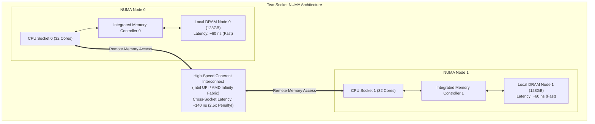
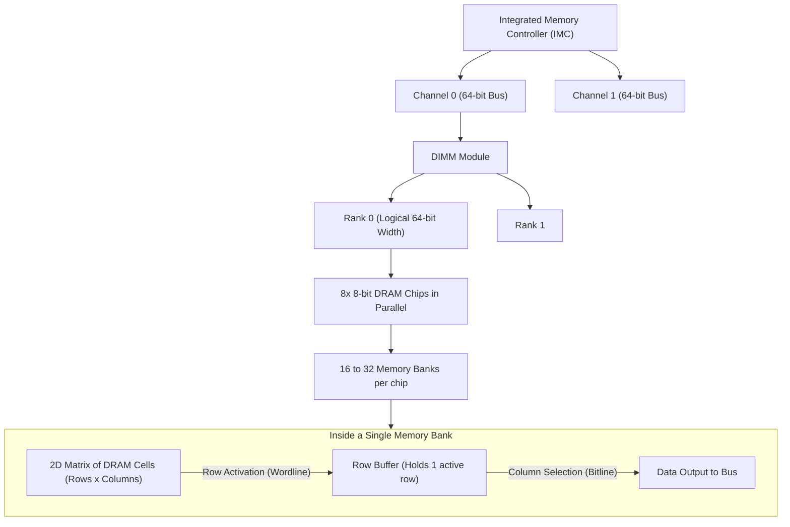
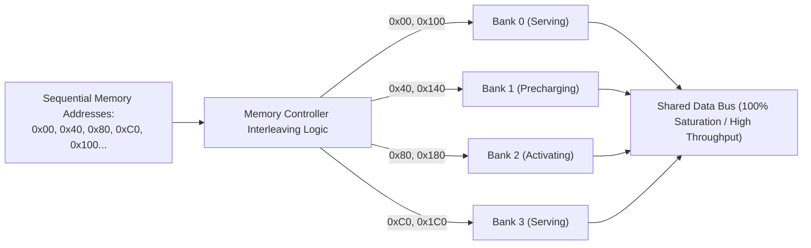
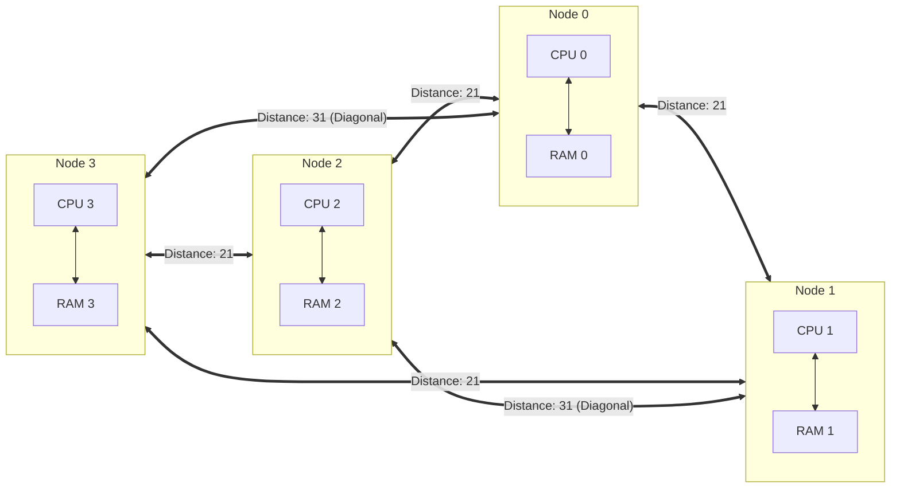

# 6.2. Memory Interfacing & System Topologies (Giao tiếp Bộ nhớ & Topo Hệ thống)

## Tổng quan về Memory Interfacing & Topologies
Bộ nhớ RAM không phải là một khối nguyên khối đơn giản mà là một hệ thống mạng phân cấp phần cứng cực kỳ phức tạp: từ **Memory Controller (Bộ điều khiển bộ nhớ)** tích hợp trên CPU $\to$ các **Memory Channels (Kênh bộ nhớ)** song song $\to$ các **DIMM Modules** $\to$ các **Ranks** $\to$ các **Chips** $\to$ các **Banks** $\to$ các ma trận **Rows và Columns**.
- **Memory Interleaving (Đan xen Bộ nhớ)**: Kỹ thuật phân tán các địa chỉ bộ nhớ liên tiếp qua nhiều kênh (Channels) và nhiều ngân hàng (Banks) khác nhau, cho phép truy xuất song song và che giấu độ trễ sạc lại của tụ điện DRAM.
- **Kiến trúc Hệ thống Đa xử lý**:
  - **UMA (Uniform Memory Access / SMP)**: Toàn bộ các CPU chia sẻ chung một không gian RAM với thời gian truy cập hoàn toàn đồng nhất.
  - **NUMA (Non-Uniform Memory Access)**: Kiến trúc máy chủ hiện đại — mỗi CPU Socket quản lý một vùng RAM cục bộ (**Local Memory - độ trễ thấp**). Khi CPU muốn truy cập RAM của Socket khác (**Remote Memory - độ trễ cao**), nó phải đi qua bus liên kết (Interconnect), tạo nên sự bất đối xứng về hiệu năng.



---

## 2. Chi tiết từng Keyword (Under-the-Hood Deep Dive)

### 1. The DRAM Physical Hierarchy: Channel, Rank, Bank, Row, Column

#### 1. Khái niệm bản chất (What & Why)
- Để đạt được băng thông hàng trăm Gigabyte/giây, cấu trúc vật lý của DRAM được phân rã thành một cây phân cấp sâu:
  1. **Memory Channel (Kênh bộ nhớ)**: Tuyến bus độc lập nối từ Memory Controller tới khe cắm RAM. Bo mạch chủ hiện đại hỗ trợ Dual-Channel (PC), Quad-Channel hoặc 8-to-12 Channels (Server).
  2. **Memory Rank**: Tập hợp các chip nhớ DRAM trên một thanh RAM hoạt động cùng lúc để tạo thành một khối dữ liệu 64-bit hoàn chỉnh (Single-Rank vs Dual-Rank).
  3. **Memory Bank**: Mảng lưu trữ độc lập nằm bên trong từng chip DRAM. Mỗi Bank sở hữu một hàng đợi thanh ghi đệm hàng (**Row Buffer**) riêng.
  4. **Row (Hàng - Page)**: Một đường dây từ (Wordline) kích hoạt hàng nghìn ô nhớ tụ điện cùng lúc (thường từ 1KB đến 8KB dữ liệu).
  5. **Column (Cột)**: Byte cụ thể được trích xuất từ Row Buffer ra bus dữ liệu.

#### 2. Cơ chế hoạt động sâu (Under the hood / Hardcore Internals)
- **Chu kỳ Truy xuất DRAM 3 bước (Row Buffer Hit vs Miss)**:
  - Khi CPU yêu cầu một địa chỉ bộ nhớ:
    1. **Precharge (`tRP`)**: Đóng hàng cũ đang mở trong Bank và sạc lại các đường dây cảm biến.
    2. **Activate / Row Access (`tRCD`)**: Kích hoạt hàng mới (Row), kéo toàn bộ hàng ngàn bit từ tụ điện nạp vào **Row Buffer** của Bank đó.
    3. **Column Access / CAS Latency (`tCL`)**: Nạp đúng cột dữ liệu mong muốn từ Row Buffer và đẩy ra bus.
  - **Row Buffer Hit**: Nếu địa chỉ CPU cần tiếp theo nằm trên **CÙNG MỘT HÀNG** đang mở sẵn trong Row Buffer, CPU bỏ qua bước 1 và 2! Dữ liệu được trả về chỉ sau **10–12 ns** (tốc độ tối đa).
  - **Row Buffer Conflict / Miss**: Nếu địa chỉ cần nằm ở hàng khác, CPU phải tốn thời gian đóng hàng cũ và mở hàng mới, độ trễ tăng vọt lên **60–80 ns**.

#### 3. Sơ đồ cây phân cấp vật lý từ CPU tới DRAM Cell


#### 4. Code ví dụ thực chiến (C++ Khám phá Kênh Bộ nhớ và Băng thông Song song)
Minh họa đo lường băng thông bộ nhớ khi dữ liệu được trải đều qua nhiều kênh:
```cpp
#include <iostream>
#include <vector>
#include <chrono>
#include <numeric>

// Benchmark đo băng thông bộ nhớ thô (Streaming Read Bandwidth)
void measure_bandwidth(size_t size_bytes) {
    size_t count = size_bytes / sizeof(uint64_t);
    std::vector<uint64_t> data(count, 1);

    auto t0 = std::chrono::high_resolution_clock::now();
    uint64_t sum = 0;
    // Đọc tuần tự mảng lớn ép Memory Controller kích hoạt tối đa mọi Channel và Bank
    for (size_t i = 0; i < count; ++i) {
        sum += data[i];
    }
    auto t1 = std::chrono::high_resolution_clock::now();

    if (sum == 0) std::cout << "never";

    double sec = std::chrono::duration<double>(t1 - t0).count();
    double gb = static_cast<double>(size_bytes) / (1024.0 * 1024.0 * 1024.0);
    double bandwidth = gb / sec;

    std::cout << "[Memory Controller Throughput]: Read " << gb << " GB in " 
              << sec << " s -> Bandwidth = " << bandwidth << " GB/s\n";
}

int main() {
    measure_bandwidth(512 * 1024 * 1024); // 512 MB
    return 0;
}
```

#### 5. Ưu / Nhược điểm, Pitfalls & Anti-patterns
- **Lắp đặt RAM sai Kênh (Channel Mismatch)**: Lắp 2 thanh RAM vào cùng 1 kênh (Channel A slot 1 & slot 2) thay vì lắp xen kẽ vào Channel A và Channel B sẽ khiến hệ thống chỉ chạy ở chế độ Single-Channel, cắt giảm **50% tổng băng thông bộ nhớ** của máy chủ mà người dùng không hề hay biết!

#### 6. Ứng dụng thực tế trong Backend / Systems
- **Tối ưu hóa Băng thông Database Sharding**: Kỹ sư hạ tầng máy chủ luôn cấu hình bộ nhớ RAM ở chế độ đa kênh tối đa (ví dụ 8 kênh trên AMD EPYC hoặc 12 kênh trên Intel Xeon) để đảm bảo các thread xử lý truy vấn SQL song song không bị bão hòa băng thông tại Memory Controller.

---

### 2. Memory Interleaving

#### 1. Khái niệm bản chất (What & Why)
- **Memory Interleaving (Đan xen Bộ nhớ)**: Kỹ thuật phần cứng do Memory Controller quản lý, phân bổ các địa chỉ bộ nhớ liên tiếp vào các Channel, Rank hoặc Bank **khác nhau** theo chu kỳ vòng quanh:
  - Địa chỉ 0x00 $\to$ Kênh 0, Bank 0.
  - Địa chỉ 0x40 $\to$ Kênh 1, Bank 0.
  - Địa chỉ 0x80 $\to$ Kênh 0, Bank 1.
  - Địa chỉ 0xC0 $\to$ Kênh 1, Bank 1.
- **Mục tiêu**: Khi một lệnh đang đọc từ Bank 0, CPU không cần đợi Bank 0 sạc lại (`tRP`) mà có thể lập tức đọc tiếp địa chỉ tiếp theo tại Bank 1. Các Bank hoạt động gối đầu lên nhau như một đường ống Pipeline, tăng gấp nhiều lần thông lượng truyền tải dữ liệu liên tục.

#### 2. Cơ chế hoạt động sâu (Under the hood / Hardcore Internals)
- **Bank-Level Parallelism (BLP)**:
  - Nhờ có Memory Interleaving, một Memory Controller có thể duy trì từ 8 đến 16 yêu cầu đọc/ghi bộ nhớ đồng thời (**Outstanding Memory Requests**) tới các Bank khác nhau cùng lúc.
  - Khi một chương trình duyệt mảng tuần tự: Trong khi Bank 0 đang bận mở hàng mới, dữ liệu từ Bank 1, Bank 2, Bank 3 đã sẵn sàng nạp ra bus. Hiện tượng chậm trễ của tụ điện DRAM được che giấu hoàn toàn!

#### 3. Sơ đồ cơ chế đan xen bộ nhớ (Memory Interleaving)


#### 4. Code ví dụ thực chiến (C++ Minh họa Bước nhảy Phá vỡ Bank Interleaving)
Minh họa bước nhảy bộ nhớ xấu làm dồn toàn bộ truy cập vào cùng một Bank duy nhất:
```cpp
#include <iostream>
#include <vector>
#include <chrono>

int main() {
    constexpr size_t N = 16 * 1024 * 1024;
    std::vector<int> data(N, 1);

    // Bước nhảy tuần tự: Khai thác 100% Bank Interleaving (Các bank chạy song song)
    auto t0 = std::chrono::high_resolution_clock::now();
    long long s1 = 0;
    for (size_t i = 0; i < N; ++i) s1 += data[i];
    auto t1 = std::chrono::high_resolution_clock::now();

    // Bước nhảy lớn (Stride = 1024): Đập liên tục vào cùng 1 Bank, triệt tiêu BLP
    auto t2 = std::chrono::high_resolution_clock::now();
    long long s2 = 0;
    for (size_t i = 0; i < N; i += 1024) s2 += data[i];
    auto t3 = std::chrono::high_resolution_clock::now();

    auto d1 = std::chrono::duration_cast<std::chrono::microseconds>(t1 - t0).count();
    auto d2 = std::chrono::duration_cast<std::chrono::microseconds>(t3 - t2).count();

    std::cout << "[Bank-Level Parallelism]: Sequential sweeps = " << d1 << " us\n";
    std::cout << "  Stride access time = " << d2 << " us\n";
    if (s1 == s2) std::cout << "ok";
    return 0;
}
```

#### 5. Ưu / Nhược điểm, Pitfalls & Anti-patterns
- **Interleaving Crash khi Hỏng 1 Thanh RAM**: Trong chế độ Interleaving sâu (như RAID 0 bộ nhớ), nếu một thanh RAM bị lỗi phần cứng, toàn bộ dữ liệu của toàn bộ không gian RAM bị xé lẻ và hỏng hóc, khiến hệ điều hành crash ngay lập tức (`Kernel Panic`).

#### 6. Ứng dụng thực tế trong Backend / Systems
- **Tối ưu hóa NUMA Interleave Policy cho Web Caching (Redis / Memcached)**: Khi chạy một instance Redis duy nhất trên máy chủ đa socket, người quản trị cấu hình cờ `numactl --interleave=all` để phân bổ các trang nhớ xen kẽ đều trên mọi NUMA Node, ngăn ngừa việc một node bị cạn kiệt RAM và dàn đều băng thông bộ nhớ trên toàn bộ các kênh của máy chủ.

---

### 3. UMA vs NUMA Architecture

#### 1. Khái niệm bản chất (What & Why)
- **UMA (Uniform Memory Access)**: Kiến trúc bộ nhớ đồng nhất (thường gặp trong các chip đơn socket hoặc máy tính cá nhân). Mọi Core đều kết nối tới bộ nhớ RAM thông qua một hệ thống bus hoặc controller chung; thời gian truy cập tới mọi địa chỉ RAM là hoàn toàn giống nhau đối với mọi Core.
- **NUMA (Non-Uniform Memory Access)**: Kiến trúc bộ nhớ bất đối xứng bắt buộc trong các máy chủ đa Socket (Multi-Socket Servers). Mỗi Socket sở hữu bộ điều khiển nhớ và các thanh RAM gắn vật lý riêng biệt tạo thành một **NUMA Node**. Thời gian truy cập bộ nhớ phụ thuộc vào **vị trí tương đối giữa Core đang chạy và thanh RAM chứa dữ liệu**:
  - **Local Access (Truy cập cục bộ)**: Core đọc RAM gắn trực tiếp vào Socket của mình $\implies$ Độ trễ thấp ($\approx 60\text{ ns}$).
  - **Remote Access (Truy cập từ xa)**: Core đọc RAM gắn vào Socket khác $\implies$ Phải đi qua đường bus liên kết liên Socket (Intel UPI / AMD Infinity Fabric) $\implies$ Độ trễ tăng vọt gấp **2.5 đến 3 lần** ($\approx 140 - 180\text{ ns}$)!

#### 2. Cơ chế hoạt động sâu (Under the hood / Hardcore Internals)
- **Hệ số Khoảng cách NUMA (NUMA Distance Matrix)**:
  - Hệ điều hành Linux quản lý topo NUMA thông qua bảng khoảng cách tương đối (Distance Matrix được BIOS cung cấp qua bảng ACPI SLIT):
    - Khoảng cách Local Node: quy ước là **10**.
    - Khoảng cách Remote Node 1-hop: thường là **21** hoặc **32**.
- **Chính sách Cấp phát Bộ nhớ của Linux Kernel (NUMA Memory Policies)**:
  - `MPOL_LOCAL` / `MPOL_PREFERRED`: Mặc định — Linux luôn cố gắng cấp phát RAM từ NUMA Node mà thread đó đang chạy.
  - `MPOL_BIND`: Khóa cứng tiến trình chỉ được cấp phát RAM trên một tập NUMA Nodes nhất định. Nếu hết RAM, tiến trình sẽ báo lỗi OOM chứ không nạp từ node khác.
  - `MPOL_INTERLEAVE`: Phân bổ các trang nhớ lần lượt vòng quanh giữa các NUMA Nodes.

#### 3. Sơ đồ ma trận khoảng cách NUMA (4-Socket Topology)


#### 4. Code ví dụ thực chiến (C++ Đọc và Khám phá Topo NUMA bằng `libnuma`)
```cpp
#include <iostream>
#include <fstream>
#include <string>

// Đọc thông số khoảng cách NUMA trực tiếp từ sysfs trên máy chủ Linux
void print_numa_distances() {
    std::cout << "[Linux NUMA Topology & Distances]:\n";
    for (int node = 0; node < 2; ++node) {
        std::string path = "/sys/devices/system/node/node" + std::to_string(node) + "/distance";
        std::ifstream file(path);
        if (file.is_open()) {
            std::string line;
            std::getline(file, line);
            std::cout << "  From Node " << node << " distances: " << line << '\n';
        } else {
            std::cout << "  Node " << node << " not found (Single socket system).\n";
            break;
        }
    }
}

int main() {
    print_numa_distances();
    return 0;
}
```

#### 5. Ưu / Nhược điểm, Pitfalls & Anti-patterns
- **Hiểm họa "NUMA Migration Penalty"**: Nếu một thread đang chạy trên Socket 0 cấp phát hàng Gigabyte RAM trên Socket 0, sau đó bộ lập lịch của hệ điều hành (OS Scheduler) quyết định di chuyển (migrate) thread đó sang chạy trên Socket 1 (vì Socket 0 bị bận), thread đó giờ đây sẽ phải chịu độ trễ Remote Memory Access cho 100% các thao tác đọc/ghi tiếp theo! Hiệu năng của backend có thể sụt giảm 40% đột ngột.

#### 6. Ứng dụng thực tế trong Backend / Systems
- **NUMA-Aware Architecture trong High-Performance Databases (PostgreSQL / MongoDB / ClickHouse)**: Trên các máy chủ cơ sở dữ liệu lớn (như AWS EC2 `r6i.32xlarge` với 2 Sockets), các kỹ sư chạy **hai instance độc lập** trên mỗi máy chủ, dùng lệnh `numactl --cpunodebind=0 --membind=0` để ghim cứng instance 1 vào Socket 0 + RAM 0, và instance 2 vào Socket 1 + RAM 1, loại bỏ 100% hiện tượng truy cập bộ nhớ chéo (Zero Cross-Socket Traffic).