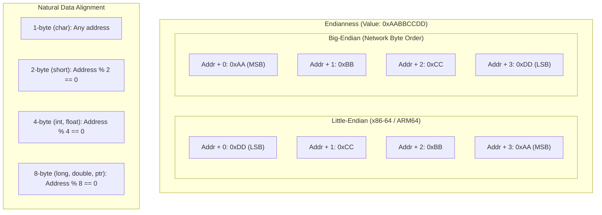
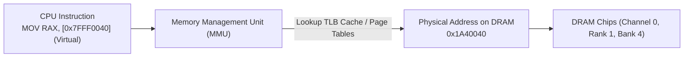
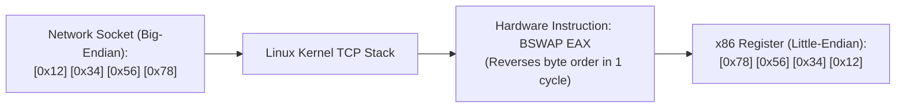
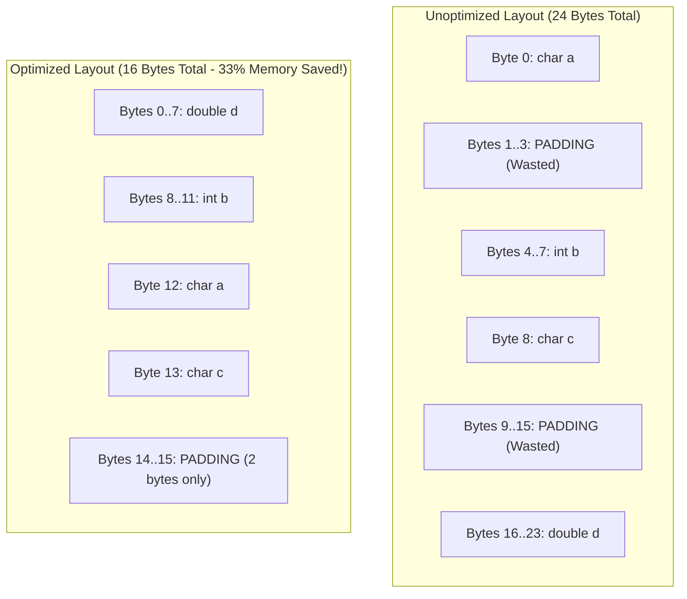

# 6.3. Addressing, Alignment & Data Representation (Định địa chỉ, Căn chỉnh & Biểu diễn Dữ liệu)

## Tổng quan về Addressing, Alignment & Data Representation
Ở tầng vật lý, bộ nhớ máy tính là một mảng tuyến tính khổng lồ của các ô nhớ 8-bit (Bytes). Cách thức mà phần cứng và trình biên dịch tổ chức, định vị và diễn giải các byte này xác định tính đúng đắn và hiệu năng của toàn bộ hệ thống phần mềm.
- **Virtual vs Physical Addressing**: Ứng dụng luôn chạy trong không gian ảo (**Virtual Address**) an toàn, được phân lập độc lập và được chuyển đổi sang địa chỉ vật lý (**Physical Address**) trên chip nhớ bởi phần cứng MMU.
- **Word Size & Endianness**: Kích thước từ máy (32-bit vs 64-bit) và trật tự sắp xếp các byte của một số nguyên đa byte trong bộ nhớ: **Little-Endian** (Byte có trọng số thấp nhất nằm ở địa chỉ nhỏ nhất — chuẩn x86 và ARM) vs **Big-Endian** (Byte có trọng số cao nhất nằm ở địa chỉ nhỏ nhất — chuẩn mạng Internet IP).
- **Data Alignment & Memory Padding**: Quy tắc bắt buộc của kiến trúc phần cứng yêu cầu dữ liệu $N$-byte phải bắt đầu tại địa chỉ chia hết cho $N$. Trình biên dịch sẽ tự động chèn thêm các byte rác (**Padding**) để đảm bảo quy tắc này, làm thay đổi kích thước của cấu trúc dữ liệu (`struct`).



---

## 2. Chi tiết từng Keyword (Under-the-Hood Deep Dive)

### 1. Memory Address: Physical vs Virtual Addressing, Latency vs Bandwidth

#### 1. Khái niệm bản chất (What & Why)
- **Physical Address (Địa chỉ Vật lý)**: Tọa độ phần cứng thực sự của một ô nhớ trên các chip DRAM, được phát trực tiếp ra các chân của bus địa chỉ (Address Bus).
- **Virtual Address (Địa chỉ Ảo)**: Địa chỉ mà chương trình ứng dụng nhìn thấy và thao tác (từ con trỏ `void*`). Cho phép mỗi tiến trình sở hữu một không gian bộ nhớ riêng biệt, phẳng, liên tục từ `0x0000000000000000` đến `0x00007FFFFFFFFFFF` (trên x86-64) mà không thể can thiệp sang tiến trình khác.
- **Latency (Độ trễ) vs Bandwidth (Băng thông) vs Throughput (Thông lượng)**:
  - *Latency*: Thời gian cần thiết từ lúc CPU phát lệnh đọc một ô nhớ cho đến khi byte dữ liệu đầu tiên cập bến thanh ghi (tính bằng nanoseconds).
  - *Bandwidth*: Tốc độ truyền tải dữ liệu cực đại trên lý thuyết của bus bộ nhớ (tính bằng GB/s):
    $$\text{Max Bandwidth} = \text{Bus Width (bytes)} \times \text{Transfer Rate (MT/s)} \times \text{Channels}$$
  - *Throughput*: Khối lượng dữ liệu thực tế mà ứng dụng đọc/ghi thành công trên mỗi đơn vị thời gian (tính bằng GB/s hoặc IOPS).

#### 2. Cơ chế hoạt động sâu (Under the hood / Hardcore Internals)
- **Nghịch lý "Băng thông rộng nhưng Độ trễ không giảm"**:
  - Trong 20 năm qua, băng thông bộ nhớ đã tăng từ 3.2 GB/s (DDR-400) lên hơn 100 GB/s (DDR5-6400) nhờ tăng số kênh và tăng tốc độ truyền sườn xung.
  - Tuy nhiên, **Độ trễ truy xuất ngẫu nhiên (Random Access Latency) của DRAM hầu như không hề giảm**, vẫn dao động quanh mức **50–70 ns** suốt hai thập kỷ!
  - Lý do: Tụ điện DRAM vẫn là tụ điện silicon vật lý; thời gian cần thiết để điện tích xả ra Bitline và bộ khuếch đại Sense Amplifier đạt đủ ngưỡng điện áp (`tRCD`) bị giới hạn bởi các định luật vật lý bán dẫn.
  - *Hệ quả cho Software*: Các thuật toán duyệt con trỏ ngẫu nhiên (Pointer Chasing, Hash Chains) không được hưởng bất kỳ lợi ích nào từ việc nâng cấp lên DDR5, trong khi các thuật toán quét mảng tuần tự (SIMD Stream) chạy nhanh gấp nhiều lần.

#### 3. Sơ đồ minh họa chuyển đổi Virtual sang Physical Address


#### 4. Code ví dụ thực chiến (C++ Kiểm tra Địa chỉ Ảo và Khám phá Trang nhớ)
```cpp
#include <iostream>
#include <cstdint>
#include <unistd.h>

int main() {
    int local_var = 42;
    uintptr_t vaddr = reinterpret_cast<uintptr_t>(&local_var);
    long page_size = sysconf(_SC_PAGESIZE);

    std::cout << "[Virtual Address Inspection]:\n";
    std::cout << "  Variable Virtual Address: 0x" << std::hex << vaddr << std::dec << '\n';
    std::cout << "  Virtual Page Base:        0x" << std::hex << (vaddr & ~(page_size - 1)) << std::dec << '\n';
    std::cout << "  Page Offset:              " << (vaddr & (page_size - 1)) << " bytes\n";
    std::cout << "  System Page Size:         " << page_size << " bytes\n";
    return 0;
}
```

#### 5. Ưu / Nhược điểm, Pitfalls & Anti-patterns
- **Nhầm lẫn giữa Băng thông và Độ trễ**: Tối ưu hóa một dịch vụ backend bằng cách nâng cấp gói Cloud lên server có băng thông RAM lớn hơn sẽ hoàn toàn vô ích nếu nguyên nhân gốc rễ gây chậm là các chuỗi truy xuất con trỏ ngẫu nhiên (Latency-bound) trong cây nhị phân lồng nhau.

#### 6. Ứng dụng thực tế trong Backend / Systems
- **Tối ưu hóa Truy vấn Analytics trong ClickHouse**: ClickHouse được thiết kế tối ưu hóa triệt để cho Bandwidth thay vì Latency: dữ liệu luôn được nén theo khối lớn và giải nén tuần tự bằng SIMD vector, tận dụng trọn vẹn 100% băng thông của các thanh RAM DDR5 hiện đại.

---

### 2. Endianness: Little Endian vs Big Endian

#### 1. Khái niệm bản chất (What & Why)
- **Endianness (Thứ tự Byte)**: Quy ước về cách sắp xếp các byte cấu thành một số nguyên đa byte (16-bit, 32-bit, 64-bit) trong các ô nhớ tuần tự của RAM.
  - **Little-Endian**: **Byte có trọng số thấp nhất (Least Significant Byte - LSB)** được lưu trữ tại ô nhớ có địa chỉ nhỏ nhất. (Quy chuẩn của toàn bộ dòng vi xử lý x86, x86-64, và mặc định trên ARM/RISC-V).
  - **Big-Endian**: **Byte có trọng số cao nhất (Most Significant Byte - MSB)** được lưu trữ tại ô nhớ có địa chỉ nhỏ nhất. (Tương tự cách con người viết số học từ trái qua phải, được chuẩn hóa làm **Network Byte Order** trong giao thức TCP/IP).

#### 2. Cơ chế hoạt động sâu (Under the hood / Hardcore Internals)
- **Xem xét giá trị số nguyên 32-bit: `0x12345678`**:
  Gồm 4 bytes: `0x12` (MSB), `0x34`, `0x56`, `0x78` (LSB).
  Được ghi vào địa chỉ bắt đầu từ `0x1000`:

| Địa chỉ ô nhớ | Little-Endian (x86-64) | Big-Endian (Network / MIPS / IBM z/Arch) |
| :--- | :--- | :--- |
| `0x1000` | **`0x78`** (LSB) | **`0x12`** (MSB) |
| `0x1001` | `0x56` | `0x34` |
| `0x1002` | `0x34` | `0x56` |
| `0x1003` | **`0x12`** (MSB) | **`0x78`** (LSB) |

- **Tại sao x86 chọn Little-Endian?**:
  - *Ép kiểu tức thì (Zero-cost Pointer Type Casting)*: Nếu bạn có con trỏ trỏ tới một số nguyên 64-bit `uint64_t x = 42` tại địa chỉ `0x1000`. Khi bạn ép kiểu con trỏ đó thành con trỏ 32-bit `uint32_t*`, hoặc 16-bit, hoặc 8-bit `uint8_t*`:
  - Trong Little-Endian, byte đầu tiên tại `0x1000` **LUÔN LUÔN chứa giá trị số 42**! CPU không cần phải tính toán lại địa chỉ hay dịch chuyển thanh ghi.
  - Trong Big-Endian, ép kiểu buộc CPU phải cộng thêm offset (nhảy tới byte cuối cùng), làm tốn thêm chu kỳ tính toán.

#### 3. Sơ đồ hoán đổi Byte Swap (BSWAP) khi nhận Gói tin Mạng


#### 4. Code ví dụ thực chiến (C++ Kiểm tra Endianness Runtime & Compile-time)
```cpp
#include <iostream>
#include <bit>
#include <cstdint>
#include <arpa/inet.h> // Header cho ntohl, htonl

void check_system_endianness() {
    // 1. Kiểm tra compile-time bằng C++20 std::endian
    if constexpr (std::endian::native == std::endian::little) {
        std::cout << "[Compile-time Check]: System is Little-Endian (x86-64 / ARM64 default).\n";
    } else if constexpr (std::endian::native == std::endian::big) {
        std::cout << "[Compile-time Check]: System is Big-Endian.\n";
    }

    // 2. Kiểm tra runtime bằng con trỏ thô
    uint32_t num = 0xAABBCCDD;
    auto* byte_ptr = reinterpret_cast<uint8_t*>(&num);
    std::cout << "[Memory Inspection]: First byte at address " << static_cast<void*>(byte_ptr) 
              << " is: 0x" << std::hex << static_cast<int>(byte_ptr[0]) << std::dec << '\n';

    // 3. Chuyển đổi Network Byte Order (Big-Endian) sang Host Byte Order (Little-Endian)
    uint32_t net_val = htonl(num); // Host to Network Long
    std::cout << "  Original: 0x" << std::hex << num << " -> After htonl: 0x" << net_val << std::dec << '\n';
}

int main() {
    check_system_endianness();
    return 0;
}
```

#### 5. Ưu / Nhược điểm, Pitfalls & Anti-patterns
- **Hiểm họa Serialization Nhị phân qua Mạng**:
  - Ghi thẳng một struct từ bộ nhớ RAM ra Socket (`write(fd, &my_struct, sizeof(my_struct))`) là lỗi kinh điển. Nếu máy gửi là x86-64 (Little-Endian) và máy nhận là một bộ định tuyến mạng chuyên dụng hoặc mainframe (Big-Endian), dữ liệu số nguyên sẽ bị đảo lộn hoàn toàn! Luôn chuẩn hóa bằng các giao thức nhị phân độc lập nền tảng (Protobuf, FlatBuffers) hoặc dùng hàm `ntohl()`/`htonl()`.

#### 6. Ứng dụng thực tế trong Backend / Systems
- **Tối ưu hóa Xử lý Header Giao thức Mạng (DPDK / eBPF XDP)**: Các driver mạng hiệu năng cao tận dụng chỉ thị assembly `bswap` của x86 hoặc `rev` của ARM để đảo ngược thứ tự các trường IP Address và Port trong TCP/UDP header chỉ trong 1 chu kỳ clock.

---

### 3. Data Alignment, Memory Padding & Packed Structures

#### 1. Khái niệm bản chất (What & Why)
- **Natural Alignment (Căn chỉnh Tự nhiên)**: Quy tắc phần cứng yêu cầu một biến có kích thước $K$ bytes phải được đặt tại một địa chỉ bộ nhớ vật lý chia hết cho $K$:
  - `char` (1 byte): Địa chỉ bất kỳ ($\text{Addr} \pmod 1 == 0$).
  - `int16_t` (2 bytes): Địa chỉ chẵn ($\text{Addr} \pmod 2 == 0$).
  - `int32_t` (4 bytes): Địa chỉ chia hết cho 4 ($\text{Addr} \pmod 4 == 0$).
  - `int64_t`, con trỏ (8 bytes): Địa chỉ chia hết cho 8 ($\text{Addr} \pmod 8 == 0$).
  - Thanh ghi SIMD `__m256` (32 bytes): Địa chỉ chia hết cho 32.
- **Memory Padding (Độn bộ nhớ)**: Các byte thừa vô nghĩa do trình biên dịch tự động chèn vào giữa các trường trong struct để đảm bảo mỗi trường tiếp theo đều thỏa mãn quy tắc căn chỉnh tự nhiên của nó.

#### 2. Cơ chế hoạt động sâu (Under the hood / Hardcore Internals)
- **Tại sao Phần cứng đòi hỏi Alignment?**:
  - Bus dữ liệu của CPU và bộ điều khiển nhớ nạp dữ liệu theo các khối từ máy (Word-aligned: 4 bytes hoặc 8 bytes).
  - Nếu một biến 4-byte nằm lệch hàng (Unaligned Access, ví dụ bắt đầu tại byte 3 và kết thúc ở byte 6):
    - Trên các CPU RISC cũ (như MIPS, SPARC): Phần cứng từ chối thực thi và lập tức ném ra lỗi ngoại lệ crash phần cứng `Alignment Fault / Bus Error (SIGBUS)`.
    - Trên x86-64 và ARM hiện đại: Phần cứng cho phép đọc unaligned, nhưng phải **thực hiện 2 chu kỳ đọc bus riêng biệt** (đọc Word 0 chứa byte 3, đọc Word 1 chứa byte 4..6), sau đó dùng mạch shifter dịch và ghép các byte lại. Điều này làm tăng độ trễ và tiêu thụ điện năng.
- **Thuật toán Padding của Trình biên dịch**:
  - Trình biên dịch tuân thủ 2 nguyên tắc bất di bất dịch:
    1. Mỗi trường trong struct bắt đầu tại offset chia hết cho kích thước của chính nó.
    2. Tổng kích thước (`sizeof`) của toàn bộ struct bắt buộc phải là **bội số của trường có kích thước lớn nhất** bên trong nó (để khi tạo mảng các struct này, phần tử thứ 2 vẫn được căn chỉnh hoàn hảo).

#### 3. Sơ đồ minh họa Struct Padding trong Bộ nhớ
```text
Cấu trúc chưa tối ưu:
struct Unoptimized {
    char a;      // 1 byte
                 // 3 bytes PADDING chèn vào đây!
    int b;       // 4 bytes (bắt đầu tại offset 4)
    char c;      // 1 byte
                 // 7 bytes PADDING chèn vào đuôi!
    double d;    // 8 bytes (bắt đầu tại offset 8? Không, phải nhảy tới offset 16!)
};
Tổng kích thước: 1 + 3 + 4 + 8 + 8 = 24 bytes! (Lãng phí 11 bytes rác!)
```



#### 4. Code ví dụ thực chiến (C++ Sắp xếp Struct Tối ưu hóa Ô nhớ và Packed Struct)
```cpp
#include <iostream>
#include <cstdint>

// 1. Struct viết cẩu thả: Thứ tự ngẫu nhiên -> Bị chèn padding khổng lồ
struct BadOrder {
    char a;      // 1 byte
    double b;    // 8 bytes -> Bị lùi tới offset 8 (lãng phí 7 bytes)
    char c;      // 1 byte
    int32_t d;   // 4 bytes -> Bị lùi tới offset 20
};

// 2. Struct tối ưu hóa: Sắp xếp các trường từ LỚN NHẤT đến NHỎ NHẤT (Greedy Ordering)
struct OptimizedOrder {
    double b;    // 8 bytes (offset 0)
    int32_t d;   // 4 bytes (offset 8)
    char a;      // 1 byte  (offset 12)
    char c;      // 1 byte  (offset 13)
    // Compiler chỉ cần chèn thêm 2 bytes padding ở đuôi để đủ 16 bytes
};

// 3. Packed Struct: Ép compiler xóa bỏ 100% padding (Dùng cho giao thức mạng / Driver)
#pragma pack(push, 1)
struct PackedStruct {
    char a;      // 1 byte
    double b;    // 8 bytes
    char c;      // 1 byte
    int32_t d;   // 4 bytes
};
#pragma pack(pop)

int main() {
    std::cout << "[Struct Memory Alignment & Padding Analysis]:\n";
    std::cout << "  sizeof(BadOrder):       " << sizeof(BadOrder) << " bytes (Wasted space!)\n";
    std::cout << "  sizeof(OptimizedOrder): " << sizeof(OptimizedOrder) << " bytes (Saved 33% memory!)\n";
    std::cout << "  sizeof(PackedStruct):   " << sizeof(PackedStruct) << " bytes (Zero padding, unaligned access risk)\n";
    return 0;
}
```

#### 5. Ưu / Nhược điểm, Pitfalls & Anti-patterns
- **Hiểm họa của `#pragma pack(1)`**: Ép struct packed để tiết kiệm vài byte có thể phản tác dụng nghiêm trọng trong ứng dụng backend! Khi CPU đọc các trường `double` hoặc `int64_t` nằm ở địa chỉ lẻ trong Packed struct, nó phải chịu độ trễ Unaligned Memory Penalty, làm tốc độ tính toán chậm đi từ **2 đến 5 lần**. Chỉ sử dụng packed struct khi giải mã byte mạng hoặc đọc header file đĩa cứng.

#### 6. Ứng dụng thực tế trong Backend / Systems
- **Tối ưu hóa RAM cho Hàng triệu Kết nối Đồng thời (WebSocket / C10M problem)**: Khi quản lý 1 triệu kết nối TCP mở trong một proxy server (như Cloudflare hay Discord), việc tối ưu hóa sắp xếp lại thứ tự các trường trong struct `ConnectionState` từ 48 bytes xuống còn 32 bytes giúp giải phóng ngay lập tức **16 Megabytes RAM vật lý** và giúp đối tượng nằm trọn vẹn trong một nửa dòng Cache Line 64-byte.