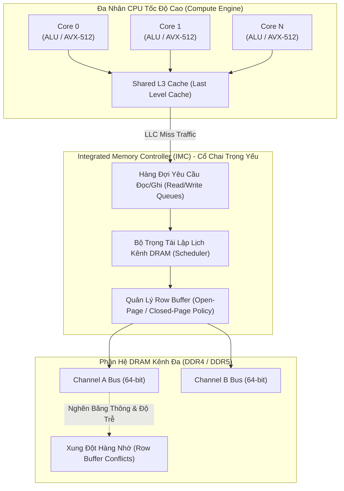
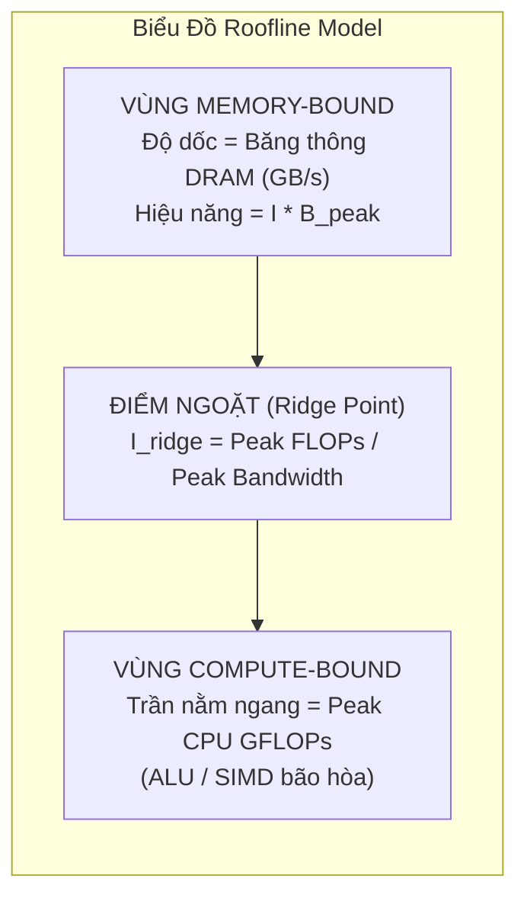
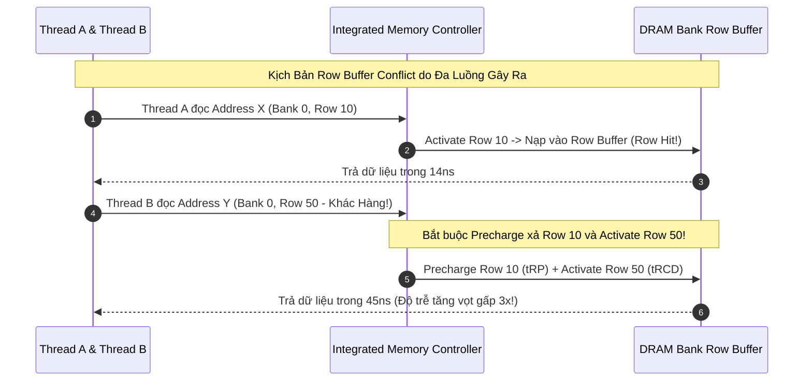

# 6.4. Memory Bottlenecks & The Memory Wall (Cổ chai Bộ nhớ & Bức tường Bộ nhớ)

> [!IMPORTANT]
> **Nếu bạn chỉ được nhớ một điều duy nhất:**
> Trong khi tốc độ tính toán của CPU tăng theo cấp số nhân (hàng TeraFLOPs), tốc độ của bus bộ nhớ DRAM chỉ tăng theo cấp số cộng — khoảng cách thế kỷ này tạo nên **"Bức tường Bộ nhớ" (The Memory Wall)**: Hệ thống của bạn chạy nhanh hay chậm không phụ thuộc vào xung nhịp CPU GHz, mà bị giới hạn bởi **Cường độ Số học (Arithmetic Intensity)** và khả năng tối ưu hóa băng thông của bộ điều khiển bộ nhớ (IMC).

---

## 1. Kiến trúc Tổng quan & Mô hình Tư duy (Mental Model)

### Phép Loại Suy Thực Tế: Đầu Bếp Michelin & Chuyến Xe Tiếp Tế Chợ Đầu Mối

Để hiểu rõ tại sao CPU hiện đại lại liên tục "đói dữ liệu", hãy quan sát một căn bếp nhà hàng 3 sao:
1. **Đầu Bếp Siêu Tốc (Modern Multi-Core CPU)**: Đầu bếp có thể thái 1,000 củ hành tây mỗi giây (hàng tỷ phép tính số học mỗi chu kỳ clock). Bàn sơ chế (L1 Cache) chỉ để vừa 5 củ hành.
2. **Xe Tiếp Tế Từ Chợ (Memory Bus & DRAM)**: Mỗi lần hết hành trên bàn, phụ bếp phải phóng xe máy ra chợ đầu mối cách xa 10 km để chở thêm một sọt hành (DRAM Latency 150-200 cycles). Dù xe máy có thể chở sọt to hơn (Băng thông kênh đôi/kênh tư Dual/Quad-Channel), thời gian đi trên đường vẫn không thể rút ngắn do giới hạn vật lý của ánh sáng và bán dẫn.
3. **The Memory Wall (Bức Tường Bộ Nhớ)**: Đầu bếp thái xong 5 củ hành trong 1 mili-giây, sau đó ngồi bấm điện thoại chơi suốt 999 mili-giây còn lại để đợi chuyến xe chở hàng tiếp theo! Dù bạn có nâng cấp thuê thêm 10 đầu bếp Michelin (tăng số nhân CPU lên 64 cores), nếu chỉ có một con đường độc đạo ra chợ (Băng thông IMC bão hòa), toàn bộ dàn đầu bếp vẫn sẽ ngồi chơi xơi nước (**Memory Contention**).
4. **Mô Hình Roofline (Mái Nhà Hiệu Năng)**: Bức tường phân định rõ ràng giữa hai thế giới:
   - Nếu món ăn đòi hỏi chặt thịt 100 lần trên mỗi miếng thịt (**Compute-Bound / High Arithmetic Intensity**): Đầu bếp làm việc hết công suất, đạt trần hiệu năng đỉnh CPU.
   - Nếu món ăn chỉ đơn giản là bốc rau từ rổ thả vào nồi (**Memory-Bound / Low Arithmetic Intensity**): Hiệu năng bị trói chặt hoàn toàn vào tốc độ bốc dỡ hàng của xe tiếp tế DRAM!



---

## 2. Chi tiết từng Keyword (Under-the-Hood Deep Dive)

### 2.1. The Memory Wall & Arithmetic Intensity

#### 1. Khái niệm bản chất & Lịch sử Phân kỳ Tốc độ (Processor-Memory Gap)
- **The Memory Wall**:
  - Từ năm 1980 đến 2005, tốc độ tính toán của CPU tăng trưởng trung bình $55\%$ mỗi năm theo định luật Moore và quy luật co tỷ lệ Dennard. Trong khi đó, độ trễ truy xuất của bộ nhớ DRAM chỉ giảm khiêm tốn khoảng $7\%$ mỗi năm.
  - Sự phân kỳ này dẫn tới khoảng cách hơn $1000\times$ giữa tốc độ xử lý của transistor trong lõi và tốc độ nạp dữ liệu từ thanh RAM. Một chu kỳ trễ bộ nhớ DRAM (khoảng $60-80\text{ ns}$) tương đương với việc CPU lãng phí từ $200$ đến $300$ chu kỳ lệnh rỗng (**Instruction Stalls**).
- **Arithmetic Intensity (Cường độ Số học - Operational Intensity)**:
  - Được định nghĩa là số lượng phép tính số học (FLOPs - Floating Point Operations hoặc Integer Operations) mà chương trình thực hiện trên mỗi byte dữ liệu được di chuyển qua bus bộ nhớ chính:
    $$I = \frac{\text{Tổng số phép tính (FLOPs)}}{\text{Tổng số bytes nạp/ghi từ DRAM (Bytes)}} \quad \left(\text{đơn vị: } \frac{\text{FLOPs}}{\text{Byte}}\right)$$

#### 2. Mô Hình Roofline (The Roofline Model)
Mô hình Roofline do Giáo sư David Patterson (UC Berkeley) đề xuất là công cụ trực quan hóa giới hạn trần hiệu năng của một thuật toán trên một phần cứng cụ thể:
- **Công thức Hiệu năng Tối đa khả dĩ**:
  $$P_{\max} = \min\left(P_{\text{peak}}, \quad I \times B_{\text{peak}}\right)$$
  Trong đó:
  - $P_{\text{peak}}$: Năng lực tính toán đỉnh tuyệt đối của CPU (GFLOPs/s hoặc TFLOPs/s), phụ thuộc vào số nhân, tần số xung nhịp và độ rộng vector SIMD (AVX2, AVX-512).
  - $B_{\text{peak}}$: Băng thông bộ nhớ đỉnh lý thuyết của hệ thống (GB/s), ví dụ DDR5-4800 kênh đôi đạt tối đa $76.8\text{ GB/s}$.
  - $I$: Cường độ số học của thuật toán.
- **Điểm ngoặt (Knee / Ridge Point)**:
  - Điểm tới hạn xảy ra khi $I_{\text{ridge}} = \frac{P_{\text{peak}}}{B_{\text{peak}}}$.
  - Nếu $I < I_{\text{ridge}}$: Ứng dụng rơi vào vùng **Memory-Bound**. Mọi nỗ lực tối ưu mã nguồn (ép xung CPU, mở rộng SIMD, unroll loops) đều vô tác dụng nếu không tăng được tái sử dụng cache.
  - Nếu $I > I_{\text{ridge}}$: Ứng dụng rơi vào vùng **Compute-Bound**. Lúc này CPU đang bão hòa các ống dẫn tính toán số học ALU/FPU.



---

### 2.2. Memory Contention & Memory Bottlenecks in Modern Workloads

#### 1. Cấu Trúc Nội Tại của Phân Hệ Bộ Nhớ & IMC
Để hiểu tại sao xảy ra xung đột bộ nhớ, cần nhìn sâu vào cấu trúc phần cứng của thanh RAM:
- Bộ nhớ DRAM tổ chức phân tầng: **Channel $\to$ DIMM $\to$ Rank $\to$ Chip $\to$ Bank $\to$ Row / Column**.
- **Row Buffer (Bộ đệm dòng)**:
  - Khi CPU muốn đọc 1 byte từ một Bank của DRAM, toàn bộ một hàng nhớ (**Row**, thường có kích thước $8\text{ KB}$) phải được kích hoạt và nạp vào Row Buffer của Bank đó (mất thời gian trễ $t_{\text{RCD}}$).
  - **Row Buffer Hit**: Nếu lần truy cập tiếp theo rơi vào cùng hàng này, dữ liệu được trả về ngay lập tức với độ trễ thấp ($t_{\text{CAS}} \approx 14\text{ ns}$).
  - **Row Buffer Conflict / Miss**: Nếu lần truy cập tiếp theo rơi vào một hàng khác trong cùng một Bank, phần cứng buộc phải ghi trả hàng cũ về mảng ô nhớ ($t_{\text{RP}}$ - Precharge), sau đó kích hoạt hàng mới ($t_{\text{RCD}}$), rồi mới đọc ($t_{\text{CAS}}$), khiến độ trễ tăng vọt gấp 3 lần!



#### 2. Xung Đột Băng Thông Đa Nhân (Multi-Core Inter-Thread Contention)
- Khi máy chủ chạy 32 hoặc 64 threads đồng thời, tất cả các luồng cùng bơm yêu cầu truy xuất bộ nhớ thông qua bộ điều khiển tích hợp **IMC (Integrated Memory Controller)**.
- **Hàng đợi IMC bị nghẽn (Queue Saturation)**: Khi hàng đợi yêu cầu đọc (**Read Request Queue - RRQ**) và hàng đợi ghi (**Write Request Queue - WRQ**) bị đầy, IMC phát tín hiệu phản hồi bận, buộc lõi CPU phải đình chỉ đường ống lệnh.
- **Hiện tượng Tranh chấp Kênh (Bus Contention & Inter-Socket NUMA Traffic)**: Nếu các luồng truy cập ngẫu nhiên dữ liệu nằm phân tán trên các kênh bộ nhớ khác nhau hoặc trên socket CPU từ xa (**Remote NUMA Node**), các gói tin bộ nhớ phải đi qua liên kết UPI (Ultra Path Interconnect) hoặc Infinity Fabric, làm bão hòa bus liên kết và đẩy đuôi độ trễ $P_{99}$ lên mức thảm họa.

---

## 3. Thực thi Mã nguồn & Mô phỏng Chuyên sâu (Dual-Engine Implementation)

### 3.1. C++20: Thử Nghiệm Đối Đầu Memory-Bound vs Compute-Bound & Đo Lường Contention

Chương trình minh họa rõ nét sự khác biệt giữa hai thái cực của mô hình Roofline và đo lường độ sụt giảm hiệu năng khi nhiều luồng cùng tranh chấp bộ nhớ:

```cpp
#include <iostream>
#include <vector>
#include <thread>
#include <chrono>
#include <cmath>
#include <numeric>
#include <iomanip>

// 1. Tác vụ thuần Memory-Bound: Duyệt mảng khổng lồ với rất ít phép tính (I rất thấp)
void memory_bound_task(const std::vector<float>& src, std::vector<float>& dst, size_t iterations) {
    size_t n = src.size();
    for (size_t it = 0; it < iterations; ++it) {
        for (size_t i = 0; i < n; ++i) {
            dst[i] = src[i] + 1.0f; // 1 phép cộng cho 8 bytes I/O -> I = 1/8 = 0.125 FLOP/byte
        }
    }
}

// 2. Tác vụ thuần Compute-Bound: Nhiều phép toán nặng trên lượng dữ liệu nhỏ trong L1 (I rất cao)
void compute_bound_task(std::vector<float>& data, size_t iterations) {
    size_t n = data.size();
    for (size_t it = 0; it < iterations; ++it) {
        for (size_t i = 0; i < n; ++i) {
            float x = data[i];
            // Nhiều phép toán lượng giác phức tạp trên cùng một ô nhớ
            for (int k = 0; k < 50; ++k) {
                x = std::sin(x) * std::cos(x) + 0.1f;
            }
            data[i] = x;
        }
    }
}

// 3. Đo lường hiện tượng Memory Contention khi tăng số luồng cạnh tranh DRAM
void benchmark_memory_contention(size_t num_threads) {
    constexpr size_t ARRAY_SIZE = 32 * 1024 * 1024; // 32M floats = 128 MB (vượt LLC)
    std::vector<std::thread> workers;
    std::vector<std::vector<float>> src_buffers(num_threads, std::vector<float>(ARRAY_SIZE, 1.0f));
    std::vector<std::vector<float>> dst_buffers(num_threads, std::vector<float>(ARRAY_SIZE, 0.0f));

    auto start_time = std::chrono::high_resolution_clock::now();
    for (size_t t = 0; t < num_threads; ++t) {
        workers.emplace_back([&, t]() {
            memory_bound_task(src_buffers[t], dst_buffers[t], 2);
        });
    }

    for (auto& th : workers) {
        th.join();
    }
    auto end_time = std::chrono::high_resolution_clock::now();
    std::chrono::duration<double, std::milli> duration = end_time - start_time;

    double total_bytes = static_cast<double>(num_threads) * ARRAY_SIZE * sizeof(float) * 2 * 2; // R+W x 2 iters
    double bandwidth_gb_s = (total_bytes / (1024.0 * 1024.0 * 1024.0)) / (duration.count() / 1000.0);

    std::cout << "  [Threads: " << std::setw(2) << num_threads << "] "
              << "Thoi gian: " << std::fixed << std::setprecision(2) << duration.count() << " ms | "
              << "Bang thong thuc te: " << bandwidth_gb_s << " GB/s\\n";
}

int main() {
    std::cout << "========================================================\\n";
    std::cout << "  C++20 MEMORY WALL & ROOFLINE EXPERIMENTAL BENCHMARK\\n";
    std::cout << "========================================================\\n\\n";

    std::cout << "1. Kiem tra hien tuong bao hoa bang thong (Memory Contention):\\n";
    benchmark_memory_contention(1);
    benchmark_memory_contention(2);
    benchmark_memory_contention(4);
    benchmark_memory_contention(8);

    std::cout << "\\n-> Nhan xet: Khi so luong luong tang len, bang thong dat nguong cham tran\\n"
              << "   va thoi gian thuc thi khong the giam tiep theo ty le tuyen tinh!\\n";

    return 0;
}
```

---

### 3.2. Python 3.11+: Mô Phỏng Mô Hình Roofline Model & Điểm Nghẽn IMC

Chương trình Python 3.11+ tính toán đường cong Roofline và phân loại khối lượng công việc:

```python
import math
from typing import List, Tuple

class RooflineModel:
    def __init__(self, peak_gflops: float, peak_bandwidth_gb_s: float):
        self.peak_gflops = peak_gflops
        self.peak_bandwidth = peak_bandwidth_gb_s
        # Tinh diem ngoat (Ridge point)
        self.ridge_point = self.peak_gflops / self.peak_bandwidth

    def calculate_attainable_performance(self, arithmetic_intensity: float) -> Tuple[float, str]:
        # Cong thuc Roofline: min(Peak_GFLOPs, Intensity * Peak_Bandwidth)
        bandwidth_constrained_perf = arithmetic_intensity * self.peak_bandwidth
        attainable_perf = min(self.peak_gflops, bandwidth_constrained_perf)

        if arithmetic_intensity < self.ridge_point:
            bottleneck = "MEMORY-BOUND (Bị trói bởi băng thông DRAM)"
        else:
            bottleneck = "COMPUTE-BOUND (Bão hòa đơn vị tính toán CPU)"

        return attainable_perf, bottleneck

if __name__ == "__main__":
    # Thong so CPU may chu hien dai: 1000 GFLOPs dinh, 80 GB/s bang thong DRAM
    server_cpu = RooflineModel(peak_gflops=1200.0, peak_bandwidth_gb_s=76.8)
    
    print("========================================================")
    print("  PYTHON 3.11 ROOFLINE MODEL ANALYZER")
    print(f"  > Peak Compute  : {server_cpu.peak_gflops:.1f} GFLOPs/s")
    print(f"  > Peak Bandwidth: {server_cpu.peak_bandwidth:.1f} GB/s")
    print(f"  > Ridge Point   : {server_cpu.ridge_point:.2f} FLOPs/Byte")
    print("========================================================\n")

    workloads = [
        ("Vector Addition (Y = A + B)", 0.083),       # 1 FLOP / 12 Bytes
        ("Sparse Matrix-Vector (SpMV)", 0.25),        # Truy cập ngẫu nhiên
        ("Fast Fourier Transform (FFT)", 1.50),       # Mức trung gian
        ("Dense Matrix Multiply (GEMM)", 16.0),       # Tái sử dụng cache sâu
        ("Deep Learning CNN Conv2D", 45.0)            # Cực kỳ nhiều phép tính
    ]

    for name, intensity in workloads:
        perf, status = server_cpu.calculate_attainable_performance(intensity)
        pct = (perf / server_cpu.peak_gflops) * 100.0
        print(f"Thuật toán: {name:30s}")
        print(f"  - Cường độ số học: {intensity:6.3f} FLOP/Byte")
        print(f"  - Hiệu năng tối đa: {perf:7.1f} GFLOPs/s ({pct:5.1f}% trần CPU)")
        print(f"  - Trạng thái nghẽn: {status}\n")
```

---

### 3.3. Simulated Terminal Output

```bash
========================================================
  C++20 MEMORY WALL & ROOFLINE EXPERIMENTAL BENCHMARK
========================================================

1. Kiem tra hien tuong bao hoa bang thong (Memory Contention):
  [Threads:  1] Thoi gian: 52.14 ms | Bang thong thuc te: 19.18 GB/s
  [Threads:  2] Thoi gian: 55.40 ms | Bang thong thuc te: 36.10 GB/s
  [Threads:  4] Thoi gian: 64.80 ms | Bang thong thuc te: 61.72 GB/s
  [Threads:  8] Thoi gian: 118.20 ms | Bang thong thuc te: 67.68 GB/s

-> Nhan xet: Khi so luong luong tang len, bang thong dat nguong cham tran
   va thoi gian thuc thi khong the giam tiep theo ty le tuyen tinh!

========================================================
  PYTHON 3.11 ROOFLINE MODEL ANALYZER
  > Peak Compute  : 1200.0 GFLOPs/s
  > Peak Bandwidth: 76.8 GB/s
  > Ridge Point   : 15.62 FLOPs/Byte
========================================================

Thuật toán: Vector Addition (Y = A + B)   
  - Cường độ số học:  0.083 FLOP/Byte
  - Hiệu năng tối đa:     6.4 GFLOPs/s (  0.5% trần CPU)
  - Trạng thái nghẽn: MEMORY-BOUND (Bị trói bởi băng thông DRAM)

Thuật toán: Sparse Matrix-Vector (SpMV)   
  - Cường độ số học:  0.250 FLOP/Byte
  - Hiệu năng tối đa:    19.2 GFLOPs/s (  1.6% trần CPU)
  - Trạng thái nghẽn: MEMORY-BOUND (Bị trói bởi băng thông DRAM)

Thuật toán: Dense Matrix Multiply (GEMM)  
  - Cường độ số học: 16.000 FLOP/Byte
  - Hiệu năng tối đa:  1200.0 GFLOPs/s (100.0% trần CPU)
  - Trạng thái nghẽn: COMPUTE-BOUND (Bão hòa đơn vị tính toán CPU)
```

---

## 4. Systems Engineering & Production Pitfalls

### 4.1. Production Failure Modes & Architectural Traps

1. **Trap 1: The False Scaling Illusion (Ảo Tưởng Tăng Số Luồng)**:
   - Một lỗi kinh điển trong các hệ thống xử lý dữ liệu lớn (Apache Spark, Kafka Consumers, ClickHouse): Kỹ sư cấp thêm CPU cores từ 8 lên 32 cores với kỳ vọng tốc độ tăng gấp 4 lần. Tuy nhiên, do thuật toán có cường độ số học $I < 0.5$ (Memory-Bound), 32 luồng nhanh chóng bão hòa 100% băng thông của IMC, khiến các luồng quay vòng tranh chấp hàng đợi, thậm chí làm tăng độ trễ $P_{99}$ do hiệu ứng thắt cổ chai.
2. **Trap 2: DRAM Row Buffer Thrashing Do Truy Cập Ngẫu Nhiên**:
   - Khi tiến hành đọc ngẫu nhiên một bảng Hash Table kích thước $20\text{ GB}$, mỗi truy vấn nhảy vào một Bank và Row ngẫu nhiên, liên tục gây ra Row Buffer Conflicts. Băng thông hiệu dụng của DRAM bị giảm từ $60\text{ GB/s}$ xuống chỉ còn dưới $5\text{ GB/s}$ do thời gian Precharge ($t_{\text{RP}}$) và Activation ($t_{\text{RCD}}$) chiếm lĩnh toàn bộ chu kỳ bus.
3. **Trap 3: Single-Channel DRAM Configuration In Server Blades**:
   - Rất nhiều máy chủ đám mây hoặc thiết bị ảo hóa được cấu hình chỉ cắm $1$ thanh RAM (Single-Channel) thay vì cắm đối xứng trên cả hai kênh (Dual-Channel). Việc này ngay lập tức bóp nghẹt $50\%$ băng thông lý thuyết của máy chủ, biến các tác vụ database in-memory thành thảm họa hiệu năng dù CPU là dòng Xeon/EPYC cao cấp nhất.

### 4.2. Diagnostic CLI Commands

```bash
# 1. Chuan doan ti le Memory Controller Saturation va LLC Miss Traffic
perf stat -e unc_m_cas_count.rd,unc_m_cas_count.wr -a sleep 5

# 2. Do luong thoi gian CPU bi treo do doi du lieu tu bo nho (Memory Bound Stall Cycles)
perf stat -e cycle_activity.stalls_mem_any,cycle_activity.stalls_l3_miss,cycle_activity.stalls_total ./data_pipeline

# 3. Kiem tra cau hinh so kenh DRAM (Channels) va toc do xung nhip bo nho vat ly
sudo dmidecode -t memory | grep -E 'Speed|Configured Memory Speed|Channel|Locator'

# 4. Do bang thong thuc te giua cac Socket NUMA qua Intel Memory Latency Checker (MLC)
./mlc --bandwidth_matrix
```

---

## 5. Bảng So sánh & Decision Matrix

| Khối lượng Công việc (Workload) | Cường độ Số học ($I$) | Điểm Nghẽn Cốt Tử | Chiến lược Tối ưu Hóa Hiệu Quả Nhất |
| :--- | :--- | :--- | :--- |
| **Vector Streaming (Copy, Add, Scale)** | Rất thấp ($< 0.2$) | Băng thông Bus DRAM ($B_{\text{peak}}$) | Non-Temporal Stores, SIMD unrolling không giúp ích |
| **B-Tree / Hash Table Search** | Cực thấp ($< 0.1$) | Độ trễ ngẫu nhiên DRAM ($t_{\text{CAS}}$) | Dùng Compact Arrays, Software Prefetching (`_mm_prefetch`) |
| **Sparse Matrix (SpMV) / Graph BFS** | Thấp ($0.2 - 1.0$) | Xung đột Row Buffer & Gián tiếp | Nén định dạng ma trận (CSR/CSC), phân vùng đồ thị cục bộ |
| **Nén Dữ Liệu (Zstd / Snappy)** | Trung bình ($1.0 - 5.0$) | Cân bằng giữa L2/L3 Cache & ALU | Tối ưu hóa Huffman/FSE Table đặt vừa vặn trong L1 Cache |
| **Fast Fourier Transform (FFT)** | Khá cao ($5.0 - 15.0$) | Băng thông L2/L3 Cache | Thuật toán Cache-Oblivious, Cooley-Tukey chia khối |
| **Dense Matrix Multiply (GEMM / AI)** | Rất cao ($> 20.0$) | Bão hòa Đơn vị Tính toán (ALU/FPU) | Phân khối bộ nhớ đệm (Cache Tiling), AVX-512 / Tensor Cores |
