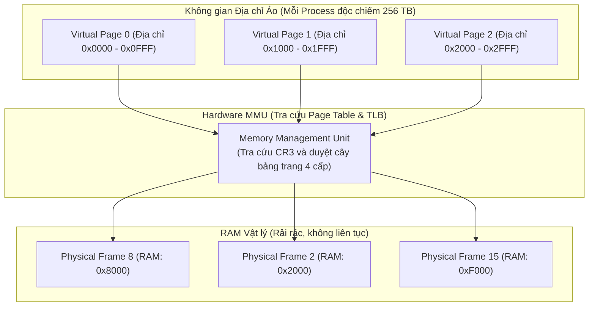
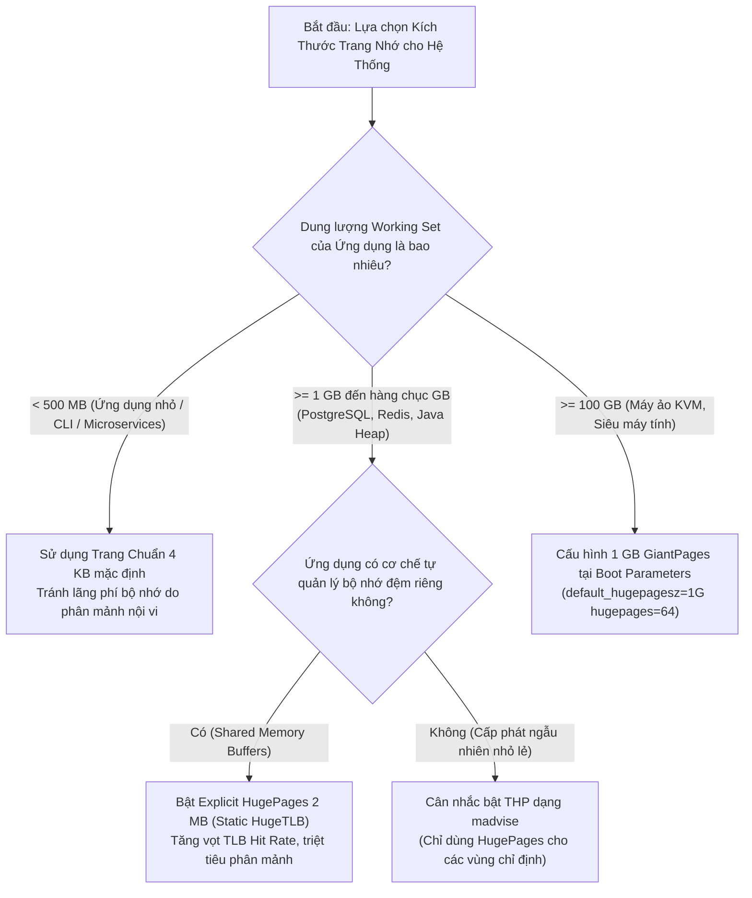

# 7.1. Virtual Memory Fundamentals and Paging (Nguyên lý Bộ nhớ ảo & Phân trang)

> [!IMPORTANT]
> **Nếu bạn chỉ được nhớ một điều duy nhất:**
> **Bộ nhớ Ảo (Virtual Memory)** là tầng trừu tượng hóa vĩ đại nhất trong lịch sử kiến trúc máy tính. Nó giải phóng lập trình viên khỏi sự trói buộc của địa chỉ RAM vật lý:
> - Mỗi tiến trình có một không gian địa chỉ phẳng, liên tục và khổng lồ ($2^{48} = 256\text{ TB}$ trên x86-64), bắt đầu từ con số $0$, độc lập hoàn toàn với các tiến trình khác.
> - Đơn vị quản lý cơ bản là **Trang nhớ (Virtual Page)** kích thước tiêu chuẩn **4096 bytes (4 KB)**, được ánh xạ vào **Khung trang vật lý (Physical Frame)** bởi mạch phần cứng **MMU (Memory Management Unit)**.
> - **12 bit cuối (Page Offset) không bao giờ bị thay đổi** trong quá trình dịch địa chỉ; MMU chỉ làm một việc duy nhất là dịch số hiệu trang ảo (**VPN**) thành số hiệu khung trang vật lý (**PFN**) thông qua cấu trúc cây **Bảng phân trang 4 cấp (4-Level Page Table Walk)**.

---

## 1. Kiến trúc Tổng quan & Mô hình Tư duy (Mental Model)

### Ẩn dụ Đời sống: Hộp Thư P.O. Box và Kho Chứa Hàng Ngoại Ô
Hãy tưởng tượng hệ thống địa chỉ bộ nhớ giống như dịch vụ chuyển phát thư tín:
- **Địa chỉ Ảo (Virtual Address)** giống như một số hộp thư P.O. Box tại bưu điện: Mọi khách hàng đều có thể sở hữu một chiếc hộp thư mang số hiệu `#100` ở các chi nhánh khác nhau mà không bao giờ bị nhầm lẫn. Mỗi tiến trình có một hộp thư riêng bắt đầu từ số 0.
- **MMU (Memory Management Unit)** là nhân viên điều phối thông minh của bưu điện: Khi có kiện hàng gửi đến hộp thư `#100`, nhân viên này mở cuốn sổ hộ khẩu mật (**Page Table**) ra tra cứu: *"Hộp thư `#100` của Tiến trình A thực chất nằm ở Kệ số 45 trong kho ngoại ô; còn Hộp thư `#100` của Tiến trình B lại nằm ở Kệ số 812"*.
- **Địa chỉ Vật lý (Physical Address)** là tọa độ GPS chính xác của chiếc kệ hàng trong nhà kho trung tâm (thanh RAM vật lý).
- **Phân trang (Paging)** giống như việc đóng gói mọi hàng hóa vào các thùng carton tiêu chuẩn có cùng kích thước $4096$ lít ($4$ KB). Dù hàng hóa của bạn có kích thước bao nhiêu, nhà kho chỉ cần xếp chồng các thùng carton chuẩn hóa này lên các vị trí trống bất kỳ mà không sợ tạo ra các khoảng kẽ hở vô dụng (**Loại bỏ Phân mảnh Ngoại vi - External Fragmentation**).



---

## 2. Chi tiết từng Keyword (Under-the-Hood Deep Dive)

### 2.1. Virtual vs Physical Address Space & The MMU

#### 1. Khái niệm bản chất (What & Why)
- **Sự cần thiết của Bộ nhớ Ảo**: Trong các hệ điều hành sơ khai (MS-DOS), ứng dụng ghi trực tiếp vào địa chỉ RAM vật lý. Một con trỏ lỗi (wild pointer) sẽ ghi đè dữ liệu của hệ điều hành hoặc làm sập máy tính. Bộ nhớ ảo cung cấp:
  1. **Tính Cô lập Tuyệt đối (Absolute Isolation)**: Tiến trình A không thể nào đọc hay ghi vào vùng nhớ của Tiến trình B vì bảng trang của nó không có mục ánh xạ tới khung trang đó.
  2. **Ảo hóa Dung lượng (Overcommit & Swapping)**: Hệ thống có thể chạy ứng dụng nặng 64 GB trên máy tính chỉ có 16 GB RAM bằng cách hoán đổi các trang ít dùng ra ổ đĩa SSD.
  3. **Cấp phát Không Liên tục (Non-contiguous Allocation)**: Vùng nhớ ảo nhìn như một mảng liên tục, nhưng trong RAM vật lý các khung trang có thể nằm rải rác ở khắp mọi nơi.
- **Định dạng Địa chỉ Chuẩn hóa Canonical trong x86-64**:
  Mặc dù con trỏ là 64-bit, kiến trúc x86-64 4 cấp phân trang chỉ sử dụng **48 bits** (tương đương 256 TB không gian địa chỉ). 
  Phần cứng quy định định dạng **Canonical Address**:
  - **16 bits cao nhất (Bits [63:48])** bắt buộc phải là bản sao mở rộng dấu (*Sign Extension*) của Bit 47.
  - Vùng Không gian Người dùng (User Space): Bit 47 = 0 $\to$ Bits [63:48] toàn là `0x0000` (`0x0000000000000000` đến `0x00007FFFFFFFFFFF`, 128 TB).
  - Vùng Lõi Hệ điều hành (Kernel Space): Bit 47 = 1 $\to$ Bits [63:48] toàn là `0xFFFF` (`0xFFFF800000000000` đến `0xFFFFFFFFFFFFFFFF`, 128 TB).
  - Khoảng giữa là **Vùng địa chỉ Bất hợp lệ (Non-Canonical Gap)**: Bất kỳ con trỏ nào truy cập vào khoảng này sẽ bị CPU kích hoạt ngoại lệ `#GP` (General Protection Fault) ngay lập tức tại phần cứng.

#### 2. Cơ chế hoạt động sâu (Under-the-Hood / Hardcore Internals)
- **Giải phẫu Cây Bảng Phân trang 4 Cấp (4-Level Page Table Walk)**:
  Phần cứng MMU phân rã địa chỉ ảo 48-bit thành 5 trường bit:

```
  63         48 47     39 38     30 29     21 20     12 11          0
 +-------------+---------+---------+---------+---------+-------------+
 | Sign Extend | PML4    | PDPT    | PD      | PT      | Page Offset |
 |   (16 bit)  | (9 bit) | (9 bit) | (9 bit) | (9 bit) |  (12 bit)   |
 +-------------+---------+---------+---------+---------+-------------+
```

  1. **Thanh ghi CR3 (Control Register 3)**: Lưu giữ địa chỉ RAM vật lý của gốc cây bảng trang: **PML4 (Page Map Level 4)** của tiến trình hiện tại.
  2. **PML4 Index (Bits [47:39], 9 bits = 512 entries)**: MMU lấy 9 bits này làm chỉ mục nạp mục PML4E từ bảng PML4 $\to$ Trỏ tới bảng **PDPT**.
  3. **PDPT Index (Bits [38:30], 9 bits)**: Lấy chỉ mục nạp mục PDPTE $\to$ Trỏ tới bảng **Page Directory (PD)**.
  4. **PD Index (Bits [29:21], 9 bits)**: Lấy chỉ mục nạp mục PDE $\to$ Trỏ tới bảng **Page Table (PT)**.
  5. **PT Index (Bits [20:12], 9 bits)**: Lấy chỉ mục nạp mục PTE cuối cùng $\to$ Trích xuất **Số hiệu Khung trang Vật lý (Physical Frame Number - PFN)**.
  6. **Page Offset (Bits [11:0], 12 bits)**: Ghép nguyên vẹn 12 bit này vào đuôi của PFN để tạo thành Địa chỉ RAM Vật lý cuối cùng.

- **Các Bit Cờ Quan Trọng trong Mỗi Mục Bảng Trang (PTE Flags)**:
  Mỗi mục bảng trang dài 64-bit ($8$ bytes) chứa các cờ kiểm soát phần cứng:
  - Bit 0 (`P` - Present): $= 1$ nếu trang đang nằm trong RAM; $= 0$ nếu trang bị swap ra đĩa hoặc chưa được cấp phát (kích hoạt `#PF` Page Fault).
  - Bit 1 (`R/W` - Read/Write): $= 0$ là chỉ đọc; $= 1$ là cho phép đọc/ghi.
  - Bit 2 (`U/S` - User/Supervisor): $= 0$ là chỉ mã Kernel (Ring 0) mới được truy xuất; $= 1$ là User mode (Ring 3) được phép truy xuất.
  - Bit 5 (`A` - Accessed): CPU tự động bật lên 1 khi trang được đọc hoặc ghi (dùng cho thuật toán thay thế trang LRU).
  - Bit 6 (`D` - Dirty): CPU tự động bật lên 1 khi trang bị ghi sửa dữ liệu (dùng cho cơ chế ghi trả Swap).
  - Bit 63 (`XD` / `NX` - Execute-Disable): Cấm thực thi lệnh mã máy trên trang này (phòng chống tấn công Buffer Overflow).

---

### 2.2. Pages, Page Frames & Memory Segmentation

#### 1. Khái niệm bản chất (What & Why)
- **Virtual Page vs Physical Page Frame**:
  - **Trang ảo (Virtual Page)**: Khối bộ nhớ logic liên tục kích thước chuẩn 4096 bytes trong không gian địa chỉ của tiến trình.
  - **Khung trang vật lý (Page Frame)**: Khối bộ nhớ vật lý thực tế kích thước 4096 bytes trên chip DRAM, luôn bắt đầu tại ranh giới địa chỉ chia hết cho 4096 (`0x000`, `0x1000`, `0x2000`,...).
- **Segmentation (Phân đoạn) vs Paging (Phân trang)**:
  - *Segmentation*: Chia bộ nhớ thành các đoạn có kích thước biến thiên tùy ý (`Code Segment`, `Data Segment`, `Stack Segment`) dựa trên các thanh ghi đoạn (`CS`, `DS`, `SS`) và bảng GDT/LDT. Dễ gây phân mảnh bộ nhớ ngoại vi nghiêm trọng.
  - *Paging*: Chia bộ nhớ thành các khối cố định bằng nhau (4 KB). Triệt tiêu hoàn toàn phân mảnh ngoại vi.
  - Trong chế độ x86-64 Long Mode, phần cứng đã **vô hiệu hóa cơ chế phân đoạn** (Base address của CS, DS, ES, SS bị ép buộc bằng 0 - Flat Memory Model), chỉ giữ lại cơ chế Phân trang thuần túy.

#### 2. Cơ chế hoạt động sâu (Under-the-Hood / Hardcore Internals)
- **Các Kích Thước Trang Lớn (HugePages: 2 MB và 1 GB)**:
  - Với trang chuẩn 4 KB, một máy chủ 128 GB RAM cần tới $33,554,432$ trang nhớ, tiêu tốn hàng Gigabytes RAM chỉ để lưu cấu trúc cây bảng phân trang!
  - **Trang Lớn 2 MB (2 MB HugePage)**:
    - Bằng cách bật bit `PS` (Page Size) tại tầng **Page Directory (PD)**, MMU dừng việc duyệt bảng tại tầng 3, bỏ qua tầng 4 (PT).
    - 21 bit thấp nhất (Bits [20:0]) trở thành Page Offset ($2^{21} = 2\text{ MB}$).
  - **Trang Khổng Lồ 1 GB (1 GB HugePage)**:
    - Bật bit `PS` ngay tại tầng **PDPT**. MMU dừng duyệt tại tầng 2.
    - 30 bit thấp nhất (Bits [29:0]) trở thành Page Offset ($2^{30} = 1\text{ GB}$).
  - **Lợi ích Khổng lồ**:
    1. Giảm số lượng tầng duyệt bảng từ 4 bước xuống còn 3 hoặc 2 bước.
    2. Một entry trong TLB giờ đây đại diện cho 2 MB hoặc 1 GB dữ liệu thay vì chỉ 4 KB, tăng độ bao phủ **TLB Reach** lên hàng trăm lần, tăng tốc độ xử lý của MySQL, PostgreSQL, JVM từ $15\%$ đến $40\%$.

---

## 3. Thực thi Mã nguồn & Mô phỏng Chuyên sâu (Dual-Engine Implementation)

### 3.1. Engine 1: C++20 Hardware Benchmark — Mô phỏng Thuật toán Phần cứng MMU 4-Level Page Walk

Chương trình mô phỏng chính xác thuật toán phần cứng của vi xử lý x86-64 khi phân rã một địa chỉ ảo 48-bit, duyệt qua cấu trúc cây 4 tầng PML4 $\to$ PDPT $\to$ PD $\to$ PT và tính toán ra địa chỉ vật lý cuối cùng.

```cpp
// Compilation: g++ -std=c++20 -O3 page_walk_simulator.cpp -o page_walk_simulator
#include <iostream>
#include <cstdint>
#include <iomanip>
#include <vector>
#include <unordered_map>
#include <stdexcept>

// Cấu trúc mô phỏng một mục bảng trang 64-bit (PTE)
struct PageTableEntry {
    uint64_t value{0};

    bool is_present() const { return value & (1ULL << 0); }
    bool is_writable() const { return value & (1ULL << 1); }
    bool is_user() const { return value & (1ULL << 2); }
    bool is_huge() const { return value & (1ULL << 7); } // Page Size bit
    uint64_t get_pfn() const { return (value & 0x000FFFFFFFFFF000ULL); } // Bits [51:12]
};

// Mô phỏng bộ nhớ vật lý chứa các bảng trang (mỗi bảng 512 mục * 8 bytes = 4096 bytes)
class MockPhysicalMemory {
public:
    std::unordered_map<uint64_t, std::vector<PageTableEntry>> memory_tables;

    uint64_t allocate_table() {
        static uint64_t next_frame = 0x10000;
        uint64_t frame = next_frame;
        next_frame += 0x1000;
        memory_tables[frame] = std::vector<PageTableEntry>(512);
        return frame;
    }
};

class HardwareMMUSimulator {
private:
    MockPhysicalMemory& mem;
    uint64_t cr3_register; // Địa chỉ gốc PML4

public:
    HardwareMMUSimulator(MockPhysicalMemory& memory, uint64_t cr3) : mem(memory), cr3_register(cr3) {}

    // Mô phỏng thuật toán Hardware Page Table Walk
    uint64_t translate(uint64_t virtual_addr) {
        // 1. Kiểm tra tính hợp lệ của địa chỉ Canonical (Bits 48-63 phải sign-extend từ bit 47)
        uint64_t sign_bits = virtual_addr >> 47;
        if (sign_bits != 0 && sign_bits != 0x1FFFF) {
            throw std::runtime_error("Hardware General Protection Fault (#GP): Non-Canonical Virtual Address!");
        }

        // 2. Trích xuất các chỉ mục từ các trường bit
        uint64_t pml4_idx = (virtual_addr >> 39) & 0x1FF;
        uint64_t pdpt_idx = (virtual_addr >> 30) & 0x1FF;
        uint64_t pd_idx   = (virtual_addr >> 21) & 0x1FF;
        uint64_t pt_idx   = (virtual_addr >> 12) & 0x1FF;
        uint64_t offset   = virtual_addr & 0xFFF;

        std::cout << "\n[MMU Walk Start]: Dịch địa chỉ ảo: 0x" << std::hex << virtual_addr << std::endl;
        std::cout << "  Indices: PML4=" << std::dec << pml4_idx 
                  << " | PDPT=" << pdpt_idx << " | PD=" << pd_idx 
                  << " | PT=" << pt_idx << " | Offset=0x" << std::hex << offset << std::endl;

        // Tầng 1: PML4 Walk
        auto& pml4_table = mem.memory_tables[cr3_register];
        auto pml4e = pml4_table[pml4_idx];
        if (!pml4e.is_present()) throw std::runtime_error("Page Fault (#PF) tại PML4!");
        uint64_t pdpt_base = pml4e.get_pfn();

        // Tầng 2: PDPT Walk
        auto& pdpt_table = mem.memory_tables[pdpt_base];
        auto pdpte = pdpt_table[pdpt_idx];
        if (!pdpte.is_present()) throw std::runtime_error("Page Fault (#PF) tại PDPT!");
        uint64_t pd_base = pdpte.get_pfn();

        // Tầng 3: PD Walk
        auto& pd_table = mem.memory_tables[pd_base];
        auto pde = pd_table[pd_idx];
        if (!pde.is_present()) throw std::runtime_error("Page Fault (#PF) tại PD!");

        // Kiểm tra xem có phải 2 MB HugePage hay không
        if (pde.is_huge()) {
            uint64_t huge_offset = virtual_addr & 0x1FFFFF; // 21 bits offset
            uint64_t phys = (pde.get_pfn() & ~0x1FFFFFULL) | huge_offset;
            std::cout << "  => Đạt mốc 2 MB HugePage! Bỏ qua tầng PT." << std::endl;
            return phys;
        }
        uint64_t pt_base = pde.get_pfn();

        // Tầng 4: PT Walk
        auto& pt_table = mem.memory_tables[pt_base];
        auto pte = pt_table[pt_idx];
        if (!pte.is_present()) throw std::runtime_error("Page Fault (#PF) tại PT: Trang chưa được cấp phát!");

        uint64_t physical_addr = pte.get_pfn() | offset;
        std::cout << "  => Hoàn tất 4 tầng Page Walk thành công!" << std::endl;
        return physical_addr;
    }
};

int main() {
    std::cout << "=== BARE-METAL X86-64 4-LEVEL PAGE TABLE WALK SIMULATOR ===" << std::endl;
    MockPhysicalMemory mem;

    // Thiết lập một nhánh ánh xạ trang hợp lệ
    uint64_t cr3 = mem.allocate_table(); // PML4 Table
    uint64_t pdpt_addr = mem.allocate_table();
    uint64_t pd_addr = mem.allocate_table();
    uint64_t pt_addr = mem.allocate_table();

    // Giả lập ánh xạ cho địa chỉ ảo: 0x00007FFFF7B38420
    uint64_t vaddr = 0x00007FFFF7B38420ULL;
    uint64_t pml4_i = (vaddr >> 39) & 0x1FF;
    uint64_t pdpt_i = (vaddr >> 30) & 0x1FF;
    uint64_t pd_i   = (vaddr >> 21) & 0x1FF;
    uint64_t pt_i   = (vaddr >> 12) & 0x1FF;

    // Nạp cờ Present (bit 0) và PFN
    mem.memory_tables[cr3][pml4_i].value = pdpt_addr | 0x7; // Present, Writable, User
    mem.memory_tables[pdpt_addr][pdpt_i].value = pd_addr | 0x7;
    mem.memory_tables[pd_addr][pd_i].value = pt_addr | 0x7;
    mem.memory_tables[pt_addr][pt_i].value = 0x8A40000ULL | 0x7; // Frame vật lý 0x8A40000

    HardwareMMUSimulator mmu(mem, cr3);

    try {
        uint64_t paddr = mmu.translate(vaddr);
        std::cout << "[Kết quả Dịch]: Địa chỉ vật lý RAM: 0x" << std::hex << paddr << std::endl;
        std::cout << "  (PFN = 0x8A40000 | Offset = 0x420)" << std::endl;
    } catch (const std::exception& e) {
        std::cerr << "Lỗi: " << e.what() << std::endl;
    }

    return 0;
}
```

---

### 3.2. Engine 2: Python 3.11+ Simulator — Trình Phân tích Trạng thái Khung Trang và Ánh xạ Ảo-Thực

```python
#!/usr/bin/env python3
"""
Trình phân tích Không gian Địa chỉ Bộ nhớ Ảo & Phân bổ Khung trang (Pagemap Inspector).
Mô phỏng cơ chế tính toán cấu trúc cây bảng phân trang và tính toán chi phí RAM của Page Tables.
"""

from dataclasses import dataclass
from typing import Dict, List

@dataclass
class PageTableMetrics:
    total_virtual_mem_gb: float
    page_size_kb: int
    levels: int

    @property
    def total_pages(self) -> int:
        return int((self.total_virtual_mem_gb * 1024 * 1024) / self.page_size_kb)

    @property
    def page_table_overhead_mb(self) -> float:
        # Mỗi trang 4 KB cần 8 bytes PTE ở tầng lá + chi phí các tầng trung gian (~0.2%)
        pt_leaf_bytes = self.total_pages * 8
        intermediate_overhead = pt_leaf_bytes * 0.002
        return (pt_leaf_bytes + intermediate_overhead) / (1024 * 1024)

    @property
    def tlb_coverage_mb(self) -> float:
        # Giả sử CPU có 1536 entries L2 TLB
        return (1536 * self.page_size_kb) / 1024.0

def analyze_paging_tradeoffs():
    scenarios = [
        ("Standard Pages (4 KB)", PageTableMetrics(total_virtual_mem_gb=128, page_size_kb=4, levels=4)),
        ("HugePages (2 MB)",       PageTableMetrics(total_virtual_mem_gb=128, page_size_kb=2048, levels=3)),
        ("GiantPages (1 GB)",      PageTableMetrics(total_virtual_mem_gb=128, page_size_kb=1048576, levels=2)),
    ]

    print("=== VIRTUAL MEMORY PAGING & HUGEPAGE MATHEMATICAL ANALYSIS ===")
    print(f"{'Page Configuration':<24} | {'Total Pages':<14} | {'PT Overhead':<14} | {'TLB Reach (1536 e)':<18}")
    print("-" * 80)

    for name, m in scenarios:
        print(f"{name:<24} | {m.total_pages:<14} | {m.page_table_overhead_mb:10.2f} MB | {m.tlb_coverage_mb:12.2f} MB")

if __name__ == "__main__":
    analyze_paging_tradeoffs()
```

---

### 3.3. Terminal Output Mẫu Thực tế

```bash
$ g++ -std=c++20 -O3 page_walk_simulator.cpp -o page_walk_simulator && ./page_walk_simulator
=== BARE-METAL X86-64 4-LEVEL PAGE TABLE WALK SIMULATOR ===

[MMU Walk Start]: Dịch địa chỉ ảo: 0x7ffff7b38420
  Indices: PML4=255 | PDPT=511 | PD=445 | PT=312 | Offset=0x420
  => Hoàn tất 4 tầng Page Walk thành công!
[Kết quả Dịch]: Địa chỉ vật lý RAM: 0x8a40420
  (PFN = 0x8a40000 | Offset = 0x420)

$ python3 pagemap_sim.py
=== VIRTUAL MEMORY PAGING & HUGEPAGE MATHEMATICAL ANALYSIS ===
Page Configuration       | Total Pages    | PT Overhead    | TLB Reach (1536 e)
--------------------------------------------------------------------------------
Standard Pages (4 KB)    | 33554432       |     256.51 MB  |         6.00 MB
HugePages (2 MB)         | 65536          |       0.50 MB  |      3072.00 MB
GiantPages (1 GB)        | 128            |       0.00 MB  |   1572864.00 MB
```

---

## 4. Systems Engineering & Production Pitfalls

### 4.1. Cạm bẫy Triển khai Thực chiến (Production Gotchas & Anti-patterns)
- **Cạm bẫy 1: Suy giảm hiệu năng bất thường do Transparent Huge Pages (THP) trên Linux**:
  - *Nguyên nhân*: Tính năng THP tự động gom các trang 4 KB thành trang 2 MB trong nền thông qua tiến trình hạt nhân `khugepaged`. Trong các hệ thống cơ sở dữ liệu in-memory truy cập ngẫu nhiên (Redis, MongoDB), việc cấp phát trang 2 MB làm tăng độ trễ cấp phát bộ nhớ (Allocation Latency) và gây hiện tượng Memory Bloat gấp hàng chục lần.
  - *Khắc phục*: Tắt THP trên các máy chủ cơ sở dữ liệu production:
    ```bash
    echo never > /sys/kernel/mm/transparent_hugepage/enabled
    echo never > /sys/kernel/mm/transparent_hugepage/defrag
    ```
- **Cạm bẫy 2: Chi phí ẩn của thao tác cấp phát trang Zero-Filled (`calloc` / Overcommit)**:
  - *Nguyên nhân*: Khi gọi `malloc` hoặc `mmap`, hệ điều hành không cấp phát ngay RAM vật lý mà chỉ gán con trỏ vào một trang đặc biệt rỗng (**Zero Page** chia sẻ chỉ đọc). Chỉ khi ứng dụng thực sự ghi dữ liệu vào trang đó, phần cứng mới phát sinh Page Fault và cấp phát khung trang thực sự. Một vòng lặp ghi khởi tạo mảng lớn sẽ phải chịu hàng triệu lần Page Faults liên tiếp.
  - *Khắc phục*: Sử dụng cờ `MAP_POPULATE` trong lệnh `mmap` để ép hạt nhân nạp trước toàn bộ bảng trang ngay tại thời điểm khởi tạo ứng dụng.
- **Cạm bẫy 3: Phân mảnh bộ nhớ ảo trong ứng dụng 32-bit cũ**:
  - *Nguyên nhân*: Các ứng dụng 32-bit chỉ có không gian địa chỉ $4$ GB ($2^{32}$). Khi nạp nhiều thư viện động xen kẽ, không gian địa chỉ ảo bị chia nhỏ, khiến ứng dụng bị crash do `OutOfMemory` mặc dù thanh RAM vật lý vẫn còn trống hàng chục GB.
  - *Khắc phục*: Nâng cấp toàn bộ hệ thống lên kiến trúc 64-bit ($256$ TB virtual address space) để triệt tiêu hoàn toàn nỗi lo phân mảnh địa chỉ ảo.

### 4.2. Chẩn đoán & Giám sát Hệ thống (CLI Diagnostics & Profiling)

```bash
# 1. Kiểm tra kích thước trang nhớ mặc định của hệ thống
$ getconf PAGESIZE
4096

# 2. Xem bản đồ bộ nhớ ảo chi tiết của một tiến trình đang chạy
$ cat /proc/<pid>/maps | head -n 20
00400000-00452000 r-xp 00000000 08:02 173521      /usr/bin/my_server
00651000-00652000 r--p 00051000 08:02 173521      /usr/bin/my_server
00652000-00655000 rw-p 00052000 08:02 173521      /usr/bin/my_server
00eb4000-01007000 rw-p 00000000 00:00 0           [heap]
7ffff79e4000-7ffff7bc9000 r-xp 00000000 08:02 541 /lib/x86_64-linux-gnu/libc-2.31.so
7ffffffde000-7ffffffff000 rw-p 00000000 00:00 0   [stack]

# 3. Theo dõi số lượng Minor và Major Page Faults trong thời gian thực
$ sar -B 1 5
 Linux 5.15.0-88-generic (db-prod-01) 	11/15/2026 	_x86_64_	(16 CPU)

 12:00:01 AM  pgpgin/s pgpgout/s  fault/s  majflt/s  pgfree/s pgscank/s pgscand/s
 12:00:02 AM      0.00     12.00   842.00      0.00   1240.00      0.00      0.00
 12:00:03 AM      0.00     48.00  3412.00      2.00   4510.00      0.00      0.00

# 4. Kiểm tra trạng thái cấp phát HugePages trong hạt nhân
$ cat /proc/meminfo | grep -i huge
AnonHugePages:         0 kB
ShmemHugePages:        0 kB
FileHugePages:         0 kB
HugePages_Total:    1024
HugePages_Free:     1024
HugePages_Rsvd:        0
Hugepagesize:       2048 kB
```

---

## 5. Bảng So sánh & Decision Matrix

### 5.1. Bảng So sánh Toàn diện

| Thuộc tính Kiến trúc | Trang Nhỏ Chuẩn (4 KB) | Trang Lớn (2 MB HugePage) | Trang Khổng Lồ (1 GB GiantPage) |
| :--- | :--- | :--- | :--- |
| **Số Tầng Duyệt Bảng**| 4 tầng (PML4 $\to$ PT) | 3 tầng (Bỏ qua PT) | 2 tầng (Bỏ qua PD và PT) |
| **Độ Phủ TLB (1536 e)**| Chỉ đạt **6 Megabytes** | Đạt **3 Gigabytes** | Đạt **1.5 Terabytes** |
| **Chi phí Bảng Trang** | Rất cao (~256 MB / 128 GB RAM)| Cực thấp (~0.5 MB / 128 GB RAM) | Gần như bằng 0 |
| **Phân Mảnh Nội Vi** | Tối thiểu (Trung bình 2 KB/file) | Lớn (Lãng phí nếu app chỉ cần vài KB)| Rất lớn (Chỉ phù hợp database lớn)|
| **Thời gian Cấp phát**| Rất nhanh (Nguồn trang dồi dào) | Chậm hơn (Cần vùng nhớ vật lý liên tục)| Phải cấu hình sẵn khi Boot hệ thống |
| **Kịch bản Tối ưu** | Desktop, Script, Microservices | Cơ sở dữ liệu MySQL, Postgres, JVM | Siêu máy tính HPC, VM Hypervisors |

### 5.2. Decision Matrix: Khi nào chọn gì?



- **Quy tắc vàng (Rule of Thumb)**:
  1. Với các hệ quản trị cơ sở dữ liệu lớn (PostgreSQL, Oracle, MySQL InnoDB), luôn cấu hình **Static HugePages (2 MB)** cho vùng nhớ đệm chia sẻ (`shared_buffers` / `innodb_buffer_pool_size`) để loại bỏ hoàn toàn chi phí TLB Misses.
  2. Luôn tắt tính năng **Transparent Huge Pages (THP = never)** trên các máy chủ cơ sở dữ liệu có độ trễ nhạy cảm để tránh các đợt giật lag (Latency Spikes) do trình gom trang chạy nền.
  3. Khi lập trình C++ hiệu năng cao cấp phát các mảng khổng lồ, hãy truyền cờ `MAP_HUGETLB` vào hàm `mmap` để tận dụng trang lớn ngay từ cấp độ ứng dụng.
