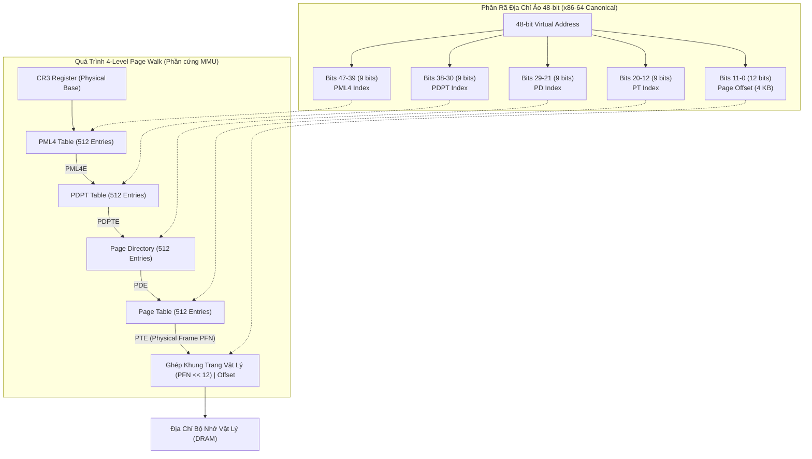
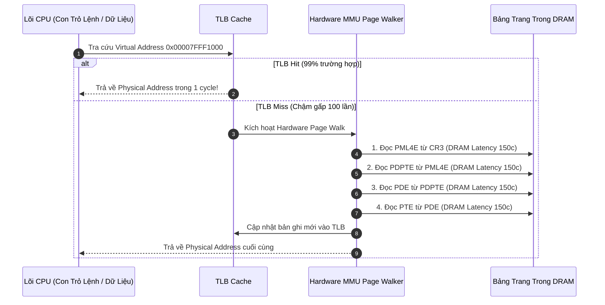

# 7.2. Page Tables & Address Translation (Bảng Phân trang & Quá trình Dịch Địa chỉ)

> [!IMPORTANT]
> **Nếu bạn chỉ được nhớ một điều duy nhất:**
> Bộ nhớ ảo (Virtual Memory) là một lớp trừu tượng thiên tài bảo vệ tiến trình: Mỗi khi CPU truy cập một con trỏ 64-bit, phần cứng MMU phải thực hiện một hành trình **"Page Walk" 4 tầng** (PML4 $\to$ PDPT $\to$ PD $\to$ PT) qua thanh ghi `CR3` để tìm ra khung trang vật lý (Physical Frame) — và bí mật giữ cho hệ thống không bị chậm đi hàng chục lần chính là bộ nhớ đệm dịch địa chỉ **TLB (Translation Lookaside Buffer)**!

---

## 1. Kiến trúc Tổng quan & Mô hình Tư duy (Mental Model)

### Phép Loại Suy Thực Tế: Hệ Thống Thư Viện Quốc Gia 4 Tầng

Hãy tưởng tượng bạn bước vào Thư viện Quốc gia khổng lồ để tìm một cuốn sách cổ:
1. **Địa Chỉ Ảo (Virtual Address - Mã Số Sách)**: Trên phiếu yêu cầu ghi một mã số dài gồm 4 chữ số chỉ đường và 1 số trang cụ thể: `[Khu 3] - [Dãy 12] - [Kệ 45] - [Ngăn 8] - [Trang 240]`.
2. **Thanh Ghi `CR3` (Bàn Lễ Tân Chính)**: Bạn không thể tự tiện xông vào kho. Bắt đầu từ cửa, bạn đến gặp Lễ tân chính (`CR3` Register) chứa địa chỉ của cuốn Danh bạ Tầng 1 (PML4).
3. **Quá Trình 4-Level Page Walk (Lần Theo Từng Cuốn Sổ Chỉ Dẫn)**:
   - Cuốn sổ PML4 chỉ bạn: *"Khu 3 nằm ở Tủ danh bạ PDPT số 0x5A00"*.
   - Cuốn sổ PDPT chỉ tiếp: *"Dãy 12 nằm ở Tủ danh bạ PD số 0x8C00"*.
   - Cuốn sổ PD chỉ tiếp: *"Kệ 45 nằm ở Tủ danh bạ PT số 0x1F00"*.
   - Cuốn sổ PT cuối cùng xác nhận: *"Ngăn 8 chính là Vị trí Vật lý (Physical Frame Number) số 0x9040 trong kho ngầm"*!
   - Cuối cùng, bạn cộng thêm số trang sách 240 (**Offset**) để mở đúng trang sách cần đọc.
4. **Hậu Quả Của Việc Không Có TLB**: Nếu mỗi lần đọc một dòng chữ bạn lại phải chạy qua 4 cuốn sổ danh bạ nói trên, bạn sẽ mất $4 \times 150 = 600$ chu kỳ DRAM chỉ để tìm ra địa chỉ vật lý trước khi đọc được 1 byte dữ liệu!
5. **TLB (Mẩu Giấy Nhớ Kẹp Nách)**: Sau lần tìm kiếm đầu tiên, bạn ghi nhanh vào một mẩu giấy nhớ kẹp nách (TLB): *"Mã `[3-12-45-8]` nằm ở Ngăn `0x9040`"*. Lần sau cần đọc trang kế tiếp, bạn liếc mẩu giấy nhớ mất đúng $1$ cycle (**TLB Hit**) mà không cần bước chân qua 4 cuốn danh bạ nữa.



---

## 2. Chi tiết từng Keyword (Under-the-Hood Deep Dive)

### 2.1. Multi-Level Page Tables & The 4-Level Walk (PML4)

#### 1. Khái niệm bản chất & Lý do Không dùng Bảng Phân trang Một Cấp
- Trong không gian địa chỉ 64-bit hiện đại, kiến trúc x86-64 sử dụng địa chỉ ảo 48-bit (Canonical Virtual Address, không gian $256\text{ TB}$). Kích thước trang tiêu chuẩn là $4\text{ KB} = 2^{12}\text{ bytes}$.
- Nếu dùng bảng phân trang một cấp phẳng (Flat Single-Level Page Table):
  $$\text{Số trang ảo} = \frac{2^{48}}{2^{12}} = 2^{36} \approx 6.87 \times 10^{10} \text{ trang}$$
  Mỗi Page Table Entry (PTE) chiếm 8 bytes. Một bảng phân trang phẳng sẽ ngốn:
  $$2^{36} \times 8\text{ bytes} = 512\text{ GB RAM}$$
  cho MỖI TIẾN TRÌNH! Đây là sự lãng phí không thể chấp nhận được, vì hầu hết các tiến trình chỉ sử dụng một vài Megabytes bộ nhớ thực tế.
- **Giải Pháp Phân Tầng (Multi-Level Tree Hierarchy)**:
  - Bảng phân trang được tổ chức thành cấu trúc cây phân nhánh $512$ nhánh (Radix-Tree).
  - Các nhánh của cây chỉ được cấp phát động khi tiến trình thực sự sử dụng bộ nhớ tại vùng đó (**Demand Paging**). Nếu một vùng địa chỉ không được ánh xạ, toàn bộ cây con bên dưới hoàn toàn không tồn tại trong RAM.

#### 2. Phân Tích Kỹ Thuật 4 Tầng Page Walk
Địa chỉ ảo 48-bit được chia thành 5 trường bit rõ ràng:
1. **Bits 47-39 (9 bits)**: Chỉ số mục trong **PML4** (Page Map Level 4) $\to$ trỏ tới 1 trong 512 mục PML4E.
2. **Bits 38-30 (9 bits)**: Chỉ số mục trong **PDPT** (Page Directory Pointer Table) $\to$ trỏ tới 1 trong 512 mục PDPTE.
3. **Bits 29-21 (9 bits)**: Chỉ số mục trong **PD** (Page Directory) $\to$ trỏ tới 1 trong 512 mục PDE.
4. **Bits 20-12 (9 bits)**: Chỉ số mục trong **PT** (Page Table) $\to$ trỏ tới 1 trong 512 mục PTE.
5. **Bits 11-0 (12 bits)**: **Page Offset** $\to$ độ lệch byte bên trong khung trang $4\text{ KB}$ vật lý.
- Thanh ghi **`CR3` (Control Register 3)**:
  - Chứa địa chỉ *vật lý* của gốc bảng PML4 của tiến trình đang chạy.
  - Mỗi khi xảy ra chuyển ngữ cảnh (Context Switch), hệ điều hành nạp lại giá trị `CR3` với địa chỉ bảng trang của tiến trình mới, kích hoạt việc vô hiệu hóa TLB (TLB Flush) nếu không có tính năng PCID (Process Context Identifiers).



---

### 2.2. Page Table Entry (PTE) Architecture & Bitfields

Mỗi mục trong bảng phân trang (PTE) có kích thước chuẩn $64\text{ bits}$ (8 bytes) trên kiến trúc x86-64, đóng vai trò là một thanh ghi điều khiển bảo mật và định tuyến bộ nhớ ở mức vi kiến trúc.

```
 63   62      52 51                                 12 11 9 8 7 6 5 4  3   2   1   0
+----+----------+-------------------------------------+----+-+-+-+-+-+---+---+---+---+
| XD | Reserved | Physical Page Frame Number (PFN)    |AVL |G|S|D|A|C|W|U/S|R/W| P |
|    |          | (Bits 51-12 of Physical Address)    |    | | | | |D|T|   |   |   |
+----+----------+-------------------------------------+----+-+-+-+-+-+---+---+---+---+
```

#### Phân Tích Ý Nghĩa Từng Bit Trường (Hardware Bitfields)

1. **Bit 0 - Present (P)**:
   - `P = 1`: Trang nhớ đang nằm hợp lệ trong RAM vật lý.
   - `P = 0`: Trang nhớ không tồn tại trong RAM. Nếu CPU cố truy cập, phần cứng lập tức kích hoạt ngắt ngoại lệ **Page Fault (#PF - Exception 14)**. Hệ điều hành sẽ xử lý: Nạp dữ liệu từ file Swap/Disk vào RAM hoặc gửi tín hiệu `SIGSEGV` (Segmentation Fault) để kết liễu tiến trình nếu truy cập vùng nhớ cấm.
2. **Bit 1 - Read / Write (R/W)**:
   - `0`: Quyền chỉ đọc (Read-Only). Cố tình ghi vào sẽ gây Page Fault (dùng cho vùng `.text` chứa mã máy hoặc cơ chế Copy-on-Write).
   - `1`: Quyền đọc và ghi (Read/Write).
3. **Bit 2 - User / Supervisor (U/S)**:
   - `0`: Quyền Supervisor (Ring 0 / Kernel Mode). Mã người dùng (Ring 3) không thể truy cập.
   - `1`: Quyền User (Ring 3). Mã ứng dụng người dùng được phép truy cập.
4. **Bit 3 - Page-level Write-Through (PWT)** & **Bit 4 - Page-level Cache Disable (PCD)**:
   - Điều khiển hành vi của Cache Controller với trang nhớ này.
   - `PCD = 1`: Vô hiệu hóa Cache (dùng cho vùng nhớ giao tiếp phần cứng I/O - Memory-Mapped I/O).
5. **Bit 5 - Accessed (A)**:
   - Phần cứng MMU tự động đặt `A = 1` mỗi khi trang nhớ này được đọc hoặc ghi. Dùng cho thuật toán thay thế trang (Page Replacement Algorithm) của Kernel Linux.
6. **Bit 6 - Dirty (D)**:
   - Phần cứng tự động đặt `D = 1` khi có thao tác GHI vào trang. Kernel biết trang này đã bị sửa đổi để lưu lại xuống đĩa trước khi giải phóng.
7. **Bit 7 - Page Size (PS)**:
   - Ở tầng PD hoặc PDPT: Nếu `PS = 1`, quá trình Page Walk dừng lại ngay lập tức và coi đây là một **Huge Page** ($2\text{ MB}$ ở PD hoặc $1\text{ GB}$ ở PDPT), bỏ qua các tầng bảng trang bên dưới!
8. **Bit 8 - Global (G)**:
   - Nếu `G = 1`, bản ghi dịch địa chỉ trong TLB sẽ KHÔNG bị xóa khi nạp lại `CR3` trong quá trình Context Switch (dùng cho các trang ánh xạ bộ nhớ của Kernel Linux dùng chung).
9. **Bit 63 - Execute-Disable / No-Execute (XD / NX bit)**:
   - Tính năng bảo mật phần cứng chống tấn công tràn bộ đệm (Buffer Overflow): Ngăn chặn triệt để việc CPU thực thi các chỉ thị lệnh nằm trên vùng nhớ dữ liệu (Stack và Heap).

---

## 3. Thực thi Mã nguồn & Mô phỏng Chuyên sâu (Dual-Engine Implementation)

### 3.1. C++20: Trình Phân Rã Địa Chỉ Ảo 48-bit & Mô Phỏng Giải Mã PTE

Chương trình minh họa phép toán nhị phân (Bit Manipulation) phân rã địa chỉ ảo 48-bit thành 4 chỉ số bảng trang và phân tích bitfield của x86-64 PTE:

```cpp
#include <iostream>
#include <cstdint>
#include <iomanip>

// Cấu trúc phân tích trường Bit của x86-64 Page Table Entry (PTE)
union PageTableEntry {
    uint64_t raw_value;
    struct {
        uint64_t present       : 1;  // Bit 0: P
        uint64_t read_write    : 1;  // Bit 1: R/W
        uint64_t user_super    : 1;  // Bit 2: U/S
        uint64_t write_through : 1;  // Bit 3: PWT
        uint64_t cache_disable : 1;  // Bit 4: PCD
        uint64_t accessed      : 1;  // Bit 5: A
        uint64_t dirty         : 1;  // Bit 6: D
        uint64_t page_size     : 1;  // Bit 7: PS
        uint64_t global        : 1;  // Bit 8: G
        uint64_t available     : 3;  // Bits 9-11: AVL
        uint64_t page_frame_num: 40; // Bits 12-51: Physical Frame (PFN)
        uint64_t reserved      : 11; // Bits 52-62
        uint64_t no_execute    : 1;  // Bit 63: NX / XD
    } bits;
};

// Hàm phân rã Virtual Address thành 4 cấp chỉ số
void deconstruct_virtual_address(uint64_t va) {
    uint64_t pml4_idx = (va >> 39) & 0x1FF;
    uint64_t pdpt_idx = (va >> 30) & 0x1FF;
    uint64_t pd_idx   = (va >> 21) & 0x1FF;
    uint64_t pt_idx   = (va >> 12) & 0x1FF;
    uint64_t offset   = va & 0xFFF;

    std::cout << ">>> PHÂN RÃ ĐỊA CHỈ ẢO: 0x" << std::hex << std::setw(16) << std::setfill('0') << va << std::dec << "\n";
    std::cout << "  - PML4 Index (Bits 47-39): " << pml4_idx << " (0x" << std::hex << pml4_idx << ")\n";
    std::cout << "  - PDPT Index (Bits 38-30): " << pdpt_idx << " (0x" << pdpt_idx << ")\n";
    std::cout << "  - PD   Index (Bits 29-21): " << pd_idx   << " (0x" << pd_idx   << ")\n";
    std::cout << "  - PT   Index (Bits 20-12): " << pt_idx   << " (0x" << pt_idx   << ")\n";
    std::cout << "  - Offset     (Bits 11-0) : " << offset   << " (0x" << offset   << ")\n" << std::dec;
}

void inspect_pte(uint64_t pte_raw) {
    PageTableEntry pte;
    pte.raw_value = pte_raw;

    std::cout << "\n>>> GIẢI PHÃU BITFIELD PTE: 0x" << std::hex << pte_raw << std::dec << "\n";
    std::cout << "  - Present (P)      : " << pte.bits.present << " (" << (pte.bits.present ? "In RAM" : "Page Fault!") << ")\n";
    std::cout << "  - Read/Write (R/W) : " << pte.bits.read_write << " (" << (pte.bits.read_write ? "Writable" : "Read-Only") << ")\n";
    std::cout << "  - User/Supervisor  : " << pte.bits.user_super << " (" << (pte.bits.user_super ? "User Ring-3" : "Kernel Ring-0") << ")\n";
    std::cout << "  - Accessed (A)     : " << pte.bits.accessed << "\n";
    std::cout << "  - Dirty (D)        : " << pte.bits.dirty << "\n";
    std::cout << "  - Huge Page (PS)   : " << pte.bits.page_size << " (" << (pte.bits.page_size ? "2MB/1GB Page" : "4KB Page") << ")\n";
    std::cout << "  - No-Execute (NX)  : " << pte.bits.no_execute << " (" << (pte.bits.no_execute ? "Execution Blocked" : "Executable") << ")\n";
    std::cout << "  - Physical Frame   : 0x" << std::hex << (static_cast<uint64_t>(pte.bits.page_frame_num) << 12) << std::dec << "\n";
}

int main() {
    std::cout << "========================================================\n";
    std::cout << "  C++20 x86-64 PAGE TABLE & ADDRESS TRANSLATION ENGINE\n";
    std::cout << "========================================================\n\n";

    // Phân rã một địa chỉ ảo điển hình trên Linux x86-64
    uint64_t sample_va = 0x00007FFF5FBFF4A8ULL;
    deconstruct_virtual_address(sample_va);

    // Giải phẫu một PTE thực tế (Ví dụ: Trang nhớ ghi được của User, nạp tại khung 0x10A000, cấm thực thi)
    // P=1, RW=1, US=1, NX=1, PFN=0x10A
    uint64_t sample_pte = (1ULL << 63) | (0x10AULL << 12) | 0x07ULL;
    inspect_pte(sample_pte);

    return 0;
}
```

---

### 3.2. Python 3.11+: Trình Giả Lập 4-Level Page Walk & Phản Hồi Page Fault

Chương trình Python 3.11+ mô phỏng toàn bộ phần cứng MMU duyệt cây bảng phân trang và kích hoạt ngoại lệ Page Fault:

```python
from typing import Dict, Optional, Tuple

class HardwareMMU:
    def __init__(self):
        # Bo nho vat ly gia lap: base_addr -> dict(index -> entry)
        self.physical_memory: Dict[int, Dict[int, int]] = {}
        self.cr3: int = 0x1000  # Base physical address of PML4

    def allocate_table(self, phys_addr: int):
        self.physical_memory[phys_addr] = {}

    def map_page(self, va: int, pa: int, writable: bool = True, user: bool = True):
        # Trich xuat cac chi so
        pml4_i = (va >> 39) & 0x1FF
        pdpt_i = (va >> 30) & 0x1FF
        pd_i   = (va >> 21) & 0x1FF
        pt_i   = (va >> 12) & 0x1FF

        # Helper tao bang neu chua co
        curr_table_addr = self.cr3
        indices = [pml4_i, pdpt_i, pd_i]
        next_alloc = 0x2000

        for level, idx in enumerate(indices):
            table = self.physical_memory.setdefault(curr_table_addr, {})
            if idx not in table:
                # Cap phat bang tiep theo
                table[idx] = next_alloc | 0x07  # P=1, R/W=1, U/S=1
                next_alloc += 0x1000
            curr_table_addr = table[idx] & ~0xFFF

        # Tai tang Page Table (PT)
        pt_table = self.physical_memory.setdefault(curr_table_addr, {})
        flags = 0x01  # Present
        if writable: flags |= 0x02
        if user:     flags |= 0x04
        pt_table[pt_i] = (pa & ~0xFFF) | flags

    def translate(self, va: int, is_write: bool = False) -> Tuple[Optional[int], str]:
        pml4_i = (va >> 39) & 0x1FF
        pdpt_i = (va >> 30) & 0x1FF
        pd_i   = (va >> 21) & 0x1FF
        pt_i   = (va >> 12) & 0x1FF
        offset = va & 0xFFF

        curr_table = self.cr3
        indices = [("PML4", pml4_i), ("PDPT", pdpt_i), ("PD", pd_i), ("PT", pt_i)]

        for level_name, idx in indices:
            table = self.physical_memory.get(curr_table, {})
            if idx not in table:
                return None, f"PAGE FAULT (#PF): Không tìm thấy Entry tại {level_name} (P=0)"
            entry = table[idx]
            if not (entry & 0x01):  # Present bit
                return None, f"PAGE FAULT (#PF): Present bit = 0 tại {level_name}"
            if is_write and not (entry & 0x02):  # Write violation
                return None, f"PAGE FAULT (#PF): Vi phạm quyền ghi (Read-Only tại {level_name})"
            curr_table = entry & ~0xFFF

        # Thiet lap dia chi vat ly
        pfn = curr_table
        physical_address = pfn | offset
        return physical_address, "TRANSLATION SUCCESS"

if __name__ == "__main__":
    mmu = HardwareMMU()
    # Anh xa dia chi ao 0x7FFF_1000_5000 vao dia chi vat ly 0x000A_4000_5000 (Read-Only)
    va_test = 0x7FFF_1000_5ABC
    pa_target = 0x000A_4000_5000

    mmu.map_page(va=va_test, pa=pa_target, writable=False, user=True)

    print(">>> KIỂM TRA DỊCH ĐỊA CHỈ QUA HARDWARE MMU:")
    # 1. Thu nghiem doc hop le
    pa, msg = mmu.translate(va_test, is_write=False)
    print(f"1. Thao tac DOC 0x{va_test:X}   -> {msg} | Physical Address = 0x{pa:X}")

    # 2. Thu nghiem ghi vao trang Read-Only
    pa_err, msg_err = mmu.translate(va_test, is_write=True)
    print(f"2. Thao tac GHI 0x{va_test:X}   -> {msg_err}")

    # 3. Thu nghiem truy cap dia chi chua duoc anh xa
    pa_unmapped, msg_unmapped = mmu.translate(0xDEADBEEF000, is_write=False)
    print(f"3. Thao tac DOC 0xDEADBEEF000 -> {msg_unmapped}")
```

---

### 3.3. Simulated Terminal Output

```bash
========================================================
  C++20 x86-64 PAGE TABLE & ADDRESS TRANSLATION ENGINE
========================================================

>>> PHÂN RÃ ĐỊA CHỈ ẢO: 0x00007fff5fbff4a8
  - PML4 Index (Bits 47-39): 255 (0xff)
  - PDPT Index (Bits 38-30): 510 (0x1fe)
  - PD   Index (Bits 29-21): 477 (0x1dd)
  - PT   Index (Bits 20-12): 511 (0x1ff)
  - Offset     (Bits 11-0) : 1192 (0x4a8)

>>> GIẢI PHÃU BITFIELD PTE: 0x800000000010a007
  - Present (P)      : 1 (In RAM)
  - Read/Write (R/W) : 1 (Writable)
  - User/Supervisor  : 1 (User Ring-3)
  - Accessed (A)     : 0
  - Dirty (D)        : 0
  - Huge Page (PS)   : 0 (4KB Page)
  - No-Execute (NX)  : 1 (Execution Blocked)
  - Physical Frame   : 0x10a000

>>> KIỂM TRA DỊCH ĐỊA CHỈ QUA HARDWARE MMU:
1. Thao tac DOC 0x7FFF10005ABC   -> TRANSLATION SUCCESS | Physical Address = 0xA40005ABC
2. Thao tac GHI 0x7FFF10005ABC   -> PAGE FAULT (#PF): Vi phạm quyền ghi (Read-Only tại PT)
3. Thao tac DOC 0xDEADBEEF000 -> PAGE FAULT (#PF): Không tìm thấy Entry tại PML4 (P=0)
```

---

## 4. Systems Engineering & Production Pitfalls

### 4.1. Production Failure Modes & Architectural Traps

1. **Trap 1: TLB Shootdown Storm Trong Hệ Thống Đa Nhân (Multi-Core SMP)**:
   - Khi một luồng giải phóng bộ nhớ (`free()` hoặc `munmap()`), Kernel Linux buộc phải xóa bản ghi tương ứng trong bảng trang và phát ra ngắt liên nhân (**Inter-Processor Interrupt - IPI**) tới tất cả các CPU cores khác đang chạy cùng tiến trình để yêu cầu xả TLB (**TLB Shootdown**).
   - Trên máy chủ 128 cores, một vòng lặp `munmap()` liên tục sẽ biến thành cơn bão IPI làm treo cứng toàn bộ các CPU, khiến thời gian thực thi của hệ điều hành chiếm tới $80\%$ CPU System Time.
2. **Trap 2: Major Page Fault Throttling Khi Thiếu RAM**:
   - Khi `Present = 0`, Kernel phải phân biệt giữa hai loại lỗi trang:
     - **Minor Page Fault**: Khung trang đã nằm sẵn trong Page Cache, chỉ cần cấp phát PTE (mất vài micro-giây).
     - **Major Page Fault**: Trang nhớ bị đẩy ra phân vùng Swap trên ổ đĩa SSD/HDD. CPU bị đình chỉ để chờ đọc đĩa (mất từ $50\mu\text{s}$ đến $10\text{ms}$!), đẩy độ trễ API của backend lên hàng chục giây.
3. **Trap 3: Memory Footprint Của Chính Bảng Phân Trang**:
   - Một tiến trình JVM hoặc Redis cấp phát $100\text{ GB}$ bộ nhớ phân mảnh với các trang tiêu chuẩn $4\text{ KB}$ sẽ tạo ra hơn 25 triệu mục PTE, tiêu tốn hơn $200\text{ MB}$ RAM chỉ để chứa chính các bảng phân trang này. Giải pháp bắt buộc là chuyển sang sử dụng **Huge Pages (2 MB / 1 GB)**.

### 4.2. Diagnostic CLI Commands

```bash
# 1. Theo doi so luong Minor va Major Page Faults theo thoi gian thuc tren toan he thong
sar -B 1 10

# 2. Do luong chi phi TLB Misses va so chu ky CPU lang phi cho Hardware Page Walk
perf stat -e dTLB-loads,dTLB-load-misses,dtlb_load_misses.walk_duration ./database_engine

# 3. Kiem tra kich thuoc bo nho bi chiem dung boi Page Tables trong Linux (/proc/meminfo)
grep PageTables /proc/meminfo

# 4. Kiem tra cac ngat IPI TLB Shootdown giua cac CPU cores tren may chu da socket
grep TLB /proc/interrupts
```

---

## 5. Bảng So sánh & Decision Matrix

| Kích thước Trang (Page Size) | Số Tầng Dịch Địa Chỉ | Dung lượng Vùng Nhớ TLB Bao Phủ (Coverage) | Nguy cơ Phân Mảnh Nội Bộ | Trường hợp Sử dụng Tối ưu |
| :--- | :--- | :--- | :--- | :--- |
| **Standard 4 KB** | 4 Tầng (PML4 $\to$ PDPT $\to$ PD $\to$ PT) | Rất nhỏ ($512 \text{ entries} \times 4\text{ KB} = 2\text{ MB}$) | Rất thấp (Trung bình lãng phí $2\text{ KB}$) | Tiến trình ngắn hạn, Command-line, microservices nhỏ |
| **Huge Page 2 MB** | 3 Tầng (PML4 $\to$ PDPT $\to$ PD) | Lớn ($512 \text{ entries} \times 2\text{ MB} = 1\text{ GB}$) | Trung bình (Lãng phí nếu chỉ dùng vài KB) | CSDL In-memory (Redis, Postgres), Web Servers, JVM Heap |
| **Giant Page 1 GB** | 2 Tầng (PML4 $\to$ PDPT) | Cực lớn ($512 \text{ entries} \times 1\text{ GB} = 512\text{ GB}$) | Rất cao (Lãng phí nếu không dùng hết) | Siêu máy tính HPC, Huấn luyện AI/LLM, Ảo hóa Hypervisor |

| Bit Cờ PTE | Tên Đầy Đủ | Trạng thái = 0 | Trạng thái = 1 | Hậu quả Vi phạm Vi kiến trúc |
| :--- | :--- | :--- | :--- | :--- |
| **P (Bit 0)** | Present | Không có trong RAM | Có trong RAM vật lý | Kích hoạt Page Fault Exception (#PF) |
| **R/W (Bit 1)** | Read/Write | Chỉ cho phép Đọc | Cho phép Đọc và Ghi | Ghi vào gây Crash `SIGSEGV` hoặc kích hoạt COW |
| **U/S (Bit 2)** | User/Supervisor | Chỉ Kernel (Ring 0) | Cả User (Ring 3) | Ứng dụng đọc gây Crash bảo mật lập tức |
| **PS (Bit 7)** | Page Size | Trang tiêu chuẩn 4 KB | Trang Huge Page 2MB/1GB | Thay đổi toàn bộ hành trình dịch địa chỉ MMU |
| **XD (Bit 63)** | Execute-Disable | Cho phép thực thi mã | Cấm nạp lệnh thực thi | Chặn tấn công tiêm mã Shellcode trên Stack/Heap |
