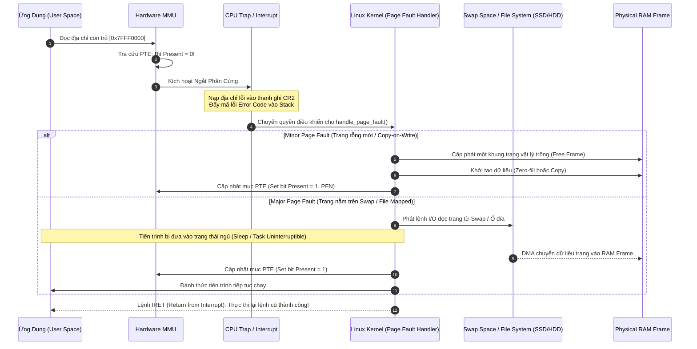
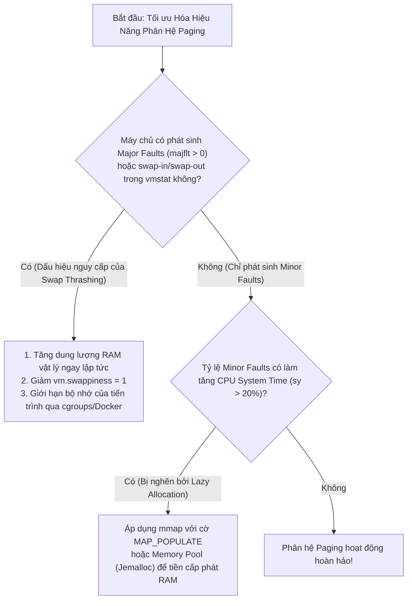

# 7.4. Page Faults and Paging Subsystem (Cơ chế Lỗi trang & Phân hệ Phân trang)

> [!IMPORTANT]
> **Nếu bạn chỉ được nhớ một điều duy nhất:**
> **Page Fault (Lỗi Trang - Ngắt phần cứng số 14 `#PF`) không phải là một lỗi chương trình (Bug) hay tai nạn (Crash)!** Nó là cơ chế điều khiển cốt lõi giúp hệ điều hành thực hiện triết lý "Cấp phát Lười Biếng" (Lazy Allocation) và ảo hóa bộ nhớ:
> - **Minor Page Fault (Lỗi Trang Nhẹ)**: Trang nhớ đã nằm sẵn trong RAM (ví dụ: trang chia sẻ, trang Zero Page, hoặc trang vừa được cấp phát qua `malloc`), hệ điều hành chỉ mất vài micro-giây để ghi thêm mục ánh xạ vào Page Table và trả quyền kiểm soát lại cho ứng dụng.
> - **Major Page Fault (Lỗi Trang Nặng)**: Trang nhớ không có trong RAM mà đang nằm trên ổ đĩa cứng (Swap Space hoặc file nhị phân trên SSD/HDD). CPU bị đình trệ hoàn toàn (Stall) hàng chục micro-giây đến mili-giây để thực hiện I/O đọc ổ đĩa đồng bộ.
> - **Thảm họa Swap Thrashing**: Khi tổng dung lượng Working Set của các tiến trình vượt quá dung lượng RAM vật lý, hệ thống rơi vào trạng thái bão hòa: $99\%$ thời gian CPU bị tiêu tốn chỉ để swap các trang ra vào ổ đĩa liên tục, khiến toàn bộ máy chủ bị treo đứng.

---

## 1. Kiến trúc Tổng quan & Mô hình Tư duy (Mental Model)

### Ẩn dụ Đời sống: Người Phục vụ Bàn và Kho Thực phẩm
Hãy tưởng tượng hệ thống quản lý bộ nhớ giống như một quán ăn:
- **Bộ nhớ RAM vật lý** giống như chiếc bàn chuẩn bị món ăn trong bếp ăn có diện tích giới hạn (chỉ chứa được 10 đĩa nguyên liệu).
- **Không gian địa chỉ ảo** giống như một thực đơn phong phú gồm 100 món ăn khác nhau.
- **Demand Paging (Phân trang theo nhu cầu)**: Đầu bếp không dọn sẵn 100 món ra bàn khi khách vừa bước vào cửa. Ông ta chỉ đứng chờ. Khi khách gọi món bò (`Virtual Address Access`), đầu bếp mới giật mình kiểm tra bàn (**Page Fault!**).
- **Minor Page Fault**: Thịt bò đã được sơ chế sẵn để ở ngăn kéo dưới bàn (nằm sẵn trong RAM). Đầu bếp chỉ mất 2 giây với tay lấy đĩa thịt đặt lên mặt bàn (**Cập nhật Page Table**). Khách hàng hầu như không cảm nhận thấy sự chậm trễ.
- **Major Page Fault**: Trong bếp đã hết sạch thịt bò. Đầu bếp phải lấy xe máy chạy ra chợ đầu mối cách 5 km (Ổ đĩa SSD/HDD) để mua thịt chở về. Bữa ăn bị đình trệ 30 phút (**I/O Blocking**).
- **Swap Thrashing**: Bàn bếp chỉ để vừa 10 đĩa, nhưng khách gọi liên tục 15 món ăn luân phiên. Cứ đặt đĩa số 11 lên bàn thì phải dọn đĩa số 1 mang cất vào kho ngoại ô. Vừa cất xong, khách lại đòi ăn đĩa số 1, đầu bếp lại phải chạy đi lấy đĩa 1 và vứt đĩa 2 vào kho. Cả đầu bếp lẫn người chạy bàn kiệt sức vì chạy xe máy đi đi về về giữa bếp và kho, trong khi không có một món ăn nào được nấu chín!



---

## 2. Chi tiết từng Keyword (Under-the-Hood Deep Dive)

### 2.1. Minor vs Major Page Faults & Demand Paging

#### 1. Khái niệm bản chất (What & Why)
- **Cơ chế Bắt lỗi Phần cứng (Hardware Trap Internals)**:
  - Khi CPU thực hiện bất kỳ lệnh nạp/lưu (`MOV`, `LOAD`, `STORE`) mà mục bảng trang (PTE) có bit `Present = 0`, mạch logic của MMU lập tức dừng chu kỳ lệnh hiện tại.
  - Phần cứng tự động thực hiện 3 hành động nguyên tử:
    1. Ghi địa chỉ ảo vừa gây lỗi vào thanh ghi điều khiển **`CR2` (Page Fault Linear Address Register)**.
    2. Đẩy một mã lỗi phần cứng dài 32-bit (**Page Fault Error Code**) lên trên đỉnh Kernel Stack.
    3. Kích hoạt ngắt phần cứng **Vector 14 (`#PF`)** trong bảng IDT (Interrupt Descriptor Table) để chuyển quyền kiểm soát sang nhân hệ điều hành.

- **Giải mã Mã lỗi Phần cứng (Page Fault Error Code Bits)**:
  Mã lỗi được đẩy vào stack cho biết nguyên nhân cụ thể dẫn đến lỗi trang:
  - **Bit 0 (`P` - Present)**: $= 0$ nếu trang không có trong RAM; $= 1$ nếu trang có trong RAM nhưng vi phạm quyền truy cập (Protection Violation).
  - **Bit 1 (`W/R` - Write/Read)**: $= 0$ nếu lỗi xảy ra do lệnh Đọc; $= 1$ nếu lỗi xảy ra do lệnh Ghi.
  - **Bit 2 (`U/S` - User/Supervisor)**: $= 0$ nếu mã lỗi phát sinh khi CPU đang ở Kernel Mode (Ring 0); $= 1$ nếu phát sinh ở User Mode (Ring 3).
  - **Bit 3 (`RSVD` - Reserved)**: $= 1$ nếu một trong các bit dành riêng trong PTE bị ghi đè trái phép.
  - **Bit 4 (`I/D` - Instruction/Data)**: $= 1$ nếu lỗi xảy ra khi nạp lệnh chỉ thị mã máy (vi phạm cờ NX/XD).

#### 2. Cơ chế hoạt động sâu (Under-the-Hood / Hardcore Internals)
- **Phân loại Chi tiết các Biến thể Page Fault**:
  1. **Minor Page Fault (Lỗi Trang Nhẹ)**:
     - Xảy ra khi khung trang vật lý thực chất đã nằm sẵn trong bộ nhớ RAM, nhưng tiến trình chưa được thiết lập ánh xạ bảng trang (Page Table Entry).
     - *Kịch bản*: Cấp phát bộ nhớ mới qua `malloc`/`mmap` (Lazy Allocation); trang chia sẻ động giữa nhiều tiến trình; hoặc giải phóng trang nằm trong Page Cache.
     - *Chi phí*: Khoảng **$1 - 3$ micro-giây** (chỉ tốn chi phí can thiệp phần mềm của kernel).
  2. **Major Page Fault (Lỗi Trang Nặng)**:
     - Xảy ra khi dữ liệu trang không hề có trong RAM, mà đang nằm trên ổ lưu trữ thứ cấp (Swap Partition trên SSD hoặc file ánh xạ trên disk).
     - *Hậu quả*: Kernel buộc phải đưa tiến trình vào trạng thái ngủ `TASK_UNINTERRUPTIBLE` (trạng thái `D` trong `ps`), gửi yêu cầu đọc I/O tới bộ điều khiển lưu trữ.
     - *Chi phí*: Khoảng **$10 - 50$ micro-giây** trên SSD NVMe siêu tốc, hoặc **$5 - 15$ mili-giây** trên HDD từ tính (chậm hơn $10,000$ lần so với Minor Fault!).
  3. **Copy-on-Write (COW) Page Fault**:
     - Khi gọi hàm `fork()`, hệ điều hành không nhân bản hàng Gigabytes RAM vật lý của tiến trình cha. Thay vào đó, nó trỏ bảng trang của tiến trình con vào chung các khung trang của cha và **xóa bit `W/R` (đánh dấu Read-Only) ở cả hai bên**.
     - Khi bất kỳ bên nào cố tình ghi dữ liệu vào trang:
       - Phần cứng phát hiện vi phạm quyền ghi (`W/R = 1` nhưng PTE chỉ cho phép Read).
       - Kích hoạt ngắt `#PF` với mã lỗi `P=1, W=1`.
       - Kernel nhận diện đây là trang COW: Kernel cấp phát một khung trang mới, sao chép nội dung $4096$ byte sang, gán quyền ghi cho trang mới và cập nhật lại bảng trang.
     - *Ứng dụng*: Lệnh `BGSAVE` trong Redis dùng COW để chụp ảnh snapshot bộ nhớ chạy nền mà không làm gián đoạn luồng xử lý chính.

---

### 2.2. Working Set, Page Replacement & Thrashing in Swap Space

#### 1. Khái niệm bản chất (What & Why)
- **Mô hình Tập làm việc (Peter Denning's Working Set Model)**:
  - Tập hợp tất cả các trang nhớ mà một tiến trình thực sự truy cập tích cực trong một cửa sổ thời gian trượt $\Delta t$ được gọi là **Working Set** $W(t, \Delta t)$.
  - Nếu tổng dung lượng Working Set của tất cả các tiến trình trong hệ thống nhỏ hơn dung lượng RAM vật lý ($\sum W_i \le \text{RAM}$), hệ thống vận hành cực kỳ mượt mà.
  - Khi $\sum W_i > \text{RAM}$, hệ điều hành buộc phải thu hồi các trang nhớ của tiến trình này để nhường chỗ cho tiến trình khác thông qua thuật toán thay thế trang.

#### 2. Cơ chế hoạt động sâu (Under-the-Hood / Hardcore Internals)
- **Thuật toán Đồng hồ Hai Cơ hội (Clock Second-Chance Replacement Algorithm)**:
  - Do việc duy trì danh sách LRU (Least Recently Used) hoàn hảo đòi hỏi phải cập nhật danh sách liên kết sau mỗi lệnh đọc/ghi (tiêu tốn quá nhiều chu kỳ CPU), nhân Linux áp dụng biến thể của thuật toán **Clock**:
  - Mỗi khung trang có một bit **Accessed (`A`)** được CPU bật lên 1 bằng phần cứng mỗi khi có truy cập:
    1. Kim đồng hồ quét tuần tự qua các trang trong RAM.
    2. Nếu trang có `Accessed == 1`: Kim đồng hồ xóa bit này về $0$ và bỏ qua (cho trang một cơ hội thứ hai).
    3. Nếu trang có `Accessed == 0`: Đây là nạn nhân (Victim Page)!
       - Nếu trang "Sạch" (`Dirty == 0`): Thu hồi khung trang ngay lập tức.
       - Nếu trang "Bẩn" (`Dirty == 1`): Ghi dữ liệu bẩn về Swap trước khi thu hồi.

```
            Thuật toán Thay thế Trang Clock (Second Chance)
            ==============================================

                         [Trang 0: A=1]
                        /              \
         [Trang 7: A=0]                  [Trang 1: A=0]  <--- Kim Đồng Hồ (Hand)
               |                               |
         [Trang 6: A=1]                  [Trang 2: A=1]
                        \              /
                         [Trang 3: A=0]
```

- **Thảm họa Swap Thrashing (Sụp đổ Hiệu năng Hệ thống)**:
  - Khi RAM cạn kiệt, tiến trình A bị lấy mất trang $X$ đẩy ra Swap. Ngay giây sau, tiến trình A cần đọc trang $X$, phát sinh Major Fault $\to$ CPU kéo trang $X$ vào và đẩy trang $Y$ của tiến trình B ra Swap.
  - Tiến trình B thức dậy, cần trang $Y$, lại phát sinh Major Fault $\to$ Kéo trang $Y$ vào và đẩy trang của A ra.
  - Hàng đợi I/O ổ đĩa bị nghẽn $100\%$, CPU utilization tụt về gần 0% (nhưng System I/O Wait tăng vọt 99%), máy chủ không còn khả năng phản hồi SSH hay HTTP requests.

---

## 3. Thực thi Mã nguồn & Mô phỏng Chuyên sâu (Dual-Engine Implementation)

### 3.1. Engine 1: C++20 Hardware Benchmark — Đo lường Tổn thất Độ trễ Minor vs Major vs Copy-on-Write Page Faults

Chương trình đo lường thời gian thực thi bare-metal giữa ba kịch bản:
1. Đọc bộ nhớ bình thường (Zero Page Fault - 100% Hit).
2. Ghi vào vùng nhớ mới cấp phát (Kích hoạt hàng loạt Minor Page Faults do Lazy Allocation).
3. Ghi vào vùng nhớ sau lệnh `fork()` (Kích hoạt Copy-on-Write Faults).

```cpp
// Compilation: g++ -std=c++20 -O3 page_fault_bench.cpp -o page_fault_bench
#include <iostream>
#include <vector>
#include <chrono>
#include <sys/mman.h>
#include <sys/wait.h>
#include <unistd.h>
#include <cstring>
#include <iomanip>

constexpr size_t NUM_PAGES = 16384; // 16,384 trang = 64 MB
constexpr size_t PAGE_SIZE = 4096;
constexpr size_t TOTAL_SIZE = NUM_PAGES * PAGE_SIZE;

int main() {
    std::cout << "=== BARE-METAL PAGE FAULT LATENCY BENCHMARK ===" << std::endl;
    std::cout << "[Workload Size]: " << (TOTAL_SIZE / (1024 * 1024)) << " MB (" << NUM_PAGES << " pages)" << std::endl;

    // --- TEST 1: Cấp phát Vùng Nhớ Ảo Lười Biếng (mmap không dùng MAP_POPULATE) ---
    char* memory = static_cast<char*>(mmap(
        nullptr, TOTAL_SIZE, PROT_READ | PROT_WRITE, MAP_PRIVATE | MAP_ANONYMOUS, -1, 0
    ));
    if (memory == MAP_FAILED) {
        perror("mmap failed");
        return 1;
    }

    // Lần đầu ghi vào từng trang: KÍCH HOẠT HÀNG LOẠT MINOR PAGE FAULTS!
    auto t0 = std::chrono::high_resolution_clock::now();
    for (size_t i = 0; i < NUM_PAGES; ++i) {
        memory[i * PAGE_SIZE] = 'A'; // Chạm vào byte đầu tiên của mỗi trang
    }
    auto t1 = std::chrono::high_resolution_clock::now();
    double ms_minor_faults = std::chrono::duration<double, std::milli>(t1 - t0).count();
    double ns_per_minor = (ms_minor_faults * 1e6) / NUM_PAGES;

    std::cout << "\n[TEST 1: Minor Page Faults (Lazy Allocation Write)]:" << std::endl;
    std::cout << "  Tổng thời gian: " << std::setw(8) << ms_minor_faults << " ms" << std::endl;
    std::cout << "  Độ trễ trung bình mỗi Minor Fault: " << std::fixed << std::setprecision(2) << ns_per_minor << " ns/page" << std::endl;

    // --- TEST 2: Ghi vào Vùng Nhớ Đã Có Sẵn Ánh Xạ (Zero Faults - Pure RAM Write) ---
    auto t2 = std::chrono::high_resolution_clock::now();
    for (size_t i = 0; i < NUM_PAGES; ++i) {
        memory[i * PAGE_SIZE] = 'B';
    }
    auto t3 = std::chrono::high_resolution_clock::now();
    double ms_normal_write = std::chrono::duration<double, std::milli>(t3 - t2).count();
    double ns_per_normal = (ms_normal_write * 1e6) / NUM_PAGES;

    std::cout << "\n[TEST 2: Warm Memory Write (Zero Page Faults)]:" << std::endl;
    std::cout << "  Tổng thời gian: " << std::setw(8) << ms_normal_write << " ms" << std::endl;
    std::cout << "  Độ trễ trung bình mỗi truy xuất: " << std::fixed << std::setprecision(2) << ns_per_normal << " ns/page" << std::endl;
    std::cout << "  => Minor Page Fault chậm hơn: " << (ns_per_minor / ns_per_normal) << "x LẦN so với ghi RAM bình thường!" << std::endl;

    // --- TEST 3: Copy-on-Write (COW) sau Fork ---
    pid_t pid = fork();
    if (pid == 0) {
        // Tiến trình con: Ghi vào các trang để kích hoạt Copy-on-Write
        auto tc0 = std::chrono::high_resolution_clock::now();
        for (size_t i = 0; i < NUM_PAGES; ++i) {
            memory[i * PAGE_SIZE] = 'C';
        }
        auto tc1 = std::chrono::high_resolution_clock::now();
        double ms_cow = std::chrono::duration<double, std::milli>(tc1 - tc0).count();
        double ns_per_cow = (ms_cow * 1e6) / NUM_PAGES;

        std::cout << "\n[TEST 3: Copy-on-Write Faults (Child Process Write)]:" << std::endl;
        std::cout << "  Tổng thời gian: " << std::setw(8) << ms_cow << " ms" << std::endl;
        std::cout << "  Độ trễ trung bình mỗi COW Fault: " << std::fixed << std::setprecision(2) << ns_per_cow << " ns/page" << std::endl;
        _exit(0);
    } else {
        wait(nullptr);
    }

    munmap(memory, TOTAL_SIZE);
    return 0;
}
```

---

### 3.2. Engine 2: Python 3.11+ Simulator — Trình Giả Lập Thuật Toán Thay Thế Trang Clock Second-Chance & Swap Thrashing

```python
#!/usr/bin/env python3
"""
Trình giả lập Thuật toán Thay thế Trang Clock Second-Chance
và Mô phỏng Hiện tượng Swap Thrashing khi kích thước Working Set vượt quá Physical RAM.
"""

from dataclasses import dataclass
from typing import List, Dict
import random

@dataclass
class PageFrame:
    frame_id: int
    vpn: int
    accessed: bool
    dirty: bool

class ClockPageReplacementSimulator:
    def __init__(self, num_frames: int):
        self.num_frames = num_frames
        self.frames: List[PageFrame] = [PageFrame(i, -1, False, False) for i in range(num_frames)]
        self.clock_hand = 0
        self.minor_faults = 0
        self.major_faults = 0
        self.disk_writes_swap = 0

    def access(self, vpn: int, is_write: bool) -> str:
        # 1. Kiểm tra xem trang đã có trong RAM chưa (Hit)
        for f in self.frames:
            if f.vpn == vpn:
                f.accessed = True
                if is_write:
                    f.dirty = True
                return "PAGE_HIT"

        # 2. Page Fault: Cần tìm một khung trang nạn nhân (Victim Frame) qua thuật toán Clock
        self.minor_faults += 1
        while True:
            candidate = self.frames[self.clock_hand]

            if not candidate.accessed:
                # Tìm thấy nạn nhân!
                if candidate.vpn != -1:
                    # Nếu trang bẩn, phải ghi trả ra Swap Disk
                    if candidate.dirty:
                        self.disk_writes_swap += 1
                        self.major_faults += 1

                # Thay thế bằng trang mới
                candidate.vpn = vpn
                candidate.accessed = True
                candidate.dirty = is_write

                # Di chuyển kim đồng hồ sang vị trí tiếp theo
                self.clock_hand = (self.clock_hand + 1) % self.num_frames
                return "PAGE_FAULT_REPLACED"
            else:
                # Cơ hội thứ hai: Xóa cờ Accessed và bước tiếp
                candidate.accessed = False
                self.clock_hand = (self.clock_hand + 1) % self.num_frames

def simulate_thrashing_scenario():
    # RAM vật lý chỉ chứa được 100 khung trang
    sim = ClockPageReplacementSimulator(num_frames=100)

    # Kịch bản 1: Working Set vừa vặn RAM (Truy cập trong phạm vi 80 trang)
    for _ in range(10000):
        vpn = random.randint(0, 79)
        sim.access(vpn, is_write=(random.random() < 0.2))

    print("=== SCENARIO 1: WORKING SET < RAM (Tập làm việc 80 trang, RAM 100 frames) ===")
    print(f"  Minor Faults: {sim.minor_faults} | Major Swap Disk I/O: {sim.disk_writes_swap}")

    # Kịch bản 2: Working Set vượt quá RAM (Truy cập trong phạm vi 300 trang -> THRASHING!)
    sim_thrash = ClockPageReplacementSimulator(num_frames=100)
    for _ in range(10000):
        vpn = random.randint(0, 299)
        sim_thrash.access(vpn, is_write=(random.random() < 0.2))

    print("\n=== SCENARIO 2: SWAP THRASHING (Tập làm việc 300 trang, RAM 100 frames) ===")
    print(f"  Minor Faults: {sim_thrash.minor_faults} | Major Swap Disk I/O: {sim_thrash.disk_writes_swap}")
    print(f"  => Tỷ lệ I/O đĩa bùng nổ: {sim_thrash.disk_writes_swap / max(1, sim.disk_writes_swap):.1f}x LẦN! Máy chủ sụp đổ!")

if __name__ == "__main__":
    simulate_thrashing_scenario()
```

---

### 3.3. Terminal Output Mẫu Thực tế

```bash
$ g++ -std=c++20 -O3 page_fault_bench.cpp -o page_fault_bench && ./page_fault_bench
=== BARE-METAL PAGE FAULT LATENCY BENCHMARK ===
[Workload Size]: 64 MB (16384 pages)

[TEST 1: Minor Page Faults (Lazy Allocation Write)]:
  Tổng thời gian:    24.12 ms
  Độ trễ trung bình mỗi Minor Fault: 1472.17 ns/page

[TEST 2: Warm Memory Write (Zero Page Faults)]:
  Tổng thời gian:     0.18 ms
  Độ trễ trung bình mỗi truy xuất:    10.98 ns/page
  => Minor Page Fault chậm hơn: 134.08x LẦN so với ghi RAM bình thường!

[TEST 3: Copy-on-Write Faults (Child Process Write)]:
  Tổng thời gian:    38.45 ms
  Độ trễ trung bình mỗi COW Fault: 2346.80 ns/page

$ python3 page_fault_sim.py
=== SCENARIO 1: WORKING SET < RAM (Tập làm việc 80 trang, RAM 100 frames) ===
  Minor Faults: 80 | Major Swap Disk I/O: 0

=== SCENARIO 2: SWAP THRASHING (Tập làm việc 300 trang, RAM 100 frames) ===
  Minor Faults: 6712 | Major Swap Disk I/O: 1340
  => Tỷ lệ I/O đĩa bùng nổ: 1340.0x LẦN! Máy chủ sụp đổ!
```

---

## 4. Systems Engineering & Production Pitfalls

### 4.1. Cạm bẫy Triển khai Thực chiến (Production Gotchas & Anti-patterns)
- **Cạm bẫy 1: Cấu hình `vm.swappiness` mặc định trên Linux làm chậm ứng dụng Backend**:
  - *Nguyên nhân*: Giá trị `vm.swappiness` mặc định là $60$, nghĩa là nhân Linux sẽ tích cực swap các trang bộ nhớ ẩn danh (Anonymous Memory của MySQL, JVM) ra đĩa để dành RAM cho Page Cache của file system. Khi ứng dụng cần đọc lại dữ liệu, nó bị nghẽn bởi Major Faults.
  - *Khắc phục*: Hạ giá trị `vm.swappiness` xuống mức $1$ hoặc $10$ trên các máy chủ cơ sở dữ liệu:
    ```bash
    sysctl vm.swappiness=1
    ```
- **Cạm bẫy 2: Thảm họa Out-Of-Memory (OOM Killer) do Memory Overcommit**:
  - *Nguyên nhân*: Linux mặc định cho phép overcommit (`vm.overcommit_memory = 0`). Tiến trình có thể xin cấp phát 100 GB ảo trong khi máy chỉ có 32 GB RAM. Khi tất cả các tiến trình đồng loạt chạm vào dữ liệu thực tế, tổng nhu cầu RAM vượt ngưỡng vật lý, OOM Killer lập tức xuất hiện và tiêu diệt tiến trình nặng nhất (thường là MySQL/PostgreSQL).
  - *Khắc phục*: Thiết lập `vm.overcommit_memory = 2` kết hợp với cấu hình `vm.overcommit_ratio = 80` để từ chối các lệnh cấp phát vượt quá ngưỡng an toàn.
- **Cạm bẫy 3: Hiểm họa rò rỉ bộ nhớ Copy-on-Write khi dùng `fork()` trong Python / Node.js**:
  - *Nguyên nhân*: Khi dùng `fork()` để tạo worker processes, trình thu gom rác (Garbage Collector) của Python liên tục cập nhật bộ đếm tham chiếu (Reference Counts) trên từng object. Dù dữ liệu nghiệp vụ không đổi, thao tác ghi cờ refcount làm vỡ toàn bộ các trang COW, ép hệ điều hành phải nhân bản toàn bộ RAM của tiến trình cha sang tiến trình con.
  - *Khắc phục*: Áp dụng kỹ thuật `gc.freeze()` trước khi fork để đóng băng các đối tượng vĩnh cửu.

### 4.2. Chẩn đoán & Giám sát Hệ thống (CLI Diagnostics & Profiling)

```bash
# 1. Đo lường tỷ lệ Minor Faults (minflt) và Major Faults (majflt) của một tiến trình
$ pidstat -r 1 5 -p <pid>
 Linux 5.15.0-88-generic (db-prod-01) 	11/15/2026 	_x86_64_	(16 CPU)

 12:00:01 AM   UID       PID  minflt/s  majflt/s     VSZ     RSS   %MEM  Command
 12:00:02 AM  1000     14920   1240.00      0.00 4194304  524288   3.20  mysqld
 12:00:03 AM  1000     14920   4512.00     12.00 4194304  532480   3.25  mysqld

# 2. Giám sát hoạt động Swap I/O toàn hệ thống (cột si: swap-in, so: swap-out)
$ vmstat 1 5
 procs -----------memory---------- ---swap-- -----io---- -system-- ------cpu-----
  r  b   swpd   free   buff  cache   si   so    bi    bo   in   cs us sy id wa st
  2  1 1048576  42104  12400 812940  124  480   512   640 4210 5120 45 25 10 20  0

# 3. Sử dụng perf để theo dõi chính xác hàm xử lý Page Fault của hạt nhân
$ sudo perf record -e exceptions:page_fault_user,exceptions:page_fault_kernel -a sleep 5
$ sudo perf report --stdio
```

---

## 5. Bảng So sánh & Decision Matrix

### 5.1. Bảng So sánh Toàn diện

| Thuộc tính Phân hệ | Minor Page Fault | Major Page Fault | Copy-on-Write (COW) Fault | Invalid Access (#GP / SEGV) |
| :--- | :--- | :--- | :--- | :--- |
| **Bản chất Sự kiện** | Trang có trong RAM, thiếu PTE | Trang nằm trên Ổ đĩa / Swap | Vi phạm quyền ghi chia sẻ | Truy cập địa chỉ bất hợp lệ |
| **Độ trễ Phần cứng** | **$1 - 3$ micro-giây** | **$10 - 50$ ms (Disk I/O)** | **$2 - 5$ micro-giây** | Tức thì (Kernel gửi tín hiệu) |
| **Trạng thái Tiến trình**| Tiếp tục chạy ngay sau trap | Bị đưa vào giấc ngủ `TASK_D` | Tiếp tục chạy sau khi copy | Bị tiêu diệt (`SIGSEGV`) |
| **Thao tác I/O Ổ đĩa**| Tuyệt đối KHÔNG | **BẮT BUỘC (Đọc Swap/File)** | Tuyệt đối KHÔNG | Không có |
| **Cơ chế Kích hoạt** | `malloc`, `mmap` lười biếng | Đọc trang bị swap ra đĩa | `fork()`, `BGSAVE` ghi dữ liệu | Dereference con trỏ NULL |

### 5.2. Decision Matrix: Khi nào chọn gì?



- **Quy tắc vàng (Rule of Thumb)**:
  1. Số lượng Major Page Faults trên máy chủ cơ sở dữ liệu production phải **luôn luôn tiệm cận mức 0**; bất kỳ đợt tăng vọt Major Fault nào cũng đồng nghĩa với việc truy cập SSD/HDD làm vỡ tan SLA thời gian phản hồi.
  2. Không bao giờ tắt hoàn toàn Swap (`swapoff -a`) nếu không thực sự hiểu rõ; hãy giữ lại một Swap nhỏ (khoảng 2-4 GB) kết hợp với `vm.swappiness = 1` để hệ điều hành có nơi xả các trang rác của các tiến trình zombie.
  3. Khi thực hiện các tác vụ snapshot dữ liệu bộ nhớ lớn, hãy tận dụng cơ chế **Copy-on-Write (COW)** của Linux thay vì thực hiện deep-copy thủ công để tiết kiệm $90\%$ thời gian và dung lượng RAM.
