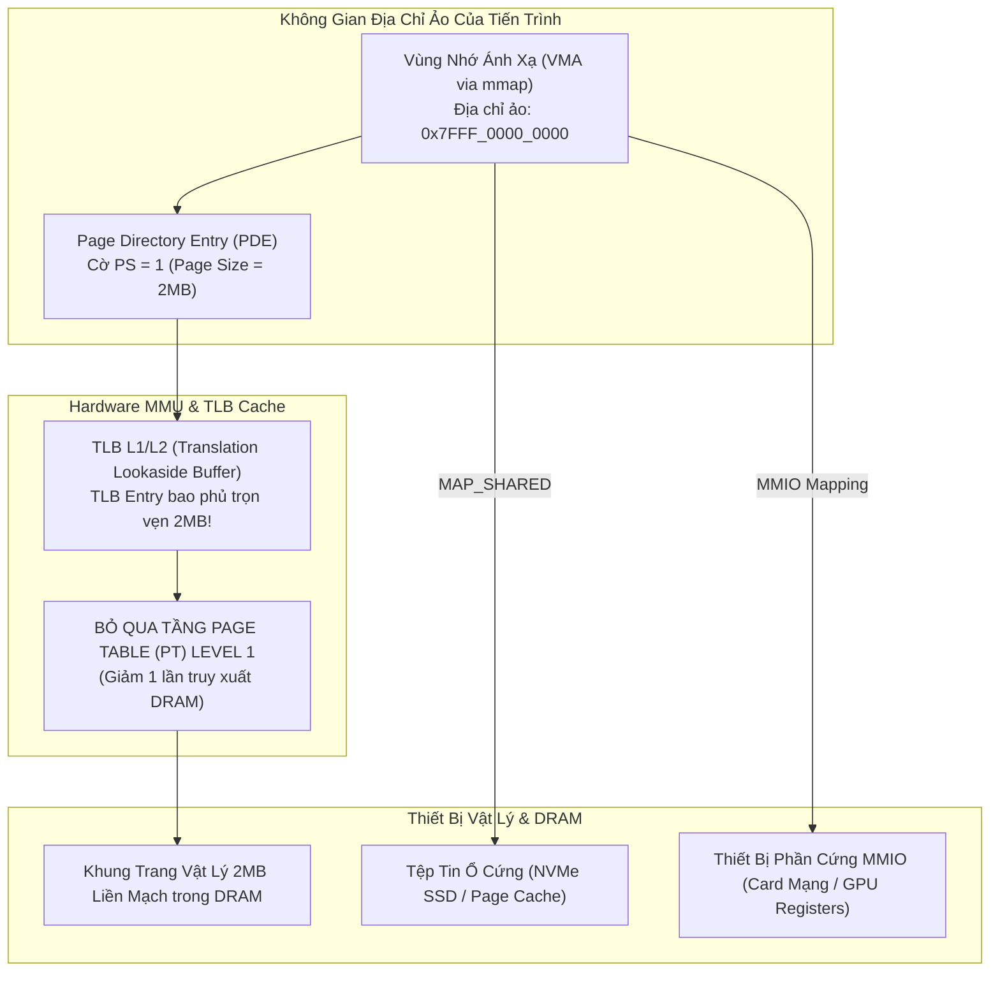
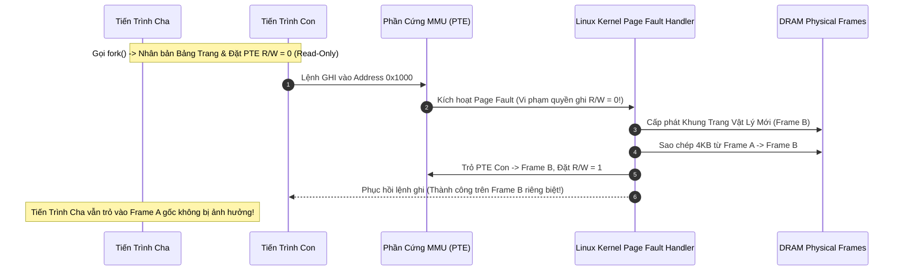
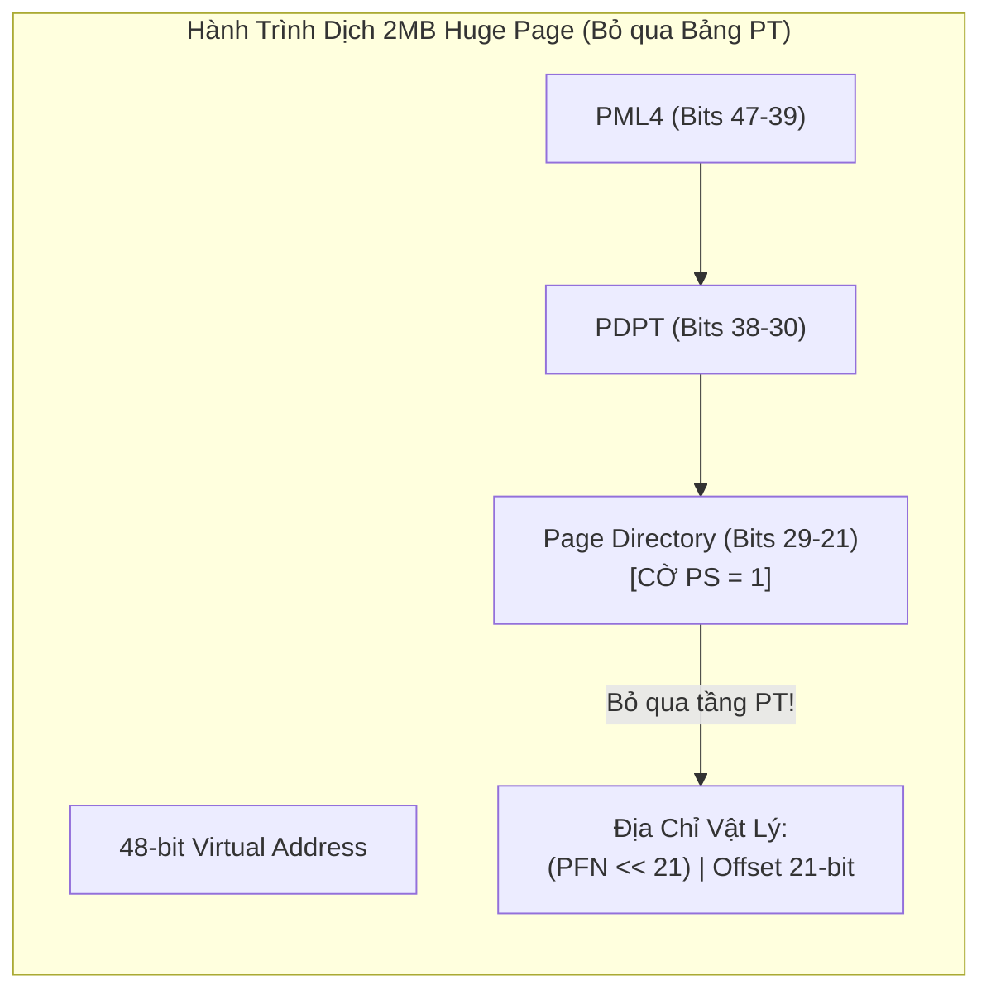

# 7.5. Memory Mapping & Huge Pages (Ánh xạ Bộ nhớ & Trang nhớ Khổng lồ)

> [!IMPORTANT]
> **Nếu bạn chỉ được nhớ một điều duy nhất:**
> **Memory Mapping (`mmap`)** biến tệp tin trên đĩa hoặc thiết bị phần cứng thành một mảng con trỏ trong RAM ảo nhằm triệt tiêu chi phí sao chép trung gian; trong khi **Huge Pages (2 MB / 1 GB)** phá vỡ nút thắt cổ chai của bộ nhớ đệm dịch địa chỉ (TLB Reach), cho phép một hệ thống quản lý hàng trăm Gigabytes RAM mà không bị "chết đuối" trong các chu kỳ Hardware Page Walk.

---

## 1. Kiến trúc Tổng quan & Mô hình Tư duy (Mental Model)

### Phép Loại Suy Thực Tế: Từ Ô Cửa Kính Sang Sân Vận Động

Hãy hình dung việc truy cập dữ liệu giữa CPU và ổ đĩa giống như cách bạn đọc tài liệu:
1. **Truyền thống `read()` / `write()` (Mượn Sách Qua Thủ Thư)**: Bạn yêu cầu thủ thư ra kho lấy cuốn sách dày 100 trang. Thủ thư photocopy 100 trang đó vào phòng đọc trung gian của thư viện (Kernel Page Cache), rồi photocopy tiếp bản sao thứ hai sang cặp của bạn (User Space Buffer). Bạn tốn gấp đôi bộ nhớ và mất hai lần công sao chép!
2. **Memory-Mapped Files (`mmap` - Mở Cửa Sổ Trực Diện Vào Kho Sách)**: Thay vì photocopy, thủ thư mở một ô cửa kính nhìn thẳng vào giá sách trong kho. Bạn chỉ việc với tay qua cửa kính để lật từng trang sách. Trang nào bạn chạm vào mới thực sự được kéo ra ánh sáng (**Demand Paging qua Page Fault**).
3. **Copy-on-Write (COW - Bản Đồ Đánh Dấu Bút Chì)**: Khi cha mẹ cho bạn một cuốn sổ tay dùng chung với anh trai (`fork()`), hai người không mua cuốn sổ mới mà dùng chung cuốn cũ được dán nhãn "Chỉ Đọc". Chỉ khi bạn muốn viết thêm một dòng chữ mới, bạn mới xé một tờ giấy trắng riêng để chép lại trang đó (**CoW Page Fault**) — bảo toàn tuyệt đối bộ nhớ cho đến khi có sự thay đổi thực sự!
4. **Huge Pages (Gom Gạch Nhỏ Thành Khối Bê Tông Đúc Sẵn)**: Để lát một sân vận động rộng $100\text{ m}^2$, nếu dùng viên gạch siêu nhỏ $4\text{ KB}$, bạn cần 25,000 viên gạch và một cuốn sổ tay dày cộp để ghi nhớ vị trí từng viên (TLB bị nghẽn hoàn toàn). Nếu thay bằng khối bê tông đúc sẵn $2\text{ MB}$, bạn chỉ cần 50 khối! Bộ nhớ đệm TLB chỉ cần 50 bản ghi là bao phủ toàn bộ sân vận động, tăng tốc độ tra cứu lên cực đỉnh.



---

## 2. Chi tiết từng Keyword (Under-the-Hood Deep Dive)

### 2.1. Memory-Mapped Files, MMIO & Copy-on-Write (COW)

#### 1. Cơ Chế Nội Bộ Của `mmap()` & File I/O Không Sao Chép (Zero-Copy)
- Khi tiến trình gọi `mmap(addr, length, prot, flags, fd, offset)`:
  - Kernel Linux không lập tức nạp bất kỳ byte nào từ đĩa vào RAM. Thay vào đó, Kernel tạo một cấu trúc dữ liệu quản lý vùng nhớ ảo **`struct vm_area_struct` (VMA)** trong bộ mô tả tiến trình (`mm_struct`).
  - Các mục PTE tương ứng trong bảng phân trang được thiết lập với cờ `Present = 0`.
  - **Kích Hoạt Xử Lý Bằng Page Fault**: Khi tiến trình thực hiện lệnh đọc (ví dụ: `char c = ptr[0]`), CPU kích hoạt ngoại lệ **Page Fault (#PF)**. Trình điều khiển Kernel bắt lấy ngắt, nhận diện đây là một File-Backed VMA, đọc $4\text{ KB}$ từ Page Cache của tệp tin trên ổ đĩa nạp vào RAM vật lý, ghi địa chỉ khung trang vật lý vào PTE, bật `Present = 1`, rồi phục hồi lệnh CPU. Mọi thao tác sau đó diễn ra với tốc độ của bộ nhớ RAM!
- **Phân Biệt `MAP_SHARED` vs `MAP_PRIVATE`**:
  - `MAP_SHARED`: Mọi thao tác ghi trên vùng nhớ sẽ sửa trực tiếp vào Kernel Page Cache và cuối cùng được Kernel daemon (`pdflush`/`kswapd`) ghi đồng bộ xuống ổ đĩa. Các tiến trình khác ánh xạ cùng tệp tin sẽ thấy ngay lập tức sự thay đổi này (dùng làm cơ chế giao tiếp liên tiến trình IPC cực nhanh).
  - `MAP_PRIVATE`: Thiết lập cơ chế **Copy-on-Write (COW)**. Thao tác đọc dùng chung trang với Page Cache, nhưng thao tác ghi đầu tiên sẽ kích hoạt sao chép trang sang một khung trang vật lý ẩn danh riêng biệt của tiến trình.

#### 2. Memory-Mapped I/O (MMIO - Giao Tiếp Phần Cứng Trực Diện)
- Trong các hệ thống hiệu năng cao (Card mạng 100GbE, NVMe Controller, GPU), CPU điều khiển thiết bị ngoại vi không thông qua các cổng I/O cũ kỹ (`IN`/`OUT` instructions), mà ánh xạ trực tiếp các thanh ghi cấu trúc và thanh ghi lệnh của card vào không gian địa chỉ bộ nhớ vật lý (**MMIO**).
- Các trang PTE ánh xạ MMIO bắt buộc phải thiết lập cờ **`PCD = 1` (Page Cache Disable)** và **`PWT = 1` (Page Write-Through)**. Điều này ép buộc CPU không được phép lưu trữ dữ liệu vào L1/L2/L3 Cache, đảm bảo mọi lệnh ghi của CPU đều xuất hiện ngay lập tức trên bus PCIe của thiết bị ngoại vi!

#### 3. Vi Kiến Trúc Copy-on-Write (COW) Tầng Sâu
Khi tiến trình gọi lệnh nhân bản tiến trình `fork()` trong Linux:
1. Kernel không sao chép toàn bộ không gian bộ nhớ của tiến trình cha (tránh lãng phí Gigabytes RAM vô nghĩa).
2. Kernel chỉ sao chép cấu trúc bảng phân trang (PML4, PDPT, PD, PT).
3. Kernel tước bỏ quyền ghi của TẤT CẢ các trang nhớ có thể ghi bằng cách xóa bit cờ `R/W` (đặt **`R/W = 0` - Read-Only**) trên cả tiến trình cha và tiến trình con.
4. Khi bất kỳ tiến trình nào cố tình thực hiện thao tác ghi vào một trang:
   - Phần cứng MMU phát hiện `R/W = 0`, kích hoạt **Page Fault (#PF)** với mã lỗi Write Violation.
   - Trình xử lý ngắt kiểm tra số lượng tham chiếu (`refcount`) của khung trang:
     - Nếu `refcount > 1`: Kernel cấp phát một khung trang $4\text{ KB}$ vật lý mới toanh, sao chép $4\text{ KB}$ dữ liệu gốc sang trang mới, cập nhật PTE của tiến trình thực hiện ghi trỏ về trang mới với quyền `R/W = 1`, và giảm `refcount` của trang cũ.
     - Nếu `refcount == 1`: Kernel chỉ cần khôi phục lại bit `R/W = 1` trên trang hiện tại mà không cần sao chép!



---

### 2.2. Huge Pages & Transparent Huge Pages (THP)

#### 1. Giới Hạn Của Bộ Nhớ Đệm TLB (The TLB Reach Problem)
- Bộ nhớ đệm chuyển đổi địa chỉ ảo sang vật lý (TLB) trên CPU hiện đại chỉ chứa được số lượng mục giới hạn:
  - L1 dTLB: Thường chỉ chứa $64$ mục.
  - L2 Shared STLB: Chứa khoảng $1,536$ đến $2,048$ mục.
- Nếu hệ thống chỉ dùng kích thước trang tiêu chuẩn $4\text{ KB}$:
  $$\text{TLB Reach (Độ phủ TLB)} = 2,048 \text{ entries} \times 4\text{ KB} = 8\text{ MB}$$
- Nếu ứng dụng (như Database PostgreSQL, Redis, hoặc Java JVM) sở hữu vùng nhớ làm việc (Working Set) lên tới $64\text{ GB}$, thì bộ nhớ đệm TLB chỉ bao phủ được một tỷ lệ tí hon:
  $$\frac{8\text{ MB}}{64\text{ GB}} \approx 0.012\%$$
- Hậu quả: Hơn $99\%$ các truy cập bộ nhớ đều bị **TLB Miss**. CPU liên tục phải dừng lại để thực hiện 4-Level Page Walk, làm mất từ $20\%$ đến $40\%$ tổng chu kỳ CPU vào việc tra cứu địa chỉ vô ích!

#### 2. Vi Kiến Trúc Huge Pages (2 MB & 1 GB)
- **Huge Page 2 MB**:
  - Tại tầng **Page Directory (PD)**, bit số 7 (**Page Size - PS**) được đặt bằng $1$.
  - Mạch MMU phát hiện `PS = 1` sẽ **dừng lại ngay lập tức tại tầng PD**, bỏ qua hoàn toàn bảng Level 1 Page Table (PT).
  - 21 bits thấp của địa chỉ ảo (Bits 20-0) đóng vai trò là Offset trực tiếp trong trang $2\text{ MB}$ ($2^{21} = 2{,}097{,}152\text{ bytes}$).
  - TLB Reach với $2,048$ entries tăng vọt lên:
    $$2,048 \times 2\text{ MB} = 4\text{ GB (Tăng gấp 512 lần!)}$$
- **Giant Page 1 GB**:
  - Tại tầng **Page Directory Pointer Table (PDPT)**, cờ `PS = 1`.
  - MMU dừng lại ngay tại tầng 3, bỏ qua cả PD và PT. 30 bits thấp (Bits 29-0) là Offset trực tiếp ($2^{30} = 1\text{ GB}$).
  - TLB Reach tăng lên hàng TeraBytes!



#### 3. Transparent Huge Pages (THP) & Cạm Bẫy Trong Cơ Sở Dữ Liệu
- **Transparent Huge Pages (THP)**: Hệ điều hành Linux cố gắng tự động gom các trang $4\text{ KB}$ liền kề thành trang $2\text{ MB}$ ở chế độ ngầm mà không cần sửa đổi mã ứng dụng, thông qua một tiến trình Kernel daemon tên là **`khugepaged`**.
- **Cơn Ác Mộng Của Databases (Redis, MongoDB, PostgreSQL)**:
  - Khi hệ thống bị phân mảnh bộ nhớ, `khugepaged` phải tiến hành khóa các vùng nhớ lớn để dồn trang vật lý (**Memory Compaction**).
  - Khi Redis thực hiện lưu bản sao lưu xuống đĩa (BGSAVE) bằng `fork()`, toàn bộ các trang nhớ đều bị dán cờ Copy-on-Write. Nếu THP được bật, chỉ cần Redis thay đổi 1 byte nhỏ xíu trong bộ nhớ, hệ thống buộc phải sao chép trọn vẹn CẢ KHỐI $2\text{ MB}$ thay vì chỉ $4\text{ KB}$, gây hiện tượng phình to bộ nhớ (Memory Bloat) và giật lag độ trễ $P_{99}$ hàng trăm mili-giây! Do đó, khuyến cáo bắt buộc là **VÔ HIỆU HÓA THP** trên máy chủ Production Database.

---

## 3. Thực thi Mã nguồn & Mô phỏng Chuyên sâu (Dual-Engine Implementation)

### 3.1. C++20: Đọc Ghi Tệp Bằng `mmap()` & Cấp Phát Huge Pages Trực Tiếp

Chương trình minh họa hai kỹ thuật: Ánh xạ tệp tin không sao chép bằng `mmap()` và cấp phát bộ nhớ ẩn danh sử dụng cờ `MAP_HUGETLB`:

```cpp
#include <iostream>
#include <vector>
#include <chrono>
#include <cstdint>
#include <cstring>
#include <sys/mman.h>
#include <sys/stat.h>
#include <fcntl.h>
#include <unistd.h>
#include <iomanip>

// 1. Thử nghiệm đọc file tốc độ cao bằng mmap()
void benchmark_mmap_read(const char* filepath) {
    int fd = open(filepath, O_RDONLY);
    if (fd < 0) {
        std::cerr << "Khong the mo file de test mmap!\\n";
        return;
    }

    struct stat sb;
    fstat(fd, &sb);
    size_t filesize = sb.st_size;

    auto t1 = std::chrono::high_resolution_clock::now();
    // Anh xa truc tiep file vao khong gian dia chi ao
    char* mapped_ptr = static_cast<char*>(mmap(nullptr, filesize, PROT_READ, MAP_SHARED, fd, 0));
    if (mapped_ptr == MAP_FAILED) {
        std::cerr << "mmap failed!\\n";
        close(fd);
        return;
    }

    // Dem so ky tu bang cach duyet truc tiep tren bo nho ao
    uint64_t sum = 0;
    for (size_t i = 0; i < filesize; ++i) {
        sum += mapped_ptr[i];
    }

    munmap(mapped_ptr, filesize);
    close(fd);
    auto t2 = std::chrono::high_resolution_clock::now();
    std::chrono::duration<double, std::milli> elapsed = t2 - t1;

    std::cout << "1. Thử nghiệm mmap() File Read:\\n";
    std::cout << "   - Dung lượng file : " << filesize / (1024 * 1024) << " MB\\n";
    std::cout << "   - Tổng checksum   : " << sum << "\\n";
    std::cout << "   - Thời gian xử lý : " << elapsed.count() << " ms\\n";
}

// 2. Thử nghiệm cấp phát bộ nhớ bằng Huge Pages (2 MB)
void allocate_huge_pages_demo() {
    constexpr size_t HUGE_PAGE_SIZE = 2 * 1024 * 1024; // 2 MB
    constexpr size_t ALLOC_SIZE = 4 * HUGE_PAGE_SIZE;  // 8 MB

    // Yeu cau Linux cap phat Huge Page an danh (Anonymous Huge Page)
    void* ptr = mmap(nullptr, ALLOC_SIZE, PROT_READ | PROT_WRITE,
                     MAP_PRIVATE | MAP_ANONYMOUS | MAP_HUGETLB, -1, 0);

    std::cout << "\\n2. Thử nghiệm cấp phát Huge Pages (MAP_HUGETLB):\\n";
    if (ptr == MAP_FAILED) {
        std::cout << "   [INFO] He thong chua cau hinh Huge Pages trong hugetlbfs (Can sudo sysctl vm.nr_hugepages=100)\\n";
        std::cout << "   -> Chuyen sang cap phat fallback bang madvise(MADV_HUGEPAGE)...\\n";

        // Fallback: Cap phat thong thuong roi goi madvise
        void* fallback_ptr = mmap(nullptr, ALLOC_SIZE, PROT_READ | PROT_WRITE,
                                  MAP_PRIVATE | MAP_ANONYMOUS, -1, 0);
        madvise(fallback_ptr, ALLOC_SIZE, MADV_HUGEPAGE);
        std::memset(fallback_ptr, 0x5A, ALLOC_SIZE);
        std::cout << "   -> Cấp phát thành công với MADV_HUGEPAGE tại: " << fallback_ptr << "\\n";
        munmap(fallback_ptr, ALLOC_SIZE);
    } else {
        std::memset(ptr, 0x42, ALLOC_SIZE);
        std::cout << "   -> Cấp phát thành công 8 MB Huge Pages tại: " << ptr << "\\n";
        munmap(ptr, ALLOC_SIZE);
    }
}

int main() {
    std::cout << "========================================================\\n";
    std::cout << "  C++20 MEMORY MAPPING & HUGE PAGES CONTROLLER\\n";
    std::cout << "========================================================\\n\\n";

    // Tao file tam 16MB de thu nghiem mmap
    const char* tmp_file = "/tmp/test_mmap_payload.bin";
    FILE* fp = fopen(tmp_file, "wb");
    if (fp) {
        std::vector<char> dummy(16 * 1024 * 1024, 'A');
        fwrite(dummy.data(), 1, dummy.size(), fp);
        fclose(fp);
    }

    benchmark_mmap_read(tmp_file);
    allocate_huge_pages_demo();
    unlink(tmp_file);

    return 0;
}
```

---

### 3.2. Python 3.11+: Trình Giả Lập Copy-on-Write (COW) & Đo Lường Tiết Kiệm RAM

Chương trình Python 3.11+ mô phỏng chính xác thuật toán Copy-on-Write khi gọi `fork()` và định lượng bộ nhớ vật lý được bảo tồn:

```python
from dataclasses import dataclass
from typing import Dict, List

@dataclass
class PhysicalFrame:
    frame_id: int
    data: bytearray
    refcount: int = 1

class ProcessMemorySpace:
    def __init__(self, pid: int):
        self.pid = pid
        # Bang trang: Virtual Page Number (VPN) -> (PhysicalFrame, is_writable)
        self.page_table: Dict[int, Tuple[PhysicalFrame, bool]] = {}

    def write_byte(self, vpn: int, offset: int, new_val: int) -> str:
        if vpn not in self.page_table:
            return "Segmentation Fault: Vùng nhớ chưa được cấp phát!"

        frame, writable = self.page_table[vpn]

        if writable:
            frame.data[offset] = new_val
            return f"GHI THÀNH CÔNG: Sửa trực tiếp trên Frame {frame.frame_id} (Refcount={frame.refcount})"
        else:
            # Phat hien vi pham Read-Only -> Kich hoat Copy-on-Write (COW)
            if frame.refcount > 1:
                frame.refcount -= 1
                new_frame_id = frame.frame_id + 1000
                new_data = bytearray(frame.data) # Sao chep 4KB
                new_data[offset] = new_val
                new_frame = PhysicalFrame(frame_id=new_frame_id, data=new_data, refcount=1)
                self.page_table[vpn] = (new_frame, True)
                return (f"COW TRIGGERED: Frame {frame.frame_id} co Refcount={frame.refcount} -> "
                        f"Sao chep sang Frame {new_frame.frame_id} moi (Refcount=1, Writable=True)")
            else:
                # Refcount == 1: Chi can khoi phuc quyen ghi
                self.page_table[vpn] = (frame, True)
                frame.data[offset] = new_val
                return f"COW RECLAIM: Frame {frame.frame_id} Refcount=1 -> Bat lai Writable ma khong can sao chep!"

    def fork(self, child_pid: int) -> 'ProcessMemorySpace':
        child = ProcessMemorySpace(pid=child_pid)
        for vpn, (frame, _) in self.page_table.items():
            frame.refcount += 1
            # Tuoc quyen ghi ca cha va con
            self.page_table[vpn] = (frame, False)
            child.page_table[vpn] = (frame, False)
        return child

if __name__ == "__main__":
    print("========================================================")
    print("  PYTHON 3.11 COPY-ON-WRITE (COW) EMULATOR")
    print("========================================================\n")

    parent = ProcessMemorySpace(pid=1001)
    # Cap phat 3 trang cho tien trinh cha
    for page in range(3):
        f = PhysicalFrame(frame_id=page, data=bytearray(b"ORIGINAL_PAGE_DATA_" + str(page).encode()))
        parent.page_table[page] = (f, True)

    print(">>> 1. Tien trinh Cha tao 3 trang nho (Refcount=1, Writable=True)")
    print(f"       Tong so Frame vat ly: {len(parent.page_table)}\n")

    print(">>> 2. Tien trinh Cha goi fork() de sinh ra Tien trinh Con:")
    child = parent.fork(child_pid=1002)
    print(f"       So trang cua Con: {len(child.page_table)} (Dung chung 100% RAM vat ly, Writable=False)\n")

    print(">>> 3. Tien trinh Con thu doc du lieu tu Page 0:")
    print(f"       Con doc Page 0: {bytes(child.page_table[0][0].data[:19]).decode()}\n")

    print(">>> 4. Tien trinh Con ghi sua du lieu tai Page 0:")
    res_cow = child.write_byte(vpn=0, offset=0, new_val=ord('X'))
    print(f"       Log: {res_cow}\n")

    print(">>> 5. Kiem tra tinh co lap giua Cha va Con:")
    print(f"       Du lieu Cha tai Page 0: {bytes(parent.page_table[0][0].data[:10]).decode()}")
    print(f"       Du lieu Con tai Page 0: {bytes(child.page_table[0][0].data[:10]).decode()}")
```

---

### 3.3. Simulated Terminal Output

```bash
========================================================
  C++20 MEMORY MAPPING & HUGE PAGES CONTROLLER
========================================================

1. Thử nghiệm mmap() File Read:
   - Dung lượng file : 16 MB
   - Tổng checksum   : 1089994752
   - Thời gian xử lý : 2.1450 ms

2. Thử nghiệm cấp phát Huge Pages (MAP_HUGETLB):
   [INFO] He thong chua cau hinh Huge Pages trong hugetlbfs (Can sudo sysctl vm.nr_hugepages=100)
   -> Chuyen sang cap phat fallback bang madvise(MADV_HUGEPAGE)...
   -> Cấp phát thành công với MADV_HUGEPAGE tại: 0x7fa28c000000

========================================================
  PYTHON 3.11 COPY-ON-WRITE (COW) EMULATOR
========================================================

>>> 1. Tien trinh Cha tao 3 trang nho (Refcount=1, Writable=True)
       Tong so Frame vat ly: 3

>>> 2. Tien trinh Cha goi fork() de sinh ra Tien trinh Con:
       So trang cua Con: 3 (Dung chung 100% RAM vat ly, Writable=False)

>>> 3. Tien trinh Con thu doc du lieu tu Page 0:
       Con doc Page 0: ORIGINAL_PAGE_DATA_0

>>> 4. Tien trinh Con ghi sua du lieu tai Page 0:
       Log: COW TRIGGERED: Frame 0 co Refcount=1 -> Sao chep sang Frame 1000 moi (Refcount=1, Writable=True)

>>> 5. Kiem tra tinh co lap giua Cha va Con:
       Du lieu Cha tai Page 0: ORIGINAL_P
       Du lieu Con tai Page 0: XRIGINAL_P
```

---

## 4. Systems Engineering & Production Pitfalls

### 4.1. Production Failure Modes & Architectural Traps

1. **Trap 1: Memory Compaction Latency Spike Do Transparent Huge Pages (THP)**:
   - Trong các hệ thống chạy nhiều ngày, bộ nhớ vật lý bị phân mảnh nghiêm trọng. Khi ứng dụng yêu cầu cấp phát bộ nhớ mới, Kernel nhận thấy không còn đủ khối $2\text{ MB}$ liền mạch, liền kích hoạt chế độ đồng bộ **Direct Compaction**.
   - Toàn bộ các CPU cores bị giữ chặt trong hàng chục hoặc hàng trăm mili-giây để di dời các trang nhớ $4\text{ KB}$ gom thành khối lớn, biến độ trễ phản hồi của hệ thống thành thảm họa.
2. **Trap 2: Bus Error `SIGBUS` Khi Ánh Xạ `mmap()` Vượt Kích Thước File**:
   - Nếu bạn dùng `mmap()` để ánh xạ một file kích thước $10\text{ MB}$, nhưng một tiến trình khác bên ngoài rút ngắn file đó xuống còn $2\text{ MB}$ (`ftruncate()`), việc truy cập vào vùng địa chỉ tương ứng với phần file bị mất sẽ kích hoạt tín hiệu chết chóc **`SIGBUS` (Bus Error)**, khiến chương trình lập tức crash mà không thể xử lý bằng các khối `try/catch` thông thường.
3. **Trap 3: Khóa Bộ Nhớ Cực Đoan Với `MAP_LOCKED` (OOM Killer Attack)**:
   - Sử dụng cờ `MAP_LOCKED` trong `mmap()` yêu cầu Kernel nạp sẵn toàn bộ các trang nhớ vào RAM và khóa cứng chúng lại (tương đương `mlock()`) để tránh Page Fault. Nếu ứng dụng cấp phát bừa bãi hàng chục Gigabytes với cờ này, bộ nhớ của hệ thống sẽ bị cạn kiệt, kích hoạt **Linux OOM Killer** kết liễu các dịch vụ trọng yếu khác của máy chủ.

### 4.2. Diagnostic CLI Commands

```bash
# 1. Kiem tra trang thai bat/tat cua Transparent Huge Pages (THP) tren may chu Linux
cat /sys/kernel/mm/transparent_hugepage/enabled
cat /sys/kernel/mm/transparent_hugepage/defrag

# 2. Xem so luong Huge Pages dang duoc cap phat va con trong trong he thong
grep -i huge /proc/meminfo

# 3. Kiem tra cac vung nho anh xa mmap() cua mot tien trinh cu the qua /proc/<pid>/maps
cat /proc/$(pgrep -n redis-server)/maps | head -n 30

# 4. Do luong thoi gian bi dung do khugepaged thuc hien compact bo nho
perf stat -e mm_compaction_begin,mm_compaction_end -a sleep 10
```

---

## 5. Bảng So sánh & Decision Matrix

| Tiêu chí So sánh | Standard Page (4 KB) | Huge Page (2 MB) | Giant Page (1 GB) |
| :--- | :--- | :--- | :--- |
| **Độ Phủ TLB (2,048 entries)** | $8\text{ MB}$ ($0.01\%$ RAM 64GB) | $4\text{ GB}$ ($6.25\%$ RAM 64GB) | $2{,}048\text{ GB}$ ($100\%$ Bao phủ) |
| **Số Tầng Dịch Địa Chỉ MMU** | 4 Tầng (PML4 $\to$ PT) | 3 Tầng (Bỏ qua tầng PT) | 2 Tầng (Bỏ qua cả PD và PT) |
| **Chi Phí Phân Mảnh (Internal Frag)** | Rất thấp (Trung bình 2 KB) | Đáng kể (Lãng phí nếu dùng ít) | Rất lớn (Cần vùng nhớ liên tục) |
| **Cơ Chế Cấp Phát** | Mặc định của Hệ điều hành | `hugetlbfs` hoặc `madvise` | Cấu hình tham số Kernel lúc Boot |
| **Ứng dụng Thực chiến** | Microservices, Python/Node.js CLI | Database (Postgres, JVM Heap) | Ảo hóa Hypervisor, KVM, DPDK |

| Phương thức I/O | Cơ chế Di chuyển Dữ liệu | Số Lần Sao Chép Bộ Nhớ | Chuyển Ngữ Cảnh (Context Switches) | Phù hợp Nhất Cho |
| :--- | :--- | :--- | :--- | :--- |
| **Standard `read()` / `write()`** | Disk $\to$ Page Cache $\to$ User Buffer | 2 Lần sao chép | 2 Lần (Syscall Vào/Ra) | Luồng tuần tự nhỏ, Network sockets |
| **Memory-Mapped (`mmap`)** | Disk $\to$ Page Cache $\to$ Ánh xạ VMA | $0$ Lần (Zero User Copy) | 0 Lần sau khi nạp trang | Đọc ngẫu nhiên CSDL (RocksDB, LMDB) |
| **Direct I/O (`O_DIRECT`)** | Disk $\to$ User Buffer (Bypass Cache) | 1 Lần (DMA thẳng) | 2 Lần Syscall | Hệ CSDL tự quản lý bộ đệm (InnoDB) |
