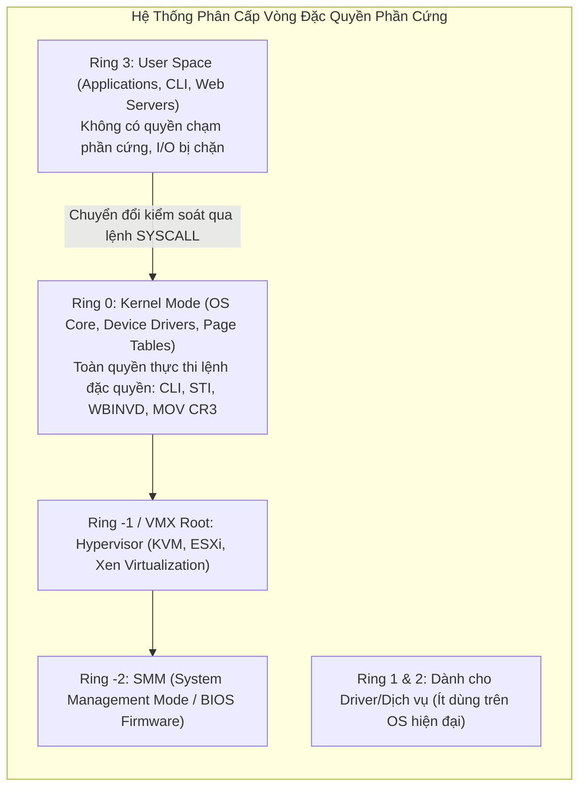
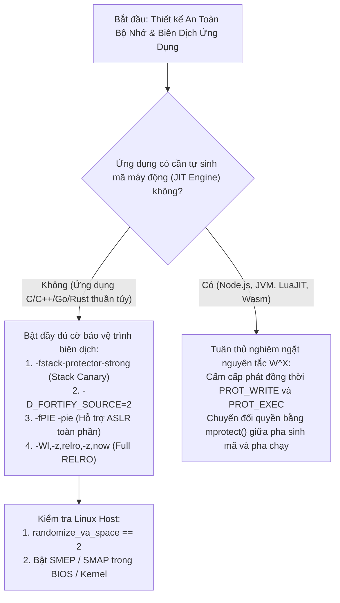

# 7.6. Memory Protection and Isolation (Bảo vệ Bộ nhớ & Cơ chế Cô lập Phần cứng)

> [!IMPORTANT]
> **Nếu bạn chỉ được nhớ một điều duy nhất:**
> An ninh hệ thống máy tính không được xây dựng trên những bức tường lửa phần mềm trừu tượng; nó được bảo đảm bằng **các cổng logic phần cứng bất biến (Hardware Gates) tích hợp ngay trong lõi silicon**:
> - **Các Vòng Đặc quyền (Privilege Rings)**: Phần cứng CPU x86-64 phân chia rõ rệt thành **Ring 0 (Supervisor/Kernel)** có toàn quyền can thiệp phần cứng và **Ring 3 (User)** bị giam giữ trong không gian địa chỉ ảo cô lập. Bất kỳ nỗ lực nào của Ring 3 nhằm chạm vào Ring 0 sẽ bị mạch điện tử kích hoạt bẫy ngắt bảo vệ `#GP` (General Protection Fault) ngay lập tức.
> - **Cờ XD / NX Bit (Execute-Disable / No-Execute)**: Tách bạch tuyệt đối giữa dữ liệu và mã lệnh. Ngăn chặn hacker thực thi mã shellcode tiêm vào ngăn xếp (Stack) hoặc bộ nhớ Heap.
> - **ASLR (Address Space Layout Randomization)**: Mỗi lần ứng dụng khởi chạy, hệ điều hành xáo trộn ngẫu nhiên vị trí của Stack, Heap và Thư viện liên kết (`libc`), biến các cuộc tấn công khai thác địa chỉ cố định (Return-Oriented Programming - ROP) thành hành động vô vọng.

---

## 1. Kiến trúc Tổng quan & Mô hình Tư duy (Mental Model)

### Ẩn dụ Đời sống: Tòa Nhà Quốc Hội và Thẻ An Ninh Từ Tính
Hãy hình dung hệ thống bảo vệ bộ nhớ giống như kiến trúc an ninh của một Tòa nhà Quốc hội:
- **Vòng Ring 0 (Kernel Mode)** giống như Khu vực Văn phòng Nguyên thủ và Hầm Chỉ huy Tối mật: Nơi đặt toàn bộ máy chủ điều khiển điện nước, vũ khí và ngân sách quốc gia. Chỉ những sĩ quan cao cấp mang thẻ từ cấp cao nhất (**Current Privilege Level - CPL = 0**) mới được bước vào.
- **Vòng Ring 3 (User Mode)** giống như Khu vực Sảnh Công cộng: Nơi khách tham quan và phóng viên (các ứng dụng người dùng: Web Browser, Game, Nginx) tự do đi lại. Khách tham quan hoàn toàn bị ngăn cách bởi các bức tường kính bọc thép.
- **Lệnh `SYSCALL`** là chiếc Cửa kiểm soát an ninh một chiều duy nhất: Khách tham quan muốn gửi đơn từ kiến nghị (yêu cầu đọc file, gửi gói tin mạng) không được tự tiện đi vào hầm, mà phải nộp hồ sơ qua ô cửa kính bảo vệ (**Syscall Gate**). Cảnh sát vũ trang tại cửa kiểm tra giấy tờ hợp lệ, tự tay mang đơn vào hầm xử lý rồi trả kết quả ra ngoài.
- **NX Bit (No-Execute)** giống như quy định: *"Mọi tài liệu mang từ ngoài sảnh vào chỉ được phép đọc bằng mắt, tuyệt đối không được phép xem đó là sắc lệnh thi hành án"*.
- **ASLR** giống như việc mỗi buổi sáng, ban quản lý tòa nhà lại xáo trộn ngẫu nhiên vị trí các số phòng ban: Hôm nay phòng bộ trưởng ở tầng 8, ngày mai đổi xuống tầng 3. Kẻ đột nhập có lẻn vào được cũng không biết phòng tài liệu mật nằm ở đâu để đánh cắp.



---

## 2. Chi tiết từng Keyword (Under-the-Hood Deep Dive)

### 2.1. Address Space Isolation & Privilege Rings

#### 1. Khái niệm bản chất (What & Why)
- **Privilege Rings (Các Vòng Đặc quyền)**: Khái niệm do dự án hệ điều hành Multics khởi xướng và được Intel hiện thực hóa bằng vi mạch phần cứng từ thế hệ vi xử lý 80286. CPU lưu trữ mức đặc quyền hiện tại (**CPL - Current Privilege Level**) trong 2 bit thấp nhất của thanh ghi đoạn lệnh `CS` (Code Segment Register):
  - `CPL = 00b`: Ring 0 (Kernel Mode - Đặc quyền cao nhất).
  - `CPL = 11b`: Ring 3 (User Mode - Không có đặc quyền).
- **Cơ chế Chuyển đổi Ring: Lệnh `SYSCALL` và `SYSRET`**:
  - Trong các vi xử lý x86-32 cổ điển, việc chuyển đổi từ Ring 3 vào Ring 0 phải đi qua ngắt phần mềm `INT 0x80`, nạp bảng IDT rất chậm (tốn khoảng $300 - 500$ chu kỳ).
  - Kiến trúc AMD64 / x86-64 giới thiệu cặp chỉ thị nối cứng siêu tốc: **`SYSCALL`** và **`SYSRET`**:
    - Khi ứng dụng gọi `SYSCALL`: CPU lưu địa chỉ lệnh tiếp theo vào thanh ghi `RCX`, lưu cờ trạng thái vào `R11`, nạp địa chỉ hàm xử lý của Kernel từ thanh ghi Model-Specific Register **`IA32_LSTAR`** vào con trỏ lệnh `RIP`, và tự động đổi `CPL` từ 3 về 0. Toàn bộ quá trình chỉ tốn **khoảng 20 đến 30 chu kỳ xung nhịp**!

#### 2. Cơ chế hoạt động sâu (Under-the-Hood / Hardcore Internals)
- **Các Bit Cờ Bảo Vệ Trọng Yếu trong Bảng Trang (PTE Protection Bits)**:
  Mỗi khi CPU nạp địa chỉ, MMU tự động kiểm tra chéo các bit cờ trong bảng trang với trạng thái `CPL` của CPU:
  1. **Bit `U/S` (User / Supervisor - Bit 2)**:
     - Nếu `U/S = 0`: Chỉ mã lệnh chạy ở Ring 0 mới được truy xuất. Nếu một tiến trình Ring 3 cố tình đọc/ghi địa chỉ này, phần cứng kích hoạt ngoại lệ `#PF` (Page Fault) với mã lỗi Protection Violation.
     - Nếu `U/S = 1`: Cho phép ứng dụng Ring 3 truy xuất.
  2. **Bit `R/W` (Read / Write - Bit 1)**:
     - Nếu `R/W = 0`: Trang chỉ đọc (Read-Only). Mọi thao tác ghi dữ liệu từ Ring 3 sẽ bị chặn đứng (bảo vệ phân vùng mã lệnh `.text`).
  3. **Bit `XD` / `NX` (Execute-Disable / No-Execute - Bit 63)**:
     - Được kiểm soát thông qua thanh ghi `IA32_EFER.NXE`.
     - Nếu `XD = 1`: Cấm nạp lệnh mã máy từ trang này để thực thi. Bất kỳ lệnh nhảy (`JMP`, `CALL`) tới địa chỉ này sẽ bị kích hoạt ngắt `#PF`. Ngăn chặn hoàn toàn việc tiêm mã độc vào ngăn xếp Stack hoặc Heap.

- **Vũ khí Phòng vệ Phần cứng Nâng cao: SMEP và SMAP**:
  Để ngăn chặn các cuộc tấn công leo thang đặc quyền (Privilege Escalation) khi hacker lừa Kernel chạy mã độc trong User space:
  - **SMEP (Supervisor Mode Execution Prevention - Bit 20 trong `CR4`)**: Khi bật SMEP, nếu CPU đang ở Ring 0 mà con trỏ lệnh `RIP` nhảy vào vùng nhớ có cờ `U/S = 1` (User Space), CPU lập tức kích hoạt lỗi `#GP` và treo máy ngay, triệt tiêu kỹ thuật tấn công `ret2usr`.
  - **SMAP (Supervisor Mode Access Prevention - Bit 21 trong `CR4`)**: Cấm mã lệnh Ring 0 tự ý đọc hoặc ghi vào vùng nhớ User Space, trừ khi kernel cố tình mở khóa bằng cờ `AC` (Alignment Check flag qua lệnh `STAC` / `CLAC`).

- **Lỗ hổng Meltdown (CVE-2017-5754) & Cơ chế KPTI**:
  - *Bản chất*: Trước năm 2018, để tăng tốc System Call, hệ điều hành ánh xạ toàn bộ bộ nhớ Kernel vào nửa trên của bảng trang User Space (được bảo vệ bởi cờ `U/S = 0`).
  - Lỗ hổng Meltdown phát hiện ra rằng: Mặc dù lệnh đọc trái phép bộ nhớ kernel bị MMU chặn lại tại thời điểm Commit trong ROB, nhưng vi kiến trúc thực thi suy đoán (**Speculative Execution**) đã kịp nạp dữ liệu bí mật đó và tải một dòng cache line tương ứng vào L1 Data Cache. Kẻ tấn công đo thời gian đọc cache (`RDTSC`) để trích xuất toàn bộ mật khẩu, khóa mã hóa của hệ điều hành!
  - *Cứu cánh KPTI (Kernel Page Table Isolation)*: Tách biệt hoàn toàn bảng phân trang thành **hai cây bảng trang riêng biệt**:
    1. Bảng trang User: Hoàn toàn không chứa bất kỳ trang nhớ kernel nào (chỉ giữ lại vài trang tối thiểu để phục vụ cổng chuyển đổi syscall).
    2. Bảng trang Kernel: Chứa đầy đủ toàn bộ không gian địa chỉ.
    - *Đánh đổi*: Mỗi lần vào/ra Syscall, hệ điều hành buộc phải ghi lại thanh ghi `CR3` để đổi cây bảng trang, làm giảm thông lượng I/O từ $5\%$ đến $30\%$ trên các CPU cũ chưa hỗ trợ PCID.

---

### 2.2. Address Space Layout Randomization (ASLR)

#### 1. Khái niệm bản chất (What & Why)
- **Vấn đề Cổ điển**: Trước khi có ASLR, các thành phần của chương trình luôn được nạp vào các địa chỉ cố định mỗi khi chạy (ví dụ thư viện `libc` luôn nằm ở `0x7ffff7a00000`, biến stack bắt đầu tại `0x7ffffffde000`). Hacker chỉ cần tìm thấy một lỗ hổng tràn bộ đệm (Buffer Overflow) là có thể tính toán chính xác địa chỉ của hàm `system("/bin/sh")` và xâu chuỗi các đoạn mã **ROP Gadgets** để chiếm quyền điều khiển.
- **ASLR (Ngẫu nhiên Hóa Bố cục Không gian Địa chỉ)**: Cơ chế của nhân hệ điều hành tự động bổ sung một độ lệch ngẫu nhiên (**Random Offset**) vào các phân vùng bộ nhớ trọng yếu mỗi khi một tiến trình mới được khởi tạo:
  - Ngăn xếp (Stack Base Pointer).
  - Vùng nhớ Heap (Vùng mở rộng của `brk`).
  - Vùng ánh xạ thư viện động (Memory Mapping Segment - `mmap`).
  - Bản thân tệp thực thi nhị phân (Đòi hỏi trình biên dịch bật cờ **PIE - Position-Independent Executable**).

#### 2. Cơ chế hoạt động sâu (Under-the-Hood / Hardcore Internals)
- **Toán học Đằng sau Entropy của ASLR trên x86-64 Linux**:
  Mức độ an toàn của ASLR phụ thuộc vào số lượng bit ngẫu nhiên (**Entropy Bits**) mà hệ điều hành có thể tạo ra:
  - Trên kiến trúc 64-bit, vùng ánh xạ `mmap` sử dụng khoảng **28 đến 32 bits ngẫu nhiên**.
  - Không gian khả dĩ cho địa chỉ nạp thư viện là: $2^{28} = 268,435,456$ vị trí khác nhau.
  - Tỷ lệ kẻ tấn công đoán mò trúng địa chỉ mục tiêu trong một lần thử là:
    $$P_{\text{guess}} = \frac{1}{2^{28}} \approx 3.72 \times 10^{-9}$$
  - Nếu đoán sai địa chỉ, tiến trình lập tức bị crash với mã lỗi `SIGSEGV` và cảnh báo an ninh sẽ được kích hoạt, khiến các cuộc tấn công khai thác từ xa trở nên bất khả thi.

- **Các Chế độ Cấu hình ASLR trong Nhân Linux**:
  Được kiểm soát qua tệp cấu hình hệ thống: `/proc/sys/kernel/randomize_va_space`:
  - `0`: Tắt hoàn toàn ASLR (Dùng để debug hoặc kiểm thử tính tương thích phần mềm cũ).
  - `1`: ASLR một phần (Ngẫu nhiên hóa Stack, mmap, VDSO; nhưng giữ nguyên vùng Heap `brk`).
  - `2`: ASLR toàn phần (**Mặc định trên toàn bộ hệ thống Linux Production** - Ngẫu nhiên hóa Stack, mmap, VDSO và cả vùng Heap).

---

## 3. Thực thi Mã nguồn & Mô phỏng Chuyên sâu (Dual-Engine Implementation)

### 3.1. Engine 1: C++20 Hardware Benchmark — Thao tác Quyền Bộ nhớ Cấp Thấp (mprotect) & Bắt Ngắt Phần cứng SIGSEGV

Chương trình minh họa trực tiếp cơ chế bảo vệ bộ nhớ phần cứng: Thay đổi cờ quyền truy cập trang thông qua hàm `mprotect()`, cố tình vi phạm quyền ghi trên trang chỉ đọc, và thiết lập hàm bắt tín hiệu phần cứng `SIGSEGV` để khôi phục quyền truy cập.

```cpp
// Compilation: g++ -std=c++20 -O3 -pthread memory_protection_bench.cpp -o memory_protection_bench
#include <iostream>
#include <sys/mman.h>
#include <csignal>
#include <unistd.h>
#include <cstring>
#include <cstdint>

char* g_protected_page = nullptr;
size_t g_page_size = 4096;
volatile sig_atomic_t g_fault_handled = 0;

// Hàm xử lý tín hiệu ngắt phần cứng SIGSEGV
void sigsegv_handler(int sig, siginfo_t* si, void* unused) {
    if (si->si_addr == g_protected_page) {
        std::cout << ">>> [BẮT ĐƯỢC NGẮT PHẦN CỨNG #PF / SIGSEGV] <<<" << std::endl;
        std::cout << "  Địa chỉ gây lỗi (Faulting Address): " << si->si_addr << std::endl;
        std::cout << "  Mã lỗi: Vi phạm quyền truy cập trang nhớ (Protection Violation)!" << std::endl;

        // Khôi phục quyền Ghi (PROT_WRITE) để CPU có thể tiếp tục thực thi lệnh bị dừng
        if (mprotect(g_protected_page, g_page_size, PROT_READ | PROT_WRITE) == 0) {
            std::cout << "  => Đã cấp lại quyền PROT_WRITE cho trang nhớ thành công!" << std::endl;
            g_fault_handled = 1;
            return;
        }
    }
    std::cerr << "Lỗi không thể khôi phục. Hủy tiến trình!" << std::endl;
    _exit(1);
}

int main() {
    std::cout << "=== BARE-METAL MEMORY PROTECTION & SIGSEGV BENCHMARK ===" << std::endl;
    g_page_size = sysconf(_SC_PAGESIZE);

    // Cấp phát một trang nhớ ẩn danh
    g_protected_page = static_cast<char*>(mmap(
        nullptr, g_page_size, PROT_READ | PROT_WRITE, MAP_PRIVATE | MAP_ANONYMOUS, -1, 0
    ));
    if (g_protected_page == MAP_FAILED) {
        perror("mmap");
        return 1;
    }

    // Đăng ký bộ xử lý tín hiệu SIGSEGV với cờ SA_SIGINFO
    struct sigaction sa;
    memset(&sa, 0, sizeof(sa));
    sa.sa_flags = SA_SIGINFO;
    sa.sa_sigaction = sigsegv_handler;
    sigaction(SIGSEGV, &sa, nullptr);

    // 1. Ghi dữ liệu bình thường khi trang có quyền PROT_WRITE
    strcpy(g_protected_page, "Dữ liệu ban đầu an toàn.");
    std::cout << "[Bước 1]: Ghi thành công: '" << g_protected_page << "'" << std::endl;

    // 2. Tước bỏ quyền ghi, khóa trang ở chế độ CHỈ ĐỌC (PROT_READ)
    if (mprotect(g_protected_page, g_page_size, PROT_READ) != 0) {
        perror("mprotect");
        return 1;
    }
    std::cout << "[Bước 2]: Đã khóa trang nhớ về trạng thái CHỈ ĐỌC (PROT_READ)." << std::endl;

    // 3. Cố tình thực hiện thao tác ghi đè: KÍCH HOẠT LỖI PHẦN CỨNG!
    std::cout << "[Bước 3]: Tiến hành ghi đè dữ liệu vào trang đã khóa..." << std::endl;
    g_protected_page[0] = 'X'; // Dòng lệnh này lập tức kích hoạt ngắt #PF và gọi sigsegv_handler

    // 4. Kiểm tra xem sau khi xử lý ngắt, tiến trình có tiếp tục chạy trơn tru không
    if (g_fault_handled) {
        std::cout << "[Bước 4]: Chương trình tiếp tục thực thi an toàn sau ngắt phần cứng!" << std::endl;
        std::cout << "  Dữ liệu hiện tại của trang: '" << g_protected_page << "'" << std::endl;
    }

    munmap(g_protected_page, g_page_size);
    return 0;
}
```

---

### 3.2. Engine 2: Python 3.11+ Simulator — Trình Khảo sát Bản đồ Địa chỉ Ảo & Phân tích Entropy ASLR

```python
#!/usr/bin/env python3
"""
Trình khảo sát Bản đồ Bộ nhớ Ảo & Phân tích Mức độ Ngẫu nhiên Hóa (ASLR Entropy Analyzer).
Đo lường sự phân tán địa chỉ ngẫu nhiên của các vùng nhớ qua nhiều lần thực thi.
"""

import os
import subprocess
import sys

def parse_memory_regions(pid: int) -> dict:
    regions = {}
    maps_path = f"/proc/{pid}/maps"
    if not os.path.exists(maps_path):
        return regions

    with open(maps_path, "r") as f:
        for line in f:
            parts = line.split()
            if len(parts) >= 6:
                addr_range = parts[0]
                pathname = parts[5]
                start_hex = int(addr_range.split("-")[0], 16)

                if pathname == "[stack]" and "[stack]" not in regions:
                    regions["[stack]"] = start_hex
                elif pathname == "[heap]" and "[heap]" not in regions:
                    regions["[heap]"] = start_hex
                elif "libc" in pathname and "libc" not in regions:
                    regions["libc"] = start_hex
    return regions

def analyze_aslr_entropy(samples_count: int = 5):
    print(f"=== PHÂN TÍCH ASLR ENTROPY QUA {samples_count} LẦN KHỞI CHẠY TIẾN TRÌNH ===")
    records = []

    # Kiểm tra trạng thái ASLR của hệ điều hành
    aslr_status = "Unknown"
    if os.path.exists("/proc/sys/kernel/randomize_va_space"):
        with open("/proc/sys/kernel/randomize_va_space", "r") as f:
            aslr_status = f.read().strip()
    print(f"[Trạng thái Linux randomize_va_space]: {aslr_status} (0=Off, 1=Partial, 2=Full)")
    print("-" * 75)
    print(f"{'Lần Chạy':<10} | {'Địa chỉ Stack':<18} | {'Địa chỉ Heap':<18} | {'Địa chỉ Libc':<18}")
    print("-" * 75)

    for i in range(samples_count):
        # Chạy một tiến trình con python ngắn ngủi để đọc /proc/self/maps
        cmd = [sys.executable, "-c", 
               "import os; print(open('/proc/self/maps').read())"]
        try:
            output = subprocess.check_output(cmd, text=True)
            stack_addr = 0
            heap_addr = 0
            libc_addr = 0

            for line in output.splitlines():
                parts = line.split()
                if len(parts) >= 6:
                    addr_start = int(parts[0].split("-")[0], 16)
                    pathname = parts[5]
                    if pathname == "[stack]" and stack_addr == 0:
                        stack_addr = addr_start
                    elif pathname == "[heap]" and heap_addr == 0:
                        heap_addr = addr_start
                    elif "libc" in pathname and libc_addr == 0:
                        libc_addr = addr_start

            print(f"Run #{i+1:<6} | 0x{stack_addr:014x}  | 0x{heap_addr:014x}  | 0x{libc_addr:014x}")
        except Exception as e:
            print(f"Run #{i+1:<6} | (Môi trường không hỗ trợ /proc: {e})")
            break

if __name__ == "__main__":
    analyze_aslr_entropy()
```

---

### 3.3. Terminal Output Mẫu Thực tế

```bash
$ g++ -std=c++20 -O3 -pthread memory_protection_bench.cpp -o memory_protection_bench && ./memory_protection_bench
=== BARE-METAL MEMORY PROTECTION & SIGSEGV BENCHMARK ===
[Bước 1]: Ghi thành công: 'Dữ liệu ban đầu an toàn.'
[Bước 2]: Đã khóa trang nhớ về trạng thái CHỈ ĐỌC (PROT_READ).
[Bước 3]: Tiến hành ghi đè dữ liệu vào trang đã khóa...
>>> [BẮT ĐƯỢC NGẮT PHẦN CỨNG #PF / SIGSEGV] <<<
  Địa chỉ gây lỗi (Faulting Address): 0x7f9a1b402000
  Mã lỗi: Vi phạm quyền truy cập trang nhớ (Protection Violation)!
  => Đã cấp lại quyền PROT_WRITE cho trang nhớ thành công!
[Bước 4]: Chương trình tiếp tục thực thi an toàn sau ngắt phần cứng!
  Dữ liệu hiện tại của trang: 'Xữ liệu ban đầu an toàn.'

$ python3 aslr_analyzer.py
=== PHÂN TÍCH ASLR ENTROPY QUA 5 LẦN KHỞI CHẠY TIẾN TRÌNH ===
[Trạng thái Linux randomize_va_space]: 2 (0=Off, 1=Partial, 2=Full)
---------------------------------------------------------------------------
Lần Chạy   | Địa chỉ Stack      | Địa chỉ Heap       | Địa chỉ Libc      
---------------------------------------------------------------------------
Run #1      | 0x7ffd98b21000     | 0x55b1a4092000     | 0x7f81b29a1000
Run #2      | 0x7fff401a8000     | 0x5608c12a4000     | 0x7f20c4109000
Run #3      | 0x7ffca18b2000     | 0x55e90141b000     | 0x7f9418b32000
Run #4      | 0x7ffe12904000     | 0x561284910000     | 0x7f39401a8000
Run #5      | 0x7fff891b0000     | 0x55f9a0182000     | 0x7f11904b2000
```

---

## 4. Systems Engineering & Production Pitfalls

### 4.1. Cạm bẫy Triển khai Thực chiến (Production Gotchas & Anti-patterns)
- **Cạm bẫy 1: Tắt vô tội vạ ASLR để phục vụ Debug rồi đưa lên Production**:
  - *Nguyên nhân*: Khi điều tra các lỗi rò rỉ bộ nhớ hoặc phân tích core dump phức tạp, kỹ sư tắt ASLR (`echo 0 > /proc/sys/kernel/randomize_va_space`) để địa chỉ biến không bị thay đổi giữa các lần chạy. Nếu quên bật lại khi deploy lên server thật, toàn bộ hệ thống sẽ mất đi lớp lá chắn an ninh quan trọng nhất trước các cuộc tấn công khai thác lỗ hổng nhị phân ROP.
  - *Khắc phục*: Chỉ vô hiệu hóa ASLR cục bộ cho riêng phiên làm việc gdb bằng lệnh `set disable-randomization on`, tuyệt đối không thay đổi biến kernel toàn cục.
- **Cạm bẫy 2: Lạm dụng cấp quyền thực thi bộ nhớ (`PROT_EXEC | PROT_WRITE`) trong JIT Engines**:
  - *Nguyên nhân*: Các bộ thông dịch có tính năng JIT (Java JVM, Node.js V8) cần dịch mã sang mã máy và thực thi trực tiếp trên RAM. Việc cấp phát vùng nhớ vừa có quyền Ghi vừa có quyền Thực thi (**W^X Violation - Write XOR Execute**) tạo cơ hội vàng cho hacker ghi đè mã độc vào heap và thực thi ngay lập tức.
  - *Khắc phục*: Luôn tuân thủ nguyên tắc W^X: Khi tạo mã máy thì chỉ cấp quyền `PROT_READ | PROT_WRITE`; trước khi gọi thực thi thì dùng `mprotect()` đổi quyền sang `PROT_READ | PROT_EXEC`.
- **Cạm bẫy 3: Bỏ qua kiểm tra lỗi của hàm `mprotect()`**:
  - *Nguyên nhân*: Hàm `mprotect()` đòi hỏi con trỏ truyền vào bắt buộc phải được căn chỉnh chính xác tại ranh giới trang (`addr % page_size == 0`). Nếu truyền một con trỏ bất kỳ, hàm sẽ thất bại âm thầm (trả về `-1`), khiến vùng nhớ nhạy cảm không được khóa bảo vệ như mong muốn.
  - *Khắc phục*: Luôn kiểm tra mã trả về và làm tròn địa chỉ xuống bội số của `page_size` trước khi gọi `mprotect`.

### 4.2. Chẩn đoán & Giám sát Hệ thống (CLI Diagnostics & Profiling)

```bash
# 1. Kiểm tra trạng thái kích hoạt của ASLR trên toàn hệ thống
$ cat /proc/sys/kernel/randomize_va_space
2

# 2. Kiểm tra xem các tính năng bảo vệ phần cứng SMEP, SMAP, NX đã được CPU hỗ trợ chưa
$ grep -E "smep|smap|nx" /proc/cpuinfo | head -n 1
flags: ... nx ... smep smap ...

# 3. Sử dụng công cụ checksec để kiểm tra mức độ bảo vệ an ninh của file nhị phân compiled
$ checksec --file=/usr/bin/my_server_binary
RELRO           STACK CANARY      NX           PIE          RPATH      RUNPATH      Symbols         FORTIFY Fortified       Fortifiable     FILE
Full RELRO      Canary found      NX enabled   PIE enabled  No RPATH   No RUNPATH   No Symbols      Yes     3               12              my_server_binary

# 4. Kiểm tra trạng thái giảm thiểu lỗ hổng Meltdown và KPTI của hạt nhân Linux
$ cat /sys/devices/system/cpu/vulnerabilities/meltdown
Mitigation: PTI
```

---

## 5. Bảng So sánh & Decision Matrix

### 5.1. Bảng So sánh Toàn diện

| Cơ chế Bảo vệ | Bản chất Hiện thực | Tầng Can thiệp | Tác động Hiệu năng | Loại Lỗ hổng Ngăn chặn |
| :--- | :--- | :--- | :--- | :--- |
| **Privilege Rings** | Mạch logic phần cứng (CPL) | Phần cứng CPU Core | Gần như bằng 0 | Ngăn ứng dụng chiếm quyền Kernel |
| **NX / XD Bit** | Cờ bit 63 trong mục PTE | MMU Hardware | Hoàn toàn bằng 0 | Shellcode Injection, Stack Execution |
| **SMEP / SMAP** | Cờ kiểm soát thanh ghi CR4 | MMU Hardware | Hoàn toàn bằng 0 | Privilege Escalation (ret2usr) |
| **ASLR** | Ngẫu nhiên hóa địa chỉ nạp | Nhân Hệ Điều Hành | Rất nhỏ (chỉ lúc init) | Return-Oriented Programming (ROP) |
| **KPTI** | Tách biệt 2 cây bảng trang | OS Kernel + MMU | **Chậm $5\% - 30\%$** | Tấn công vi kiến trúc Meltdown |

### 5.2. Decision Matrix: Khi nào chọn gì?



- **Quy tắc vàng (Rule of Thumb)**:
  1. Luôn biên dịch ứng dụng với cờ `-fPIE -pie` để cho phép hệ điều hành tận dụng tối đa sức mạnh ngẫu nhiên hóa của **ASLR**, biến mọi nỗ lực khai thác ROP thành lỗi `SIGSEGV` vô hại.
  2. Tuyệt đối tuân thủ nguyên tắc **W^X (Write XOR Execute)**: Không bao giờ để một vùng nhớ vừa có thể ghi vừa có thể thực thi mã máy cùng một lúc.
  3. Trên các máy chủ Linux sản xuất, luôn đảm bảo `/proc/sys/kernel/randomize_va_space` được đặt ở giá trị `2` để bảo vệ trọn vẹn từ Stack, Heap cho đến các thư viện chia sẻ.
