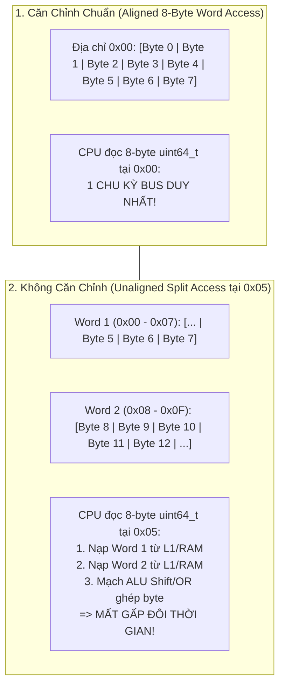
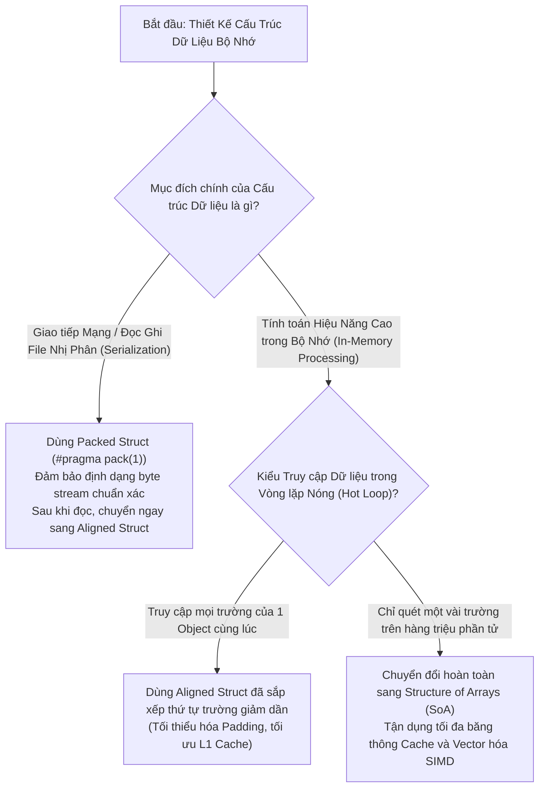

# 8.1. Data and Struct Layout (Bố cục Dữ liệu & Cấu trúc Bộ nhớ)

> [!IMPORTANT]
> **Nếu bạn chỉ được nhớ một điều duy nhất:**
> Bộ nhớ RAM không phải là một chuỗi các byte đơn lẻ có thể truy cập tùy tiện; phần cứng CPU luôn đọc và ghi dữ liệu theo từng **khối từ vật lý (Memory Words - 4 hoặc 8 bytes) hoặc dòng nhớ (Cache Lines - 64 bytes)**:
> - **Nguyên lý Căn chỉnh Tự nhiên (Natural Alignment)**: Một biến kích thước $k$ bytes bắt buộc phải được đặt tại địa chỉ chia hết cho $k$ (ví dụ: `uint32_t` phải ở địa chỉ chia hết cho 4; `uint64_t` phải ở địa chỉ chia hết cho 8).
> - **Cạm bẫy Padding lãng phí RAM**: Trình biên dịch sẽ tự động chèn các byte "rác" vô hình (**Padding Bytes**) vào giữa các trường trong struct để thỏa mãn luật căn chỉnh. Sắp xếp thứ tự các trường bừa bãi có thể làm tăng gấp đôi dung lượng struct!
> - **Hiểm họa Packed Structures (`#pragma pack(1)`)**: Ép struct không có padding sẽ tiết kiệm byte khi đóng gói gói tin mạng, nhưng biến các thao tác đọc/ghi thành **Unaligned Access**. Trên x86, điều này làm tăng gấp đôi chu kỳ đọc do nứt dòng nhớ (**Cache Line Split**); trên nhiều chip ARM/RISC, phần cứng sẽ kích hoạt lỗi sập chương trình `#AC` (Alignment Check Exception) ngay lập tức!

---

## 1. Kiến trúc Tổng quan & Mô hình Tư duy (Mental Model)

### Ẩn dụ Đời sống: Đóng Thùng Kiện Hàng Trên Xe Tải Pallet
Hãy tưởng tượng bộ nhớ máy tính giống như một đội xe tải chở hàng tiêu chuẩn:
- Xe tải chỉ bốc dỡ hàng theo từng **khối Pallet chuẩn hóa dài 8 ô (8 bytes / 64-bit Word)**: Mỗi lần xe nâng nhấc hàng, nó bốc trọn vẹn đúng 1 Pallet 8-byte từ địa chỉ chia hết cho 8.
- Nếu bạn có một kiện hàng 8-byte (`uint64_t`):
  - **Căn chỉnh Chuẩn (Aligned)**: Kiện hàng nằm gọn gàng trên 1 Pallet duy nhất. Xe nâng chỉ cần đúng 1 lần nhấc là nạp xong vào xe (1 chu kỳ xung nhịp).
  - **Không Căn chỉnh (Unaligned - Vắt ngang qua 2 Pallet)**: Kiện hàng bị đặt lệch, nửa đầu nằm ở đuôi Pallet 1 (3 bytes), nửa sau nằm ở đầu Pallet 2 (5 bytes). Xe nâng buộc phải thực hiện **2 lần bốc dỡ riêng biệt**, sau đó công nhân phải dùng kéo cưa cắt và ghép hai nửa kiện hàng lại với nhau (**Shift & Mask Logic**) mới lấy được dữ liệu hoàn chỉnh. Thời gian xử lý tăng gấp đôi!
- **Padding**: Để tránh việc kiện hàng bị nứt đôi, người đóng gói thông minh sẽ chèn thêm các túi đệm khí rỗng (**Padding Bytes**) vào cuối Pallet 1 để đẩy kiện hàng tiếp theo sang hẳn đầu Pallet 2.



---

## 2. Chi tiết từng Keyword (Under-the-Hood Deep Dive)

### 2.1. Struct Layout, Padding & Packed Structures (Deep Dive)

#### 1. Khái niệm bản chất (What & Why)
- **Quy tắc Căn chỉnh Tự nhiên của Trình biên dịch (ABI Alignment Rules)**:
  - Kiểu `char` / `int8_t` (1 byte): Có thể đặt tại bất kỳ địa chỉ nào (`alignment = 1`).
  - Kiểu `short` / `int16_t` (2 bytes): Phải đặt tại địa chỉ chia hết cho 2 (`addr % 2 == 0`).
  - Kiểu `int` / `float` / `int32_t` (4 bytes): Phải đặt tại địa chỉ chia hết cho 4 (`addr % 4 == 0`).
  - Kiểu `long` / `double` / con trỏ `void*` (8 bytes trên 64-bit): Phải đặt tại địa chỉ chia hết cho 8 (`addr % 8 == 0`).
  - Toàn bộ struct phải có kích thước tổng thể là **bội số của thành viên có kích thước căn chỉnh lớn nhất** bên trong nó (`alignof(struct) = max(alignof(member_i))`).

#### 2. Cơ chế hoạt động sâu (Under-the-Hood / Hardcore Internals)
- **Giải phẫu Thuật toán Chèn Padding Nội bộ và Tail Padding**:
  Xét một cấu trúc dữ liệu thường gặp trong backend:

```cpp
struct BadLayout {
    char   a; // 1 byte  | Offset 0. Cần padding 3 bytes để b căn chỉnh 4!
    int    b; // 4 bytes | Offset 4.
    char   c; // 1 byte  | Offset 8. Cần padding 7 bytes để khớp alignment 8!
    double d; // 8 bytes | Offset 16.
    char   e; // 1 byte  | Offset 24. Cần Tail Padding 7 bytes!
}; // Tổng kích thước: 32 BYTES! (Trong đó dữ liệu thực chỉ có 1 + 4 + 1 + 8 + 1 = 15 bytes!)
```

```
   Bố Cục Bộ Nhớ của BadLayout (Lãng phí 17 bytes Padding = 53% RAM!)
  +------+------------+------------+------+------------+--------------------+------+------------+
  | a(1) | Pad (3B)   | b (4B)     | c(1) | Pad (7B)   | d (8B)             | e(1) | TailPad(7B)|
  +------+------------+------------+------+------------+--------------------+------+------------+
  0      1            4            8      9           16                   24     25           32
```

- **Quy tắc Vàng Tối ưu Struct: Sắp xếp theo Thứ tự Kích thước Giảm dần**:
  Bằng cách đảo thứ tự các trường từ lớn nhất đến nhỏ nhất (`double` $\to$ `int` $\to$ `char`):

```cpp
struct OptimizedLayout {
    double d; // 8 bytes | Offset 0.
    int    b; // 4 bytes | Offset 8.
    char   a; // 1 byte  | Offset 12.
    char   c; // 1 byte  | Offset 13.
    char   e; // 1 byte  | Offset 14. Cần Tail Padding đúng 1 byte!
}; // Tổng kích thước: 16 BYTES! (Tiết kiệm đúng 50% dung lượng RAM!)
```

```
   Bố Cục Bộ Nhớ của OptimizedLayout (Chỉ còn 1 byte Tail Padding!)
  +--------------------+------------+------+------+------+---------+
  | d (8B)             | b (4B)     | a(1) | c(1) | e(1) | Pad(1B) |
  +--------------------+------------+------+------+------+---------+
  0                    8            12     13     14     15        16
```

- **Packed Structures (`#pragma pack(1)` hoặc `__attribute__((packed))`)**:
  - Ép trình biên dịch triệt tiêu toàn bộ các byte padding, nhồi nhét dữ liệu khít khao từng byte.
  - *Khi nào dùng*: Bắt buộc khi định nghĩa cấu trúc gói tin mạng (TCP/IP Header, Ethernet Frame) hoặc định dạng file lưu trữ cố định trên đĩa (ELF Header, BMP Header) để tương thích chính xác với byte stream từ dây cáp truyền về.
  - *Cái giá phải trả trong RAM*: Mọi truy cập vào trường `d` hay `b` giờ đây đều bị lệch địa chỉ (**Unaligned Access**). Nếu dòng dữ liệu vắt ngang qua ranh giới hai dòng Cache Line 64-byte (**Cache Line Split Lock**), phần cứng x86 phải khóa bus hoặc tiêu tốn hàng chục chu kỳ xung nhịp để nạp hai dòng nhớ liên tiếp.

- **Bố cục Mảng: Array of Structures (AoS) vs Structure of Arrays (SoA)**:
  - **AoS (Array of Structures - Mô hình Hướng đối tượng OOP)**:
    `std::vector<Particle>` trong đó mỗi phần tử chứa `{x, y, z, vx, vy, vz, mass, color, id}`.
    - *Điểm yếu*: Khi hệ thống vật lý chỉ cần cập nhật tọa độ `{x, y, z}` theo vận tốc, CPU vẫn phải nạp toàn bộ các trường `mass`, `color`, `id` vào L1 Cache, làm lãng phí $70\%$ băng thông bộ nhớ!
  - **SoA (Structure of Arrays - Mô hình Hướng dữ liệu Data-Oriented Design / ECS)**:
    Tách biệt thành các mảng độc lập: `struct Particles { vector<float> x; vector<float> y; vector<float> z; ... }`.
    - *Ưu thế vượt trội*: Mảng tọa độ `x` nằm liền kề liên tục trong bộ nhớ, nạp trọn vẹn $100\%$ dữ liệu hữu ích vào L1 Cache, đồng thời mở đường cho tập lệnh SIMD (AVX2/AVX-512) tính toán 8 đến 16 hạt cùng lúc trong 1 chu kỳ!

---

### 2.2. Object Layout & C++ Virtual Table (VTable / VPTR)

#### 1. Khái niệm bản chất (What & Why)
- **Tính đa hình động (Dynamic Polymorphism)** trong C++ (từ khóa `virtual`) cho phép một con trỏ lớp cha `Base*` gọi đúng hàm của lớp con `Derived::draw()` tại thời điểm chạy (runtime).
- Để hiện thực hóa điều này mà không cần cơ chế thông dịch (Reflection) chậm chạp, phần cứng và trình biên dịch áp dụng cơ chế **Virtual Table (VTable)**:
  - **VTable (Bảng Hàm Ảo)**: Là một mảng tĩnh chứa các con trỏ hàm, được trình biên dịch tạo ra cho mỗi lớp có chứa phương thức ảo và đặt tại phân vùng nhớ chỉ đọc `.rodata`.
  - **vptr (Virtual Table Pointer)**: Một con trỏ bí mật dài 8-byte được trình biên dịch tự động tiêm vào **ngay tại vị trí Offset 0** của mỗi đối tượng trên bộ nhớ RAM.

#### 2. Cơ chế hoạt động sâu (Under-the-Hood / Hardcore Internals)
- **Giải phẫu Bố cục Bộ nhớ Đơn Kế thừa (Single Inheritance)**:

```cpp
class Animal {
public:
    uint64_t id;
    virtual void speak();
    virtual void move();
};

class Dog : public Animal {
public:
    uint64_t bark_volume;
    void speak() override; // Ghi đè hàm của cha
};
```

```
  Bố Cục Bộ Nhớ của Đối Tượng Dog trên Heap/Stack
  +-------------------------------------------------------+
  | Offset 0:  vptr (8 bytes) ---> [VTable của Dog]      |
  | Offset 8:  id (8 bytes - Kế thừa từ Animal)           |
  | Offset 16: bark_volume (8 bytes - Thành viên riêng)   |
  +-------------------------------------------------------+
  Tổng kích thước: 24 bytes (Chưa tính padding nếu có)

  Cấu trúc Bảng VTable của Dog trong phân vùng .rodata:
  [0]: Con trỏ hàm tới Dog::speak() (Đã override)
  [1]: Con trỏ hàm tới Animal::move() (Kế thừa nguyên vẹn)
```

- **Thảm họa Đa Kế thừa & Bộ Điều chỉnh Con trỏ Thunk (Multiple Inheritance Layout)**:
  Khi một lớp kế thừa từ nhiều lớp cha độc lập có hàm ảo:
  ```cpp
  class ComponentA { public: virtual void update(); uint32_t a; };
  class ComponentB { public: virtual void render(); uint32_t b; };
  class Entity : public ComponentA, public ComponentB { ... };
  ```
  - Đối tượng `Entity` buộc phải chứa **HAI con trỏ `vptr` riêng biệt**: Một cho `ComponentA` tại Offset 0, và một cho `ComponentB` tại Offset 16!
  - Khi một con trỏ `ComponentB* ptr = &my_entity;` được ép kiểu:
    - Giá trị của con trỏ `ptr` không còn trỏ tới đầu đối tượng `my_entity` nữa mà bị cộng thêm độ lệch **Offset +16 bytes**!
    - Khi gọi hàm `ptr->render()`, trình biên dịch phải sử dụng một đoạn mã chuyển tiếp hợp ngữ siêu ngắn gọi là **Adjustor Thunk** để trừ ngược lại 16 bytes vào con trỏ `this` trước khi nhảy vào hàm thực tế.

---

## 3. Thực thi Mã nguồn & Mô phỏng Chuyên sâu (Dual-Engine Implementation)

### 3.1. Engine 1: C++20 Hardware Benchmark — Khảo sát Bố cục Bộ nhớ Chi tiết, Đo lường Padding & Trích xuất VTable

```cpp
// Compilation: g++ -std=c++20 -O3 memory_layout_bench.cpp -o memory_layout_bench
#include <iostream>
#include <cstdint>
#include <iomanip>
#include <cstddef>

// Struct bố cục tồi tệ (Lãng phí RAM do Padding)
struct BadLayout {
    char   a; // 1 byte
    int    b; // 4 bytes
    char   c; // 1 byte
    double d; // 8 bytes
    char   e; // 1 byte
};

// Struct đã được tối ưu hóa thủ công theo quy tắc kích thước giảm dần
struct GoodLayout {
    double d; // 8 bytes
    int    b; // 4 bytes
    char   a; // 1 byte
    char   c; // 1 byte
    char   e; // 1 byte
};

// Struct ép đóng gói không padding
#pragma pack(push, 1)
struct PackedLayout {
    char   a; // 1 byte
    int    b; // 4 bytes
    char   c; // 1 byte
    double d; // 8 bytes
    char   e; // 1 byte
};
#pragma pack(pop)

// Lớp có hàm ảo để khảo sát vptr
class BaseEntity {
public:
    uint64_t entity_id{1001};
    virtual void on_update() { std::cout << "BaseEntity::on_update" << std::endl; }
    virtual void on_render() { std::cout << "BaseEntity::on_render" << std::endl; }
    virtual ~BaseEntity() = default;
};

int main() {
    std::cout << "=== BARE-METAL C++ MEMORY LAYOUT & VTABLE INSPECTOR ===" << std::endl;

    std::cout << "\n[1. SO SÁNH KÍCH THƯỚC VÀ PADDING CỦA CÁC STRUCTS]:" << std::endl;
    std::cout << "  sizeof(BadLayout)    : " << sizeof(BadLayout) << " bytes (Lãng phí: " 
              << sizeof(BadLayout) - sizeof(PackedLayout) << " bytes padding)" << std::endl;
    std::cout << "  sizeof(GoodLayout)   : " << sizeof(GoodLayout) << " bytes (Tối ưu tiết kiệm: " 
              << sizeof(BadLayout) - sizeof(GoodLayout) << " bytes)" << std::endl;
    std::cout << "  sizeof(PackedLayout) : " << sizeof(PackedLayout) << " bytes (Packed thuần túy)" << std::endl;

    std::cout << "\n[2. CHI TIẾT ĐỘ LỆCH OFFSET CỦA BAD LAYOUT]:" << std::endl;
    std::cout << "  Offset of a (char)   : " << offsetof(BadLayout, a) << std::endl;
    std::cout << "  Offset of b (int)    : " << offsetof(BadLayout, b) << " (Chèn 3 byte padding sau a!)" << std::endl;
    std::cout << "  Offset of c (char)   : " << offsetof(BadLayout, c) << std::endl;
    std::cout << "  Offset of d (double) : " << offsetof(BadLayout, d) << " (Chèn 7 byte padding sau c!)" << std::endl;
    std::cout << "  Offset of e (char)   : " << offsetof(BadLayout, e) << std::endl;

    std::cout << "\n[3. GIẢI PHẪU CON TRỎ VPTR VÀ VTABLE CỦA BASE ENTITY]:" << std::endl;
    BaseEntity entity;
    std::cout << "  sizeof(BaseEntity)   : " << sizeof(BaseEntity) << " bytes" << std::endl;

    // Trích xuất con trỏ vptr nằm ở 8 byte đầu tiên
    uintptr_t* raw_ptr = reinterpret_cast<uintptr_t*>(&entity);
    uintptr_t vptr_address = raw_ptr[0];
    uint64_t field_id = *reinterpret_cast<uint64_t*>(reinterpret_cast<char*>(&entity) + 8);

    std::cout << "  Offset 0 (vptr)      : 0x" << std::hex << vptr_address << std::dec 
              << " -> Trỏ tới VTable trong phân vùng .rodata" << std::endl;
    std::cout << "  Offset 8 (entity_id) : " << field_id << " (Giá trị thực của biến thành viên)" << std::endl;

    // Gọi hàm gián tiếp thông qua con trỏ trong VTable
    typedef void (*MethodFunc)(BaseEntity*);
    uintptr_t* vtable = reinterpret_cast<uintptr_t*>(vptr_address);
    MethodFunc func_update = reinterpret_cast<MethodFunc>(vtable[0]);
    std::cout << "  Thực thi VTable[0] gián tiếp: ";
    func_update(&entity);

    return 0;
}
```

---

### 3.2. Engine 2: Python 3.11+ Simulator — Bộ Giả Lập & Tối Ưu Hóa Bố Cục Struct Tự Động (Pahole Emulator)

```python
#!/usr/bin/env python3
"""
Trình giả lập Phân tích Bố cục Bộ nhớ Struct & Tối ưu Hóa Tự Động (Python Pahole Emulator).
Mô phỏng chính xác thuật toán căn chỉnh tự nhiên của trình biên dịch C/C++ (ABI rules)
và tự động sắp xếp lại các trường để tối thiểu hóa Padding.
"""

from dataclasses import dataclass
from typing import List, Tuple

@dataclass
class StructField:
    name: str
    size: int
    alignment: int

class StructLayoutOptimizer:
    def __init__(self, fields: List[StructField]):
        self.fields = fields

    def calculate_layout(self, fields_to_analyze: List[StructField]) -> Tuple[int, int, List[dict]]:
        current_offset = 0
        layout_details = []
        max_align = 1

        for f in fields_to_analyze:
            max_align = max(max_align, f.alignment)
            # Tính toán padding cần chèn trước field
            padding = (f.alignment - (current_offset % f.alignment)) % f.alignment
            if padding > 0:
                layout_details.append({"type": "PADDING", "size": padding, "offset": current_offset})
                current_offset += padding

            layout_details.append({"type": "FIELD", "name": f.name, "size": f.size, "offset": current_offset})
            current_offset += f.size

        # Tính Tail Padding để tổng kích thước struct là bội số của max_align
        tail_padding = (max_align - (current_offset % max_align)) % max_align
        if tail_padding > 0:
            layout_details.append({"type": "TAIL_PADDING", "size": tail_padding, "offset": current_offset})
            current_offset += tail_padding

        return current_offset, max_align, layout_details

    def optimize(self):
        # 1. Phân tích bố cục ban đầu
        orig_size, orig_align, orig_details = self.calculate_layout(self.fields)

        # 2. Tối ưu hóa: Sắp xếp theo thứ tự Alignment/Size giảm dần
        optimized_fields = sorted(self.fields, key=lambda x: x.alignment, reverse=True)
        opt_size, opt_align, opt_details = self.calculate_layout(optimized_fields)

        return {
            "Original Size": orig_size,
            "Optimized Size": opt_size,
            "Saved Bytes": orig_size - opt_size,
            "Memory Reduction (%)": ((orig_size - opt_size) / orig_size) * 100.0,
            "Original Layout": orig_details,
            "Optimized Layout": opt_details
        }

if __name__ == "__main__":
    fields = [
        StructField("flag_a", size=1, alignment=1),
        StructField("counter_b", size=4, alignment=4),
        StructField("flag_c", size=1, alignment=1),
        StructField("weight_d", size=8, alignment=8),
        StructField("flag_e", size=1, alignment=1),
    ]

    opt = StructLayoutOptimizer(fields)
    res = opt.optimize()

    print("=== AUTOMATIC STRUCT LAYOUT OPTIMIZER (PAHOLE EMULATOR) ===")
    print(f"Kích thước Ban Đầu : {res['Original Size']} bytes")
    print(f"Kích thước Tối Ưu  : {res['Optimized Size']} bytes")
    print(f"Dung lượng Tiết kiệm: {res['Saved Bytes']} bytes ({res['Memory Reduction (%)']:.1f}% RAM)\n")

    print(f"{'Offset':<8} | {'Type':<14} | {'Name/Size':<20}")
    print("-" * 45)
    for item in res["Optimized Layout"]:
        name_str = item.get("name", f"Padding ({item['size']}B)")
        print(f"0x{item['offset']:02x}     | {item['type']:<14} | {name_str:<20}")
```

---

### 3.3. Terminal Output Mẫu Thực tế

```bash
$ g++ -std=c++20 -O3 memory_layout_bench.cpp -o memory_layout_bench && ./memory_layout_bench
=== BARE-METAL C++ MEMORY LAYOUT & VTABLE INSPECTOR ===

[1. SO SÁNH KÍCH THƯỚC VÀ PADDING CỦA CÁC STRUCTS]:
  sizeof(BadLayout)    : 32 bytes (Lãng phí: 17 bytes padding)
  sizeof(GoodLayout)   : 16 bytes (Tối ưu tiết kiệm: 16 bytes)
  sizeof(PackedLayout) : 15 bytes (Packed thuần túy)

[2. CHI TIẾT ĐỘ LỆCH OFFSET CỦA BAD LAYOUT]:
  Offset of a (char)   : 0
  Offset of b (int)    : 4 (Chèn 3 byte padding sau a!)
  Offset of c (char)   : 8
  Offset of d (double) : 16 (Chèn 7 byte padding sau c!)
  Offset of e (char)   : 24

[3. GIẢI PHẪU CON TRỎ VPTR VÀ VTABLE CỦA BASE ENTITY]:
  sizeof(BaseEntity)   : 16 bytes
  Offset 0 (vptr)      : 0x55d1400a2d48 -> Trỏ tới VTable trong phân vùng .rodata
  Offset 8 (entity_id) : 1001 (Giá trị thực của biến thành viên)
  Thực thi VTable[0] gián tiếp: BaseEntity::on_update

$ python3 pahole_emulator.py
=== AUTOMATIC STRUCT LAYOUT OPTIMIZER (PAHOLE EMULATOR) ===
Kích thước Ban Đầu : 32 bytes
Kích thước Tối Ưu  : 16 bytes
Dung lượng Tiết kiệm: 16 bytes (50.0% RAM)

Offset   | Type           | Name/Size           
---------------------------------------------
0x00     | FIELD          | weight_d            
0x08     | FIELD          | counter_b           
0x0c     | FIELD          | flag_a              
0x0d     | FIELD          | flag_c              
0x0e     | FIELD          | flag_e              
0x0f     | TAIL_PADDING   | Padding (1B)        
```

---

## 4. Systems Engineering & Production Pitfalls

### 4.1. Cạm bẫy Triển khai Thực chiến (Production Gotchas & Anti-patterns)
- **Cạm bẫy 1: Sụp đổ hiệu năng nghiêm trọng do Unaligned Access trong Packed Structs**:
  - *Nguyên nhân*: Lập trình viên sử dụng `#pragma pack(1)` để giảm kích thước struct trong các mảng hàng triệu phần tử. Khi duyệt mảng, các biến `uint64_t` nằm vắt ngang qua ranh giới $64$-byte của dòng Cache Line. Vi xử lý x86 buộc phải phát sinh hiện tượng **Split Lock** hoặc nạp 2 lần cache line liên tiếp, làm tốc độ xử lý sụt giảm từ $3\times$ đến $10\times$.
  - *Khắc phục*: Chỉ dùng `#pragma pack(1)` khi giải mã dữ liệu mạng tại tầng I/O. Sau khi nhận dữ liệu, hãy sao chép (deserialize) các trường vào một struct chuẩn đã căn chỉnh tự nhiên để tính toán nội bộ.
- **Cạm bẫy 2: Chi phí ẩn của hàm hủy ảo (Virtual Destructor Missing)**:
  - *Nguyên nhân*: Một lớp cơ sở có hàm ảo nhưng quên khai báo `virtual ~Base()`. Khi hủy đối tượng qua con trỏ lớp cha `Base* ptr = new Derived(); delete ptr;`, trình biên dịch chỉ gọi hàm hủy của `Base` mà bỏ qua hàm hủy của `Derived`, dẫn đến rò rỉ tài nguyên nghiêm trọng.
  - *Khắc phục*: Luôn tuân thủ quy tắc: Lớp nào có ít nhất một hàm ảo thì bắt buộc phải có hàm hủy ảo (`virtual ~Base() = default;`).
- **Cạm bẫy 3: Đệm kích thước struct không khớp kích thước dòng nhớ gây False Sharing**:
  - *Nguyên nhân*: Khi cấp phát mảng đa luồng, struct có kích thước 32 bytes sẽ khiến 2 phần tử của 2 luồng nằm chung một dòng nhớ 64-byte.
  - *Khắc phục*: Sử dụng `alignas(64)` trên cấu trúc dữ liệu đa luồng để đảm bảo mỗi phần tử chiếm trọn một cache line riêng biệt.

### 4.2. Chẩn đoán & Giám sát Hệ thống (CLI Diagnostics & Profiling)

```bash
# 1. Sử dụng công cụ pahole (Poke-a-hole) để phát hiện lãng phí padding trong file nhị phân
$ pahole -C BadLayout ./memory_layout_bench
struct BadLayout {
	char                       a;                    /*     0     1 */

	/* XXX 3 bytes hole, try to pack */

	int                        b;                    /*     4     4 */
	char                       c;                    /*     8     1 */

	/* XXX 7 bytes hole, try to pack */

	double                     d;                    /*    16     8 */
	char                       e;                    /*    24     1 */

	/* size: 32, cachelines: 1, members: 5 */
	/* sum members: 15, holes: 2, sum holes: 10 */
	/* padding: 7 */
	/* last cacheline: 32 bytes */
};

# 2. Sử dụng Clang compiler flag để in ra toàn bộ cây phân rã bố cục struct và offset
$ clang++ -Xclang -fdump-record-layouts -std=c++20 -c memory_layout_bench.cpp

# 3. Đo lường tỷ lệ các truy cập bộ nhớ bị nứt dòng nhớ (Split Loads / Stores) bằng perf
$ perf stat -e \
    mem_inst_retired.split_loads,\
    mem_inst_retired.split_stores \
    ./my_server_binary
```

---

## 5. Bảng So sánh & Decision Matrix

### 5.1. Bảng So sánh Toàn diện

| Tiêu chí So sánh | Aligned Struct (Tự nhiên) | Packed Struct (`#pragma pack(1)`) | Array of Structures (AoS) | Structure of Arrays (SoA) |
| :--- | :--- | :--- | :--- | :--- |
| **Dung lượng RAM** | Có padding (Tiêu tốn hơn) | Tối thiểu (Không có padding) | Tốn kém nếu có padding | **Tối ưu nhất (Không padding)** |
| **Độ trễ Đọc/Ghi** | **1 chu kỳ bus (Tối đa)** | Chậm ($2\times$ nếu unaligned) | Chậm khi chỉ duyệt 1 trường | **Siêu tốc (L1 Cache Hit)** |
| **Khả năng Vector SIMD**| Bình thường | Cực kỳ khó khăn / Chặn SIMD| Rất khó khăn (Cần Gather) | **Hoàn hảo (Nạp tuần tự AVX)** |
| **Độ phức tạp Mã nguồn**| Tự nhiên, dễ bảo trì | Dễ nhầm lẫn, nguy hiểm | Mô hình OOP truyền thống | Đòi hỏi Data-Oriented Design |
| **Kịch bản Tối ưu** | Tính toán Backend, In-Memory | Gói tin mạng, File Header | Thao tác trên từng Object riêng| Game Engines, Xử lý Đồ họa, AI |

### 5.2. Decision Matrix: Khi nào chọn gì?



- **Quy tắc vàng (Rule of Thumb)**:
  1. Luôn khai báo các trường trong struct theo thứ tự kích thước giảm dần (8-byte $\to$ 4-byte $\to$ 2-byte $\to$ 1-byte) để loại bỏ $100\%$ các khoảng trống padding nội bộ vô ích.
  2. Sử dụng công cụ `pahole` trong quy trình CI/CD để tự động phát hiện và cảnh báo các cấu trúc dữ liệu bị phình to lãng phí RAM trong mã nguồn production.
  3. Khi xử lý các thuật toán số học hoặc mô phỏng trên mảng lớn, hãy chuyển dịch từ tư duy Hướng đối tượng (AoS) sang tư duy Hướng dữ liệu (SoA) để giải phóng sức mạnh tính toán SIMD của vi xử lý.
