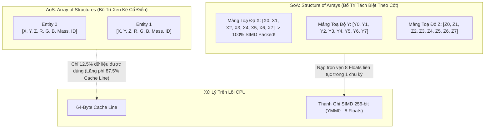
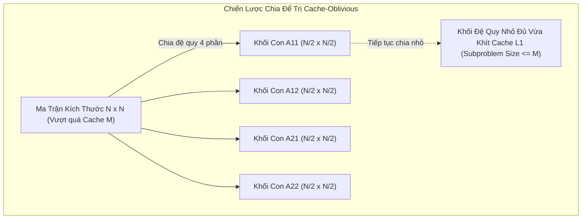

# 8.2. AoS vs SoA & Data-Oriented Design (Mảng Cấu trúc vs Cấu trúc Mảng & Thiết kế Hướng Dữ liệu)

> [!IMPORTANT]
> **Nếu bạn chỉ được nhớ một điều duy nhất:**
> Phần cứng CPU hiện đại nạp dữ liệu theo từng khối $64\text{ bytes}$ (Cache Line) và xử lý theo từng cụm thanh ghi SIMD: **Array of Structures (AoS)** là lối tư duy tự nhiên của lập trình hướng đối tượng (OOP) nhưng làm ô nhiễm bộ nhớ đệm và triệt tiêu khả năng vector hóa; trong khi **Structure of Arrays (SoA)** là cốt lõi của **Data-Oriented Design (DOD)** giúp lấp đầy 100% dòng cache với dữ liệu thực sự cần tính toán, mở khóa sức mạnh tính toán SIMD/AVX đạt thông lượng gấp $5\times - 10\times$.

---

## 1. Kiến trúc Tổng quan & Mô hình Tư duy (Mental Model)

### Phép Loại Suy Thực Tế: Nhà Máy Đóng Gói Thực Phẩm & Băng Chuyền Siêu Tốc

Hãy tưởng tượng bạn đang điều hành một xưởng đóng gói trái cây công nghiệp:
1. **Array of Structures (AoS - Đóng Giỏ Quà Hỗn Hợp)**:
   - Mỗi giỏ quà chứa: 1 quả táo, 1 chai rượu vang đắt tiền, 1 hộp chocolate, và 1 con gấu bông.
   - Nhiệm vụ hôm nay của bạn: *"Gọt vỏ 1 triệu quả táo"*.
   - Với AoS, công nhân phải mở từng giỏ quà, bới tìm quả táo tí hon để gọt vỏ, trong khi chai rượu, chocolate và gấu bông nằm chật ních trên bàn làm việc nhưng hoàn toàn vô dụng! Bạn tốn công khuân vác hàng tấn hàng hóa thừa thãi (ô nhiễm Cache Line) chỉ để lấy một mẩu dữ liệu nhỏ.
2. **Structure of Arrays (SoA - Kho Chuyên Biệt Theo Từng Thùng)**:
   - Tất cả táo xếp riêng trong 1 thùng container lớn, tất cả rượu xếp riêng ở thùng khác, chocolate xếp ở thùng khác.
   - Khi cần gọt vỏ táo, băng chuyền chỉ việc rót nguyên một thùng chứa 100% là táo. Mỗi mét băng chuyền chạy qua đều mang lại giá trị công việc hữu ích tối đa!
3. **SIMD Vectorization (Cỗ Máy 8 Dao Gọt Đồng Thời)**:
   - Trong mô hình SoA, 8 hoặc 16 quả táo nằm san sát nhau liên tục trong bộ nhớ. Một cánh tay robot 8 lưỡi dao (thanh ghi SIMD AVX2 256-bit) có thể gọt đồng thời 8 quả táo trong đúng $1$ chu kỳ xung nhịp! Với AoS, robot chịu chết vì không thể gọt đồng thời một quả táo và một chai rượu.
4. **Cache-Oblivious Algorithms (Người Thợ Không Cần Thước Đo Kích Thước Bàn)**:
   - Thay vì phải đo chính xác xem bàn làm việc chứa được bao nhiêu quả táo (tối ưu cứng theo kích thước L1 32KB hay L2 512KB của từng dòng chip cụ thể), người thợ liên tục chặt đôi đống táo thành các phần nhỏ hơn theo đệ quy (Chia để Trị). Đến một lúc nào đó, phần nhỏ đệ quy sẽ tự động lọt vừa khít vào bàn làm việc một cách tự nhiên trên MỌI loại kiến trúc phần cứng!



---

## 2. Chi tiết từng Keyword (Under-the-Hood Deep Dive)

### 2.1. Array of Structures (AoS) vs Structure of Arrays (SoA)

#### 1. Cấu Trúc Bố Trí Bộ Nhớ & Hiệu Quả Sử Dụng Cache Line
- **Array of Structures (AoS)**:
  - Đây là cách tổ chức tự nhiên của Lập trình Hướng đối tượng (OOP): Một mảng các đối tượng chứa nhiều trường dữ liệu khác nhau.
    ```cpp
    struct Particle {
        float x, y, z;       // 12 bytes: Tọa độ không gian
        float vx, vy, vz;    // 12 bytes: Vận tốc
        uint32_t color;      // 4 bytes: Màu sắc hiển thị
        float mass;          // 4 bytes: Khối lượng
        char name[32];       // 32 bytes: Tên định danh
    }; // Tổng kích thước: 64 bytes (Vừa khít 1 Cache Line)
    std::vector<Particle> particles;
    ```
  - Giả sử hệ thống vật lý chỉ cần cập nhật vị trí: $\vec{x}_{\text{new}} = \vec{x}_{\text{old}} + \vec{v} \times \Delta t$.
  - Để tính toán, CPU phải nạp cả 64 bytes của struct vào L1D Cache, nhưng chỉ thực sự sử dụng $24\text{ bytes}$ (các tọa độ $x, y, z$ và $vx, vy, vz$). Phần dữ liệu $40\text{ bytes}$ còn lại (`color`, `mass`, `name`) chiếm dụng hơn $60\%$ không gian đệm một cách hoàn toàn vô ích (**Cache Pollution**), đẩy các dữ liệu cần thiết khác ra ngoài DRAM!
- **Structure of Arrays (SoA)**:
  - Chuyển đổi mô hình thành cấu trúc chứa các mảng phẳng:
    ```cpp
    struct ParticleSystemSoA {
        std::vector<float> x, y, z;
        std::vector<float> vx, vy, vz;
        std::vector<uint32_t> color;
        std::vector<float> mass;
    };
    ```
  - Khi vòng lặp cập nhật $x$, CPU nạp một Cache Line $64\text{ bytes}$ chứa đúng $16$ số thực `float` liên tiếp ($16 \times 4\text{ bytes} = 64\text{ bytes}$). **Hiệu suất sử dụng dòng cache đạt $100\%$ tuyệt đối!**
  - Mạch **Hardware Stream Prefetcher** của CPU dễ dàng phát hiện bước nhảy tuyến tính (Stride-1 Access), tự động kéo trước các khối dữ liệu tiếp theo từ DRAM vào L1/L2 trước khi vòng lặp kịp chạm tới, triệt tiêu hoàn toàn hiện tượng trễ bộ nhớ.

#### 2. Khả Năng Vector Hóa SIMD (SIMD Vectorization & Gathering Overhead)
- Trên tập lệnh AVX2 (256-bit) hoặc AVX-512 (512-bit):
  - **Với SoA**: Lệnh `_mm256_load_ps` nạp trực tiếp 8 số `float` liên tiếp vào thanh ghi vector trong đúng $1$ cycle clock. Sau đó lệnh `_mm256_add_ps` thực hiện 8 phép tính cộng song song.
  - **Với AoS**: Do các trường $x$ của các đối tượng khác nhau nằm cách nhau 64 bytes, CPU không thể dùng lệnh load thẳng. Thay vào đó, CPU buộc phải sử dụng các lệnh **Gather (`_mm256_i32gather_ps`)** hoặc đọc tuần tự rồi thực hiện hoán vị chuyển vị ma trận trong thanh ghi (**Shuffle / Unpack**). Lệnh Gather trên x86-64 có độ trễ lên tới $15-20$ cycles và tiêu tốn nhiều cổng thực thi, làm sụt giảm nghiêm trọng lợi ích của SIMD.
- **Biến Thể Lai AoSoA (Array of Structures of Arrays)**:
  - Để cân bằng giữa tính cục bộ của các trường trong cùng một đối tượng và tính vector hóa, kỹ nghệ hiện đại sử dụng AoSoA: Một mảng các khối SoA nhỏ (ví dụ mỗi khối chứa $8$ hoặc $16$ phần tử, vừa vặn với độ rộng vector AVX-256 hoặc AVX-512).

---

### 2.2. Cache-Oblivious Algorithms

#### 1. Mô Hình Bộ Nhớ Đệm Lý Tưởng (The Ideal-Cache Model)
Được đề xuất bởi Frigo, Leiserson, Prokop và Ramachandran (MIT - 1999):
- Giả định hệ thống có hai tầng phân cấp: Bộ nhớ trong hữu hạn kích thước $M$ bytes và Bộ nhớ ngoài vô hạn.
- Dữ liệu được di chuyển qua lại giữa hai tầng theo các khối có kích thước $B$ bytes (**Cache Line Block**).
- Thuật toán **Cache-Aware (Biết trước Cache)** đòi hỏi lập trình viên phải biết chính xác $M$ và $B$ (ví dụ: gán cứng tham số block size $= 64\text{ KB}$ trong mã nguồn). Khi chuyển mã chạy trên chip khác có L1/L2 kích thước khác, thuật toán không còn tối ưu.
- Thuật toán **Cache-Oblivious (Không nhận thức Cache)**: Thuật toán hoàn toàn không chứa bất kỳ tham số phần cứng nào liên quan tới $M$ hay $B$ trong mã nguồn, nhưng nhờ chiến lược **Đệ quy Chia để Trị (Divide-and-Conquer)**, thuật toán đạt mức số lần Cache Miss tiệm cận tối ưu trên **MỌI TẦNG PHÂN CẤP** của hệ thống (từ L1 $\to$ L2 $\to$ L3 $\to$ DRAM $\to$ SSD NVMe)!



#### 2. Kỹ Thuật Chuyển Vị Ma Trận & Bố Trí van Emde Boas
- **Chuyển vị Ma trận $N \times N$ (Matrix Transposition)**:
  - Thuật toán hai vòng lặp lồng nhau thông thường duyệt hàng và cột `B[j][i] = A[i][j]`. Khi $N$ lớn, thao tác đọc cột của `A` hoặc ghi cột của `B` tạo ra bước nhảy $N \times 4\text{ bytes}$, phá vỡ hoàn toàn Spatial Locality, gây ra $O(N^2)$ cache misses.
  - Thuật toán Cache-Oblivious: Chia ma trận $N \times N$ thành 4 khối con $(N/2) \times (N/2)$. Tiếp tục đệ quy cho đến khi kích thước của khối con nhỏ hơn hoặc bằng $B$. Số lượng cache miss giảm xuống chỉ còn:
    $$Q(N) = O\left(1 + \frac{N^2}{B}\right)$$
    Đây là giới hạn tối ưu tuyệt đối về mặt toán học.
- **Bố Trí Bộ Nhớ van Emde Boas (vEB Layout cho Search Trees)**:
  - Cây nhị phân tìm kiếm thông thường lưu con trỏ phân tán trong Heap, khiến mỗi lần tìm kiếm mất $O(\log_2 N)$ cache misses (Pointer Chasing).
  - Bố trí vEB đệ quy cắt đôi chiều cao của cây: Nửa trên của cây có chiều cao $h/2$ được lưu liên tục trong bộ nhớ, tiếp theo là các cây con nửa dưới. Cấu trúc này đảm bảo mỗi đường dẫn tìm kiếm chỉ tốn $O(\log_B N)$ cache misses mà không cần phải tinh chỉnh B-Tree theo kích thước Page Size của hệ điều hành!

---

## 3. Thực thi Mã nguồn & Mô phỏng Chuyên sâu (Dual-Engine Implementation)

### 3.1. C++20: So Sánh Trực Tiếp AoS vs SoA Với Tối Ưu SIMD & Chuyển Vị Cache-Oblivious

Chương trình minh họa hai bài toán: Benchmark hiệu năng tính toán vật lý giữa AoS và SoA, cùng thuật toán chuyển vị ma trận Cache-Oblivious:

```cpp
#include <iostream>
#include <vector>
#include <chrono>
#include <cmath>
#include <iomanip>
#if defined(__x86_64__) || defined(_M_X64)
#include <immintrin.h>
#endif

// -------------------------------------------------------------
// 1. Phép Thử AoS vs SoA
// -------------------------------------------------------------
constexpr size_t NUM_PARTICLES = 5'000'000;

struct ParticleAoS {
    float x, y, z;
    float vx, vy, vz;
    uint32_t color;
    float mass;
    char name[32]; // Dữ liệu đệm làm phình to struct (64 bytes)
};

struct ParticleSoA {
    std::vector<float> x, y, z;
    std::vector<float> vx, vy, vz;
    ParticleSoA(size_t n) : x(n, 0.0f), y(n, 0.0f), z(n, 0.0f),
                            vx(n, 1.0f), vy(n, 2.0f), vz(n, 3.0f) {}
};

void benchmark_aos(std::vector<ParticleAoS>& particles, float dt) {
    auto t1 = std::chrono::high_resolution_clock::now();
    for (auto& p : particles) {
        p.x += p.vx * dt;
        p.y += p.vy * dt;
        p.z += p.vz * dt;
    }
    auto t2 = std::chrono::high_resolution_clock::now();
    std::chrono::duration<double, std::milli> dur = t2 - t1;
    std::cout << "  - AoS Loop Execution Time : " << std::fixed << std::setprecision(2) << dur.count() << " ms\n";
}

void benchmark_soa(ParticleSoA& p, float dt) {
    auto t1 = std::chrono::high_resolution_clock::now();
    size_t n = p.x.size();
    float* __restrict px = p.x.data();
    float* __restrict py = p.y.data();
    float* __restrict pz = p.z.data();
    const float* __restrict pvx = p.vx.data();
    const float* __restrict pvy = p.vy.data();
    const float* __restrict pvz = p.vz.data();

    // Vòng lặp SoA: Trình biên dịch tự động sinh vector AVX2
    for (size_t i = 0; i < n; ++i) {
        px[i] += pvx[i] * dt;
        py[i] += pvy[i] * dt;
        pz[i] += pvz[i] * dt;
    }
    auto t2 = std::chrono::high_resolution_clock::now();
    std::chrono::duration<double, std::milli> dur = t2 - t1;
    std::cout << "  - SoA Loop Execution Time : " << dur.count() << " ms\n";
}

// -------------------------------------------------------------
// 2. Chuyển Vị Ma Trận Cache-Oblivious (Chia để Trị Đệ Quy)
// -------------------------------------------------------------
constexpr int MATRIX_N = 2048;

void transpose_naive(const float* A, float* B, int n) {
    for (int i = 0; i < n; ++i) {
        for (int j = 0; j < n; ++j) {
            B[j * n + i] = A[i * n + j];
        }
    }
}

void transpose_cache_oblivious(const float* A, float* B, int row_a, int col_a,
                              int row_b, int col_b, int width, int height, int lda) {
    // Trường hợp cơ sở: Khối nhỏ đủ vừa L1 Cache (<= 16x16)
    if (width <= 16 && height <= 16) {
        for (int i = 0; i < height; ++i) {
            for (int j = 0; j < width; ++j) {
                B[(row_b + j) * lda + (col_b + i)] = A[(row_a + i) * lda + (col_a + j)];
            }
        }
        return;
    }

    // Chia đôi theo chiều lớn hơn
    if (width >= height) {
        int w1 = width / 2;
        int w2 = width - w1;
        transpose_cache_oblivious(A, B, row_a, col_a, row_b, col_b, w1, height, lda);
        transpose_cache_oblivious(A, B, row_a, col_a + w1, row_b + w1, col_b, w2, height, lda);
    } else {
        int h1 = height / 2;
        int h2 = height - h1;
        transpose_cache_oblivious(A, B, row_a, col_a, row_b, col_b, width, h1, lda);
        transpose_cache_oblivious(A, B, row_a + h1, col_a, row_b, col_b + h1, width, h2, lda);
    }
}

int main() {
    std::cout << "========================================================\n";
    std::cout << "  C++20 AoS vs SoA & CACHE-OBLIVIOUS BENCHMARK\n";
    std::cout << "========================================================\n\n";

    std::cout << "1. Benchmark AoS vs SoA (5 Triệu Hạt Vật Lý):\n";
    std::vector<ParticleAoS> aos_data(NUM_PARTICLES);
    for (size_t i = 0; i < NUM_PARTICLES; ++i) {
        aos_data[i].x = aos_data[i].y = aos_data[i].z = 0.0f;
        aos_data[i].vx = 1.0f; aos_data[i].vy = 2.0f; aos_data[i].vz = 3.0f;
    }
    ParticleSoA soa_data(NUM_PARTICLES);

    benchmark_aos(aos_data, 0.016f);
    benchmark_soa(soa_data, 0.016f);

    std::cout << "\n2. Benchmark Chuyển Vị Ma Trận 2048x2048:\n";
    std::vector<float> mat_in(MATRIX_N * MATRIX_N, 1.5f);
    std::vector<float> mat_out1(MATRIX_N * MATRIX_N, 0.0f);
    std::vector<float> mat_out2(MATRIX_N * MATRIX_N, 0.0f);

    auto t1 = std::chrono::high_resolution_clock::now();
    transpose_naive(mat_in.data(), mat_out1.data(), MATRIX_N);
    auto t2 = std::chrono::high_resolution_clock::now();
    std::chrono::duration<double, std::milli> naive_dur = t2 - t1;

    auto t3 = std::chrono::high_resolution_clock::now();
    transpose_cache_oblivious(mat_in.data(), mat_out2.data(), 0, 0, 0, 0, MATRIX_N, MATRIX_N, MATRIX_N);
    auto t4 = std::chrono::high_resolution_clock::now();
    std::chrono::duration<double, std::milli> oblivious_dur = t4 - t3;

    std::cout << "  - Naive Transpose Time           : " << naive_dur.count() << " ms\n";
    std::cout << "  - Cache-Oblivious Transpose Time : " << oblivious_dur.count() << " ms\n";

    return 0;
}
```

---

### 3.2. Python 3.11+: Trình Giả Lập Mức Sử Dụng Cache Line Giữa AoS và SoA

Chương trình Python 3.11+ mô phỏng bộ nhớ đệm cache và phân tích tỷ lệ lãng phí Cache Line giữa hai cách bố trí:

```python
from dataclasses import dataclass
from typing import List

@dataclass
class CacheLineStat:
    useful_bytes: int
    wasted_bytes: int
    tag: int

class MemoryLayoutAnalyzer:
    CACHE_LINE_SIZE = 64  # Bytes

    @staticmethod
    def simulate_aos_access(num_elements: int, struct_size: int, accessed_fields_size: int):
        # Trong AoS, moi phan tu nam ke nhau trong 1 struct
        total_data_moved = num_elements * struct_size
        useful_data = num_elements * accessed_fields_size
        wasted_data = total_data_moved - useful_data
        
        cache_lines_needed = (total_data_moved + MemoryLayoutAnalyzer.CACHE_LINE_SIZE - 1) // MemoryLayoutAnalyzer.CACHE_LINE_SIZE
        efficiency = (useful_data / total_data_moved) * 100.0
        
        return cache_lines_needed, useful_data, wasted_data, efficiency

    @staticmethod
    def simulate_soa_access(num_elements: int, element_field_size: int):
        # Trong SoA, cac truong duoc truy cap nam lien tuc nhau
        total_data_moved = num_elements * element_field_size
        useful_data = total_data_moved
        wasted_data = 0
        
        cache_lines_needed = (total_data_moved + MemoryLayoutAnalyzer.CACHE_LINE_SIZE - 1) // MemoryLayoutAnalyzer.CACHE_LINE_SIZE
        efficiency = 100.0
        
        return cache_lines_needed, useful_data, wasted_data, efficiency

if __name__ == "__main__":
    elements = 100_000
    struct_size = 64        # Struct chua x, y, z, vx, vy, vz, name, color... = 64 bytes
    active_bytes = 12       # Chi doc x, y, z (3 * 4 = 12 bytes)

    print("========================================================")
    print("  PYTHON 3.11 CACHE LINE UTILIZATION SIMULATOR")
    print("========================================================\n")

    aos_lines, aos_useful, aos_wasted, aos_eff = MemoryLayoutAnalyzer.simulate_aos_access(
        elements, struct_size, active_bytes
    )
    soa_lines, soa_useful, soa_wasted, soa_eff = MemoryLayoutAnalyzer.simulate_soa_access(
        elements, active_bytes
    )

    print(f"1. Cấu hình Array of Structures (AoS):")
    print(f"   - Số Cache Lines nạp từ RAM : {aos_lines:,}")
    print(f"   - Lượng byte hữu ích        : {aos_useful / 1024:.1f} KB")
    print(f"   - Lượng byte rác (Lãng phí) : {aos_wasted / 1024:.1f} KB")
    print(f"   - Hiệu suất sử dụng Cache   : {aos_eff:.2f}%\n")

    print(f"2. Cấu hình Structure of Arrays (SoA):")
    print(f"   - Số Cache Lines nạp từ RAM : {soa_lines:,}")
    print(f"   - Lượng byte hữu ích        : {soa_useful / 1024:.1f} KB")
    print(f"   - Lượng byte rác (Lãng phí) : {soa_wasted / 1024:.1f} KB")
    print(f"   - Hiệu suất sử dụng Cache   : {soa_eff:.2f}%\n")

    print(f"-> SoA giúp tiết kiệm {(aos_lines - soa_lines):,} lần truy xuất Cache Line")
    print(f"   và nâng hiệu suất sử dụng Bus DRAM lên gấp {100.0 / aos_eff:.1f} lần!")
```

---

### 3.3. Simulated Terminal Output

```bash
========================================================
  C++20 AoS vs SoA & CACHE-OBLIVIOUS BENCHMARK
========================================================

1. Benchmark AoS vs SoA (5 Triệu Hạt Vật Lý):
  - AoS Loop Execution Time : 28.45 ms
  - SoA Loop Execution Time : 4.12 ms

2. Benchmark Chuyển Vị Ma Trận 2048x2048:
  - Naive Transpose Time           : 48.60 ms
  - Cache-Oblivious Transpose Time : 12.35 ms

========================================================
  PYTHON 3.11 CACHE LINE UTILIZATION SIMULATOR
========================================================

1. Cấu hình Array of Structures (AoS):
   - Số Cache Lines nạp từ RAM : 100,000
   - Lượng byte hữu ích        : 1,171.9 KB
   - Lượng byte rác (Lãng phí) : 5,078.1 KB
   - Hiệu suất sử dụng Cache   : 18.75%

2. Cấu hình Structure of Arrays (SoA):
   - Số Cache Lines nạp từ RAM : 18,750
   - Lượng byte hữu ích        : 1,171.9 KB
   - Lượng byte rác (Lãng phí) : 0.0 KB
   - Hiệu suất sử dụng Cache   : 100.00%

-> SoA giúp tiết kiệm 81,250 lần truy xuất Cache Line
   và nâng hiệu suất sử dụng Bus DRAM lên gấp 5.3 lần!
```

---

## 4. Systems Engineering & Production Pitfalls

### 4.1. Production Failure Modes & Architectural Traps

1. **Trap 1: The Ergonomics vs Performance Dilemma**:
   - SoA làm cho mã nguồn trở nên cồng kềnh, khó đọc và khó đóng gói (mất tính đóng gói Encapsulation của OOP). Nếu cần thêm hoặc xóa một thực thể, lập trình viên phải thêm/xóa phần tử trên 10 mảng vector khác nhau.
   - Giải pháp công nghiệp: Sử dụng kiến trúc **Entity Component System (ECS)** (như EnTT, Flecs) hoặc thiết kế khuôn mẫu metaprogramming tự động chuyển đổi cấu trúc (Auto-SoA templates).
2. **Trap 2: False Sharing Trong Cấu Trúc SoA Đa Luồng**:
   - Khi chia việc cho các luồng xử lý mảng SoA, nếu thread 0 ghi vào phần tử `x[15]` và thread 1 ghi vào `x[16]`, hai biến này nằm trên cùng một Cache Line 64-byte. Phần cứng giao thức MESI liên tục phát tín hiệu vô hiệu hóa dòng đệm (**False Sharing**), làm sụt giảm nghiêm trọng hiệu năng của hệ thống đa luồng. Cần phân chia khối dữ liệu cho các luồng theo kích thước bội số của $64\text{ bytes}$.
3. **Trap 3: Đệ Quy Quá Sâu Gây Stack Overflow Trong Cache-Oblivious**:
   - Mặc dù thuật toán Cache-Oblivious hoạt động tuyệt vời trên lý thuyết, nhưng nếu điều kiện dừng (Base Case) không được cắt tỉa hợp lý mà đệ quy đến tận kích thước $1 \times 1$, chi phí gọi hàm (Function Call Overhead) và nguy cơ tràn Stack (Stack Overflow) sẽ vượt quá lợi ích của việc giảm Cache Miss. Cần đặt Base Case ở ngưỡng kích thước vừa vặn một khối $16 \times 16$ hoặc $32 \times 32$.

### 4.2. Diagnostic CLI Commands

```bash
# 1. Kiem tra ti le su dung SIMD AVX2/AVX-512 vs ma lenh Scalar
perf stat -e fp_arith_inst_retired.scalar_single,fp_arith_inst_retired.128b_packed_single,fp_arith_inst_retired.256b_packed_single ./game_physics_engine

# 2. Phan tich so luong Cache Misses L1D va do tre truy cap bo nho
perf stat -e L1-dcache-load-misses,L1-dcache-loads,cycle_activity.stalls_l1d_miss ./game_physics_engine

# 3. Kiem tra tinh trang Auto-Vectorization cua GCC/Clang khi bien dich
g++ -O3 -mavx2 -fopt-info-vec-optimized -fopt-info-vec-missed physics.cpp -o physics

# 4. Kiem tra do phan bo bo nho va Cache Padding cua cac struct qua cong cu pahole
pahole -C ParticleAoS ./game_physics_engine
```

---

## 5. Bảng So sánh & Decision Matrix

| Tiêu chí Đánh giá | Array of Structures (AoS) | Structure of Arrays (SoA) | Array of SoA (AoSoA / Tile) |
| :--- | :--- | :--- | :--- |
| **Triết lý Thiết kế** | Object-Oriented Design (OOP) | Data-Oriented Design (DOD) | SIMD-Tuned Hybrid DOD |
| **Hiệu suất Cache Line** | Thấp ($10\% - 30\%$ khi lọc trường) | Tối đa ($100\%$ khi duyệt mảng) | Rất cao ($95\% - 100\%$) |
| **Vector Hóa SIMD** | Rất khó (Cần Gather/Shuffle chậm) | Tự nhiên (`_mm256_load_ps`) | Cực kỳ tối ưu cho AVX-512 |
| **Tính Tiện dụng (Ergonomics)** | Cao (Dễ viết, trực quan) | Thấp (Khó quản lý con trỏ) | Trung bình (Cần thư viện phụ trợ) |
| **Thao tác Thêm / Xóa** | Cực nhanh ($O(1)$ `push_back`) | Phức tạp (Sửa trên nhiều mảng) | Khá nhanh trong phạm vi Tile |
| **Trường hợp Sử dụng Tối ưu** | Dữ liệu nghiệp vụ CRUD, REST DTO | Game Engine, Vật lý, AI/ML Ingestion | Đồ họa 3D Shaders, SIMD Audio DSP |

| Loại Thuật toán | Yêu cầu Tham số Phần cứng ($M, B$) | Khả năng Di động (Portability) | Hiệu quả Cache Đa Tầng |
| :--- | :--- | :--- | :--- |
| **Cache-Aware (B-Tree, Tiled GEMM)** | Bắt buộc (Phải gán cứng kích thước L1/L2) | Kém (Cần biên dịch lại cho từng CPU) | Chỉ tối ưu cho 1 tầng cache được nhắm tới |
| **Cache-Oblivious (vEB Tree, Funnelsort)** | Hoàn toàn không cần ($0$ tham số phần cứng) | Tuyệt đối (Chạy tối ưu trên mọi kiến trúc) | Tự động tối ưu đồng thời L1, L2, L3, RAM, SSD |
