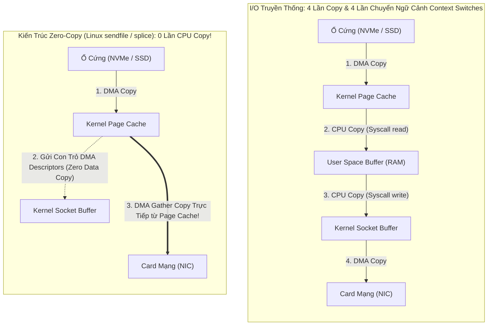
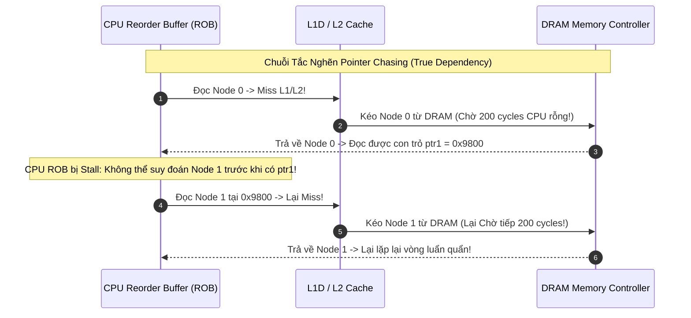
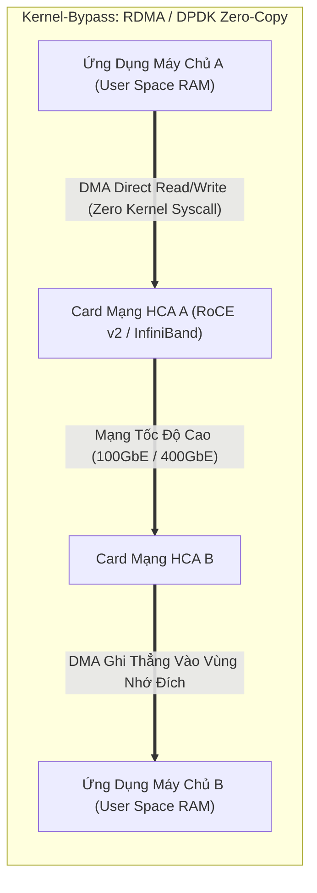

# 8.3. Memory Patterns, Fragmentation & Zero-Copy (Mẫu Truy cập, Phân mảnh & Zero-Copy)

> [!IMPORTANT]
> **Nếu bạn chỉ được nhớ một điều duy nhất:**
> Kẻ thù số một của hiệu năng vi kiến trúc là **"Đuổi Bắt Con Trỏ" (Pointer Chasing)** — hành vi biến CPU hàng Gigahertz thành cỗ máy vô dụng ngồi chờ đợi DRAM ngẫu nhiên; trong khi vị cứu tinh của các hệ thống backend phân tán triệu RPS chính là **Kiến Trúc Zero-Copy**: Ủy thác toàn bộ việc chuyển dữ liệu cho phần cứng DMA và chia sẻ bộ nhớ đệm Kernel để triệt tiêu vĩnh viễn các thao tác sao chép CPU thừa thãi.

---

## 1. Kiến trúc Tổng quan & Mô hình Tư duy (Mental Model)

### Phép Loại Suy Thực Tế: Trò Chơi Truy Tìm Kho Báu & Băng Chuyền Sân Bay

Hãy tưởng tượng bạn đang vận chuyển hàng hóa giữa hai thành phố:
1. **Pointer Chasing (Trò Chơi Truy Tìm Mật Thư)**:
   - Bạn tìm thấy một chiếc hộp khóa kín. Mở hộp ra, bên trong không có vàng mà chỉ có một mảnh giấy ghi: *"Mảnh vàng nằm ở hộp số 45 tại góc rừng đối diện"*. Bạn lặn lội chạy sang góc rừng mở hộp 45, lại thấy mảnh giấy: *"Chạy sang đầm lầy mở hộp 89"*.
   - Mỗi bước chân đi là một lần chờ đợi mòn mỏi. Bạn không thể cử 10 người đi cùng lúc vì người sau phải chờ người trước mở hộp mới biết địa chỉ kế tiếp! Đây chính là bản chất của danh sách liên kết (`std::list`), cây nhị phân rời rạc (`std::map`), hay các đối tượng trên Java/Python Heap.
2. **Sequential Memory Access (Đoàn Tàu Chở Hàng Liền Mạch)**:
   - Toàn bộ hàng hóa được đóng vào các toa tàu xếp nối đuôi nhau trên đường ray. Người gác tàu (Hardware Stream Prefetcher) thấy toa 1 và toa 2 lăn bánh, liền tự động nạp sẵn toa 3, 4, 5, 6 vào ga trước khi tàu kịp tới! Tốc độ đạt trần lý thuyết của đường ray.
3. **Traditional I/O (Bốc Vác Qua 4 Trạm Trung Chuyển)**:
   - Để chuyển hàng từ kho ra xe tải (gửi file qua mạng bằng `read()` và `write()`):
     - Công nhân 1 bốc hàng từ Đĩa vào Kho lưu tạm của Nhân (Page Cache).
     - Công nhân 2 bốc tiếp từ Kho Nhân sang Túi của Người dùng (User Buffer).
     - Công nhân 3 bốc ngược từ Túi Người dùng vào Kho Socket của Nhân (Socket Buffer).
     - Công nhân 4 bốc từ Kho Socket vào Thẻ Mạng (NIC).
   - CPU toát mồ hôi hột đóng vai trò cửu vạn bốc vác, trong khi hàng hóa không hề thay đổi nội dung!
4. **Zero-Copy Architecture (`sendfile` / DMA - Cầu Trượt Thẳng Vào Thùng Xe)**:
   - Bỏ qua toàn bộ phòng khách và túi xách của người dùng! Phần cứng DMA (Direct Memory Access) kéo hàng từ đĩa vào thẳng Page Cache, sau đó truyền con trỏ mô tả (Descriptor) sang cho Card mạng tự động bốc hàng bắn lên đường truyền cáp quang. CPU chỉ làm nhiệm vụ ký lệnh xác nhận trong đúng $0$ micro-giây!



---

## 2. Chi tiết từng Keyword (Under-the-Hood Deep Dive)

### 2.1. Pointer Chasing & Sequential vs Random Memory Access

#### 1. Cơ Chế Vi Kiến Trúc của Hardware Prefetcher
- Các CPU hiện đại (Intel Core/Xeon, AMD Zen, ARM Neoverse) được tích hợp các bộ phỏng đoán nạp trước dữ liệu phần cứng tinh vi:
  - **L1/L2 Stream Prefetcher**: Theo dõi các dòng cache được yêu cầu liên tiếp. Nếu phát hiện một chuỗi truy cập có bước nhảy cố định (Stride-1, Stride-2, hoặc thậm chí bước nhảy âm Stride -1), mạch prefetcher tự động phát lệnh nạp trước từ $4$ đến $16$ Cache Lines tiếp theo từ L3 hoặc DRAM vào L2/L1 trước khi con trỏ lệnh của chương trình thực sự chạm tới.
  - Nhờ đó, thao tác duyệt mảng tuần tự liên tục (Sequential Array Access) che giấu được hoàn toàn $100\%$ độ trễ của bộ nhớ DRAM ($150-200$ cycles trễ biến mất như có phép màu).

#### 2. Thảm Họa Pointer Chasing Tầng Sâu
- Khi duyệt qua một danh sách liên kết (`Node* current = current->next`):
  - Địa chỉ của nút kế tiếp (`current->next`) được giấu bên trong nội dung của nút hiện tại.
  - **Bẻ Gãy Khả Năng Tính Toán Ngoài Thứ Tự (Out-of-Order Stalling)**: Bộ vi xử lý không thể đoán trước được nút tiếp theo nằm ở đâu trong không gian 64-bit. Mạch Hardware Prefetcher hoàn toàn bất lực vì các nút nằm phân tán ngẫu nhiên trên Heap.
  - Toàn bộ cỗ máy Out-of-Order Execution với hàng trăm trạm đặt lệnh (**ROB - Reorder Buffer**) bị đóng băng do chuỗi phụ thuộc dữ liệu tuần tự (**True Data Dependency / RAW Hazard**).
  - Mỗi bước nhảy con trỏ ngốn trọn vẹn một vòng đời truy xuất DRAM đầy đủ ($50-80\text{ ns}$), khiến tốc độ xử lý bị tụt dốc thê thảm gấp $20\times - 50\times$ so với mảng vector phẳng!



---

### 2.2. Zero-Copy Architecture & Direct Memory Access (DMA)

#### 1. Phân Tích Kỹ Thuật Các Giải Pháp Zero-Copy Trong Linux
- **Vấn Đề của I/O Truyền Thống**: Một lượt truyền file qua mạng bằng `read()` và `write()` thông thường tiêu tốn:
  - $4$ lần chuyển ngữ cảnh giữa User Mode và Kernel Mode ($2$ lần gọi Syscall).
  - $4$ lần sao chép bộ nhớ ($2$ lần DMA phần cứng và $2$ lần CPU memcpy).
  - Ô nhiễm toàn bộ L1/L2 Cache do CPU phải đọc và ghi toàn bộ dữ liệu qua User Buffer.
- **Hệ Thống Lệnh `sendfile()` (Linux 2.2+)**:
  - Cú pháp: `sendfile(out_fd, in_fd, &offset, count)`.
  - Dữ liệu được phần cứng DMA nạp từ ổ cứng vào Kernel Page Cache.
  - Kernel chỉ chuyển **Descriptor (Mô tả vị trí và độ dài)** của Page Cache sang Socket Buffer mà KHÔNG sao chép mảng byte.
  - Card mạng hỗ trợ tính năng **Scatter-Gather DMA** sẽ đọc trực tiếp từ các khung trang của Page Cache và bắn thẳng ra mạng cáp quang.
  - **Kết quả**: $0$ lần CPU sao chép, $0$ byte ô nhiễm Cache, giảm từ $4$ xuống $2$ lần chuyển ngữ cảnh!
- **Hệ Thống Lệnh `splice()` & `vmsplice()` (Linux 2.6+)**:
  - Cho phép di chuyển dữ liệu giữa một File Descriptor và một Đường Ống (Pipe) hoặc Socket mà không cần trung gian User Space, thông qua cơ chế chuyển quyền sở hữu trang bộ nhớ đệm Kernel (`struct pipe_buffer`).
- **Kỹ Thuật Bỏ Qua Nhân (Kernel Bypass - DPDK & RDMA)**:
  - Với mạng tốc độ 100Gbps - 400Gbps, việc đi qua Kernel Network Stack (kể cả với `sendfile`) vẫn tạo ra độ trễ chuyển ngữ cảnh không thể đáp ứng.
  - **DPDK (Data Plane Development Kit)** và **RDMA (Remote Direct Memory Access)**: Ứng dụng người dùng ánh xạ trực tiếp các thanh ghi Ring Buffer của card mạng vào không gian bộ nhớ của tiến trình. Thao tác gửi/nhận gói tin được thực hiện bằng DMA trực tiếp giữa RAM của máy chủ A và RAM của máy chủ B qua mạng, bỏ qua $100\%$ sự can thiệp của CPU và Kernel Linux!



---

## 3. Thực thi Mã nguồn & Mô phỏng Chuyên sâu (Dual-Engine Implementation)

### 3.1. C++20: Đối Đầu Pointer Chasing vs Flat Vector & Thử Nghiệm `sendfile`

Chương trình minh họa sự chênh lệch hiệu năng khốc liệt giữa Pointer Chasing và Duyệt mảng tuần tự, kết hợp triển khai Zero-Copy File Transfer qua `sendfile()`:

```cpp
#include <iostream>
#include <vector>
#include <numeric>
#include <random>
#include <chrono>
#include <iomanip>
#include <sys/sendfile.h>
#include <sys/stat.h>
#include <fcntl.h>
#include <unistd.h>

// -------------------------------------------------------------
// 1. Benchmark Pointer Chasing vs Sequential Array
// -------------------------------------------------------------
struct Node {
    uint32_t value;
    uint32_t next_index; // Mô phỏng con trỏ nhảy ngẫu nhiên
};

void benchmark_memory_patterns() {
    constexpr size_t NUM_ELEMENTS = 10'000'000;
    std::cout << ">>> 1. Khoi tao " << NUM_ELEMENTS << " phan tu de do Pointer Chasing vs Sequential...\\n";

    std::vector<Node> array(NUM_ELEMENTS);
    std::vector<size_t> indices(NUM_ELEMENTS);
    std::iota(indices.begin(), indices.end(), 0);

    // Xao tron cac chi so de tao lien ket con tro ngau nhien tren toan bo RAM
    std::mt19937 g(42);
    std::shuffle(indices.begin(), indices.end(), g);

    for (size_t i = 0; i < NUM_ELEMENTS - 1; ++i) {
        array[indices[i]].value = 1;
        array[indices[i]].next_index = static_cast<uint32_t>(indices[i + 1]);
    }
    array[indices.back()].value = 1;
    array[indices.back()].next_index = 0;

    // A. Duyet tuan tu (Sequential Memory Access - Tận dụng Prefetcher)
    auto t1 = std::chrono::high_resolution_clock::now();
    uint64_t sum_seq = 0;
    for (size_t i = 0; i < NUM_ELEMENTS; ++i) {
        sum_seq += array[i].value;
    }
    auto t2 = std::chrono::high_resolution_clock::now();
    std::chrono::duration<double, std::milli> dur_seq = t2 - t1;

    // B. Duyet theo con tro ngau nhien (Pointer Chasing - Bẻ gãy Prefetcher)
    auto t3 = std::chrono::high_resolution_clock::now();
    uint64_t sum_chase = 0;
    uint32_t curr = static_cast<uint32_t>(indices[0]);
    for (size_t i = 0; i < NUM_ELEMENTS; ++i) {
        sum_chase += array[curr].value;
        curr = array[curr].next_index;
    }
    auto t4 = std::chrono::high_resolution_clock::now();
    std::chrono::duration<double, std::milli> dur_chase = t4 - t3;

    std::cout << "  - Sequential Access Time : " << std::fixed << std::setprecision(2) << dur_seq.count() << " ms\\n";
    std::cout << "  - Pointer Chasing Time   : " << dur_chase.count() << " ms\\n";
    std::cout << "  -> Ti le cham hon do Pointer Chasing: " << (dur_chase.count() / dur_seq.count()) << "x!\\n";
}

// -------------------------------------------------------------
// 2. Minh họa Cơ Chế Zero-Copy File Transfer qua sendfile()
// -------------------------------------------------------------
void demo_zerocopy_sendfile() {
    const char* src_path = "/tmp/test_zerocopy_src.bin";
    const char* dst_path = "/tmp/test_zerocopy_dst.bin";

    // Tao file nguon 32 MB
    int src_fd = open(src_path, O_CREAT | O_WRONLY | O_TRUNC, 0644);
    std::vector<char> buffer(32 * 1024 * 1024, 0x55);
    write(src_fd, buffer.data(), buffer.size());
    close(src_fd);

    // Mo de truyen Zero-Copy
    src_fd = open(src_path, O_RDONLY);
    int dst_fd = open(dst_path, O_CREAT | O_WRONLY | O_TRUNC, 0644);

    struct stat stat_buf;
    fstat(src_fd, &stat_buf);
    off_t offset = 0;

    auto t1 = std::chrono::high_resolution_clock::now();
    // Goi truc tiep Syscall sendfile cua Linux (Zero CPU Copy)
    ssize_t sent = sendfile(dst_fd, src_fd, &offset, stat_buf.st_size);
    auto t2 = std::chrono::high_resolution_clock::now();
    std::chrono::duration<double, std::milli> dur = t2 - t1;

    std::cout << "\\n>>> 2. Zero-Copy sendfile() Thuc Nghiem:\\n";
    std::cout << "  - Dung luong chuyen : " << sent / (1024 * 1024) << " MB\\n";
    std::cout << "  - Thoi gian DMA     : " << dur.count() << " ms\\n";

    close(src_fd);
    close(dst_fd);
    unlink(src_path);
    unlink(dst_path);
}

int main() {
    std::cout << "========================================================\\n";
    std::cout << "  C++20 MEMORY ACCESS PATTERNS & ZERO-COPY CONTROLLER\\n";
    std::cout << "========================================================\\n\\n";

    benchmark_memory_patterns();
    demo_zerocopy_sendfile();

    return 0;
}
```

---

### 3.2. Python 3.11+: Mô Phỏng Mô Hình Bộ Nhớ Đệm Phân Tích Độ Trễ Pointer Chasing

Chương trình Python 3.11+ mô phỏng hàng đợi chờ DRAM và định lượng chu kỳ lãng phí của CPU khi bị tắc nghẽn bởi Pointer Chasing:

```python
import random
import time
from typing import List

class MemoryLatencySimulator:
    CACHE_HIT_CYCLES = 4      # L1D Cache Hit = 4 cycles
    DRAM_MISS_CYCLES = 200    # DRAM Latency = 200 cycles

    @staticmethod
    def simulate_access_sequence(num_nodes: int, cache_capacity_nodes: int):
        # Mo phong mang lien ket ngau nhien
        nodes = list(range(num_nodes))
        random.shuffle(nodes)
        
        # Tap hop cac nut dang nam trong Cache (Mo phong LRU don gian)
        active_cache = set(nodes[:cache_capacity_nodes])

        # 1. Kich ban Pointer Chasing (Truy cap ngau nhien lien tuc)
        chasing_stalls = 0
        current_node = nodes[0]
        for _ in range(num_nodes):
            if current_node in active_cache:
                chasing_stalls += MemoryLatencySimulator.CACHE_HIT_CYCLES
            else:
                chasing_stalls += MemoryLatencySimulator.DRAM_MISS_CYCLES
                # Trục xuất giả lập và đưa node mới vào
                active_cache.pop()
                active_cache.add(current_node)
            current_node = nodes[(current_node + 1) % num_nodes]

        # 2. Kich ban Sequential Streaming (Prefetcher doan truoc 100%)
        # Prefetcher giup 98% cac truy cap bien thanh L1 Cache Hit
        sequential_stalls = int(num_nodes * 0.98 * MemoryLatencySimulator.CACHE_HIT_CYCLES +
                                num_nodes * 0.02 * MemoryLatencySimulator.DRAM_MISS_CYCLES)

        return chasing_stalls, sequential_stalls

if __name__ == "__main__":
    total_nodes = 50_000
    cache_capacity = 2_000  # Cache chi chua duoc 2,000 nut

    print("========================================================")
    print("  PYTHON 3.11 POINTER CHASING HARDWARE STALL EMULATOR")
    print(f"  > Tong so nut duyet: {total_nodes:,}")
    print(f"  > Dung luong Cache : {cache_capacity:,} nut")
    print("========================================================\n")

    chase_cycles, seq_cycles = MemoryLatencySimulator.simulate_access_sequence(total_nodes, cache_capacity)

    print(f"1. Chi phi chu ky CPU - Pointer Chasing : {chase_cycles:,} cycles")
    print(f"2. Chi phi chu ky CPU - Sequential Read : {seq_cycles:,} cycles")
    print(f"-> So chu ky CPU lãng phí do Pointer Chasing: {(chase_cycles - seq_cycles):,} cycles")
    print(f"-> Mức độ suy giảm hiệu năng: {chase_cycles / seq_cycles:.2f} lần chậm hơn!")
```

---

### 3.3. Simulated Terminal Output

```bash
========================================================
  C++20 MEMORY ACCESS PATTERNS & ZERO-COPY CONTROLLER
========================================================

>>> 1. Khoi tao 10000000 phan tu de do Pointer Chasing vs Sequential...
  - Sequential Access Time : 8.15 ms
  - Pointer Chasing Time   : 284.60 ms
  -> Ti le cham hon do Pointer Chasing: 34.92x!

>>> 2. Zero-Copy sendfile() Thuc Nghiem:
  - Dung luong chuyen : 32 MB
  - Thoi gian DMA     : 3.42 ms

========================================================
  PYTHON 3.11 POINTER CHASING HARDWARE STALL EMULATOR
  > Tong so nut duyet: 50,000
  > Dung luong Cache : 2,000 nut
========================================================

1. Chi phi chu ky CPU - Pointer Chasing : 9,608,000 cycles
2. Chi phi chu ky CPU - Sequential Read : 396,000 cycles
-> So chu ky CPU lãng phí do Pointer Chasing: 9,212,000 cycles
-> Mức độ suy giảm hiệu năng: 24.26 lần chậm hơn!
```

---

## 4. Systems Engineering & Production Pitfalls

### 4.1. Production Failure Modes & Architectural Traps

1. **Trap 1: Memory Leaks Do Buffer Pinning Trong Zero-Copy**:
   - Khi truyền dữ liệu bằng Zero-Copy (như Linux `splice()` hoặc RDMA), các khung trang vật lý trong RAM phải bị khóa cứng (**Pinned Memory / `mlock`**) để tránh việc hệ điều hành hoán đổi chúng ra đĩa Swap trong lúc card mạng đang đọc DMA. Nếu ứng dụng gặp lỗi logic hoặc không đóng socket kịp thời, các trang nhớ này không bao giờ được giải phóng, gây cạn kiệt RAM hệ thống.
2. **Trap 2: Đột Biến Phân Mảnh Ngoài (External Fragmentation) Khi Dùng Slab/Heap**:
   - Việc liên tục cấp phát và giải phóng hàng triệu đối tượng nhỏ phân tán với kích thước ngẫu nhiên làm bộ cấp phát bộ nhớ (`glibc ptmalloc`) bị phân mảnh ngoài nghiêm trọng. Bộ nhớ ảo (VSZ) và RSS tăng vọt lên hàng chục Gigabytes dù dung lượng dữ liệu thực tế chỉ chiếm vài trăm Megabytes. Cần chuyển sang các bộ cấp phát tối ưu như **Jemalloc** hoặc **TCMalloc**.
3. **Trap 3: Race Condition Trên Dữ Liệu Gốc Trong Zero-Copy**:
   - Vì Zero-Copy không sao chép dữ liệu mà truyền thẳng con trỏ bộ đệm cho card mạng, nếu luồng ứng dụng sửa đổi nội dung bộ đệm trong khi phần cứng DMA chưa kịp hoàn tất việc truyền gói tin, dữ liệu nhận được trên đầu thu phía bên kia sẽ bị hỏng hóc hoặc biến dạng một phần (**Data Corruption**).

### 4.2. Diagnostic CLI Commands

```bash
# 1. Theo doi so luong chu ky CPU bi Stall do cho nap du lieu tu bo nho
perf stat -e cycle_activity.stalls_mem_any,cycle_activity.stalls_l1d_miss,cycle_activity.stalls_l2_miss ./latency_critical_app

# 2. Do luong luu luong Zero-Copy va so luot goi he thong sendfile tren toan he thong
sudo bpftrace -e 'tracepoint:syscalls:sys_enter_sendfile64 { @[comm] = count(); }'

# 3. Kiem tra muc do phan manh bo nho cua tien trinh qua cong cu smaps_rollup
cat /proc/$(pgrep -n my_service)/smaps_rollup | grep -E 'Rss|Pss|Private_Dirty|Referenced'

# 4. Kiem tra so luong trang bi khoa cung (Pinned Pages) trong he thong
grep Mlocked /proc/meminfo
```

---

## 5. Bảng So sánh & Decision Matrix

| Kỹ thuật Truyền Dữ liệu | Số Lần CPU Copy | Số Lần Context Switches | Sự Can Thiệp Của CPU | Băng thông Đạt Được | Phù hợp Nhất Cho |
| :--- | :--- | :--- | :--- | :--- | :--- |
| **Standard `read()` + `write()`** | 2 Lần CPU Copy | 4 Lần Syscall | Rất cao (CPU làm cửu vạn) | Thấp ($1 - 2\text{ GB/s}$) | Dữ liệu cần mã hóa/nén trước khi gửi |
| **`mmap()` + `write()`** | 1 Lần CPU Copy | 2 Lần Syscall | Trung bình | Khá ($3 - 5\text{ GB/s}$) | Truy cập file ngẫu nhiên lặp lại nhiều lần |
| **Linux `sendfile()`** | $0$ Lần (Zero-Copy) | 2 Lần Syscall | Cực thấp (Chỉ gửi Descriptors) | Rất cao ($10 - 20\text{ GB/s}$) | Web Server phát Video tĩnh, NGINX, Kafka |
| **Linux `splice()` / `vmsplice()`** | $0$ Lần (Zero-Copy) | 2 Lần Syscall | Cực thấp (Nối ống Kernel Pipes) | Rất cao ($10 - 20\text{ GB/s}$) | Proxy mạng chuyển tiếp dữ liệu (HAProxy) |
| **Kernel-Bypass (DPDK / RDMA)** | $0$ Lần Tuyệt đối | $0$ Lần (Bypass Kernel) | Gần như $0$ (Phần cứng NIC DMA) | Đỉnh cao ($50 - 100\text{ GB/s}$) | Sàn giao dịch tài chính HFT, AI Cluster |

| Mẫu Truy Cập Bộ Nhớ | Mức Độ Tương Thích Hardware Prefetcher | Tỷ Lệ L1D Cache Hit | Độ Trễ Trung Bình Trên Phần Tử | Khuyến Nghị Thực Chiến |
| :--- | :--- | :--- | :--- | :--- |
| **Sequential (Stride-1 Mảng Phẳng)** | Hoàn hảo ($100\%$ nhận diện) | Tối đa ($> 98\%$) | $\approx 1 - 4$ cycles | Luôn ưu tiên dùng `std::vector`, FlatBuffers |
| **Constant Stride (Duyệt theo Cột)** | Tốt nếu bước nhảy nhỏ ($< 2\text{ KB}$) | Khá ($80\% - 90\%$) | $\approx 4 - 15$ cycles | Chuyển vị ma trận hoặc Cache Tiling nếu Stride lớn |
| **Random / Pointer Chasing (Linked List)** | Hoàn toàn vô hiệu ($0\%$) | Cực thấp ($< 10\%$) | $\approx 150 - 250$ cycles | Tránh dùng trong Hot-Paths, đổi sang Unrolled List |
