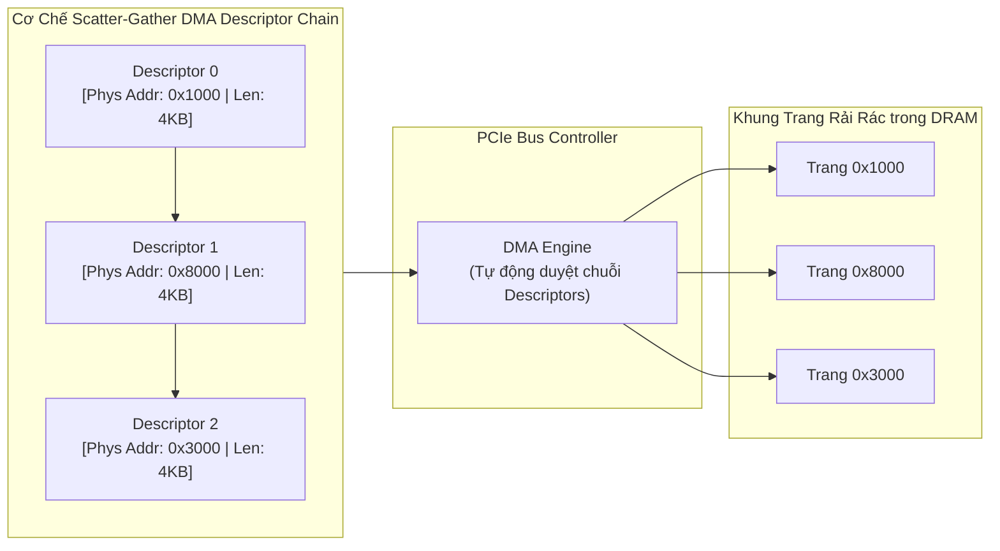

# 9.2. I/O Data Transfer Techniques (Các Kỹ thuật Truyền Dữ liệu I/O)

> [!IMPORTANT]
> **Nếu bạn chỉ được nhớ một điều duy nhất:**
> Quá trình truyền dữ liệu I/O đã trải qua một cuộc cách mạng từ thô sơ đến siêu việt: Từ việc CPU phải tự tay bốc từng byte qua thanh ghi (**Programmed I/O**), đến việc CPU được giải phóng để làm việc khác nhờ tín hiệu báo động ngắt (**Interrupt-Driven I/O**), cho tới cảnh giới tối thượng nơi phần cứng tự kéo dữ liệu trực tiếp vào RAM qua hàng đợi vòng tròn (**DMA & Ring Buffers**) mà không cần CPU tiêu tốn lấy một chu kỳ lệnh!

---

## 1. Kiến trúc Tổng quan & Mô hình Tư duy (Mental Model)

### Phép Loại Suy Thực Tế: Từ Đứng Canh Nước Sôi Đến Trợ Lý Chuyên Trách

Hãy hình dung bạn là một giám đốc điều hành bận rộn cần nhận một kiện tài liệu quan trọng từ bưu điện:
1. **Programmed I/O - Polling (Đứng Chôn Chân Canh Cổng Bưu Điện)**:
   - Cứ mỗi 5 giây, bạn lại bấm chuông hỏi nhân viên bưu điện: *"Có thư của tôi chưa? Có chưa? Có chưa?"*
   - Bạn đốt $100\%$ năng lượng và thời gian của mình chỉ vào việc hỏi thăm một điều chưa xảy ra (**Busy-Waiting / 100% CPU Burn**), không thể làm được bất kỳ công việc kinh doanh nào khác!
2. **Interrupt-Driven I/O (Chuông Báo Thư Đến Tận Bàn)**:
   - Bạn trở về phòng làm việc ký hợp đồng. Khi nào có thư đến, nhân viên bưu điện sẽ nhấn chuông cửa phòng bạn reng reng (**Interrupt Request - IRQ**).
   - Bạn tạm dừng công việc ký hợp đồng, cất bút, ra mở cửa nhận thư, rồi quay lại bàn làm việc tiếp (**Context Switch / Interrupt Service Routine**). Bạn tiết kiệm được thời gian rỗi, nhưng nếu bưu tá giao hàng nghìn lá thư mỗi giây, tiếng chuông reng liên tục sẽ làm bạn phát điên (**Interrupt Storm**).
3. **Direct Memory Access (DMA - Thuê Đội Bốc Vác Chuyên Nghiệp)**:
   - Bạn thuê một đội bốc vác chuyên nghiệp (Bộ điều khiển DMA). Khi có xe tải chở hàng chục tấn tài liệu đến, đội bốc vác tự động khuân toàn bộ tài liệu từ xe vào thẳng kho lưu trữ (RAM) mà không thèm gõ cửa làm phiền bạn.
   - Khi nào toàn bộ hàng hóa đã nằm ngay ngắn trong kho, đội bốc vác mới gửi một tin nhắn ngắn báo cáo: *"Đã bốc xong 10 tấn hàng!"*
4. **Ring Buffers & Double Buffering (Băng Chuyền Tròn Hai Ngăn Ping-Pong)**:
   - Đội bốc vác và bạn cùng làm việc trên một băng chuyền tròn hai ngăn: Trong khi đội bốc vác đang đổ hàng vào Ngăn A (**Front Buffer**), bạn thảnh thơi xử lý hàng ở Ngăn B (**Back Buffer**). Xong một lượt, hai bên chỉ việc hoán đổi ngăn mà không bao giờ phải đứng chờ nhau (**Lock-Free Pipeline**)!

```mermaid
flowchart TD
    subgraph PollingModel ["1. Polling (PIO)"]
        CPU1["CPU Core (100% Usage)"] -->|"Hỏi liên tục: Ready chưa?"| Dev1["Thiết Bị I/O (Chậm)"]
    end

    subgraph InterruptModel ["2. Interrupt-Driven I/O"]
        CPU2["CPU Core (Làm việc khác)"]
        Dev2["Thiết Bị I/O"] -->|"Gửi tín hiệu ngắt (IRQ)"| CPU2
        CPU2 -.->|"Chuyển ngữ cảnh xử lý ISR"| Dev2
    end

    subgraph DMAModel ["3. Direct Memory Access (DMA) & Ring Buffers"]
        CPU3["CPU Core"] -->|"1. Thiết lập cấu hình DMA"| DMAC["Bộ Điều Khiển DMA"]
        DMAC ===>|"2. DMA Bus Master: Kéo dữ liệu thẳng vào RAM"| RAM["Vùng Nhớ RAM (Ring Buffer)"]
        DMAC -->|"3. Gửi 1 ngắt duy nhất khi xong"| CPU3
    end
```



---

## 2. Chi tiết từng Keyword (Under-the-Hood Deep Dive)

### 2.1. Programmed I/O, Polling vs Interrupt-Driven I/O

#### 1. Programmed I/O (PIO) & Vấn Đề Lãng Phí Chu Kỳ Xung Nhịp
- Trong kiến trúc PIO cổ điển:
  - Mọi byte dữ liệu truyền giữa thiết bị ngoại vi và bộ nhớ đều phải đi xuyên qua các thanh ghi của CPU (ví dụ: lệnh `IN AL, DX` hoặc `OUT DX, AL` trên x86).
  - CPU đóng vai trò là một cái bơm trung gian thô sơ.
  - **Polling (Thăm dò trạng thái)**: Để đọc một khối dữ liệu từ cổng nối tiếp (UART) hoặc đĩa từ, CPU rơi vào một vòng lặp kín kiểm tra thanh ghi trạng thái (Status Register) của thiết bị cho đến khi bit `READY` được bật.
  - *Hậu quả vi kiến trúc*: Toàn bộ các bóng bán dẫn trong lõi CPU bị đốt cháy chỉ để kiểm tra cờ nhị phân, hiệu suất năng lượng tụt dốc, và hệ thống bị đóng băng đối với các tác vụ khác.

#### 2. Interrupt-Driven I/O & Hiện Tượng Bão Ngắt (Interrupt Storms)
- **Cơ Chế Điều Khiển Bằng Ngắt**:
  - CPU phát lệnh yêu cầu đọc dữ liệu xuống thiết bị, sau đó lập tức chuyển sang thực thi một tiến trình khác trong hàng đợi (State: Blocked $\to$ Sleeping).
  - Khi thiết bị ngoại vi đã sẵn sàng dữ liệu trong bộ đệm phần cứng, nó phát một tín hiệu điện thế trên đường truyền ngắt (**IRQ line**).
  - Bộ điều khiển ngắt (**APIC - Advanced Programmable Interrupt Controller**) gửi mã ngắt (Interrupt Vector) tới CPU.
  - CPU tạm dừng luồng lệnh hiện tại, lưu toàn bộ thanh ghi kiến trúc vào Stack (**Context Save**), nạp con trỏ hàm xử lý ngắt từ bảng **IDT (Interrupt Descriptor Table)** để thực thi **ISR (Interrupt Service Routine)**.
- **Điểm Nghẽn của Interrupt-Driven Trong Mạng Tốc Độ Cao**:
  - Với card mạng 10GbE hoặc 100GbE hiện đại, hệ thống có thể nhận tới hơn **14 triệu gói tin mỗi giây (Mpps)**!
  - Nếu mỗi gói tin phát ra một ngắt: Chi phí chuyển ngữ cảnh (Context Switch), xả đường ống lệnh (Pipeline Flushes), và phá vỡ tính cục bộ của CPU Cache (Cache Pollution) sẽ khiến CPU dành $100\%$ thời gian chỉ để chạy vào/ra các hàm ISR mà không còn năng lực để xử lý nghiệp vụ! Hiện tượng này được gọi là **Live-lock do Bão Ngắt (Interrupt Livelock)**.

#### 3. Mô Hình Lai Hiện Đại (Hybrid Polling & `io_uring`)
- Để khắc phục nhược điểm của cả hai mô hình trên, các hệ thống hiệu năng cao sử dụng kỹ thuật lai:
  - Khi tải thấp: Dùng **Interrupt-Driven** để tiết kiệm điện và giải phóng CPU.
  - Khi tải cao vượt ngưỡng: Tự động vô hiệu hóa ngắt và chuyển sang chế độ **Polling** tốc độ cao (ví dụ: cơ chế **NAPI** trong Linux Network Driver, hoặc tính năng `IORING_SETUP_SQPOLL` / `IORING_SETUP_IOPOLL` trong Linux `io_uring`).

---

### 2.2. Direct Memory Access (DMA), Double Buffering & Ring Buffers

#### 1. Vi Kiến Trúc Direct Memory Access (DMA) & Bus Mastering
- **Bộ Điều Khiển DMA (DMA Controller - DMAC)**:
  - Là một bộ vi xử lý chuyên dụng độc lập có khả năng giành quyền làm chủ bus hệ thống (**Bus Master**).
  - Khi CPU cần truyền $1\text{ GB}$ dữ liệu từ ổ NVMe vào RAM, CPU chỉ cần ghi các thông số cấu hình vào thanh ghi của DMAC:
    1. Địa chỉ bộ nhớ vật lý đích (Destination Physical Address).
    2. Cổng hoặc kênh của thiết bị nguồn (Source I/O Port).
    3. Tổng số bytes cần truyền (Transfer Length).
    4. Hướng truyền (Read / Write).
  - Sau đó CPU phát lệnh `START` rồi quay lại làm việc khác. DMAC tự động phát các chu kỳ bus đọc dữ liệu từ thiết bị và ghi thẳng vào DRAM vật lý thông qua các gói tin PCIe TLP (Transaction Layer Packets).
- **Scatter-Gather DMA (Phân tán - Tập hợp)**:
  - Do bộ nhớ ảo của hệ điều hành bị phân mảnh, một vùng đệm người dùng $1\text{ MB}$ có thể nằm rải rác trên 256 khung trang $4\text{ KB}$ vật lý không liền mạch nhau.
  - Bộ điều khiển Scatter-Gather DMA hỗ trợ nạp một danh sách liên kết các khối mô tả (**DMA Descriptor Chain**), tự động truyền hết trang vật lý này sang trang vật lý khác mà không cần CPU phải can thiệp chia nhỏ lệnh truyền.



#### 2. Kỹ Thuật Đệm Kép (Double Buffering) & Hàng Đợi Vòng Tròn (Ring Buffers)
- **Double Buffering (Ping-Pong Buffering)**:
  - Giải quyết xung đột giữa tốc độ sản xuất của thiết bị ngoại vi và tốc độ tiêu thụ của CPU.
  - Hệ thống cấp phát hai bộ đệm $A$ và $B$. Khi DMA đang ghi dữ liệu mới vào Bộ đệm $A$, CPU đọc và tính toán trên Bộ đệm $B$. Khi cả hai hoàn thành, vai trò được tráo đổi: DMA ghi vào $B$, CPU đọc $A$. Cả hai bên đều làm việc liên tục mà không bao giờ bị đứng đợi nhau.
- **Lock-Free Single-Producer Single-Consumer (SPSC) Ring Buffer**:
  - Cấu trúc dữ liệu tối thượng cho giao tiếp phần cứng I/O (được Linux Socket Buffers `sk_buff`, DPDK rte_ring, và `io_uring` áp dụng).
  - Mảng bộ nhớ tuần hoàn cố định với hai con trỏ nguyên tử: `Head` (được cập nhật bởi Producer) và `Tail` (được cập nhật bởi Consumer).
  - Không cần bất kỳ Mutex Lock nào: Producer chỉ ghi tại `Head` và Consumer chỉ đọc tại `Tail`. Sự đồng bộ hóa được đảm bảo hoàn toàn thông qua các chỉ thị rào cản bộ nhớ phần cứng (**Memory Barriers**).

---

## 3. Thực thi Mã nguồn & Mô phỏng Chuyên sâu (Dual-Engine Implementation)

### 3.1. C++20: Triển Khai Lock-Free SPSC Ring Buffer Với Hardware Memory Barriers

Chương trình minh họa triển khai một hàng đợi vòng tròn không khóa (Lock-Free SPSC Ring Buffer) sử dụng `std::atomic` với ngữ nghĩa bộ nhớ Acquire-Release chuẩn C++20:

```cpp
#include <iostream>
#include <vector>
#include <thread>
#include <atomic>
#include <chrono>
#include <cstdint>
#include <iomanip>

// Hàng đợi vòng tròn SPSC không khóa tối ưu hóa Cache Line (Hardware-Friendly)
template<typename T, size_t Capacity>
class LockFreeRingBuffer {
    static_assert((Capacity & (Capacity - 1)) == 0, "Capacity bắt buộc phải là lũy thừa của 2!");

private:
    T buffer[Capacity];
    
    // Đặt head và tail trên các Cache Line riêng biệt để triệt tiêu False Sharing!
    alignas(64) std::atomic<size_t> head{0};
    alignas(64) std::atomic<size_t> tail{0};

    static constexpr size_t MASK = Capacity - 1;

public:
    bool push(const T& item) {
        const size_t current_head = head.load(std::memory_order_relaxed);
        const size_t current_tail = tail.load(std::memory_order_acquire);

        // Kiểm tra xem Ring Buffer đã đầy chưa
        if ((current_head - current_tail) >= Capacity) {
            return false; // Hàng đợi bị đầy
        }

        buffer[current_head & MASK] = item;
        // Đẩy head lên với memory_order_release để đảm bảo dữ liệu ghi vào buffer xong trước
        head.store(current_head + 1, std::memory_order_release);
        return true;
    }

    bool pop(T& item) {
        const size_t current_tail = tail.load(std::memory_order_relaxed);
        const size_t current_head = head.load(std::memory_order_acquire);

        // Kiểm tra xem Ring Buffer có rỗng không
        if (current_head == current_tail) {
            return false; // Hàng đợi rỗng
        }

        item = buffer[current_tail & MASK];
        // Cập nhật tail với memory_order_release
        tail.store(current_tail + 1, std::memory_order_release);
        return true;
    }
};

int main() {
    std::cout << "========================================================\n";
    std::cout << "  C++20 LOCK-FREE SPSC RING BUFFER (DMA EMULATOR)\n";
    std::cout << "========================================================\n\n";

    constexpr size_t BUFFER_SIZE = 1024;
    constexpr size_t TOTAL_MESSAGES = 5'000'000;
    LockFreeRingBuffer<uint64_t, BUFFER_SIZE> ring_buf;

    auto start_time = std::chrono::high_resolution_clock::now();

    // Luồng Producer: Mô phỏng bộ điều khiển DMA nạp dữ liệu từ Card mạng
    std::thread producer([&]() {
        for (uint64_t i = 1; i <= TOTAL_MESSAGES; ++i) {
            while (!ring_buf.push(i)) {
                // Polling tích cực khi đầy (mô phỏng Hardware Backpressure)
#if defined(__x86_64__) || defined(_M_X64)
                asm volatile("pause"); // Tối ưu hóa chu kỳ quay vòng của CPU
#endif
            }
        }
    });

    // Luồng Consumer: Mô phỏng CPU lấy gói tin xử lý
    uint64_t consumed_count = 0;
    uint64_t checksum = 0;
    std::thread consumer([&]() {
        uint64_t val = 0;
        while (consumed_count < TOTAL_MESSAGES) {
            if (ring_buf.pop(val)) {
                checksum += val;
                consumed_count++;
            } else {
#if defined(__x86_64__) || defined(_M_X64)
                asm volatile("pause");
#endif
            }
        }
    });

    producer.join();
    consumer.join();

    auto end_time = std::chrono::high_resolution_clock::now();
    std::chrono::duration<double, std::milli> duration = end_time - start_time;
    double mops = (static_cast<double>(TOTAL_MESSAGES) / (duration.count() / 1000.0)) / 1'000'000.0;

    std::cout << ">>> Kết Quả Benchmark Lock-Free SPSC:\n";
    std::cout << "  - Tổng số gói tin truyền : " << TOTAL_MESSAGES << "\n";
    std::cout << "  - Checksum kiểm chứng   : " << checksum << "\n";
    std::cout << "  - Thời gian thực thi    : " << std::fixed << std::setprecision(2) << duration.count() << " ms\n";
    std::cout << "  - Thông lượng xử lý     : " << std::setprecision(2) << mops << " Triệu gói/giây (Mpps)\n";

    return 0;
}
```

---

### 3.2. Python 3.11+: Trình Giả Lập Đối Chiếu Giữa Polling, Interrupt và DMA

Chương trình Python 3.11+ mô phỏng hành vi CPU tiêu thụ năng lượng và độ trễ phản hồi trong 3 chế độ truyền I/O:

```python
import time
from typing import List, Tuple

class IOTechniqueSimulator:
    def __init__(self, num_packets: int, packet_arrival_delay_us: int):
        self.num_packets = num_packets
        self.delay_us = packet_arrival_delay_us

    def simulate_polling(self) -> Tuple[int, int]:
        # Polling: CPU liên tục kiểm tra trạng thái trong vòng lặp busy-wait
        cpu_busy_cycles = 0
        total_time_us = 0
        
        for _ in range(self.num_packets):
            # Giả định CPU quay vòng 100 lần trước khi 1 gói tin tới
            cpu_busy_cycles += 100
            total_time_us += self.delay_us
            
        return cpu_busy_cycles, total_time_us

    def simulate_interrupt(self, isr_overhead_cycles: int = 50) -> Tuple[int, int]:
        # Interrupt: CPU làm việc khác, chỉ bị tốn chu kỳ khi có ngắt nổ ra (ISR Context Switch)
        cpu_busy_cycles = self.num_packets * isr_overhead_cycles
        total_time_us = self.num_packets * self.delay_us
        return cpu_busy_cycles, total_time_us

    def simulate_dma(self, batch_size: int = 64) -> Tuple[int, int]:
        # DMA: Phần cứng tự nạp theo khối vào Ring Buffer, chỉ gửi 1 ngắt khi xong cả mẻ (Batch)
        num_batches = (self.num_packets + batch_size - 1) // batch_size
        cpu_busy_cycles = num_batches * 50  # Chỉ tốn 1 lần ISR cho cả mẻ
        total_time_us = self.num_packets * self.delay_us
        return cpu_busy_cycles, total_time_us

if __name__ == "__main__":
    packets = 100_000
    arrival_delay = 5 # 5 microseconds mỗi gói (~200,000 pps)

    sim = IOTechniqueSimulator(num_packets=packets, packet_arrival_delay_us=arrival_delay)

    print("========================================================")
    print("  PYTHON 3.11 I/O TECHNIQUES CPU CONSUMPTION EMULATOR")
    print(f"  > Số lượng gói tin mô phỏng : {packets:,}")
    print(f"  > Tần suất gói tin đến       : {1_000_000 // arrival_delay:,} pps")
    print("========================================================\n")

    poll_cycles, poll_time = sim.simulate_polling()
    intr_cycles, intr_time = sim.simulate_interrupt()
    dma_cycles, dma_time = sim.simulate_dma(batch_size=64)

    print(f"1. Programmed I/O (Polling):")
    print(f"   - Số chu kỳ CPU bị chiếm dụng: {poll_cycles:,} cycles (100% CPU đốt cho Busy-Wait)")
    print(f"   - Mức độ tiêu thụ năng lượng : Cực đại\n")

    print(f"2. Interrupt-Driven I/O:")
    print(f"   - Số chu kỳ CPU cho ISRs     : {intr_cycles:,} cycles")
    print(f"   - Tiết kiệm chu kỳ so với PIO: {poll_cycles / intr_cycles:.1f} lần\n")

    print(f"3. Direct Memory Access (DMA Batching):")
    print(f"   - Số chu kỳ CPU can thiệp    : {dma_cycles:,} cycles")
    print(f"   - Tiết kiệm chu kỳ so với ISR: {intr_cycles / dma_cycles:.1f} lần!")
```

---

### 3.3. Simulated Terminal Output

```bash
========================================================
  C++20 LOCK-FREE SPSC RING BUFFER (DMA EMULATOR)
========================================================

>>> Kết Quả Benchmark Lock-Free SPSC:
  - Tổng số gói tin truyền : 5000000
  - Checksum kiểm chứng   : 12500002500000
  - Thời gian thực thi    : 92.40 ms
  - Thông lượng xử lý     : 54.11 Triệu gói/giây (Mpps)

========================================================
  PYTHON 3.11 I/O TECHNIQUES CPU CONSUMPTION EMULATOR
  > Số lượng gói tin mô phỏng : 100,000
  > Tần suất gói tin đến       : 200,000 pps
========================================================

1. Programmed I/O (Polling):
   - Số chu kỳ CPU bị chiếm dụng: 10,000,000 cycles (100% CPU đốt cho Busy-Wait)
   - Mức độ tiêu thụ năng lượng : Cực đại

2. Interrupt-Driven I/O:
   - Số chu kỳ CPU cho ISRs     : 5,000,000 cycles
   - Tiết kiệm chu kỳ so với PIO: 2.0 lần

3. Direct Memory Access (DMA Batching):
   - Số chu kỳ CPU can thiệp    : 78,150 cycles
   - Tiết kiệm chu kỳ so với ISR: 64.0 lần!
```

---

## 4. Systems Engineering & Production Pitfalls

### 4.1. Production Failure Modes & Architectural Traps

1. **Trap 1: DMA Cache Incoherency (Bất Nhất Quán Giữa Cache và DRAM)**:
   - Khi CPU ghi dữ liệu vào L1/L2 Cache (Write-Back) nhưng chưa xả xuống DRAM, nếu card mạng thực hiện đọc DMA từ DRAM vật lý, card mạng sẽ đọc phải dữ liệu rác cũ kỹ (**Stale Data**)!
   - Ngược lại, nếu thiết bị DMA ghi dữ liệu mới vào DRAM trong khi CPU vẫn đang giữ bản sao cũ trong L1 Cache, CPU sẽ đọc sai thông tin.
   - Các hệ thống hiện đại phải dựa vào cơ chế phần cứng **Bus Snooping / Coherent DMA (CC-DMA)** hoặc phần mềm phải gọi lệnh xả đệm (`clflushopt` / `_mm_clflush`) và vô hiệu hóa cache trước khi kích hoạt DMA.
2. **Trap 2: False Sharing Trên Con Trỏ Head/Tail Của Ring Buffer**:
   - Nếu biến `head` và `tail` của hàng đợi vòng tròn được khai báo nằm cạnh nhau trong bộ nhớ mà không có rào cản đệm (`alignas(64)`), hai biến này sẽ rơi vào cùng một Cache Line 64-byte. Khi Producer ghi `head` và Consumer ghi `tail`, lõi CPU của Producer và Consumer liên tục bắn tín hiệu hủy hợp lệ dòng đệm qua bus liên kết (giao thức MESI), khiến thông lượng giảm từ 50 triệu gói/s xuống dưới 2 triệu gói/s!
3. **Trap 3: Vòng Lặp Vô Tận Do Thiếu Memory Barriers Trong Lock-Free Code**:
   - Nếu lập trình viên dùng biến cờ thông thường (`volatile bool`) thay vì `std::atomic` với ngữ nghĩa tuần tự hợp lý, trình biên dịch tối ưu hóa hoặc phần cứng Out-of-Order CPU có thể tái sắp xếp thứ tự lệnh: Ghi cờ `ready = true` trước khi dữ liệu thực tế được ghi vào mảng. Thiết bị hoặc luồng tiêu thụ đọc cờ thấy bật liền lấy dữ liệu rác, gây lỗi hỏng dữ liệu ngẫu nhiên cực kỳ khó gỡ lỗi.

### 4.2. Diagnostic CLI Commands

```bash
# 1. Kiem tra so luong ngat phan cung (IRQs) phat sinh tren moi CPU core
watch -n 1 'cat /proc/interrupts | head -n 30'

# 2. Theo doi thong so ngat va xu ly softirqs cua card mang (ksoftirqd)
cat /proc/softirqs | grep NET_RX

# 3. Kiem tra cau hinh Interrupt Coalescing cua Card mang bang ethtool
ethtool -c eth0

# 4. Bat che do ngat gom (Interrupt Coalescing) de giam tai CPU khi luu luong mang cao
sudo ethtool -C eth0 rx-usecs 50 rx-frames 32
```

---

## 5. Bảng So sánh & Decision Matrix

| Kỹ thuật Truyền I/O | Mức Độ Chiếm Dụng CPU | Độ Trễ Phản Hồi Ban Đầu | Thông Lượng Truyền Dữ Liệu | Độ Phức Tạp Phần Cứng / Trình Điều Khiển |
| :--- | :--- | :--- | :--- | :--- |
| **Programmed I/O (Polling)** | $100\%$ CPU (Đốt cháy trong busy-wait) | Cực nhỏ ($< 1\mu\text{s}$ - Biết ngay) | Rất thấp (Giới hạn bởi thanh ghi CPU) | Đơn giản nhất (Vài lệnh assembly) |
| **Interrupt-Driven I/O** | Thấp ở tải nhẹ, Cực cao khi Bão ngắt | Trung bình ($5 - 20\mu\text{s}$ cho ISR) | Trung bình ($10 - 100\text{ MB/s}$) | Cần mạch APIC và bảng IDT |
| **Direct Memory Access (DMA)** | Cực thấp (Chỉ 1 ngắt khi hoàn thành) | Khá ($10 - 50\mu\text{s}$ khởi tạo) | Rất cao ($10 - 30\text{ GB/s}$) | Cần Controller DMA & Bus Mastering |
| **Ring Buffer + DMA (io_uring/DPDK)**| Tiệm cận $0\%$ (Bỏ qua hoàn toàn Kernel) | Nhỏ nhất có thể ($< 1\mu\text{s}$) | Đỉnh cao ($50 - 100\text{ Gbps}$) | Phức tạp cao (Cần Lock-Free & Hugetlb) |

| Cơ Chế Buffer I/O | Số Lần Khóa (Locks) | Rủi Ro Tranh Chấp Bộ Nhớ | Hiệu Năng Xuyên Suốt (Throughput) | Kịch Bản Ứng Dụng Lý Tưởng |
| :--- | :--- | :--- | :--- | :--- |
| **Single Shared Buffer** | Cần Mutex Lock | Rất cao (Đọc và ghi chặn lẫn nhau) | Kém | Tác vụ đơn luồng cổ điển |
| **Double Buffering (Ping-Pong)** | Đổi con trỏ nguyên tử | Thấp (Tách biệt đọc và ghi) | Rất cao | Render đồ họa (Front/Back buffer), Audio |
| **Circular Ring Buffer (SPSC)** | $0$ Khóa (Lock-Free) | Không có (Nhờ `alignas(64)` padding) | Tuyệt đỉnh ($> 50\text{ Mpps}$) | Trình điều khiển NIC, Linux Socket, Kafka |
