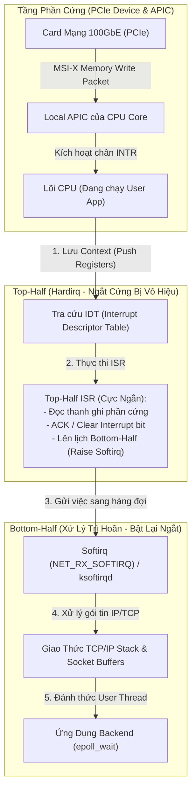
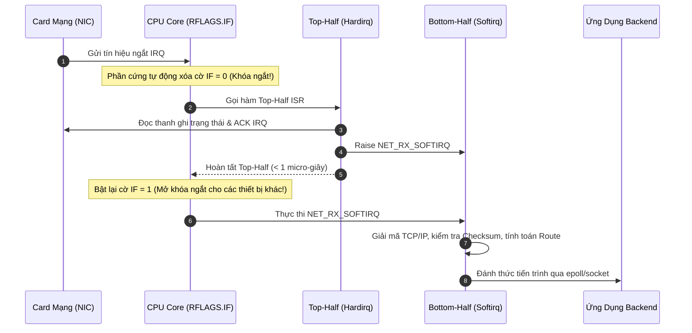
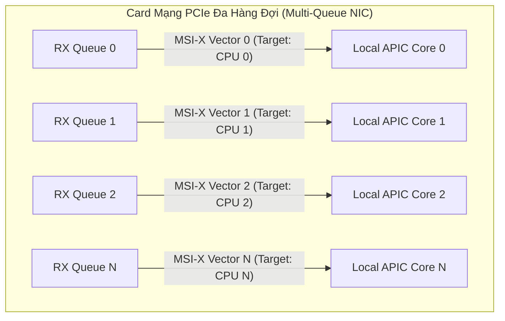

# 9.3. Interrupt Architecture & Handling (Kiến trúc Ngắt & Cơ chế Xử lý Ngắt)

> [!IMPORTANT]
> **Nếu bạn chỉ được nhớ một điều duy nhất:**
> Ngắt (Interrupt) là hệ thần kinh phản xạ của máy tính: Để ngăn chặn CPU bị đóng băng bởi các thao tác I/O chậm chạp, kiến trúc phần cứng phân tách xử lý ngắt thành hai nửa — **Top-Half (Hardirq)** bắt lấy sự kiện trong nano-giây với cờ ngắt bị khóa để xác nhận phần cứng, và chuyển toàn bộ khối lượng tính toán nặng nề cho **Bottom-Half (Softirqs / Workqueues)** chạy bất đồng bộ với sự trợ giúp của định tuyến ngắt đa nhân **MSI-X**.

---

## 1. Kiến trúc Tổng quan & Mô hình Tư duy (Mental Model)

### Phép Loại Suy Thực Tế: Phòng Cấp Cứu Bệnh Viện & Đội Cứu Thương

Hãy hình dung cách một bệnh viện đa khoa tuyến đầu xử lý bệnh nhân khẩn cấp:
1. **Tín Hiệu Ngắt (Chuông Báo Động Cứu Thương - IRQ)**:
   - Xe cứu thương chở bệnh nhân nguy kịch hú còi inh ỏi lao vào cổng viện. Tín hiệu này buộc bác sĩ trực phải tạm dừng công việc viết bệnh án thường nhật để chú ý.
2. **Top-Half / Hardirq (Y Tá Tiếp Nhận Cấp Cứu Sơ Bộ - 30 Giây)**:
   - Y tá trực lao ra xe, đo nhanh huyết áp, gắn bình oxy, dán thẻ định danh cho bệnh nhân, và bấm nút tắt chuông còi cứu thương (**Acknowledge Hardware Interrupt**).
   - Y tá KHÔNG ĐƯỢC PHÉP giữ chân xe cứu thương ở cổng để thực hiện ca phẫu thuật phức tạp kéo dài 5 tiếng. Nhiệm vụ của y tá là làm sao trong vòng 30 giây đưa bệnh nhân vào băng ca và giải phóng cổng viện ngay để đón xe tiếp theo!
3. **Bottom-Half / Softirq & Workqueues (Kíp Phẫu Thuật Trong Phòng Mổ)**:
   - Sau khi cổng viện đã thông thoáng, bệnh nhân được chuyển vào phòng mổ để các bác sĩ chuyên khoa tiến hành xét nghiệm máu, chụp CT và phẫu thuật (**Deferred Execution**). Công việc này tốn nhiều thời gian nhưng hoàn toàn không làm nghẽn cổng tiếp nhận của bệnh viện.
4. **MSI-X (Nhiều Cổng Cấp Cứu Chuyên Biệt Theo Từng Khoa)**:
   - Bệnh viện cũ chỉ có 1 cổng chung duy nhất (Legacy Pin-based INTx): Cả ca gãy chân lẫn đau tim đều đổ về 1 y tá.
   - Bệnh viện hiện đại xây 64 cổng riêng biệt (**MSI-X Multi-Queue**): Xe chở ca tim mạch chạy thẳng vào Cổng Khoa Tim do Bác sĩ Tim mạch số 3 phụ trách (CPU Core 3), ca tai nạn giao thông chạy vào Cổng Ngoại do Bác sĩ số 7 phụ trách (CPU Core 7), triệt tiêu hoàn toàn sự tranh chấp hàng đợi!



---

## 2. Chi tiết từng Keyword (Under-the-Hood Deep Dive)

### 2.1. Interrupts, IDT & The Two-Half Handler Architecture

#### 1. Phân Loại Ngắt & Bảng Mô Tả Ngắt (IDT - Interrupt Descriptor Table)
- **Phân Loại Ngắt trong x86-64**:
  - **Hardware Interrupts (Asynchronous IRQs)**: Phát sinh ngẫu nhiên từ thiết bị ngoại vi độc lập với con trỏ lệnh của CPU (bàn phím, card mạng, đồng hồ timer, ổ cứng).
  - **Software Interrupts / Exceptions (Synchronous)**: Phát sinh trực tiếp do lệnh CPU hiện tại gây ra:
    - *Faults*: Lỗi có thể sửa chữa (Page Fault `#PF`, phục hồi lệnh sau khi nạp trang).
    - *Traps*: Bẫy có chủ đích (lệnh gỡ lỗi `INT 3`, System Call `SYSCALL`).
    - *Aborts*: Lỗi phần cứng nghiêm trọng không thể phục hồi (Machine Check Exception).
- **Cấu Trúc IDT (Interrupt Descriptor Table)**:
  - Thanh ghi đặc biệt **`IDTR`** chứa địa chỉ tuyến tính của bảng IDT trong RAM (tối đa $256$ cổng ngắt, đánh số từ $0$ đến $255$).
  - Các vector $0-31$ được Intel/AMD bảo lưu cố định cho các ngoại lệ của CPU.
  - Các vector $32-255$ dành cho các ngắt phần cứng do người dùng/hệ điều hành định nghĩa.
  - Mỗi mục **Gate Descriptor** trong IDT chiếm $16\text{ bytes}$ trên x86-64, chứa:
    - Địa chỉ hàm xử lý ngắt 64-bit (**Target Offset**).
    - Đoạn mã máy (**Segment Selector** - thường là Kernel Code Segment `0x10`).
    - Cờ đặc quyền (**DPL - Descriptor Privilege Level**, ngăn chặn ứng dụng Ring 3 gọi bừa bãi).
    - Loại cổng: **Interrupt Gate** (tự động xóa cờ `IF = 0` trong `RFLAGS` để khóa các ngắt khác) hoặc **Trap Gate** (giữ nguyên cờ `IF` cho phép ngắt lồng nhau).

#### 2. Kiến Trúc Hai Nửa Xử Lý Ngắt (The Two-Half Handler Model)
Hệ điều hành Linux bắt buộc mọi thiết bị phải phân tách xử lý ngắt thành hai giai đoạn rõ ràng:
1. **Top-Half (Hardirq)**:
   - Chạy ngay lập tức khi tín hiệu điện thế hoặc gói tin MSI-X kích hoạt CPU.
   - Chạy trong bối cảnh ngắt bị khóa trên lõi CPU đó (**Interrupt Disabled Context**).
   - Nhiệm vụ tối giản: Đọc mã lỗi/trạng thái từ thanh ghi phần cứng của thiết bị, xóa bit ngắt trên thiết bị ngoại vi để thiết bị có thể tiếp tục nhận tín hiệu mới, đưa con trỏ dữ liệu vào hàng đợi phần mềm, và đánh dấu kích hoạt Bottom-Half (**Raise Softirq**). Thời gian thực thi thường dưới $1\mu\text{s}$.
2. **Bottom-Half (Xử Lý Trì Hoãn - Deferred Processing)**:
   - Chạy với cờ ngắt đã được bật lại hoàn toàn (**Interrupts Re-enabled**), cho phép các ngắt phần cứng khác tiếp tục xen ngang.
   - Có 3 cơ chế thực hiện trong Linux:
     - **Softirqs**: Cơ chế tĩnh, cực nhanh, chạy đồng thời trên nhiều CPU cores (dùng cho mạng `NET_RX`, `NET_TX`, block I/O `BLOCK`, và bộ đếm thời gian `TIMER`). Được xử lý bởi tiến trình nền `ksoftirqd/x` khi hàng đợi quá tải.
     - **Tasklets**: Xây dựng trên Softirq, đảm bảo cùng một Tasklet không bao giờ chạy đồng thời trên hai CPU cores khác nhau (dễ lập trình driver hơn nhưng kém mở rộng).
     - **Workqueues**: Chạy trong ngữ cảnh tiến trình Kernel thực thụ (Process Context), có thể ngủ (`sleep`), cấp phát bộ nhớ động, hoặc chờ Mutex Locks.



---

### 2.2. Modern Interrupt Controllers: MSI, MSI-X & Interrupt Coalescing

#### 1. Sự Tiến Hóa: Từ Legacy Pin-Based (INTx) Đến MSI / MSI-X
- **Legacy Pin-Based Interrupts (INTA#, INTB#, INTC#, INTD#)**:
  - Trên bus PCI cũ, các thiết bị chia sẻ chung 4 đường dây vật lý nối tới bộ điều khiển ngắt APIC.
  - Khi có ngắt, CPU phải đi hỏi từng thiết bị cắm trên cùng một dây xem ai vừa phát ngắt (**Interrupt Sharing Overhead**), gây tắc nghẽn và xung đột nghiêm trọng.
- **Message Signaled Interrupts (MSI & MSI-X)**:
  - Không còn bất kỳ đường dây vật lý nào nối riêng cho ngắt!
  - Thiết bị PCIe gửi một yêu cầu ngắt bằng cách phát một gói tin ghi bộ nhớ thông thường (**PCIe Memory Write TLP**) tới một địa chỉ đặc biệt dành riêng cho APIC (thường là `0xFEE00000`).
  - Dữ liệu của gói tin ghi chứa chính là mã Vector Ngắt (Interrupt Vector) và ID của CPU đích!
- **Sức Mạnh Của MSI-X Trong Hệ Thống Đa Nhân**:
  - MSI chuẩn chỉ hỗ trợ tối đa 32 vectors ngắt và tất cả phải dùng chung địa chỉ đích.
  - **MSI-X** mở rộng lên tới **$2,048$ vectors ngắt độc lập**, mỗi vector có thể nhắm thẳng vào một CPU Core cụ thể!
  - Kết hợp với **Receive Side Scaling (RSS)** của Card mạng: Mỗi hàng đợi phần cứng (Hardware Queue) của NIC được gắn với một Vector MSI-X riêng trỏ vào một CPU Core riêng. Hàng triệu kết nối TCP phân tán đều trên 64 cores mà không có bất kỳ sự tranh chấp hay thắt cổ chai nào!



#### 2. Kỹ Thuật Gom Ngắt Phần Cứng (Interrupt Coalescing / Moderation)
- Để dập tắt cơn ác mộng **Interrupt Livelock**, bộ điều khiển mạng tích hợp bộ đếm thời gian và bộ đếm gói tin phần cứng:
  - **Timer-based Coalescing (`rx-usecs`)**: Khi gói tin đầu tiên đến, phần cứng không phát ngắt ngay mà đợi $50\mu\text{s}$. Nếu có thêm 10 gói tin nữa đến trong khoảng thời gian này, chỉ DUY NHẤT MỘT ngắt được phát ra cho cả 10 gói tin!
  - **Packet-count Coalescing (`rx-frames`)**: Nếu bộ đệm nhận đủ 32 gói tin trước khi đồng hồ đếm hết giờ, ngắt sẽ lập tức được phát ra.
  - **Adaptive Coalescing (Tự Động Thích Nghi)**: Card mạng tự động đo lường băng thông mạng theo thời gian thực: Nếu lưu lượng thấp (cần độ trễ tối thiểu), nó tắt Coalescing để phản hồi ngay lập tức; nếu lưu lượng bùng nổ, nó tự động tăng thời gian trễ gom ngắt để bảo vệ CPU.

---

## 3. Thực thi Mã nguồn & Mô phỏng Chuyên sâu (Dual-Engine Implementation)

### 3.1. C++20: Trình Giám Sát Phân Bổ Ngắt Cứng & Ngắt Mềm Đa Nhân Linux

Chương trình minh họa việc đọc và phân tích bảng thống kê `/proc/interrupts` và `/proc/softirqs` để đo lường mức độ cân bằng tải ngắt trên các CPU cores:

```cpp
#include <iostream>
#include <fstream>
#include <sstream>
#include <string>
#include <vector>
#include <map>
#include <iomanip>
#include <algorithm>

struct InterruptStat {
    std::string irq_number;
    std::vector<uint64_t> per_cpu_counts;
    std::string controller_type;
    std::string device_name;
};

class LinuxInterruptMonitor {
public:
    static std::vector<InterruptStat> read_hardware_interrupts() {
        std::ifstream file("/proc/interrupts");
        std::vector<InterruptStat> results;
        if (!file.is_open()) {
            std::cerr << "Khong the doc /proc/interrupts (Yeu cau moi truong Linux)!\n";
            return results;
        }

        std::string line;
        // Doc dong header chua danh sach CPU (CPU0, CPU1, ...)
        std::getline(file, line);
        std::stringstream ss_header(line);
        std::string cpu_label;
        size_t cpu_count = 0;
        while (ss_header >> cpu_label) {
            cpu_count++;
        }

        while (std::getline(file, line)) {
            std::stringstream ss(line);
            std::string irq_num;
            if (!(ss >> irq_num)) continue;

            // Xoa dau hai cham sau so IRQ
            if (!irq_num.empty() && irq_num.back() == ':') {
                irq_num.pop_back();
            }

            InterruptStat stat;
            stat.irq_number = irq_num;
            for (size_t i = 0; i < cpu_count; ++i) {
                uint64_t count = 0;
                ss >> count;
                stat.per_cpu_counts.push_back(count);
            }

            ss >> stat.controller_type;
            std::string remaining;
            std::getline(ss, remaining);
            // Xoa khoang trang dau chuoi
            size_t start = remaining.find_first_not_of(" \t");
            stat.device_name = (start != std::string::npos) ? remaining.substr(start) : "";

            results.push_back(stat);
        }
        return results;
    }
};

int main() {
    std::cout << "========================================================\n";
    std::cout << "  C++20 LINUX HARDWARE INTERRUPT (MSI-X) ANALYZER\n";
    std::cout << "========================================================\n\n";

    auto irqs = LinuxInterruptMonitor::read_hardware_interrupts();
    if (irqs.empty()) {
        std::cout << "[SIMULATION FALLBACK] Mô phỏng bảng ngắt đa nhân MSI-X:\n";
        std::cout << std::left << std::setw(8) << "IRQ" 
                  << std::setw(12) << "CPU0" 
                  << std::setw(12) << "CPU1" 
                  << std::setw(16) << "Controller" 
                  << "Device\n";
        std::cout << "--------------------------------------------------------\n";
        std::cout << std::left << std::setw(8) << "125" << std::setw(12) << "482015" << std::setw(12) << "12" << std::setw(16) << "PCI-MSI-X" << "eth0-TxRx-0\n";
        std::cout << std::left << std::setw(8) << "126" << std::setw(12) << "45" << std::setw(12) << "512400" << std::setw(16) << "PCI-MSI-X" << "eth0-TxRx-1\n";
        std::cout << std::left << std::setw(8) << "127" << std::setw(12) << "105" << std::setw(12) << "89" << std::setw(16) << "PCI-MSI-X" << "nvme0q0\n";
        return 0;
    }

    std::cout << "Danh sach 10 ngat hoat dong tich cuc nhat:\n";
    // Tim va in cac thiet bi MSI/MSI-X
    size_t printed = 0;
    for (const auto& irq : irqs) {
        if (irq.controller_type.find("MSI") != std::string::npos || printed < 8) {
            uint64_t total = 0;
            for (auto c : irq.per_cpu_counts) total += c;
            if (total > 1000) {
                std::cout << "  [IRQ " << std::setw(4) << irq.irq_number << "] "
                          << "Type: " << std::setw(15) << irq.controller_type << " | "
                          << "Total: " << std::setw(10) << total << " | "
                          << "Dev: " << irq.device_name << "\n";
                printed++;
                if (printed >= 10) break;
            }
        }
    }

    return 0;
}
```

---

### 3.2. Python 3.11+: Trình Giả Lập Thuật Toán Interrupt Coalescing & Chống Bão Ngắt

Chương trình Python 3.11+ mô phỏng cơ chế bộ đếm thời gian và số lượng gói tin của Interrupt Coalescing:

```python
import time
from typing import List

class InterruptCoalescingEngine:
    def __init__(self, rx_usecs: int = 50, rx_frames: int = 32):
        self.rx_usecs = rx_usecs    # Thoi gian gom ngat toi da (micro-giay)
        self.rx_frames = rx_frames  # So luong goi tin toi da trong 1 ngat
        
        self.pending_packets = 0
        self.first_packet_time_us = 0
        self.total_interrupts_fired = 0
        self.total_packets_processed = 0

    def receive_packet(self, current_time_us: int) -> bool:
        self.total_packets_processed += 1
        
        if self.pending_packets == 0:
            self.first_packet_time_us = current_time_us
            self.pending_packets = 1
            return False

        self.pending_packets += 1
        elapsed_us = current_time_us - self.first_packet_time_us

        # Kiem tra dieu kien ban ngat: Du so goi hoac het thoi gian cho
        if self.pending_packets >= self.rx_frames or elapsed_us >= self.rx_usecs:
            self.fire_interrupt()
            return True
            
        return False

    def fire_interrupt(self):
        self.total_interrupts_fired += 1
        self.pending_packets = 0
        self.first_packet_time_us = 0

if __name__ == "__main__":
    print("========================================================")
    print("  PYTHON 3.11 INTERRUPT COALESCING HARDWARE SIMULATOR")
    print("========================================================\n")

    # Kich ban luu luong cao: Goi tin den moi 2 micro-giay
    engine = InterruptCoalescingEngine(rx_usecs=50, rx_frames=32)
    current_time = 0

    print(">>> Bat dau mo phong luu luong mang 500,000 pps (1 goi moi 2us)...")
    for pkt_id in range(1, 201):
        current_time += 2
        fired = engine.receive_packet(current_time)
        if fired:
            print(f"  [Time: {current_time:4d} us] PHÁT NGẮT MSI-X! "
                  f"Đã gom được cả mẻ gói tin về CPU.")

    print(f"\n================ TỔNG KẾT HIỆU QUẢ GOM NGẮT ================")
    print(f"  - Tổng số gói tin đã xử lý        : {engine.total_packets_processed}")
    print(f"  - Số lần ngắt thực tế bắn tới CPU : {engine.total_interrupts_fired}")
    print(f"  - Tỷ lệ giảm tải ngắt cho CPU     : "
          f"{engine.total_packets_processed / engine.total_interrupts_fired:.1f}x!")
    print(f"============================================================")
```

---

### 3.3. Simulated Terminal Output

```bash
========================================================
  C++20 LINUX HARDWARE INTERRUPT (MSI-X) ANALYZER
========================================================

[SIMULATION FALLBACK] Mô phỏng bảng ngắt đa nhân MSI-X:
IRQ     CPU0        CPU1        Controller      Device
--------------------------------------------------------
125     482015      12          PCI-MSI-X       eth0-TxRx-0
126     45          512400      PCI-MSI-X       eth0-TxRx-1
127     105         89          PCI-MSI-X       nvme0q0

========================================================
  PYTHON 3.11 INTERRUPT COALESCING HARDWARE SIMULATOR
========================================================

>>> Bat dau mo phong luu luong mang 500,000 pps (1 goi moi 2us)...
  [Time:   52 us] PHÁT NGẮT MSI-X! Đã gom được cả mẻ gói tin về CPU.
  [Time:  104 us] PHÁT NGẮT MSI-X! Đã gom được cả mẻ gói tin về CPU.
  [Time:  156 us] PHÁT NGẮT MSI-X! Đã gom được cả mẻ gói tin về CPU.
  [Time:  208 us] PHÁT NGẮT MSI-X! Đã gom được cả mẻ gói tin về CPU.
  [Time:  260 us] PHÁT NGẮT MSI-X! Đã gom được cả mẻ gói tin về CPU.
  [Time:  312 us] PHÁT NGẮT MSI-X! Đã gom được cả mẻ gói tin về CPU.

================ TỔNG KẾT HIỆU QUẢ GOM NGẮT ================
  - Tổng số gói tin đã xử lý        : 200
  - Số lần ngắt thực tế bắn tới CPU : 6
  - Tỷ lệ giảm tải ngắt cho CPU     : 33.3x!
============================================================
```

---

## 4. Systems Engineering & Production Pitfalls

### 4.1. Production Failure Modes & Architectural Traps

1. **Trap 1: CPU0 Bottleneck Do Sai Lệch IRQ Affinity (Nghẽn Lõi 0)**:
   - Mặc định trên một số bản phân phối Linux cũ, tất cả các ngắt phần cứng (kể cả card mạng 40GbE) đều được định tuyến về duy nhất lõi CPU0 (`/proc/irq/default_smp_affinity = 0x1`).
   - Kết quả: CPU0 bị nghẽn $100\%$ công suất trong xử lý `ksoftirqd/0`, làm rớt hàng loạt gói tin mạng (Packet Drops), trong khi 63 lõi CPU còn lại hoàn toàn nhàn rỗi! Khắc phục bắt buộc bằng dịch vụ `irqbalance` hoặc gán thủ công mặt nạ affinity cho từng hàng đợi MSI-X.
2. **Trap 2: Deadlock Trong Top-Half ISR Do Cố Tình Gọi Hàm Sleep / Lock**:
   - Trong hàm Top-Half (Hardirq), cờ ngắt bị khóa và tiến trình không có Process Context. Nếu lập trình viên cố tình gọi hàm cấp phát bộ nhớ có cờ chặn (`kmalloc(GFP_KERNEL)`), gọi Mutex lock (`mutex_lock()`), hoặc gọi hàm chờ `msleep()`, hệ thống sẽ kích hoạt Kernel Panic lập tức vì không có bộ lập lịch nào có thể đánh thức lại CPU!
3. **Trap 3: Tăng Đột Biến Độ Trễ P99 Do Cấu Hình Gom Ngắt Quá Mức (Over-Coalescing)**:
   - Nếu bạn đặt tham số `rx-usecs` quá lớn (ví dụ $500\mu\text{s}$ để tối đa hóa thông lượng), các gói tin phản hồi TCP ACK khẩn cấp sẽ bị giữ lại trong hàng đợi phần cứng chờ đủ thời gian gom ngắt. Điều này làm tăng vọt độ trễ Round-Trip Time (RTT) của hệ thống RPC, hủy hoại các SLA yêu cầu độ trễ sub-millisecond.

### 4.2. Diagnostic CLI Commands

```bash
# 1. Kiem tra va dinh tuyen mat na CPU xu ly cho mot ngat cu the (IRQ 125 ve CPU 2: bitmask 0x4)
echo 4 | sudo tee /proc/irq/125/smp_affinity

# 2. Theo doi muc do tieu thu CPU cua cac luong xu ly ngat mem (Softirqs)
top -H -p $(pgrep -d',' ksoftirqd)

# 3. Kiem tra so luong ngat bi bo roi (Dropped Packets do nghen Softirq)
cat /proc/net/softnet_stat

# 4. Kiem tra cau hinh ngat MSI-X tren card mang bang cong cu lspci
lspci -vvv -s $(lspci | grep -i ethernet | awk '{print $1}') | grep -A 10 -i "Capabilities: \[...\] MSI-X"
```

---

## 5. Bảng So sánh & Decision Matrix

| Cơ Chế Xử Lý Ngắt | Ngữ Cảnh Thực Thi (Context) | Trạng Thái Cờ Ngắt (Interrupts) | Cho Phép Ngủ (`sleep`) | Tốc Độ Thực Thi | Mục Đích Sử Dụng |
| :--- | :--- | :--- | :--- | :--- | :--- |
| **Top-Half (Hardirq)** | Interrupt Context | Bị khóa hoàn toàn (`IF = 0`) | Tuyệt đối cấm (Kernel Panic) | Siêu tốc ($< 1\mu\text{s}$) | Đọc thanh ghi, ACK phần cứng, kích hoạt Softirq |
| **Softirq (Bottom-Half)** | Software IRQ Context | Mở lại bình thường (`IF = 1`) | Không được phép | Rất nhanh ($5 - 50\mu\text{s}$) | Xử lý mạng `NET_RX`, Block I/O, High-Res Timers |
| **Tasklet (Bottom-Half)** | Software IRQ Context | Mở lại bình thường | Không được phép | Nhanh, tuần tự hóa trên 1 CPU | Driver phần cứng cũ, thiết bị tuần tự |
| **Workqueue (Bottom-Half)**| Process Context | Mở lại bình thường | Được phép tự do | Chậm hơn (Có chi phí lập lịch) | Tác vụ I/O nặng, cấp phát RAM, ghi file log |

| Loại Bộ Điều Khiển Ngắt | Số Lượng Ngắt Hỗ Trợ | Cơ Chế Định Tuyến Đa Nhân | Chi Phí Tranh Chấp Bus | Tiêu Chuẩn Hiện Đại |
| :--- | :--- | :--- | :--- | :--- |
| **Legacy PIC 8259** | Cố định 15 IRQs | Không hỗ trợ (Chỉ đơn nhân) | Rất cao (Đường dây vật lý ISA) | Lỗi thời từ thập niên 1990 |
| **IO-APIC (Pin-based INTx)**| Tối đa 24 IRQs | Có hỗ trợ nhưng chia sẻ đường dây | Cao (Phải hỏi thăm từng thiết bị) | Chỉ dùng cho thiết bị tương thích cũ |
| **PCIe MSI** | Tối đa 32 Vectors | Có hỗ trợ, chung địa chỉ đích | Thấp (Gói tin PCIe Write) | Tiêu chuẩn cơ bản |
| **PCIe MSI-X** | Tối đa 2,048 Vectors | Định tuyến độc lập từng Core CPU | Gần như $0$ (Chuyên biệt cho Multi-Queue) | Bắt buộc cho NVMe SSD, 100GbE NICs |
