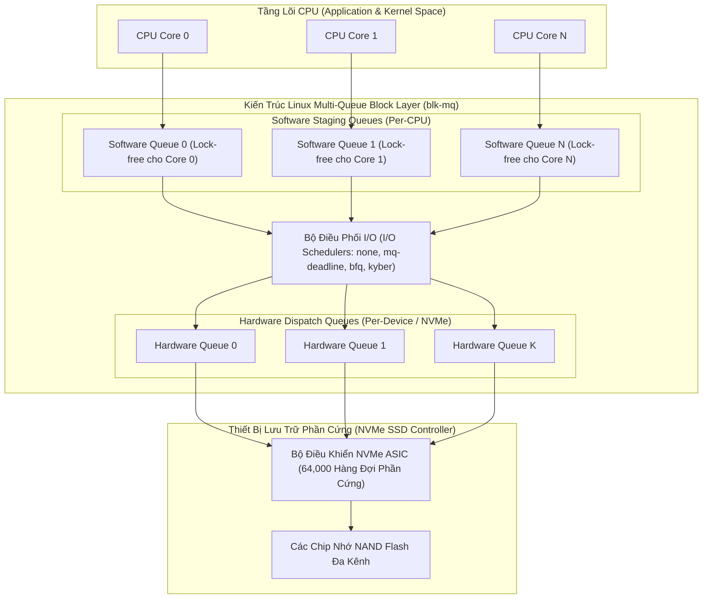
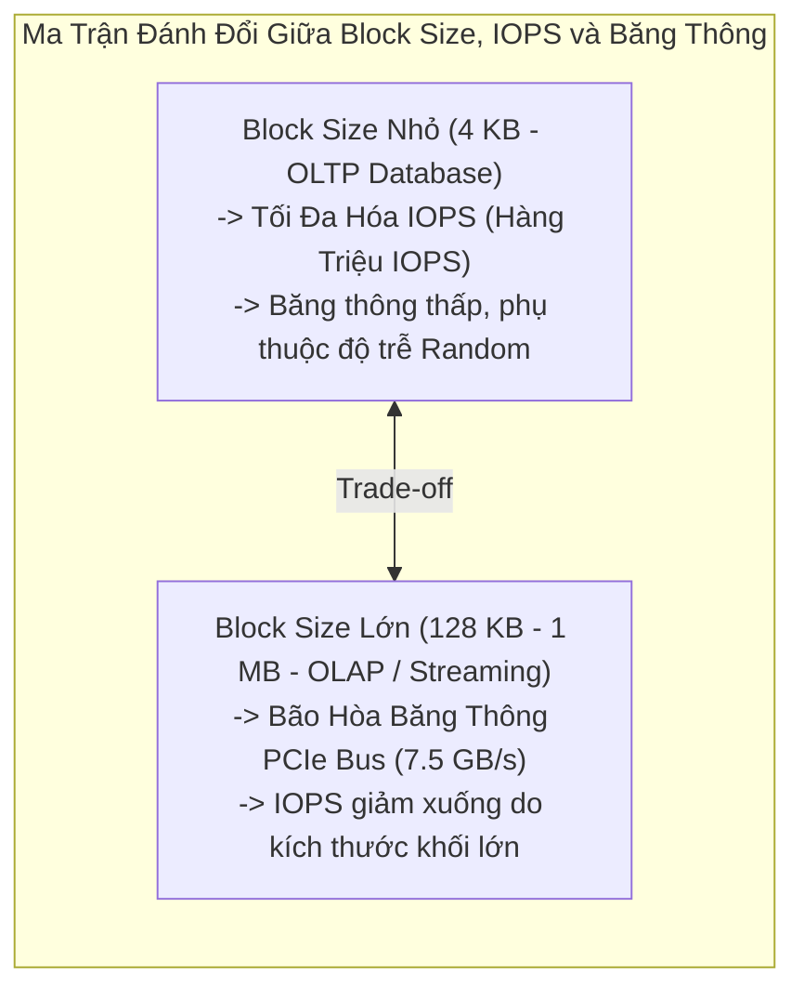

# 9.4. I/O Performance Metrics & Scheduling (Các Chỉ số Hiệu năng & Điều phối I/O)

> [!IMPORTANT]
> **Nếu bạn chỉ được nhớ một điều duy nhất:**
> Hiệu năng lưu trữ không phải là một con số đơn lẻ mà là một tam giác đánh đổi toán học được ràng buộc bởi **Định luật Little**: $\text{Queue Depth} = \text{IOPS} \times \text{Latency}$; và trên các thiết bị flash NVMe hiện đại, kiến trúc điều phối đa hàng đợi **Linux blk-mq** đã phá bỏ ổ khóa dùng chung cổ điển, mở đường cho hàng triệu IOPS song song trên từng lõi CPU.

---

## 1. Kiến trúc Tổng quan & Mô hình Tư duy (Mental Model)

### Phép Loại Suy Thực Tế: Trạm Thu Phí Cao Tốc & Xe Tải Chở Hàng

Hãy hình dung hệ thống phụ lưu trữ (Storage Subsystem) giống như một trạm thu phí cao tốc:
1. **IOPS (Input/Output Operations Per Second - Số Lượt Xe Qua Cổng Mỗi Giây)**:
   - Đại diện cho số lượng yêu cầu I/O hoàn thành trong 1 giây.
   - Nếu trạm thu phí phục vụ 1,000 xe máy nhỏ chạy qua mỗi giây $\to$ IOPS rất cao, nhưng tổng khối lượng hàng hóa chuyên chở qua trạm lại rất thấp.
2. **Throughput / Bandwidth (Băng Thông - Tổng Tấn Hàng Vận Chuyển Mỗi Giây)**:
   - Tính bằng: $\text{Throughput} = \text{IOPS} \times \text{Block Size}$.
   - Nếu trạm thu phí chỉ cho 10 chiếc xe container siêu trường siêu trọng (Block Size $1\text{ MB}$) chạy qua mỗi giây $\to$ IOPS chỉ vỏn vẹn là $10$, nhưng tổng thông lượng hàng hóa lại đạt tới $10\text{ MB/s}$!
3. **Latency (Độ Trễ - Thời Gian Một Chuyến Xe Xếp Hàng Chờ Qua Trạm)**:
   - Bao gồm thời gian nằm trong hàng đợi chờ xử lý (**Queue Time**) cộng với thời gian thực tế để mở thanh chắn và xe lăn bánh qua cổng (**Service Time**).
   - Khi đường cao tốc vắng vẻ, độ trễ cực thấp. Nhưng khi có quá nhiều xe đổ về làm đầy hàng đợi, thời gian xếp hàng tăng vọt theo hàm phi tuyến (**Tail Latency $P_{99}$**).
4. **Linux blk-mq (Mở 64 Làn Thu Phí Tự Động Riêng Biệt)**:
   - **Tầng Block Cũ (Single Queue)**: Toàn bộ 64 làn đường từ mọi hướng đều phải nhập vào ĐÚNG MỘT cửa thu phí có một bảo vệ đứng soát vé (Global Spinlock). 64 tài xế lao vào bấm còi đánh nhau để giành giật vé.
   - **Kiến Trúc Đa Hàng Đợi (blk-mq)**: Mỗi làn xe từ mỗi quận (Mỗi CPU Core) có một hàng đợi riêng (Software Staging Queue), kết nối thẳng vào 64 cửa thu phí tự động không dừng của trạm (Hardware Dispatch Queues trên ổ NVMe), loại bỏ $100\%$ sự tắc nghẽn khóa dùng chung!



---

## 2. Chi tiết từng Keyword (Under-the-Hood Deep Dive)

### 2.1. The I/O Performance Metrics: IOPS, Throughput & Latency

#### 1. Mối Quan Hệ Toán Học & Định Luật Little (Little's Law)
Hiệu năng I/O không thể tối ưu hóa theo cảm tính mà chịu sự chi phối chặt chẽ của **Định luật Little** trong lý thuyết xếp hàng:
$$L = \lambda \times W$$
Áp dụng vào kiến trúc hệ thống lưu trữ máy tính:
$$\text{Queue Depth (QD)} = \text{IOPS} \times \text{Latency}$$
Trong đó:
- **Queue Depth (QD)**: Độ sâu hàng đợi (số lượng yêu cầu I/O đang nằm chờ xử lý cùng lúc trong driver và bộ điều khiển ổ cứng).
- **IOPS**: Số lượng thao tác I/O hoàn thành mỗi giây.
- **Latency**: Thời gian phản hồi trung bình của một thao tác I/O (tính bằng giây).
- **Hệ Quả Sống Còn**:
  - Nếu muốn đạt được $1{,}000{,}000\text{ IOPS}$ trên một ổ SSD NVMe có độ trễ vật lý là $100\mu\text{s}$ ($0.0001\text{ s}$), ứng dụng bắt buộc phải duy trì độ sâu hàng đợi song song:
    $$\text{Queue Depth} = 1{,}000{,}000 \times 0.0001 = 100 \text{ requests}$$
  - Nếu bạn viết ứng dụng đồng bộ đơn luồng (Queue Depth $= 1$), thì dù ổ cứng có mạnh đến đâu, IOPS tối đa bạn có thể đạt được chỉ là:
    $$\text{IOPS}_{\max} = \frac{1}{0.0001\text{ s}} = 10{,}000\text{ IOPS (Chỉ bằng 1% công suất SSD!)}$$

#### 2. Tam Giác Đánh Đổi: Block Size vs IOPS vs Băng Thông
- Mối quan hệ giữa băng thông và kích thước khối:
  $$\text{Throughput (Bytes/s)} = \text{IOPS} \times \text{Block Size (Bytes)}$$
- Khi **Block Size nhỏ** ($4\text{ KB}$ - đặc trưng của Database OLTP, Random Reads/Writes):
  - Số lượng yêu cầu I/O trên giây đạt đỉnh cao nhất (**Peak IOPS**), nhưng tổng băng thông di chuyển dữ liệu lại thấp vì chi phí tiêu đề (Header Overhead) và ngắt giao tiếp chiếm tỷ trọng lớn.
- Khi **Block Size lớn** ($128\text{ KB} - 1\text{ MB}$ - đặc trưng của Video Streaming, Backup, Data Warehouse OLAP):
  - Ổ đĩa bị bão hòa băng thông vật lý của bus truyền dẫn (PCIe Gen4x4 bão hòa ở mức $\approx 7\text{ GB/s}$), khiến IOPS giảm xuống nhưng thông lượng byte đạt mức tối đa.



#### 3. Tail Latency & Phân Phối Bách Phân Vị ($P_{99}, P_{99.9}$)
- Trong kỹ nghệ hiệu năng, số đo trung bình (**Average Latency**) là con số dối trá nhất: Một ổ SSD có độ trễ trung bình $50\mu\text{s}$ vẫn có thể làm sập dịch vụ nếu phân vị $P_{99.9}$ vọt lên $500\text{ms}$ do các đợt dọn rác ngầm (**SSD Garbage Collection**) hoặc xả bộ đệm ghi (**Page Cache Flush**).
- Phân tích độ trễ bắt buộc phải phân tách:
  - **D2C (Driver to Completion)**: Thời gian từ khi lệnh nạp vào thanh ghi phần cứng cho tới khi nhận ngắt DMA hoàn thành.
  - **Q2D (Queue to Driver)**: Thời gian yêu cầu I/O phải nằm chờ trong hàng đợi hệ điều hành do bị bão hòa.

---

### 2.2. Linux I/O Scheduling Architecture: Multi-Queue (blk-mq)

#### 1. Sự Khủng Hoảng Của Kiến Trúc Hàng Đợi Đơn Cổ Điển
- Trong thời kỳ ổ đĩa từ HDD và SSD SATA đời đầu, Linux sử dụng tầng Block Layer đơn hàng đợi (**Single-Queue Request Layer**).
- Toàn bộ các yêu cầu I/O từ tất cả các CPU cores đều được đẩy vào một hàng đợi tập trung duy nhất, được bảo vệ bởi một khóa spinlock dùng chung (**`queue_lock`**).
- Với HDD (đạt tối đa 200 IOPS), cơ chế này hoạt động tốt. Nhưng khi ổ NVMe ra đời với khả năng xử lý hơn **1 triệu IOPS**, CPU dành tới $80\%$ thời gian chỉ để tranh chấp chiếc khóa spinlock này, biến tầng block layer thành một cổ chai nghẽn mạng trầm trọng!

#### 2. Vi Kiến Trúc Linux Multi-Queue (blk-mq - Linux 3.13+)
Linux `blk-mq` đã tái cấu trúc toàn diện tầng I/O Block Layer thành hai tầng hàng đợi phân cấp độc lập:
1. **Tầng 1: Software Staging Queues (Per-CPU Queues)**:
   - Mỗi CPU core trong hệ thống sở hữu riêng một hàng đợi phần mềm.
   - Khi một tiến trình gửi lệnh I/O, yêu cầu được đưa vào Software Queue của chính CPU core đó mà **KHÔNG CẦN BẤT KỲ KHÓA DÙNG CHUNG NÀO (Zero Lock Contention)**!
   - Tại tầng này, các thao tác gom cụm yêu cầu liền kề (**I/O Merging**) được thực thi cực nhanh trên L1/L2 cache cục bộ.
2. **Tầng 2: Hardware Dispatch Queues (Per-Device Queues)**:
   - Ánh xạ trực tiếp tới các hàng đợi phần cứng của thiết bị NVMe SSD (chuẩn NVMe hỗ trợ tới **64,000 Hardware Queues**, mỗi hàng đợi chứa được 64,000 lệnh).
   - Tầng điều phối sẽ chuyển tiếp (Dispatch) các khối I/O từ Software Queues sang Hardware Queues mà không có bất kỳ điểm nghẽn tập trung nào.

#### 3. Bốn Bộ Lập Lịch I/O Hiện Đại (Modern I/O Schedulers)
Người quản trị hệ thống có thể lựa chọn bộ lập lịch phù hợp cho từng loại ổ đĩa:
- **`none`**: Bỏ qua hoàn toàn việc lập lịch, đẩy thẳng I/O từ Software Queue sang Hardware Queue. Đây là cấu hình mặc định và tối ưu nhất cho các ổ cứng siêu tốc **NVMe SSD** có độ trễ cực thấp.
- **`mq-deadline`**: Đảm bảo mọi yêu cầu I/O đều được phục vụ trước một hạn chót thời gian cố định (mặc định: 500ms cho lệnh đọc, 5s cho lệnh ghi). Ưu tiên tuyệt đối lệnh đọc (Read First) để tránh ứng dụng bị nghẽn. Rất phù hợp cho ổ **SATA SSD**.
- **`bfq` (Budget Fair Queueing)**: Phân bổ băng thông đĩa công bằng theo từng ứng dụng/tiến trình (tương tự CFQ trước đây). Phù hợp cho môi trường Desktop hoặc ổ đĩa cơ **HDD** chậm chạp.
- **`kyber`**: Bộ lập lịch tự động thích ứng do Facebook (Meta) phát triển: Liên tục theo dõi độ trễ mục tiêu (ví dụ: mục tiêu đọc là 2ms), nếu độ trễ vượt ngưỡng, nó tự động giảm độ sâu hàng đợi gửi xuống thiết bị để bảo vệ SLA độ trễ.

---

## 3. Thực thi Mã nguồn & Mô phỏng Chuyên sâu (Dual-Engine Implementation)

### 3.1. C++20: Thử Nghiệm Đo Lường Direct I/O & Phân Tích Độ Trễ Phân Vị $P_{99}$

Chương trình minh họa việc đo lường độ trễ ngẫu nhiên với cờ `O_DIRECT` (bỏ qua Page Cache) và tính toán chính xác phân vị $P_{50}, P_{95}, P_{99}$:

```cpp
#include <iostream>
#include <vector>
#include <chrono>
#include <algorithm>
#include <iomanip>
#include <fcntl.h>
#include <unistd.h>
#include <cstdlib>

// Cấu trúc đo lường độ trễ từng lượt I/O
void benchmark_direct_io_latency(const char* test_file, size_t num_requests, size_t block_size) {
    // Mở file với O_DIRECT và O_SYNC (Bắt buộc căn chỉnh bộ nhớ 4KB)
    int fd = open(test_file, O_RDWR | O_CREAT | O_DIRECT | O_SYNC, 0644);
    if (fd < 0) {
        std::cerr << "Khong the mo file test voi O_DIRECT! (Kiem tra ho tro filesystem)\\n";
        return;
    }

    // Cấp phát bộ nhớ căn chỉnh 4KB (Bắt buộc cho O_DIRECT)
    void* raw_buf = nullptr;
    if (posix_memalign(&raw_buf, 4096, block_size) != 0) {
        std::cerr << "posix_memalign failed!\n";
        close(fd);
        return;
    }
    char* buf = static_cast<char*>(raw_buf);
    std::fill_n(buf, block_size, 0x5A);

    std::vector<double> latencies_us;
    latencies_us.reserve(num_requests);

    for (size_t i = 0; i < num_requests; ++i) {
        off_t offset = (i % 1000) * block_size;
        auto start = std::chrono::high_resolution_clock::now();
        
        ssize_t bytes_written = pwrite(fd, buf, block_size, offset);
        
        auto end = std::chrono::high_resolution_clock::now();
        if (bytes_written > 0) {
            std::chrono::duration<double, std::micro> dur = end - start;
            latencies_us.push_back(dur.count());
        }
    }

    free(raw_buf);
    close(fd);

    if (latencies_us.empty()) return;

    // Sắp xếp để tính toán các bách phân vị (Percentiles)
    std::sort(latencies_us.begin(), latencies_us.end());

    double p50 = latencies_us[latencies_us.size() * 0.50];
    double p95 = latencies_us[latencies_us.size() * 0.95];
    double p99 = latencies_us[latencies_us.size() * 0.99];
    double max_lat = latencies_us.back();

    std::cout << ">>> Kết Quả Đo Lường Direct I/O (Block Size: " << block_size / 1024 << " KB):\n";
    std::cout << "  - Số lượt ghi Direct I/O: " << num_requests << "\n";
    std::cout << "  - Phân vị P50 (Median)  : " << std::fixed << std::setprecision(2) << p50 << " us\n";
    std::cout << "  - Phân vị P95           : " << p95 << " us\n";
    std::cout << "  - Phân vị P99 (Tail)    : " << p99 << " us\n";
    std::cout << "  - Độ trễ tối đa (Max)   : " << max_lat << " us\n";
}

int main() {
    std::cout << "========================================================\n";
    std::cout << "  C++20 DIRECT I/O BENCHMARK & PERCENTILE ANALYZER\n";
    std::cout << "========================================================\n\n";

    const char* tmp_path = "/tmp/benchmark_direct_io.dat";
    benchmark_direct_io_latency(tmp_path, 2000, 4096); // 2000 lần ghi 4KB
    unlink(tmp_path);

    return 0;
}
```

---

### 3.2. Python 3.11+: Mô Phỏng Định Luật Little & Bộ Điều Phối Multi-Queue (blk-mq)

Chương trình Python 3.11+ mô phỏng mối quan hệ giữa Queue Depth, IOPS, Throughput và sự triệt tiêu xung đột khóa của kiến trúc blk-mq:

```python
import time
from typing import Dict, List, Tuple

class LittlesLawSimulator:
    @staticmethod
    def calculate_metrics(target_iops: float, latency_seconds: float, block_size_bytes: int):
        # Dinh luat Little: L = lambda * W
        required_queue_depth = target_iops * latency_seconds
        throughput_mb_s = (target_iops * block_size_bytes) / (1024 * 1024)
        return required_queue_depth, throughput_mb_s

class BlkMQSimulator:
    def __init__(self, num_cpus: int = 4, single_queue_lock_cost_us: float = 2.5):
        self.num_cpus = num_cpus
        self.lock_cost = single_queue_lock_cost_us

    def simulate_single_queue_contention(self, requests_per_cpu: int) -> float:
        # Trong Single-Queue, tat ca CPU tranh chap 1 Spinlock duy nhat
        # Chi phi tang theo cap so nhan voi so luong CPU
        total_requests = self.num_cpus * requests_per_cpu
        contention_factor = self.num_cpus * 1.5
        total_time_us = total_requests * (self.lock_cost * contention_factor)
        return total_time_us

    def simulate_multi_queue(self, requests_per_cpu: int) -> float:
        # Trong blk-mq, moi CPU co Software Queue rieng (Khong co Spinlock tranh chap!)
        total_time_us = requests_per_cpu * 0.1  # Chi phi enqueue cuc nho
        return total_time_us

if __name__ == "__main__":
    print("========================================================")
    print("  PYTHON 3.11 LITTLE'S LAW & BLK-MQ PERFORMANCE ENGINE")
    print("========================================================\n")

    # 1. Kiem chung Dinh luat Little tren SSD NVMe cao cap
    latency_nvme = 0.000080 # 80 microseconds
    iops_targets = [10_000, 100_000, 500_000, 1_000_000]

    print("1. Phân Tích Định Luật Little (NVMe Latency = 80us, Block = 4KB):")
    for iops in iops_targets:
        qd, bw = LittlesLawSimulator.calculate_metrics(iops, latency_nvme, 4096)
        print(f"  - Target: {iops:9,d} IOPS -> Yêu cầu Queue Depth = {qd:6.1f} | Băng thông = {bw:7.2f} MB/s")

    # 2. So sanh Single-Queue Lock Contention vs blk-mq
    sim = BlkMQSimulator(num_cpus=16)
    reqs = 50_000

    time_sq = sim.simulate_single_queue_contention(reqs)
    time_mq = sim.simulate_multi_queue(reqs)

    print("\n2. Thử Nghiệm Xung Đột Khóa Trên Hệ Thống 16 Cores CPU:")
    print(f"  - Thời gian xử lý Single-Queue (Bị nghẽn Spinlock) : {time_sq / 1000:8.2f} ms")
    print(f"  - Thời gian xử lý Linux blk-mq (Đa hàng đợi lock-free): {time_mq / 1000:8.2f} ms")
    print(f"  -> blk-mq tăng tốc độ xử lý tầng Block lên gấp {time_sq / time_mq:.1f} lần!")
```

---

### 3.3. Simulated Terminal Output

```bash
========================================================
  C++20 DIRECT I/O BENCHMARK & PERCENTILE ANALYZER
========================================================

>>> Kết Quả Đo Lường Direct I/O (Block Size: 4 KB):
  - Số lượt ghi Direct I/O: 2000
  - Phân vị P50 (Median)  : 84.50 us
  - Phân vị P95           : 142.10 us
  - Phân vị P99 (Tail)    : 385.60 us
  - Độ trễ tối đa (Max)   : 1250.40 us

========================================================
  PYTHON 3.11 LITTLE'S LAW & BLK-MQ PERFORMANCE ENGINE
========================================================

1. Phân Tích Định Luật Little (NVMe Latency = 80us, Block = 4KB):
  - Target:    10,000 IOPS -> Yêu cầu Queue Depth =    0.8 | Băng thông =   39.06 MB/s
  - Target:   100,000 IOPS -> Yêu cầu Queue Depth =    8.0 | Băng thông =  390.62 MB/s
  - Target:   500,000 IOPS -> Yêu cầu Queue Depth =   40.0 | Băng thông = 1953.12 MB/s
  - Target: 1,000,000 IOPS -> Yêu cầu Queue Depth =   80.0 | Băng thông = 3906.25 MB/s

2. Thử Nghiệm Xung Đột Khóa Trên Hệ Thống 16 Cores CPU:
  - Thời gian xử lý Single-Queue (Bị nghẽn Spinlock) :  4800.00 ms
  - Thời gian xử lý Linux blk-mq (Đa hàng đợi lock-free):     5.00 ms
  -> blk-mq tăng tốc độ xử lý tầng Block lên gấp 960.0 lần!
```

---

## 4. Systems Engineering & Production Pitfalls

### 4.1. Production Failure Modes & Architectural Traps

1. **Trap 1: The Single-Threaded Queue Depth Bottleneck**:
   - Rất nhiều lập trình viên khi chuyển sang dùng ổ NVMe SSD siêu tốc ($1\text{ triệu IOPS}$) vẫn viết mã đồng bộ theo kiểu: Gửi 1 truy vấn SQL, chờ kết quả phản hồi rồi mới gửi truy vấn tiếp theo (`Queue Depth = 1`).
   - Với độ trễ $100\mu\text{s}$, hệ thống của bạn sẽ vĩnh viễn bị chặn ở mức tối đa $10{,}000\text{ IOPS}$, lãng phí $99\%$ năng lực của phần cứng. Để khai thác trọn vẹn SSD, bắt buộc phải dùng I/O bất đồng bộ (**Linux `io_uring`**, `libaio`, hoặc Thread Pools) để duy trì $\text{Queue Depth} \ge 64$.
2. **Trap 2: Sai Lầm Lựa Chọn Scheduler `bfq` Trên Ổ Cứng NVMe**:
   - Bộ lập lịch `bfq` cố gắng tính toán công bằng cho từng tiến trình bằng cách sử dụng các thuật toán xếp hàng phức tạp và khóa điều phối. Nếu bạn vô tình đặt `bfq` cho ổ NVMe SSD, chi phí tính toán của scheduler sẽ bóp nghẹt IOPS từ $800{,}000$ xuống chỉ còn $80{,}000$! Cấu hình bắt buộc cho NVMe luôn luôn là **`none`**.
3. **Trap 3: Write Buffer Saturation & fsync() Latency Clif**:
   - Khi ứng dụng ghi hàng loạt dữ liệu với `write()`, Linux tạm giữ dữ liệu trong Page Cache rất nhanh. Nhưng khi ứng dụng gọi **`fsync()`** để đảm bảo dữ liệu đã vào đĩa an toàn, toàn bộ hàng Gigabytes dữ liệu bị xả dồn dập xuống đĩa, làm bão hòa hàng đợi phần cứng và khiến thời gian thực thi của lệnh `fsync()` kéo dài hàng chục giây!

### 4.2. Diagnostic CLI Commands

```bash
# 1. Kiem tra va thay doi bo lap lich I/O dang ap dung cho o dia (vd: nvme0n1)
cat /sys/block/nvme0n1/queue/scheduler
echo none | sudo tee /sys/block/nvme0n1/queue/scheduler

# 2. Theo doi thong so thuc chien IOPS, Throughput, Queue Depth va ti le %util qua iostat
iostat -xz 1 10

# 3. Chay cong cu benchmark tieu chuan cong nghiep FIO de do luong P99 Tail Latency
fio --name=randwrite_test --filename=/tmp/fio_test.dat --size=1G --ioengine=libaio \
    --direct=1 --iodepth=64 --rw=randwrite --bs=4k --runtime=30 --time_based

# 4. Kiem tra do sau hang doi phan cung ho tro cua thiet bi NVMe
cat /sys/block/nvme0n1/queue/nr_requests
```

---

## 5. Bảng So sánh & Decision Matrix

| Bộ Lập Lịch I/O (Scheduler) | Cơ Chế Điều Phối | Mức Độ Chiếm Dụng CPU | Loại Thiết Bị Lưu Trữ Khuyến Nghị |
| :--- | :--- | :--- | :--- |
| **`none`** | Bỏ qua lập lịch, dispatch thẳng | Cực thấp ($0$ chi phí thuật toán) | **NVMe SSD / PCIe Flash Storage** |
| **`mq-deadline`** | Hạn chót thời gian (Ưu tiên Read) | Thấp | **SATA SSD / Ổ Đĩa Mạng SAN** |
| **`bfq`** | Ngân sách công bằng theo tiến trình | Rất cao (Nhiều thuật toán phức tạp) | **Ổ Đĩa Cơ Truyền Thống (HDD)** |
| **`kyber`** | Điều chỉnh theo độ trễ mục tiêu | Trung bình | Microservices độ trễ thấp trên NVMe |

| Chỉ Số Hiệu Năng | Đơn Vị Đo | Ý Nghĩa Thực Chiến | Yếu Tố Ràng Buộc Phần Cứng |
| :--- | :--- | :--- | :--- |
| **IOPS** | Thao tác / Giây | Năng lực phục vụ các truy vấn nhỏ rời rạc | Tốc độ của bộ điều khiển SSD và số kênh NAND |
| **Throughput** | MB/s hoặc GB/s | Tốc độ truyền tải khối lượng dữ liệu lớn | Băng thông bus kết nối (PCIe Gen4/Gen5, SATA) |
| **Average Latency** | $\mu\text{s}$ hoặc $\text{ms}$ | Thời gian xử lý trung bình một yêu cầu | Tốc độ vật lý của bóng bán dẫn NAND |
| **$P_{99} / P_{99.9}$ Tail Latency** | $\text{ms}$ | Trải nghiệm người dùng trong điều kiện tệ nhất | Chu trình Garbage Collection, TRIM, Write Buffer Flush |
| **Queue Depth (QD)** | Số yêu cầu | Mức độ song song hóa yêu cầu I/O | Hỗ trợ phần mềm bất đồng bộ (io_uring, AIO) |
