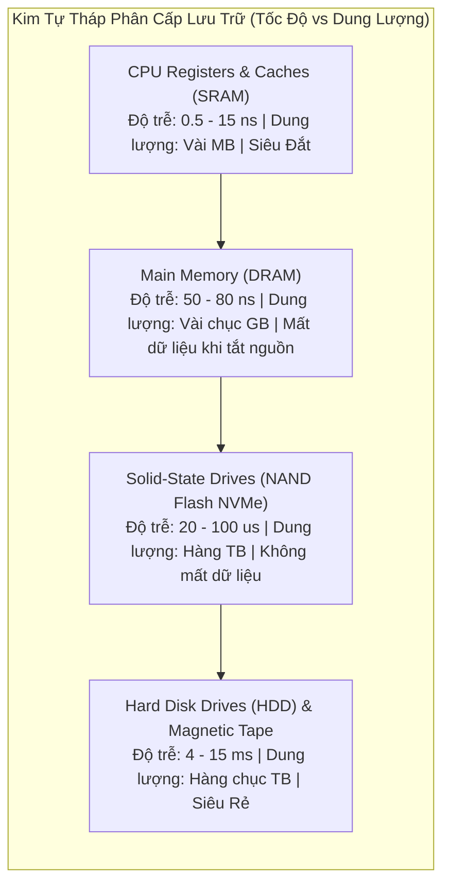
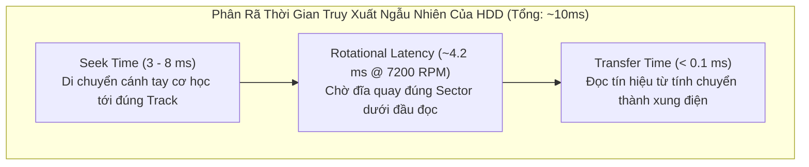
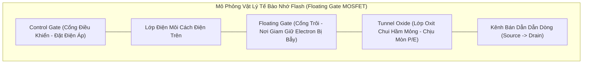

# 10.1. Storage Hierarchy & Media Technologies (Phân cấp Lưu trữ & Các Công nghệ Phương tiện)

> [!IMPORTANT]
> **Nếu bạn chỉ được nhớ một điều duy nhất:**
> Kim tự tháp lưu trữ máy tính là sự đánh đổi vĩnh cửu giữa **Tốc độ, Dung lượng và Chi phí**: Từ các đĩa từ cơ học quay nghìn vòng mỗi phút (**HDD**) bị trói chặt bởi quán tính vật lý (Seek Time mili-giây), nhân loại đã tiến tới các chip nhớ bán dẫn thể rắn (**NAND Flash**) vận hành theo nguyên lý bẫy điện tích lượng tử — mang lại tốc độ ngẫu nhiên nhanh gấp hàng nghìn lần nhưng phải trả giá bằng giới hạn số lần xóa ghi vật lý (P/E Cycles).

---

## 1. Kiến trúc Tổng quan & Mô hình Tư duy (Mental Model)

### Phép Loại Suy Thực Tế: Từ Máy Hát Đĩa Than Cổ Điển Đến Tủ Điện Tử Lượng Tử

Để thấu hiểu sự chuyển dịch công nghệ mang tính thời đại giữa hai loại phương tiện lưu trữ:
1. **Hard Disk Drive - HDD (Máy Hát Đĩa Than Khổng Lồ)**:
   - Hãy hình dung một chiếc máy hát đĩa than với nhiều tầng đĩa quay tít ở tốc độ $7,200$ hoặc $15,000$ vòng/phút. Một cánh tay cơ học bằng kim loại mang đầu đọc phải vật lý di chuyển từ mép ngoài vào tâm đĩa (**Seek Time**) và chờ cho rãnh đĩa quay đúng vị trí cần đọc bên dưới đầu đọc (**Rotational Latency**).
   - Dù bạn có một siêu máy tính xử lý hàng tỷ phép tính mỗi giây, nếu muốn đọc 1 byte từ đĩa từ, bạn bắt buộc phải chờ cánh tay cơ học di chuyển mất từ $4$ đến $10$ mili-giây — một khoảng thời gian dài vô tận tương đương hàng triệu chu kỳ xung nhịp CPU!
2. **Solid-State Drive - SSD (Tủ Khóa Bẫy Điện Tử Thể Rắn)**:
   - Không có bất kỳ bộ phận cơ học chuyển động nào! SSD là một ma trận gồm hàng tỷ tế bào nhớ thể rắn tĩnh lặng.
   - Khi cần đọc dữ liệu, bộ điều khiển chỉ việc đặt một điện áp kích hoạt lên đường dây địa chỉ, điện tích lập tức được đo lường trong vòng vài chục micro-giây ($20 - 50\mu\text{s}$), nhanh gấp **1,000 lần** so với cánh tay cơ học của HDD!
3. **NAND vs NOR Flash (Sách Đọc Theo Trang vs Bảng Tra Cứu Từng Ký Tự)**:
   - **NOR Flash (Bảng Tra Cứu Từng Ký Tự Trực Tiếp)**: Cho phép truy cập ngẫu nhiên đến từng byte độc lập giống hệt RAM, cho phép CPU nạp lệnh chạy trực tiếp tại chỗ (**Execute-In-Place - XIP** - dùng chứa BIOS/UEFI), nhưng dung lượng rất nhỏ và giá thành cực đắt.
   - **NAND Flash (Cuốn Sách Chỉ Lật Từng Trang)**: Các tế bào nối tiếp nhau thành chuỗi, buộc bạn phải đọc và ghi theo từng **Trang (Page - 4KB/16KB)** và xóa theo từng **Khối (Block - hàng Megabytes)**. Bù lại, mật độ lưu trữ cực kỳ dày đặc và chi phí siêu rẻ, trở thành xương sống của toàn bộ ổ SSD thế giới.



---

## 2. Chi tiết từng Keyword (Under-the-Hood Deep Dive)

### 2.1. Hard Disk Drives (HDD) vs Solid-State Drives (SSD)

#### 1. Cấu Trúc Vật Lý & Thành Phần Cơ Học Của HDD
- Một ổ đĩa cứng truyền thống bao gồm:
  - **Platters (Các đĩa từ)**: Làm bằng nhôm hoặc thủy tinh phủ lớp vật liệu từ tính siêu mỏng, quay quanh một trục (**Spindle**) với tốc độ góc không đổi ($5,400$, $7,200$, $10,000$ hoặc $15,000\text{ RPM}$).
  - **Read/Write Heads (Đầu đọc/ghi)**: Bay lơ lửng trên bề mặt đĩa ở khoảng cách chỉ vài nanomet (nhỏ hơn đường kính hạt bụi), được điều khiển bởi động cơ cuộn dây âm thanh (**Voice Coil Motor - VCM Actuator**).
  - **Tracks, Sectors & Cylinders**:
    - Mỗi đĩa chia thành hàng trăm nghìn vòng tròn đồng tâm gọi là **Tracks**.
    - Mỗi Track chia thành các cung từ **Sectors** (chuẩn cũ là $512\text{ bytes}$, chuẩn Advanced Format hiện đại là $4\text{ KB}$).
    - Tập hợp các Track cùng bán kính trên tất cả các mặt đĩa tạo thành một **Cylinder**.
- **Công Thức Tính Thời Gian Truy Xuất Ngẫu Nhiên Của HDD**:
  $$T_{\text{access}} = T_{\text{seek}} + T_{\text{rotational}} + T_{\text{transfer}}$$
  Trong đó:
  - $T_{\text{seek}}$ (Thời gian dò tìm rãnh): Thời gian cánh tay cơ học di chuyển đầu đọc tới đúng Cylinder, trung bình mất từ $3\text{ ms}$ đến $9\text{ ms}$.
  - $T_{\text{rotational}}$ (Thời gian chờ đĩa quay): Trung bình là thời gian đĩa quay nửa vòng:
    $$T_{\text{rotational}} = \frac{1}{2} \times \frac{60}{\text{RPM}} \quad (\text{Với } 7,200\text{ RPM: } \approx 4.17\text{ ms})$$
  - Tổng thời gian truy xuất ngẫu nhiên cho một lần đọc là $\approx 8 - 12\text{ ms}$, tương đương mức trần cứng giới hạn tối đa chỉ khoảng **$75 - 120\text{ IOPS}$**!



#### 2. Kiến Trúc Thể Rắn Của SSD (Solid-State Drive)
- Trái ngược hoàn toàn với HDD, SSD được cấu tạo từ:
  - **Flash Controller (Bộ điều khiển ASIC đa nhân)**: Trái tim của SSD, chạy firmware quản trị phức tạp (FTL), quản lý các kênh giao tiếp phần cứng song song.
  - **DRAM Cache**: Lưu trữ bảng ánh xạ địa chỉ logic sang vật lý (L2P Table) để tra cứu trong vài nano-giây.
  - **NAND Flash Packages**: Chứa nhiều khuôn silicon (Dies), mỗi die chia thành nhiều mặt phẳng (Planes), blocks và pages.
- Nhờ khả năng định tuyến điện tử tức thời, thời gian truy xuất đọc ngẫu nhiên của SSD NVMe chỉ mất từ **$10\mu\text{s}$ đến $50\mu\text{s}$**, loại bỏ hoàn toàn khái niệm Seek Time và nâng thông lượng lên tới hàng triệu IOPS.

---

### 2.2. Flash Memory Physics: NAND Flash vs NOR Flash

#### 1. Nguyên Lý Vật Lý Lượng Tử: Tế Bào Nhớ Bẫy Điện Tích (Floating Gate & Charge Trap)
- Bộ nhớ Flash lưu trữ bit nhị phân dựa trên việc giam giữ các electron trong một lớp vật liệu cách điện:
  - **Floating Gate Transistor (Cổng trôi)**: Cấu trúc transistor MOSFET có thêm một cổng kim loại cô lập (Floating Gate) nằm kẹp giữa hai lớp oxit silic cách điện.
  - **Cơ chế Ghi (Program via Fowler-Nordheim Tunneling)**: Đặt một điện áp cao ($15 - 20\text{ V}$) lên Cổng Điều Khiển (Control Gate), các electron từ lớp nền bán dẫn sẽ "chui hầm lượng tử" xuyên qua lớp oxit cách điện để đi vào và bị giam lỏng bên trong Cổng trôi.
  - **Trạng thái Tích Điện (Threshold Voltage Shift)**: Khi có electron bị giam, điện áp ngưỡng kích hoạt ($V_{\text{th}}$) của transistor tăng lên. Khi CPU đọc dữ liệu bằng cách đặt điện áp kiểm tra chuẩn:
    - Nếu có electron bị bẫy $\to$ dòng điện không chạy qua transistor $\to$ Giá trị logic là **Bit 0**.
    - Nếu không có electron $\to$ dòng điện chạy qua transistor $\to$ Giá trị logic là **Bit 1**.
  - **Hiện Tượng Thoái Hóa Ôxit (Wear-Out & P/E Cycles)**: Mỗi lần xóa dữ liệu bằng điện áp đảo ngược, lớp oxit mỏng bị bắn phá bởi các electron năng lượng cao, tạo ra các bẫy khuyết tật vật lý. Sau vài nghìn chu kỳ Xóa/Ghi (**P/E Cycles**), lớp oxit bị thủng, electron bị rò rỉ và ô nhớ vĩnh viễn mất khả năng giữ dữ liệu.



#### 2. Cuộc Đối Đầu Giữa NOR Flash và NAND Flash
- **NOR Flash (Cấu trúc song song)**:
  - Các tế bào nhớ được mắc song song với đường dây bit (Bitline).
  - *Ưu điểm*: Hỗ trợ truy cập ngẫu nhiên đến từng Byte (Byte-level Random Access), tốc độ đọc cực nhanh. Cho phép tính năng **XIP (Execute-In-Place)**: CPU có thể trỏ thẳng con trỏ lệnh `RIP` vào chip NOR Flash để thực thi mã máy mà không cần sao chép vào RAM (lý tưởng cho Firmware, Bootloader, Router nhúng).
  - *Nhược điểm*: Diện tích mạch silicon lớn, mật độ lưu trữ thấp, tốc độ ghi và xóa cực kỳ chậm, giá thành đắt đỏ.
- **NAND Flash (Cấu trúc nối tiếp chuỗi)**:
  - Các tế bào nhớ được mắc nối tiếp nhau thành từng chuỗi (Strings, thường gồm 32 đến 128 cells).
  - *Ưu điểm*: Tiết kiệm diện tích tiếp điểm kim loại, mật độ lưu trữ cực kỳ dày đặc, chi phí sản xuất rẻ gấp nhiều lần NOR.
  - *Nhược điểm*: **Không hỗ trợ truy cập ngẫu nhiên theo byte!**
    - Thao tác ĐỌC (Read): Phải đọc trọn vẹn một **Trang (Page)** ($4\text{ KB} - 16\text{ KB}$).
    - Thao tác GHI (Program): Phải ghi theo từng **Trang (Page)**.
    - Thao tác XÓA (Erase): Bắt buộc phải xóa theo từng **Khối (Block)** gồm hàng trăm trang ($2\text{ MB} - 16\text{ MB}$) do giới hạn mạch điện áp cao!

#### 3. Các Thế Hệ Tế Bào Nhớ NAND: SLC, MLC, TLC, QLC
Để tăng dung lượng lưu trữ trên cùng một diện tích chip silicon, các kỹ sư điều khiển số lượng electron bị bẫy để phân định nhiều mức điện áp ngưỡng khác nhau:
- **SLC (Single-Level Cell)**: Lưu $1$ bit/cell (2 mức điện áp). Độ bền tối thượng: $\approx 100{,}000$ P/E cycles. Tốc độ nhanh nhất, siêu đắt (dùng cho quân sự, máy chủ tài chính).
- **MLC (Multi-Level Cell)**: Lưu $2$ bits/cell (4 mức điện áp). Độ bền: $\approx 3{,}000 - 10{,}000$ P/E cycles.
- **TLC (Triple-Level Cell)**: Lưu $3$ bits/cell (8 mức điện áp). Độ bền: $\approx 1{,}000 - 3{,}000$ P/E cycles. Là chuẩn chủ đạo của SSD phổ thông và trung tâm dữ liệu hiện nay.
- **QLC (Quad-Level Cell)**: Lưu $4$ bits/cell (16 mức điện áp). Độ bền: chỉ còn $\approx 300 - 1{,}000$ P/E cycles. Tốc độ ghi chậm hơn, nhạy cảm với nhiệt độ, dùng cho lưu trữ dung lượng cao thay thế HDD.

---

## 3. Thực thi Mã nguồn & Mô phỏng Chuyên sâu (Dual-Engine Implementation)

### 3.1. C++20: Trình Tự Động Nhận Diện Loại Ổ Cứng (Rotational Check) & Phân Tích Thông Số

Chương trình minh họa cách hệ điều hành Linux nhận diện một thiết bị lưu trữ là ổ đĩa cơ quay (HDD) hay ổ thể rắn (SSD) thông qua giao diện `/sys/block`:

```cpp
#include <iostream>
#include <fstream>
#include <string>
#include <vector>
#include <filesystem>
#include <iomanip>

namespace fs = std::filesystem;

struct StorageDevice {
    std::string name;
    bool is_rotational;     // true: HDD, false: SSD / NVMe
    uint64_t size_sectors;
    uint32_t logical_block_size;
};

class StorageDetector {
public:
    static std::vector<StorageDevice> scan_devices() {
        std::vector<StorageDevice> devices;
        const std::string sys_block_path = "/sys/block";

        if (!fs::exists(sys_block_path)) {
            std::cerr << "Khong tim thay /sys/block (Yeu cau Linux OS)!\n";
            return devices;
        }

        for (const auto& entry : fs::directory_iterator(sys_block_path)) {
            std::string dev_name = entry.path().filename().string();
            // Bo qua cac thiet bi loopback va ramdisk
            if (dev_name.rfind("loop", 0) == 0 || dev_name.rfind("ram", 0) == 0) continue;

            std::string rot_path = entry.path().string() + "/queue/rotational";
            std::string size_path = entry.path().string() + "/size";
            std::string block_path = entry.path().string() + "/queue/logical_block_size";

            StorageDevice dev;
            dev.name = dev_name;
            dev.is_rotational = true;
            dev.size_sectors = 0;
            dev.logical_block_size = 512;

            std::ifstream rot_file(rot_path);
            int rot_val = 1;
            if (rot_file >> rot_val) {
                dev.is_rotational = (rot_val == 1);
            }

            std::ifstream size_file(size_path);
            size_file >> dev.size_sectors;

            std::ifstream blk_file(block_path);
            blk_file >> dev.logical_block_size;

            devices.push_back(dev);
        }
        return devices;
    }
};

int main() {
    std::cout << "========================================================\n";
    std::cout << "  C++20 STORAGE MEDIA DETECTOR (HDD vs SSD)\n";
    std::cout << "========================================================\n\n";

    auto devices = StorageDetector::scan_devices();
    if (devices.empty()) {
        std::cout << "[SIMULATION FALLBACK] Mô phỏng kết quả nhận diện thiết bị:\n";
        std::cout << "  - Thiết bị: sda  | Loại: HDD (Cơ học quay) | Dung lượng: 2000.0 GB | Block: 4096 B\n";
        std::cout << "  - Thiết bị: nvme0n1 | Loại: SSD (Thể rắn Flash) | Dung lượng: 1000.0 GB | Block: 512 B\n";
        return 0;
    }

    std::cout << std::left << std::setw(12) << "Thiết bị" 
              << std::setw(20) << "Công Nghệ Phương Tiện" 
              << std::setw(18) << "Dung Lượng (GB)" 
              << "Block Size\n";
    std::cout << "--------------------------------------------------------------------\n";

    for (const auto& dev : devices) {
        double capacity_gb = (static_cast<double>(dev.size_sectors) * dev.logical_block_size) / (1024.0 * 1024.0 * 1024.0);
        std::string media_type = dev.is_rotational ? "HDD (Rotational)" : "SSD (Non-Rotational)";

        std::cout << std::left << std::setw(12) << dev.name
                  << std::setw(20) << media_type
                  << std::setw(18) << std::fixed << std::setprecision(1) << capacity_gb
                  << dev.logical_block_size << " Bytes\n";
    }

    return 0;
}
```

---

### 3.2. Python 3.11+: Mô Phỏng Mô Hình Vật Lý Bất Đối Xứng Của NAND Flash (Read/Program/Erase)

Chương trình Python 3.11+ mô phỏng cấu trúc phân cấp Page/Block của NAND Flash, chứng minh sự bất đối xứng giữa đọc/ghi theo trang và xóa theo khối:

```python
from typing import List

class NANDFlashSimulator:
    PAGE_SIZE_BYTES = 4096       # 4 KB mỗi Page
    PAGES_PER_BLOCK = 64         # 64 Pages mỗi Block (Block = 256 KB)

    def __init__(self, num_blocks: int = 4):
        self.num_blocks = num_blocks
        # Khoi tao ma tran: Block -> Page -> Bytearray
        # Trang thai ban dau cua NAND sau khi xoa la toan bit 1 (0xFF)
        self.blocks: List[List[bytearray]] = [
            [bytearray(b'\xFF' * self.PAGE_SIZE_BYTES) for _ in range(self.PAGES_PER_BLOCK)]
            for _ in range(num_blocks)
        ]
        # Theo doi trang thai Page: True la da ghi, False la con trong (Clean)
        self.page_written = [[False for _ in range(self.PAGES_PER_BLOCK)] for _ in range(num_blocks)]

    def read_page(self, block_id: int, page_id: int) -> bytes:
        # Thao tac doc dien ra theo tung Trang
        return bytes(self.blocks[block_id][page_id])

    def program_page(self, block_id: int, page_id: int, data: bytes) -> str:
        # Thao tac ghi chi co the chuyen bit 1 thanh bit 0
        if self.page_written[block_id][page_id]:
            return "ERROR: Khong the ghi de truc tiep len Page da co du lieu (Can Erase Block truoc)!"

        page_buf = self.blocks[block_id][page_id]
        for i in range(min(len(data), self.PAGE_SIZE_BYTES)):
            page_buf[i] = data[i]

        self.page_written[block_id][page_id] = True
        return f"PROGRAM SUCCESS: Ghi {len(data)} bytes vao Block {block_id}, Page {page_id}."

    def erase_block(self, block_id: int) -> str:
        # Thao tac xoa BAT BUOC phai thuc hien tren ca Khoi (Toan bo Pages bien ve 0xFF)
        for page_id in range(self.PAGES_PER_BLOCK):
            self.blocks[block_id][page_id] = bytearray(b'\xFF' * self.PAGE_SIZE_BYTES)
            self.page_written[block_id][page_id] = False
        return f"ERASE SUCCESS: Đã xóa toàn bộ 64 Pages trong Block {block_id} về trạng thái 0xFF."

if __name__ == "__main__":
    print("========================================================")
    print("  PYTHON 3.11 NAND FLASH ASYMMETRIC PHYSICS SIMULATOR")
    print("========================================================\n")

    nand = NANDFlashSimulator(num_blocks=2)

    print(">>> 1. Ghi du lieu lan dau vao Block 0, Page 0:")
    msg1 = nand.program_page(block_id=0, page_id=0, data=b"TRANSACTION_RECORD_ALPHA")
    print(f"  {msg1}")
    print(f"  Nội dung đọc được: {nand.read_page(0, 0)[:24].decode()}\n")

    print(">>> 2. Cố tình ghi đè dữ liệu mới vào đúng Page 0 đó (In-Place Update):")
    msg2 = nand.program_page(block_id=0, page_id=0, data=b"UPDATED_RECORD_BETA")
    print(f"  {msg2}\n")

    print(">>> 3. Muốn ghi đè, phần cứng buộc phải xóa sạch TOÀN BỘ Block 0:")
    msg_erase = nand.erase_block(block_id=0)
    print(f"  {msg_erase}")
    print(f"  Nội dung Page 0 sau khi Erase: {nand.read_page(0, 0)[:10].hex()} (Toàn bộ 0xFF)\n")

    print(">>> 4. Ghi lại dữ liệu mới thành công sau khi đã Erase:")
    msg3 = nand.program_page(block_id=0, page_id=0, data=b"UPDATED_RECORD_BETA")
    print(f"  {msg3}")
    print(f"  Nội dung đọc lại: {nand.read_page(0, 0)[:19].decode()}")
```

---

### 3.3. Simulated Terminal Output

```bash
========================================================
  C++20 STORAGE MEDIA DETECTOR (HDD vs SSD)
========================================================

Thiết bị    Công Nghệ Phương Tiện  Dung Lượng (GB)   Block Size
--------------------------------------------------------------------
sda         HDD (Rotational)    2000.0            4096 Bytes
nvme0n1     SSD (Non-Rotational) 1000.0           512 Bytes

========================================================
  PYTHON 3.11 NAND FLASH ASYMMETRIC PHYSICS SIMULATOR
========================================================

>>> 1. Ghi du lieu lan dau vao Block 0, Page 0:
  PROGRAM SUCCESS: Ghi 24 bytes vao Block 0, Page 0.
  Nội dung đọc được: TRANSACTION_RECORD_ALPHA

>>> 2. Cố tình ghi đè dữ liệu mới vào đúng Page 0 đó (In-Place Update):
  ERROR: Khong the ghi de truc tiep len Page da co du lieu (Can Erase Block truoc)!

>>> 3. Muốn ghi đè, phần cứng buộc phải xóa sạch TOÀN BỘ Block 0:
  ERASE SUCCESS: Đã xóa toàn bộ 64 Pages trong Block 0 về trạng thái 0xFF.
  Nội dung Page 0 sau khi Erase: ffffffffffffffffffff (Toàn bộ 0xFF)

>>> 4. Ghi lại dữ liệu mới thành công sau khi đã Erase:
  PROGRAM SUCCESS: Ghi 19 bytes vao Block 0, Page 0.
  Nội dung đọc lại: UPDATED_RECORD_BETA
```

---

## 4. Systems Engineering & Production Pitfalls

### 4.1. Production Failure Modes & Architectural Traps

1. **Trap 1: Random I/O Cliff Trên HDD (Hiện Tượng Gãy Hiệu Năng Cơ Học)**:
   - Trên ổ đĩa cơ HDD, trong khi đọc tuần tự có thể đạt tới $200\text{ MB/s}$, việc truy cập ngẫu nhiên dữ liệu phân tán sẽ đẩy cánh tay cơ học vào trạng thái liên tục Seek, làm thông lượng rơi thẳng đứng xuống dưới $1\text{ MB/s}$ (chỉ còn $100\text{ IOPS}$). Các hệ cơ sở dữ liệu kinh điển (như MySQL InnoDB B+Tree) bắt buộc phải sử dụng Write-Ahead Logging (WAL) để biến các thao tác ghi ngẫu nhiên thành ghi tuần tự liên tục nhằm cứu rỗi HDD.
2. **Trap 2: NAND Flash Retention Loss Do Nhiệt Độ Cao**:
   - Các electron bị giam trong Floating Gate / Charge Trap có xu hướng dao động nhiệt và rò rỉ ra ngoài theo thời gian (**Charge Leakage**). Nếu ổ SSD văn phòng bị ngắt nguồn và lưu trữ trong môi trường nhiệt độ cao ($50^\circ\text{C}-60^\circ\text{C}$), thời gian bảo toàn dữ liệu (Retention Period) có thể bị tụt từ 3 năm xuống chỉ còn vài tuần, gây mất mát dữ liệu âm thầm (**Silent Data Corruption**).
3. **Trap 3: Read Disturbance Trong Các Tác Vụ Đọc Dữ Liệu Lặp Lại**:
   - Khi đọc một Page trong NAND Flash, bộ điều khiển phải đặt một điện áp trung bình lên tất cả các Pages lân cận trong cùng một Block. Nếu một Page được đọc hàng triệu lần mà Block đó không bao giờ được ghi lại, điện áp kiểm tra lặp lại sẽ vô tình đẩy các electron trôi vào các tế bào lân cận, làm đảo lộn giá trị bit (**Read Disturbance**). Firmware của SSD phải chủ động theo dõi và di dời dữ liệu sang Block khác khi số lượt đọc vượt ngưỡng.

### 4.2. Diagnostic CLI Commands

```bash
# 1. Kiem tra thong so suc khoe SMART cua o dia (HDD va SSD) bang smartctl
sudo smartctl -a /dev/nvme0n1
sudo smartctl -a /dev/sda | grep -E 'Seek_Error_Rate|Raw_Read_Error_Rate|Power_On_Hours'

# 2. Kiem tra phan tram tuoi tho con lai (Wear Out Level) cua o SSD NVMe
sudo nvme smart-log /dev/nvme0 | grep -E 'percentage_used|data_units_written|media_errors'

# 3. Kiem tra toc do quay cua dia tu HDD (/sys/block/<dev>/queue/rotational)
cat /sys/block/sda/queue/rotational

# 4. Do bang thong doc tuan tu thuc te cua o dia bang hdparm
sudo hdparm -Tt /dev/sda
```

---

## 5. Bảng So sánh & Decision Matrix

| Tiêu chí So sánh | Hard Disk Drive (HDD) | NAND Flash SSD (SATA/NVMe) | NOR Flash (Mã Nhúng) |
| :--- | :--- | :--- | :--- |
| **Nguyên Lý Vật Lý** | Phân cực từ tính trên đĩa quay | Bẫy điện tích lượng tử (Floating Gate) | Mắc song song MOSFET |
| **Bộ Phận Cơ Học** | Có (Cánh tay cơ học, Spindle) | Không có ($100\%$ điện tử thể rắn) | Không có |
| **Độ Trễ Đọc Ngẫu Nhiên**| $4 - 10\text{ ms}$ (Cực chậm) | $10 - 80\mu\text{s}$ (Nhanh gấp 1000x) | $50 - 100\text{ ns}$ (Siêu tốc) |
| **IOPS Đọc Ngẫu Nhiên** | $\approx 75 - 200\text{ IOPS}$ | $100{,}000 - 1{,}000{,}000+\text{ IOPS}$ | $O(1)$ Byte Random Access |
| **Đơn Vị Thao Tác I/O** | Đọc/Ghi theo Sector (512B/4KB) | Đọc/Ghi theo Page, Xóa theo Block | Đọc theo Byte, Xóa theo Sector |
| **Độ Bền (Wear-Out)** | Phụ thuộc mài mòn cơ khí | Giới hạn P/E Cycles ($10^3 - 10^5$) | $100{,}000\text{ P/E cycles}$ |
| **Tính Năng XIP** | Không hỗ trợ | Không hỗ trợ | Có hỗ trợ (Execute-In-Place) |
| **Trường Hợp Tối Ưu** | Lưu trữ lạnh, Backup, Video CCTV | CSDL Online, OS Boot, High-Perf I/O | Lưu trữ BIOS/UEFI, Firmware Router |

| Công Nghệ Tế Bào NAND | Số Bit trên mỗi Cell | Số Mức Điện Áp Ngưỡng | Tuổi Thọ Chu Kỳ P/E | Chi Phí Trên Mỗi Gigabyte |
| :--- | :--- | :--- | :--- | :--- |
| **SLC (Single-Level)** | 1 Bit | 2 Mức | $\approx 100{,}000$ | Rất đắt (Dùng làm Cache đệm/Quân sự) |
| **MLC (Multi-Level)** | 2 Bits | 4 Mức | $\approx 3{,}000 - 10{,}000$ | Đắt (SSD công nghiệp) |
| **TLC (Triple-Level)** | 3 Bits | 8 Mức | $\approx 1{,}000 - 3{,}000$ | Hợp lý (Tiêu chuẩn thị trường hiện nay) |
| **QLC (Quad-Level)** | 4 Bits | 16 Mức | $\approx 300 - 1{,}000$ | Siêu rẻ (Thay thế HDD lưu trữ lớn) |
