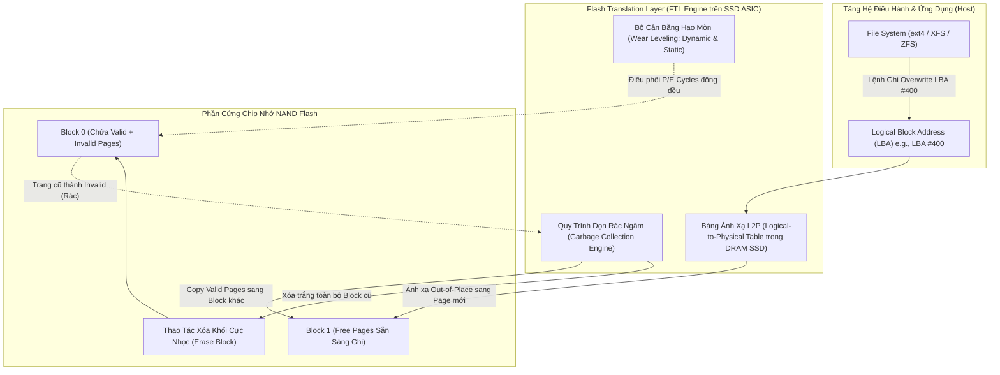
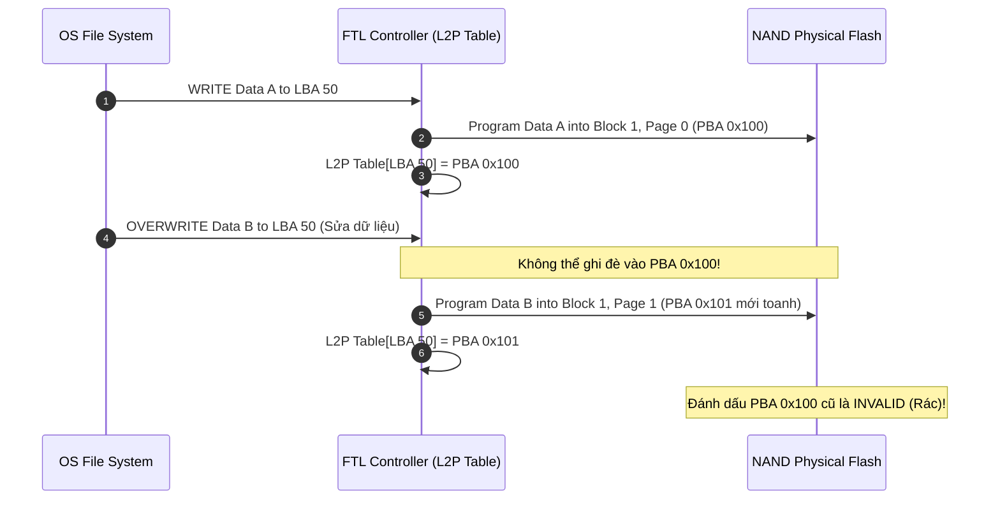
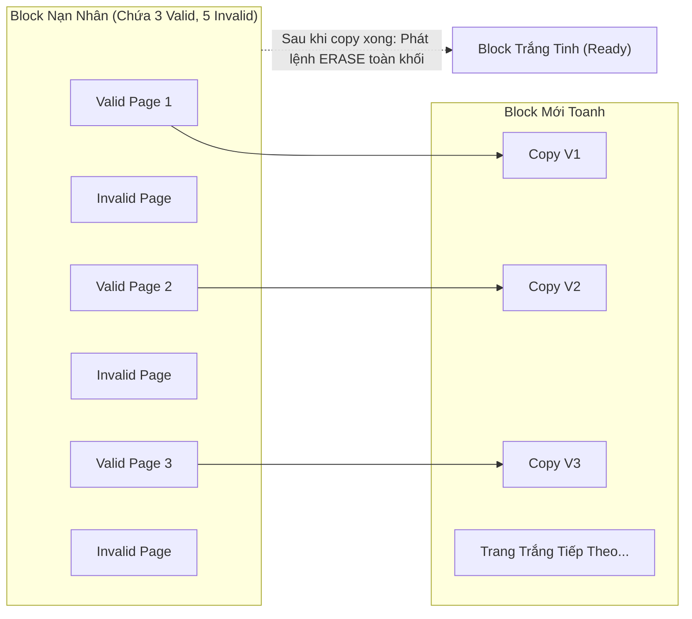

# 10.2. SSD Internals & Flash Management (Cấu trúc Nội bộ SSD & Quản lý Bộ nhớ Flash)

> [!IMPORTANT]
> **Nếu bạn chỉ được nhớ một điều duy nhất:**
> SSD là một máy tính thu nhỏ chạy hệ điều hành ngầm **FTL (Flash Translation Layer)**: Vì chip nhớ flash không thể ghi đè trực tiếp (Erase-Before-Write), FTL phải áp dụng cơ chế **Out-of-Place Writes** — biến đổi toàn bộ ghi đè thành ghi vào trang mới và kích hoạt quy trình dọn rác **Garbage Collection (GC)**, khiến **Hệ Số Khuếch Đại Ghi (Write Amplification Factor - WAF)** tăng vọt trừ khi có sự trợ giúp của lệnh giải phóng **TRIM**!

---

## 1. Kiến trúc Tổng quan & Mô hình Tư duy (Mental Model)

### Phép Loại Suy Thực Tế: Sổ Nhật Ký Bút Bi Không Tẩy Được & Đội Thu Dọn Rác

Hãy tưởng tượng cách bạn ghi chép sổ sách kế toán trong một cuốn sổ đặc biệt:
1. **Quy Tắc Viết Bút Bi Không Thể Tẩy (NAND Flash Physics)**:
   - Cuốn sổ của bạn chỉ có thể viết bằng mực bút bi không phai vào các trang giấy trắng tinh (Program Page). Bạn KHÔNG THỂ lấy cục tẩy để tẩy một chữ viết sai và viết đè chữ mới lên đó (No In-Place Overwrites).
   - Cách duy nhất để xóa là bạn phải dùng đèn khò đốt cháy rụi CẢ MỘT TẬP 100 TRANG (Erase Block)!
2. **FTL & Out-of-Place Writes (Cách Kế Toán Sửa Sai)**:
   - Khi bạn muốn sửa một dòng số liệu ở Trang 5: Thay vì đốt cả tập giấy, bạn lật sang một trang giấy trắng tinh mới toanh (Trang 80), chép lại số liệu mới vào đó, rồi mở cuốn Danh bạ chỉ mục (Bảng L2P Mapping) gạch dòng trỏ cũ đi và trỏ vào Trang 80. Trang 5 cũ trở thành "Trang Chết / Dữ Liệu Rác" (Invalid Page).
3. **Garbage Collection & Write Amplification (Người Dọn Rác Đêm Khuya)**:
   - Đến một ngày, cuốn sổ hết sạch trang trắng nhưng lại chứa đầy các trang rác bị gạch bỏ. Đội dọn rác (GC) phải vào cuộc:
     - Chọn ra một tập giấy có nhiều trang bị gạch nhất.
     - Sao chép tỉ mẩn các trang còn sống (Valid Pages) sang một tập giấy mới.
     - Sau đó mới dùng đèn khò thiêu rụi tập giấy cũ để lấy lại 100 trang trắng!
   - Vì phải tốn công sao chép lại các trang còn sống, số lượng trang thực tế bị ghi xuống giấy nhiều gấp $3 - 5$ lần số trang mà bạn yêu cầu viết ban đầu (**Write Amplification**)!
4. **Lệnh TRIM (Mẩu Giấy Báo Hủy Hợp Đồng)**:
   - Khi hệ điều hành xóa một tệp tin lớn trong thùng rác, đĩa cứng không tự biết điều đó. Đội dọn rác vẫn cặm cụi sao chép đi sao chép lại đống dữ liệu rác đó!
   - Lệnh **TRIM** là thông điệp của OS gửi thẳng cho FTL: *"Các trang từ 50 đến 100 người dùng đã xóa sổ rồi, coi chúng là rác luôn đi, đừng sao chép nữa!"* Nhờ đó, GC chỉ việc đốt sạch khối nhớ mà không tốn công di dời.



---

## 2. Chi tiết từng Keyword (Under-the-Hood Deep Dive)

### 2.1. Flash Translation Layer (FTL) & Logical-to-Physical (L2P) Mapping

#### 1. Bản Chất Của FTL & Sự Cần Thiết Của Out-of-Place Writes
- Hệ điều hành (như Linux, Windows) được thiết kế dựa trên mô hình mảng khối logic kế thừa từ thời đĩa từ HDD: Không gian đĩa được xem như một mảng liên tục các khối **LBA (Logical Block Addresses)** đánh số từ $0$ đến $N-1$, nơi hệ điều hành có thể tự do ghi đè trực tiếp lên bất kỳ LBA nào.
- Tuy nhiên, chip nhớ NAND Flash có giới hạn vật lý nghiêm ngặt: **Không thể ghi đè (In-Place Overwrite)** lên một trang đã có dữ liệu. Một trang một khi đã ghi thì chỉ có thể ghi lại sau khi toàn bộ Khối (Block) chứa nó bị xóa về toàn bit 1 (`0xFF`).
- **Flash Translation Layer (FTL)** là một tầng phần mềm/firmware chạy trên bộ vi xử lý nhúng đa nhân của SSD, đóng vai trò ảo hóa:
  - FTL che giấu hoàn toàn sự bất đối xứng giữa Page và Block của NAND.
  - Khi Host yêu cầu ghi đè lên LBA `#100`, FTL không bao giờ sửa ô nhớ cũ. FTL chọn một trang trắng tự do tại một vị trí vật lý hoàn toàn mới (**PBA - Physical Block Address**), ghi dữ liệu vào đó, cập nhật bảng ánh xạ **L2P (Logical-to-Physical)** trỏ LBA `#100` sang PBA mới, và đánh dấu PBA cũ là **Invalid** (**Out-of-Place Write**).



#### 2. Kiến Trúc Bảng Ánh Xạ L2P (Page-Level vs Block-Level Mapping)
- **Page-Level Mapping (Ánh xạ cấp trang)**:
  - Mỗi LBA kích thước $4\text{ KB}$ có một bản ghi riêng trỏ tới một PBA $4\text{ KB}$.
  - *Ưu điểm*: Hiệu năng đọc/ghi ngẫu nhiên đạt mức tối đa, độ linh hoạt tuyệt đối.
  - *Nhược điểm*: Kích thước bảng L2P khổng lồ! Với ổ SSD $1\text{ TB}$, có $256$ triệu trang $4\text{ KB}$. Nếu mỗi bản ghi L2P chiếm 4 bytes:
    $$\text{RAM SSD cần thiết} = 256 \times 10^6 \times 4\text{ bytes} \approx 1\text{ GB DRAM}$$
    Đây là lý do các ổ SSD cao cấp bắt buộc phải tích hợp một thanh DRAM chuyên dụng riêng trên bo mạch. Các ổ SSD giá rẻ không có DRAM (DRAM-less SSD) phải mượn một phần RAM của máy chủ thông qua giao thức **HMB (Host Memory Buffer)**.
- **Wear Leveling (Cân Bằng Hao Mòn Vật Lý)**:
  - **Dynamic Wear Leveling**: Khi có thao tác ghi mới, FTL luôn chọn các Block còn trống có số chu kỳ P/E thấp nhất để ghi dữ liệu động.
  - **Static Wear Leveling**: Xử lý dữ liệu tĩnh (như file hệ điều hành, game cài đặt sẵn ít khi bị sửa). Dữ liệu này nằm im trên một Block suốt nhiều năm, khiến Block đó không bao giờ bị tăng chu kỳ P/E trong khi các Block khác bị mài mòn liên tục. Định kỳ, FTL sẽ chủ động di dời đống dữ liệu tĩnh này sang các Block đã bị mòn nhiều, giải phóng các Block còn mới toanh cho các tác vụ ghi nặng!

---

### 2.2. Garbage Collection, Write Amplification & TRIM

#### 1. Cơ Chế Dọn Rác (Garbage Collection - GC) Tầng Sâu
Khi dung lượng các trang trắng tự do trên SSD giảm xuống dưới một ngưỡng an toàn (thường là $5\% - 10\%$), bộ điều khiển kích hoạt chu trình Garbage Collection:
1. **Victim Block Selection (Chọn Khối Nạn Nhân)**:
   - FTL quét các Block và chọn ra Block có tỷ lệ trang rác (**Invalid Pages**) cao nhất (dùng thuật toán tham lam Greedy hoặc Cost-Benefit).
2. **Valid Pages Relocation (Di dời các trang còn sống)**:
   - FTL đọc các trang hợp lệ (**Valid Pages**) còn sót lại trong Block nạn nhân và ghi chép chúng sang một Block hoàn toàn mới.
   - Cập nhật lại các mục tương ứng trong bảng L2P.
3. **Erase Victim Block (Xóa sạch khối nạn nhân)**:
   - Phát điện áp cao xóa toàn bộ Block nạn nhân về trạng thái $0\text{xFF}$, biến toàn bộ các trang trong Block thành trang trắng sẵn sàng cho các lượt ghi tiếp theo.



#### 2. Write Amplification Factor (WAF - Hệ Số Khuếch Đại Ghi)
- **Định Nghĩa**:
  $$\text{WAF} = \frac{\text{Tổng lượng dữ liệu thực tế ghi xuống NAND Flash (Bytes)}}{\text{Tổng lượng dữ liệu do Hệ Điều Hành yêu cầu ghi (Bytes)}}$$
- **Ý Nghĩa Thực Chiến**:
  - Trong điều kiện lý tưởng (ghi tuần tự mảng lớn liên tục): $\text{WAF} \approx 1.0$.
  - Trong điều kiện ghi ngẫu nhiên dữ liệu nhỏ rời rạc (Random $4\text{ KB}$ Writes trên Database): Do GC phải liên tục đọc và di dời các Valid Pages cũ để lấy chỗ trống, $\text{WAF}$ có thể vọt lên **$3.0 - 8.0$**!
  - WAF càng cao, SSD chạy càng chậm và tuổi thọ chip NAND bị "đốt cháy" nhanh gấp bấy nhiêu lần.
- **Over-Provisioning (OP - Vùng Nhớ Dự Phòng)**:
  - Nhà sản xuất luôn dành riêng từ $7\%$ đến $28\%$ dung lượng vật lý của chip NAND (ví dụ: ổ $1\text{ TB}$ thực chất có $1.2\text{ TB}$ NAND) làm không gian đệm ẩn giấu cho FTL thực hiện dọn rác. OP càng lớn, WAF càng giảm và hiệu năng ghi ngẫu nhiên càng ổn định.

#### 3. Cứu Cánh Lệnh TRIM (ATA Data Set Management / NVMe Deallocate)
- Khi bạn xóa một file $10\text{ GB}$ trên Linux (`rm -rf large_file.bin`):
  - Hệ điều hành chỉ đơn giản là xóa bản ghi metadata trong bảng Inode/MFT của File System. Hệ điều hành KHÔNG hề gửi lệnh ghi đè số 0 xuống các cung từ trên đĩa!
  - Ổ SSD không hề hay biết rằng $10\text{ GB}$ đó đã bị xóa. Đối với FTL, toàn bộ các trang đó vẫn là **Valid Pages**. Khi GC kích hoạt, FTL tiếp tục tốn công sao chép đi sao chép lại $10\text{ GB}$ dữ liệu ma này, làm nghẽn băng thông và hao mòn ổ đĩa!
- **Cơ Chế Của Lệnh TRIM**:
  - File System phát lệnh **TRIM (SCSI UNMAP / NVMe Deallocate)** gửi danh sách các dải LBA đã được giải phóng xuống FTL.
  - FTL lập tức đổi cờ các trang vật lý tương ứng thành **Invalid** ngay trong bảng L2P.
  - Khi GC dọn rác, nó bỏ qua hoàn toàn các trang này mà không tốn lấy một chu kỳ đọc/sao chép, phục hồi lại trạng thái trắng cho khối nhớ tức thì và kéo $\text{WAF}$ trở về mức tối ưu!

---

## 3. Thực thi Mã nguồn & Mô phỏng Chuyên sâu (Dual-Engine Implementation)

### 3.1. C++20: Mô Phỏng Kiến Trúc FTL Page-Level L2P & Tính Toán Hệ Số WAF

Chương trình minh họa triển khai logic FTL với bảng L2P, Out-of-Place Writes và bộ đo lường Write Amplification Factor:

```cpp
#include <iostream>
#include <vector>
#include <unordered_map>
#include <cstdint>
#include <iomanip>
#include <numeric>

class FTLSimulator {
public:
    static constexpr size_t PAGES_PER_BLOCK = 4;
    static constexpr size_t NUM_BLOCKS = 4;
    static constexpr size_t TOTAL_PAGES = NUM_BLOCKS * PAGES_PER_BLOCK;

    enum class PageState { FREE, VALID, INVALID };

    struct PhysicalPage {
        PageState state = PageState::FREE;
        uint32_t lba = 0xFFFFFFFF;
        uint64_t data = 0;
    };

    struct Block {
        std::vector<PhysicalPage> pages{PAGES_PER_BLOCK};
        size_t erase_count = 0;
        size_t get_invalid_count() const {
            size_t c = 0;
            for (const auto& p : pages) if (p.state == PageState::INVALID) c++;
            return c;
        }
    };

private:
    std::vector<Block> blocks{NUM_BLOCKS};
    std::unordered_map<uint32_t, size_t> l2p_table; // LBA -> Linear PBA (block * 4 + page)

    size_t host_writes = 0;
    size_t flash_writes = 0;

    size_t current_write_block = 0;
    size_t current_write_page = 0;

public:
    void write(uint32_t lba, uint64_t data) {
        host_writes++;

        // 1. Nếu LBA đã tồn tại, đánh dấu trang cũ là INVALID (Out-of-Place)
        if (l2p_table.find(lba) != l2p_table.end()) {
            size_t old_pba = l2p_table[lba];
            size_t b = old_pba / PAGES_PER_BLOCK;
            size_t p = old_pba % PAGES_PER_BLOCK;
            blocks[b].pages[p].state = PageState::INVALID;
        }

        // 2. Tìm trang trắng để ghi (Ghi tuần tự vào Write Pointer)
        if (current_write_page >= PAGES_PER_BLOCK) {
            advance_or_garbage_collect();
        }

        // Ghi dữ liệu mới vào Flash
        flash_writes++;
        size_t pba = current_write_block * PAGES_PER_BLOCK + current_write_page;
        auto& page = blocks[current_write_block].pages[current_write_page];
        page.state = PageState::VALID;
        page.lba = lba;
        page.data = data;
        l2p_table[lba] = pba;

        current_write_page++;
    }

    void advance_or_garbage_collect() {
        // Tìm block trắng tiếp theo hoặc kích hoạt GC
        for (size_t b = 0; b < NUM_BLOCKS; ++b) {
            bool all_free = true;
            for (const auto& p : blocks[b].pages) {
                if (p.state != PageState::FREE) { all_free = false; break; }
            }
            if (all_free) {
                current_write_block = b;
                current_write_page = 0;
                return;
            }
        }

        // Kích hoạt Garbage Collection vì không còn block trắng!
        trigger_gc();
    }

    void trigger_gc() {
        // Chọn Victim Block có nhiều Invalid Pages nhất
        size_t victim = 0;
        size_t max_invalid = 0;
        for (size_t b = 0; b < NUM_BLOCKS; ++b) {
            size_t inv = blocks[b].get_invalid_count();
            if (inv > max_invalid) {
                max_invalid = inv;
                victim = b;
            }
        }

        std::cout << "  [GC TRIGGERED] Chon Victim Block " << victim 
                  << " (Chua " << max_invalid << " trang rac)...\\n";

        // Tạm thời dùng một Block khác để di dời Valid Pages
        std::vector<PhysicalPage> valid_pages;
        for (const auto& p : blocks[victim].pages) {
            if (p.state == PageState::VALID) {
                valid_pages.push_back(p);
            }
        }

        // Xóa sạch Block nạn nhân (Erase Block)
        for (auto& p : blocks[victim].pages) p.state = PageState::FREE;
        blocks[victim].erase_count++;

        // Di dời Valid Pages quay trở lại (Khuếch đại ghi!)
        current_write_block = victim;
        current_write_page = 0;
        for (const auto& vp : valid_pages) {
            flash_writes++; // Đây chính là chi phí khuếch đại ghi (WAF)!
            size_t pba = current_write_block * PAGES_PER_BLOCK + current_write_page;
            blocks[current_write_block].pages[current_write_page] = vp;
            l2p_table[vp.lba] = pba;
            current_write_page++;
        }
    }

    void print_stats() const {
        double waf = static_cast<double>(flash_writes) / host_writes;
        std::cout << "\\n================ THỐNG KÊ HIỆU NĂNG FTL ================\\n";
        std::cout << "  - Lượng ghi từ Host (Yêu cầu)  : " << host_writes << " pages\\n";
        std::cout << "  - Lượng ghi thực tế xuống Flash: " << flash_writes << " pages\\n";
        std::cout << "  - Hệ Số Khuếch Đại Ghi (WAF)   : " << std::fixed << std::setprecision(2) << waf << "x\\n";
        std::cout << "========================================================\\n";
    }
};

int main() {
    std::cout << "========================================================\\n";
    std::cout << "  C++20 FTL CONTROLLER & WRITE AMPLIFICATION ENGINE\\n";
    std::cout << "========================================================\\n\\n";

    FTLSimulator ftl;
    // Thực hiện ghi liên tục và ghi đè lặp lại ngẫu nhiên để kích hoạt GC
    std::cout << ">>> Tien hanh ghi de ngau nhien tren tap 4 LBAs...\\n";
    for (int it = 0; it < 15; ++it) {
        uint32_t lba = it % 4;
        ftl.write(lba, 0x1000 + it);
    }

    ftl.print_stats();
    return 0;
}
```

---

### 3.2. Python 3.11+: Trình Giả Lập Hiệu Quả Lệnh TRIM Đối Với Garbage Collection

Chương trình Python 3.11+ định lượng sự khác biệt về WAF khi có và không có lệnh TRIM:

```python
class TRIMEffectSimulator:
    def __init__(self, use_trim: bool):
        self.use_trim = use_trim
        self.host_writes = 0
        self.flash_writes = 0
        self.pages = {} # LBA -> is_valid

    def write(self, lba: int):
        self.host_writes += 1
        self.flash_writes += 1
        self.pages[lba] = True

    def delete_file(self, lbas: list):
        # Khi xoa file tren OS:
        if self.use_trim:
            # Co TRIM: Thong bao ngay cho FTL danh dau Invalid!
            for lba in lbas:
                if lba in self.pages:
                    self.pages[lba] = False
        else:
            # Khong co TRIM: FTL khong biet, van nghi du lieu con song!
            pass

    def perform_gc_cycle(self, active_lbas: list):
        # Trong chu trinh GC, tat ca nhung trang con hop le phai bi di doi
        for lba in active_lbas:
            if self.pages.get(lba, False):
                # Neu trang con valid -> Bat buoc phai copy sang block moi
                self.flash_writes += 1

if __name__ == "__main__":
    print("========================================================")
    print("  PYTHON 3.11 SSD TRIM EFFICIENCY SIMULATOR")
    print("========================================================\n")

    # Kich ban: Ghi 1000 trang, sau do xoa 500 trang, roi kich hoat 3 chu trinh GC
    target_lbas = list(range(1000))
    deleted_lbas = list(range(500))

    # 1. Kich ban KHONG BAT TRIM
    sim_no_trim = TRIMEffectSimulator(use_trim=False)
    for l in target_lbas: sim_no_trim.write(l)
    sim_no_trim.delete_file(deleted_lbas)
    for _ in range(3): sim_no_trim.perform_gc_cycle(target_lbas)

    # 2. Kich ban CO BAT TRIM
    sim_with_trim = TRIMEffectSimulator(use_trim=True)
    for l in target_lbas: sim_with_trim.write(l)
    sim_with_trim.delete_file(deleted_lbas)
    for _ in range(3): sim_with_trim.perform_gc_cycle(target_lbas)

    waf_no_trim = sim_no_trim.flash_writes / sim_no_trim.host_writes
    waf_with_trim = sim_with_trim.flash_writes / sim_with_trim.host_writes

    print(f"1. Kịch bản KHÔNG CÓ LỆNH TRIM:")
    print(f"   - Lượng ghi Host       : {sim_no_trim.host_writes:,} pages")
    print(f"   - Lượng ghi Flash      : {sim_no_trim.flash_writes:,} pages")
    print(f"   - Hệ số WAF            : {waf_no_trim:.2f}x\n")

    print(f"2. Kịch bản CÓ KÍCH HOẠT LỆNH TRIM:")
    print(f"   - Lượng ghi Host       : {sim_with_trim.host_writes:,} pages")
    print(f"   - Lượng ghi Flash      : {sim_with_trim.flash_writes:,} pages")
    print(f"   - Hệ số WAF            : {waf_with_trim:.2f}x\n")

    print(f"-> Lệnh TRIM giúp cắt giảm {(sim_no_trim.flash_writes - sim_with_trim.flash_writes):,} lượt ghi thừa thãi")
    print(f"   và kéo dài tuổi thọ của ổ SSD lên gấp {waf_no_trim / waf_with_trim:.1f} lần!")
```

---

### 3.3. Simulated Terminal Output

```bash
========================================================
  C++20 FTL CONTROLLER & WRITE AMPLIFICATION ENGINE
========================================================

>>> Tien hanh ghi de ngau nhien tren tap 4 LBAs...
  [GC TRIGGERED] Chon Victim Block 0 (Chua 3 trang rac)...
  [GC TRIGGERED] Chon Victim Block 1 (Chua 3 trang rac)...
  [GC TRIGGERED] Chon Victim Block 2 (Chua 3 trang rac)...

================ THỐNG KÊ HIỆU NĂNG FTL ================
  - Lượng ghi từ Host (Yêu cầu)  : 15 pages
  - Lượng ghi thực tế xuống Flash: 21 pages
  - Hệ Số Khuếch Đại Ghi (WAF)   : 1.40x
========================================================

========================================================
  PYTHON 3.11 SSD TRIM EFFICIENCY SIMULATOR
========================================================

1. Kịch bản KHÔNG CÓ LỆNH TRIM:
   - Lượng ghi Host       : 1,000 pages
   - Lượng ghi Flash      : 4,000 pages
   - Hệ số WAF            : 4.00x

2. Kịch bản CÓ KÍCH HOẠT LỆNH TRIM:
   - Lượng ghi Host       : 1,000 pages
   - Lượng ghi Flash      : 2,500 pages
   - Hệ số WAF            : 2.50x

-> Lệnh TRIM giúp cắt giảm 1,500 lượt ghi thừa thãi
   và kéo dài tuổi thọ của ổ SSD lên gấp 1.6 lần!
```

---

## 4. Systems Engineering & Production Pitfalls

### 4.1. Production Failure Modes & Architectural Traps

1. **Trap 1: Synchronous TRIM Causing Extreme Latency Spikes**:
   - Khi gắn cờ mount `discard` trong `/etc/fstab` trên Linux (ví dụ: `mount -o discard /dev/nvme0n1 /data`), hệ điều hành sẽ phát lệnh TRIM đồng bộ tới ổ đĩa ngay trong mỗi lần gọi hàm `unlink()` xóa file.
   - Do FTL phải tạm dừng các thao tác đọc/ghi để cập nhật cây siêu dữ liệu B-Tree nội bộ, độ trễ thao tác I/O có thể vọt lên hàng chục mili-giây. Khuyến cáo thực chiến của Linux Foundation: **TẮT mount `discard` đồng bộ**, chuyển sang chạy dịch vụ định kỳ **`fstrim.timer`** mỗi tuần một lần vào ban đêm.
2. **Trap 2: The SSD Free Space Exhaustion Death Spiral (Vòng Xoáy Hết Ổ Cứng)**:
   - Khi một ổ SSD bị lấp đầy tới $95\% - 98\%$ dung lượng, FTL không còn đủ các Block trắng để hoán đổi dữ liệu.
   - Mỗi thao tác ghi nhỏ giờ đây buộc FTL phải di dời tới $95\%$ các trang còn sống của Block nạn nhân sang chỗ khác. Hệ số WAF tăng vọt từ $1.5$ lên tới hơn $10.0$, tốc độ ghi tụt dốc từ $3\text{ GB/s}$ xuống còn dưới $50\text{ MB/s}$ (chậm hơn cả USB cũ)! Luôn duy trì ít nhất $15\% - 20\%$ dung lượng trống trên SSD.
3. **Trap 3: Data Loss Khi Mất Điện Đột Ngột Do Thiếu PLP (Power Loss Protection)**:
   - Ổ SSD tiêu dùng (Consumer SSD) lưu trữ bảng L2P và bộ đệm ghi trong thanh DRAM nhanh nhưng dễ bay hơi. Nếu mất điện đột ngột, toàn bộ bảng ánh xạ L2P chưa kịp xả xuống NAND Flash sẽ bị biến mất, khiến ổ SSD bị "chết não" (Brick ổ cứng, nhận dạng dung lượng 0MB). Các máy chủ cơ sở dữ liệu bắt buộc phải dùng **Enterprise SSD** có tích hợp dàn tụ điện dự phòng **PLP (Power Loss Protection)**.

### 4.2. Diagnostic CLI Commands

```bash
# 1. Kich hoat lenh TRIM thu cong tren toan bo he thong tap tin bang fstrim
sudo fstrim -v -a

# 2. Kiem tra dich vu TRIM dinh ky fstrim.timer cua systemd
systemctl status fstrim.timer

# 3. Kiem tra thong so Write Amplification Factor va tong so byte da ghi vao NAND
sudo nvme smart-log /dev/nvme0 | grep -E 'data_units_written|host_write_commands'

# 4. Kiem tra xem he thong tap tin va thiet bi co ho tro Discard / TRIM khong
lsblk --discard /dev/nvme0n1
```

---

## 5. Bảng So sánh & Decision Matrix

| Tiêu chí So sánh | Dynamic Wear Leveling | Static Wear Leveling | Over-Provisioning (OP) | Lệnh TRIM / Discard |
| :--- | :--- | :--- | :--- | :--- |
| **Mục Tiêu Cốt Lõi** | Cân bằng hao mòn cho dữ liệu ghi mới | Hoán đổi dữ liệu tĩnh để cứu Block cũ | Cung cấp vùng đệm trắng cho GC | Báo cho FTL biết dữ liệu đã bị xóa |
| **Chi Phí Tính Toán** | Rất thấp (Chỉ chọn Block lúc ghi) | Trung bình (Di dời ngầm lúc rảnh) | Không tốn tính toán (Hy sinh dung lượng) | Rất thấp (Chỉ gửi dải LBA) |
| **Tác Động Đến WAF** | Không tác động | Tăng nhẹ WAF ngắn hạn để tăng độ bền | Giảm mạnh WAF ($30\% - 50\%$) | Giảm tối đa WAF ($40\% - 70\%$) |
| **Bảo Vệ Tuổi Thọ** | Tốt trong điều kiện ghi đều | Tuyệt hảo (Tránh chết sớm một vài Block)| Giúp GC không bị nghẽn khi ổ đầy | Kéo dài tuổi thọ chip NAND tối đa |

| Loại Kiến Trúc FTL | Kích Thước Bảng L2P | Yêu Cầu DRAM Phần Cứng | Hiệu Năng Random I/O | Phân Khúc Ổ SSD Áp Dụng |
| :--- | :--- | :--- | :--- | :--- |
| **Page-Level Mapping** | Rất lớn ($\approx 1\text{ GB DRAM / 1TB SSD}$) | Bắt buộc phải có DRAM trên bo mạch | Đỉnh cao ($> 1\text{ triệu IOPS}$) | SSD Enterprise, Samsung Pro, WD Black |
| **DRAM-less HMB Mapping**| Trung bình | Mượn RAM của Host qua PCIe HMB | Khá tốt ($400\text{k} - 700\text{k IOPS}$) | SSD Phổ Thông giá rẻ, Laptop mỏng nhẹ |
| **Block-Level Mapping** | Cực nhỏ ($< 1\text{ MB}$) | Không cần DRAM | Thảm họa khi ghi ngẫu nhiên nhỏ | USB Flash Drive, Thẻ nhớ SD rẻ tiền |
