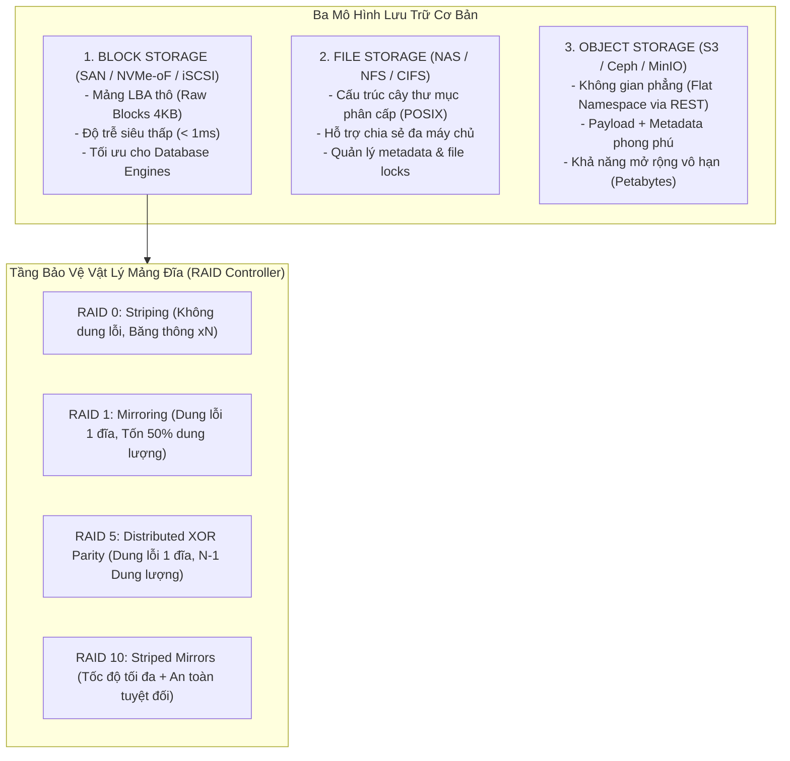
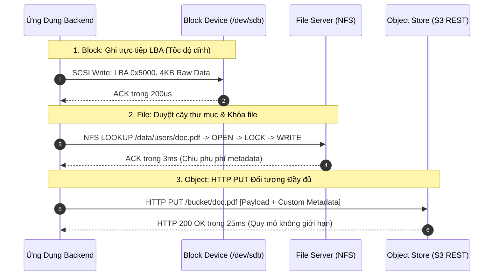
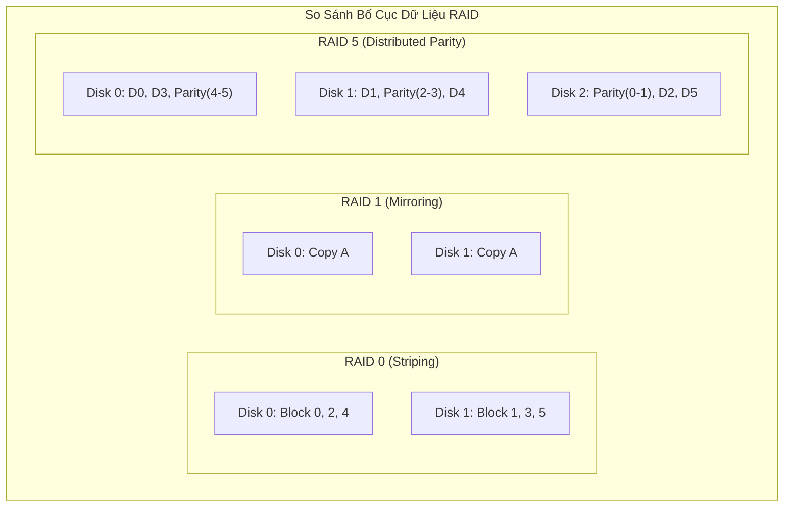

# 10.3. Storage Paradigms & RAID Architecture (Mô hình Lưu trữ & Kiến trúc Mảng Đĩa RAID)

> [!IMPORTANT]
> **Nếu bạn chỉ được nhớ một điều duy nhất:**
> Không có một phương thức lưu trữ vạn năng: **Block Storage (SAN)** mang lại độ trễ siêu thấp cho cơ sở dữ liệu cốt lõi; **File Storage (NAS)** bảo tồn tính tương thích thư mục POSIX dùng chung; **Object Storage (S3)** mở rộng vô tận qua REST API không gian phẳng; trong khi **Mảng Đĩa RAID** bảo vệ sự sống còn của dữ liệu vật lý thông qua phép toán số học bù trừ chẵn lẻ **XOR Parity** (RAID 5) và nhân đôi phản chiếu (RAID 10).

---

## 1. Kiến trúc Tổng quan & Mô hình Tư duy (Mental Model)

### Phép Loại Suy Thực Tế: Từ Ngăn Kéo Khỏa Thân Đến Tủ Hồ Sơ & Kho Hàng Container

Để nắm bắt sự khác biệt giữa 3 mô hình lưu trữ và cơ chế bảo vệ RAID:
1. **Block Storage (Ngăn Kéo Khỏa Thân Đánh Số)**:
   - Hãy hình dung một bức tường chứa hàng triệu ngăn kéo kim loại nhỏ giống hệt nhau, được đánh số từ $0$ đến $N-1$ (LBA). Trong ngăn kéo không có nhãn mác, không có tên file, chỉ chứa các mẩu byte nhị phân thô sơ.
   - Bạn muốn quản lý ngăn kéo thế nào là quyền của bạn (Cài đặt File System ext4, XFS hoặc để CSDL Oracle/Postgres tự ghi trực tiếp). Tốc độ nhanh nhất, độ trễ nhỏ nhất.
2. **File Storage (Tủ Hồ Sơ Văn Phòng Truyền Thống)**:
   - Bạn lưu trữ tài liệu theo cấu trúc hình cây phân cấp quen thuộc: `Công Ty / Phòng Nhân Sự / Hợp Đồng / NguyenVanA.pdf`.
   - Mỗi file có quyền sở hữu (chmod), thời gian sửa đổi (mtime) và kích thước. Nhiều nhân viên văn phòng có thể cùng mở tủ xem chung tài liệu qua mạng (NFS/SMB), nhưng khi tủ hồ sơ phình to lên hàng triệu tệp, việc tìm kiếm và khóa file (Locking) làm tốc độ bị nghẽn lại.
3. **Object Storage (Bãi Giữ Xe Container Toàn Cầu)**:
   - Không có ngăn kéo, không có thư mục con lồng nhau! Mọi thứ được gói vào một chiếc container (Object) gồm: Dữ liệu (Payload) + Mã định danh duy nhất (UUID / Key) + Thẻ thông tin tùy biến không giới hạn (Metadata).
   - Khi cần lấy hàng, bạn chỉ đưa mã vé xe qua cổng kiểm soát API (HTTP GET/PUT). Bãi giữ xe có thể mở rộng tới hàng tỷ container đặt rải rác trên toàn hành tinh mà không bao giờ bị giới hạn dung lượng!
4. **RAID Architecture (Đội Xe Tải Chở Hàng Đối Xứng)**:
   - **RAID 0 (Chạy Hai Xe Song Song)**: Bạn chia đôi kiện hàng, mỗi xe chở một nửa. Tốc độ giao hàng tăng gấp đôi, nhưng chỉ cần 1 xe nổ lốp là toàn bộ hàng hóa bị phá hủy hoàn toàn!
   - **RAID 1 (Một Xe Chạy, Một Xe Đi Kèm Sao Chép)**: Hai xe chở hai bản sao giống hệt nhau. Một xe cháy rụi, xe kia vẫn an toàn tới đích, nhưng chi phí đắt gấp đôi.
   - **RAID 5 (Phép Toán Kỳ Diệu Của Tấm Thẻ Kiểm Chứng XOR)**: 3 xe chở hàng thật, 1 xe chở tấm thẻ chẵn lẻ (Parity). Nếu bất kỳ xe nào lao xuống vực, bạn chỉ việc lấy dữ liệu của 2 xe còn lại thực hiện phép trừ số học XOR với tấm thẻ chẵn lẻ là khôi phục lại $100\%$ kiện hàng bị mất!



---

## 2. Chi tiết từng Keyword (Under-the-Hood Deep Dive)

### 2.1. Block Storage vs File Storage vs Object Storage

#### 1. Phân Tích Kỹ Thuật Chuyên Sâu Từng Mô Hình
- **Block Storage (Lưu Trữ Khối)**:
  - Giao thức tầng thấp: **Fibre Channel (FC)**, **iSCSI**, **NVMe-oF (NVMe over Fabrics)**.
  - Máy chủ nhận diện thiết bị như một ổ đĩa cục bộ thông thường (ví dụ: `/dev/sdb`).
  - Hệ điều hành trực tiếp phát các lệnh SCSI/NVMe đọc/ghi các cung từ LBA thô. Không có khái niệm file, folder, hay metadata ở tầng này.
  - *Hiệu năng*: Băng thông tối đa, độ trễ sub-millisecond, hoàn hảo cho các hệ quản trị CSDL đòi hỏi ghi ngẫu nhiên (MySQL InnoDB, Oracle, MongoDB).
- **File Storage (Lưu Trữ Tệp Tin)**:
  - Giao thức mạng: **NFS v4 (Linux)**, **SMB/CIFS (Windows)**.
  - Thiết bị NAS (Network Attached Storage) tự quản lý File System nội bộ của nó. Máy chủ khách chỉ kết nối thông qua giao diện mạng POSIX API (`open()`, `read()`, `write()`, `close()`).
  - Điểm nghẽn: Cơ chế khóa tệp (**File Locking - `fcntl`**) và tra cứu cây thư mục (Directory Traversal) tạo ra độ trễ mạng lớn và giới hạn khả năng mở rộng quy mô đồng thời.
- **Object Storage (Lưu Trữ Đối Tượng)**:
  - Giao thức ứng dụng: **HTTP RESTful API (GET, PUT, DELETE, HEAD)**.
  - Toàn bộ dữ liệu là **Immutable (Bất biến)**: Bạn không thể sửa 1 byte ở giữa đối tượng; muốn sửa, bạn phải upload lại toàn bộ đối tượng mới đè lên.
  - Khả năng đính kèm **Custom Metadata** (ví dụ: gán nhãn `customer_id: 12345`, `retention: 7_years`) trực tiếp vào đối tượng.
  - Hệ thống sử dụng thuật toán băm phân tán (**Consistent Hashing**) hoặc bảng định vị trung tâm để phân tán hàng tỷ đối tượng trên hàng nghìn máy chủ lưu trữ rẻ tiền mà không bao giờ gặp điểm nghẽn cây thư mục.



---

### 2.2. RAID Architectures: 0, 1, 5, 6, 10 & Hardware Controllers

#### 1. Nguyên Lý Toán Học & Bố Cục Dữ Liệu Các Chuẩn RAID
- **RAID 0 (Block Striping - Phân Vùng Khối Đan Xen)**:
  - Dữ liệu được băm nhỏ thành các khối dải (**Stripe Units**, thường $64\text{ KB} - 256\text{ KB}$) và ghi xen kẽ đồng thời trên $N$ đĩa.
  - *Dung lượng sử dụng*: $100\%$ ($N \times \text{Capacity}$).
  - *Khả năng chịu lỗi*: $0$ đĩa (Chết 1 đĩa là mất sạch toàn bộ mảng dữ liệu!).
- **RAID 1 (Mirroring - Nhân Đôi Phản Chiếu)**:
  - Dữ liệu được ghi đồng thời thành hai bản sao hoàn chỉnh trên 2 đĩa.
  - *Dung lượng sử dụng*: $50\%$.
  - *Khả năng chịu lỗi*: Sống sót khi 1 trong 2 đĩa bị hỏng.
- **RAID 5 (Distributed Parity - Phân Bổ Bit Chẵn Lẻ Bằng Phép Toán XOR)**:
  - Yêu cầu tối thiểu 3 đĩa. Dữ liệu được chia dải trên các đĩa, và khối chẵn lẻ (Parity Block $P$) được tính toán bằng phép toán số học XOR bit:
    $$P = D_0 \oplus D_1 \oplus D_2$$
  - Nếu đĩa $D_1$ bị hỏng vật lý, dữ liệu của nó được khôi phục nguyên vẹn bằng cách XOR các đĩa còn lại với $P$:
    $$D_1 = D_0 \oplus D_2 \oplus P$$
  - Khối Parity được luân chuyển phân tán đều trên tất cả các đĩa để tránh cổ chai nghẽn đĩa chẵn lẻ độc lập.
  - *Dung lượng sử dụng*: $(N - 1) \times \text{Capacity}$.
  - *Khả năng chịu lỗi*: Sống sót khi $1$ đĩa bất kỳ bị chết.
  - **Cơn Ác Mộng "Cực Hình Ghi" (The RAID 5 Write Penalty - 4x I/Os)**:
    - Để ghi đè 1 khối dữ liệu nhỏ ngẫu nhiên ($4\text{ KB}$), bộ điều khiển RAID 5 không thể chỉ ghi 1 lần. Nó bắt buộc phải thực hiện **4 thao tác I/O liên tiếp**:
      1. Đọc khối dữ liệu cũ ($D_{\text{old}}$).
      2. Đọc khối chẵn lẻ cũ ($P_{\text{old}}$).
      3. Tính toán chẵn lẻ mới: $P_{\text{new}} = (D_{\text{old}} \oplus D_{\text{new}}) \oplus P_{\text{old}}$.
      4. Ghi khối dữ liệu mới ($D_{\text{new}}$) VÀ ghi khối chẵn lẻ mới ($P_{\text{new}}$).
    - Hiệu năng ghi ngẫu nhiên của RAID 5 bị bóp nghẹt xuống chỉ còn $25\%$ so với lý thuyết!
- **RAID 6 (Dual Distributed Parity)**:
  - Yêu cầu tối thiểu 4 đĩa. Sử dụng hai thuật toán chẵn lẻ độc lập (XOR cho khối $P$ và mã sửa sai đại số **Reed-Solomon Galois Field $GF(2^8)$** cho khối $Q$).
  - *Khả năng chịu lỗi*: Sống sót an toàn khi **2 đĩa bị chết cùng lúc**. Write penalty tăng lên $6\times$ I/Os.
- **RAID 10 (RAID 1 + 0 - Mảng Sọc Của Các Cặp Đĩa Soi Gương)**:
  - Dữ liệu được Mirroring trước (RAID 1), sau đó các cặp Mirror được Striping (RAID 0).
  - *Dung lượng sử dụng*: $50\%$.
  - *Hiệu năng*: Tốc độ đỉnh cao, không bị phụ phí tính toán XOR, không có Write Penalty. Khả năng phục hồi cực nhanh, là tiêu chuẩn vàng cho các hệ thống CSDL lớn (Production OLTP).



#### 2. Hardware RAID Controller vs Software RAID (`mdadm`)
- **Hardware RAID Controller**:
  - Bo mạch PCIe chuyên dụng chứa chip xử lý XOR/Reed-Solomon ASIC, RAM bộ đệm riêng biệt ($2\text{ GB} - 8\text{ GB}$) và pin dự phòng **BBU (Battery Backup Unit)** hoặc bộ siêu tụ điện (Supercapacitor).
  - BBU cho phép bật chế độ ghi **Write-Back Caching**: Dữ liệu ghi vào RAM của card RAID được xác nhận thành công ngay lập tức ($0\text{ ms}$ trễ). Nếu mất điện, pin giữ nguồn nuôi RAM để xả dữ liệu xuống flash lúc khởi động lại.
- **Software RAID (Linux `mdadm` / ZFS)**:
  - Do Kernel Linux quản lý, tận dụng trực tiếp CPU của máy chủ để tính toán XOR. Với CPU hiện đại có tập lệnh vector AVX-512, Software RAID có thể tính toán Parity với tốc độ hàng chục Gigabytes/s mà không cần mua card phần cứng đắt đỏ.

---

## 3. Thực thi Mã nguồn & Mô phỏng Chuyên sâu (Dual-Engine Implementation)

### 3.1. C++20: Mô Phỏng Thuật Toán Tính Toán & Khôi Phục Dữ Liệu RAID 5 Bằng Phép Toán XOR

Chương trình minh họa toán học phân vùng khối RAID 5, sinh khối Parity chẵn lẻ và tái tạo chính xác dữ liệu của một đĩa bị hỏng:

```cpp
#include <iostream>
#include <vector>
#include <cstdint>
#include <iomanip>
#include <string>

class RAID5Engine {
public:
    static constexpr size_t BLOCK_SIZE = 16; // Kích thước khối mô phỏng 16 bytes

    struct DiskArray {
        std::vector<uint8_t> disk0;
        std::vector<uint8_t> disk1;
        std::vector<uint8_t> disk2_parity;
    };

    // Hàm tính toán khối Parity bằng XOR giữa Disk 0 và Disk 1
    static std::vector<uint8_t> calculate_xor_parity(const std::vector<uint8_t>& d0, const std::vector<uint8_t>& d1) {
        std::vector<uint8_t> parity(d0.size());
        for (size_t i = 0; i < d0.size(); ++i) {
            parity[i] = d0[i] ^ d1[i]; // Phép toán XOR nhị phân
        }
        return parity;
    }

    // Hàm phục hồi dữ liệu đĩa bị hỏng (Rebuild)
    static std::vector<uint8_t> reconstruct_lost_disk(const std::vector<uint8_t>& surviving_data,
                                                      const std::vector<uint8_t>& parity) {
        std::vector<uint8_t> recovered(surviving_data.size());
        for (size_t i = 0; i < surviving_data.size(); ++i) {
            recovered[i] = surviving_data[i] ^ parity[i];
        }
        return recovered;
    }
};

void print_hex(const std::string& label, const std::vector<uint8_t>& data) {
    std::cout << label << ": ";
    for (auto b : data) {
        std::cout << std::hex << std::setw(2) << std::setfill('0') << static_cast<int>(b) << " ";
    }
    std::cout << std::dec << "\n";
}

int main() {
    std::cout << "========================================================\n";
    std::cout << "  C++20 RAID 5 XOR PARITY COMPUTATION & RECOVERY\n";
    std::cout << "========================================================\n\n";

    // Khởi tạo dữ liệu trên 2 đĩa dữ liệu (16 bytes mỗi khối)
    std::vector<uint8_t> disk0 = {'H', 'E', 'L', 'L', 'O', '_', 'R', 'A', 'I', 'D', '_', '5', '_', 'S', 'Y', 'S'};
    std::vector<uint8_t> disk1 = {0x01, 0x02, 0x03, 0x04, 0x05, 0x06, 0x07, 0x08, 0x09, 0x0A, 0x0B, 0x0C, 0x0D, 0x0E, 0x0F, 0x10};

    // 1. Tính toán Parity
    std::vector<uint8_t> parity = RAID5Engine::calculate_xor_parity(disk0, disk1);

    std::cout << ">>> 1. Trạng Thái Hoạt Động Bình Thường (Healthy State):\n";
    print_hex("  - Dữ liệu Disk 0", disk0);
    print_hex("  - Dữ liệu Disk 1", disk1);
    print_hex("  - Khối Parity Disk 2", parity);

    // 2. Mô phỏng thảm họa: Disk 0 bị chết hoàn toàn (Mất dữ liệu)
    std::cout << "\n>>> 2. Thảm họa xảy ra: Disk 0 bị hỏng phần cứng hoàn toàn!\n";
    std::vector<uint8_t> dead_disk0(disk0.size(), 0x00);

    // 3. Tiến hành tái thiết mảng đĩa (Rebuild Process) từ Disk 1 và Parity
    std::vector<uint8_t> recovered_disk0 = RAID5Engine::reconstruct_lost_disk(disk1, parity);

    std::cout << "\n>>> 3. Kết Quả Khôi Phục Dữ Liệu Qua Phép Toán XOR:\n";
    print_hex("  - Dữ liệu tái tạo Disk 0", recovered_disk0);

    bool success = (recovered_disk0 == disk0);
    std::cout << "\n-> Kiểm tra tính toàn vẹn dữ liệu: " 
              << (success ? "THÀNH CÔNG 100% KHÔNG MẤT 1 BIT NÀO!" : "THẤT BẠI!") << "\n";
    std::cout << "-> Chuỗi văn bản khôi phục: \"";
    for (auto c : recovered_disk0) std::cout << static_cast<char>(c);
    std::cout << "\"\n";

    return 0;
}
```

---

### 3.2. Python 3.11+: Trình Giả Lập Write Penalty Của Các Chuẩn RAID

Chương trình Python 3.11+ mô phỏng số lượng thao tác I/O vật lý phát sinh khi ghi dữ liệu ngẫu nhiên trên các cấu hình RAID khác nhau:

```python
class RAIDWritePenaltyCalculator:
    # Bang he so Write Penalty theo tieu chuan luu tru
    PENALTIES = {
        "RAID 0": 1,   # 1 Host Write = 1 Disk Write
        "RAID 1": 2,   # 1 Host Write = 2 Disk Writes (Mirror)
        "RAID 5": 4,   # 1 Host Write = 2 Reads + 2 Writes (Read Old D/P, Write New D/P)
        "RAID 6": 6,   # 1 Host Write = 3 Reads + 3 Writes (Dual Parity)
        "RAID 10": 2   # 1 Host Write = 2 Disk Writes (Mirrored Stripe)
    }

    @staticmethod
    def calculate_backend_iops(host_write_iops: int, raid_type: str) -> int:
        penalty = RAIDWritePenaltyCalculator.PENALTIES.get(raid_type, 1)
        return host_write_iops * penalty

if __name__ == "__main__":
    print("========================================================")
    print("  PYTHON 3.11 RAID WRITE PENALTY & IOPS SIMULATOR")
    print("========================================================\n")

    target_host_iops = 10_000 # Ung dung CSDL can 10,000 Write IOPS

    print(f">>> Yêu cầu ứng dụng: {target_host_iops:,} Write IOPS ngẫu nhiên\n")
    print(f"{'Cấu Hình RAID':12s} | {'Write Penalty':15s} | {'IOPS Vật Lý Đĩa Cần Gánh':25s} | {'Mức Độ Tải Đĩa'}")
    print("-" * 75)

    for raid, penalty in RAIDWritePenaltyCalculator.PENALTIES.items():
        backend_iops = RAIDWritePenaltyCalculator.calculate_backend_iops(target_host_iops, raid)
        print(f"{raid:12s} | {penalty:2d}x IOs / Write    | {backend_iops:10,d} Backend IOPS        | "
              f"{'Cực Nặng!' if penalty >= 4 else 'Tối Ưu'}")

    print("\n-> Nhận xét: Cùng 10,000 ghi từ Database, RAID 5 ép phần cứng ổ đĩa phải")
    print("   chịu đựng tới 40,000 lượt I/O vật lý do vòng luẩn quẩn Read-Modify-Write!")
```

---

### 3.3. Simulated Terminal Output

```bash
========================================================
  C++20 RAID 5 XOR PARITY COMPUTATION & RECOVERY
========================================================

>>> 1. Trạng Thái Hoạt Động Bình Thường (Healthy State):
  - Dữ liệu Disk 0: 48 45 4c 4c 4f 5f 52 41 49 44 5f 35 5f 53 59 53 
  - Dữ liệu Disk 1: 01 02 03 04 05 06 07 08 09 0a 0b 0c 0d 0e 0f 10 
  - Khối Parity Disk 2: 49 47 4f 48 4a 59 55 49 40 4e 54 39 52 5d 56 43 

>>> 2. Thảm họa xảy ra: Disk 0 bị hỏng phần cứng hoàn toàn!

>>> 3. Kết Quả Khôi Phục Dữ Liệu Qua Phép Toán XOR:
  - Dữ liệu tái tạo Disk 0: 48 45 4c 4c 4f 5f 52 41 49 44 5f 35 5f 53 59 53 

-> Kiểm tra tính toàn vẹn dữ liệu: THÀNH CÔNG 100% KHÔNG MẤT 1 BIT NÀO!
-> Chuỗi văn bản khôi phục: "HELLO_RAID_5_SYS"

========================================================
  PYTHON 3.11 RAID WRITE PENALTY & IOPS SIMULATOR
========================================================

>>> Yêu cầu ứng dụng: 10,000 Write IOPS ngẫu nhiên

Cấu Hình RAID | Write Penalty   | IOPS Vật Lý Đĩa Cần Gánh  | Mức Độ Tải Đĩa
---------------------------------------------------------------------------
RAID 0       |  1x IOs / Write    |     10,000 Backend IOPS        | Tối Ưu
RAID 1       |  2x IOs / Write    |     20,000 Backend IOPS        | Tối Ưu
RAID 5       |  4x IOs / Write    |     40,000 Backend IOPS        | Cực Nặng!
RAID 6       |  6x IOs / Write    |     60,000 Backend IOPS        | Cực Nặng!
RAID 10      |  2x IOs / Write    |     20,000 Backend IOPS        | Tối Ưu

-> Nhận xét: Cùng 10,000 ghi từ Database, RAID 5 ép phần cứng ổ đĩa phải
   chịu đựng tới 40,000 lượt I/O vật lý do vòng luẩn quẩn Read-Modify-Write!
```

---

## 4. Systems Engineering & Production Pitfalls

### 4.1. Production Failure Modes & Architectural Traps

1. **Trap 1: The RAID 5 Rebuild Death Spiral (Cái Chết Khi Tái Thiết Ổ Lớn)**:
   - Với các ổ cứng dung lượng khổng lồ hiện nay ($16\text{ TB} - 20\text{ TB}$ HDD), khi 1 đĩa bị chết, quá trình tái thiết mảng RAID 5 yêu cầu đọc $100\%$ từng bit dữ liệu trên tất cả các đĩa còn lại suốt nhiều ngày liên tục.
   - Do tỷ lệ lỗi đọc không thể sửa (**Unrecoverable Read Error - URE**) của HDD chuẩn tiêu dùng là $1$ bit trên $10^{14}$ bits đọc, xác suất xuất hiện một bit lỗi trong quá trình đọc hàng chục Terabytes là **hơn $80\%$**! Khi gặp bit lỗi này, toàn bộ mảng RAID 5 sẽ sập hoàn toàn (**Rebuild Failure**), mất trắng dữ liệu! Với ổ đĩa trên $8\text{ TB}$, tuyệt đối không dùng RAID 5, bắt buộc phải dùng **RAID 6** hoặc **RAID 10**.
2. **Trap 2: The RAID Write Hole (Lỗ Hổng Ghi Do Mất Điện Đột Ngột)**:
   - Trong RAID 5/6, việc ghi một khối dữ liệu và khối Parity không thể diễn ra đồng thời tại cùng một pico-giây. Nếu mất điện đột ngột ngay giữa lúc khối dữ liệu đã ghi xong nhưng khối Parity chưa kịp ghi, mảng đĩa rơi vào trạng thái bất nhất quán (**Inconsistent Parity**). Khi một đĩa khác bị hỏng sau đó, quá trình tái tạo sẽ sinh ra dữ liệu rác làm hỏng hệ thống tệp. Bắt buộc phải có **NVRAM / BBU Cache** hoặc chuyển sang dùng ZFS RAIDZ (sử dụng Copy-on-Write để triệt tiêu Write Hole).
3. **Trap 3: Lạm Dụng Object Storage Cho Các Tác Vụ Ghi Nhỏ Rời Rạc**:
   - Object Storage có độ trễ kết nối HTTP tối thiểu từ $10\text{ms}$ đến $30\text{ms}$. Nếu lập trình viên dùng S3 để lưu trữ các bảng dữ liệu cập nhật theo từng dòng (như ghi log giao dịch ngân hàng từng mili-giây), chi phí kết nối mạng và độ trễ tuần tự sẽ phá hủy hoàn toàn throughput của hệ thống. Object Storage chỉ dành cho dữ liệu lớn bất biến (Ảnh, Video, Parquet Files).

### 4.2. Diagnostic CLI Commands

```bash
# 1. Kiem tra trang thai suc khoe cua mang dia Software RAID qua /proc/mdstat
cat /proc/mdstat

# 2. Xem chi tiet thong so mang dia mdadm va toc do tien trinh Rebuild
sudo mdadm --detail /dev/md0

# 3. Kiem tra tinh trang Pin du phong (BBU) cua Card Hardware RAID Megaraid/Broadcom
sudo storcli /c0/bbu show all

# 4. Kiem tra cac thiet bi Block Storage dang duoc ket noi qua iSCSI hoac Fibre Channel
lsblk -o NAME,SIZE,TYPE,FSTYPE,MOUNTPOINT,ROTA
```

---

## 5. Bảng So sánh & Decision Matrix

| Mô Hình Lưu Trữ | Đơn Vị Quản Lý | Giao Thức Kết Nối | Độ Trễ Thao Tác | Khả Năng Mở Rộng Quy Mô | Trường Hợp Sử Dụng Tối Ưu |
| :--- | :--- | :--- | :--- | :--- | :--- |
| **Block Storage** | Khối thô LBA ($4\text{ KB}$) | NVMe-oF, iSCSI, FC | Cực thấp ($< 1\text{ ms}$) | Hạn chế trong cụm SAN | CSDL Transactional (Postgres, MySQL, Oracle) |
| **File Storage** | Tệp tin & Thư mục cây | NFS, SMB/CIFS, CephFS | Trung bình ($1 - 5\text{ ms}$) | Khá tốt (Hàng trăm clients) | Chia sẻ tài liệu văn phòng, Home directories, CMS |
| **Object Storage** | Đối tượng phẳng (UUID) | HTTP REST (S3 API) | Khá cao ($10 - 50\text{ ms}$) | Không giới hạn (Exabytes) | Data Lake, AI Training Data, Backup, Media Assets |

| Cấu Hình RAID | Khả Năng Chịu Lỗi | Hiệu Quả Dung Lượng | Tốc Độ Đọc (Random) | Tốc Độ Ghi (Random Penalty) | Ứng Dụng Thực Tế Khuyến Nghị |
| :--- | :--- | :--- | :--- | :--- | :--- |
| **RAID 0** | $0$ Đĩa (Không dung lỗi) | $100\%$ | Cực nhanh ($N \times$) | Cực nhanh ($1\times$ - Không penalty) | Bộ đệm tạm thời (Scratch / Temp Space) |
| **RAID 1** | $1$ Đĩa | $50\%$ | Rất nhanh ($2 \times$) | Bình thường ($2\times$ Mirror) | Ổ chứa Hệ Điều Hành (OS Boot Drives) |
| **RAID 5** | $1$ Đĩa bất kỳ | $(N - 1) / N$ | Rất nhanh | Kém ($4\times$ Write Penalty) | Web Server lưu trữ tĩnh, File Server nhỏ |
| **RAID 6** | $2$ Đĩa bất kỳ | $(N - 2) / N$ | Rất nhanh | Rất kém ($6\times$ Write Penalty) | Lưu trữ dung lượng lớn bằng ổ đĩa HDD $> 8\text{ TB}$ |
| **RAID 10** | $1$ đĩa mỗi cặp Mirror | $50\%$ | Đỉnh cao ($N \times$) | Rất nhanh ($2\times$ Penalty) | **Tiêu chuẩn vàng cho Database OLTP hiệu năng cao** |
