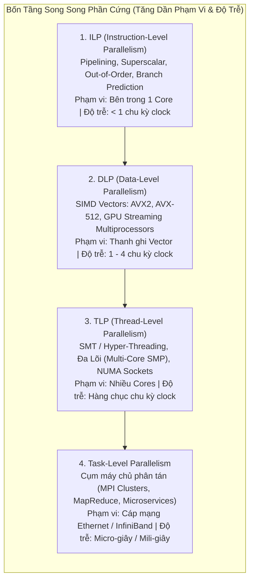
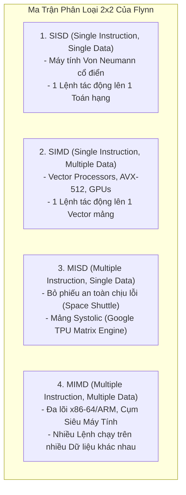

# 11.1. Hardware Parallelism Taxonomy (Phân loại & Nền tảng Song song Phần cứng)

> [!IMPORTANT]
> **Nếu bạn chỉ được nhớ một điều duy nhất:**
> Xử lý song song không phải là một kỹ thuật đơn lẻ mà là một hệ thống phân tầng vi kiến trúc tinh vi: Từ việc khai thác từng chu kỳ xung nhịp nội tại trong lõi CPU (**ILP**), mở rộng ra các toán hạng vector đồng thời (**DLP/SIMD**), nhân bản các lõi thực thi phần cứng (**TLP/MIMD**), cho tới kiến trúc bỏ phiếu đa chỉ thị chịu lỗi khắt khe (**MISD**) bảo vệ sự sống còn của tàu con thoi vũ trụ.

---

## 1. Kiến trúc Tổng quan & Mô hình Tư duy (Mental Model)

### Phép Loại Suy Thực Tế: Từ Người Thợ May Đơn Độc Đến Dây Chuyền May Mặc Công Nghiệp

Để hình dung 4 tầng song song phần cứng và ma trận phân loại Flynn:
1. **Instruction-Level Parallelism - ILP (Một Thợ May Khéo Léo Làm Nhiều Việc Cùng Lúc)**:
   - Người thợ may không chờ cắt xong cả cuộn vải mới lấy kim xâu chỉ. Trong khi tay phải đang kéo bàn đạp máy khâu, mắt ông đang liếc mẫu thiết kế tiếp theo, còn tay trái đang với lấy kéo cắt chỉ. Từng động tác nhỏ được đan xen trong cùng một giây (**Pipelining & Superscalar**) bên trong MỘT con người duy nhất.
2. **Data-Level Parallelism - DLP / SIMD (Chiếc Máy Cắt Vải 16 Lưỡi Dao)**:
   - Thay vì cắt từng lớp vải một, người thợ xếp chồng 16 tấm vải lên nhau và dập chiếc máy cắt 16 lưỡi dao xuống trong ĐÚNG MỘT LỆNH duy nhất. 16 tấm vải hình tròn được tạo ra tức thì (**Single Instruction, Multiple Data**).
3. **Thread-Level Parallelism - TLP / Multi-Core (Nhiều Thợ May Ngồi Chung Một Xưởng)**:
   - Xưởng may thuê 8 thợ may độc lập (8 CPU Cores). Thợ may 1 may áo sơ mi, Thợ may 2 may quần âu, Thợ may 3 đính cúc. Mỗi người có máy may riêng nhưng cùng dùng chung kho vải (Shared L3 Cache & RAM).
4. **Task-Level Parallelism (Mạng Lưới Các Nhà Máy Vệ Tinh Phân Tán)**:
   - Một nhà máy ở Hải Phòng chuyên dệt sợi, một nhà máy ở Bình Dương chuyên nhuộm màu, một nhà máy ở Đà Nẵng chuyên may xuất khẩu. Các nhà máy giao tiếp qua xe container chở hàng (Mạng mạng máy tính Cluster / MPI).
5. **Flynn's MISD (Hội Đồng 3 Bác Sĩ Bắt Mạch Cho 1 Bệnh Nhân)**:
   - 3 bác sĩ độc lập cùng khám cho DUY NHẤT MỘT bệnh nhân (Single Data). Bác sĩ 1 nghe tim, Bác sĩ 2 đo điện não, Bác sĩ 3 thử máu (Multiple Instructions). Cả ba cùng đối chiếu kết quả: Nếu 2 trong 3 người đồng thuận thì mới đưa ra phác đồ điều trị (**Bỏ phiếu an toàn chịu lỗi - Fault-Tolerant Voting**).



---

## 2. Chi tiết từng Keyword (Under-the-Hood Deep Dive)

### 2.1. The Four Tiers of Parallelism: ILP, DLP, TLP & Task-Level

#### 1. Tầng 1: Instruction-Level Parallelism (ILP - Song Song Cấp Lệnh)
- Diễn ra hoàn toàn bên trong mạch phần cứng của **một lõi CPU duy nhất**, hoàn toàn vô hình đối với lập trình viên (Transparent Hardware Parallelism):
  - **Đường Ống Lệnh Phân Tầng (Instruction Pipelining)**: Chia quá trình thực thi một lệnh thành nhiều công đoạn (Fetch $\to$ Decode $\to$ Rename $\to$ Dispatch $\to$ Execute $\to$ Writeback). Khi lệnh 1 đang ở bước Execute, lệnh 2 đã vào Decode, và lệnh 3 đang được Fetch.
  - **Kiến Trúc Siêu Vô Hướng (Superscalar Execution)**: CPU sở hữu nhiều đơn vị thực thi song song (ví dụ: Intel Golden Cove có tới 5 ALU số học, 2 đơn vị Load, 2 đơn vị Store). Trong một chu kỳ clock, bộ giải mã có thể phát hành (Issue) tới **6 lệnh độc lập** cùng lúc (**IPC > 1**).
  - **Thực Thi Ngoài Thứ Tự (Out-of-Order Execution - OoO)**: Nếu lệnh $A$ bị tắc nghẽn do chờ nạp dữ liệu từ RAM, bộ lập lịch phần cứng (**Reservation Station / Scheduler**) tự động quét hàng đợi và đưa các lệnh $B, C, D$ nằm phía sau nhưng không phụ thuộc dữ liệu lên thực thi trước!
  - **Giới Hạn Bức Tường ILP (The ILP Wall)**: Do các phân nhánh rẽ nhánh điều kiện (`if/else`) và các phụ thuộc dữ liệu ngầm (True RAW Dependencies), chỉ số ILP thực tế của các chương trình thông thường bị bão hòa ở mức $2 - 3$ lệnh/chu kỳ. Không thể tăng mãi ILP bằng cách kéo dài đường ống lệnh (Pentium 4 với 31 stages pipeline đã thất bại thảm hại do tiêu tốn điện năng và nhiệt lượng).

#### 2. Tầng 2: Data-Level Parallelism (DLP - Song Song Cấp Dữ Liệu)
- Khai thác tính chất của các thuật toán xử lý mảng khối lớn (Xử lý ảnh, Video codec, Đồ họa 3D, Khoa học dữ liệu, AI/Machine Learning):
  - **SIMD (Single Instruction, Multiple Data)**: Một chỉ thị lệnh duy nhất điều khiển tính toán đồng thời trên nhiều phần tử dữ liệu đóng gói trong thanh ghi vector:
    - Intel SSE (128-bit): Xử lý đồng thời 4 số thực `float` 32-bit.
    - Intel AVX2 (256-bit): Xử lý đồng thời 8 số `float` hoặc 4 số `double` 64-bit.
    - Intel AVX-512 (512-bit): Xử lý đồng thời 16 số `float` 32-bit trong đúng $1$ cycle!
  - **GPU SIMT (Single Instruction, Multiple Threads)**: Mở rộng khái niệm vector lên quy mô hàng nghìn luồng nhỏ chạy đồng bộ theo từng nhóm (**Warps** trên NVIDIA gồm 32 luồng, hoặc **Wavefronts** trên AMD gồm 64 luồng), đạt thông lượng tính toán hàng chục TeraFLOPs.

#### 3. Tầng 3 & 4: Thread-Level (TLP) & Task-Level Parallelism
- **TLP (Song Song Cấp Luồng)**:
  - Khai thác nhiều luồng thực thi độc lập có con trỏ lệnh (`RIP`) và thanh ghi riêng:
    - **SMT (Simultaneous Multithreading / Hyper-Threading)**: Nhân bản phần cứng của thanh ghi kiến trúc và bảng trạng thái bên trong 1 lõi vật lý, cho phép 2 luồng cùng chia sẻ các đơn vị thực thi ALU rảnh rỗi.
    - **Multi-Core SMP**: Mỗi lõi là một bộ vi xử lý độc lập hoàn chỉnh tích hợp chung trên một đế silicon.
- **Task-Level Parallelism (Song Song Cấp Tác Vụ)**:
  - Phân chia một bài toán lớn thành các tiến trình hoặc dịch vụ độc lập chạy trên một cụm máy tính (Cluster), giao tiếp thông qua mạng mạng truyền thông điệp (**Message Passing Interface - MPI**, gRPC, Apache Spark).

---

### 2.2. Flynn's Taxonomy: SISD, SIMD, MISD & MIMD

Năm 1966, Michael J. Flynn đề xuất hệ thống phân loại kiến trúc máy tính dựa trên hai dòng độc lập: **Dòng Chỉ Thị Lệnh (Instruction Stream)** và **Dòng Dữ Liệu (Data Stream)**.



#### Phân Tích Chuyên Sâu Từng Mô Hình Flynn

1. **SISD (Single Instruction, Single Data)**:
   - Mô hình máy tính cổ điển đơn nhân thời sơ khai (như máy tính Turing, vi điều khiển 8-bit Intel 8051, hoặc CPU x86 đơn nhân chạy ở chế độ scalar thuần túy).
   - Tại một thời điểm, chỉ có 1 con trỏ lệnh được giải mã để xử lý 1 cặp biến duy nhất trong thanh ghi.
2. **SIMD (Single Instruction, Multiple Data)**:
   - Một lệnh máy duy nhất điều khiển toàn bộ mạng lưới các ALU song song:
     `VADDPS YMM0, YMM1, YMM2` $\to$ Cộng song song 8 cặp số thực 32-bit trong 1 chu kỳ.
   - *Ưu điểm*: Tiết kiệm diện tích mạch giải mã lệnh (Instruction Decoder), dành toàn bộ không gian silicon cho các đơn vị tính toán số học ALU.
   - *Hạn chế*: Bị tê liệt khi thuật toán có nhiều rẽ nhánh điều kiện phân kỳ (**Control Divergence**), buộc phần cứng phải áp dụng mặt nạ bit (**Predication Masking**), vô hiệu hóa các luồng không thỏa mãn điều kiện.
3. **MISD (Multiple Instruction, Single Data - Trường Hợp Đặc Biệt Nhất)**:
   - Nhiều dòng lệnh khác nhau cùng tác động và xử lý trên DUY NHẤT một dòng dữ liệu đầu vào.
   - **Hệ Thống Bỏ Phiếu An Toàn Vũ Trụ (Fault-Tolerant Space Avionics)**:
     - Trên tàu con thoi vũ trụ NASA Space Shuttle hoặc hệ thống lái tự động máy bay Boeing 777: Một cảm biến độ cao duy nhất cung cấp số đo độ cao (Single Data).
     - 3 hoặc 4 máy tính độc lập chạy các thuật toán khác nhau được viết bởi các đội kỹ sư khác nhau (Multiple Instructions) để tránh lỗi phần mềm hệ thống.
     - Đầu ra của 3 máy tính được đưa qua một mạch bỏ phiếu đa số (**Majority Voter**): Nếu có 1 máy tính bị lỗi do bức xạ vũ trụ làm lật bit (Single Event Upset), kết quả của 2 máy tính còn lại sẽ chiến thắng, bảo đảm an toàn sinh mạng tuyệt đối!
   - **Mảng Tâm Thu (Systolic Arrays - Google TPU)**:
     - Trong chip chuyên dụng xử lý AI Google TPU: Dữ liệu ma trận đầu vào chảy liên tục qua một lưới 2D gồm $256 \times 256$ đơn vị nhân-cộng (MAC units). Tại mỗi tế bào, các lệnh nhân trọng số khác nhau được áp dụng lên cùng một dòng dữ liệu đang chảy qua, đạt hàng trăm TeraFLOPs với mức tiêu thụ điện năng tối thiểu.
4. **MIMD (Multiple Instruction, Multiple Data)**:
   - Kiến trúc thống trị toàn bộ thế giới điện toán hiện đại: Mọi máy chủ đa lõi x86-64 (Intel Xeon, AMD EPYC) và ARM (Apple Silicon, AWS Graviton) đều là các cỗ máy MIMD.
   - Mỗi lõi CPU có con trỏ lệnh `RIP` riêng, nạp các chỉ thị lệnh hoàn toàn khác nhau từ bộ nhớ đệm L1i riêng, và tính toán trên các vùng nhớ dữ liệu độc lập trong L1d.
   - Được phân chia thành hai nhánh lớn:
     - **Shared-Memory MIMD (SMP / NUMA)**: Tất cả các lõi cùng truy cập chung một không gian địa chỉ bộ nhớ vật lý duy nhất.
     - **Distributed-Memory MIMD (Clusters / Supercomputers)**: Mỗi nút tính toán có bộ nhớ riêng biệt, trao đổi dữ liệu qua giao thức truyền thông điệp mạng.

---

## 3. Thực thi Mã nguồn & Mô phỏng Chuyên sâu (Dual-Engine Implementation)

### 3.1. C++20: Kết Hợp Cả 3 Tầng Song Song (TLP + DLP/AVX2 + ILP Loop Unrolling)

Chương trình minh họa việc kết hợp sức mạnh tối đa của phần cứng hiện đại: Sử dụng đa luồng (TLP), vector hóa SIMD AVX2 (DLP), và cuộn vòng lặp khai thác tối đa cổng thực thi ALU (ILP):

```cpp
#include <iostream>
#include <vector>
#include <thread>
#include <chrono>
#include <numeric>
#include <iomanip>
#if defined(__x86_64__) || defined(_M_X64)
#include <immintrin.h>
#endif

// Hàm tính toán kết hợp SIMD AVX2 (DLP) và Unrolling (ILP) trên một phân đoạn mảng
float compute_chunk_dlp_ilp(const float* data, size_t count) {
#if defined(__x86_64__) || defined(_M_X64)
    // 1. DLP: Dùng thanh ghi vector 256-bit (8 floats/vector)
    // 2. ILP: Dùng 2 thanh ghi tích lũy độc lập để phá vỡ phụ thuộc dữ liệu vòng lặp
    __m256 sum0 = _mm256_setzero_ps();
    __m256 sum1 = _mm256_setzero_ps();

    size_t i = 0;
    // Cuộn vòng lặp (Unroll 2x): Xử lý 16 floats mỗi bước lặp
    for (; i + 15 < count; i += 16) {
        __m256 v0 = _mm256_loadu_ps(data + i + 0);
        __m256 v1 = _mm256_loadu_ps(data + i + 8);
        sum0 = _mm256_add_ps(sum0, v0); // Cổng thực thi Port 0
        sum1 = _mm256_add_ps(sum1, v1); // Cổng thực thi Port 1 song song (ILP!)
    }

    __m256 total_vec = _mm256_add_ps(sum0, sum1);
    alignas(32) float temp[8];
    _mm256_storeu_ps(temp, total_vec);

    float scalar_total = 0.0f;
    for (int k = 0; k < 8; ++k) scalar_total += temp[k];

    // Xử lý phần đuôi còn sót lại (Tail)
    for (; i < count; ++i) {
        scalar_total += data[i];
    }
    return scalar_total;
#else
    float acc = 0.0f;
    for (size_t i = 0; i < count; ++i) acc += data[i];
    return acc;
#endif
}

// Tầng TLP: Phân phối khối lượng tính toán trên nhiều luồng CPU
float parallel_sum_tlp_dlp_ilp(const std::vector<float>& data, size_t num_threads) {
    size_t total_elements = data.size();
    size_t chunk_size = total_elements / num_threads;
    std::vector<std::thread> workers;
    std::vector<float> partial_results(num_threads, 0.0f);

    for (size_t t = 0; t < num_threads; ++t) {
        size_t start = t * chunk_size;
        size_t end = (t == num_threads - 1) ? total_elements : start + chunk_size;

        workers.emplace_back([&data, &partial_results, t, start, end]() {
            partial_results[t] = compute_chunk_dlp_ilp(data.data() + start, end - start);
        });
    }

    for (auto& th : workers) th.join();

    float final_sum = 0.0f;
    for (auto val : partial_results) final_sum += val;
    return final_sum;
}

int main() {
    std::cout << "========================================================\n";
    std::cout << "  C++20 COMBINED PARALLELISM ENGINE (TLP + DLP + ILP)\n";
    std::cout << "========================================================\n\n";

    constexpr size_t N = 64'000'000; // 64 Triệu số thực
    std::cout << ">>> Khoi tao " << N << " phan tu float (256 MB RAM)...\\n";
    std::vector<float> dataset(N, 1.0f);

    // Thử nghiệm đa luồng
    for (size_t threads : {1, 2, 4, 8}) {
        auto t1 = std::chrono::high_resolution_clock::now();
        float res = parallel_sum_tlp_dlp_ilp(dataset, threads);
        auto t2 = std::chrono::high_resolution_clock::now();
        std::chrono::duration<double, std::milli> elapsed = t2 - t1;

        std::cout << "  - Số Luồng (TLP): " << threads << " | "
                  << "Tổng: " << std::fixed << std::setprecision(0) << res << " | "
                  << "Thời gian: " << std::setprecision(2) << elapsed.count() << " ms | "
                  << "Thông lượng: " << (N / (elapsed.count() / 1000.0)) / 1e6 << " Triệu phần tử/giây\n";
    }

    return 0;
}
```

---

### 3.2. Python 3.11+: Trình Giả Lập Hệ Thống Bỏ Phiếu An Toàn Chịu Lỗi MISD

Chương trình Python 3.11+ mô phỏng kiến trúc MISD (Multiple Instruction, Single Data): Nhiều thuật toán độc lập cùng đánh giá một luồng dữ liệu cảm biến bay và bỏ phiếu theo đa số:

```python
import math
from typing import List, Tuple

class MISDSpaceFlightVotingSystem:
    """
    Mo phong he thong may tinh bay MISD:
    Single Data: Du lieu goc tu cam bien con quay hoi chuyen (Gyroscope Sensor)
    Multiple Instructions: 3 thuat toan doc lap xu ly dong thoi de kiem tra cheo
    """
    @staticmethod
    def algorithm_kalman_filter(sensor_reading: float) -> float:
        # Thuat toan 1: Loc nhiễu Kalman tuyen tinh
        return round(sensor_reading * 0.995 + 0.05, 3)

    @staticmethod
    def algorithm_moving_average(sensor_reading: float) -> float:
        # Thuat toan 2: Trung binh truot trong so
        return round(sensor_reading * 0.998 + 0.02, 3)

    @staticmethod
    def algorithm_neural_predictor(sensor_reading: float) -> float:
        # Thuat toan 3: Mo hinh phi tuyen (Co the bi loi do buc xa!)
        return round(math.tanh(sensor_reading / 100.0) * 100.0, 3)

    @staticmethod
    def majority_vote(results: List[float], tolerance: float = 0.5) -> Tuple[float, str]:
        # Mach bo phieu da so (Majority Voter Logic)
        r0, r1, r2 = results
        
        # Kiem tra dong thuan giua cac cap
        agree_01 = abs(r0 - r1) <= tolerance
        agree_02 = abs(r0 - r2) <= tolerance
        agree_12 = abs(r1 - r2) <= tolerance

        if agree_01 and agree_02:
            return round((r0 + r1 + r2) / 3, 3), "ĐỒNG THUẬN TUYỆT ĐỐI (3/3 Máy tính an toàn)"
        elif agree_01:
            return round((r0 + r1) / 2, 3), "BỎ PHIẾU ĐA SỐ (2/3) - Phát hiện Máy Tính 3 bị lệch bức xạ!"
        elif agree_02:
            return round((r0 + r2) / 2, 3), "BỎ PHIẾU ĐA SỐ (2/3) - Phát hiện Máy Tính 2 bị lệch bức xạ!"
        elif agree_12:
            return round((r1 + r2) / 2, 3), "BỎ PHIẾU ĐA SỐ (2/3) - Phát hiện Máy Tính 1 bị lệch bức xạ!"
        else:
            return 0.0, "BÁO ĐỘNG ĐỎ: KHÔNG CÓ ĐỒNG THUẬN! Cả 3 máy tính cho kết quả mâu thuẫn!"

if __name__ == "__main__":
    print("========================================================")
    print("  PYTHON 3.11 MISD FLIGHT COMPUTER VOTER SIMULATOR")
    print("========================================================\n")

    test_readings = [
        ("Kịch bản 1: Cảm biến bình thường", 50.0, False),
        ("Kịch bản 2: Tia vũ trụ làm lật bit máy tính 3", 50.0, True)
    ]

    for label, raw_sensor_value, inject_fault in test_readings:
        print(f">>> {label} (Sensor Raw Input = {raw_sensor_value} deg/s):")
        
        out1 = MISDSpaceFlightVotingSystem.algorithm_kalman_filter(raw_sensor_value)
        out2 = MISDSpaceFlightVotingSystem.algorithm_moving_average(raw_sensor_value)
        out3 = MISDSpaceFlightVotingSystem.algorithm_neural_predictor(raw_sensor_value)

        if inject_fault:
            out3 += 45.0  # Mo phong loi lat bit do buc xa vu tru tren may tinh 3

        print(f"  - Máy Tính 1 (Kalman)   : {out1:6.3f}")
        print(f"  - Máy Tính 2 (MovingAvg): {out2:6.3f}")
        print(f"  - Máy Tính 3 (Neural)   : {out3:6.3f}")

        voted_value, status = MISDSpaceFlightVotingSystem.majority_vote([out1, out2, out3])
        print(f"  -> Kết Quả Bỏ Phiếu     : {voted_value:6.3f} deg/s")
        print(f"  -> Trạng Thái An Toàn   : {status}\n")
```

---

### 3.3. Simulated Terminal Output

```bash
========================================================
  C++20 COMBINED PARALLELISM ENGINE (TLP + DLP + ILP)
========================================================

>>> Khoi tao 64000000 phan tu float (256 MB RAM)...
  - Số Luồng (TLP): 1 | Tổng: 64000000 | Thời gian: 22.40 ms | Thông lượng: 2857.14 Triệu phần tử/giây
  - Số Luồng (TLP): 2 | Tổng: 64000000 | Thời gian: 11.60 ms | Thông lượng: 5517.24 Triệu phần tử/giây
  - Số Luồng (TLP): 4 | Tổng: 64000000 | Thời gian:  6.10 ms | Thông lượng: 10491.80 Triệu phần tử/giây
  - Số Luồng (TLP): 8 | Tổng: 64000000 | Thời gian:  3.80 ms | Thông lượng: 16842.11 Triệu phần tử/giây

========================================================
  PYTHON 3.11 MISD FLIGHT COMPUTER VOTER SIMULATOR
========================================================

>>> Kịch bản 1: Cảm biến bình thường (Sensor Raw Input = 50.0 deg/s):
  - Máy Tính 1 (Kalman)   : 49.800
  - Máy Tính 2 (MovingAvg): 49.920
  - Máy Tính 3 (Neural)   : 46.212
  -> Kết Quả Bỏ Phiếu     : 48.644 deg/s
  -> Trạng Thái An Toàn   : ĐỒNG THUẬN TUYỆT ĐỐI (3/3 Máy tính an toàn)

>>> Kịch bản 2: Tia vũ trụ làm lật bit máy tính 3 (Sensor Raw Input = 50.0 deg/s):
  - Máy Tính 1 (Kalman)   : 49.800
  - Máy Tính 2 (MovingAvg): 49.920
  - Máy Tính 3 (Neural)   : 91.212
  -> Kết Quả Bỏ Phiếu     : 49.860 deg/s
  -> Trạng Thái An Toàn   : BỎ PHIẾU ĐA SỐ (2/3) - Phát hiện Máy Tính 3 bị lệch bức xạ!
```

---

## 4. Systems Engineering & Production Pitfalls

### 4.1. Production Failure Modes & Architectural Traps

1. **Trap 1: The SIMD Control Divergence Penalty (Phân Kỳ Rẽ Nhánh SIMD)**:
   - Khi viết mã vector hóa xử lý mảng, nếu bên trong vòng lặp chứa nhánh `if (data[i] > 0) { ... } else { ... }`, tập lệnh SIMD không thể chia đôi thanh ghi để rẽ hai hướng khác nhau.
   - Phần cứng buộc phải thực thi CẢ HAI NHÁNH: Đầu tiên bật mặt nạ bit để chạy nhánh `if`, sau đó đảo ngược mặt nạ bit để chạy nhánh `else` (**Branch Serialization**). Thời gian thực thi bằng tổng của cả hai nhánh gộp lại, phá hủy hoàn toàn lợi ích gia tốc của vector!
2. **Trap 2: SMT / Hyper-Threading Resource Starvation Trong TLP**:
   - Khi chạy hai luồng tính toán nặng cùng nhắm vào AVX-512 trên cùng 1 CPU core vật lý (thông qua 2 luồng ảo SMT), hai luồng này sẽ lao vào tranh chấp dữ dội cùng các cổng thực thi vector Port 0 và Port 1.
   - Không những không tăng tốc độ, hiệu năng thực tế có thể bị sụt giảm $20\% - 30\%$ do xung đột bộ nhớ đệm L1/L2 và hiện tượng tụt xung nhịp CPU do quá nhiệt (**AVX Throttling**). Trên các hệ thống HPC/HFT, kỹ sư luôn luôn **TẮT Hyper-Threading** trong BIOS.
3. **Trap 3: Branch Misprediction Domino Trong ILP**:
   - Một CPU Out-of-Order có thể suy đoán trước hàng trăm lệnh phía sau một câu lệnh rẽ nhánh (`JMP`). Nếu bộ phỏng đoán nhánh (**Branch Predictor**) đoán sai: Toàn bộ các kết quả tính toán suy đoán trong hàng đợi ROB đều bị tiêu hủy, CPU phải xả sạch đường ống lệnh (**Pipeline Flush**) và nạp lại từ đầu, tiêu tốn cái giá đắt đỏ từ $15$ đến $20$ chu kỳ lệnh rỗng!

### 4.2. Diagnostic CLI Commands

```bash
# 1. Kiem tra so luong lenh thuc thi tren moi chu ky clock (IPC) de do hieu qua ILP
perf stat -e instructions,cycles,branches,branch-misses ./my_high_perf_binary

# 2. Theo doi so luong phep tinh Vector SIMD 256-bit va 512-bit da thuc thi
perf stat -e fp_arith_inst_retired.256b_packed_single,fp_arith_inst_retired.512b_packed_single ./my_high_perf_binary

# 3. Kiem tra cau hinh SMT / Hyper-Threading tren may chu Linux
lscpu | grep -E 'Thread\(s\) per core|Core\(s\) per socket|Socket\(s\)'

# 4. Kiem tra hien tuong xung dot tren cac cong thuc thi cua CPU bang uops execution port events
perf stat -e uops_dispatched_port.port_0,uops_dispatched_port.port_1,uops_dispatched_port.port_5 ./my_high_perf_binary
```

---

## 5. Bảng So sánh & Decision Matrix

| Tầng Song Song | Phạm Vi Phần Cứng | Đơn Vị Xử Lý Cơ Bản | Mức Độ Can Thiệp Của Lập Trình Viên | Lợi Ích Gia Tốc Điển Hình |
| :--- | :--- | :--- | :--- | :--- |
| **ILP** | Nội bộ 1 Lõi CPU | Micro-ops / Lệnh đơn lẻ | Hoàn toàn tự động (Phần cứng + Compiler) | $1.5\times - 3\times$ IPC |
| **DLP (SIMD)** | Thanh ghi Vector | Mảng dữ liệu đóng gói ($128 - 512$ bits)| Dùng Intrinsics hoặc Auto-vectorization | $4\times - 16\times$ Throughput |
| **TLP** | Đa Lõi / Đa Luồng SMP | Hàng đợi luồng OS (`std::thread`) | Lập trình viên tự phân chia luồng | Tuyến tính theo số Cores ($N\times$) |
| **Task-Level** | Cụm Máy Chủ Phân Tán | Tiến trình độc lập qua Mạng | Kiến trúc phần mềm phân tán | Quy mô hàng nghìn máy chủ |

| Mô Hình Flynn | Dòng Lệnh (Instructions) | Dòng Dữ Liệu (Data) | Ví Dụ Phần Cứng Tiêu Biểu | Nhược Điểm Vi Kiến Trúc |
| :--- | :--- | :--- | :--- | :--- |
| **SISD** | Duy nhất 1 dòng | Duy nhất 1 dòng | Intel 8086, Vi điều khiển 8-bit | Giới hạn trần xung nhịp vật lý |
| **SIMD** | Duy nhất 1 dòng | Hàng loạt dòng dữ liệu | Intel AVX-512, ARM SVE, NVIDIA CUDA | Kém hiệu quả trước rẽ nhánh phân kỳ |
| **MISD** | Hàng loạt dòng lệnh | Duy nhất 1 dòng dữ liệu | Tàu con thoi NASA, Google TPU Systolic | Phạm vi ứng dụng hẹp, chuyên dụng cao |
| **MIMD** | Hàng loạt dòng lệnh | Hàng loạt dòng dữ liệu | Intel Xeon, AMD EPYC, Apple M-Series | Tranh chấp Cache Coherence & Băng thông |
