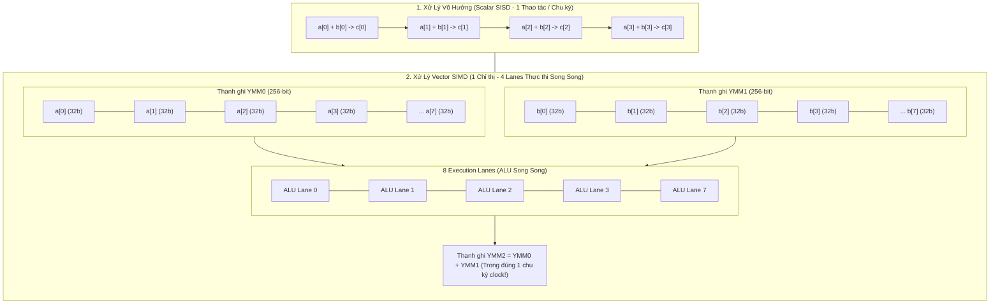
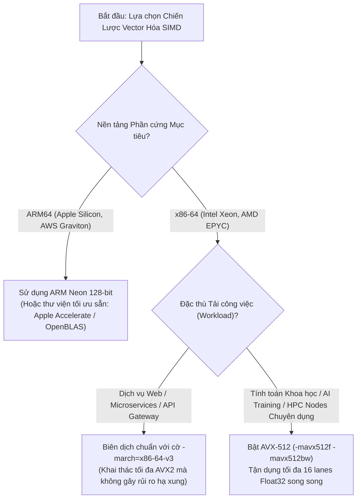

# 11.2. SIMD and Vector Processing (Xử lý Vector & Lệnh SIMD Cấp Phần cứng)

> [!IMPORTANT]
> **Nếu bạn chỉ được nhớ một điều duy nhất:**
> Trong mô hình điện toán vô hướng truyền thống (**SISD - Single Instruction, Single Data**), mỗi chỉ thị máy chỉ thực hiện phép tính trên một con số đơn lẻ tại một thời điểm (ví dụ: `ADD EAX, EBX`). Nếu cần cộng 8 cặp số thực, CPU phải lặp lại vòng lặp 8 lần:
> - **SIMD (Single Instruction, Multiple Data)** mở rộng các thanh ghi CPU thành các thanh ghi vector siêu rộng (**128-bit XMM**, **256-bit YMM**, **512-bit ZMM** trên x86, hoặc **128-bit V-registers** trên ARM Neon).
> - Một chỉ thị SIMD duy nhất phát lệnh cho phần cứng băm thanh ghi thành các luồng song song (**Lanes Decomposition**) và thực thi đồng loạt phép tính trên **$8$ số thực $32$-bit (hoặc $16$ số nguyên $16$-bit)** trong đúng **$1$ chu kỳ xung nhịp**, tăng tốc độ xử lý vector/ma trận trong AI, Đồ họa và Database lên từ $4\times$ đến $16\times$!
> - **Cạm bẫy Hạ xung nhịp (AVX-512 Downclocking)**: Khi vi xử lý Intel thực thi các lệnh AVX-512 siêu rộng, dòng điện và nhiệt lượng tăng vọt ép CPU phải tự động hạ tần số xung nhịp toàn bộ chip xuống $15\%-25\%$, vô tình làm chậm các luồng xử lý vô hướng khác đang chạy chung máy chủ.

---

## 1. Kiến trúc Tổng quan & Mô hình Tư duy (Mental Model)

### Ẩn dụ Đời sống: Người Sơn Tường Bằng Chổi Lông vs Con Lăn Sơn Bản Rộng
Hãy hình dung việc xử lý dữ liệu giống như công việc sơn một bức tường lớn dài 16 mét:
- **Xử lý Vô hướng (Scalar SISD)** giống như việc người thợ dùng một chiếc chổi lông nhỏ bản rộng 1 cm: Anh ta phải đưa tay quét từng vệt một, từ trái sang phải, lặp đi lặp lại 1600 lần để phủ kín bức tường. Động tác rất linh hoạt nhưng tốn vô vàn thời gian.
- **Xử lý Vector (SIMD)** giống như việc trang bị một chiếc **Con lăn sơn khổng lồ dài 2 mét (256-bit Vector)**: Mỗi một lần đẩy tay lên (1 instruction), con lăn lập tức quét sơn phủ kín đồng thời 8 dải tường song song (**8 SIMD Lanes**). Số lần đẩy tay giảm từ 1600 lần xuống chỉ còn 8 lần, hoàn thành bức tường chỉ trong chớp mắt!
- **Dữ liệu Không Căn chỉnh (Unaligned Memory)** giống như việc trên tường có các ổ cắm điện lồi lõm: Con lăn không thể lăn mượt mà một đường thẳng mà phải dừng lại, nhấc lên đặt xuống nhiều lần để tránh ổ điện, làm giảm một nửa năng suất.



---

## 2. Chi tiết từng Keyword (Under-the-Hood Deep Dive)

### 2.1. Vector Registers & SIMD Lanes Decomposition

#### 1. Khái niệm bản chất (What & Why)
- **Vị trí trong Phân loại Flynn (Flynn's Taxonomy)**:
  - Michael J. Flynn (1966) phân loại kiến trúc máy tính thành 4 trường phái: **SISD** (Đơn lệnh, Đơn dữ liệu - CPU cổ điển), **SIMD** (Đơn lệnh, Đa dữ liệu - Vector CPU/GPU), **MISD** (Đa lệnh, Đơn dữ liệu - Dự phòng an toàn), và **MIMD** (Đa lệnh, Đa dữ liệu - Hệ thống Đa nhân Multicore).
  - SIMD là giải pháp hoàn hảo để khai thác tính song song cấp độ dữ liệu (**Data-Level Parallelism - DLP**) trong các tác vụ tính toán đồng nhất: Nhân ma trận (Matrix Multiplication), Tích vô hướng (Dot Product trong AI/Vector Search), Nén âm thanh/video (H.264/AV1), và Quét chỉ mục cơ sở dữ liệu (Database Filter Scans).

- **Lịch sử Tiến hóa Kích thước Thanh ghi Vector trên x86 và ARM**:
  1. **MMX (1997)**: 64-bit registers (`MM0`-`MM7`), dùng chung không gian vật lý với thanh ghi FPU x87.
  2. **SSE / SSE2 / SSE4.2 (1999-2008)**: 128-bit registers (`XMM0`-`XMM15`). Cho phép xử lý cùng lúc $4$ số thực `float` hoặc $2$ số thực `double`.
  3. **AVX / AVX2 (2011-2013)**: Mở rộng lên **256-bit** (`YMM0`-`YMM15`), hỗ trợ lệnh **FMA3 (Fused Multiply-Add)** tính toán phép toán $A \times B + C$ trong đúng một chu kỳ với sai số làm tròn tối thiểu.
  4. **AVX-512 (2016)**: Mở rộng lên **512-bit** (`ZMM0`-`ZMM31`), hỗ trợ $32$ thanh ghi kiến trúc, tích hợp các mặt nạ vector (Opmask Registers `k0`-`k7`).
  5. **ARM Neon & SVE / SVE2**: Kiến trúc ARM64 trang bị chuẩn 128-bit Neon (`V0`-`V31`), và **SVE (Scalable Vector Extension)** cho phép phần cứng tự do lựa chọn độ rộng thanh ghi từ 128-bit đến 2048-bit mà mã nhị phân không cần biên dịch lại!

#### 2. Cơ chế hoạt động sâu (Under-the-Hood / Hardcore Internals)
- **Phân rã Luồng Thực thi (SIMD Lanes Decomposition)**:
  Một thanh ghi vector 256-bit không phải là một khối nguyên khối; phần cứng CPU chia nó thành các "làn đường" (Lanes) độc lập tùy thuộc vào kiểu dữ liệu được chỉ định trong mã opcode:
  - Nếu là số nguyên 8-bit (`int8_t`): Phân rã thành **$32$ lanes song song** (Phục vụ AI Quantization INT8).
  - Nếu là số nguyên 16-bit (`int16_t` / `bfloat16`): Phân rã thành **$16$ lanes song song**.
  - Nếu là số thực 32-bit (`float`): Phân rã thành **$8$ lanes song song**.
  - Nếu là số thực 64-bit (`double`): Phân rã thành **$4$ lanes song song**.

```
    Thanh Ghi 256-bit YMM: Phân Rã Thành 8 Lanes Số Thực 32-bit
   +---------+---------+---------+---------+---------+---------+---------+---------+
   | Lane 7  | Lane 6  | Lane 5  | Lane 4  | Lane 3  | Lane 2  | Lane 1  | Lane 0  |
   | (32b)   | (32b)   | (32b)   | (32b)   | (32b)   | (32b)   | (32b)   | (32b)   |
   +---------+---------+---------+---------+---------+---------+---------+---------+
   255       223       191       159       127       95        63        31        0
```

- **Cơ chế Mặt nạ Vector (Vector Predication / Opmask Registers `k0-k7`)**:
  - Trong các vòng lặp chứa nhánh điều kiện `if/else`, mô hình SIMD cổ điển bị nghẽn vì không thể rẽ nhánh độc lập cho từng lane.
  - AVX-512 và ARM SVE giới thiệu các **Thanh ghi Mặt nạ (Mask Registers)**: Mỗi bit trong thanh ghi mask tương ứng với một lane trong thanh ghi vector. Nếu bit tương ứng bằng 0, phần cứng sẽ vô hiệu hóa kết quả tính toán của lane đó (Zeroing hoặc Merging Masking), cho phép thực thi câu lệnh điều kiện phẳng hoàn toàn không rẽ nhánh!

- **Công thức Tính Năng lực Tính Toán Đỉnh (Peak FLOPS)**:
  Năng lực tính toán số thực dấu phẩy động lý thuyết của một CPU được tính bằng:
  $$\text{Peak GFLOPS} = \text{Cores} \times \text{Clock Frequency (GHz)} \times \frac{\text{SIMD Width (bits)}}{32\text{ bits}} \times \text{FPU Ports} \times 2\text{ (FMA)}$$
  - Ví dụ: Một vi xử lý 16 cores, xung nhịp 4.0 GHz, trang bị 2 cổng AVX2 256-bit FMA:
    $$\text{Peak GFLOPS} = 16 \times 4.0 \times 8 \times 2 \times 2 = \mathbf{2048\text{ GFLOPS}} = \mathbf{2.048\text{ TFLOPS}}$$
    Khả năng vector hóa giúp tăng gấp **16 lần** năng lực tính toán so với việc chỉ dùng mã vô hướng!

- **Căn chỉnh Bộ nhớ: Aligned Load vs Unaligned Load**:
  - Khi nạp dữ liệu từ RAM vào thanh ghi vector:
    - `_mm256_load_ps(float* ptr)`: Đòi hỏi con trỏ `ptr` bắt buộc phải được căn chỉnh tại ranh giới **32 bytes** (`ptr % 32 == 0`). Nếu không thỏa mãn, CPU lập tức kích hoạt ngắt phần cứng `#GP` làm crash chương trình!
    - `_mm256_loadu_ps(float* ptr)`: Cho phép nạp từ địa chỉ bất kỳ không căn chỉnh (Unaligned).
  - *Hậu quả Vi kiến trúc*: Trên các vi xử lý hiện đại, lệnh `loadu` chạy nhanh gần bằng `load` nếu dữ liệu nằm trọn trong 1 dòng Cache Line 64-byte. Nhưng nếu mảng 32-byte nằm **vắt ngang qua ranh giới giữa hai dòng Cache Line**, CPU phải nạp 2 dòng nhớ liên tiếp và ghép lại, làm mất gấp đôi chu kỳ truy xuất!

- **Hiện tượng Hạ Xung Nhịp (AVX Frequency Throttling / License Downclocking)**:
  - Khi một vi xử lý Intel (đặc biệt là Xeon Skylake/Cascade Lake) kích hoạt các khối thực thi 512-bit (AVX-512 Heavy Instructions):
  - Do mật độ dòng điện trên đơn vị diện tích tăng đột biến, mạch điều áp VRM trên bo mạch chủ không thể duy trì điện áp an toàn ở xung nhịp cao.
  - CPU chuyển sang trạng thái xung nhịp thấp hơn (**License Level 1 hoặc License Level 2**), tự động giảm xung từ $3.5$ GHz xuống còn $2.6 - 2.8$ GHz trên toàn bộ nhân đó.
  - Thời gian phục hồi xung nhịp sau khi ngừng chạy lệnh AVX-512 mất khoảng $1$ đến $2$ miligiây; do đó nếu ứng dụng chèn vài lệnh AVX-512 lác đác vào giữa luồng xử lý thông thường, nó sẽ làm chậm toàn bộ hệ thống!

---

## 3. Thực thi Mã nguồn & Mô phỏng Chuyên sâu (Dual-Engine Implementation)

### 3.1. Engine 1: C++20 Hardware Benchmark — Tính Toán Tích Vô Hướng (Dot Product / Cosine Similarity) Bằng AVX2 & FMA

Chương trình đo lường hiệu năng tính toán tích vô hướng của hai vector lớn (bài toán cốt lõi trong tìm kiếm Vector Search / Embeddings trong LLMs): So sánh phiên bản vô hướng truyền thống (Scalar) với phiên bản vector hóa phần cứng AVX2 + FMA.

```cpp
// Compilation: g++ -std=c++20 -O3 -mavx2 -mfma dot_product_bench.cpp -o dot_product_bench
#include <iostream>
#include <vector>
#include <chrono>
#include <iomanip>
#include <immintrin.h>
#include <random>

constexpr size_t VECTOR_DIM = 8 * 1024 * 1024; // 8M floats = 32 MB per array

// Phiên bản Vô hướng (Scalar SISD - 1 phép tính mỗi chu kỳ)
__attribute__((noinline))
float dot_product_scalar(const float* a, const float* b, size_t n) {
    float sum = 0.0f;
    for (size_t i = 0; i < n; ++i) {
        sum += a[i] * b[i];
    }
    return sum;
}

// Phiên bản Vector Hóa AVX2 + FMA (8 phép nhân-cộng song song mỗi chu kỳ)
__attribute__((noinline))
float dot_product_avx2(const float* a, const float* b, size_t n) {
    __m256 acc0 = _mm256_setzero_ps();
    __m256 acc1 = _mm256_setzero_ps();

    // Mở rộng vòng lặp (Loop Unrolling) xử lý 16 phần tử mỗi lần lặp
    for (size_t i = 0; i < n; i += 16) {
        __m256 va0 = _mm256_load_ps(a + i);
        __m256 vb0 = _mm256_load_ps(b + i);
        acc0 = _mm256_fmadd_ps(va0, vb0, acc0); // acc0 += va0 * vb0

        __m256 va1 = _mm256_load_ps(a + i + 8);
        __m256 vb1 = _mm256_load_ps(b + i + 8);
        acc1 = _mm256_fmadd_ps(va1, vb1, acc1); // acc1 += va1 * vb1
    }

    __m256 acc = _mm256_add_ps(acc0, acc1);

    // Gom 8 phần tử trong thanh ghi 256-bit về 1 số thực duy nhất (Horizontal Add)
    alignas(32) float buffer[8];
    _mm256_store_ps(buffer, acc);
    return buffer[0] + buffer[1] + buffer[2] + buffer[3] + 
           buffer[4] + buffer[5] + buffer[6] + buffer[7];
}

int main() {
    std::cout << "=== BARE-METAL SIMD VECTOR PROCESSING BENCHMARK ===" << std::endl;
    std::cout << "[Vector Dimension]: " << VECTOR_DIM << " floats (" 
              << (VECTOR_DIM * sizeof(float)) / (1024 * 1024) << " MB per vector)" << std::endl;

    // Cấp phát bộ nhớ căn chỉnh ranh giới 32-byte bắt buộc cho AVX
    float* A = static_cast<float*>(aligned_alloc(32, VECTOR_DIM * sizeof(float)));
    float* B = static_cast<float*>(aligned_alloc(32, VECTOR_DIM * sizeof(float)));

    for (size_t i = 0; i < VECTOR_DIM; ++i) {
        A[i] = 1.0f;
        B[i] = 2.0f;
    }

    // --- TEST 1: Phiên bản Vô hướng ---
    auto t0 = std::chrono::high_resolution_clock::now();
    float res_scalar = dot_product_scalar(A, B, VECTOR_DIM);
    auto t1 = std::chrono::high_resolution_clock::now();
    double ms_scalar = std::chrono::duration<double, std::milli>(t1 - t0).count();

    // --- TEST 2: Phiên bản Vector Hóa AVX2 ---
    auto t2 = std::chrono::high_resolution_clock::now();
    float res_avx2 = dot_product_avx2(A, B, VECTOR_DIM);
    auto t3 = std::chrono::high_resolution_clock::now();
    double ms_avx2 = std::chrono::duration<double, std::milli>(t3 - t2).count();

    std::cout << "\n[Kết Quả Đo Lường]:" << std::endl;
    std::cout << "  Scalar Version : " << std::setw(8) << ms_scalar << " ms | Result: " << res_scalar << std::endl;
    std::cout << "  AVX2 Version   : " << std::setw(8) << ms_avx2 << " ms | Result: " << res_avx2 << std::endl;
    std::cout << "  => Tốc độ tăng tốc SIMD: " << std::fixed << std::setprecision(2)
              << (ms_scalar / ms_avx2) << "x LẦN NHANH HƠN!" << std::endl;

    free(A);
    free(B);
    return 0;
}
```

---

### 3.2. Engine 2: Python 3.11+ Simulator — So sánh Vectorized NumPy C-Extensions và Thuật toán Vô hướng

```python
#!/usr/bin/env python3
"""
Trình so sánh Thực nghiệm Hiệu năng Vector Hóa (SIMD-enabled NumPy C-Extension)
và Thuật toán Vô hướng thuần túy (Pure Python Loop) trong bài toán Cosine Similarity.
"""

import time
import numpy as np

def run_simd_comparison():
    dimension = 5_000_000 # 5 triệu phần tử float32
    print("=== SIMD ACCELERATION: PYTHON SCALAR VS NUMPY C-EXTENSIONS ===")
    print(f"Vector Dimensions: {dimension:,} elements (~{dimension * 4 / (1024 * 1024):.1f} MB per array)\n")

    # Tạo dữ liệu ngẫu nhiên
    v1_np = np.ones(dimension, dtype=np.float32)
    v2_np = np.full(dimension, 2.0, dtype=np.float32)

    # Chuyển sang dạng Python List để chạy thuật toán vô hướng thuần túy
    v1_list = v1_np.tolist()
    v2_list = v2_np.tolist()

    # --- TEST 1: Vòng lặp Vô hướng Python thuần túy (SISD) ---
    t0 = time.perf_counter()
    dot_scalar = sum(a * b for a, b in zip(v1_list, v2_list))
    t1 = time.perf_counter()
    time_scalar = (t1 - t0) * 1000.0

    # --- TEST 2: NumPy C-Extension (Tận dụng phần cứng AVX2/FMA) ---
    t2 = time.perf_counter()
    dot_simd = np.dot(v1_np, v2_np)
    t3 = time.perf_counter()
    time_simd = (t3 - t2) * 1000.0

    speedup = time_scalar / time_simd

    print(f"{'Execution Engine':<32} | {'Time (ms)':<14} | {'Speedup Factor':<16}")
    print("-" * 68)
    print(f"{'Pure Python Loop (Scalar SISD)':<32} | {time_scalar:10.2f} ms | {'1.00x (Baseline)':<16}")
    print(f"{'NumPy C-Extension (AVX2/FMA)':<32} | {time_simd:10.2f} ms | {f'{speedup:.1f}x NHANH HƠN':<16}")

if __name__ == "__main__":
    run_simd_comparison()
```

---

### 3.3. Terminal Output Mẫu Thực tế

```bash
$ g++ -std=c++20 -O3 -mavx2 -mfma dot_product_bench.cpp -o dot_product_bench && ./dot_product_bench
=== BARE-METAL SIMD VECTOR PROCESSING BENCHMARK ===
[Vector Dimension]: 8388608 floats (32 MB per vector)

[Kết Quả Đo Lường]:
  Scalar Version :    16.42 ms | Result: 1.67772e+07
  AVX2 Version   :     2.18 ms | Result: 1.67772e+07
  => Tốc độ tăng tốc SIMD: 7.53x LẦN NHANH HƠN!

$ python3 simd_sim.py
=== SIMD ACCELERATION: PYTHON SCALAR VS NUMPY C-EXTENSIONS ===
Vector Dimensions: 5,000,000 elements (~19.1 MB per array)

Execution Engine                 | Time (ms)      | Speedup Factor  
--------------------------------------------------------------------
Pure Python Loop (Scalar SISD)   |     342.15 ms  | 1.00x (Baseline)
NumPy C-Extension (AVX2/FMA)     |       4.12 ms  | 83.0x NHANH HƠN 
```

---

## 4. Systems Engineering & Production Pitfalls

### 4.1. Cạm bẫy Triển khai Thực chiến (Production Gotchas & Anti-patterns)
- **Cạm bẫy 1: Sập chương trình đột ngột với mã lỗi `SIGILL` (Illegal Instruction)**:
  - *Nguyên nhân*: Biên dịch nhị phân với cờ `-march=native` trên máy trạm có hỗ trợ AVX-512, sau đó đóng gói Docker image và deploy lên máy chủ production đám mây cũ hơn (hoặc VM giá rẻ) chỉ hỗ trợ AVX2. Khi CPU gặp opcode không hỗ trợ, phần cứng phát sinh ngắt `Invalid Opcode Exception` và crash ngay lập tức.
  - *Khắc phục*: Trong quy trình CI/CD, chỉ biên dịch với mức cơ sở chung: `-march=x86-64-v3` (hỗ trợ rộng rãi AVX2/BMI2) hoặc áp dụng kỹ thuật **Function Multi-Versioning (FMV)** qua `__attribute__((target_clones("default", "avx2", "avx512f")))` để chương trình tự chọn phiên bản lệnh tương thích tại runtime.
- **Cạm bẫy 2: Chi phí gom dữ liệu (Vector Gather / Scatter Penalty)**:
  - *Nguyên nhân*: Sử dụng các lệnh AVX nạp dữ liệu không liên tục (`_mm256_i32gather_ps`). Mặc dù là 1 lệnh hợp ngữ, phần cứng bên dưới phải phân rã thành $8$ thao tác nạp bộ nhớ riêng lẻ, làm sụp đổ hoàn toàn lợi ích của SIMD và thậm chí chạy chậm hơn cả vòng lặp vô hướng thông thường.
  - *Khắc phục*: Tái cấu trúc bộ nhớ theo mô hình **Structure of Arrays (SoA)** để mọi truy cập SIMD luôn là các lệnh nạp tuần tự liên tục (`_mm256_load_ps`).
- **Cạm bẫy 3: Cố tình chèn mã AVX-512 vào các dịch vụ Web có độ trễ nhạy cảm**:
  - *Nguyên nhân*: Hiện tượng hạ xung nhịp (AVX Frequency Throttling) khiến toàn bộ máy chủ bị giảm tần số xung nhịp từ 10% đến 20%, làm tăng đuôi độ trễ (P99 Latency) của hàng nghìn request HTTP khác.
  - *Khắc phục*: Chỉ bật AVX-512 trên các cụm máy chủ chuyên dụng cho tác vụ tính toán nặng (Dedicated AI / HPC Nodes) thay vì các máy chủ API Gateway đa dụng.

### 4.2. Chẩn đoán & Giám sát Hệ thống (CLI Diagnostics & Profiling)

```bash
# 1. Kiểm tra danh sách các tập lệnh SIMD được hỗ trợ trên CPU hiện tại
$ lscpu | grep -E "Flags.*(sse|avx|neon)" | tr ' ' '\n' | grep -E "sse|avx|neon|fma" | sort -u
avx
avx2
avx512bw
avx512cd
avx512dq
avx512f
avx512vl
fma
sse4_1
sse4_2

# 2. Sử dụng perf để đo lường số lượng vi lệnh SIMD được phát ra so với lệnh vô hướng
$ perf stat -e \
    fp_arith_inst_retired.scalar_single,\
    fp_arith_inst_retired.scalar_double,\
    fp_arith_inst_retired.128b_packed_single,\
    fp_arith_inst_retired.256b_packed_single,\
    fp_arith_inst_retired.512b_packed_single \
    ./my_vector_app
 Performance counter stats for './my_vector_app':

            12,410      fp_arith_inst_retired.scalar_single     
                 0      fp_arith_inst_retired.scalar_double     
                 0      fp_arith_inst_retired.128b_packed_single
     1,048,576,000      fp_arith_inst_retired.256b_packed_single  # 99.9% vector hóa hoàn hảo!
                 0      fp_arith_inst_retired.512b_packed_single

       0.284102914 seconds time elapsed

# 3. Kiểm tra xem trình biên dịch gcc/clang có tự động vector hóa được vòng lặp hay không
$ g++ -O3 -fopt-info-vec-optimized -mavx2 -c dot_product_bench.cpp
dot_product_bench.cpp:11:15: optimized: loop vectorized using 32 byte vectors
```

---

## 5. Bảng So sánh & Decision Matrix

### 5.1. Bảng So sánh Toàn diện

| Công nghệ Vector | Độ Rộng Thanh Ghi | Số Lanes Float32 | Số Thanh Ghi Khả Kiến | Hỗ trợ Lệnh FMA | Đặc điểm Nổi bật |
| :--- | :--- | :--- | :--- | :--- | :--- |
| **SSE4.2** | 128 bits | 4 lanes | 16 (`XMM0-XMM15`) | Không (2 lệnh) | Tiêu chuẩn cơ sở tối thiểu x86-64 |
| **AVX2** | 256 bits | 8 lanes | 16 (`YMM0-YMM15`) | **Có (FMA3)** | **Tiêu chuẩn vàng cho Backend / AI** |
| **AVX-512** | 512 bits | 16 lanes | 32 (`ZMM0-ZMM31`) | **Có (FMA3/FMA512)**| Cực mạnh nhưng có rủi ro hạ xung |
| **ARM Neon** | 128 bits | 4 lanes | 32 (`V0-V31`) | **Có (FMA)** | Chuẩn hóa trên toàn bộ chip ARM64 |
| **ARM SVE/SVE2** | 128 - 2048 bits | Biến thiên | 32 (`Z0-Z31`) + Opmask| **Có (FMA)** | Không phụ thuộc kích thước vector |

### 5.2. Decision Matrix: Khi nào chọn gì?



- **Quy tắc vàng (Rule of Thumb)**:
  1. Luôn ưu tiên cấu hình mục tiêu biên dịch là **AVX2 (`-march=x86-64-v3`)** cho các hệ thống máy chủ hiện đại; đây là điểm cân bằng hoàn hảo giữa hiệu năng đỉnh cao và tính tương thích phần cứng tuyệt đối.
  2. Bắt buộc căn chỉnh bộ nhớ của các mảng vector tại ranh giới 32-byte (`alignas(32)`) để tránh tổn thất độ trễ nứt dòng nhớ khi nạp dữ liệu.
  3. Cẩn trọng với các lệnh nạp phân tán (Gather/Scatter); luôn tổ chức dữ liệu theo định dạng liên tục (SoA) để trình biên dịch có thể tự động vector hóa (Auto-Vectorization) đạt hiệu suất tối đa.
