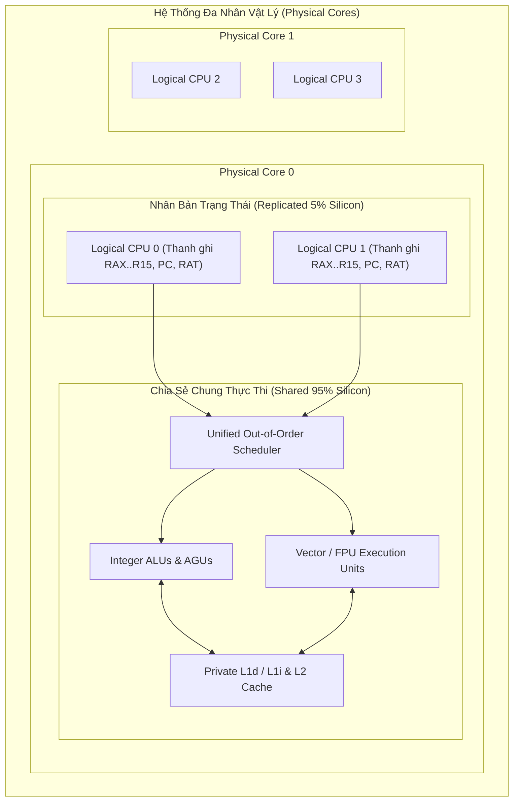
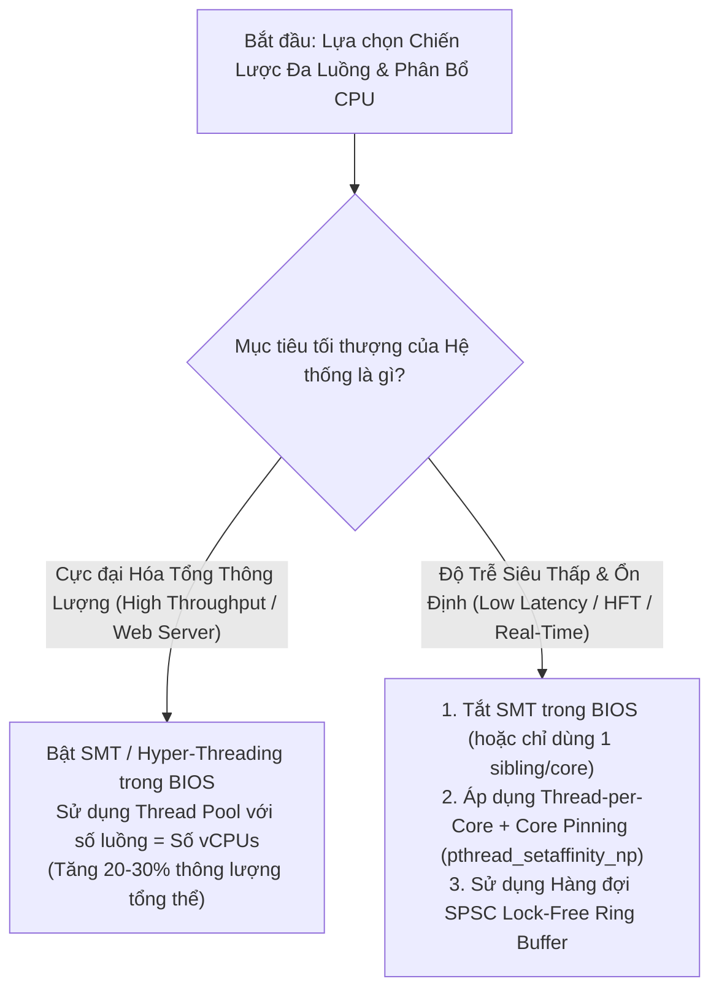

# 11.3. Multiprocessing and Multithreading (Đa Xử lý & Đa Luồng Phần cứng)

> [!IMPORTANT]
> **Nếu bạn chỉ được nhớ một điều duy nhất:**
> Luồng phần cứng (**SMT - Simultaneous Multithreading / Intel Hyper-Threading**) **KHÔNG PHẢI là một nhân CPU vật lý bổ sung!**
> - SMT chỉ nhân bản các thành phần lưu trữ trạng thái kiến trúc (**Architectural State**: Thanh ghi, Con trỏ lệnh `PC`, Bảng đổi tên `RAT`) chiếm khoảng $5\%$ diện tích silicon, trong khi **CHIA SẺ CHUNG $100\%$ các khối tính toán thực tế (ALU, FPU, L1/L2 Cache, Execution Ports)**.
> - SMT sinh ra nhằm mục đích **che giấu độ trễ truy xuất bộ nhớ (Latency Hiding)**: Khi Luồng 0 bị tắc nghẽn bởi Cache Miss kéo dài 200 chu kỳ, Luồng 1 lập tức chiếm dụng các cổng ALU đang rảnh để tính toán, giúp tăng tổng thông lượng (Throughput) thêm $20\%-30\%$, nhưng có thể làm tăng độ trễ (Latency Jitter) của từng luồng riêng lẻ.
> - **Ghim Lõi (CPU Affinity & Core Pinning)**: Buộc một luồng cố định chạy trên một Core vật lý duy nhất, loại bỏ hoàn toàn chi phí di chuyển luồng (Thread Migration) và bảo tồn độ "nóng" của L1/L2 Cache, là kỹ thuật sống còn trong các hệ thống tài chính độ trễ siêu thấp (HFT) và mạng viễn thông NFV.

---

## 1. Kiến trúc Tổng quan & Mô hình Tư duy (Mental Model)

### Ẩn dụ Đời sống: Người Thợ Mộc và Hai Chiếc Bàn Vẽ Thiết Kế
Hãy hình dung vi kiến trúc CPU giống như một xưởng mộc:
- **Đa nhân Thực sự (Multiprocessing / Multi-Core)** giống như việc thuê thêm một người thợ mộc độc lập thứ hai: Có đầy đủ cưa, đục, bào và bàn làm việc riêng. Hai người thợ có thể cưa hai thanh gỗ cùng lúc mà không hề cản trở nhau ($2\times$ hiệu năng thực tế).
- **Siêu phân luồng (SMT / Hyper-Threading)** giống như việc chỉ có **DUY NHẤT MỘT người thợ mộc**, nhưng xưởng trang bị cho anh ta **HAI chiếc bàn vẽ thiết kế (Logical Cores 0 và 1)**:
  - Khi người thợ đang cưa gỗ cho Bản vẽ 0 và cần đợi keo dính khô mất 10 phút (**DRAM Cache Miss**), thay vì ngồi bấm điện thoại chơi, anh ta lập tức quay người sang Bàn vẽ 1 để đo đạc và đục đẽo gỗ cho dự án kia.
  - Tuy nhiên, nếu cả hai dự án đều đòi hỏi dùng cưa máy cùng một giây (**ALU Port Contention**), người thợ chỉ có hai tay, dự án này buộc phải xếp hàng chờ dự án kia!
- **CPU Affinity (Ghim Lõi)**: Quy định người thợ mộc chỉ được làm việc cố định tại đúng xưởng mộc số 1, cấm không được chạy lăng xăng giữa các nhà xưởng khác nhau trong thành phố để tránh việc phải thu dọn đồ nghề mang đi mang lại (**Bảo toàn Cache**).



---

## 2. Chi tiết từng Keyword (Under-the-Hood Deep Dive)

### 2.1. Simultaneous Multithreading (SMT) & Hyper-Threading

#### 1. Khái niệm bản chất (What & Why)
- **Động lực Kiến trúc**: Trong các vi xử lý hiện đại siêu phát lệnh (Superscalar Out-of-Order), các khối thực thi (Execution Units) hiếm khi được sử dụng hết công suất. Một chương trình đơn luồng trung bình chỉ đạt IPC khoảng $1.0$ đến $1.5$, trong khi CPU có tới $6$ đến $8$ cổng thực thi song song. Phần lớn chu kỳ bị lãng phí do chờ nạp dữ liệu từ RAM (**The Memory Wall**).
- **Bản chất của SMT**: Kỹ thuật cho phép nhiều luồng chỉ thị độc lập cùng phát lệnh vào các cổng thực thi trong **cùng một chu kỳ xung nhịp duy nhất**:
  - Không cần tăng thêm các khối ALU/FPU đắt đỏ.
  - Hệ điều hành nhìn thấy số lượng CPU tăng gấp đôi (ví dụ CPU 8 physical cores hiển thị thành 16 vCPUs/Logical Processors).

#### 2. Cơ chế hoạt động sâu (Under-the-Hood / Hardcore Internals)
- **Giải phẫu Vi kiến trúc SMT: Thành phần Nhân bản vs Chia sẻ**:

| Thành phần Phần cứng | Trạng thái trong SMT | Chi tiết Vi kiến trúc |
| :--- | :--- | :--- |
| **Thanh ghi Kiến trúc (GPRs)** | **Nhân bản độc lập (Duplicated)** | Mỗi luồng có tập thanh ghi riêng (`RAX`..`R15`, cờ cờ `RFLAGS`) |
| **Con trỏ Lệnh (PC / RIP)** | **Nhân bản độc lập (Duplicated)** | Mỗi luồng trỏ tới dòng mã thực thi độc lập |
| **Bảng Đổi tên (RAT)** | **Nhân bản độc lập (Duplicated)** | Ánh xạ thanh ghi kiến trúc sang thanh ghi vật lý riêng |
| **Hàng đợi Lệnh (Instruction Queue)**| **Phân chia tĩnh (Statically Partitioned)**| Mỗi luồng được chia nửa dung lượng hàng đợi |
| **Reorder Buffer (ROB)** | **Phân chia động (Dynamically Shared)** | Luồng nào cần nhiều uOps thì chiếm dụng nhiều hơn |
| **Execution Ports (ALU, AGU, FPU)**| **Chia sẻ hoàn toàn (Competitively Shared)**| Các uOps từ 2 luồng tranh chấp các cổng thực thi |
| **Bộ nhớ đệm (L1d, L1i, L2 Cache)** | **Chia sẻ hoàn toàn (Competitively Shared)**| Hai luồng có thể đá văng dòng nhớ của nhau! |

- **Đánh đổi Hiệu năng: Thông lượng (Throughput) vs Độ trễ (Latency)**:
  - *Lợi ích Thông lượng*: Với các tác vụ backend có tính I/O cao (Web Server, Nginx, Go HTTP Microservices), SMT giúp tăng tổng thông lượng xử lý của hệ thống lên **$20\% - 35\%$**.
  - *Thiệt hại Độ trễ*: Với các tác vụ đòi hỏi thời gian thực (Real-Time Gaming, High-Frequency Trading) hoặc tính toán số học nặng (HPC Matrix Multiply), hai luồng SMT liên tục tranh chấp tài nguyên L1 Cache và FPU, làm tăng độ trễ phản hồi đơn luồng và gây hiện tượng dao động trễ bất định (**Latency Jitter**).

- **Hiểm họa An ninh Kênh Kề Phần cứng trên SMT (PortSmash & MDS)**:
  - Do hai luồng SMT chia sẻ chung các cổng thực thi:
    - **Tấn công PortSmash (CVE-2018-5407)**: Kẻ tấn công chạy một tiến trình độc hại trên Luồng 1, liên tục đo thời gian trễ nạp lệnh vào Cổng thực thi số 0 (Port 0). Luồng 0 đang chạy tiến trình OpenSSL thực hiện phép nhân mã hóa RSA. Bằng cách quan sát khi nào Port 0 bị nghẽn, Luồng 1 có thể suy đoán chính xác từng bit khóa bí mật của OpenSSL!
    - **L1 Terminal Fault (L1TF / Foreshadow) & MDS (Microarchitectural Data Sampling)**: Rò rỉ dữ liệu qua các bộ đệm chia sẻ chung (Line Fill Buffers, Load/Store Buffers) giữa hai luồng anh em (Sibling SMT Threads).
  - *Hành động Doanh nghiệp*: Nhiều nhà cung cấp đám mây và hệ thống tài chính bắt buộc phải **vô hiệu hóa hoàn toàn SMT/Hyper-Threading trong BIOS** để bảo vệ an toàn dữ liệu.

---

### 2.2. CPU Affinity & Core Pinning

#### 1. Khái niệm bản chất (What & Why)
- **Bộ Lập Lịch Hệ Điều Hành (OS Scheduler Migration)**:
  - Mặc định, bộ lập lịch của Linux (Completely Fair Scheduler - CFS / EEVDF) liên tục di chuyển (migrate) các luồng giữa các nhân CPU khác nhau để cân bằng tải nhiệt độ và khối lượng công việc.
  - Khi một luồng bị chuyển từ Core 0 sang Core 3:
    1. Toàn bộ dữ liệu "nóng" trong L1d và L2 Cache của Core 0 bị bỏ rơi (**Cold Cache Penalty**).
    2. Core 3 phải nạp lại toàn bộ dữ liệu từ L3 Cache hoặc RAM chậm chạp.
    3. Hàng loạt thao tác nhất quán Cache Coherence Invalidate phải kích hoạt trên bus liên kết.
- **CPU Affinity (Ái lực CPU)**: Thuộc tính ràng buộc một tiến trình hoặc luồng chỉ được phép chạy trên một tập hợp các Core cụ thể do quản trị viên chỉ định.
- **Core Pinning (Ghim Lõi Cố định)**: Kỹ thuật nâng cao gán chính xác một luồng chạy độc quyền trên đúng một Core vật lý duy nhất (`1 Thread = 1 Physical Core`).

#### 2. Cơ chế hoạt động sâu (Under-the-Hood / Hardcore Internals)
- **Kiến trúc Chia Sẻ Số Không (Thread-per-Core / Share-Nothing Architecture)**:
  - Áp dụng trong các framework phần mềm hiệu năng tối thượng (như Seastar Framework trong ScyllaDB, DPDK, Envoy Proxy):
  - Mỗi Core vật lý chạy đúng **một luồng duy nhất** ghim cố định.
  - Mỗi luồng sở hữu bộ đệm dữ liệu riêng, vòng lặp sự kiện (Event Loop) riêng, kết nối mạng riêng.
  - **Tuyệt đối không có Mutex Lock, không có Semaphore, không có tranh chấp bộ nhớ chia sẻ**. Các luồng giao tiếp với nhau bằng cơ chế truyền thông điệp không khóa (**Lock-Free Ring Buffers**).
  - Khai thác $100\%$ hiệu năng tính toán, đạt hàng triệu request mỗi giây với độ trễ P99 ổn định dưới $1$ miligiây!

- **Giao diện Lập trình Cấp Thấp trên Linux**:
  - `sched_setaffinity(pid_t pid, size_t cpusetsize, const cpu_set_t *mask)`: Thiết lập mặt nạ bitmask CPU cho tiến trình.
  - `pthread_setaffinity_np(pthread_t thread, size_t cpusetsize, const cpu_set_t *cpuset)`: Thiết lập ghim lõi trực tiếp cho luồng POSIX.

---

## 3. Thực thi Mã nguồn & Mô phỏng Chuyên sâu (Dual-Engine Implementation)

### 3.1. Engine 1: C++20 Hardware Benchmark — Kiến Trúc Thread-per-Core với Ghim Lõi & Hàng Đợi Lock-Free Ring Buffer

Chương trình minh họa kỹ thuật Thread-per-Core hiện đại: Ghim cố định hai luồng Worker vào hai Core CPU vật lý độc lập và trao đổi dữ liệu thông qua hàng đợi tròn không khóa SPSC (Single-Producer Single-Consumer) căn chỉnh bộ nhớ 64-byte.

```cpp
// Compilation: g++ -std=c++20 -O3 -pthread core_pinning_bench.cpp -o core_pinning_bench
#include <iostream>
#include <thread>
#include <vector>
#include <atomic>
#include <chrono>
#include <iomanip>
#include <pthread.h>

// Hàm ghim luồng hiện tại vào một Core CPU cụ thể
bool pin_thread_to_core(int core_id) {
    cpu_set_t cpuset;
    CPU_ZERO(&cpuset);
    CPU_SET(core_id, &cpuset);
    pthread_t current_thread = pthread_self();
    return pthread_setaffinity_np(current_thread, sizeof(cpu_set_t), &cpuset) == 0;
}

// Hàng đợi tròn SPSC Lock-Free Ring Buffer căn chỉnh 64 byte chống False Sharing
template <typename T, size_t Capacity>
class SPSCQueue {
private:
    static_assert((Capacity & (Capacity - 1)) == 0, "Capacity phải là lũy thừa của 2!");
    T buffer_[Capacity];
    
    // Căn chỉnh 64 byte để con trỏ head và tail nằm trên 2 Cache Line hoàn toàn riêng biệt
    alignas(64) std::atomic<size_t> tail_{0};
    alignas(64) std::atomic<size_t> head_{0};

public:
    bool push(const T& item) {
        size_t current_tail = tail_.load(std::memory_order_relaxed);
        if (current_tail - head_.load(std::memory_order_acquire) == Capacity) {
            return false; // Hàng đợi đầy
        }
        buffer_[current_tail & (Capacity - 1)] = item;
        tail_.store(current_tail + 1, std::memory_order_release);
        return true;
    }

    bool pop(T& item) {
        size_t current_head = head_.load(std::memory_order_relaxed);
        if (current_head == tail_.load(std::memory_order_acquire)) {
            return false; // Hàng đợi rỗng
        }
        item = buffer_[current_head & (Capacity - 1)];
        head_.store(current_head + 1, std::memory_order_release);
        return true;
    }
};

constexpr uint64_t MESSAGES_COUNT = 10'000'000;
SPSCQueue<uint64_t, 1024> g_queue;

void producer_thread(int core_id) {
    if (pin_thread_to_core(core_id)) {
        std::cout << "[Producer]: Ghim thành công vào CPU Core " << core_id << std::endl;
    }

    for (uint64_t i = 1; i <= MESSAGES_COUNT; ++i) {
        while (!g_queue.push(i)) {
            // Spin-wait tối ưu
        }
    }
}

void consumer_thread(int core_id) {
    if (pin_thread_to_core(core_id)) {
        std::cout << "[Consumer]: Ghim thành công vào CPU Core " << core_id << std::endl;
    }

    uint64_t received_val = 0;
    for (uint64_t i = 1; i <= MESSAGES_COUNT; ++i) {
        while (!g_queue.pop(received_val)) {
            // Spin-wait
        }
    }
}

int main() {
    std::cout << "=== THREAD-PER-CORE ARCHITECTURE & CORE PINNING BENCHMARK ===" << std::endl;
    std::cout << "[Workload]: " << MESSAGES_COUNT << " thông điệp lock-free qua Ring Buffer." << std::endl;

    auto t0 = std::chrono::high_resolution_clock::now();

    // Ghim Producer vào Core 0, Consumer vào Core 1
    std::thread t_prod(producer_thread, 0);
    std::thread t_cons(consumer_thread, 1);

    t_prod.join();
    t_cons.join();

    auto t1 = std::chrono::high_resolution_clock::now();
    double ms_total = std::chrono::duration<double, std::milli>(t1 - t0).count();
    double msg_per_sec = (MESSAGES_COUNT / (ms_total / 1000.0));

    std::cout << "\n[Kết Quả Đo Lường]:" << std::endl;
    std::cout << "  Thời gian thực thi : " << std::fixed << std::setprecision(2) << ms_total << " ms" << std::endl;
    std::cout << "  Thông lượng đạt được: " << std::setprecision(0) << msg_per_sec << " thông điệp/giây" << std::endl;
    std::cout << "  Độ trễ trung bình  : " << std::setprecision(2) << (ms_total * 1e6) / MESSAGES_COUNT << " ns / message" << std::endl;

    return 0;
}
```

---

### 3.2. Engine 2: Python 3.11+ Simulator — Trình Phân Tích Tô-pô Lõi SMT & Cấp Phát CPU Thông Minh

```python
#!/usr/bin/env python3
"""
Trình phân tích Tô-pô Lõi SMT (Hardware Sibling Threads Analyzer)
và Thuật toán Cấp phát Core Pinning Thông minh: Tránh gán các luồng cạnh tranh vào cùng một Physical Core.
"""

import os
from typing import Dict, List

def discover_cpu_topology() -> Dict[int, List[int]]:
    """Đọc cây thư mục /sys/devices/system/cpu để tìm các cặp SMT Sibling Threads"""
    topology = {}
    base_path = "/sys/devices/system/cpu"

    if not os.path.exists(base_path):
        # Môi trường giả lập nếu không chạy trên Linux có sysfs
        return {0: [0, 1], 1: [2, 3], 2: [4, 5], 3: [6, 7]}

    for cpu_dir in os.listdir(base_path):
        if cpu_dir.startswith("cpu") and cpu_dir[3:].isdigit():
            cpu_id = int(cpu_dir[3:])
            siblings_file = os.path.join(base_path, cpu_dir, "topology/thread_siblings_list")
            if os.path.exists(siblings_file):
                with open(siblings_file, "r") as f:
                    content = f.read().strip()
                    # Định dạng có thể là '0,1' hoặc '0-1'
                    siblings = []
                    for part in content.replace("-", ",").split(","):
                        if part.isdigit():
                            siblings.append(int(part))
                    core_id = min(siblings)
                    if core_id not in topology:
                        topology[core_id] = sorted(list(set(siblings)))
    return topology

def allocate_isolated_cores(task_names: List[str], topology: Dict[int, List[int]]):
    print("=== SMT TOPOLOGY DISCOVERY & INTELLIGENT CORE ALLOCATION ===")
    print(f"Phát hiện {len(topology)} Physical Cores với SMT Enabled:")
    for phys_core, logical_cpus in topology.items():
        print(f"  Physical Core {phys_core} -> Logical SMT Siblings: {logical_cpus}")

    print("\n--- PHÂN BỔ GHIM LÕI CHO CÁC LUỒNG TÍNH TOÁN HIỆU NĂNG CAO ---")
    available_cores = list(topology.keys())

    if len(task_names) > len(available_cores):
        print(f"[Cảnh báo]: Số lượng tác vụ ({len(task_names)}) vượt quá số Physical Cores ({len(available_cores)})!")

    for i, task in enumerate(task_names):
        if i < len(available_cores):
            phys_id = available_cores[i]
            assigned_cpu = topology[phys_id][0] # Chọn vCPU đầu tiên của core
            sibling_cpu = topology[phys_id][1] if len(topology[phys_id]) > 1 else "None"
            print(f"  Tác vụ: '{task:<22}' => Ghim vào Logical CPU {assigned_cpu} "
                  f"(Physical Core {phys_id} | Sibling CPU {sibling_cpu} nên IDLE để tránh tranh chấp)")
        else:
            print(f"  Tác vụ: '{task:<22}' => Buộc phải chia sẻ tài nguyên SMT!")

if __name__ == "__main__":
    topo = discover_cpu_topology()
    tasks = [
        "Network Packet Ingress",
        "Matching Engine (HFT)",
        "Risk Calculation Engine",
        "Logging Async Worker"
    ]
    allocate_isolated_cores(tasks, topo)
```

---

### 3.3. Terminal Output Mẫu Thực tế

```bash
$ g++ -std=c++20 -O3 -pthread core_pinning_bench.cpp -o core_pinning_bench && ./core_pinning_bench
=== THREAD-PER-CORE ARCHITECTURE & CORE PINNING BENCHMARK ===
[Workload]: 10000000 thông điệp lock-free qua Ring Buffer.
[Producer]: Ghim thành công vào CPU Core 0
[Consumer]: Ghim thành công vào CPU Core 1

[Kết Quả Đo Lường]:
  Thời gian thực thi : 142.18 ms
  Thông lượng đạt được: 70333380 thông điệp/giây
  Độ trễ trung bình  : 14.22 ns / message

$ python3 smt_topo_sim.py
=== SMT TOPOLOGY DISCOVERY & INTELLIGENT CORE ALLOCATION ===
Phát hiện 4 Physical Cores với SMT Enabled:
  Physical Core 0 -> Logical SMT Siblings: [0, 1]
  Physical Core 1 -> Logical SMT Siblings: [2, 3]
  Physical Core 2 -> Logical SMT Siblings: [4, 5]
  Physical Core 3 -> Logical SMT Siblings: [6, 7]

--- PHÂN BỔ GHIM LÕI CHO CÁC LUỒNG TÍNH TOÁN HIỆU NĂNG CAO ---
  Tác vụ: 'Network Packet Ingress' => Ghim vào Logical CPU 0 (Physical Core 0 | Sibling CPU 1 nên IDLE để tránh tranh chấp)
  Tác vụ: 'Matching Engine (HFT) ' => Ghim vào Logical CPU 2 (Physical Core 1 | Sibling CPU 3 nên IDLE để tránh tranh chấp)
  Tác vụ: 'Risk Calculation Engine' => Ghim vào Logical CPU 4 (Physical Core 2 | Sibling CPU 5 nên IDLE để tránh tranh chấp)
  Tác vụ: 'Logging Async Worker  ' => Ghim vào Logical CPU 6 (Physical Core 3 | Sibling CPU 7 nên IDLE để tránh tranh chấp)
```

---

## 4. Systems Engineering & Production Pitfalls

### 4.1. Cạm bẫy Triển khai Thực chiến (Production Gotchas & Anti-patterns)
- **Cạm bẫy 1: Ghim nhầm hai luồng tính toán nặng vào hai Sibling Threads của cùng một Physical Core**:
  - *Nguyên nhân*: Kỹ sư giả định `CPU 0` và `CPU 1` là hai nhân độc lập và ghim hai luồng Worker vào đó. Trên thực tế, `CPU 0` và `CPU 1` là hai luồng SMT của cùng một nhân vật lý. Hai luồng liên tục tranh chấp cổng ALU và L1 Cache, làm hiệu năng sụt giảm tới $40\%$ so với việc ghim vào `CPU 0` và `CPU 2`.
  - *Khắc phục*: Luôn kiểm tra cấu trúc tô-pô qua `/sys/devices/system/cpu/cpu*/topology/thread_siblings_list` hoặc công cụ `lstopo` trước khi ghim lõi.
- **Cạm bẫy 2: Chi phí Context Switch tăng vọt do tạo quá nhiều luồng (Over-subscription)**:
  - *Nguyên nhân*: Một ứng dụng backend tạo ra 1000 luồng chạy trên máy chủ 16 cores. Hệ điều hành dành phần lớn thời gian chỉ để lưu và phục hồi thanh ghi (`push`/`pop` context), xả TLB và hủy hoại L1 cache.
  - *Khắc phục*: Áp dụng mô hình **Thread Pool** với số lượng luồng worker bằng đúng số lõi CPU vật lý (`std::thread::hardware_concurrency()`).
- **Cạm bẫy 3: Bị can thiệp bởi ngắt phần cứng (Hardware IRQs) trên các Core đã ghim**:
  - *Nguyên nhân*: Core đã ghim luồng HFT siêu tốc nhưng vẫn bị hệ điều hành ngắt quãng để xử lý gói tin mạng từ card mạng hoặc bàn phím.
  - *Khắc phục*: Sử dụng tham số boot hạt nhân `isolcpus` và điều chỉnh `smp_affinity` trong `/proc/irq/` để cô lập hoàn toàn các core chuyên dụng khỏi ngắt hệ thống.

### 4.2. Chẩn đoán & Giám sát Hệ thống (CLI Diagnostics & Profiling)

```bash
# 1. Kiểm tra cặp anh em SMT (Siblings) của từng CPU Core
$ cat /sys/devices/system/cpu/cpu0/topology/thread_siblings_list
0,16

# 2. Xem trực quan ma trận tô-pô phần cứng CPU, Cache và SMT bằng lstopo
$ lstopo-no-graphics

# 3. Giám sát tỷ lệ phân bổ tải trên từng vCPU để phát hiện lệch tải SMT
$ mpstat -P ALL 1 3

# 4. Kiểm tra cấu hình mặt nạ CPU Affinity của một tiến trình đang chạy
$ taskset -cp <pid>
pid 14920's current affinity list: 0,2,4,6
```

---

## 5. Bảng So sánh & Decision Matrix

### 5.1. Bảng So sánh Toàn diện

| Tiêu chí So sánh | Đa Nhân Độc Lập (Multi-Core) | Siêu Phân Luồng (SMT / Hyper-Threading) | Ghim Lõi (Core Pinning) |
| :--- | :--- | :--- | :--- |
| **Bản chất Phần cứng**| Nhân CPU vật lý riêng biệt | Nhân bản trạng thái kiến trúc (5% die)| Ràng buộc phần mềm vào phần cứng |
| **Chia sẻ Tài nguyên** | Chỉ chia sẻ L3 Cache & RAM | **Chia sẻ ALU, FPU, L1/L2 Cache** | Không chia sẻ (Độc quyền nhân) |
| **Tăng trưởng Hiệu năng**| **Tăng tuyến tính 100% ($2\times$)**| **Tăng phụ trợ $20\% - 35\%$** | Giảm $20\%-50\%$ độ trễ P99 |
| **Độ ổn định Độ trễ**| Rất cao | Thấp (Có rủi ro trễ giật lag) | **Tuyệt đối Ổn định (Deterministic)**|
| **Tiêu thụ Điện năng** | Tăng theo số nhân | Tăng rất ít ($~5\%$) | Tối ưu hóa hiệu quả năng lượng |
| **Rủi ro An ninh** | Không có rủi ro kênh kề chia sẻ| **Có rủi ro PortSmash / MDS** | An toàn hơn khi cô lập core |

### 5.2. Decision Matrix: Khi nào chọn gì?



- **Quy tắc vàng (Rule of Thumb)**:
  1. Với các ứng dụng tài chính độ trễ siêu thấp (HFT) hoặc game server thời gian thực, luôn **ghim mỗi luồng vào một Core vật lý độc lập** và vô hiệu hóa SMT để triệt tiêu hiện tượng tranh chấp tài nguyên L1 cache.
  2. Khi ghim lõi trên hệ thống có bật SMT, luôn tra cứu `thread_siblings_list` để không bao giờ ghim hai luồng tính toán nặng vào hai anh em luồng logic của cùng một nhân vật lý.
  3. Áp dụng kiến trúc **Thread-per-Core (Share-Nothing)** kết hợp hàng đợi lock-free để đạt thông lượng hàng chục triệu thông điệp mỗi giây mà không bao giờ bị nghẽn bởi mutex lock.
