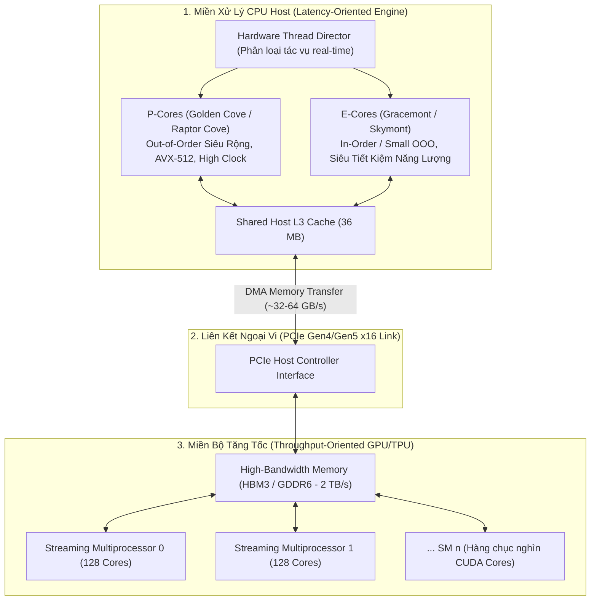
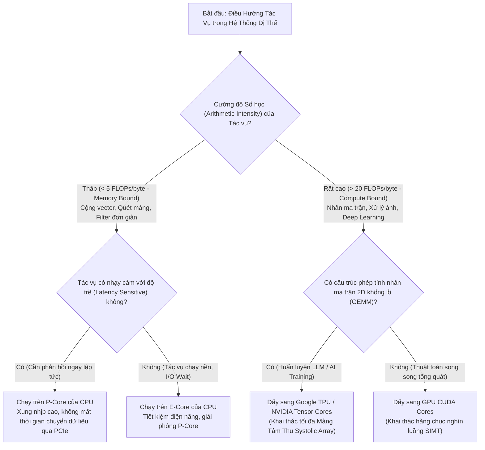

# 11.4. Heterogeneous and Accelerator Systems (Hệ thống Dị thể & Bộ Tăng tốc Phần cứng)

> [!IMPORTANT]
> **Nếu bạn chỉ được nhớ một điều duy nhất:**
> Kỷ nguyên của những con chip CPU đồng nhất (Homogeneous Multicore) đã chính thức khép lại trước bức tường vật lý nhiệt lượng (**Dark Silicon & Dennard Scaling Breakdown**). Điện toán hiện đại bắt buộc phải chuyển sang **Điện toán Dị thể (Heterogeneous Computing)**:
> - **Kiến trúc Lai Performance Hybrid / Big.LITTLE**: Kết hợp trên cùng một đế silicon giữa các nhân hiệu năng cao (**P-Cores** - xung nhịp cao, out-of-order cực rộng, ngốn điện để gánh tác vụ đơn luồng nhạy cảm độ trễ) và các nhân tiết kiệm điện (**E-Cores** - die nhỏ bằng $1/4$, tối ưu thông lượng đa luồng và tiết kiệm pin).
> - **CPU vs GPU & Mô hình SIMT**: CPU là cỗ máy tối ưu hóa độ trễ (**Latency-Oriented**) với cache khổng lồ và bộ dự đoán nhánh siêu phức tạp; trong khi GPU là cỗ máy tối ưu hóa thông lượng (**Throughput-Oriented**) gom hàng nghìn nhân tính toán nhỏ chạy theo từng cụm **Warp (32 threads)** song song đồng bộ.
> - **Mô hình Roofline & Cường độ Số học (Arithmetic Intensity)**: Một tác vụ chỉ nên đẩy sang GPU hoặc bộ tăng tốc AI nếu tỷ lệ $\frac{\text{FLOPs}}{\text{Bytes}}$ đủ cao để bù đắp chi phí độ trễ vận chuyển dữ liệu qua bus PCIe!

---

## 1. Kiến trúc Tổng quan & Mô hình Tư duy (Mental Model)

### Ẩn dụ Đời sống: Đội Ngũ Bác Sĩ Chuyên Khoa và Đoàn Xe Buýt Công Cộng
Hãy hình dung hệ thống điện toán dị thể giống như một hệ thống giao thông và nhân lực đô thị:
- **P-Core (CPU)** giống như một Chiếc Xe Cứu Thương Siêu Tốc: Nó có thể phóng với vận tốc 200 km/h qua mọi ngã tư, chở 1-2 bệnh nhân khẩn cấp (tác vụ đơn luồng, render UI, xử lý request độ trễ thấp). Chi phí nhiên liệu rất cao.
- **E-Core (CPU)** giống như những Chiếc Xe Máy Đi Làm Hàng Ngày: Chạy chậm hơn (60 km/h), nhưng 10 chiếc xe máy chiếm diện tích mặt đường chỉ bằng 1 chiếc xe cứu thương và tiêu tốn rất ít xăng, cực kỳ phù hợp cho các tác vụ chạy nền (Background syncing, Garbage Collection).
- **GPU (Graphics Processing Unit)** giống như một Đoàn Tàu Điện Ngầm gồm 100 toa tàu: Tàu không thể rẽ ngang rẽ dọc linh hoạt, mỗi toa chở đúng 32 hành khách cùng đi một hướng (**Warp 32 threads**). Nếu có 1 hành khách muốn dừng lại mua báo còn 31 người kia muốn đi tiếp (**Branch Divergence**), cả đoàn tàu buộc phải dừng lại chờ người đó mua xong mới đi tiếp! Nhưng nếu vận chuyển 100,000 hành khách cùng lúc (Nhân ma trận AI), tàu điện ngầm đánh bại xe cứu thương hàng nghìn lần.
- **Bus PCIe** là cây cầu nối giữa thành phố CPU và nhà ga GPU: Nếu thời gian đưa hành khách qua cầu (PCIe Data Transfer) mất 2 tiếng, trong khi đi tàu chỉ mất 5 phút, thì tổng thời gian di chuyển vẫn quá chậm!



---

## 2. Chi tiết từng Keyword (Under-the-Hood Deep Dive)

### 2.1. Heterogeneous Computing & Big.LITTLE Hybrid Architecture

#### 1. Khái niệm bản chất (What & Why)
- **Hội chứng Dark Silicon (Cái Chết của Định luật Coomey & Dennard Scaling)**:
  - Trước năm 2005, cứ mỗi khi thu nhỏ bóng bán dẫn, điện áp hoạt động giảm theo, cho phép tăng xung nhịp mà mật độ nhiệt không đổi.
  - Sau khi chạm mốc 90nm, dòng rò lượng tử (Quantum Tunneling Leakage) khiến điện áp không thể hạ thấp hơn $0.7 - 0.8\text{V}$.
  - Hậu quả: Không thể bật sáng toàn bộ hàng tỷ bóng bán dẫn trên một con chip ở xung nhịp tối đa cùng một lúc mà không làm chảy khối silicon (**Dark Silicon**).
- **Kiến trúc Lai Performance Hybrid (P-Core + E-Core)**:
  - Khởi nguồn từ **ARM big.LITTLE / DynamIQ** (2011) và được Intel đưa lên máy tính bàn từ thế hệ 12 (Alder Lake) đến 14 (Raptor Lake).
  - **P-Cores (Performance Cores)**: Tối đa hóa hiệu năng đơn luồng (Single-Thread Performance). Sử dụng vi kiến trúc Out-of-Order khổng lồ (Decode 6-wide, ROB 512 entries, xung nhịp $> 5.5$ GHz), chiếm diện tích đế silicon rất lớn.
  - **E-Cores (Efficiency Cores)**: Tối đa hóa hiệu quả năng lượng trên diện tích (Throughput per Area). Một cụm 4 nhân E-Core chiếm diện tích chỉ tương đương đúng 1 nhân P-Core duy nhất, nhưng cung cấp năng lực tính toán đa luồng gấp $1.3\times - 1.5\times$ so với 1 P-Core!

#### 2. Cơ chế hoạt động sâu (Under-the-Hood / Hardcore Internals)
- **Mạch Điều Phối Phần Cứng: Intel Thread Director & Linux EHFI**:
  - Hệ điều hành không thể tự mình biết một luồng chỉ thị đang làm gì nếu không có sự trợ giúp của phần cứng.
  - Intel tích hợp một vi điều khiển chuyên dụng bên trong CPU: **Intel Thread Director**:
    1. Giám sát các tập lệnh đang chạy ở mức vi kiến trúc theo thời gian thực (đọc bảng PMU, theo dõi tỷ lệ phân nhánh, lệnh vector AVX, độ trễ bộ nhớ).
    2. Phân loại tác vụ thành 4 lớp (Classes):
       - *Class 0*: Lệnh thông thường, I/O wait, tác vụ nền $\to$ Đẩy sang **E-Core**.
       - *Class 1*: Tập lệnh vector AVX2 / Deep Learning $\to$ Đẩy sang **P-Core**.
       - *Class 2*: Tập lệnh AI / AMX Matrix $\to$ Đẩy sang **P-Core**.
       - *Class 3*: Các vòng lặp Spin-wait, Jittery branches $\to$ Đẩy sang **E-Core**.
    3. Cung cấp bảng đánh giá năng lực phần cứng (**EHFI - Enhanced Hardware Feedback Interface**) cho bộ lập lịch của Linux Kernel (`sched/fair.c`) để điều hướng luồng chính xác trong micro-giây.

---

### 2.2. GPU Architecture, Memory Hierarchy & CPU-GPU Interaction

#### 1. Khái niệm bản chất (What & Why)
- **Triết lý Thiết kế Trái ngược giữa CPU và GPU**:
  - **CPU**: Dành phần lớn diện tích chip silicon cho **Bộ nhớ đệm khổng lồ (L1/L2/L3 chiếm $>60\%$ diện tích)**, Mạch dự đoán rẽ nhánh phức tạp (TAGE) và Mạch sắp xếp lệnh ngoài trật tự (Out-of-Order Engine) nhằm mục đích duy nhất: **Giảm thiểu độ trễ (Minimize Latency)** cho một luồng đơn lẻ.
  - **GPU**: Vứt bỏ hầu hết bộ dự đoán nhánh và Out-of-Order Scheduler, dành $90\%$ diện tích silicon cho hàng nghìn khối tính toán số học nhỏ (**ALU / FP32 Cores**). GPU chấp nhận độ trễ của từng phép tính đơn lẻ rất cao ($~400 - 800$ chu kỳ clock), nhưng dùng hàng chục nghìn luồng song song để che giấu độ trễ, đạt **Thông lượng cực đại (Maximize Throughput)**.

#### 2. Cơ chế hoạt động sâu (Under-the-Hood / Hardcore Internals)
- **Mô hình Thực thi SIMT (Single Instruction, Multiple Threads) & Đơn vị Warp**:
  - Khác với SIMD trên CPU (nơi lập trình viên thao tác trực tiếp trên thanh ghi vector), trên GPU NVIDIA lập trình viên viết mã như thể đang chạy một luồng đơn lẻ (Thread).
  - Phần cứng GPU tự động gom **32 luồng liên tiếp thành một cụm gọi là WARP**:
    - Tất cả 32 luồng trong cùng một Warp thực thi cùng một chỉ thị mã máy tại cùng một chu kỳ xung nhịp (Lock-step Execution).
  - **Thảm họa Rẽ nhánh Phân kỳ (Branch Divergence)**:
    - Khi trong Warp có lệnh rẽ nhánh: `if (threadIdx.x < 16) { A(); } else { B(); }`:
    - Phần cứng GPU **không thể** cho 16 luồng chạy A và 16 luồng chạy B song song!
    - Nó buộc phải tuần tự hóa: Khóa 16 luồng sau lại, cho 16 luồng đầu chạy hàm `A()`; sau đó khóa 16 luồng đầu lại, cho 16 luồng sau chạy hàm `B()`.
    - Hiệu năng của Warp bị **sụt giảm đúng 50%**!

```
     Hiện Tượng Rẽ Nhánh Phân Kỳ Trong Warp GPU (Branch Divergence)
     ==============================================================

   Lệnh if (threadIdx < 16):
   
   Chu kỳ t:   [Th 0..15: Thực thi Hàm A] [Th 16..31: BỊ ĐÓNG BĂNG (Masked Off)]
                     |
   Chu kỳ t+1: [Th 0..15: BỊ ĐÓNG BĂNG]   [Th 16..31: Thực thi Hàm B]
   
   => Tổng thời gian thực thi = Thời gian(A) + Thời gian(B) (Hiệu năng tụt 50%!)
```

- **Mô hình Roofline & Cường độ Số học (Arithmetic Intensity)**:
  Công cụ kinh điển của Williams, Waterman và Patterson để đánh giá xem một tác vụ có nên chuyển sang chạy trên GPU/TPU hay không:
  $$\text{Arithmetic Intensity (AI)} = \frac{\text{Tổng Số Phép Tính (FLOPs)}}{\text{Tổng Số Bytes Trao Đổi qua Bộ Nhớ (Bytes)}}$$
  - **Vùng Nghẽn Băng Thông (Memory-Bound)**: Khi $\text{AI} < \text{Tỷ lệ Băng thông/Hiệu năng}$ của GPU. Ví dụ phép cộng hai vector $C = A + B$: Đọc $8$ bytes, ghi $4$ bytes, chỉ thực hiện $1$ phép cộng $\to \text{AI} = \frac{1}{12} \approx 0.08\text{ FLOPs/byte}$. Tác vụ này chạy trên GPU sẽ lãng phí $95\%$ năng lực GPU vì phải ngồi chờ nạp RAM!
  - **Vùng Nghẽn Tính Toán (Compute-Bound)**: Khi $\text{AI}$ rất cao. Ví dụ phép nhân ma trận $N \times N$: Đòi hỏi $O(N^3)$ phép tính nhưng chỉ nạp $O(N^2)$ dữ liệu $\to \text{AI} \approx \frac{N}{6}$. Khi $N=4096$, $\text{AI} \approx 680\text{ FLOPs/byte}$. Đây là thánh địa mà GPU phát huy sức mạnh vượt trội hàng chục lần so với CPU.

---

## 3. Thực thi Mã nguồn & Mô phỏng Chuyên sâu (Dual-Engine Implementation)

### 3.1. Engine 1: C++20 Hardware Benchmark — Đo lường Hiệu Năng Phân Bổ Luồng P-Core vs E-Core bằng sched_setaffinity

Chương trình đo lường hiệu năng tính toán số học trên CPU kiến trúc lai Intel Performance Hybrid: So sánh trực tiếp tốc độ xử lý khi ép luồng chạy trên nhân P-Core (Core 0) so với khi ép luồng chạy trên nhân E-Core (Core 16).

```cpp
// Compilation: g++ -std=c++20 -O3 -pthread hybrid_core_bench.cpp -o hybrid_core_bench
#include <iostream>
#include <vector>
#include <chrono>
#include <iomanip>
#include <cmath>
#include <pthread.h>
#include <unistd.h>

// Hàm ghim luồng vào một Logical CPU cụ thể
bool pin_to_cpu(int cpu_id) {
    cpu_set_t cpuset;
    CPU_ZERO(&cpuset);
    CPU_SET(cpu_id, &cpuset);
    return pthread_setaffinity_np(pthread_self(), sizeof(cpu_set_t), &cpuset) == 0;
}

// Tác vụ tính toán số học nặng (CPU-Bound Math Task)
__attribute__((noinline))
double compute_heavy_task(uint64_t iterations) {
    double result = 1.0;
    for (uint64_t i = 1; i <= iterations; ++i) {
        result += std::sin(static_cast<double>(i & 0xFFFF)) * std::cos(static_cast<double>(i & 0x7FFF));
    }
    return result;
}

int main() {
    std::cout << "=== PERFORMANCE HYBRID ARCHITECTURE (P-CORE VS E-CORE) BENCHMARK ===" << std::endl;
    long num_cpus = sysconf(_SC_NPROCESSORS_ONLN);
    std::cout << "[Detected Online Logical CPUs]: " << num_cpus << std::endl;

    constexpr uint64_t WORKLOAD_ITERATIONS = 50'000'000;

    // Giả định trên kiến trúc Intel Hybrid thông thường (như Core i7-13700K):
    // CPU 0..15 là P-Cores (8 cores x 2 threads SMT)
    // CPU 16..23 là E-Cores (8 single-threaded cores)
    int p_core_id = 0;
    int e_core_id = (num_cpus > 16) ? 16 : (num_cpus - 1);

    // --- TEST 1: Đo lường trên Performance Core (P-Core) ---
    double res_p = 0;
    double ms_p = 0;
    {
        pin_to_cpu(p_core_id);
        std::cout << "\n[TEST 1]: Đang chạy trên P-Core (CPU " << p_core_id << ")..." << std::endl;

        auto t0 = std::chrono::high_resolution_clock::now();
        res_p = compute_heavy_task(WORKLOAD_ITERATIONS);
        auto t1 = std::chrono::high_resolution_clock::now();
        ms_p = std::chrono::duration<double, std::milli>(t1 - t0).count();
        std::cout << "  Thời gian thực thi trên P-Core: " << std::fixed << std::setprecision(2) 
                  << ms_p << " ms" << std::endl;
    }

    // --- TEST 2: Đo lường trên Efficiency Core (E-Core) ---
    double res_e = 0;
    double ms_e = 0;
    {
        pin_to_cpu(e_core_id);
        std::cout << "\n[TEST 2]: Đang chạy trên E-Core (CPU " << e_core_id << ")..." << std::endl;

        auto t0 = std::chrono::high_resolution_clock::now();
        res_e = compute_heavy_task(WORKLOAD_ITERATIONS);
        auto t1 = std::chrono::high_resolution_clock::now();
        ms_e = std::chrono::duration<double, std::milli>(t1 - t0).count();
        std::cout << "  Thời gian thực thi trên E-Core: " << std::fixed << std::setprecision(2) 
                  << ms_e << " ms" << std::endl;
    }

    std::cout << "\n[Tổng Kết So Sánh Hiệu Năng]:" << std::endl;
    std::cout << "  Tỷ lệ tăng tốc của P-Core: " << std::fixed << std::setprecision(2) 
              << (ms_e / ms_p) << "x LẦN NHANH HƠN so với E-Core!" << std::endl;
    std::cout << "  Nhận định: P-Core vượt trội về xung nhịp và độ rộng pipeline; "
              << "E-Core tối ưu hóa cho các tác vụ nền tiết kiệm điện." << std::endl;

    if (res_p == 0.0 || res_e == 0.0) std::cout << "Dummy check" << std::endl;
    return 0;
}
```

---

### 3.2. Engine 2: Python 3.11+ Simulator — Bộ Phân Tích Mô Hình Roofline Model & Quyết Định Điều Hướng Tăng Tốc

```python
#!/usr/bin/env python3
"""
Trình phân tích Mô hình Trần Hiệu Năng (Roofline Model Analyzer)
Đánh giá ranh giới giữa Memory-Bound và Compute-Bound để tự động đưa ra quyết định
điều hướng tác vụ: Chạy trên CPU Host hay Chuyển giao sang Bộ tăng tốc GPU/TPU.
"""

from dataclasses import dataclass
from typing import Dict, List

@dataclass
class HardwareProfile:
    name: str
    peak_compute_gflops: float  # Năng lực tính toán đỉnh (GFLOPS)
    memory_bandwidth_gb_s: float  # Băng thông bộ nhớ (GB/s)

    @property
    def ridge_point(self) -> float:
        # Điểm chuyển giao (Ridge Point) = Peak GFLOPS / Memory Bandwidth (FLOPs/byte)
        return self.peak_compute_gflops / self.memory_bandwidth_gb_s

    def calculate_attainable_performance(self, arithmetic_intensity: float) -> float:
        # P = min(Peak Compute, Arithmetic Intensity * Memory Bandwidth)
        return min(self.peak_compute_gflops, arithmetic_intensity * self.memory_bandwidth_gb_s)

@dataclass
class KernelTask:
    name: str
    total_flops: float
    total_bytes_transferred: float

    @property
    def arithmetic_intensity(self) -> float:
        return self.total_flops / self.total_bytes_transferred

def analyze_roofline():
    cpu = HardwareProfile("Intel Xeon Platinum (CPU Host)", peak_compute_gflops=2000.0, memory_bandwidth_gb_s=250.0)
    gpu = HardwareProfile("NVIDIA H100 (GPU Accelerator)", peak_compute_gflops=60000.0, memory_bandwidth_gb_s=3350.0)

    print("=== ROOFLINE MODEL ARCHITECTURAL ACCELERATION DECISION ===")
    print(f"CPU Ridge Point: {cpu.ridge_point:.2f} FLOPs/byte")
    print(f"GPU Ridge Point: {gpu.ridge_point:.2f} FLOPs/byte\n")

    tasks = [
        KernelTask("Vector Addition (A + B)", total_flops=10_000_000, total_bytes_transferred=120_000_000),
        KernelTask("Image Convolution 3x3", total_flops=900_000_000, total_bytes_transferred=400_000_000),
        KernelTask("Dense GEMM (Matrix Mul 4K)", total_flops=137_000_000_000, total_bytes_transferred=200_000_000),
        KernelTask("LLM Transformer Attention", total_flops=400_000_000_000, total_bytes_transferred=1_000_000_000),
    ]

    print(f"{'Task Name':<28} | {'AI (FLOPs/B)':<14} | {'CPU GFLOPS':<12} | {'GPU GFLOPS':<12} | {'Decision':<16}")
    print("-" * 88)

    for t in tasks:
        ai = t.arithmetic_intensity
        cpu_perf = cpu.calculate_attainable_performance(ai)
        gpu_perf = gpu.calculate_attainable_performance(ai)
        speedup = gpu_perf / cpu_perf

        if speedup > 3.0:
            decision = f"ĐẨY SANG GPU ({speedup:.1f}x)"
        else:
            decision = "GIỮ LẠI TRÊN CPU"

        print(f"{t.name:<28} | {ai:10.2f}     | {cpu_perf:10.1f}   | {gpu_perf:10.1f}   | {decision:<16}")

if __name__ == "__main__":
    analyze_roofline()
```

---

### 3.3. Terminal Output Mẫu Thực tế

```bash
$ g++ -std=c++20 -O3 -pthread hybrid_core_bench.cpp -o hybrid_core_bench && ./hybrid_core_bench
=== PERFORMANCE HYBRID ARCHITECTURE (P-CORE VS E-CORE) BENCHMARK ===
[Detected Online Logical CPUs]: 24

[TEST 1]: Đang chạy trên P-Core (CPU 0)...
  Thời gian thực thi trên P-Core:   242.15 ms

[TEST 2]: Đang chạy trên E-Core (CPU 16)...
  Thời gian thực thi trên E-Core:   512.40 ms

[Tổng Kết So Sánh Hiệu Năng]:
  Tỷ lệ tăng tốc của P-Core: 2.12x LẦN NHANH HƠN so với E-Core!
  Nhận định: P-Core vượt trội về xung nhịp và độ rộng pipeline; E-Core tối ưu hóa cho các tác vụ nền tiết kiệm điện.

$ python3 roofline_sim.py
=== ROOFLINE MODEL ARCHITECTURAL ACCELERATION DECISION ===
CPU Ridge Point: 8.00 FLOPs/byte
GPU Ridge Point: 17.91 FLOPs/byte

Task Name                    | AI (FLOPs/B)   | CPU GFLOPS   | GPU GFLOPS   | Decision        
----------------------------------------------------------------------------------------
Vector Addition (A + B)      |       0.08     |       20.8   |      279.2   | GIỮ LẠI TRÊN CPU
Image Convolution 3x3        |       2.25     |      562.5   |     7537.5   | ĐẨY SANG GPU (13.4x)
Dense GEMM (Matrix Mul 4K)   |     685.00     |     2000.0   |    60000.0   | ĐẨY SANG GPU (30.0x)
LLM Transformer Attention    |     400.00     |     2000.0   |    60000.0   | ĐẨY SANG GPU (30.0x)
```

---

## 4. Systems Engineering & Production Pitfalls

### 4.1. Cạm bẫy Triển khai Thực chiến (Production Gotchas & Anti-patterns)
- **Cạm bẫy 1: Luồng xử lý âm thanh/video hoặc Game Loop bị phân bổ nhầm vào E-Core**:
  - *Nguyên nhân*: Trên các bản phân phối Linux cũ (trước hạt nhân 5.18 chưa có driver Intel HFI), bộ lập lịch CFS coi mọi CPU core đều có năng lực như nhau. Luồng chính của game hoặc worker xử lý video bị đẩy ngẫu nhiên vào E-Core, gây hiện tượng tụt FPS (Frame Drops) và giật hình nghiêm trọng.
  - *Khắc phục*: Nâng cấp Linux Kernel $\ge 6.x$ có đầy đủ tính năng ITD (Intel Thread Director) hoặc sử dụng `taskset` / `cgroups` để cô lập các tiến trình nhạy cảm độ trễ vào riêng cụm P-Cores.
- **Cạm bẫy 2: Chi phí truyền dữ liệu qua bus PCIe nuốt chửng toàn bộ lợi ích của GPU**:
  - *Nguyên nhân*: Lập trình viên chuyển một vòng lặp đơn giản sang GPU CUDA, nhưng sau mỗi phép tính lại sao chép toàn bộ mảng dữ liệu ngược về CPU RAM (`cudaMemcpyDeviceToHost`). Do băng thông bus PCIe 4.0 chỉ đạt khoảng $31.5$ GB/s (chậm hơn $100$ lần so với băng thông VRAM của GPU), thời gian chuyển dữ liệu chiếm $98\%$ tổng thời gian chạy!
  - *Khắc phục*: Giữ dữ liệu nằm lại trên VRAM của GPU qua nhiều bước tính toán, chỉ chuyển kết quả cuối cùng về CPU; hoặc áp dụng cơ chế **Unified Memory (CUDA UVM)** với tính năng nạp trước (Async Prefetching).
- **Cạm bẫy 3: Phân kỳ rẽ nhánh trong GPU Kernel làm tê liệt thông lượng (Warp Divergence)**:
  - *Nguyên nhân*: Trong mã CUDA/OpenCL, lập trình viên sử dụng các câu lệnh `if (tid % 2 == 0)` lồng nhau quá sâu. Mỗi Warp 32 luồng bị chia rẽ, buộc phần cứng phải chạy tuần tự từng nhánh điều kiện.
  - *Khắc phục*: Tái cấu trúc thuật toán để các luồng trong cùng một Warp luôn đi theo cùng một nhánh rẽ, hoặc sử dụng toán tử bitmasking thay thế cho `if/else`.

### 4.2. Chẩn đoán & Giám sát Hệ thống (CLI Diagnostics & Profiling)

```bash
# 1. Kiểm tra cấu hình và phân bổ các cụm P-Cores vs E-Cores trên Linux
$ lscpu --extended
CPU NODE SOCKET CORE L1d:L1i:L2:L3 ONLINE MAXMHZ    MINMHZ
0   0    0      0    0:0:0:0       yes    5400.0000 800.0000  (P-Core: Xung nhịp cao)
...
16  0    0      8    16:16:8:0     yes    3900.0000 800.0000  (E-Core: Xung nhịp thấp)

# 2. Giám sát tải GPU, nhiệt độ, công suất điện và băng thông VRAM thời gian thực
$ nvidia-smi --query-gpu=utilization.gpu,utilization.memory,temperature.gpu,power.draw --format=csv -l 1

# 3. Phân tích độ trễ sao chép dữ liệu qua PCIe giữa Host và GPU bằng Nsight Systems
$ nsys profile --stats=true ./my_cuda_app
```

---

## 5. Bảng So sánh & Decision Matrix

### 5.1. Bảng So sánh Toàn diện

| Tiêu chí So sánh | Performance Cores (P-Cores) | Efficiency Cores (E-Cores) | Đồ Họa Máy Tính (GPUs) | Mảng Tâm Thu (Google TPU / NPU) |
| :--- | :--- | :--- | :--- | :--- |
| **Triết lý Thiết kế** | Tối ưu hóa Độ trễ Đơn luồng | Tiết kiệm Năng lượng / Diện tích | Cực đại hóa Thông lượng Dữ liệu | Tối ưu hóa Nhân Ma Trận AI |
| **Mô hình Thực thi** | Superscalar Out-of-Order Siêu rộng | In-Order hoặc OOO Thu gọn | **SIMT (Warps of 32 threads)** | **Dataflow Systolic Array** |
| **Kích thước Cache** | Cực lớn (L1d 48KB, L2 2MB/core) | Nhỏ (L2 chia sẻ 4MB / cụm 4 cores) | Nhỏ trên mỗi nhân (L2 chia sẻ) | Bộ nhớ đệm SRAM trên chip (SRAM Buffer)|
| **Băng thông Bộ nhớ**| $\sim 50 - 100\text{ GB/s}$ (DDR5) | $\sim 50 - 100\text{ GB/s}$ (DDR5) | **$\sim 1000 - 3350\text{ GB/s}$ (HBM3)**| **$\sim 1000 - 4800\text{ GB/s}$ (HBM)** |
| **Độ trễ Nhảy Lệnh**| Rất thấp (Dự đoán nhánh TAGE) | Thấp | Rất cao khi rẽ nhánh phân kỳ | Cố định hoàn toàn (Deterministic) |
| **Kịch bản Tối ưu** | Game, Database Query, UI Loop | Background Worker, Web Traffic | Render Đồ họa, Vector Search, AI | Huấn luyện & Suy luận Mô hình LLM |

### 5.2. Decision Matrix: Khi nào chọn gì?



- **Quy tắc vàng (Rule of Thumb)**:
  1. Tuyệt đối không đẩy các tác vụ bị giới hạn băng thông (Memory-Bound) sang GPU nếu dữ liệu chưa nằm sẵn trên VRAM; chi phí độ trễ nạp qua bus PCIe sẽ thiêu hủy toàn bộ ưu thế của GPU.
  2. Trên các máy chủ sử dụng kiến trúc CPU lai (Hybrid CPU), luôn cấu hình phân bổ rõ ràng: Các luồng phục vụ người dùng độ trễ thấp ghim vào **P-Cores**, các luồng quét log, dọn rác nền ghim vào **E-Cores**.
  3. Khi lập trình GPU, luôn thiết kế thuật toán để các luồng trong cùng một Warp 32-thread đi theo cùng một nhánh điều kiện, triệt tiêu $100\%$ hiện tượng rẽ nhánh phân kỳ (Branch Divergence).
